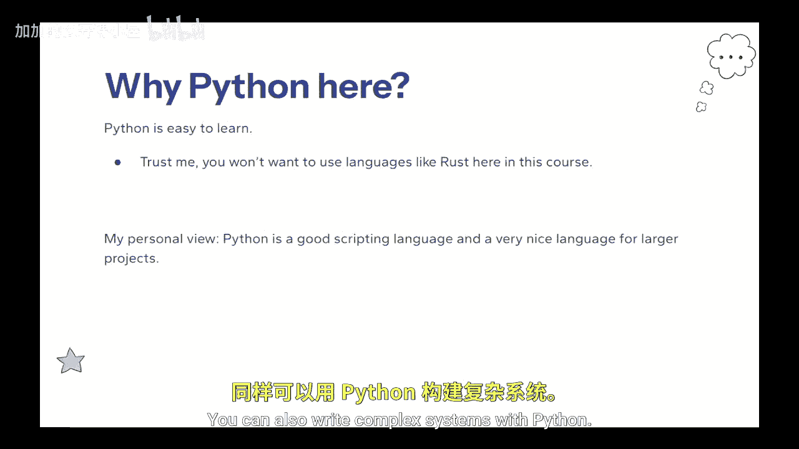

# 数据库系统：第11讲：使用Python连接PostgreSQL

在本节课中，我们将学习如何使用Python编程语言与PostgreSQL数据库进行交互。我们将从课程公告和路线图开始，然后快速回顾Python基础知识，最后重点介绍用于连接数据库的`psycopg2`模块。

## 课程公告

以下是本周的重要通知。

关于作业2，其详细说明将于本周晚些时候发布，截止日期待定。我们将确保大家有超过两周的时间来完成。助教和我仍在讨论使用哪个数据库，但这将是一个有趣的练习。本次作业旨在练习使用Python与PostgreSQL交互，因此需要使用Python完成。

请尽早开始作业并在论坛上尽早提问。因为在作业1截止日期的前一两天，我们收到了大量问题，无法很好地回答每一个。如果尽早提问，你的问题得到更好解答的机会更大。论坛上有助教和乐于助人的同学可以帮助你。

设置指南比问题发布得更早，请务必尽早尝试设置环境。因为在截止日期前几小时，我们收到了一些关于在VSCode上设置或连接数据库的问题，这非常糟糕。你无法在最后几小时内完成所有事情，因此请尽早设置。

关于作业的最后一点是，你应该使用私密帖子来发布代码。有些学生在论坛上询问代码中的错误或问题，但没有将其标记为私密，导致其他所有学生都能看到他们的代码，这很不好。如果你真的想与我们讨论你的代码，请尝试使用私密帖子。

关于测验，本周有测验4，截止日期是本周五，请按时完成。

关于帮助课程，周四的帮助课程与讲座时间重叠，将被调整到周四上午11点至下午1点。但正式调整的时间还需要等待确认。

## 课程路线图

现在，让我们看看接下来的课程路线图。

此前，我们已经学习了所有关于SQL的知识，包括如何编写查询、函数和触发器等。今天，我们将学习如何使用编程语言与数据库交互。

接下来，我们将学习更多关于数据库的理论知识。最后，我们还将学习数据库系统的事务和并发控制，这在多用户使用同一数据库时非常有用。

课程结束时，我们将讨论数据库的未来，进行课程回顾，并预览期末考试。我们可能还会邀请来自业界的客座讲师，分享他们在实践中如何使用数据库。

在第10周，我将外出参加会议，但会为大家提前准备好讲座视频。

## Python快速回顾

上一节我们介绍了课程安排，本节中我们来看看今天的主要内容。

如前所述，本课程将使用Python。希望这对你来说是一个回顾，希望你在此之前已经熟悉Python。Python是一种非常流行的编程语言，它易于学习和使用，并拥有广泛的实用库。如今，由于人工智能的流行，它尤其有用，因为有许多AI库都是用Python编写的。

在本课程中，我们假设你具备足够的Python基础知识。希望如此，因为本课程的主要主题是数据库，而不是Python编程。

如果你之前对Python不太熟悉，也无需担心。本课程中将有许多Python编码示例，并且网上有许多优秀的在线教程，例如learnpython.org，你可以快速学习。

## 为什么选择Python？

我们为什么要选择Python作为与数据库交互的编程语言呢？

第一个原因是Python是一种非常流行的编程语言。根据一份最新的排名，Python是最受欢迎的编程语言，其次是C/C++。这个排名是基于社区中程序员的评价，而不仅仅是统计GitHub上的代码量。C/C++排名稍高是因为它们对于构建操作系统等基础设施非常重要，例如PostgreSQL的实际代码就是用C编写的。但Python仍然是最重要的语言之一。你能在这个排名中找到SQL吗？是的，它在今年三月排名第七。我们在这里学习的是非常流行的编程语言，它们都非常有用。

第二个选择Python的原因是它相对容易学习。相信我，你不会想在这门课程中使用像Rust这样的语言。因此，Python可以说是这里最简单的选择。

对我来说，Python是一种优秀的脚本语言，也是构建大型系统的好语言。例如，你可以编写一些Shell脚本来进行实用程序操作，比如批量重命名文件或操作操作系统中的一些文件。但你不能用Shell脚本来编写大型服务器。你可以用C、C++或Java来编写Web服务器，但通常不会用它们来编写基本的实用程序。而Python则像是一个多面手，你可以用Python编写脚本，也可以用Python构建复杂的系统。有许多著名的框架就是用Python构建的，例如Django和Flask。

本节课中我们一起学习了课程公告、未来路线图，并回顾了Python的基础知识以及选择它作为数据库交互语言的原因。接下来，我们将深入探讨如何使用`psycopg2`模块具体连接和操作PostgreSQL数据库。