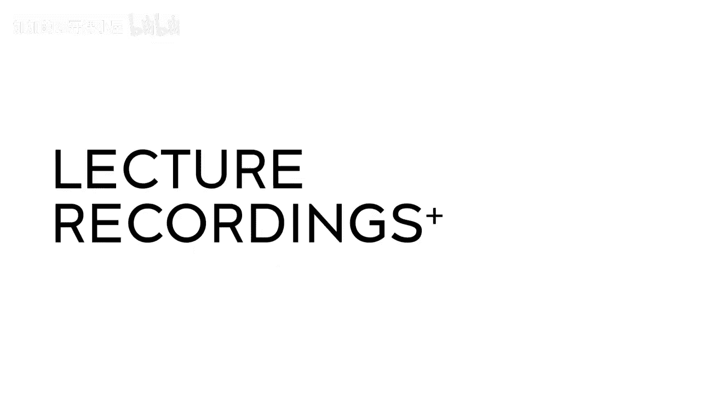
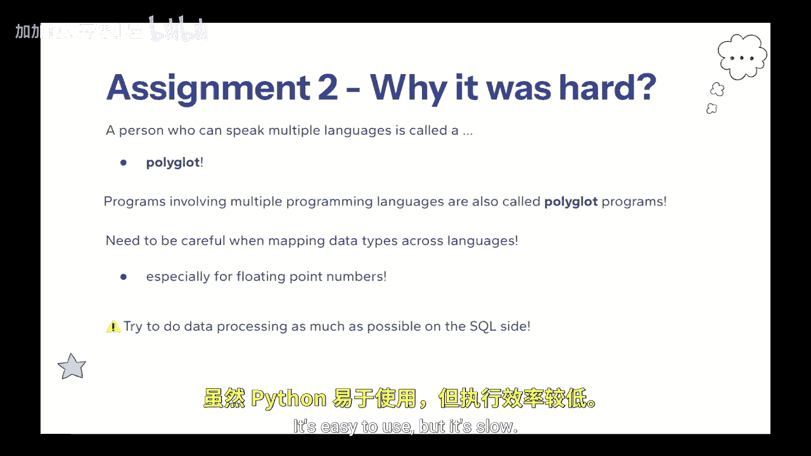

# 新南威尔士大学【中英⚡数据库系统｜COMP3311 2025 Database system】 p12 P12 Lecture 2 (Redundancy and functional dependency) -BV1dV4HzTE7p_p12-

。

， alright， let's start， so。Today， here is today's outline。 like before。

 we will go through some announcements first。And today， we are releasing the specific。

 not the specifications， but the setup guide for a sum tool。 And。

 and then we will have a quick recap of what we have learned on Monday。

 And then we will learn something about the relational design theory。So here。

 the first announcement is that。The specifications will be released later this week。

 and due date would be on Wednesday of week 10。And the purpose for this an assignment is for you to practice cycle P G2。

Actually。Actually， it is said to be pt the Python module。 but in the end。

 you are still writing SQL queries。 So it's essentially a practice for SQL queries。 And， of course。

 because it a Python module， you will be using Python for this assignment。

And you should do it earlier because you can， if you encounter any questions or problems。

 you can ask them earlier so they could be got so we don't。

 we don't need to rush to solve those problems。And the。

 and another reminder here is if you would like to post your assignment code。

 you should use private posts。And the second announcement isquiz for the deal it is。

This Friday tomorrow。 So you just try to do it。And。

And the third announcement is the Thursday session is to be shifted to 11 to 1 today on Thursday。

 but， but is not officially confirmed by the admin yet。So， however， our one of our tutors。

 he's willing to。Do double sessions。 So he's also there available for help from 11 to 1 on Thursdays。

So that's about the help session。And。Wait， my computer stocks。哦。And for a7， too。

Could you make a guess which database will we use here。

And this assignment was complain as being too hard the database we use。 We're gonna use。

But I think its an interesting database。 So let's use it again。

 And I will explain to you why it was complain as hard。 And the database is about Pomon。

 So it's a Pomon database。And。As you can see， this。This is the E R diagram of this Pokemon database。

 So you can see there are a lot of entities。 There are a lot of relations。

Is much more complex than the movie database。 But， but although it is the， the。

 the R diagram looks more complex。It's not hard to understand， because I know I。

 I believe you must be familiar with Pokemons， right， So no。Okay， okay， but， but they， they。

 they are quite intuitive and。And。😔，There are not many。

 there are not many very complex concepts here to be used。And that， this is about the。

 the relations between different entities。And here are all the attributes for each entity here。And。😔。

In total， we have 9 different types of entities。In this database。 and and the most the， the the。

 the entity with the， the， the most attributes is just the Pokemon。

And we could have some composite entities here as well。 For example。

 the I of the Pomon is a composite。Entity and the levels here is also a composite entity attribute。

So。😔，Here is， here are all the attributes。 This is also， this is available on Web cMS。

 You can view them at any time you like。收。We have released the schema and data dump and all the diagrams on Web cMS S where you can access via this link。

And what I would suggest to you is because we are not releasing the questions yet。

 the specifications yet。 What I would suggest to you is to set up the database earlier。 because for。

 for assignment 1， we were receiving setup problems on the last day of the of the assignment。

 So that's very bad。 So you you can't finish everything on the last day。

 So you what I suggest is since we have released the setup guide。 just set up the database earlier。

And。Another thing is we will you， we will we will provide you less questions than assignment 1。

 So basically， we will give you 4 or five questions for this assignment。

 So you don't need to worry that much。And as I just mentioned。It was this。

 this database was complained by the students else too hard。And it was not because of the。

The complexity of the ER diagrams of the entity relations。The。

 it was complain because of the another thing， because of the。how the questions were designed， so。

A person let's think about this case。 A person who can speak multiple languages is called what is called polygt。

 Yes， a polyglot。And。😔，And programs involving multiple programming languages are also called polygt programs。

And we need to be careful when we map data types across different programming languages。So。😔，Here。

 the program we create using the Python module psycho P G 2 is a polylo program is essentially a poly program。

 It involves both python code and SQL code。So there are data transfer transfer。

 there are data transferred between these two types of languages。And they could have mismatches。

 So we need to be careful。When we do data conversion across different languages。And。😔。

Its especially important for floating point numbers。Because in the。

 because you can either do the calculation on the personython side or on the。On the SQ。

 on the SQL side。And they will produce you floating point numbers， with different precisions。

And what， what we， what we did for last time was。Some students will do the calculation on the Pthon side。

 and some students will do the calculation on the SQL side。

 and they will generate different results because of the precision issues。 So that's why they， they。

 they they， they， they are essentially doing the correct thing。

 but they are generating different results。 and it's very hard to assess。

 So that's why it was complain。 And this year， we， we will avoid this issue。

 We will avoid the usage of floating point numbers in this assignment to。

 And I hope it won't be that hard this time。 for you。So that's all about 7，2。

 And another thing is talking about doing things on which side of the code。

You should for this assignment， you should try to do data processing as much as possible with SQL instead of Python。

 So some students， they would just use， you know， you， you can use the cursor to select。

Ftch all data from all the tables and do the data processing always p with python。

 So that would be very， very slow。Because。Postgres is highly optimd。

 and using Python is a slow language。 It's， it's easy to use， but it's slow。

 Its execution is very slow and it's an inter because it's un interpretive。

