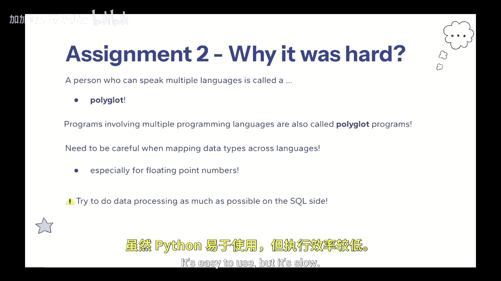

# COMP3311 数据库系统：第2讲：冗余与函数依赖

在本节课中，我们将学习关系数据库设计理论的核心概念，特别是冗余和函数依赖。我们将从课程公告开始，回顾上一讲的内容，然后深入探讨如何识别和消除数据冗余，并理解函数依赖在数据库设计中的关键作用。

## 课程公告

以下是本周的重要通知。

### 作业2发布

作业2的详细说明将于本周晚些时候发布，截止日期为第10周的星期三。本次作业的目的是练习使用Python模块`psycopg2`，但核心仍然是编写SQL查询。因此，这本质上是一次SQL查询的练习。由于涉及Python模块，你将使用Python来完成此作业。

建议尽早开始作业。如果遇到任何问题，可以及早提问，避免在截止日期前匆忙解决。

**提醒**：如果你需要在论坛上发布与作业代码相关的内容，请使用**私密帖子**。

### 测验安排

关于“事务”的测验将于本周五进行。请做好准备。

### 辅导课时间调整

周四的辅导课计划调整至周四上午11点至下午1点，但此安排尚未得到管理员的正式确认。不过，我们的一位助教愿意在此期间提供额外的辅导帮助。

### 关于作业2的数据库

本次作业将使用一个关于**宝可梦**的数据库。这个数据库在往年曾被学生反馈难度较高。

下图展示了该数据库的实体关系图：

如图所示，该数据库包含9种不同的实体类型，关系比之前的电影数据库更为复杂。但请放心，由于宝可梦的概念本身比较直观，理解这些实体和关系并不困难。其中，属性最多的实体是“宝可梦”本身，数据库中也包含一些复合实体和属性。

数据库的模式定义、数据转储文件以及所有图表均已发布在WebCMS上，你可以通过提供的链接随时访问。

**建议**：由于作业说明尚未发布，建议你**尽早设置好数据库环境**。在以往的作业1中，我们在截止日期前一天收到了许多环境设置问题，这非常不利于完成作业。因此，请提前按照发布的设置指南完成数据库搭建。

此外，本次作业的问题数量将少于作业1，大约只有4到5个问题，所以无需过度担忧。

### 关于作业难度的说明

往年学生反馈作业难，并非因为实体关系图的复杂性，而是源于**问题设计的方式**。

使用`psycopg2`编写的程序是一个**多语言程序**，它同时涉及Python代码和SQL代码。数据在这两种语言之间传递时，可能发生**数据类型不匹配**的问题，需要特别小心。

这一点在处理**浮点数**时尤为关键。因为计算可以在Python端进行，也可以在SQL端进行，两者可能产生不同精度的结果。去年，有些学生在Python端计算，有些则在SQL端计算，由于精度问题导致了不同的结果。虽然他们本质上都做了正确的事情，但结果却不同，这给评分带来了困难。

今年，我们将**避免在作业中使用浮点数**，以期解决这个问题。

**核心建议**：对于本次作业，你应尽可能使用**SQL**进行数据处理，而不是Python。有些学生倾向于用游标获取所有表的数据，然后在Python中进行全部处理，这种方法会非常慢。因为PostgreSQL是高度优化的，而Python作为一种解释型语言，执行速度相对较慢。

## 内容回顾

上一讲中，我们介绍了关系模型的基本概念，包括关系、元组、属性和键。

## 关系设计理论：冗余与函数依赖

现在，让我们进入今天的核心主题：关系设计理论。一个糟糕的数据库设计会导致各种问题，其中最常见的问题之一就是**数据冗余**。

### 什么是数据冗余？

数据冗余指的是**相同的信息在数据库的多个地方重复存储**。

例如，考虑一个存储学生和课程信息的简单表 `Enrolment`：

| StudentID | StudentName | CourseCode | CourseName |
| :--- | :--- | :--- | :--- |
| 123 | Alice | COMP3311 | Database Systems |
| 123 | Alice | COMP1521 | Computer Systems Fundamentals |
| 456 | Bob | COMP3311 | Database Systems |

在这个表中，“Alice”的名字和“COMP3311”的课程名都被存储了多次。这就是冗余。

### 冗余会导致什么问题？

冗余主要会引发三个问题：
1.  **更新异常**：如果“Database Systems”这门课改名了，我们需要更新所有相关的行（第1行和第3行）。如果漏掉一行，数据就会不一致。
2.  **插入异常**：如果我们想新增一门课程“COMP9999”，但还没有任何学生选修，我们就无法插入这条课程记录，因为`StudentID`是主键的一部分，不能为空。
3.  **删除异常**：如果学生Bob（ID 456）退选了COMP3311，当我们删除第3行时，关于“Database Systems”这门课程的信息也会随之丢失。

### 如何解决冗余？——引入函数依赖

为了解决冗余，我们需要理解数据之间的内在联系，这可以通过**函数依赖**来描述。

一个函数依赖表示一个属性集的值**唯一决定**另一个属性集的值。

其公式表示为：
**X → Y**
读作“X函数决定Y”或“Y函数依赖于X”。意思是，对于任意两个元组，如果它们在属性集X上的值相等，那么它们在属性集Y上的值也**必须**相等。

在上面的例子中，我们可以观察到：
*   `CourseCode → CourseName`：课程代码唯一决定了课程名称。
*   `StudentID → StudentName`：学号唯一决定了学生姓名。

然而，`StudentID`并不能决定`CourseCode`，因为一个学生可以选修多门课。

### 识别函数依赖

函数依赖不是由DBMS强制规定的，而是基于**现实世界的语义**。作为数据库设计者，你需要根据业务规则来识别它们。

例如：
*   在一个公司里，`员工ID → 部门`。
*   在一个产品库里，`产品编号 → 价格`。
*   在一个订单系统里，`(订单号，产品编号) → 数量`。这里，数量依赖于订单和产品的组合。

### 函数依赖与键的关系

**超键**：是一个或多个属性的集合，可以唯一标识一个关系中的元组。
**候选键**：是最小超键（即没有多余属性）。
**主键**：是被选中的候选键。

从函数依赖的角度看：
*   如果 **K → R**（即K函数决定所有其他属性），那么K是一个**超键**。
*   如果 **K → R**，并且K的任何真子集都不能函数决定R，那么K是一个**候选键**。

因此，寻找键的过程就是寻找能够函数决定所有属性的最小属性集。

## 总结

本节课我们一起学习了数据库设计中的关键问题——**数据冗余**及其引发的更新、插入和删除异常。为了解决这些问题，我们引入了**函数依赖**的概念，它描述了属性之间的决定关系。理解函数依赖是进行数据库规范化（我们将在后续课程中学习）的基础，它能帮助我们设计出更高效、更少冗余的数据库结构。

下一讲中，我们将基于函数依赖，学习如何通过规范化过程来分解表，从而消除冗余和异常。

