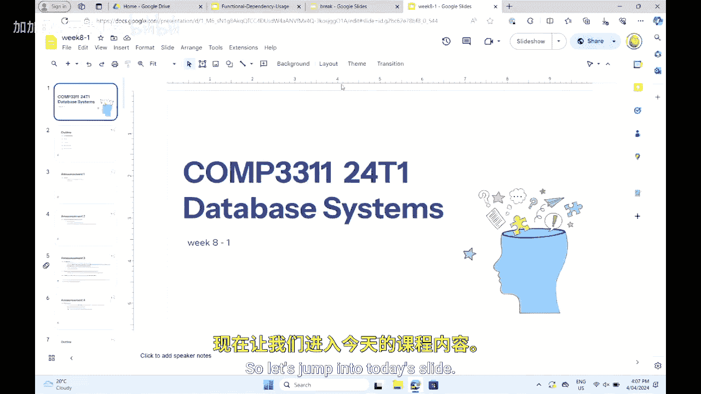
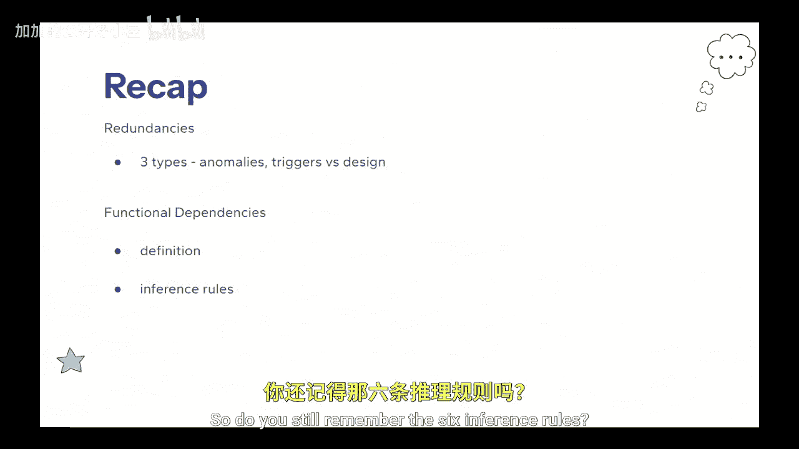

# 新南威尔士大学【中英⚡数据库系统｜COMP3311 2025 Database system】 p13 P13 Lecture 1 (Closures, Normal Forms, and Normalisation) -BV1dV4HzTE7p_p13-

。

呃。Very simple mistakes on syntax。You， and， and you don't worry about that。 We can you， use。

 you can still get partial marks because because we are。

 the tutors are manually marking your assignment。 so you don't worry about that。

And but please make sure that you， you can pass the auto test to eliminate those syntax errors。And。

alright， let's start。 So before we jump into the main content today。

 let me quickly go through the the additional slides I have provided。 because in La。

 in our last lecture， we have。We have learned about the functional。Depenencies。

 and some students may wonder， okay， what is the usage of functional dependency， Why it is important。

And actually， it， it could be used for it could be used in a lot of scenarios in DBM S in the design of the database。

 However， there are three key points here。 The first one is， it is very useful to determine keys。

Because it can。It can help us to generate。W which our attributes could determine the value of other attributes。

And this is quite natural for key。And the second one is it can help us to normalise the database and to reduce。

 to reduce or remove redundancy。 And I have shown an example in this in the slides here。 A A very。

 a very basic example here to show you how it could be used to remove redundancy。

And the last one is it is very useful for， for， for creating integrity constraints。And。And。And。

 and this is just a quick example of how it could be used。 And it's just a summary。

 And we will be learning how to systematically use。Functional dependencies today。 So that's。

So this is， this additional slide is like a bridging。

 It's like a bridge between our previous slide about functional pro dependencies and today's content。

So let's jump into today's。

Slide。So first， so this is today's outline。 We will go through some announcements。

 We will have a quick recap of what we have learned。In our last lecture。

 and we will learn three important concepts， closures， normal forms and normalization。

And the first announcement is about quiz 5。 The deal date is on this Friday tomorrow。

 So please just do it。the second one is about the provisional marks for assignment1。

 It is available now。 and please let us know if there's any issues like you have make made some syntax errors。

 You have you you， you think you have maybe your， your your queries are have failed to be loaded into the database。

 those will give you zero marks for for auto tests。 But。

 but we do have a second round of manual checking for your assignment。

 So you can still get partial marks。 and but please let us know if there's any issues with your provisional mark now。

And。The third announcement is about assignment 2， and we are still working on it。 And I'm trying。

 I'm pushing Dlan for。Creating the specifications now and， but。

 but he's kind of busy with the marking of assignment 1。

 but we will release and the the expected due date is week Friday now。

 and we will release the official notice through Web c m。And， but we。

 we may need to further de def it if we cant finish the， the， the， the current tasks on our hand。And。

And there are two other things you need to。Any need to take care of。 So first。

 if you have some special considerations。Requests you should submit to the portal earlier because I。

 I just received some approvals from the school for a assignment  one yesterday， so。

So to avoid getting late penalties， if you have special considerations， you should submit your。

Requests earlier。 and because it takes time for the admin to， to approve your requests。

 And the second one is for ELP extension request， you can directly send us emails。

And it should be sent 24 hours before the due date。

And that's about the special considerations and ELP students。

And you don't worry because we are kind of releasing assignment 2 a bit late， but you don't worry。

 you don't need to worry about your final exam preparation getting affected by assignment 2， because。

It will have much， less a much fewer questions。 It won't take you too long to finish。So。

 that's about。Assignment 2。And the， the th， first announcement is that for the。

Help session conflicting with today's lecture。It is finally officially shifted to the morning session。

 But next week。 But that's our last physical lecture because I will be attending a conference on week 10。

 So that session， that help session is help， is hosted by Kens。 and hes a very helpful。

 nice and experienced tutor。 So if you have any questions with your assignments with your tutorials with whatever。

Questions， you can come to the help session and。And our tutor is ready to help you。

So that's about announcement 4。And we can。Come to。The knowledge learning part。

So let's have a quick recap of what we have learned。In our last lecture。

 So the first concept we have learned is。redundancy of database。So， redundancies， so。If。

 if the database is not well designed， we could suffer from redundancies。

 and redundancies could cause different types of anno anomalies。

 And there are three types of an anomalies。 So can you quickly think about them。

 So what are the three types of anomalies。Update。Insert， and。Deleelete， yes， yes。And。And we have。

 we do have some measurements to。To counter this kind of an anomalies to deal with them。

 So the first one is we can insert a lot of triggers。But that is not ideal， because。

If we insert too many triggers into the database， it will slow down the execution of the entire system。

 So that's why we don't want to use t triggers to solve to resolve these anomalies。And instead。

 we want to。Remove the redundancies from the design of the database。 So we， we it。

 it is more like a pro proactive way of dealing with these redundancies。

And the second key concept we have learned in our last lecture is functional dependencies。

So can you still remember the definition of。functionunctional dependency。Yes， yes， yes。 So it。

 it is like， it is like one。 it's not one attribute。

 It's a set of attributes can determine another set of attributes。 So if the value of。

A set of attributes is settled or is fixed。 Then the， the， the rest， the， the other， the deter， the。

 the depend， the determined。Set of attributes。Is also fixed。So let's say if I， if X determines。

 determines y or y is dependent on x， then if X is fixed， Y is also determined。

 So that's the definition here。And。We have also learned6 inference rules to de derive new。

functional dependencies based on existing ones。 So do you still remember the six inference rules。

