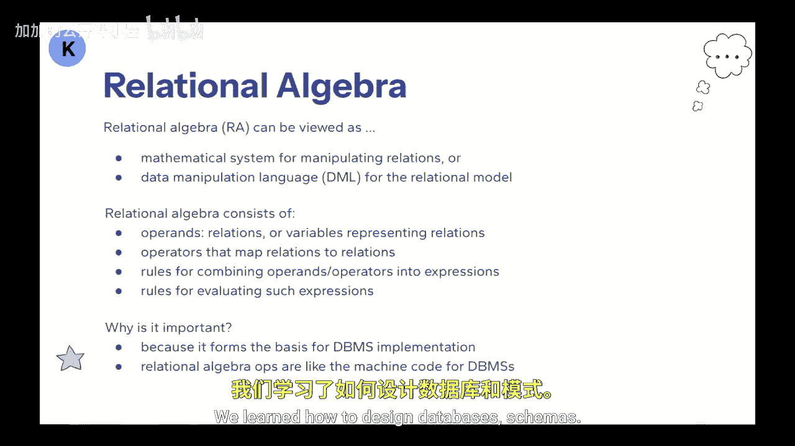

# 新南威尔士大学【中英⚡数据库系统｜COMP3311 2025 Database system】 p14 P14 Lecture 1 (Relational Algebra & Query Execution) -BV1dV4HzTE7p_p14-

。

Alright， let's start。So in， so this is the outline for today's lecture。 So first。

 we will go through some announcements。 And then let's have a quick recap and show you。

 I'll show you the roadmap for the next， for this week and next week。And after that。

 we will learn two important topics， relational algebra and query execution。

So the first announcement is that we don't have any quiz T this week。However。

 you will have your quiz 6 due by next Friday。And that is your last quiz。

And as for the scores of the quiz， you， you are doing pretty well so far。

 And the average score is a little bit higher than previous terms。For the。

 the second announcement is about assignment 2。 So we have released the specifications for the first two questions and。

We are finalizing the last three of them。 and the due date is by。the Friday， next week。And。

And you should submit your special considerations early as early as possible。

 And you should submit your ELP extension request。24 hours before the due date。And that's。

 and that's all about the announcements。 Let's have a quick recap， and。Have a look at the road mapap。

So in， in our last lecture， we have learned。The actual usage of functional dependencies。

And we have learned several important concepts。The first one is closure。

So can you still remember the definition of closures。So what is the definition here for closure。

Given a set of functional dependencies。What is。The closure for this set of functional dependencies。

Is the set of functional dependencies that could be derived based on this。

Set of functional dependencies。 So that is the definition of closure。However， the。

 the closure for functional dependencies is also is often very， very large。

 and it is impractical to be used。For many algorithms。

 So instead of using functional dependency closures， we use attribute closures。And。

And do you remember how to calculate the attribute closure。

You don't need to worry if you can't remember the exact algorithm because I will show you our plan next to help you to memorize all these concepts。

And the usage of closure is often related to determining keys。

Because the closure for keys can cover the entire the， the all the attributes of a relation。

 So that's the usage of closures。And another concept related to closure is minimum cover。It is。😔。

The smallest。Complete set of。Is the smallest complete set of edge。放射 no dependencies。

So that's the definition of minimum cover。And the second key concept we learned in our last lecture is called normal forms。

So the most commonly used normal forms are the third normal form and the PCNF。

So do you remember which one is。呃 has less redundancies。Which one will produce us less redundancy。

BCNF， actually。And， and I hope you can remember the restrictions of these two restrictions or number forms。

 So this is， this is actually the。The restriction for the functional dependencies required by BNF。

And these， these are the restrictions required by the third N F。 As you can see。

 it has one more allowed pattern here。 So， so third N F is a little bit less strict。Than B cN F。

 So it allows more redundancy。And talking about normal forms。

 We have learned the process of normalization。And we have learned some algorithms for calculating third N F or B E。

 N F。So。😔，You don't have to recite。 You don't have to recite the algorithm。

 but you have to understand how it works。So for third， N F。

The algorithm starts with building a reduced minimum cover of the functional dependencies。

And starting with the minimum cover， we gradually include。Tables into our collection。

Skima into our database schema。So that's the algorithm for third and life。For B and F。

 the algorithm is to。Check to go through all the functional dependencies one by one and try to identify we whichever functional dependency that will violate the restrictions of B and F。

 And then with separate tables， according to the functional dependencies that could violate。

The restrictions here。 So that's the algorithm of PC and F。So。So our plan here is like this。

 So instead of getting you overwhelmed by those algorithms， because there are several details。

 and it is。It is quite lengthy。 So， so you don't need to worry about reciting those algorithms。

 What we will do now is our plan is。 I will guide you through all the。

 I will give you all the concepts and all the knowledge。As fast as possible。

 And then I will provide you more。Practical examples about those algorithms。Yeah， yeah。

 we're following up lectures。 So today。We are going to learn relational algebra plus query execution。

And on Thursday。We will learn performance， tuning， transactions， serializability。And。😔。

More examples on the theoretical concept。I don't want you to recite those algorithms Instead。

 I wish you could understand them， so。So I will try to spare some time。

To go through more examples for those algorithms for you to understand how they work。So。😔。

In the next week， I will， I will be out for a conference and。

 but I will provide you a summary of the entire course with a video and some slides。

So that's our road map。 And now let's jump into the main content today。

So the first topic we are going to learn today is relational algebra。

So relational algebrabra can be viewed as the mathematical system for manipulating relations。

Or its like the data manipulation language for the relational models。So in relational algebra。

 it consists of opera。Operator。And rules of combining opera and operators into expressions and rules for evaluating these expressions。

So why it is important for us to learn。Relationational algebra。

Its because it forms the basis of the D， the DBI S implementation， so。In our previous lectures。

 what we have learned is from the user's point of view。 We learn how to design databases， schemas。

 We learn how to。

We learn how to use。