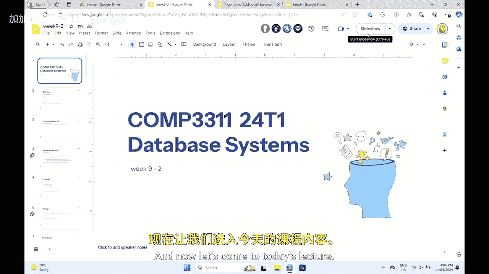
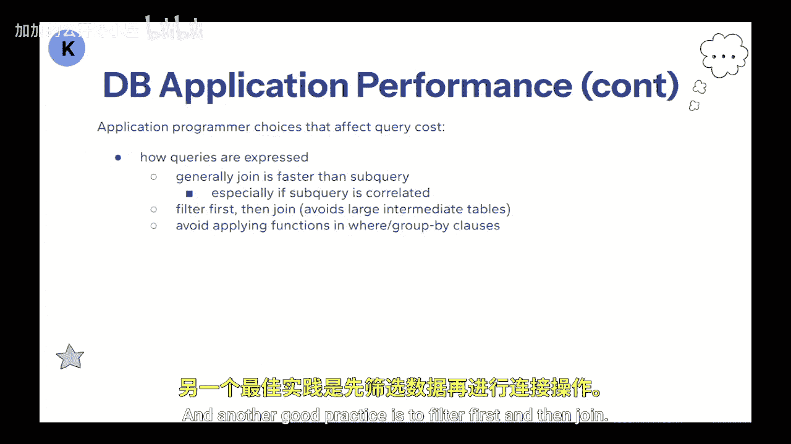

# 新南威尔士大学【中英⚡数据库系统｜COMP3311 2025 Database system】 p15 P15 Lecture 2 (Performance Tuning & Transactions & Serializability) -BV1dV4HzTE7p_p15-

。

Alright， let's start。 So first， I， actually， I created some extra exercises for you to practice the algorithms we。

Are learning for the theoretical topics。 for example， how to check。

 how to convert tables into normal forms。Or how to check the serializibility of transaction schedules。

 which we， which will be learned today。 So I will keep updating this exercise and please stay updated and。

If you want， if you want more exercises， because。Because the， the。

 the original algorithm in the slides in in our lecture slides is made up of pseudo code and some mathematical symbols。

And I think it could be hard for some of you to。Understand。 So instead of reciting those algorithms。

 you should comprehend them and you should understand how they work。

 So that's why I decided to create more step by step exercises for you to really understand them。

And that's the first thing。Now， let's come to today's lecture。

So this is our outline today。 So we will go through some announcements。 and let's have a。

 and we will have a quick recap of what we have learned。In our last lecture。

And then we will learn three topics today。The first one is following our previous lecture about how to do performance tuning。

And the second one is about transactions。 And the the last one is about this serializability of transaction schedules。

So the first announcement is that there's no quiz this week。 but next week， you have quiz。

 the last quiz。And the second announcement is about assignment 2。For assignment 2。

 we have released three questions for now and。And we have decided to reduce the scope。 So in the end。

 you will have four questions in total to practice with。

And we will extend the due date by three days。So it's the Monday of week 11。And although the。

 we are not releasing the questions out at once， you are actually given a lot of time F per。

Poer question on average。 So I hope you can really。Work on them well。And as I said。

 you should submit this if you have special considerations。

 you should submit them to the portal earlier。And you should submit your E LP extension request 24 hours before the due date。

And now let's come to the re recap。So in our last lecture， we learned about。Relational algebra。

And do you still remember the definition of relational algebra。So what is that。Its it could。

 It could。 iss actually the formal form of the database operations。 And it is actually。

 it could be think of as what is exactly executed by the DBMS S。

So that's the definition or the concept of relational algebra。

 And we learned several operations for relational algebra。 We learned rename。We learned selection。

And we learned projection。 So do you know， can you still remember the difference between selection and projection。

Selection is used to select what to extract， what kind of information。Yes。Yes， yes。 Actually。

 projection。 although the name of selection sounds like select in SQL queries， it is not used。

 It is not used the same as in SQL。 It's used only to extract information from topples。

 and projection is used to extract column values or the attributes。

And we have also learned some site operators。Used for relational algebra。

 And they are essentially the same as。SQL the mechanism。

 And we also learned several product and drawings。For。😔，Relational algebra。And。

 and the second topic we learned in our last lecture is about query execution。So for query execution。

 we learned that there could be a mapping between SQL and relational algebra。So。

You should be able to do this mapping。And， and we also learned that D BM S will use。

This execution plan of relational algebra operations to estimate the cost of a particular query。So。

 that's what we learned。And。😔，And in in next and in next week。

 we will have a summary of the entire course。 So this course， today's lecture is。

The last lecture that we will be， to， to learn new knowledge。So。That's all about the reup。

And now let's learn something new。 The first topic today is。performance tuning。

 So in our last lecture， we ended at the point where we know that。

Data D BM S view can estimate the cost of queries using the execution plan made up of operations of relational algebra。

 And， but from the developer point of view， how can we utilize this information to optimize our queries。

 So that's the question。 And this is what we are going to learn here。So。😔。

In order to make the D B applications efficient to optimize the efficiency to the execution time。

It is useful to know。What operations on the data that the application require。 So it's。

 it's useful to know what kind of operations we need。And the second one is。

Because there are different， different alternatives for implementing the same mechanism of。

Data retrieval。We need to。 We need to know how much。Each。😔，Implementation will cost。And then。

As a developer， we should encourage the DBM S to use the most efficient methods。

 We cannot directly manipulate how these D BM S work。

 but we can somehow encourage it to work in an efficient way。

And this could be achieved by using indexes， and avoiding some。badad practices。 So that's。

What we are going to。 That's how we boost the performance。

And the choices of application programmers could affect query costs。

And the first one is how the queries are expressed could affect the performance。

Of the query could affect the execution time。And。😔，Here are some general tips。 So generally。

 drawing is faster than sub query。 So this is generally drawings is faster。Especially if subqueries。

Are correlated。So， correlated sub Korean means。Means that the sub query， inside the sub query。

 we are referring to the variables of the parent query。So this is called correlated sub query。

 So if we correlated sub query could be very slow， and we will show you some examples later。And。

And another good practice is to filter first。