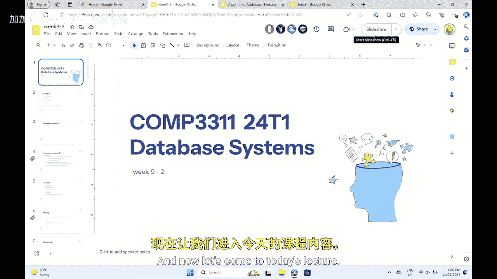
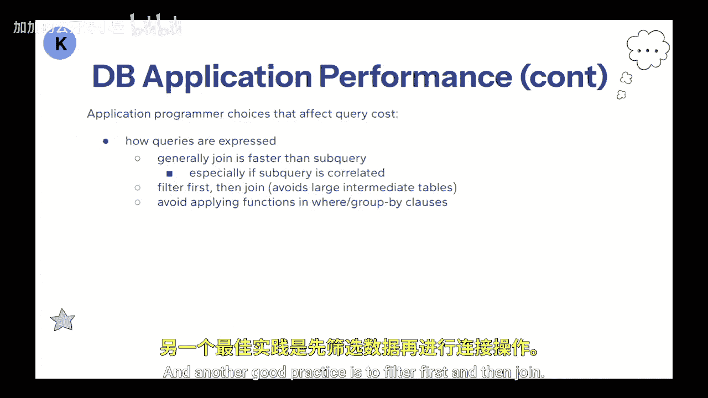

# 数据库系统：第2讲：性能调优、事务与可串行化 📊

在本节课中，我们将学习数据库性能调优的基本方法、事务的核心概念，以及如何判断事务调度是否可串行化。课程内容将包含具体算法和实践技巧，旨在帮助初学者理解和应用这些关键知识。

---

## 课程公告与回顾 📢

首先，我们来看一些课程相关的公告。本周没有测验，但下周将进行本课程的最后一次测验。关于作业2，目前已发布三道题目，最终将共有四道题目供大家练习。作业提交截止日期已延长三天，至第11周的星期一。请注意，如有特殊情况需要延期，请提前通过相应渠道提交申请。

上一讲我们学习了关系代数。关系代数是数据库操作的形式化表示，可以理解为数据库管理系统（DBMS）实际执行的操作。我们学习了重命名、选择、投影等基本操作，以及并集、交集、差集等集合运算符。此外，我们还了解了SQL查询如何映射到关系代数操作，以及DBMS如何利用由关系代数操作构成的执行计划来估算查询成本。

---

## 性能调优 ⚡

上一讲我们了解到，DBMS可以通过关系代数操作组成的执行计划来估算查询成本。那么，从开发者的角度，我们如何利用这些信息来优化查询性能呢？本节我们将探讨这个问题。

为了提高数据库应用的执行效率，了解应用所需的数据操作类型非常有用。同时，由于实现相同数据检索机制可能存在多种不同方案，我们需要了解每种实现的成本。作为开发者，我们应鼓励DBMS使用最高效的方法。虽然无法直接操控DBMS的工作方式，但我们可以通过使用索引和避免一些不良实践来引导其高效运行。

应用程序员的选择会影响查询成本。首先，查询语句的编写方式会影响其执行性能。

以下是一些通用建议。通常，使用连接（JOIN）比使用子查询更快，尤其是在子查询是相关子查询的情况下。相关子查询是指子查询内部引用了外部查询的变量，这种查询可能非常慢，稍后我们会举例说明。

另一个良好的实践是**先进行过滤**。这意味着应尽早应用筛选条件，以减少后续操作需要处理的数据量。

---

## 总结 📝

本节课我们一起学习了数据库性能调优的基本思路，包括理解操作成本、优化查询编写（如优先使用连接而非相关子查询）以及先过滤原则。我们还回顾了关系代数，并了解了课程相关的公告。掌握这些知识有助于你编写出更高效的数据库查询。