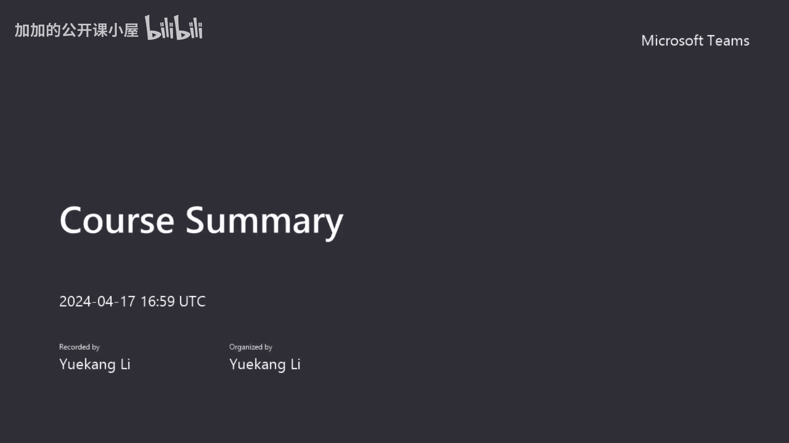
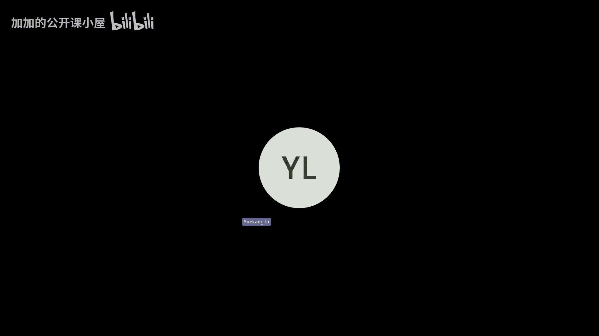
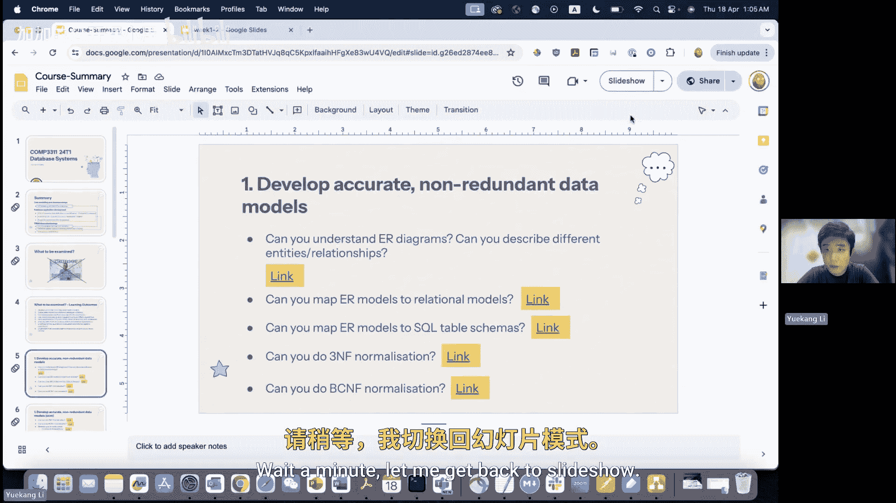

# 新南威尔士大学【中英⚡数据库系统｜COMP3311 2025 Database system】 p16 P16 Lecture 1 (Course Summary) -BV1dV4HzTE7p_p16-

。

Hi， class， welcome to the welcome to the last lecture of Comp 3，1，1 in this term。

 And in this lecture， we we are going to cover。 We are going to have a summary of the entire course。

And in general， we have learned three topics in this course。The first topic is。

Data modeling and database design。In this topic， we basically learn E R modeling。

 relational modeling。And we also learned how should how could we map E R models to relational models and to S QL table schemas。

The second key topic we learned in this course is about database application development。

And it covers several sub topics。For example， we have learned。SQ L for querying。

 we have learned data definition and modification through SQ L。

 And there are many different implementations of SQ L， and we are using。

 we are learning Postgs because it is an open source。Implementation。

 and it has a lot of powerful extensions。And talking about extensions。

 we also learned how could we extend SQL queries。 For example， we can use functions。

 We can use every custom defined。aggregates， we can also extend SQL with triggers。And in particular。

 we we learned P L， P G SQL， which is called procedral SQL。

And we also learned a Python module called psycho P G2 and how to use Python programs to interact with Postgre databases。

Lastly， in this course， we also learned some D B M S theories and techniques。

The first subtopic here is about functional dependencies and normalizations。

We also learned relational algebra， query， processing and performance tuning。Lastly。

 we also learned about transactions。And theizability of concurrent transaction schedules。

We learn this series because they are actually helpful for the database design and for app development。

 for example， for functional dependencies and normalization。

 it could help us to remove redundancies in the database design。

So this is why we learned this theory。For by understanding the relational algebra and how the queries are actually processed by the D BMS S。

We can actually， we can actually optimize our queries so this could help us in database application development。

 And that's why we need to learn this。Serious。So that's the overall road mapap of this course。

 And that's the key topics we have learned in this course。

And I believe you must be more interested in what will be。Examined in the final exam。

 So what will be included in the final exam。So。So you may， sometimes you may joke about this。

 So what you have learned in class is much more simpler than a much more different from the exams。

 What will be examined。 So that's。We don't hope that we we don't want this to happen here in this course。

And instead。In order to understand what you will be。

 what might be examined or what might be included in the final exam。We should understand what is。

 what are the learning outcomes of this course。And you。

And we will go through the the the content of the entire course。

Ting through via these learning outcomes。And you will。And， and the exams are actually to。

And the exam is actually not to place a hurdle for your university life。 It is actually used。

To test if you have achieved the learning outcome， If you have acquired the skills and knowledge we wish you could learn from this course。

So， so the let's try to， let's have a， let's try to have a review of the course content。

According to the learning outcomes。So we have 8 learning outcomes in total。

The first one is about developing accurate and non redundant data models。So the keyword here。

 you can see， is data model。 So there here are some questions。Can you understand your diagrams。

Can you describe different entities or relationships。In an e diagram。If not， if not。

 you can click on this link and it will lead you to the relevant slide like this。

So you should wait a moment。 this will， these links will point you to the exact slide。

Currenting the topic。So you can， you can。 this is how you should make use of these slides here。

And wait a minute。 Let me get back to slideshow。

And。The second question here is。Can you map your models to relational models。

 So do you still remember the mapping of different entities， different relationships。If not。

You should go through the link here。So the third question here is。

 can you map E R models to SQl table schemas。So here's the link。And。

Data model is the key subject here， and we want our data models to be accurate and nonreundant。

 Therefore， we need to do some normalization。And the question here is。

Can you do the third normal form， normalization。Sa， so if you can， remember how to do it。

You can click on this link and it will guide it will lead you to the relevant slides。

And the last question here is， can you do PC and F normalization。Similarly。

 you have a link here and the reason of learning third NF normalization and B C NF。

Nmalization is that they are the most commonly used。Normal forms in practice。So in order to。

 in order to do these normalizations， you will need to know or understand some other key concepts。

So for example， you will need to know what are functional dependencies。

So if you don't remember what are functional dependencies。

 you should click this link and go through the previous slides。

You should also know what are the inference rules。For different functional dependencies。

And another important concept here is closure。And a very important concept related to closure and calculation of third。

 third normal form is the minimum cover。And， and of course， if you want to do normalization。

 you need to know the concepts of normal forms and heres。The link。Our second learning outcome is。

Realize data models as relational database schemas。Actually， this is covered in learning outcome 1。

 So it's basically， how can we， how can we design E， R models and how can we map E R models。

Into relational schemas。And。How to map E R models into SQL schemas is especially important here。

 because。Eventually， we want e smas in practice。The third learning outcome is。To formulate queries。

