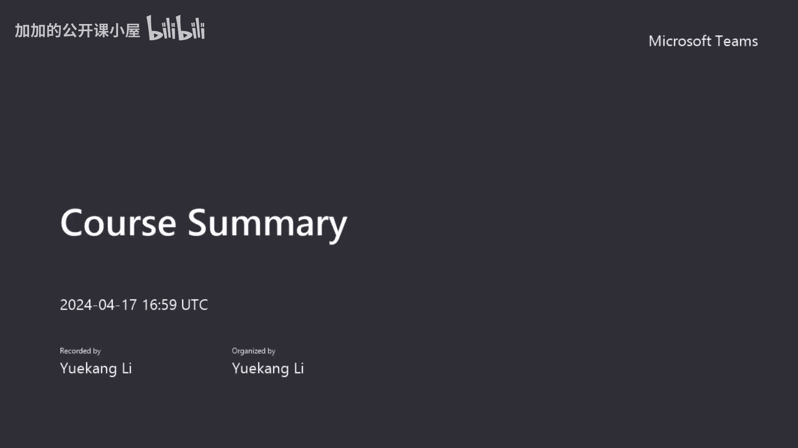
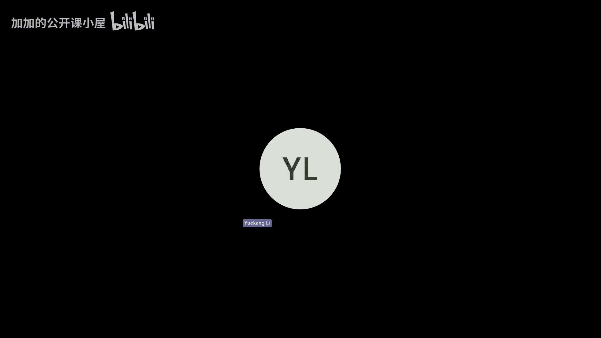
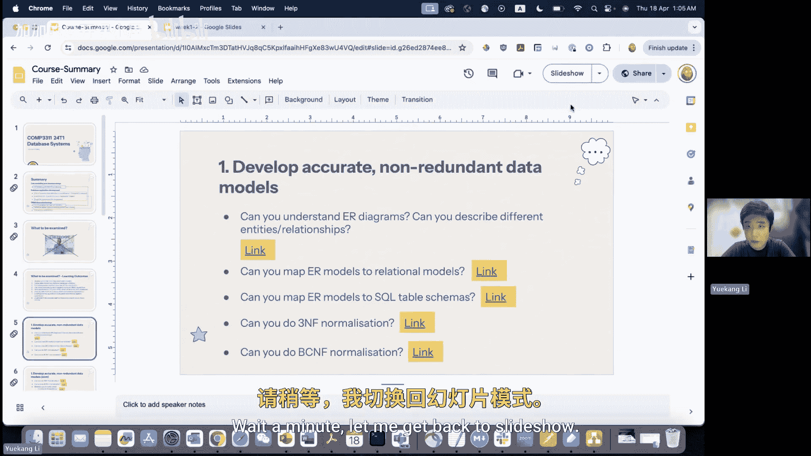

# 数据库系统：16：课程总结 📚

在本节课中，我们将对COMP3311数据库系统课程的全部内容进行回顾与总结。我们将梳理本学期所学的核心主题，并对照课程的学习成果，帮助你为期末考试做好准备。

---

## 课程概览

在本课程中，我们主要学习了三大主题。

上一节我们介绍了课程的整体框架，本节中我们来看看第一个核心主题。

### 数据建模与数据库设计

在这个主题中，我们主要学习了：
*   **ER建模**：学习如何使用实体-关系图来概念化地描述现实世界的数据结构。
*   **关系建模**：理解如何将ER模型转换为形式化的关系模型。
*   **模型映射**：掌握如何将ER模型和关系模型最终映射为具体的SQL表结构。

---

### 数据库应用开发

在掌握了数据建模的基础后，我们进入了应用开发环节。以下是本主题涵盖的关键子领域：

*   **SQL查询**：学习使用SQL语言从数据库中检索数据。
*   **数据定义与修改**：学习使用SQL创建、修改数据库结构（如表、索引）以及更新数据。
*   **PostgreSQL**：我们使用开源的PostgreSQL作为实践平台，因为它功能强大且支持丰富的扩展。
*   **扩展SQL**：学习如何通过自定义函数、聚合函数和触发器来增强SQL的功能。
*   **过程化SQL**：学习使用PL/pgSQL编写存储过程和函数。
*   **Python交互**：学习使用`psycopg2`模块编写Python程序来连接和操作PostgreSQL数据库。

---

### 数据库管理系统理论与技术

为了设计出更优的数据库并开发出高效的应用，我们需要理解DBMS背后的原理。以下是相关的理论和技术：

*   **函数依赖与规范化**：学习如何识别数据中的冗余，并通过规范化理论（如第三范式3NF、BCNF）来设计出结构良好的数据库模式。
*   **关系代数与查询处理**：理解DBMS内部如何将SQL查询转换为关系代数操作并执行，这有助于我们进行查询优化。
*   **事务与可串行化**：学习数据库事务的概念，以及如何保证并发执行的事务调度是正确的（即可串行化的）。

这些理论直接服务于前两个主题。例如，规范化能帮助我们设计出无冗余的数据库；理解查询处理过程则能指导我们编写出性能更优的SQL语句。

---

## 学习成果与考试关联

我相信你们更关心期末考试会考什么。考试的目的并非设置障碍，而是检验你是否达到了课程预设的学习成果。因此，理解学习成果是备考的关键。

本课程共有8项学习成果，我们将逐一回顾。

---

### 学习成果1：开发准确且无冗余的数据模型

此成果的核心是**数据模型**。你可以通过以下问题自测：

*   **你能理解ER图吗？** 你能描述ER图中的不同实体和关系吗？如果不确定，请回顾相关课件。
*   **你能将ER模型映射到关系模型吗？** 还记得不同实体和关系的映射规则吗？如果不确定，请回顾相关课件。
*   **你能将ER模型映射为SQL表模式吗？** 这是将设计付诸实践的关键步骤。相关链接可提供帮助。
*   **你能进行第三范式（3NF）规范化吗？** 这是实践中最常用的范式之一。相关链接可提供帮助。
*   **你能进行BCNF规范化吗？** 这是另一个重要的范式。相关链接可提供帮助。

为了实现规范化，你需要掌握以下核心概念：
*   **函数依赖**：理解其定义和作用。
*   **推理规则**：掌握从已知函数依赖推导新依赖的规则。
*   **闭包**：计算属性集在函数依赖下的闭包。
*   **最小覆盖**：这是计算3NF分解的关键步骤。
*   **范式**：理解各范式的定义和目标。

---

### 学习成果2：将数据模型实现为关系数据库模式

这项成果已基本涵盖在学习成果1中，重点是**如何将ER模型映射为具体的SQL模式**，因为最终我们需要在数据库中实际创建这些结构。

---

### 学习成果3：构建查询

这项成果要求你能够针对给定的数据库模式，编写SQL查询来回答各种问题。这涵盖了从简单的单表查询到复杂的多表连接、子查询和聚合操作。

---

### 学习成果4：使用SQL定义和修改数据

这项成果要求你不仅会查询，还要会使用SQL来创建和修改数据库本身。这包括：
*   使用`CREATE`, `ALTER`, `DROP`语句定义表、视图、索引等。
*   使用`INSERT`, `UPDATE`, `DELETE`语句修改表中的数据。

---

### 学习成果5：使用高级数据库特性

这项成果要求你能够利用现代DBMS的高级功能来构建更强大的应用。包括：
*   **约束**：使用主键、外键、唯一约束、检查约束来保证数据完整性。
*   **视图**：创建虚拟表来简化复杂查询或隐藏数据细节。
*   **触发器**：在特定数据操作（增、删、改）发生时自动执行预定义的操作。
*   **事务**：将一系列操作作为一个原子单元来执行，保证ACID特性。
*   **存储过程/函数**：使用PL/pgSQL在数据库服务器端封装复杂的业务逻辑。

---

### 学习成果6：通过Python程序与数据库交互

这项成果要求你能够编写Python应用程序，使用`psycopg2`等库连接数据库、执行SQL语句并处理返回的结果，从而构建完整的数据库应用。

---

### 学习成果7：解释查询处理与优化概念

这项成果关注DBMS内部原理。你需要能够：
*   将SQL语句翻译成等价的关系代数表达式。
*   理解查询执行计划的基本概念。
*   解释索引如何提高查询性能。
*   识别可能导致性能低下的查询模式，并提出优化建议。

---

### 学习成果8：分析事务调度

这项成果要求你理解数据库并发控制。你需要能够：
*   判断一个给定的事务调度是否是**可串行化**的。
*   理解锁机制等并发控制技术的基本思想。

---

## 总结

本节课中，我们一起回顾了COMP3311数据库系统课程的完整知识体系。我们从**数据建模与设计**出发，学习了**数据库应用开发**所需的SQL及编程技能，并深入探讨了支撑这些实践的**DBMS核心理论**（函数依赖、规范化、查询处理、事务）。

请根据上述八项学习成果进行自查，针对薄弱环节，利用课程提供的链接和资料进行复习。扎实掌握这些内容，不仅能助你顺利通过考试，更能为你未来从事任何与数据相关的工作打下坚实的基础。祝你好运！