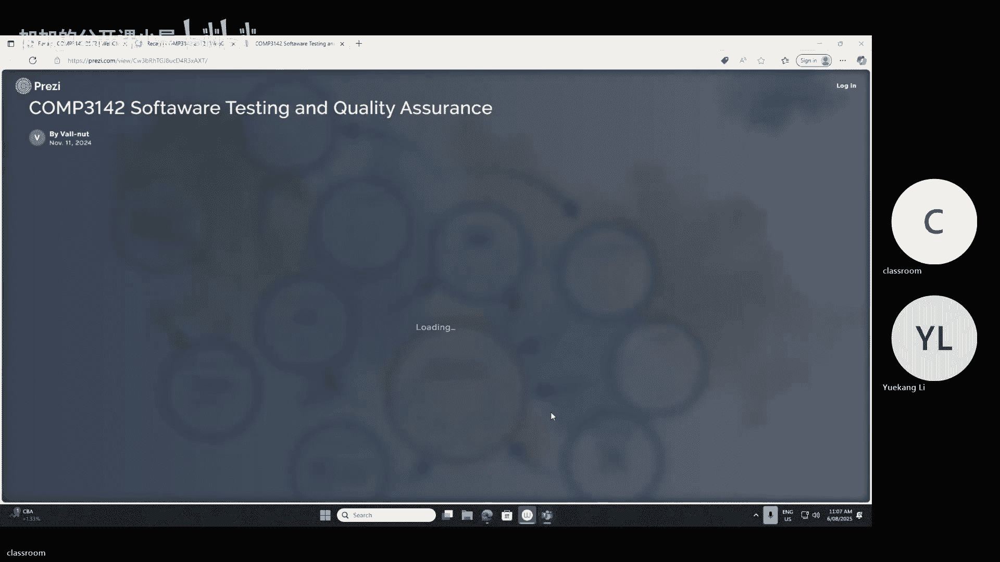
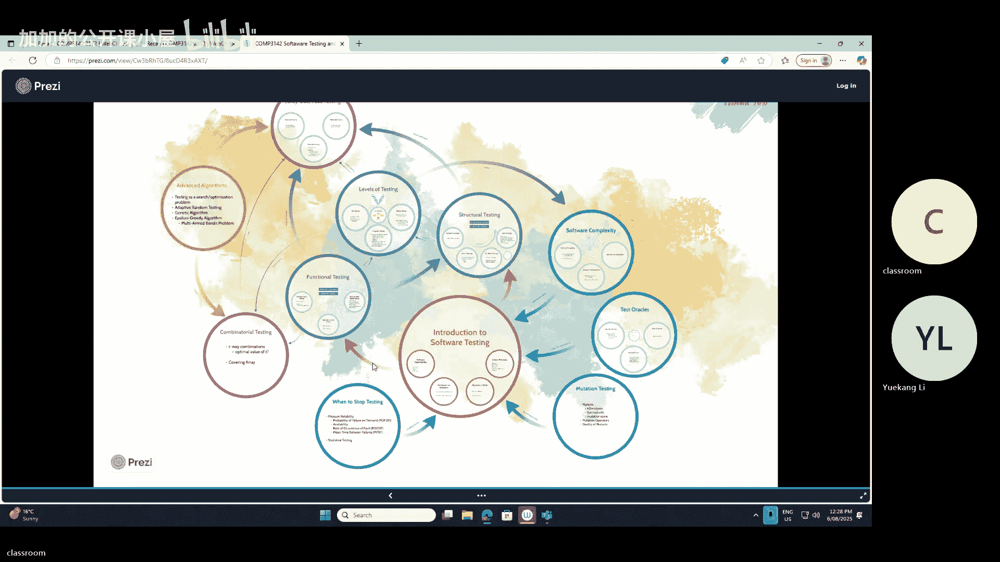

# 001：学期内容总览

在本节课中，我们将对COMP3142软件测试课程整个学期所学的核心概念进行一次全面的回顾。我们将按照学习的逻辑顺序，梳理从软件测试基础到高级算法的所有知识点。

## 软件测试导论

我们首先从软件测试的导论开始。在这一部分，我们学习了几个核心概念。

软件可信赖性是我们的终极目标。我们希望构建可信赖的软件，而可信赖性由四个属性构成：**正确性**、**可靠性**、**安全性**和**健壮性**。理解这些属性之间的关系至关重要，例如，什么是正确但不可靠的软件，什么是安全但不健壮的软件。

我们还学习了**验证**和**确认**的概念。简单来说，验证关注“我们是否正确地构建了产品”，而确认关注“我们是否构建了正确的产品”。验证更多是从工程师的角度思考软件质量，而确认更多是从用户或客户的角度。

此外，我们区分了**动态分析**和**静态分析**。动态分析需要执行程序并观察其行为，而静态分析则通过扫描程序代码来寻找潜在的缺陷模式。

最后，我们学习了软件测试的六项基本原则。这些原则在实际测试技术中都有体现。例如，**敏感性**原则要求我们设计能够有效发现缺陷的测试预言；**可见性和可观察性**原则则通过覆盖率指标来帮助我们了解测试的进展。

## 功能测试

上一节我们介绍了测试的基础概念，本节中我们来看看功能测试。功能测试也称为黑盒测试，意味着我们不了解程序内部结构，只将其视为一个黑盒。

由于输入空间通常是无限的，功能测试技术的核心机制是根据特定规则对输入空间进行划分。

以下是基于边界值划分输入空间的技术：

*   **边界值测试**：我们学习了该技术的两个关键特性，从而衍生出不同的变体。
    *   **正常测试 vs. 健壮测试**：正常测试只关心有效输入范围内的值；健壮测试则同时考虑无效输入。
    *   **单缺陷假设 vs. 最坏情况**：基于单缺陷假设，最多只有一个参数取无效值；若打破此假设，允许多个参数取无效值，则是最坏情况测试。

以下是基于等价类划分输入空间的技术：

*   **等价类测试**：根据输入的等价类来划分输入空间。同样，它也有正常/健壮以及弱/强等价类测试等变体。

我们还学习了另一种功能测试技术：

*   **基于决策表的测试**：决策表是一种可以建模程序因果关系的模型。原因对应程序输入，结果对应程序的行为或动作。关键概念包括**桩**（表头）、**条目**（表值）、**条件**（输入）和**动作**（输出）。决策表分为**有限条目决策表**（条目为布尔值）和**扩展条目决策表**（条目可为数值等其他类型）。

## 结构测试

功能测试属于黑盒测试，而如果我们能获得程序的源代码，就可以进行白盒测试，即结构测试。

结构测试技术的核心是关于我们使用的**覆盖率指标**。我们可以收集代码覆盖率，而本课程更关注与控制流图相关的覆盖率。

首先，回顾一下什么是控制流图。以下是几种主要的控制流覆盖率指标：

*   **语句覆盖**：目标是执行程序中的所有语句。
*   **分支覆盖**：目标是执行控制流图中所有的分支（即边）。分支通常出现在条件语句处。
*   **条件覆盖**：目标是使程序中每个条件表达式的所有可能结果都至少被评估一次。条件覆盖比分支覆盖更全面。
*   **修正条件/判定覆盖**：这是一种更严格的条件覆盖标准，被NASA等机构使用。
*   **路径覆盖**：目标是覆盖控制流图中所有可能的执行路径。然而，路径覆盖存在一个著名的问题——**路径爆炸**。分支和循环是导致路径爆炸的主要来源。因此，对于复杂程序，通常无法达到100%的路径覆盖率。

为了简化问题，我们学习了一些基于路径覆盖的衍生指标：

*   **数据流覆盖**：控制流覆盖关注是否能到达程序的某个点，而数据流覆盖则关注是**以何种值**到达该点。其核心概念是**定义-使用对**：一个值在何处被定义，又在何处被使用。

## 测试级别

在学习了黑盒和白盒测试技术后，我们接下来看看测试的级别。测试级别与软件开发生命周期紧密相关。

结合测试生命周期，我们得到了著名的**V模型**。它展示了开发阶段与测试阶段之间的对应关系。

不同级别的测试及其目标如下：

*   **单元测试**：最接近代码实现的测试级别，用于测试详细设计和具体实现。通常由开发人员完成，也是测试驱动开发的基础。
*   **集成测试**：测试软件架构，关注不同单元组合后的交互。集成策略有多种：
    *   **基于分解的集成**：按照需求对软件进行分解，包括自顶向下、自底向上和三明治集成。
    *   **基于调用图的集成**：根据函数间的调用关系图进行集成，例如成对集成（测试有调用关系的函数对）和邻域集成（测试某个函数邻域内的所有函数）。
    *   **基于路径的集成**：根据控制流图中的执行路径来集成组件。
*   **系统测试**：将整个系统作为一个整体进行测试，以验证其是否满足需求。包括：
    *   **基于模型的测试**：使用模型（如决策表、有限状态机）来描述系统行为，并据此设计测试用例。
    *   **非功能性系统测试**：测试性能、可用性、兼容性等其他质量属性。

与测试级别相关的一个重要概念是**测试脚手架**。编写测试用例时通常包含以下部分：

*   **驱动程序**：为执行目标单元提供上下文。
*   **桩**：模拟被测单元所依赖的、尚未实现或不关心的功能。
*   **输出比较**：检查程序行为是否正确。
*   **清理**：释放测试中使用的资源，或重置系统状态。

## 灰盒模糊测试

接下来，我们结合测试级别和测试技术的知识，学习了**灰盒模糊测试**。灰盒指的是对程序内部有部分了解，而模糊测试是一种系统测试技术。

首先，我们了解了黑盒模糊测试的两种类型：

*   **基于变异的模糊测试**：给定初始种子，通过变异其内容来生成新的测试用例。
*   **基于生成的模糊测试**：根据规则或模型（如语法）从头开始生成测试用例。

然后，我们学习了白盒模糊测试，它通常与**符号执行**和**混合执行**相关。

*   **符号执行**：使用符号而非具体值来表示变量，积累与输入相关的路径约束，并使用SMT求解器求解，以生成能到达特定程序状态的输入。
*   **缺点**：对于复杂程序，约束可能过多，导致可扩展性差。

为了结合黑盒和白盒模糊测试的优点，我们引入了灰盒模糊测试。其核心机制是**分而治之**。

灰盒模糊测试会收集程序执行的部分信息（如边覆盖率），但不像白盒测试那样收集全部运行时信息，从而保持了可扩展性。它通过反馈来指导测试用例的生成，逐步探索程序空间。

灰盒模糊测试涉及几种关键策略：

*   **种子优先级调度**：决定接下来使用哪个种子进行测试。
*   **能量调度**：决定使用当前种子生成多少个新的测试用例。
*   **变异操作符**：决定如何对种子进行变异以生成新的测试用例。

一个著名的灰盒模糊测试工具是**American Fuzzy Lop**。

## 软件复杂度

在课程的后半部分，我们首先学习了**软件复杂度**。我们通常假设软件越复杂，越可能存在缺陷。

与覆盖率类似，软件复杂度也有不同的度量指标：

*   **单元级复杂度**：
    *   **圈复杂度**：与程序的控制流图结构相关，计算公式为 `边数 - 节点数 + 2`。它反映了代码的判定复杂度。
    *   **Halstead 度量**：考虑代码的体积，基于程序中不同运算符和操作数的数量及出现次数进行计算。
*   **集成级复杂度**：可以对调用图应用圈复杂度等度量。
*   **面向对象程序的复杂度**：涉及类、继承、耦合等特定概念的度量。

## 测试预言

测试预言用于判断测试用例应该通过还是失败。有些缺陷很容易被发现（如程序崩溃），但有些则不然，因此需要设计测试预言。

测试预言有以下几种类型：

*   **指定的预言**：通常是人工创建的。
    *   **基于模型的预言**：例如，将系统建模为有限状态机，检查程序是否进入错误状态。
    *   **期望值**：在单元测试的断言中使用的预期结果。
    *   **自检**：在程序内部逻辑中添加断言。
*   **衍生的预言**：可以自动获得。
    *   **差分测试**：使用多个实现相同功能的程序版本，比较它们的输出是否一致。
    *   **回归测试**：使用已有的测试用例来测试新引入的功能。
    *   **蜕变测试**：寻找并验证被测程序的蜕变关系（即输入输出之间应满足的某种关系）。
*   **隐式预言**：任何程序自然具备的预言，例如程序崩溃肯定意味着有缺陷。可以使用**净化器**（如地址净化器）来提高隐式预言的敏感性。
*   **人工预言**：由人来判断程序行为是否正确，例如通过众包平台进行。

## 变异测试

变异测试虽然名字听起来像一种测试技术，但它实际上是一种用于**评估测试套件质量**的特殊技术。

基本思想很简单：我们可以用测试用例来评估程序，也可以用程序来评估测试用例。变异测试通过创建程序的变体（即**变异体**）来评估测试用例。

关键概念包括：

*   **变异体**：通过对原始程序进行微小改动（模拟开发者可能犯的错误）而创建的程序变体。
*   **杀死变异体**：如果某个测试用例能导致变异体运行失败，则该变异体被“杀死”。
*   **存活变异体**：能通过所有测试用例的变异体。
*   **变异得分**：`被杀死的变异体数量 / 总变异体数量`。得分越高，测试套件质量越好。

变异操作符决定了变异体的质量，它们应能模拟开发中可能出现的真实错误。

## 何时停止测试

“何时停止测试”取决于对程序**可靠性**的评估。我们认为软件可靠时，就可以停止测试。

因此，我们需要度量可靠性。可靠性意味着在观察期间程序能无故障运行。相关度量指标包括：

*   **需求失效概率**：`失效的请求数 / 总请求数`
*   **可用性**：`系统正常运行时间 / 总时间`
*   **失效发生率**：观察期间内失效发生的频率
*   **平均失效间隔时间**：两次失效之间的平均运行时间

我们可以通过**统计测试**来度量这些指标，即模拟真实的使用环境，收集用户使用剖面，并在此模拟环境中运行程序以收集数据。

## 组合测试

组合测试是一种可用于多个测试级别的技术，它主要测试程序的不同配置选项组合。

关键思想是使用 **t-way 组合**。由于选项组合的数量可能非常庞大，t-way组合限制了我们需覆盖的组合维度。例如，2-way组合要求覆盖所有可能的选项值对。

我们不需要为每个组合都创建一个测试用例，因为一个测试用例可以覆盖多个组合。我们使用**覆盖数组**来追踪每个测试用例覆盖了哪些组合，并以此最小化测试套件。计算最优覆盖数组是困难的，我们学习了使用**贪心算法**来近似求解。

对于大多数系统，t取2或3通常就足够了。

## 高级算法

最后，我们学习了一些可用于测试及相关问题的高级算法。

首先，我们将测试问题形式化为**搜索与优化问题**。测试可以被视为搜索合适的测试套件（搜索问题），并且在预算有限的情况下，我们需要寻找最优解而非完美解（优化问题）。

以下是几种相关的算法：

*   **自适应随机测试**：一种启发式算法。如果之前的测试用例没有发现缺陷，则生成一个与之差异很大的新测试用例。
*   **遗传算法**：一种元启发式算法，模拟生物进化过程。通过选择、交叉、变异等操作，使测试用例种群朝着优化目标进化。
*   **ε-贪心算法**：用于解决**多臂赌博机问题**。以大概率选择当前观测收益最高的“手臂”（策略），以小概率随机探索其他“手臂”，以平衡利用与探索。

## 总结

本节课中，我们一起回顾了本学期软件测试课程的所有核心概念。我们从软件测试的基础定义和原则出发，逐步深入到功能测试、结构测试、不同测试级别以及灰盒模糊测试等具体技术。随后，我们探讨了软件复杂度、测试预言、变异测试、停止测试的标准、组合测试，最后以将测试形式化为搜索优化问题并介绍相关高级算法作为结束。希望这次回顾能帮助你梳理和巩固过去两个月所学的知识，理解各个概念之间的联系，并在未来的学习和实践中继续运用这些思想。