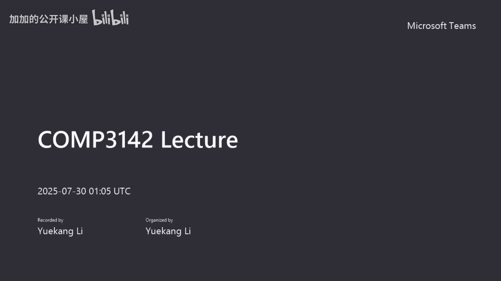
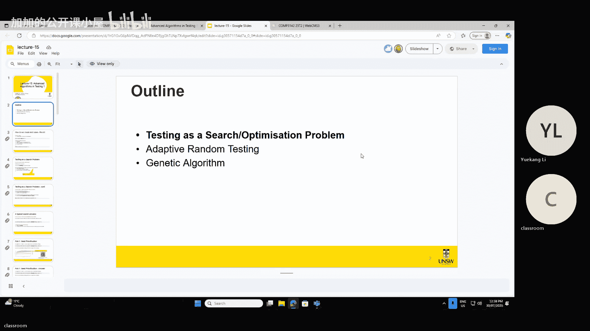

# 003：高级测试算法（第一部分）

在本节课中，我们将学习如何将软件测试问题转化为搜索或优化问题，并介绍两种基于此思想的高级测试算法：自适应随机测试和遗传算法。通过学习这些算法，你将理解如何更高效、更自动地生成测试用例。

---

## 将测试视为搜索问题

上一节我们介绍了软件测试的基本流程。本节中，我们来看看如何将测试过程形式化。

软件测试的核心是生成输入、运行程序并观察结果。但我们生成输入并非毫无目的。我们通常希望测试用例能够发现缺陷、覆盖代码结构（如语句、分支、路径）或执行特定的数据流对。这些目标都是可衡量的。

由于程序的输入空间几乎是无限的，而我们希望从中找到一个能满足特定目标（如高覆盖率）的测试用例集合。这就像在一个巨大的空间中寻找一个合适的物品。因此，测试可以被描述为一个**搜索问题**：我们在近乎无限的输入空间中，搜索一个能满足特定属性的测试套件。

因为测试目标可以衡量，并且我们可以自动生成候选解决方案（即测试用例），所以我们有可能编写程序来自动化整个搜索过程。大多数基于搜索的测试技术都是完全自动化的。

一个典型的搜索过程如下：
1.  随机或按策略选择一个候选解决方案（测试套件）。
2.  检查该方案是否满足目标。
3.  如果不满足，则尝试另一个方案。
4.  重复此过程，直到达成目标或穷尽所有可能。

在这个过程中，**选择尝试解决方案的顺序**至关重要，它直接影响找到满意方案的效率。用于做出这种决策的策略被称为**启发式方法**。

---

## 启发式、效率与有效性

在讨论具体算法前，我们需要区分两个关键概念：效率与有效性。

*   **效率**：指完成任务的速度。在测试中，体现为达到目标（如特定覆盖率）的收敛速度。
*   **有效性**：指任务完成的质量。在测试中，体现为最终能达到的最佳性能（如最大覆盖率）。

启发式方法（例如，种子优先级的排序策略）主要影响**效率**，即我们多快能找到好的测试用例。但它通常不影响最终的**有效性**。因为只要有足够的时间，我们最终会尝试所有相关的候选方案，顺序并不改变最终能探索到的空间上限。它只改变我们到达那个上限的速度。

我们之前学习过的一些算法也包含了启发式思想，例如：
*   **广度优先搜索**：逐层探索所有节点。
*   **深度优先搜索**：沿一条路径深入探索再回溯。
*   **A* 搜索**：一种贪心算法，使用评估函数（启发式）估计到目标的距离，并选择当前看来最优的路径。

---

## 将搜索问题转化为优化问题

在无限输入空间中寻找理想测试套件是不现实的。因此，我们需要引入**约束**或**预算**来限定搜索范围。

常见的搜索预算包括：
*   **时间预算**：例如，只运行模糊测试5小时。
*   **尝试次数预算**：例如，只执行目标程序10000次。

在预算限制下，我们往往无法找到全局最优解（例如，绝对无缺陷的程序）。因此，问题从“寻找满足布尔条件（是/否）的最佳方案”转变为“在预算内寻找**最优**的方案”。这便将搜索问题转化为了一个**优化问题**。

优化问题的目标是，在给定预算内，从所有能尝试的候选方案中找到评估分数最高的那个。这个评估分数可以覆盖率、发现的缺陷数等。

由于预算有限，搜索时所采用的**启发式策略**变得尤为重要，它直接决定了我们能在有限资源内找到多好的局部最优解。

---

## 自适应随机测试

最朴素的搜索策略是**完全随机测试**。它随机生成方法调用、参数和输入。其优点是实现简单、快速，且能避免设计者偏见。但缺点也很明显：缺乏方向性，效率和有效性通常较低。

为了提高随机测试的效率，我们引入**自适应随机测试**的核心思想：**促进输入多样性**。其基本假设是：
1.  触发缺陷的输入在输入空间中通常是稀疏的。
2.  如果一个输入未能触发缺陷，那么与其相似的输入很可能同样无效。
3.  因此，在选择下一个测试输入时，应选择与已执行过的、未成功的测试用例差异最大的那个。

以下是实现此思想的一种算法：**固定大小候选集自适应随机测试**。

该算法维护两个集合：
*   **已执行集**：存放所有已执行但未达成目标的测试用例。
*   **候选集**：存放一批已生成但未执行的测试用例。

算法关键步骤如下：
1.  随机生成一个测试用例并执行。
2.  生成一个包含 N 个随机测试用例的**候选集**。
3.  从候选集中，选择一个与**已执行集**中所有测试用例“距离最远”的候选用例执行。
4.  如果该候选用例仍未达成目标，则将其加入**已执行集**。
5.  重复步骤2-4。

这个算法的关键在于如何定义和计算“距离”。有两种常用策略：
*   **最大最小距离法**：对于每个候选用例，计算它与已执行集中**最近**用例的距离，然后选择这个距离值最大的候选。
    *   `候选得分 = min( distance(候选, 已执行用例1), distance(候选, 已执行用例2), ... )`
*   **最大总和距离法**：对于每个候选用例，计算它与已执行集中**所有**用例的距离之和，然后选择和最大的候选。
    *   `候选得分 = sum( distance(候选, 已执行用例1), distance(候选, 已执行用例2), ... )`

距离的计算方式取决于输入数据的类型：
*   对于数值，可使用**欧几里得距离**：`distance = sqrt( (x1-x2)^2 + (y1-y2)^2 + ... )`
*   对于字符串，可使用编辑距离等。

自适应随机测试通过生成多于执行数量的候选用例，并精心挑选执行对象，旨在用更少的执行次数获得更高的输入多样性，从而提升效率。

---

## 基于区域的改进算法

在自适应随机测试的基础上，发展出一些改进策略，如**基于区域的算法**。

其核心思想是定义**排除区域**。围绕每个已执行但未成功的测试用例，划定一个区域（如一个圆形范围）。在选择下一个测试输入时，只从这些排除区域之外的区域中随机选择。

为了应对随着测试进行，排除区域可能覆盖大部分输入空间的问题，算法会动态**缩小排除区域**的半径，确保始终有空间可供选择。

另一种改进是**动态分区**。算法将输入空间动态划分为多个区域，并始终从当前**最大**的未探索区域中选择测试输入。这确保了测试用例能相对均匀地分布在整个输入空间，避免了某些区域被完全忽略（“饥饿”现象）。

理论上，这些基于区域的算法能比基础的自适应随机测试更有效地保证测试输入的多样性和空间覆盖的均匀性。

---

## 遗传算法

前面介绍的算法都依赖于人为设计的启发式规则。那么，能否让算法自动寻找好的启发式呢？这就引出了**元启发式算法**。元启发式是为寻找启发式规则而设计的更高层策略。

如果我们能为每个测试用例计算一个**适应度分数**（如代码覆盖率），那么测试生成问题就可以明确地定义为一个优化问题：寻找适应度分数最高的测试用例。**遗传算法**就是一种强大的元启发式优化算法。

遗传算法受生物进化论启发，其核心思想是：
1.  维护一个由多个个体（测试用例）组成的**种群**。
2.  通过**适应度函数**评估每个个体的优劣。
3.  让优秀的个体有更高概率“繁殖”后代，淘汰劣质个体。
4.  在繁殖过程中引入**交叉**和**变异**操作，以保持种群多样性并探索新可能。
5.  迭代多代，使种群的整体适应度不断提高。

算法基本流程如下：
1.  **初始化**：随机生成初始种群（一组测试用例）。
2.  **循环直到满足终止条件**（如达到指定代数或找到满意解）：
    a.  **选择**：根据适应度分数，从当前种群中选择优秀的个体作为“父母”。
    b.  **交叉**：将两个父母的基因（测试用例的部分）组合，生成新的“后代”测试用例。
    c.  **变异**：以小概率随机改变后代测试用例的某些部分。
    d.  **评估**：用适应度函数计算新后代的分数。
    e.  **生存选择**：从新旧个体中，选择适应度最高的一批个体组成下一代种群。

在测试领域的成功应用是 **EvoSuite** 框架，它能自动为Java程序生成单元测试，并证明了遗传算法在此类问题上的强大有效性。

遗传算法的思想也与现代灰盒模糊测试（如AFL）的设计有相似之处：
*   **种子队列** 类似于种群。
*   **变异操作**（如 havoc）类似于变异。
*   **交叉操作** 类似于交叉。
*   通过**种子优先级**来“偏爱”某些种子，而不是直接淘汰，这与遗传算法中的选择压力类似。
*   主要使用**时间**而非代数作为终止条件。

---

## 总结

本节课中我们一起学习了如何将软件测试重新定义为搜索与优化问题，并介绍了两种基于此思想的高级算法。

首先，我们了解到测试可以被视为一个**搜索问题**，因为我们需要从巨大的输入空间中寻找满足特定目标的测试套件。由于资源有限，我们进一步将其转化为**优化问题**，即在预算内寻找局部最优解。

接着，我们学习了**自适应随机测试**及其变体。它们通过有策略地选择与已失败测试差异最大的新输入，来提升测试输入的多样性，从而更高效地探索输入空间。

最后，我们探讨了**遗传算法**这一元启发式方法。它模拟自然选择的过程，通过交叉、变异和适应度选择，迭代地进化出一组高质量的测试用例，在单元测试生成等领域取得了显著成功。

理解这些算法背后的思想，不仅能帮助我们更好地进行测试，也为我们解决其他类型的搜索与优化问题提供了思路。