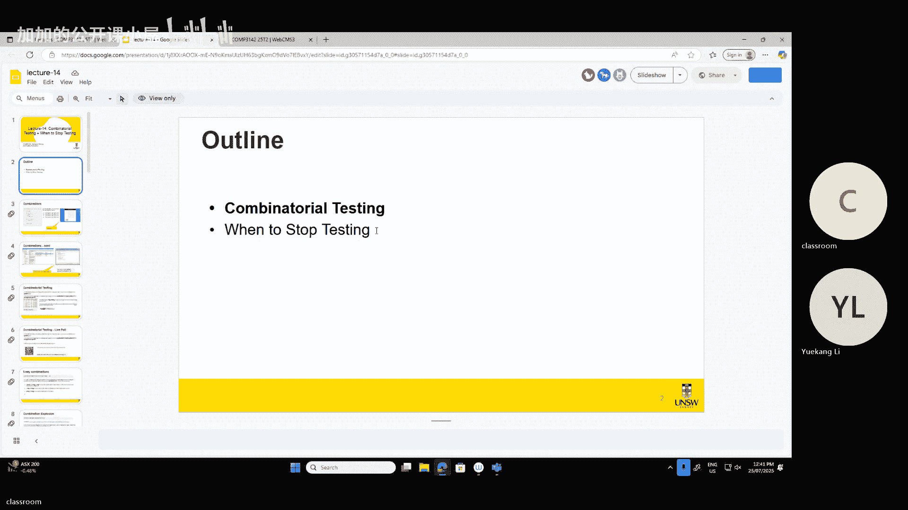

# 004：组合测试与何时停止测试

在本节课中，我们将学习本课程的最后一个测试技术——组合测试，并探讨一个在实际项目中至关重要的问题：何时停止测试。

## 组合测试 🧩

上一节我们介绍了多种测试技术，本节中我们来看看组合测试。从名称可以看出，其核心在于“组合”。在软件中，组合通常出现在两个场景：一是函数输入参数的多种取值组合，二是软件配置选项的不同设置组合。

组合测试是一种测试技术，旨在系统地检查系统输入（如用户参数或配置选项）的所有或部分组合。它也被称为 **t-way 测试**，其中 **t** 代表交互级别。

### 组合爆炸问题 💥

当我们尝试覆盖所有参数组合时，可能会面临“组合爆炸”问题。例如，对于 n 个参数进行两两组合（t=2），需要覆盖的组合数为 **C(n, 2) = n * (n-1) / 2**。随着参数数量 n 或交互级别 t 的增加，组合数量会急剧增长，使得穷尽测试变得不切实际。

那么，如何确定一个合适的 t 值呢？根据美国国家标准与技术研究院（NIST）的研究报告，大多数软件缺陷（约70%）是由单个参数或两个参数的交互引发的。将 t 设置为 3 通常可以覆盖近90%的缺陷。因此，在实践中，进行 **两两组合测试（t=2）** 或 **三三组合测试（t=3）** 通常就足够了，这能极大地减少测试用例数量。

### 覆盖数组 📊

为了高效地进行组合测试并减少冗余，我们引入“覆盖数组”的概念。覆盖数组是一个 **n × k** 的矩阵，其中 n 是测试用例数，k 是参数个数。每个单元格代表特定参数在某个测试用例中的取值。

其目标是，在给定的交互级别 t 下，用最少的测试用例覆盖所有可能的参数值组合。一个覆盖数组可以表示为 **CA(N; t, k, v)**，其中：
*   **N**: 测试用例数
*   **t**: 交互级别
*   **k**: 参数个数
*   **v**: 每个参数的可能取值数（为简化，常假设各参数 v 值相同）

以下是使用覆盖数组的一个简单示例。假设有4个参数（P1, P2, P3, P4），每个参数可取值为0或1（v=2），目标是进行两两组合测试（t=2）。虽然穷举所有组合需要16个测试用例，但通过精心设计的覆盖数组，仅需6个测试用例即可覆盖所有可能的参数对（共6对）的每一种值组合（如00, 01, 10, 11）。

### 生成覆盖数组的算法 🤖

如何生成这样一个高效的覆盖数组呢？这本身是一个复杂问题。一种相对简单的方法是使用**贪心算法**。

贪心算法的核心思想是迭代地选择测试用例。在每一步，都选择那个能在当前已覆盖组合的基础上，**新增覆盖组合数量最多**的测试用例。

以下是使用贪心算法构建覆盖数组的简化步骤：
1.  从一个随机测试用例开始（例如，所有参数值为0）。
2.  计算当前已覆盖的参数组合。
3.  寻找一个未使用的测试用例，使其能覆盖最多尚未被覆盖的参数组合。
4.  将该测试用例加入数组，更新已覆盖组合集合。
5.  重复步骤3和4，直到所有需要的组合都被覆盖。

贪心算法的优点是**速度快、实现简单**，并且通常能提供接近最优的解。然而，它可能无法生成**全局最小**的覆盖数组，尤其在参数多、取值复杂或 t 值较大时。对于更复杂的情况，可能需要使用模拟退火、遗传算法等元启发式方法。

### 组合测试的局限性 ⚠️

尽管组合测试非常强大，但它也存在一些局限性：
1.  **组合爆炸**：即使 t 值较小，当参数数量非常多时，组合数依然可能很大。
2.  **参数约束**：实际系统中，某些参数组合可能无意义或不可能出现（例如，互斥的选项）。生成测试用例时需要识别并排除这些无效组合。
3.  **缺陷类型**：组合测试擅长发现由参数间交互引发的缺陷，但可能遗漏与程序内部状态、特定计算路径或非交互性逻辑相关的缺陷。

## 何时停止测试 🛑

我们已经学习了众多测试技术，但测试不能无限进行下去。何时停止测试是一个需要科学决策的问题。我们可以依据多种标准来设定停止测试的准则。

### 停止测试的常见准则

以下是几种常见的停止测试准则：
*   **需求覆盖**：所有根据需求编写的测试用例均已通过。
*   **覆盖率指标**：达到了预定的代码覆盖率目标（例如，语句覆盖率 > 90%）。
*   **预算/计划**：测试时间或经费已耗尽。
*   **软件可信性**：软件达到了足够的可信赖程度。这是最理想但也最难以量化的准则。

软件可信性包括正确性、可靠性、安全性和健壮性。其中，**可靠性**因其可测量性，常被用作评估是否停止测试的核心依据。

### 可靠性的度量 📈

可靠性是指在特定环境中、特定时间段内无故障运行的概率。我们可以通过以下指标来量化它：

1.  **需求失效概率（POFOD）**：计算公式为 **失效次数 / 总请求次数**。它衡量每次服务请求遭遇失败的概率，与请求频率无关。
2.  **可用性（Availability）**：计算公式为 **系统正常运行时间 / 总时间**。它衡量服务在时间维度上的可获取程度，将系统重启、修复时间计入宕机时间。
3.  **故障发生率（ROCOF）**：计算公式为 **失效次数 / 总运行时间**。它衡量单位时间内发生故障的频率，适用于请求持续不断的系统。
4.  **平均失效间隔时间（MTBF）**：计算公式为 **总运行时间 / 失效次数**。它衡量两次故障之间的平均时间长度。

为了计算这些指标，我们需要在测试过程中收集数据，例如：请求总数、失效次数、每次失效的时间戳、系统总运行时间等。

### 基于可靠性的统计测试 🧪

为了评估可靠性，我们可以进行**统计测试**。其关键是根据**运行剖面**来生成测试用例。运行剖面描述了软件在真实世界中被使用的各种方式及其概率分布。

基于运行剖面的统计测试步骤如下：
1.  **建立运行剖面**：通过分析现有类似系统或进行 Beta 测试，收集用户实际使用模式的数据。
2.  **生成测试输入**：根据运行剖面中不同输入类型的概率分布，构造测试用例集。
3.  **执行测试并收集数据**：运行系统，使用生成的测试输入，并记录失效情况及相关时间数据。
4.  **计算可靠性指标**：根据收集的数据，计算 POFOD、可用性、ROCOF 或 MTBF。
5.  **判断是否达标**：将计算出的指标与预先设定的可接受阈值进行比较。若达标，则可停止测试；否则，需修复缺陷后继续测试。

### 统计测试的挑战 🤔

基于运行剖面的统计测试也面临挑战：
*   **剖面准确性**：获取真实、准确的运行剖面非常困难，尤其对于全新系统。
*   **剖面变化**：用户行为和使用模式会随时间变化。
*   **测试成本**：模拟真实使用场景可能需要海量测试输入，生成和执行成本高。
*   **统计不确定性**：在极高可靠性的系统中，可能长时间观测不到失效，这使得难以精确评估其可靠性，也无法区分是“系统真的无缺陷”还是“测试不够充分”。

尽管有这些挑战，通过持续测试和改进，系统的故障率通常会呈现下降趋势。当观测到的故障率低于某个可接受的水平时，我们就可以有信心地停止测试并发布软件。

## 总结 ✨

本节课我们一起学习了两个重要主题。

首先，我们深入探讨了**组合测试**。我们了解到，组合测试通过系统性地检查输入参数或配置选项的组合来发现缺陷，其核心是 **t-way 交互覆盖**。为了应对组合爆炸并提高效率，我们引入了**覆盖数组**的概念，并简要介绍了使用**贪心算法**来构建覆盖数组的思路。同时，我们也认识到组合测试在参数约束和缺陷检测类型方面的局限性。

其次，我们讨论了**何时停止测试**这个实践性极强的问题。我们回顾了多种停止准则，并重点学习了以**软件可靠性**作为判断依据的方法。我们介绍了几个关键的可靠性度量指标：**需求失效概率（POFOD）、可用性、故障发生率（ROCOF）和平均失效间隔时间（MTBF）**。最后，我们探讨了通过建立**运行剖面**进行**统计测试**来评估可靠性，并以此决定测试终点的完整流程及其面临的挑战。

掌握这些知识，将帮助你在未来的工作中更有效、更科学地进行测试，并在合适的时机做出发布决策。