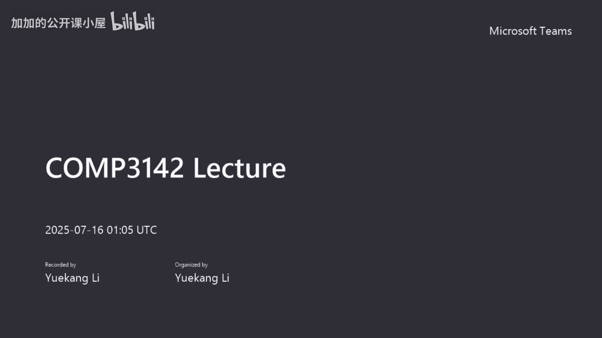
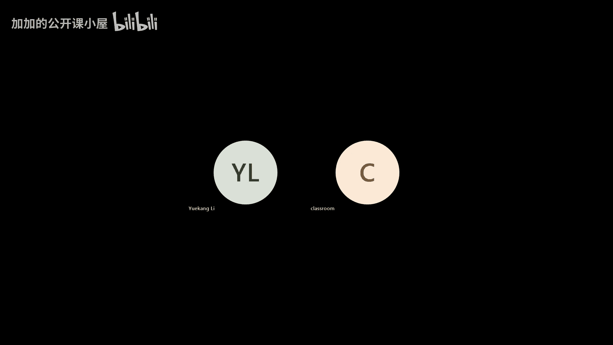
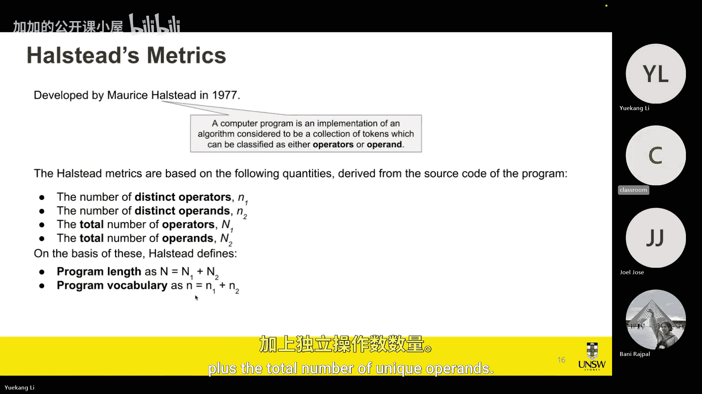
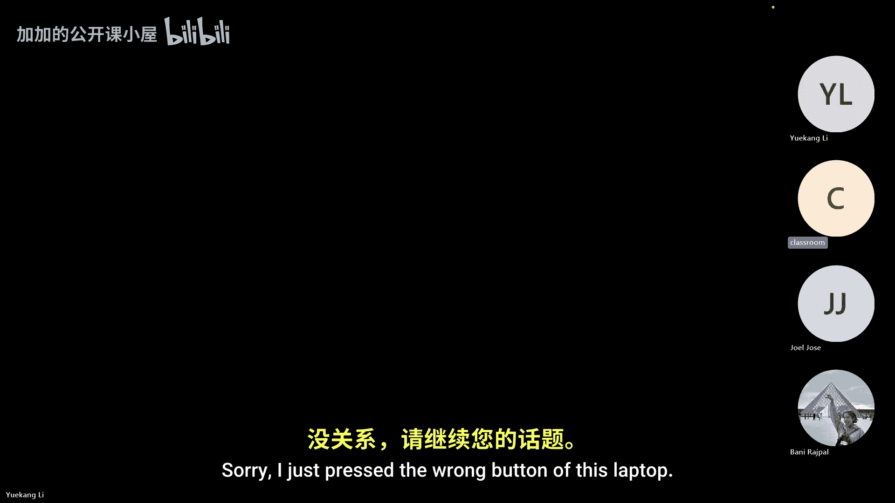
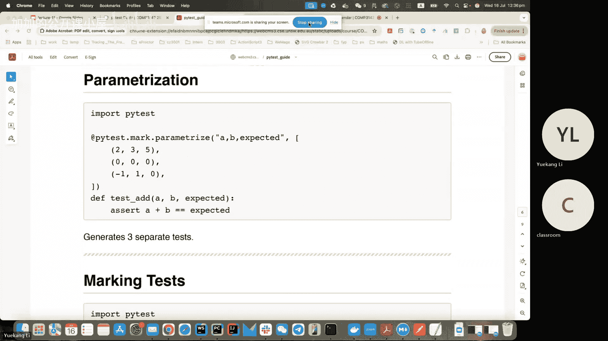
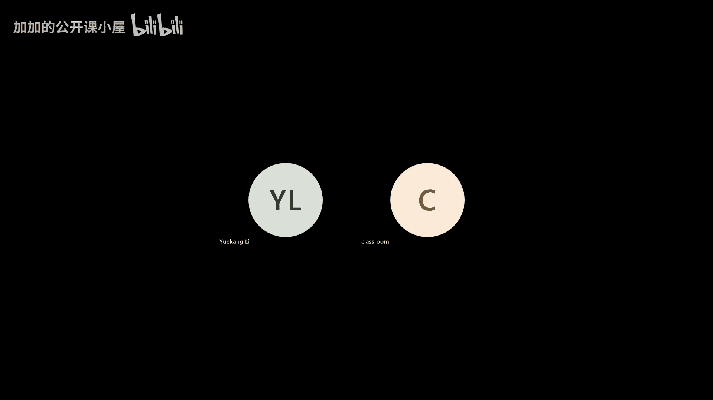

# 007：软件复杂度 📊





在本节课中，我们将要学习软件复杂度的概念。我们将了解它与计算复杂度的区别，并学习在不同层级（单元、集成、系统）上衡量软件复杂度的多种度量方法。理解软件复杂度有助于我们识别代码中潜在的高风险区域，从而更有效地进行测试。

---

## 软件复杂度概述

上一节我们回顾了课程更新。本节中，我们来看看什么是软件复杂度。

你可能在算法课程中学习过“复杂度”，例如时间复杂度和空间复杂度，它们使用大O符号（如 **O(1)**、**O(n)**、**O(n²)**）来衡量算法的计算资源消耗。

然而，软件复杂度与此不同。它衡量的是软件**结构**的复杂程度，关注的是人类理解、维护或更新代码的认知难度。它与代码执行时所需的实际计算资源无关。人们通常认为高复杂度与高缺陷风险相关，因此学习软件复杂度有助于我们在测试中聚焦高风险区域。

---

## 单元级复杂度度量

首先，我们从单元级别开始，学习两种度量代码复杂度的方法。

### 圈复杂度 (Cyclomatic Complexity)

圈复杂度可用于计算任何图的复杂度。对于控制流图，其公式为：

**V(G) = E - N + 2P**

其中：
*   **E** 是边的数量。
*   **N** 是节点的数量。
*   **P** 是连通分量的数量（通常对于一个函数，P=1）。

因此，公式可简化为：**V(G) = E - N + 2**。

以下是一个计算示例。考虑以下程序及其控制流图：

```python
if (a > b):
    max = a
else:
    max = b
if (max < c):
    max = c
return max
```

对应的控制流图有 4 条边和 5 个节点。其圈复杂度为：**4 - 5 + 2 = 1**。

通过观察，我们可以总结出影响圈复杂度的因素，并得到一个更快的计算公式，无需绘制控制流图：

**V(G) = 2 + #if + #loop + #case - #exit**



其中：
*   `#if`: `if` 语句的数量（不包括 `else`）。
*   `#loop`: 循环语句（如 `while`, `for`）的数量。
*   `#case`: `switch` 语句中 `case` 的数量（不包括 `default`）。
*   `#exit`: `return` 或退出语句的数量。



使用此公式计算上述示例：`2 + 2 (两个if) + 0 + 0 - 3 (三个return) = 1`，结果一致。

**圈复杂度的局限性：**
1.  它只衡量控制流的结构复杂度，未考虑数据流。例如，使用复合条件（如 `if (a && b && c)`）可以将嵌套 `if` 简化，降低圈复杂度，但程序的逻辑复杂度并未降低。
2.  它忽略了代码规模。一个长达数百行、没有分支的顺序执行函数，圈复杂度很低，但可能包含大量缺陷。

### 霍尔斯特德复杂度 (Halstead Complexity)

由于圈复杂度的局限性，我们引入另一种度量方法——霍尔斯特德度量法。它基于程序中的运算符和操作数进行计算。

首先需要计算四个基本量：
*   **n1**: 不同运算符的数量。
*   **n2**: 不同操作数的数量。
*   **N1**: 运算符出现的总次数。
*   **N2**: 操作数出现的总次数。

基于这些，可以推导出多个度量指标：
*   **程序长度 (Program Length)**: **N = N1 + N2**
*   **程序词汇表 (Program Vocabulary)**: **n = n1 + n2**
*   **程序体积 (Program Volume)**: **V = N * log₂(n)**
*   **程序难度 (Program Difficulty)**: **D = (n1/2) * (N2/n2)**
*   **编程工作量 (Program Effort)**: **E = D * V**

霍尔斯特德度量法在1977年提出，旨在实现语言无关的度量。但对于现代编程语言，区分运算符和操作数有时比较困难，且由其衍生出的“预计编程时间”或“预计缺陷数”等指标在实际中参考价值有限。通常，**程序体积 (V)** 和 **编程工作量 (E)** 是相对有用的指标。

---

## 集成级复杂度度量

上一节我们介绍了单元级别的复杂度度量。本节中，我们来看看在集成级别如何衡量复杂度。

### 调用图圈复杂度

由于圈复杂度适用于任何图，因此也可以用于**调用图**。计算方法是相同的：**V(G) = E - N + 2P**，其中 E 和 N 是调用图中的边和节点。这可以帮助我们理解模块间调用的结构复杂度。

### 面向对象复杂度 (CK度量集)

对于面向对象软件，有一套著名的CK度量集，包含6个指标：
1.  每个类的加权方法数 (WMC)
2.  继承树的深度 (DIT)
3.  子类数量 (NOC)
4.  对象类之间的耦合度 (CBO)
5.  类的响应集合 (RFC)
6.  方法间缺乏内聚性 (LCOM)

以下是其中三个关键概念的简要说明：
*   **WMC**: 一个类中所有方法的复杂度之和（可使用圈复杂度或霍尔斯特德体积计算）。
*   **CBO**: 与一个类耦合的其他类的数量。耦合是双向的，如果类A使用了类B，或类B使用了类A，则它们相互耦合。
*   **RFC**: 一个类的方法集合的响应数量。计算公式为：`RFC = |{本类方法集合}| + |{这些方法调用的不同外部方法集合}|`。
*   **LCOM (缺乏内聚性度量)**: 衡量一个类中方法的内聚程度。计算方法之一是：列出类的所有方法和属性，确定每个方法访问哪些属性，然后计算方法对；如果两个方法共享至少一个属性，则它们是一个“内聚对”。`LCOM = |非内聚方法对| - |内聚方法对|`（若结果为负则取0）。值越高，表示类的方法内聚性越差。

---

## 系统级复杂度与总结

最后，我们探讨系统级别的复杂度。

在系统级别，通常复用集成级别的度量方法（如调用图复杂度、CK度量）。一个重要的研究问题是：软件复杂度是否与缺陷正相关？2018年的一项研究表明，这个关系很难一概而论。复杂的代码可能因为开发者更专注而缺陷较少，简单的代码也可能因疏忽而引入缺陷。有趣的是，许多复杂的缺陷预测模型，其效果有时还不如简单的**代码行数(LOC)** 指标。

尽管如此，复杂度度量在实践中仍有价值。例如，一些自动化测试工具（如Fuzz工具）会使用圈复杂度等指标来识别值得进行模糊测试的“有价值目标函数”。许多公司也会在代码规范中限制函数的圈复杂度，以提升代码可维护性。

**本节课总结：**
我们一起学习了软件复杂度的概念及其与计算复杂度的区别。我们深入探讨了三种级别的复杂度度量：
1.  **单元级**：圈复杂度（快速公式：`V=2+#if+#loop+#case-#exit`）和霍尔斯特德度量法。
2.  **集成级**：调用图圈复杂度和面向对象的CK度量集（如WMC, CBO, RFC, LCOM）。
3.  **系统级**：复杂度和缺陷关系的复杂性，以及度量在实践中的应用（如识别测试重点）。

理解这些度量有助于我们在软件测试中更智能地分配精力，聚焦于潜在的高风险复杂模块。

---

## 附：Pytest 进阶技巧 🔧

本节将介绍Pytest测试框架中的两个进阶功能，它们对于编写作业2的自动化测试非常有帮助。

### 1. 夹具 (Fixtures) 回顾与深入

夹具用于为测试提供可重用、可组合的设置和清理代码。

**基本结构：**
```python
import pytest
import os

@pytest.fixture
def temp_text_file():
    # 设置阶段：创建资源
    file_path = "temp_test_file.txt"
    with open(file_path, 'w') as f:
        f.write("hello world")
    # 使用 yield 将资源提供给测试函数，并暂停执行
    yield file_path
    # 清理阶段：测试结束后执行
    os.remove(file_path)

def test_file_content(temp_text_file):
    # 测试函数接收 fixture 返回的资源
    with open(temp_text_file, 'r') as f:
        content = f.read()
    assert content == "hello world"
```

**`yield` 与 `return` 的区别：**
*   在Pytest夹具中，使用 `yield` 可以在测试函数执行完毕后，返回到夹具中执行清理代码。
*   如果使用 `return`，则夹具函数会立即终止，清理代码无法执行。
*   一个夹具中只能有一个 `yield`，但可以有多个 `return`（虽然通常不这么用）。

**夹具作用域 (Scope)：**
可以通过 `@pytest.fixture(scope="...")` 指定夹具的作用域，控制其创建和销毁的频率：
*   `function` (默认): 每个测试函数运行一次。
*   `class`: 每个测试类运行一次。
*   `module`: 每个模块（文件）运行一次。
*   `package`: 每个包运行一次。
*   `session`: 整个测试会话运行一次。

### 2. 参数化测试 (Parameterization)

当需要对同一个测试函数使用多组不同的输入数据和预期输出来进行测试时，可以使用参数化，避免编写多个重复的测试函数。

**使用方法：**
```python
import pytest

@pytest.mark.parametrize("input_a, input_b, expected", [
    (1, 2, 3),
    (5, -5, 0),
    (100, 200, 300),
])
def test_addition(input_a, input_b, expected):
    result = input_a + input_b
    assert result == expected
```
`@pytest.mark.parametrize` 装饰器的第一个参数是一个字符串，定义了测试函数接收的参数名；第二个参数是一个列表，其中每个元素是一组测试数据（元组形式）。Pytest会分别使用每一组数据运行一次测试函数。





掌握夹具和参数化，可以让你写出更简洁、更强大、更易维护的自动化测试代码。