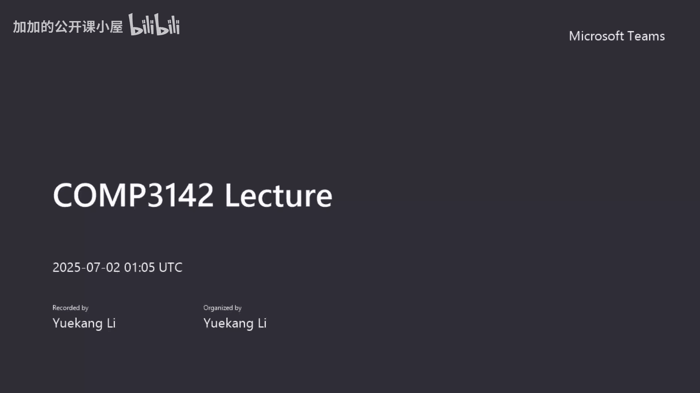

# 009：模糊测试 🎯

在本节课中，我们将要学习一种特定的系统测试技术——模糊测试。我们将了解其基本概念、不同类型（黑盒、白盒、灰盒）以及它们的工作原理和优缺点。

---

## 课程概述 📋

在开始今天的主要内容之前，我们先快速了解一下本学期后半段的计划。本周我们将学习模糊测试，特别是名为 American Fuzzy Lop 的特定模糊测试工具，这些内容与作业2相关。下周是实践周，我们将发布一些练习材料，让大家亲身体验模糊测试，并练习 Docker 的使用。第七周结束时，我们将发布作业1的结果和作业2的规范。作业2将涵盖单元测试、集成测试和模糊测试的实践。

现在，让我们开始今天的课程。我们将学习一种特定的系统测试技术，称为模糊测试。在此之前，我们先回顾一下已学内容：功能与结构测试、不同级别的测试（单元、集成、系统测试）。今天，我们将聚焦于一个非常具体且实用的系统测试技术——模糊测试。

---

## 什么是模糊测试？🤔

模糊测试是一种自动化测试技术，这意味着它不需要太多人工努力，测试用例是自动生成的。其基本思想是向程序提供大量随机、无效或意外的数据作为输入，然后执行程序并监控其异常行为，如崩溃、断言失败或其他问题。

这里有三个关键术语：
1.  生成大量**随机数据**作为输入。
2.  **执行**程序。
3.  **监控**结果。

这三个关键术语决定了我们如何设计模糊测试策略。

“模糊”一词意味着高度随机。我们试图向目标程序输入大量随机数据，因此这种技术被称为模糊测试。

根据模糊测试的定义，我们可以得出一个通用的工作流程：
1.  创建大量随机输入。
2.  使用这些输入执行目标程序。
3.  观察程序的异常行为。

自动执行这三项任务的工具称为模糊测试工具。

---

## 影响模糊测试性能的因素 ⚙️

根据工作流程，哪些因素会影响模糊测试工具的性能？实际上，所有三个因素都会影响。

1.  **生成输入的质量**：如果我们借鉴边界值测试的思想，在随机输入中创建一些极值，则更有可能覆盖开发者可能忽略的边界情况。
2.  **执行速度**：测试通常有时间预算。在预算内，我们希望尽可能多地执行目标程序。执行速度很重要，在灰盒模糊测试中，我们可以使用一些技巧来加速执行。
3.  **异常行为观察的敏感性**：我们需要足够敏感，以捕获程序的某些异常行为。例如，在C程序中读取数组越界一个字节，程序可能不会崩溃，但这仍然是一个缺陷。我们需要捕获这些异常行为，以免遗漏任何错误。

因此，这三个特征都会影响模糊测试工具的性能。

---

## 黑盒模糊测试 ⬛

最直观或最简单的模糊测试类型是黑盒模糊测试。就像我们进行功能或黑盒测试一样，我们可以将目标程序视为一个黑盒。我们只需要知道程序需要什么作为输入，并观察程序的输出，而不需要关心内部发生了什么。

黑盒模糊测试是最早、最基本的模糊测试形式之一，诞生于20世纪80年代。然而，随机测试的概念在更早之前由研究人员提出，最初是用于硬件测试。

整个黑盒模糊测试的想法基于“无限猴子定理”。这个定理是说，如果给一只猴子无限的时间，让它随机敲击打字机，它几乎肯定能打出任何给定的文本，包括莎士比亚的全部作品。关键在于“无限的时间”。但在现实中，我们没有无限的时间，只有预算。因此，我们需要比纯粹随机更聪明的策略来设计随机数据生成器。

在之前的练习题中，我们了解到所有三个因素都会影响测试过程的最终性能。在这些因素中，哪些可以由测试工具控制？
*   如何生成测试输入可以由测试者完全控制。
*   我们也可以加速目标程序的执行（特别是在灰盒模糊测试中）。
*   然而，我们通常无法控制对程序异常行为的敏感度，这需要对目标程序进行代码修改。

因此，对于黑盒模糊测试工具，我们基本上只能控制如何生成测试输入。基于此，我们可以将黑盒模糊测试策略分为两种类型。

### 基于变异的模糊测试 🧬

这种类型涉及通过**变异**或修改一些现有的程序输入来生成测试输入。因此，它被称为基于变异的模糊测试。

关键在于**种子**。种子是用于调整或变异以生成新测试输入的程序输入。例如，在对抗性机器学习中，我们向原始图像添加小的扰动，新生成的测试输入可以误导深度神经网络分类器产生错误的标签。这里的“小扰动”就是对原始测试输入的变异。

### 基于生成的模糊测试 🏗️

与基于现有输入应用变异操作不同，基于生成的模糊测试不需要访问现有的程序输入。

我们根据某些**规则**从头开始生成测试输入或测试用例。这些规则可以是我们之前在系统测试讲座中学到的，例如**上下文无关文法**。我们可以遵循这些文法生成一些程序、脚本或XML文件来测试编译器、解释器或解析器。

对于接受结构化输入的目标程序（如编译器、代码解释器），基于生成的模糊测试通常被认为比基于变异的更有效。因为我们不是随机生成畸形的测试输入，而是遵循规则生成测试输入，这样生成的测试输入可以通过输入的有效性检查，从而触及程序更深层的逻辑。

此类目标的例子包括PDF阅读器（PDF文件格式高度结构化）和V8 JavaScript引擎（JavaScript代码高度结构化）。然而，由于需要这些规则，基于生成的模糊测试被认为自动化程度较低，因为这些规则通常需要手动创建。

---

## 白盒模糊测试 ⬜

人们通常用“白盒模糊测试”这个术语来指代**符号执行**。

符号执行是构建描述将执行哪条路径的谓词，并估计对程序状态影响的过程。它包含三个关键步骤：
1.  确定可以采取某条路径的条件。
2.  识别本不应执行但可能被执行的部分。
3.  通过计算可以引导程序走特定路径的输入，系统地执行程序中的不同路径，从而生成针对系统中特定部分进行测试的测试用例。

让我们看一个符号执行与普通程序执行的具体例子。

在普通程序执行中，程序使用实际输入执行。而符号执行则使用**符号值**而不是实际值来执行程序。这些符号值实际上是变量或符号，在根据某些条件求解之前，可以取该类型中的任何值。

第二个区别在于语句计算。在普通程序执行中，语句使用该语句中接收到的变量的新值进行计算。而在符号执行中，由于符号值在求解之前不取任何具体值，因此语句使用**符号表达式**进行计算。

第三个区别在于程序状态。在普通程序执行中，程序状态由变量的具体值来表征。而在符号执行期间，我们使用由符号表达式组成的谓词。

**执行分支**：在符号执行中，当我们到达条件分支时，会向程序状态添加一个约束（条件或其反条件），以表示选择该路径必须满足的条件。

随着程序执行，我们会积累这些约束。然而，可能存在冲突的约束，导致不可行分支或不可达代码（也称为死代码）。

为了根据约束找到解决方案（即具体的输入值），我们需要一个称为 **SMT求解** 的技术。SMT代表“可满足性模理论”。它实际上是确定一个数学公式是否可满足的问题。在符号执行的上下文中，程序状态由对输入的不同表达式或约束组成，因此我们可以尝试使用SMT求解技术来找到一个满足这些条件的具体值，或者确定这些条件是否冲突或无解。

SMT求解技术试图将这些条件转换为布尔可满足性问题。基本上，它将问题转化为回答“这个条件是否可满足？”的是/否问题。有一些自动化工具可以帮助我们解决积累的条件，这些工具称为SMT求解器。其中最著名的是由微软维护的 **Z3**。

通过符号执行，我们可以积累路径上的条件，以便到达程序中的特定位置，然后使用SMT求解器给我们一个满足所有约束的解决方案，并将此解决方案用作测试用例，以执行该特定程序路径。

纯符号执行实际上是一种**静态分析技术**，尽管它的名字中有“执行”。我们并不实际运行程序。例如，如果我们只关心到达每个基本块的条件，我们可以得到程序的符号执行树。为了到达程序中的某个位置，我们不需要真正运行程序，只需要收集所有条件并将其发送给求解器，求解器会给出一个能到达该位置的结果（除非条件不可满足）。

符号执行有一些局限性：
1.  **路径爆炸问题**：一旦程序中有循环，就可能产生无限多条路径；每当有分支时，路径数量就会翻倍。
2.  **不可解条件**：即使条件是可满足的（存在解），条件也可能过于复杂，导致求解器无法在可行时间内求解。
3.  **环境交互**：程序可能与外部环境交互（例如调用RESTful API或读写文件），这些交互很难被转换为约束供求解器求解。

为了解决这些问题，我们可以结合**具体程序执行**。这意味着我们可以使用一些具体值来执行程序，生成具体的执行路径，然后只将这条路径上某些感兴趣的值符号化。这可以帮助缓解一些问题，例如路径爆炸。通过结合具体值和符号值，我们可以进行**混合执行**。

符号或混合执行通常用于自动化程序验证，因为它基于SMT求解器的严密性。由于其解决复杂条件的能力，通常用于一些小型但关键的系统。符号执行在一些“夺旗”安全竞赛中也很流行。然而，由于上述限制，很难应用于大型现实世界的程序。即使使用混合执行，对于大型程序也可能存在问题。

在我看来，符号执行或混合执行虽然有些人可能称之为白盒模糊测试，但严格来说并不完全是模糊测试。因为模糊测试，顾名思义，依赖于随机输入，而符号执行或混合执行是非常精确的。

---

## 灰盒模糊测试 ⚫⚪

黑盒模糊测试可能存在有效性问题。例如，由于我们对程序内部一无所知，只是纯粹随机生成测试输入，这些输入可能过于随机，以至于在程序的早期就被拒绝。如今我们使用的大多数软件都对输入有有效性检查。为了触及被测软件的深层逻辑，我们不能纯粹随机生成输入。因此，黑盒模糊测试可能因缺乏对程序内部情况的了解而存在有效性问题。

白盒模糊测试（符号执行）则可能存在可扩展性问题。因为我们需要积累程序不同状态下的条件，并使用SMT求解器求解这些约束，它们可能非常复杂，以至于无法求解。

那么，为什么不将两者结合起来呢？在模糊测试中，我们没有“黑加白”，而是有“灰盒”。灰盒模糊测试可以兼具可扩展性和有效性。

灰盒模糊测试的关键思想是：
1.  首先，我们需要解决黑盒测试的缺点，不能忽略程序内部发生的情况。因此，我们在目标程序执行期间**收集信息**。
2.  然而，与白盒测试（符号执行收集所有程序状态）不同，我们只收集测试所需的**部分信息**。这解决了信息过多难以处理的问题，使得灰盒模糊测试可以应用于大型程序。

让我们回到模糊测试的一般工作流程，看看有什么不同。在灰盒模糊测试中，我们仍然需要创建大量随机输入作为测试用例，然后执行目标程序，并观察异常行为（漏洞）。不同之处在于，除了观察漏洞或崩溃，我们还在执行程序后**收集执行信息**。然后，我们使用这些运行时信息来调整生成测试输入的方式。这就像一个反馈循环：首先生成一些随机测试输入，用它们执行程序，收集信息，评估哪些输入更好或更差，然后利用这些信息更新下一轮输入生成的策略。

灰盒模糊测试体现了“暴力的美学”。为什么需要“暴力”？这又与无限猴子定理有关。我们需要创建大量随机输入来覆盖边界情况。我们需要足够随机以覆盖开发者可能忽略的情况，并且需要大量的输入，因为开发者通常很聪明，会处理大多数情况。使用大量随机输入有点像在暴力破解程序。然而，暴力并不总是有效，我们需要“美学”（策略）。就像童话故事里，大灰狼可以轻易吹倒稻草和木头房子，但无法吹倒砖房。在模糊测试中，我们需要设计一些策略来触及漏洞位置，这些策略可以被视为“美学”。

灰盒模糊测试的关键机制是让模糊器知晓程序内部的某些覆盖情况，例如分支覆盖。这是通过**程序插桩**实现的。程序插桩是修改程序以便执行某种分析。这种修改可以在源代码级别（编译前）或二进制级别（编译后）进行。如果我们想在源代码级别修改，可以修改编译过程，让编译器注入额外的逻辑来收集覆盖信息。如果我们无法访问源代码，仍然可以使用二进制分析工具和二进制重写工具来重写已编译的程序。

程序插桩可以实现性能分析，因为我们可以向程序中注入任何我们想要的逻辑，显然可以注入一些额外的逻辑，将代码覆盖情况报告给自动化测试器。

回到灰盒模糊测试的工作流程。现在我们理解了为什么需要收集这些额外信息（为了提高有效性），以及如何收集（通过程序插桩）。接下来，看看我们可以根据收集到的执行信息设计哪些策略。

基本上，基于收集到的执行信息，我们可以设计三种策略：
1.  **种子优先级排序**：灰盒模糊器可以保留那些能覆盖额外分支的输入作为种子。它维护一个种子池。由于我们有一个种子池用于生成新的测试输入，我们需要决定接下来使用哪个种子。这个决策过程称为种子优先级排序。这需要我们评估种子的质量，例如种子的覆盖率（能覆盖多少基本块或分支）、执行速度等。
2.  **能量调度**：一旦选择了一个种子，我们想对其应用随机变异或扰动以生成新的测试输入。然而，这里还有另一个决策：基于这个种子应该生成多少个新的测试输入？这个决策需要能量调度策略。能量调度是确定给定一个种子应生成多少新测试输入。这再次需要我们评估种子的质量。
3.  **测试输入生成**：与黑盒测试类似，我们可以使用基于变异的或基于生成的模糊测试。我们可以在这里使用一些高级算法，但这取决于具体情况，应该根据我们试图测试的目标而定。大多数时候，由于灰盒模糊测试根据目标程序的执行轨迹提供了一些提示，我们可以比黑盒模糊测试更有效地使用基于变异的策略。因此，现今大多数灰盒模糊测试都是基于变异的。但这取决于具体情况。

---

## 为什么学习灰盒模糊测试？🌟

我们在这门课程中特别需要学习灰盒模糊测试，是因为它最近非常流行。例如，一个十年前开发的黑盒模糊测试工具，其发现的漏洞数量有限。相比之下，一个灰盒模糊测试工具（即使不是最新版本）也能在许多著名的产品中发现大量漏洞。许多大公司也提供模糊测试服务，例如微软的OneF、Google的OSS-Fuzz、AWS的模糊测试服务等。它们提供的大多数服务都基于灰盒模糊测试。这就是为什么我们在这门课程中对灰盒模糊测试特别感兴趣，也是为什么我们将在作业2中练习如何创建一个小型的灰盒模糊器。

---

## 总结 📝

本节课我们一起学习了模糊测试。我们首先了解了模糊测试的基本概念和工作流程，以及影响其性能的因素。接着，我们深入探讨了三种主要的模糊测试类型：黑盒模糊测试（包括基于变异和基于生成的子类）、白盒模糊测试（即符号执行）以及结合两者优点的灰盒模糊测试。我们重点分析了灰盒模糊测试的关键机制、策略及其在实际应用中的重要性。最后，我们了解了为什么灰盒模糊测试在现代软件测试中如此流行和实用。