# 010：系统测试与测试自动化 🧪

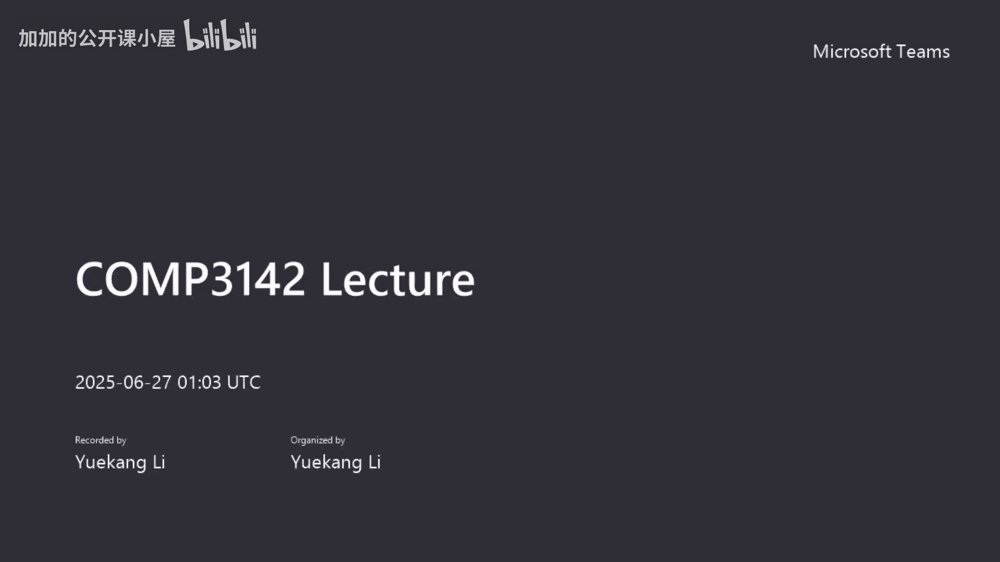

在本节课中，我们将继续学习测试级别，并深入了解系统测试。之后，我们将探讨测试自动化技术及其在实际中的应用，包括如何使用 `pytest` 工具。

## 课程回顾

在上一讲中，我们学习了两种测试级别：单元测试和集成测试。今天，我们将学习第三种测试级别——系统测试。随后，我们将学习一些在实践中非常有用的测试自动化技术。

## 系统测试概述

系统测试是指测试整个系统或整个软件。其核心在于测试完全集成的产品，并依据特定需求（无论是功能性的还是非功能性的）进行测试。因此，系统测试既可以是功能性的，也可以是非功能性的。

在三种测试级别中，系统测试最接近我们的日常体验，因为我们是从最终用户的角度来测试整个产品，而不仅仅是单个函数或小功能模块的组合。

### 功能性系统测试

对于功能性系统测试，我们关注的是产品的功能或业务逻辑。我们测试系统是否能正常运行。通常的方法是提供一些测试输入，并用预期结果来验证程序的输出。

### 非功能性系统测试

对于非功能性系统测试，我们关注的不是源代码或代码结构，而是系统的性能、可扩展性、可用性等质量属性。测试方法通常是找到衡量这些非功能性特征的方法，然后根据预定义的标准来评估结果，而不是对照预期的输出进行检查。

## 功能性与非功能性测试示例

让我们以悉尼的有轨电车系统为例。

*   **功能性特征示例**：
    *   **测试电车调度功能**：这是整个系统的主要功能。
    *   **测试乘客信息系统**：验证车厢内屏幕上显示的信息是否准确。

*   **非功能性特征示例**：
    *   **可扩展性测试**：测试系统在活动或节日期间能否处理比平时更多的乘客。
    *   **可维护性测试**：评估对系统进行维护任务（如道路维护）的难易程度。

通常，功能性特征更特定于当前测试的系统，而非功能性特征（如可扩展性、可维护性）在不同系统中可能具有相似的属性。

## 安全性：功能还是非功能？

安全性在软件系统中是功能性还是非功能性特征？答案可能是两者兼有。

对于大多数日常软件（如Windows自带的计算器），安全性并非必需功能。然而，对于某些软件系统（如防火墙、Windows Defender、Web内容管理系统），安全性则是关键功能。因此，安全性是功能性还是非功能性，取决于具体的软件系统。

## 功能与非功能测试对比

以下是系统测试背景下功能与非功能测试的简要对比：

*   **功能性测试**：主要测试产品的功能。可以在单元、集成或系统测试阶段进行。通常只需一套配置，因为我们只关心软件的业务逻辑。
*   **非功能性测试**：测试各种质量因素。主要在系统测试阶段进行。由于需要覆盖不同的属性，某些属性可能需要特定的环境，因此不同测试套件的配置可能不同。

## 功能性系统测试策略：基于模型的测试

进行功能性系统测试最著名、最常用的技术之一是**基于模型的测试**。这是因为当今使用的许多软件的行为都可以用模型来捕获或表示。

基于模型的测试不是基于实现来测试软件，而是基于模型来检查软件行为是否符合预期。这些模型有助于设计测试用例，有时还能帮助验证程序行为是否正常。

这里的“模型”只是对所测试或开发系统的抽象。其优势在于，由于我们忽略了一些细节，可以进行更强大的分析。这些模型可以从规范或源代码中推导出来。

### 常见模型类型

以下是一些在实践中可能遇到的典型模型：

**基于图的模型**：

*   **有限状态机**：许多软件系统（尤其是那些具有明确定义状态的系统）都可以建模为有限状态机。例如，自动售货机或日常使用的协议（如HTTP、TCP协议）。该模型可用于推导测试用例和检查整个系统的行为。
*   **佩特里网**：擅长捕获分布式系统或并发系统的行为。它由“位置”和“变迁”组成，通过变迁携带令牌在位置间移动，非常适合测试分布式工作流。

**非基于图的模型**：

*   **上下文无关文法**：通常用于表示语言（无论是编程语言还是领域特定语言）的结构。适用于测试编译器、解释器或语言解析器。
*   **决策表**：我们的“老朋友”，擅长捕获规则。每个规则由“原因”（输入）和“结果”（最终动作）组成。设计决策表时，应避免只关注最终动作，而应同时根据输入或原因来构建规则。

**从代码推导的模型**：

*   **马尔可夫链**：一种表示状态和带有概率的转移的**概率模型**。它通常用于模糊测试（我们将在作业工具中使用）。为什么可以将一段代码建模为概率模型？因为当我们进行随机测试时，向程序输入随机数据，到达程序中特定部分的**概率**是可以计算的。然而，这种计算通常成本很高，并且取决于程序内部的条件，通常我们需要进行近似计算。

## 非功能性系统测试指标

如前所述，系统测试中的非功能性测试涉及评估软件质量的各种质量因素。与功能性测试相比，它通常需要更多的时间、精力和资源，因为需要设置不同的配置，有时还需要搭建接近真实的环境。

进行非功能性测试时，我们通常关注以下四类资源：**计算资源**（如CPU、GPU）、**网络**、**内存**和**磁盘**（存储）。

### 性能测试

性能测试关注系统在特定条件下的表现。

*   **负载测试**：检查系统在**预期负载**条件下的行为。例如，模拟500名学生同时使用WebCMS，测试其能否处理。
*   **压力测试**：检查系统在**超出其预期最大负载**的极端条件下的行为。例如，一个设计为支持1000并发用户的新闻网站，在重大突发新闻期间尝试增加到10000用户，观察网站是否会崩溃。
*   **尖峰测试**：测试当用户数量或所需资源**突然增加或减少**时系统的表现。与压力测试关注最终总数不同，尖峰测试更关注资源使用的**突然变化**。例如，作业提交前，学生并发访问量突然从100激增到1000。
*   **耐久性测试**：确保系统在**长时间运行**下的稳定性和性能。例如，让Microsoft Teams会议录制超过24小时，或长时间运行流媒体服务，观察是否存在内存泄漏等问题。

### 可扩展性测试

测试系统能否通过**增加或移除资源**来根据需求进行扩展或收缩。例如，在AWS云服务上部署应用，逐渐增加服务器数量或资源，观察在用户数增长时能否保持性能。这通常用于云服务或弹性实例。

### 可用性测试

评估用户学习和使用系统的难易程度。例如，将一款医疗保健应用交给一组医生，观察他们是否能轻松使用该应用执行某些操作。反馈可用于改进UI和UX设计，涉及人机交互。

### 兼容性测试

确保系统各组件之间，以及软件系统与其运行环境之间的兼容性。例如，测试移动应用在不同Android版本、不同操作系统、不同屏幕尺寸上的表现。网页是兼容性测试的典型对象，现代前端框架支持响应式设计，可以通过浏览器开发者工具的设备模拟功能进行测试。

### 可用性测试

验证系统在特定条件下或一段时间内的可用性或正常运行时间，并测量停机时间。例如，测试在线预订系统，确保其具有99.99%的可用性（即每年只有约52分钟的停机时间）。

### 可靠性测试

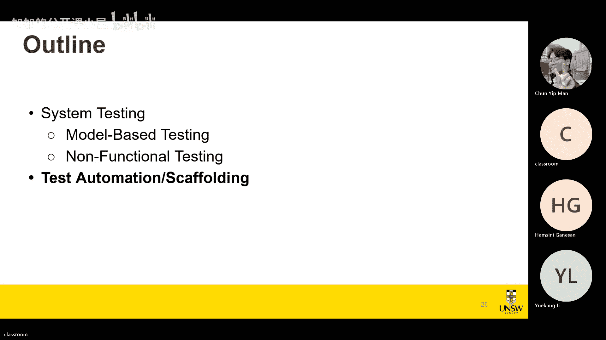

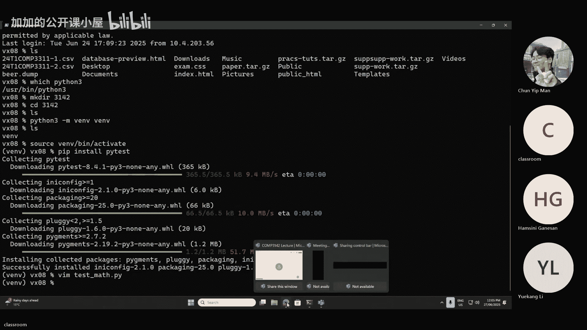

定义为系统在观察期间能够正常且一致地执行。关键是“定义的时间段”。我们可以观察系统一段时间，看是否有错误和崩溃。然而，可靠性测试实际上与其他非功能性测试指标有重叠，因为在观察期间，我们可能会观察到性能问题、停机时间等问题。

## 测试自动化与脚手架

到目前为止，我们已经学习了许多为不同目标设计测试用例的技术，也学习了如何确定测试目标。但是，我们如何实际运行它们呢？

虽然我们可以手动运行代码并检查结果，但**请不要在实践中这样做**。因为人工操作速度慢、成本高且容易出错。测试设计需要努力和创造力（正如你们在作业1中可能体验到的），但**测试执行不应该**。我们应该将测试用例在目标上的执行自动化。

**测试自动化**是关于开发一些软件或有用的脚本，来为我们执行重复性任务，从而让我们能更专注于测试的策略设计等创造性方面。它控制测试用例的执行方式和时机，负责程序运行的环境和前提条件，并能自动比较结果以检查错误，以及自动重新执行失败的测试用例。

**测试脚手架**是为支持测试自动化过程而编写的一组程序。它通常不是产品的一部分，并且经常是临时的。脚手架就像为我们创建一些辅助工具来进行测试自动化。

### 测试脚手架结构

一个典型的测试脚手架代码结构如下：

```
+-------------------+
|    测试工具      | <-- 整个结构称为“工具”
+-------------------+
| - 驱动 (Driver)   | <-- 目标单元的上层，模拟调用环境
| - 桩 (Stub)       | <-- 目标单元的下层，模拟未实现的功能
| - 输出比较器      | <-- 也称为“测试预言”，用于验证输出
| - 清理代码        | <-- 测试后必须执行的步骤（如重置数据）
+-------------------+
```

*   **驱动**：位于目标单元之上的一层。它是目标单元主调用程序的替代品，为目标的运行准备环境。
*   **桩**：位于目标单元之下的一层。它是目标单元中尚未实现或集成以供测试的系统功能的替代品。
*   **输出比较器**：用于比较程序输出与预期结果，通常使用断言来实现。
*   **清理代码**：在运行特定测试后必须执行的任何步骤。例如，重置数据库中的临时数据或文件，以确保后续测试不受影响。

### 单元测试框架

有许多框架可以帮助我们编写测试脚手架代码，它们通常被称为**单元测试框架**（尽管在实践中，我们通常进行的不仅仅是单个函数的测试）。例如：
*   Python: `pytest`, `unittest`
*   Java: `JUnit`
*   JavaScript: `Jest`, `Mocha`
*   C++: `GTest`
*   Rust: 内置测试框架

我们将在作业工具中使用 `pytest`。

## 使用 `pytest` 进行实践

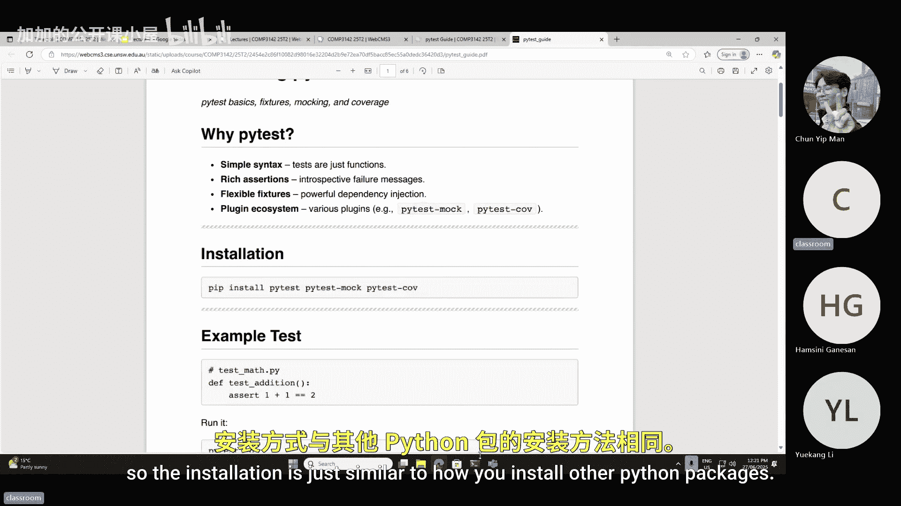

`pytest` 是一个流行的Python测试框架，语法简单，断言能提供丰富信息，并提供了用于管理测试环境设置的“夹具”系统，以及丰富的插件生态系统。我们将学习两个插件：`pytest-mock`（用于创建桩和驱动）和 `pytest-cov`（用于检查测试用例的代码覆盖率）。

### 安装与基本使用

1.  **创建虚拟环境**（推荐）：
    ```bash
    python -m venv venv
    ```
2.  **激活虚拟环境**：
    *   Linux/macOS: `source venv/bin/activate`
    *   Windows: `venv\Scripts\activate`
3.  **安装 `pytest`**：
    ```bash
    pip install pytest
    ```
4.  **运行测试**：在项目目录下执行 `pytest`，它会自动发现并运行测试。

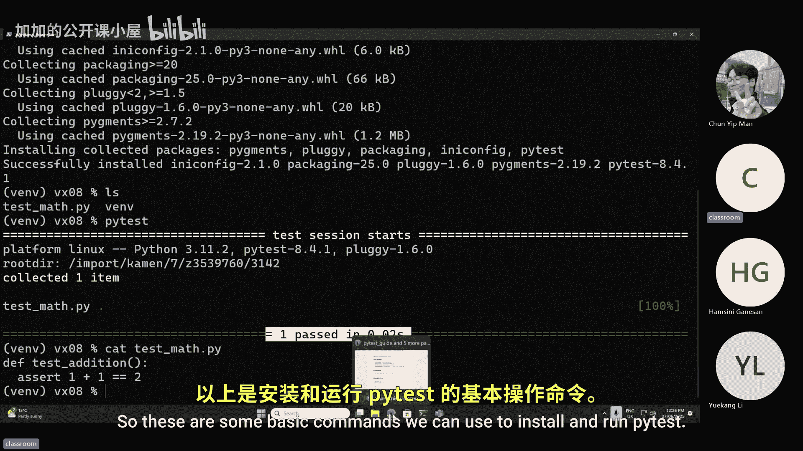

### `pytest` 的优势：丰富的断言信息

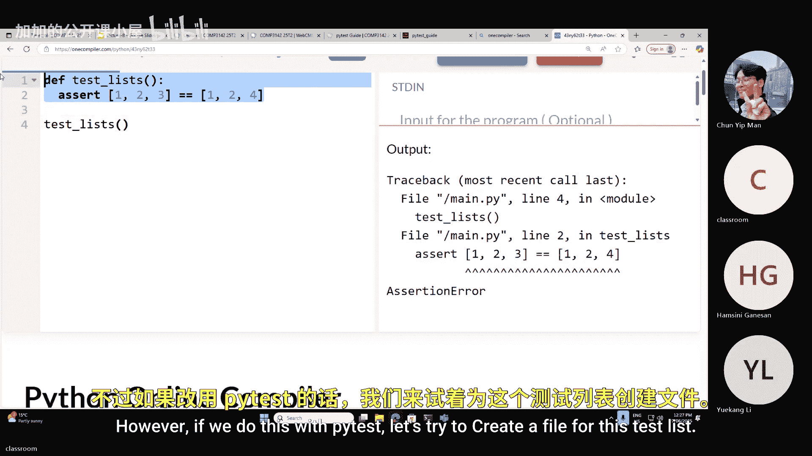

与Python内置的 `assert` 相比，`pytest` 在断言失败时能提供更详细的上下文信息，便于调试。

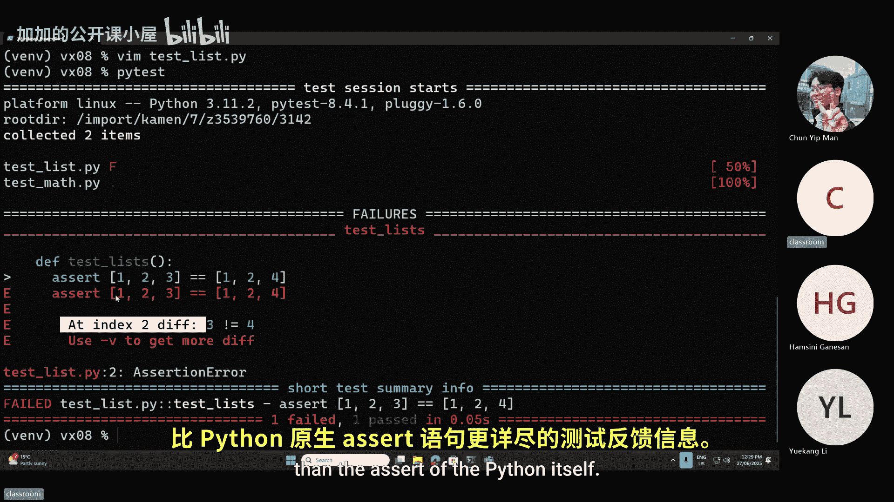

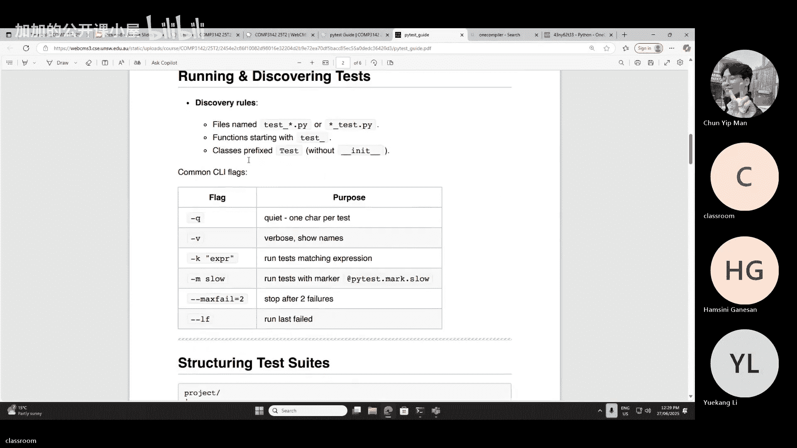

### 测试发现规则

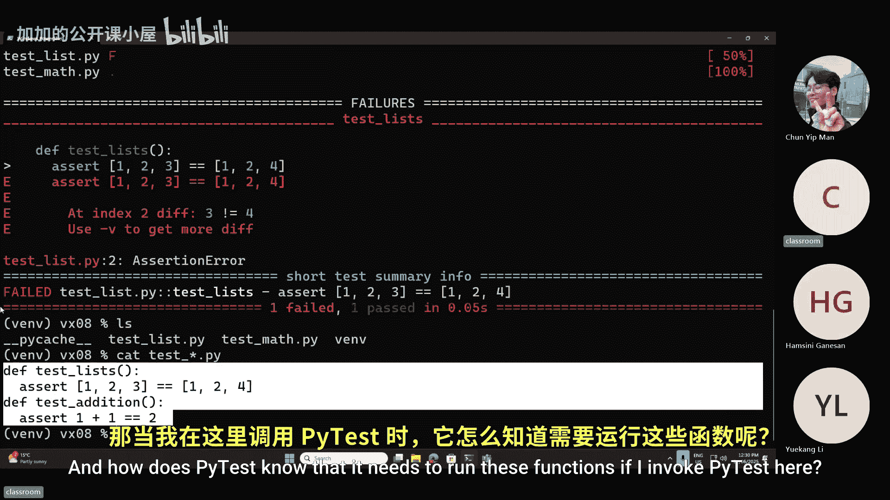

`pytest` 自动发现测试用例的规则：
1.  查找文件名匹配 `test_*.py` 或 `*_test.py` 的文件。
2.  在这些文件中，查找以 `test_` 开头的函数。
3.  同时，也会查找以 `Test` 开头的类（类中的测试方法通常以 `test_` 开头）。

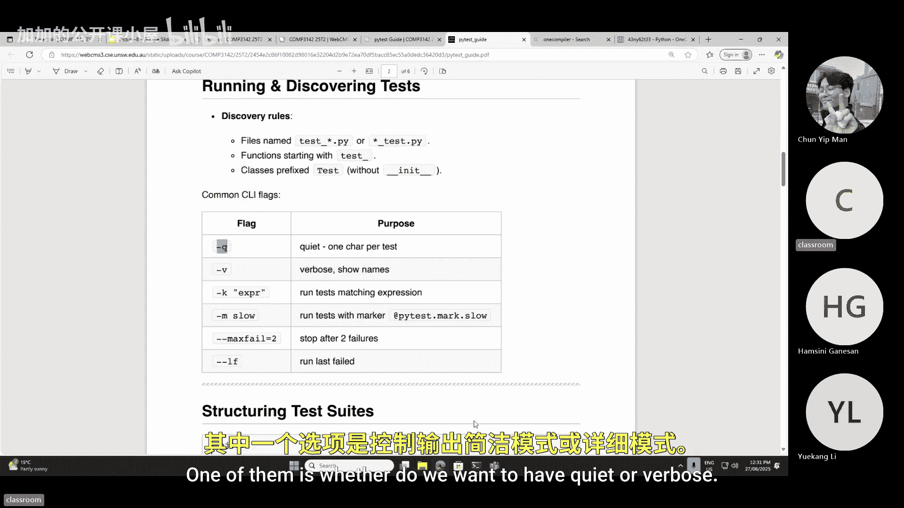

### 有用的命令行标志

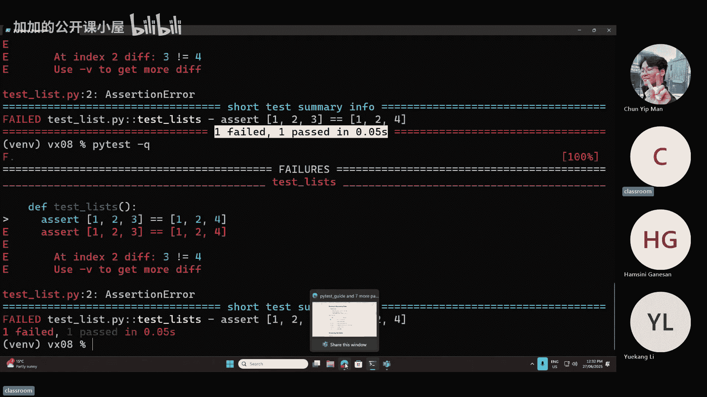

*   `-q` / `--quiet`: 安静模式，减少输出。
*   `-k <表达式>`: 只运行名称匹配表达式的测试。
*   `-m <标记>`: 只运行用 `@pytest.mark.<标记>` 装饰器标记的测试。
*   `--maxfail=<数字>`: 在遇到指定数量的失败后停止测试。
*   `--lf` / `--last-failed`: 只重新运行上次失败的测试。
*   `--lf --maxfail=1`: 组合使用，专注于修复单个失败测试。

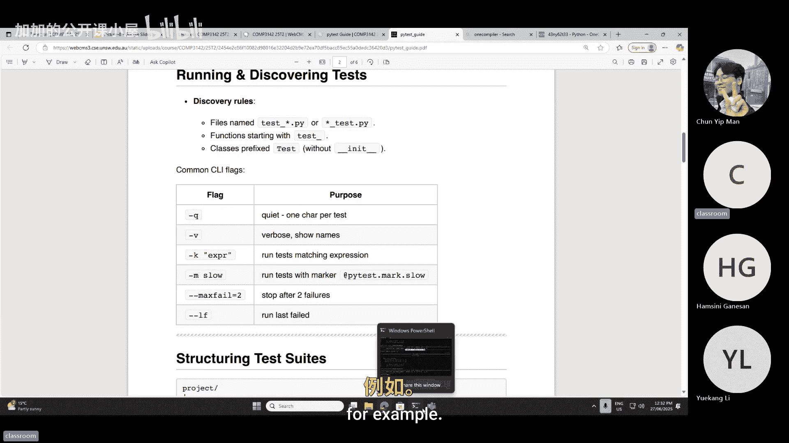

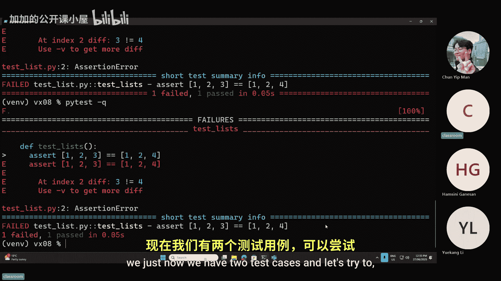

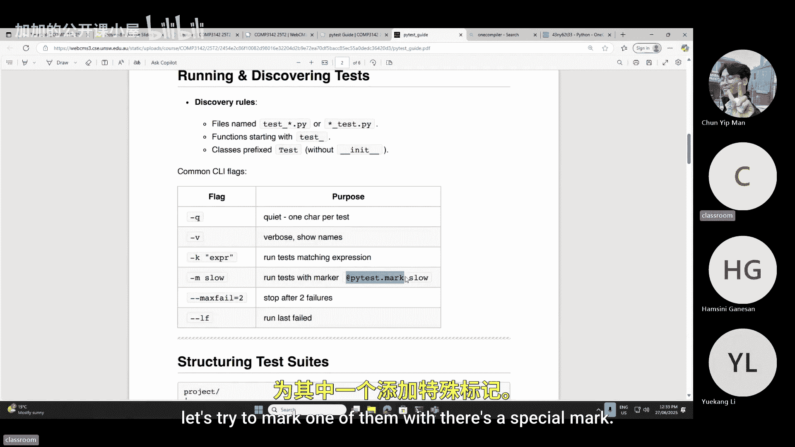

### 项目结构建议

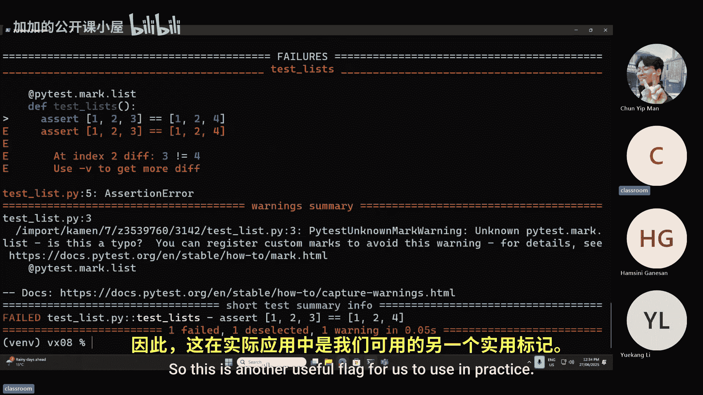

一个典型的使用 `pytest` 的Python项目测试结构如下：
```
my_project/
├── src/                    # 源代码
├── tests/                  # 测试代码
│   ├── unit/              # 单元测试
│   ├── integration/       # 集成测试
│   └── conftest.py        # 共享的夹具和配置
└── ...
```
`conftest.py` 文件用于存放项目范围内共享的**夹具**，这些夹具对应着测试脚手架中的驱动、桩或更高级的环境设置。

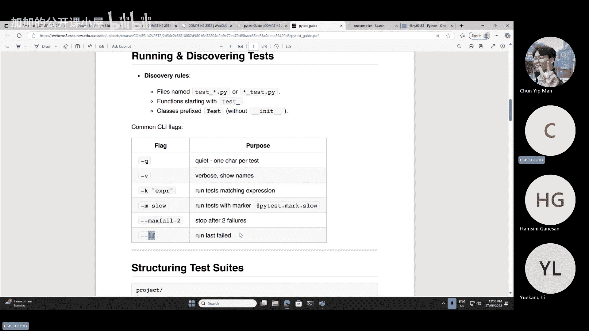

## 课程总结

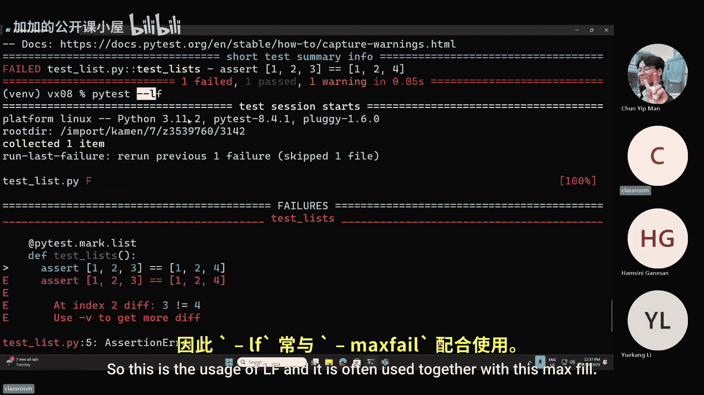

在本节课中，我们一起学习了以下内容：

1.  **系统测试**：作为测试级别的最高层，测试完全集成的整个系统。它分为：
    *   **功能性系统测试**：关注软件的核心功能。
    *   **非功能性系统测试**：关注软件的质量属性，如性能、可扩展性、可用性、兼容性、可用性和可靠性。

2.  **基于模型的测试**：一种重要的功能性系统测试策略，利用抽象模型来设计测试用例和验证行为。

3.  **测试自动化与脚手架**：为了高效执行测试，我们需要自动化重复任务。测试脚手架提供了必要的结构，包括驱动、桩、输出比较器和清理代码。

4.  **`pytest` 实践**：我们介绍了如何使用 `pytest` 框架来编写和运行自动化测试，包括其安装、基本用法、测试发现规则和一些有用的命令行标志。

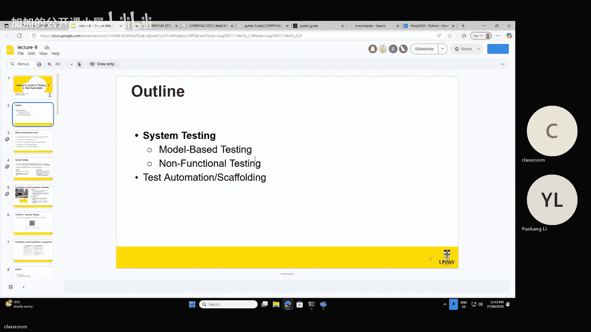

通过本课程的学习，我们已经掌握了从测试用例设计（黑盒/白盒策略）、测试目标确定（单元、集成、系统测试级别），到测试执行自动化（测试脚手架和 `pytest` 工具）的完整测试流程基础知识。