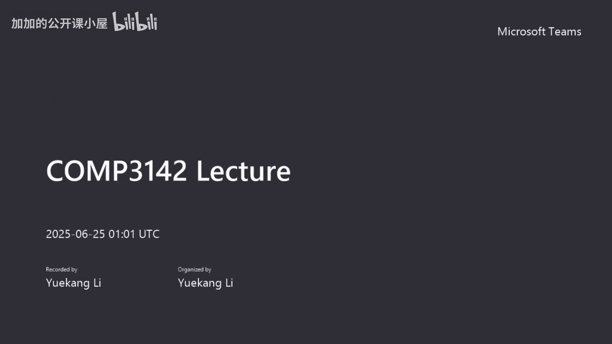
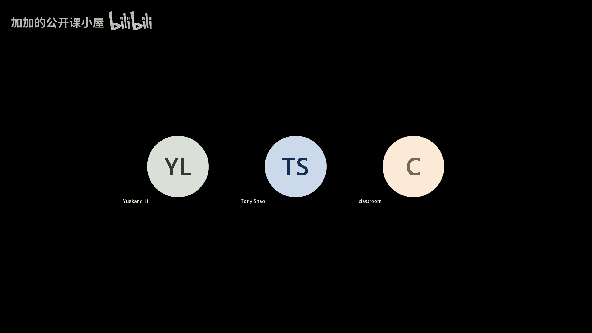
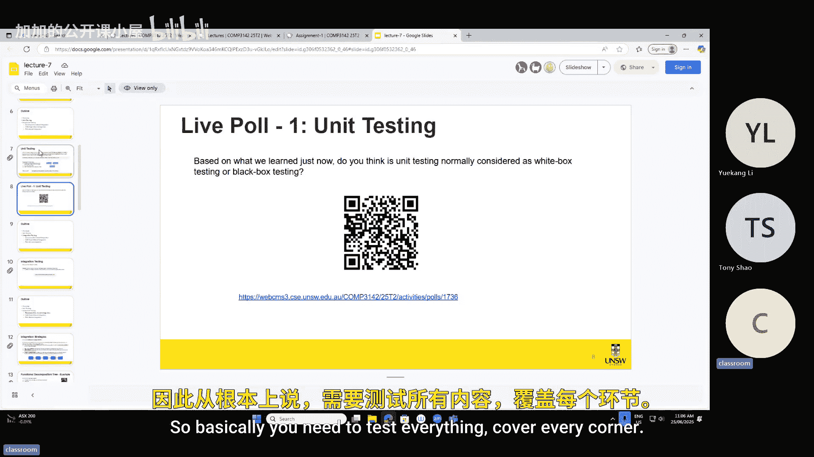
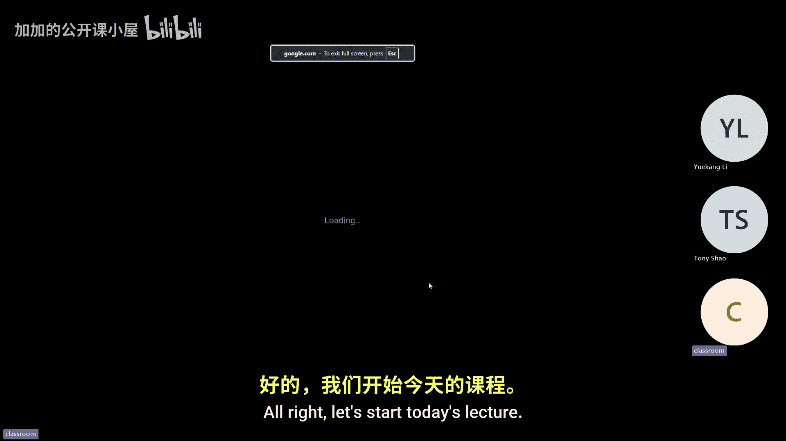
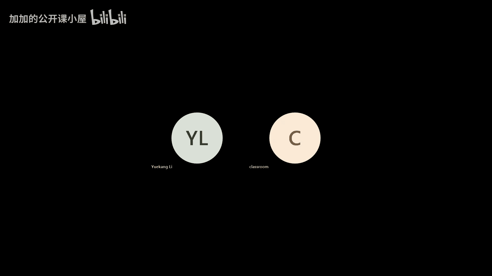

# 011：测试级别（一） 🧪

在本节课中，我们将学习软件测试的不同级别。我们将从测试目标的角度转向测试过程的角度，探讨如何在软件开发的不同阶段进行测试。具体来说，我们将重点介绍单元测试和集成测试，并了解如何根据需求或代码结构来识别和测试不同的系统组件。

---

## 概述 📋

在之前的课程中，我们学习了功能测试和结构测试，它们是从是否拥有源代码的角度来区分测试目标。功能测试关注需求规格，而结构测试关注具体实现。本周，我们将从测试过程的角度，学习不同级别的测试技术，包括单元测试、集成测试和系统测试。这些技术为我们设计测试用例提供了系统化的方法。

---

## 测试级别简介

上一节我们介绍了从测试目标角度区分的功能与结构测试。本节中，我们来看看从软件开发过程角度划分的测试级别。

软件测试可以根据其执行的阶段和目标分为不同级别。这通常通过一个称为 **V模型** 的开发模型来理解。V模型的左侧代表软件开发的生命周期阶段，右侧则对应每个开发阶段需要进行的测试活动。

*   **单元测试** 对应于详细设计阶段，测试程序中最小的可测试单元。
*   **集成测试** 对应于架构设计阶段，测试多个单元组合后的交互。
*   **系统测试** 对应于需求分析阶段，将软件作为一个整体进行测试。
*   **验收测试** 是一个特殊类别，涉及用户验收、法规验收等，本课程不深入讨论。

我们主要关注前三个级别：单元测试、集成测试和系统测试。

---

## 单元测试 🔬

单元测试是测试过程的基础。它专注于测试程序中一个独立的、最小的可测试部分。

### 什么是单元测试？

单元测试是一个动态过程，它针对程序的**原子单元**，使用准备好的测试用例作为输入来运行该单元代码，并将实际输出与预期结果（测试预言）进行比较，以验证其行为是否正确。

其核心在于，单元测试是测试**最小的、可隔离的单元**的过程。

### 为什么进行单元测试？

*   **易于设计测试用例**：由于测试目标较小（如一个函数），只需关注有限的输入（如函数参数），使得测试用例设计更简单。
*   **更彻底的测试**：可以相对更彻底地测试一个单元的所有可能行为。
*   **支持测试驱动开发**：可以先根据需求编写单元测试，再实现代码。

### 什么是“单元”？

“单元”的定义因编程语言而异：
*   在过程式编程中，一个单元通常是一个**函数**或**方法**。
*   在面向对象编程中，一个单元可以是一个**类**（包含其所有方法）。

### 单元测试是白盒还是黑盒？

单元测试既可以是白盒测试，也可以是黑盒测试，这取决于测试的编写时机：
*   如果在编写代码**之前**根据规格说明编写测试（如测试驱动开发），则是**黑盒测试**。
*   如果在编写代码**之后**，结合源代码逻辑编写测试，则是**白盒测试**。

---

## 集成测试 🔗

单元测试确保各个部件本身正常工作。然而，软件中的许多错误并非来自单个单元，而是源于单元之间的交互。集成测试就是用来测试这些交互的。

### 什么是集成测试？

集成测试，也称为子系统测试，关注的是将多个单元组合成子系统后，它们之间的接口和交互是否正确。关键在于如何确定将哪些单元“集成”在一起进行测试。

接下来，我们将学习几种不同的集成策略。

---

## 基于分解的集成测试

第一种集成策略是基于对系统功能的分解。这种方法使用**功能分解树**来识别子系统。

### 功能分解树

功能分解树是一种树形结构，用于将一个复杂系统的功能需求分解为更小、更具体的子功能。
*   **顶层功能**：树的根节点，代表系统最核心的功能。
*   **子功能**：由顶层功能分解而来，是实现顶层功能所必需的。
*   子功能可以继续分解，直到达到最基本的级别。

构建功能分解树的典型步骤是：识别主要功能 -> 划分主要功能 -> 定义功能间关系 -> 表示这些关系 -> 细化分解。

### 示例：日历程序

假设一个日历程序具有以下功能：获取下一天日期、计算闰年、计算星期几、计算星座、识别纪念日、计算最近的“黑色星期五”。
我们可以根据这些功能描述（而非具体实现）构建一个功能分解树。例如，“获取下一天日期”这个功能可以进一步分解为“检查日期有效性”、“计算月份最后一天”等子功能。

有了这棵树，我们就可以应用不同的集成策略。

### 集成策略

以下是基于功能分解树的几种集成方法：

#### 1. 自顶向下集成
这种方法从树的根节点（主功能）开始测试。
*   **步骤**：初始时，将所有下一级子功能用**桩模块**替代。桩模块是模拟子功能行为的伪代码，返回硬编码的正确结果。然后，逐步用实际的实现代码替换这些桩模块。
*   **优点**：故障隔离性好。当替换某个桩模块后出现错误，可以确定问题出在该模块对应的功能中。
*   **遍历方式**：类似于广度优先搜索，逐层替换。

#### 2. 自底向上集成
这种方法从树的叶子节点（最基础的功能）开始测试。
*   **步骤**：叶子节点是实际代码，不需要桩。但它们需要**驱动模块**来模拟其上层调用者，提供执行所需的上下文和依赖。
*   **优点**：需要编写的桩代码较少。由于多个叶子节点可能共享同一个父节点（即共享同一个驱动），可以减少驱动模块的开发工作量。

#### 3. 三明治集成
这种方法结合了自顶向下和自底向上的思想。
*   **步骤**：在功能分解树中识别出一条从根到叶的完整路径，将这条路径上的所有组件作为一个切片进行测试。
*   **优点**：减少了桩和驱动模块的开发工作量。
*   **缺点**：故障定位比纯粹的自顶向下或自底向上更困难，因为错误可能出现在切片中的任何部分。

#### 4. 大爆炸集成
这是一种简单的策略：将所有已实现的模块一次性组合在一起进行测试。
*   **与大爆炸集成和系统测试的区别**：
    *   **范围**：两者都测试所有组件。但集成测试更关注组件间的**内部交互**，而系统测试关注软件作为**整体**的外部行为。
    *   **执行者与时机**：集成测试通常由开发团队在单元测试之后、系统测试之前进行。系统测试则由独立的测试团队在集成测试之后进行。

### 优缺点与选用考量

**优点**：
1.  **良好的故障定位**：除大爆炸外，其他策略都是逐步集成，易于定位错误。
2.  **进度可视**：可以对照功能分解树清晰地了解测试进度。

**缺点**：
1.  **依赖需求规格**：功能分解树源于需求而非代码，而开发者通常不负责编写需求，这可能导致管理上的脱节。
2.  **额外开发工作**：自顶向下和自底向上需要开发桩模块或驱动模块。

**如何选择策略**：
*   **需求清晰稳定**：适合**自顶向下**，便于根据稳定需求编写桩模块。
*   **需求频繁变更**：适合**自底向上**，避免因需求变更而频繁修改桩模块。
*   **代码结构变更，需求稳定**：适合**三明治**，功能切片稳定，不受代码重构影响。
*   **一切稳定**：可以考虑**大爆炸**集成。

---

## 基于调用图的集成测试 🕸️

基于分解的集成测试依赖于需求规格。然而，开发者更熟悉代码本身。因此，我们可以直接从代码结构出发，使用**调用图**来进行集成。

### 什么是调用图？

调用图是一种特殊的控制流图，表示程序中子程序（如函数）之间的调用关系。
*   每个**节点**代表一个过程（通常是函数）。
*   每条**边**表示一个过程调用了另一个过程。

### 集成策略

#### 1. 成对集成
每个测试会话（测试目标）仅包含调用图中由一条边连接的两个单元（一对函数）。
*   **优点**：故障隔离度最高，因为每次只测试两个单元间的交互。
*   **缺点**：修复错误时可能缺乏全局上下文。针对某个“对”的修复，可能无法解决该单元在其他“对”中出现的问题。此外，一个单元出现在多个“对”中，修复后需要重新运行所有相关测试用例。

**测试会话数量**：等于调用图中的**边数**。

#### 2. 邻域集成
为每个节点定义一个“邻域”。通常，邻域半径设为1，即包含该节点本身及其所有直接相邻（通过一条边连接）的节点。每个邻域作为一个测试会话。
*   **优点**：
    *   减少了测试会话数量（通常节点数少于边数）。
    *   避免了桩和驱动的开发，因为邻域中同时包含了调用者和被调用者。
*   **与三明治集成的相似性**：邻域就像是调用图中的一个小子图。

**测试会话数量**：等于调用图中的**节点数**。

### 优缺点

**优点**：
1.  **捕获行为**：通过调用关系捕获了组件间的交互行为，而不仅仅是静态结构。
2.  **减少桩/驱动**：成对和邻域集成都能在一定程度上避免编写桩或驱动模块。
3.  **便于开发人员实施**：基于代码调用关系，与开发方式匹配。

**缺点**：
1.  **故障隔离问题**：邻域可能变得很大，影响故障定位。
2.  **修复与回归测试**：与成对集成类似，一个节点属于多个邻域，修复错误时可能忽略根因，且需要重新运行多个测试会话。

---

## 基于路径的集成测试 🛤️

类似于在结构测试中利用控制流图的路径，在集成测试中，我们可以利用跨模块的执行路径。

### 核心概念

在深入之前，需要理解几个术语（结合控制流图思想）：
*   **语句片段**：控制流图中的基本块。
*   **源节点**：程序执行开始或恢复的语句片段（如函数入口点、从被调用函数返回后的点）。
*   **汇节点**：程序执行终止的语句片段（如函数退出点、调用其他函数前的点）。
*   **模块执行路径**：连接一个源节点和一个汇节点，且中间没有其他汇节点的节点序列。
*   **消息**：将控制权转移到另一个程序单元的机制（如函数调用）。
*   **模块间路径**：跨越多个模块（函数）的执行路径，由多个MEP连接而成。**MM路径图**本质上就是通过调用关系连接起来的各函数控制流图的集合。

### 如何进行？

通过分析MM路径图，我们可以识别出不同的模块间路径。**每一条这样的路径都可以作为一个集成测试的测试目标**。测试用例的设计旨在覆盖这些关键的跨模块执行场景。

### 优缺点

**优点**：
1.  **功能与结构的混合**：通过消息（调用）捕获交互（功能层面），同时测试具体代码路径（结构层面）。
2.  **贴近系统行为**：测试的是跨模块的实际执行场景，更接近真实的系统运行行为。

**缺点**：
**路径爆炸问题**：与控制流图路径覆盖一样，当存在分支和循环时，模块间路径的数量可能急剧增长，导致测试不可行。不过，由于这种方法通常不需要开发桩和驱动，在某些情况下可能是值得的。

---

## 总结 🎯

本节课中，我们一起学习了软件测试的不同级别。

*   我们回顾了从**测试目标**角度区分的功能测试（黑盒）与结构测试（白盒）。
*   然后，我们转向从**开发过程**角度学习的测试级别：
    *   **单元测试**：测试最小的可测试单元（如函数）。
    *   **集成测试**：测试多个单元组合后的交互。这是本节课的重点。
*   对于集成测试，我们学习了多种确定子系统（集成策略）的方法：
    1.  **基于分解的集成**：从**需求**出发，构建功能分解树。
        *   包括：自顶向下、自底向上、三明治、大爆炸集成。
    2.  **基于调用图的集成**：从**代码结构**出发，利用函数调用图。
        *   包括：成对集成、邻域集成。
    3.  **基于路径的集成**：从**代码执行**出发，分析跨模块的MM路径。
        *   将MM路径作为测试目标。

理解这些不同的级别和策略，有助于我们在软件开发的正确阶段，选择合适的方法来系统化地设计和执行测试，从而更有效地发现软件中的缺陷。