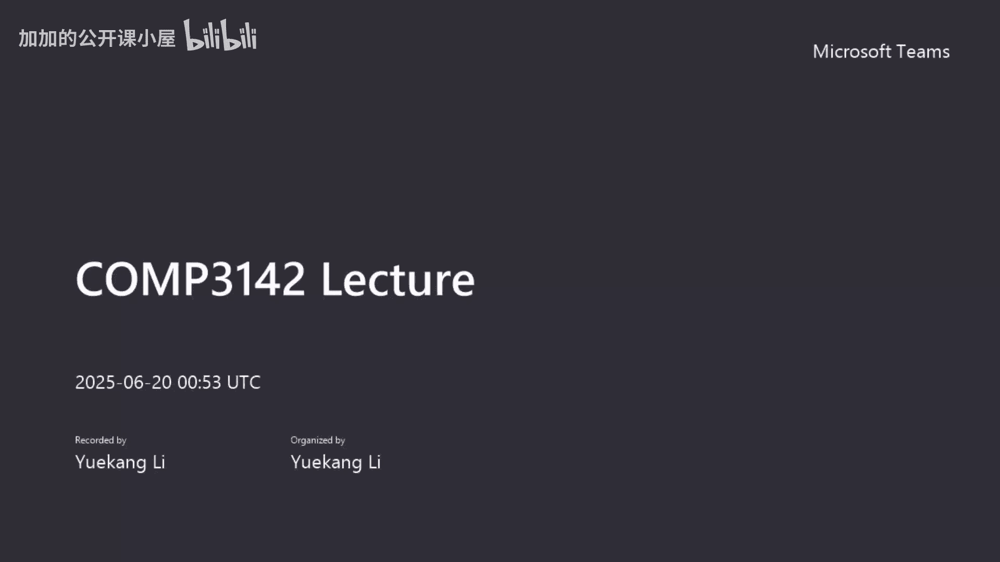
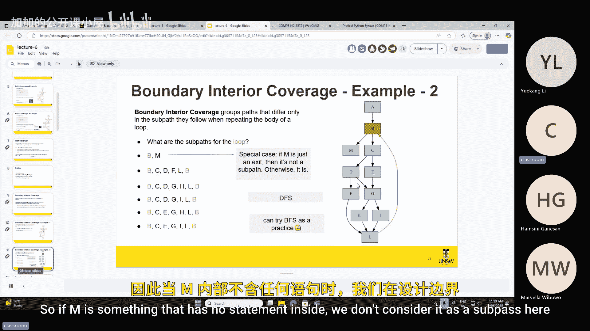
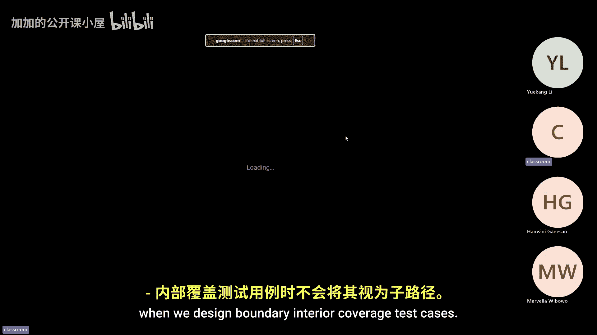
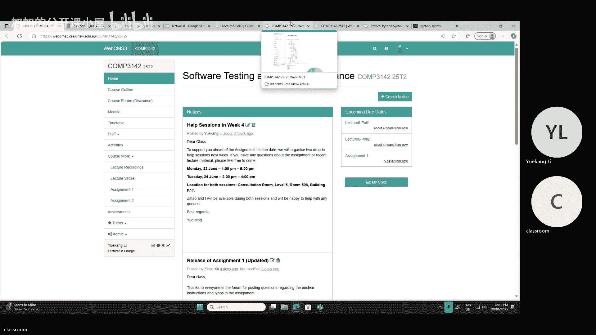

# 012：结构测试 2 🧪




在本节课中，我们将要学习结构测试（白盒测试）中的新覆盖标准，了解结构测试的局限性，并初步认识数据流测试。

## 课程回顾 📚

上一节我们介绍了基于控制流图（CFG）的三种基本覆盖标准：语句覆盖、分支覆盖和条件覆盖。这些标准都关注于图中的单个元素（节点或边）。然而，在实际程序执行中，我们执行的是由节点和边组成的**路径**。本节中，我们来看看如何将路径作为新的覆盖标准。

## 路径覆盖 🛤️

路径覆盖要求测试用例覆盖控制流图中的所有可能执行路径。每条路径是程序执行过程中经过的节点和边的序列，**顺序至关重要**。

例如，一个循环执行一次和执行两次，即使经过的节点相同，也被视为两条不同的路径。

### 路径覆盖的挑战：无限路径

让我们通过一个例子来理解路径覆盖的挑战。考虑以下控制流图：

```
[Entry] -> [BB1] -> [Loop: BB2] -> (Condition) -> [BB3] 或 [BB4] -> [BB5] -> (Loop back to BB2 or Exit)
```

*   如果循环可以执行任意多次，那么程序存在**无限多条**路径。
*   即使我们限制循环最多执行100次，并且循环体内有一个分支（每次循环有2种选择），那么可能的路径总数将是 `2^100`，这是一个天文数字。

因此，**理论上路径覆盖是最强的结构测试标准**，因为它能体现不同代码元素间的交互。但**在实践中，由于循环的存在，实现100%的路径覆盖通常是不可能的**。

## 路径覆盖的变体策略 🧩

既然无法覆盖所有路径，我们可以借鉴黑盒测试中**划分等价类**的思想，将无限多的路径划分为有限的几组，然后从每组中选择代表性路径进行测试。





以下是三种主要的路径覆盖变体策略：

### 1. 边界-内部覆盖

这种策略关注**循环内部**的子路径。它将那些仅在循环体内部子路径上不同的路径归为一组。

**核心思想**：我们只关心循环体内**不同的执行子路径**，而不关心循环执行了多少次。测试时，确保每个独特的循环体子路径至少被执行一次。

**示例**：
对于包含一个循环的程序，如果循环体内有两条可能的子路径（例如，一个 `if-else` 分支的两边），那么只需要一个测试用例（执行循环至少两次，分别走通两条子路径）即可满足边界-内部覆盖。

### 2. 循环边界覆盖

这种策略关注**循环执行次数**的边界情况。它测试能代表循环不同执行次数的场景。

以下是设计测试用例的策略：
*   **0次循环**：测试跳过循环的情况。
*   **1次循环**：测试恰好执行一次循环的情况。
*   **2次或更多次循环**：测试执行多次循环的情况（可选择特定边界值，如 `N-1`, `N`, `N+1` 次）。

这类似于黑盒测试中的**边界值分析**。它通常只适用于**简单循环**（无嵌套、循环条件独立）。

**处理复杂循环**：
*   **嵌套循环**：从最内层循环开始，应用上述策略，然后逐层向外。
*   **串联循环**：如果循环独立，则分别测试；如果后一个循环的条件受前一个循环影响，则采用类似嵌套循环的**自底向上**策略。

**循环边界覆盖的理论依据**：它模仿了形式化验证中证明循环正确性的方法（考虑循环执行0次、1次和多次时，前置条件、后置条件和循环不变式的关系）。

### 3. 线性代码序列与跳转覆盖

LCSSAJ 关注程序中**线性的代码序列**，直到遇到分支或跳转点。一个子路径是一段会顺序执行、中间没有分支的代码。

**定义**：
*   **LCS**：线性代码序列。
*   **J**：跳转（如循环起点、分支点、函数调用/返回）。

**方法**：
1.  识别控制流图中所有的跳转点（J）。
2.  提取所有从一个跳转点到另一个跳转点（或程序入口/出口）的线性代码序列（子路径）。
3.  要求测试用例覆盖所有这些子路径。

**灵活性**：
LCSSAJ 允许我们组合子路径。定义参数 **N**，表示可以链接的连续子路径的最大数量。
*   当 **N=1** 时，LCSSAJ 等价于**语句覆盖**。
*   当 **N=2** 时，LCSSAJ 等价于**分支覆盖**。
*   **N 值越大**，覆盖越强，越接近路径覆盖。这让我们可以控制测试的强度。

## 实践练习：搜索函数 🔍

让我们用一个搜索函数来练习边界-内部覆盖和循环边界覆盖。

**函数功能**：在字符串 `str` 中查找字符 `ch`，返回其索引，若未找到则返回 -1。`n` 是字符串长度。

### 边界-内部覆盖练习
1.  **识别循环**：函数中存在一个 `while` 循环。
2.  **识别循环内子路径**：循环体内有两条子路径：
    *   子路径 A：找到字符，执行 `return index;`。
    *   子路径 B：未找到字符，执行 `index++;` 继续循环。
3.  **设计测试用例**：至少需要一个测试用例，确保两条子路径都被执行。例如，一个测试用例使循环执行两次，第一次走子路径B，第二次走子路径A。

### 循环边界覆盖练习
1.  **执行0次循环**：可能吗？**不可能**。因为进入循环的条件是 `index < n`，而在首次到达时 `index=0`，且根据前面代码 `n>=2`，条件恒真。
2.  **执行1次循环**：可能。测试用例：`str="ab"`, `n=2`, `ch='a'`。第一次循环就找到字符并返回。
3.  **执行2次或更多次循环**：可能。测试用例：`str="abc"`, `n=3`, `ch='c'`。需要循环三次才能找到。

## 结构测试的局限性 ⚠️

上一节我们介绍了多种覆盖标准，本节我们来看看结构测试本身存在的局限。

### 1. 可行性问题
*   **路径爆炸**：如前所述，即使是中等复杂度的程序，路径数量也可能是指数级或无限的。
*   **不可达代码**：
    *   **防御性编程**引入的永远不会触发的错误处理代码。
    *   **遗留代码**中的死代码。
    *   **跨平台代码**中特定于某操作系统的部分。
*   **不可能的条件组合**：某些条件组合在逻辑上不可能发生（如之前的循环0次例子）。

**应对策略**：
*   设定覆盖率的**经验阈值**（如80%分支覆盖）。
*   **聚焦关键代码**（如更复杂的模块）。
*   **人工识别并排除**死代码或平台特定代码。
*   现实中，测试常在**预算耗尽或截止日期到达**时停止。

### 2. 控制流覆盖的不足
所有基于控制流图的覆盖标准都有一个核心假设：**不执行某条语句，则无法发现其中的缺陷**。这个假设成立。

但其逆命题不成立：**执行了某条语句，并不能保证发现其中的缺陷**。

**示例**：
假设正确的条件是 `if (a <= b)`，但开发者误写为 `if (a >= b)`。
*   如果测试用例是 `a=5, b=5`，那么无论条件是否正确，程序行为都一样（`5<=5` 和 `5>=5` 都为真）。
*   因此，即使100%执行了这条语句，也未能暴露错误。

**结论**：仅靠执行代码（控制流）不足以发现所有缺陷。缺陷的暴露还依赖于**执行到该点时的数据值**。这就需要引入**数据流**分析。

## 数据流测试简介 📊

数据流测试从**数据依赖**的角度审视程序，关注变量的定义（赋值）和使用。

### 核心概念：定义与使用
*   **定义**：变量被声明、初始化、赋值或作为函数参数传入值。
    *   公式：`def(x)` 在位置 `p`。
*   **使用**：变量在表达式、条件、参数传递或返回语句中被引用。
    *   公式：`use(x)` 在位置 `p`。

### 定义-使用对
一个定义-使用对关联了一个变量的定义点和其后的一个使用点，并满足：
1.  存在从定义点到使用点的**路径**。
2.  该路径对于该变量是**定义清除**的，即路径上该变量没有被重新定义。

### 数据流覆盖标准
基于定义-使用对，可以定义两种覆盖标准：

1.  **定义-使用对覆盖**：要求每个定义-使用对至少被一个测试用例执行一次。
    *   **优势**：能发现控制流覆盖遗漏的缺陷，因为它要求特定的数据值沿特定路径传播。
    *   **计算**：`覆盖率 = (已执行的对数) / (总对数)`

2.  **定义-使用路径覆盖**：要求覆盖连接每个定义-使用对的**所有可能执行路径**。
    *   **优势**：更全面，结合了数据流和控制流。
    *   **挑战**：同样存在**路径爆炸**问题。即使没有循环，程序中的分支也会导致定义-使用对间的路径数量呈指数增长。

## 实用Python语法：列表推导式与循环 🐍

最后，我们补充一个实用的Python语法，它可以帮助你更简洁地处理集合数据。

**列表推导式** 提供了一种创建列表的简洁方法，并可包含条件逻辑。

**基本形式**：
```python
new_list = [expression for item in iterable if condition]
```

**示例**：
```python
# 将一个列表中的每个元素加倍
original = [1, 2, 3, 4, 5]
doubled = [x * 2 for x in original]  # 结果: [2, 4, 6, 8, 10]

# 只将奇数加倍
doubled_odds = [x * 2 for x in original if x % 2 == 1]  # 结果: [2, 6, 10]
```

**遍历字典**：
```python
my_dict = {'a': 1, 'b': 2, 'c': 3}
# 默认遍历键
keys = [k for k in my_dict]  # 结果: ['a', 'b', 'c']
# 遍历键值对
items = [f"{k}:{v}" for k, v in my_dict.items()]  # 结果: ['a:1', 'b:2', 'c:3']
```

**嵌套循环**：
```python
# 生成两个列表的笛卡尔积组合
list1 = [1, 2]
list2 = ['a', 'b']
combined = [(x, y) for x in list1 for y in list2]
# 结果: [(1, 'a'), (1, 'b'), (2, 'a'), (2, 'b')]
```
列表推导式类似于函数式编程中的 `map` 和 `filter` 函数，但语法更贴近Python风格，易于阅读。

## 总结 🎯

本节课中我们一起学习了：
1.  **路径覆盖**作为强大的理论标准及其**不可行性**（由于路径爆炸）。
2.  三种应对路径爆炸的**变体策略**：
    *   **边界-内部覆盖**：关注循环内子路径。
    *   **循环边界覆盖**：关注循环执行次数（0, 1, 2+）。
    *   **LCSSAJ覆盖**：关注线性代码序列，可通过参数N控制强度。
3.  结构测试的**主要局限性**：可行性问题以及控制流覆盖对数据值不敏感的不足。
4.  **数据流测试简介**：通过变量的**定义**和**使用**对来分析程序，引入了定义-使用对覆盖和定义-使用路径覆盖，以发现更隐蔽的缺陷。
5.  一个实用的**Python列表推导式**语法，用于简化集合数据处理。



理解这些覆盖标准的强弱、成本及适用场景，对于设计有效且高效的白盒测试至关重要。