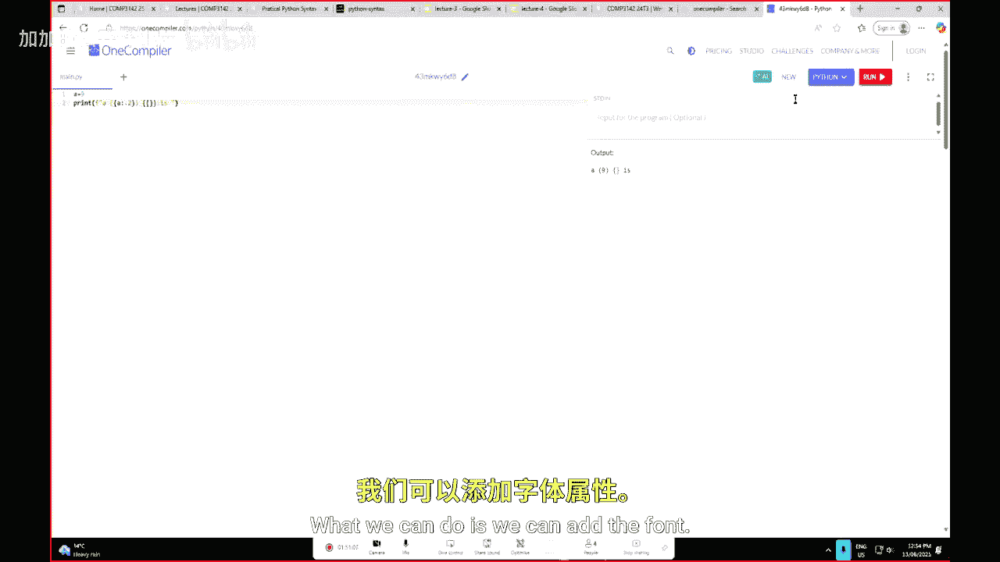

# 014：功能测试（二）


在本节课中，我们将继续学习功能测试技术。我们将重点介绍两种基于逻辑关系的测试方法：决策表测试和因果图法。这些方法能帮助我们更系统、更严谨地设计测试用例，尤其是在处理输入与输出之间存在复杂逻辑关系时。

---

## 决策表测试

上一节我们介绍了边界值分析和等价类划分，它们主要基于输入值或输出结果对输入空间进行划分。本节中，我们来看看**决策表测试**。这种方法通过构建一个表格来捕获程序在不同输入条件组合下应采取的动作，从而强制实现逻辑上的严谨性。

一个标准的决策表包含四个部分：
*   **条件桩**：列出所有可能的输入条件。
*   **动作桩**：列出所有可能的输出动作。
*   **条件项**：针对每一列规则，列出各条件的取值（真/假或特定值）。
*   **动作项**：针对每一列规则，列出应执行的动作。

决策表中的每一列代表一条**规则**，它是一组条件与对应动作的配对。

以下是决策表的基本结构示例：
```
| 条件桩 | 规则1 | 规则2 | ... |
|--------|-------|-------|-----|
| 条件C1 |   Y   |   N   |     |
| 条件C2 |   N   |   Y   |     |
|--------|-------|-------|-----|
| 动作桩 |       |       |     |
| 动作A1 |   X   |       |     |
| 动作A2 |       |   X   |     |
```
*注：`Y`代表条件为真，`N`代表条件为假，`X`代表执行该动作。*

决策表主要有两种类型：
1.  **有限条目决策表**：每个条件只能取布尔值（真/假）。
2.  **扩展条目决策表**：每个条件可以取多个离散值。

在条件项中，符号 `-` 表示“不关心”。这意味着该条件的取值不影响最终动作的选择。每个 `-` 实际上代表了两种可能（真或假），因此会使该规则代表的实际用例数量翻倍。

对于一个具有 `n` 个条件的有限条目决策表，理论上需要 `2^n` 条规则来覆盖所有条件组合。

### 决策表测试示例：三角形问题

我们以经典的三角形判定程序为例。程序输入三个整数（代表边长），输出三角形的类型（等边、等腰、不等边）或“非三角形”。

首先，我们定义条件和动作：
*   **条件**：
    *   C1: a < b + c
    *   C2: b < a + c
    *   C3: c < a + b
    *   C4: a == b
    *   C5: a == c
    *   C6: b == c
*   **动作**：
    *   A1: 非三角形
    *   A2: 不等边三角形
    *   A3: 等腰三角形
    *   A4: 等边三角形
    *   A5: 不可能（条件矛盾）

根据逻辑，我们可以构建决策表。例如：
*   如果 C1 为假（即 a ≥ b + c），则无论其他条件如何，结果都是“非三角形”（A1）。此时 C2 到 C6 都可以标记为 `-`（不关心）。
*   如果 C1, C2, C3 均为真（能构成三角形），且 C4, C5, C6 也均为真（三边相等），则动作为 A4（等边三角形）。
*   如果 C4 为真（a == b），但 C6 为假（b != c），这在逻辑上矛盾（因为 a == b 且 b != c 意味着 a != c，但 C5 未定），可能被标记为 A5（不可能）。

通过系统性地列出条件组合，我们可以得到一系列规则。对于这个有6个条件的例子，完整决策表理论上应有 2^6 = 64 条规则。但通过合并“不关心”项和消除“不可能”规则，我们可以将实际需要设计的测试用例减少到可管理的数量（例如8个）。

### 决策表测试示例：NextDate 问题

NextDate 程序输入年、月、日，输出下一天的日期。这个例子更能体现决策表在捕获复杂逻辑关系上的优势。

简单的边界条件（如月份 1-12）不足以处理月份天数、闰年等逻辑。我们需要更精细的条件划分：
*   **月份类型**：M1 (30天月份), M2 (31天月份，非12月), M3 (12月), M4 (2月)
*   **日期**：D1 (1-27), D2 (28), D3 (29), D4 (30), D5 (31)
*   **年份**：Y1 (闰年), Y2 (非闰年)

动作也需要细化，不仅仅是“计算”，而是具体操作：
*   A1: 日期加1
*   A2: 日期重置为1，月份加1
*   A3: 日期重置为1，月份重置为1，年份加1
*   A4: 不可能

使用**扩展条目决策表**，我们可以为每个条件选择具体的值（如 M1, D1, Y1），而不是简单的真/假。这样可以更清晰、更紧凑地表示规则，避免因使用布尔值而导致的规则数量爆炸。

例如：
*   规则：`M1, D4, Y1` -> 动作 `A2` (日期重置为1，月份加1)。因为30天的月份，30号的下一天是下个月的1号。
*   规则：`M4, D3, Y2` -> 动作 `A4` (不可能)。因为非闰年的2月不可能有29号。

通过合并产生相同动作的规则，我们可以进一步优化决策表，减少冗余。


决策表测试的优点是逻辑严谨，能系统化地覆盖条件组合。但它也有局限性：对于复杂程序，决策表可能变得非常庞大，需要不断迭代和精化设计来消除冗余。

---

## 因果图法

在学习了如何直接构建决策表后，我们来看看**因果图法**。它本身并非独立的测试用例设计技术，而是一种辅助工具，用于可视化地分析和表示输入（因）与输出（果）之间的逻辑关系，并最终转化为决策表。

因果图法起源于硬件测试，它使用逻辑门符号来连接原因和结果。
基本的图形符号包括：
*   **恒等**：原因出现，结果出现。
*   **非**：原因出现，结果不出现；原因不出现，结果出现。
*   **或**：多个原因中至少有一个出现，结果就出现。
*   **与**：所有原因都出现，结果才出现。

使用因果图的步骤是：
1.  识别规格说明中的原因（输入条件）和结果（输出动作）。
2.  绘制因果图，表示出原因与结果、原因与原因之间的逻辑关系。
3.  将因果图转换为决策表。
4.  根据决策表生成测试用例。

### 因果图法示例：三角形问题（修正版）

我们尝试为三角形问题绘制因果图。原因（C）和结果（E）与之前决策表中的条件和动作类似。

一个正确的因果图需要精确反映所有逻辑约束。例如：
*   结果“非三角形”（E1）应由“不能构成三角形”的原因导致，即 **NOT(C1 AND C2 AND C3)**。这意味着 C1, C2, C3 中至少有一个为假。
*   结果“不等边三角形”（E2）需要“能构成三角形”（C1 AND C2 AND C3）且“三边互不相等”（NOT C4 AND NOT C5 AND NOT C6）同时成立。教科书示例中常会遗漏部分原因间的“与”关系。
*   结果“不可能”（E5）通常由矛盾的原因导致，例如 C4 为真（a==b）但 C6 为假（b!=c）。

因果图虽然绘制起来可能繁琐且容易出错，但它有两个主要价值：
1.  **辅助调试**：它能清晰地展示哪些输入条件的组合会导致特定的输出，帮助定位缺陷根源。
2.  **发现约束**：它能揭示输入条件之间的隐含逻辑关系（如互斥、依赖），帮助我们在设计测试用例时避免冗余和无效组合。

---

## 功能测试技术总结与比较

本节课我们一起学习了四种功能测试技术：边界值分析、等价类划分、决策表测试以及辅助性的因果图法。它们的核心思想都是对无限的输入空间进行划分，然后选取代表值作为测试用例。

以下是选择和使用这些技术的一些指导：

**边界值分析的局限与技巧**：
*   **局限**：
    1.  不适合布尔值或逻辑变量，因为它们没有明确的“边界”。
    2.  假设输入变量完全独立，否则会产生大量无效用例（如 NextDate 中的日依赖于月）。
    3.  仅关注输入边界，可能遗漏某些输出行为（如所有边界值测试都未产生“不等边三角形”）。
*   **技巧**：
    1.  **健壮性测试**（考虑超出边界的值）适用于测试程序内部变量的边界（如整型溢出）。
    2.  可以利用非极端的输入值，在程序内部构造出极端的边界情况（如使某个中间变量为0）。

**等价类划分的使用建议**：
1.  弱形式的等价类测试（单缺陷假设）不如强形式（多缺陷假设）全面。
2.  对于强类型语言（如 Java），进行健壮性测试（输入无效类型）可能没有意义，因为错误会在运行时被语言本身捕获，而非程序逻辑。
3.  等价类划分（关注输出）和边界值分析（关注输入）是互补的，可以结合使用。
4.  强等价类测试同样假设变量独立，否则会产生冗余的无效用例。

**决策表测试的适用场景**：
决策表测试在以下情况下特别适用：
1.  程序包含大量的 `if-then-else` 逻辑。
2.  输入变量之间存在逻辑关系。
3.  计算涉及输入变量的子集。
4.  存在清晰的因果（输入-输出）关系。
5.  程序具有较高的圈复杂度（即分支较多）。

**技术对比**：
一般来说，可以这样对比：
*   **复杂性/严谨性**：决策表测试 > 等价类划分 > 边界值分析。
*   **生成用例数量**：边界值分析（尤其是强健壮性）可能产生最多的用例，决策表测试通过逻辑合并往往能用更少的用例覆盖更多逻辑。
*   **设计工作量**：决策表测试通常需要最多的前期分析和设计工作。

本质上，这是在**测试效率**（快速生成用例）和**测试有效性**（全面覆盖行为）之间进行权衡。在实际项目中，可以根据被测系统的特点选择合适的、或组合多种测试技术。

---

## Python 语法小贴士

最后，我们简要了解几个现代 Python（3.5+）中有用的语法特性，它们能让代码更简洁清晰。

### 1. 海象运算符 (:=)
海象运算符 `:=` 允许在表达式内部进行赋值，有助于减少代码行数，提高可读性。

**传统写法**：
```python
data = {"key": "value"}
a = data.get("key")
if a is not None:
    print(a)
```

**使用海象运算符**：
```python
data = {"key": "value"}
if (a := data.get("key")) is not None:
    print(a)
```
它让赋值和检查合并为一步。注意，由于其运算符优先级最低，在复杂表达式中建议用括号括起来。

### 2. 模式匹配 (match-case, Python 3.10+)
`match` 语句类似于其他语言的 `switch`，但功能强大得多，可用于值匹配、类型匹配和结构匹配。

**基础值匹配**：
```python
def http_status(code):
    match code:
        case 200:
            return "OK"
        case 404:
            return "Not Found"
        case 500:
            return "Server Error"
        case _: # 通配符，匹配任何情况
            return "Unknown code"
```

**类型与结构匹配**：
```python
def process_data(data):
    match data:
        case [str(name), int(age)]: # 匹配一个包含字符串和整数的列表
            print(f"Name: {name}, Age: {age}")
        case {"status": 200, "data": list(items)}: # 匹配特定键值的字典
            print(f"Got {len(items)} items")
        case _:
            print("Unknown data format")
```
模式匹配在验证复杂配置或API响应时特别有用，可以大幅简化条件检查代码。

### 3. 格式化字符串字面值 (f-string, Python 3.6+)
f-string 提供了一种更简洁、更直观的字符串格式化方式。

**传统格式化**：
```python
name = "Alice"
age = 30
message = "Hello, {}. You are {} years old.".format(name, age)
```

**使用 f-string**：
```python
name = "Alice"
age = 30
message = f"Hello, {name}. You are {age} years old."
```
f-string 直接在字符串内嵌入表达式，用大括号 `{}` 括起来，代码更清晰易读。还可以在大括号内添加格式说明符，如 `f"{value:.2f}"` 用于格式化浮点数。



本节课中我们一起学习了如何运用决策表进行更严谨的功能测试，了解了因果图作为辅助工具的作用，并对不同的黑盒测试技术进行了比较。同时，也了解了一些能提升代码简洁性的现代 Python 语法。