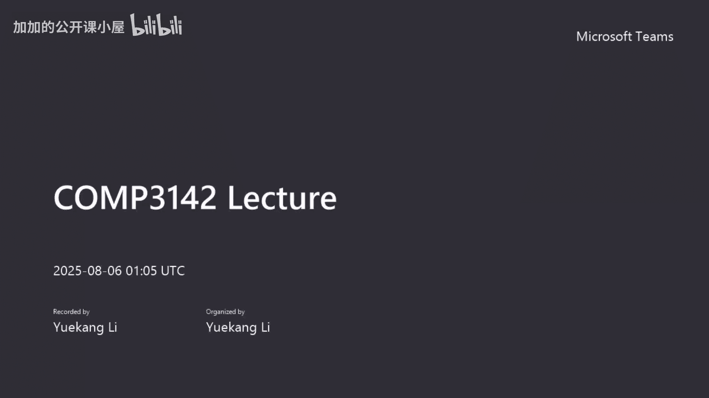
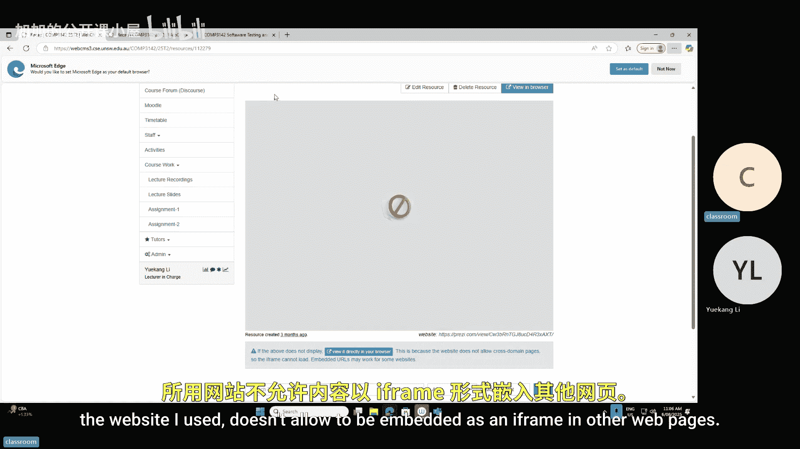
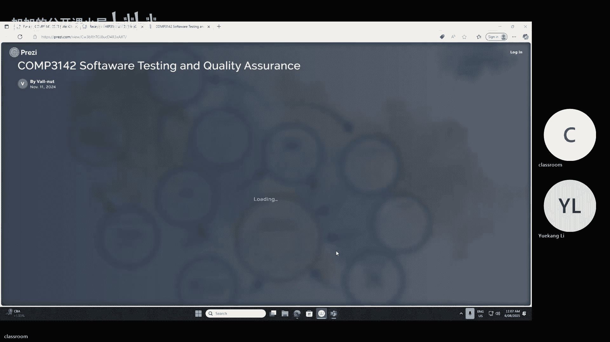
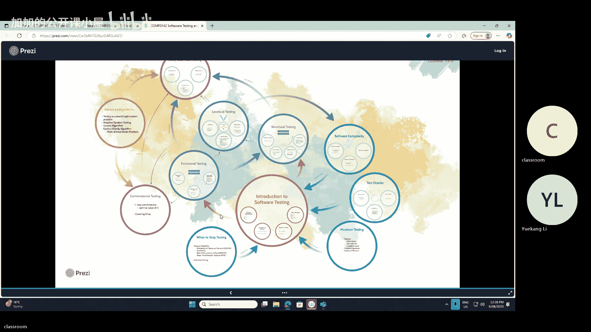

# 新南威尔士大学【中英⚡软件测试｜COMP3142 2025 Software testing】 p01 P1 Course Recap -BV1o34HzBENA_p1-

诶嗯test。ok， so。Let's start。Today is actually our last lecture and we won't have a lecture on Friday and this is a special lecture we are going to have instead of learning new knowledge。

 we are going to have a recap of what we have learned this term。And。Have you done your assignment2。

 Oh sorry sorry，quiz2。Yes or no。 You should have。 You should have try。

 at least have a look because the deal is next Friday。😊，So。😔，Okay， let's start today's lecture。

 And if you click on this on this link here， and you will see， okay， there's。

 it seems to be an error here for this。 the slides today。 But that's only because the。

The the website I used doesn't allow to be embedded as an iframe in other web pages。

 So you just click on this view in browser， and you can view it。

Properly。So。Today， we are going to have a recap of。What we have learned for the entire term。So。

Okay， let's get started。 So this is actually an overview of all the concepts we have learned in this term。

And。And if we zoom in， we can see that we started from the introduction to software testing。

And in this。In this introduction， we learned several concepts。

 The first one is software dependability。 So let's see if you can still remember these concepts。

 So software dependability is like the ultimate goal we want to have， right？

 So we want to build dependable software and dependability is。consists of four different properties。

 correctness， reliability， safety and robustness。 And can you still remember the relations between these。

For properties。Like what is correct but unreliable， What is safe， but not robust。So。

These are the key concepts here。And we also learned the concepts of verification and validation。

 So in。In plain text， they are related to， are we building， sorry， They are related to。

 are we building the product right， and are we building the right product。

So can you still remember which one is which， so。What is， are we building the product， right。

 Is it verification or is it validation。Are they building the product right。

Is it verification or a validation。It's verification。And are we building the right product is。

Validation。So verification is more like thinking from the engineer's point of view about the quality of the software。

 and validation is more like thinking from the user or the customers point of view about the quality of the software。

 So are we building the right product is more like thinking from the。The angle of customers。

So let's continue。 We also learned two concepts。 So dynamic analysis and static analysis， right。

 So most of the testing techniques are。Static or dynamic Can still remember that。

So the testing techniques we are using， like the fastuzz testing we are doing for Z tool。

 is it dynamic or is it static。Is。😔，Dynamic， right， because we need to execute the program。

 We need to let it execute。 We need to run the program。 So it is dynamic。 And dynamic technique。

 technique is more about executing the software and observe for abnormal behaviors。

And static analysis is more about with scan for certain vulnerable patterns inside the program。

So these are the two concepts here。And we also learned six basic principles for doing testing。

 And actually， all these principles， we can。We can somehow see the usage of these concepts in our。

In the actual techniques we have learned， for example， for sensitivity。

 we want to have high sensitivity for detecting bugs， right。

 So that's why when we design test oracles， we need to think about this problem here。😊。

And for visibility and observability， we learned different coverage metrics， right。

 These coverage metrics can help us to know the progress of our testing， right。

 And in your assignment，2， you also tried。You also try to report the coverage of the father， right。

 And this is like a progress， a show of the progress of。呃The entire fighting。呃F session， so。

So this actually improves visibility and observability。And that's all about。

Introduction to software testing。 And after that， what did we learn， we。

We learned functional testing， right， So functional testing is also known as black box testing。

And black box testing means that we know nothing inside the program， right， We know。

 we don't know what's happening inside the program。 We just treat it as a black box。

And because we are treating the program as a black box。We。

 what we can only control is about the program inputs， right。

 We only know what are we feeding into the program and。And because。

The input space of all these programs is like infinite。So there's， we can。

 we can actually feed any type of inputs or any input。Into the program。

So the key idea are the key mechanism of all the functional testing techniques。

Are to divide the input space， according to to certain rules。And the first rule or the first type of。

Division division。😔，Technnic we used here for functional testing is to use the boundary values to divide the input space。

 right， So that's that gives us the technique of boundary value testing。

And for boundary value testing， we learned two key concepts that gives us variations of different boundary value testing techniques。

 So the first concept is about whether the testing is normal or robust。Right。

So normal means that we only care about。The cases where there's no。

No value it out it outside the valid region or the valid range of the。Of the。Parameterters。

And for robust， we care about the invalid inputs， right。

And the second characteristic here is about whether do we consider the worst case scenario or not。

 so。This is based on the single fault assumption。 And if we have this single fault assumption。

 it means that at at most one parameter can take invalid values， right。

 And if we break this assumption， it means that。More than1 parameters can take invalid values。So。

 and that is like the worst case we can have， right， so。

So we can have different variations based on these different characteristics of boundary value testing。

And the second type of technique we learned is equivalentence class testing， so。

This equivalence class testing is also about dividing the input space。And this time。

 instead of using the boundary values， we are using the equivalentence classes of different inputs。

 and these equivalentence classes are normally based on the。The， the characteristics of these inputs。

And similar to boundary value testing， we also have。To different types of characteristics。

So we also have normal versuss robust， which is about whether the values can be invalid or not。

 right， And we also have weak or strong。Equivalence class testing。

 which is about whether more than one parameter can take in values， right。So。

This is about equivalence class testing。And then we also learned another type of。Functional testing。

 which is called decision table based testing。 So decision table is like a model that can model the cause and effect of a program。

 right， So the causes are actually the program inputs。

 and the effects are the actions or the behaviors of the program。So。

Here are some key concepts in decision tables。 So do you still remember what is a sta。

 What is an entry， So stas are more like the table headers， right。

 and entries are the actual values of the table。And do you still remember actions and conditions。

So actions are like the outputs of the program， and conditions are like the inputs we have， right。

And we do have limited entry decision tables and extended entry decision tables。

 Do you still remember the their differences like。What is。

 What's the difference between limited and extended。

So limited entry decision tables means that each one out of the。The action。

 each one of the conditions there could either be true or false。

But extended entry decision tables means can allow us to have entries which are。

Which doesn't just take Boolean values， which can take numeric values or other types of values。So。

This is these are all the techniques we have learned for functional testing。And then。

We learn structural， I think， so。Because functional testing is more like black box。Testing， and if。

 and that's。Because we don't have access to。To the internals of the programs。

 And if we are given the source code of the program。

 then we can do white box testing and the key about all these structural testing。

Techniques or white boxox texting techniques。Is about the coverage metric。We are going to use。 So we。

So because we cant have access to the source code， then we can collect。Code coverage， right。

 But talking about code coverage， there are different metrics here we can collect。

 And let's go through them one by one。And in this course。

 we only we are more focused on the courage related to control flow graph。

And I hope you can still remember what is a control flow graph， right so。😊。

And there are some key concepts in the control F。 And let's go through them， so。

The most basic type of coverage we learned is。Statement coverage， right。 So basically。

 a program is normally a program is considered to be made up of a sequence of statements， right。

 So the target of of most of the our testings is to。Execute all the statements， right， so。

This is very straightforward。And。We， we can also have branch coverage。

 So branch coverage are like the branches on the in the control flow graph and。

Branches are like we are like the points where the control flow diverges， right， So， for example。

 we can have those conditional statements like if， like switch， then。

after executing these conditional statements， the control flow of the program could diverge， right。

 It could either take the true branch or it could take the false branch。So the target of using these。

A related to branch coverage is to execute all the branches。 Basically， we we want to cover all the。

 not only all the。A the basic blocks， but also are the address connecting the basic blocks， right。

So this is the basic idea of branch coverage。And then we also learned condition coverage， so。😔。

 so just now we learned that， okay。😊，Branch is related to normally related to conditional statements。

 right， and conditional statements can have conditions inside these statements， right。

 And so it seems that condition coverage is very similar to branchch coverage， right。

 But what is the difference here。So。Glag。What is the difference between conditional。

 condition coverage and。Branrench coverage。 So which one is。摸啊。AMore comprehensive。

 Or which one contains which。Actually， condition coverage is contains branch coverage because。

There are some conditions which are not used in conditional statements， right。

 We can assign boolean values to some variables using some conditional expressions， right。So。

Condition coverage is more comprehensive than branch coverage。And we could also， we also learned。

The MCCDC coverage， which was used by。Some government agencies in the US。

 and its actually used by NASA。And。MCDC is basically to。Check the courage of all the conditions。

 right。So that's about conditional condition coverage。And we also learned the most。

Detailed coverage we can get from a control flow graph， which is the path coverage。So。

 past coverage is like。Execution pass consisting of basic blocks and edge。

And it's like a permutation of different basic blocks and different edges， right。

 on the control flow graph， so。The target of edge coverage of past coverage is also， of course。

 to try to cover all the paths on this control flow。 However， there is a very。

 very infamous problem if we use path coverage。 and this problem is called path explosion。

So can you still remember， what are the sources of path explosion。Like， which。Hes of。

Cold components could lead to pass explosion。Which types of probe。

Cold components can can lead to this kind of pass exp。Branches and loops。So， for each branch。

We are the， the number of past will。Increase， we will double the number。 We double the number， right。

 Time2， right， Every time we encounter a branch。 And for loops， every time we when。

 we get inside the loop， we get a new path， right， so。😊。

Branches and loops are the sources of pass explosion。And。Therefore， because past explosion。

 because of this very infamous infamous problem。Normally。

 we cannot achieve 100% of past coverage for most of the programs we are dealing with because they are just too complex。

 And in order to simplify the problem， we can have some other coverage metrics。😔。

That can that that are based on path coverage。So the first one is called And Inter coverage。Which。

 which is related to。How many， which is related to the internal values inside the loop。

 And we also learned loop boundary coverage， which is related to how many times do we execute。

 Do we enter a loop， right。And we also have LC C， S A J， linear code sequences and jumps。

 And we can have different levels for this type of coverage。 And if。If we have level。

If we have level  one， then it means that we are not connecting any components。

 Its then the coverage is， the coverage metric is kind of equal to statement coverage。

 And if we have。Level 2， LC C S AJ， then is more like a branch coverage。And so on。

 if you increase the level， we are getting closer to health courage。

And because of the past exposure problem iss normally not， not possible to。

Guide 100% of past coverage。And then。And then we also learned a little bit about。

Data flow based coverage metrics， right。We learned that he was Paris， because。Because。

Using control flow graph coverage is not enough to review all the bugs。

 And we have practiced this with a question in a71， right？

 So even if in the in the in the question in71， even if we can achieve 100% of past coverage。

 we can still craft。We can still inject some vulnerabilities which cannot be detected， right。

 So we need。To so past coverage is about whether we can reach certain parts of the program。

 And the data flow is more about how did we reach this point。

 So with what values did we reach this point of the program。

 So that's why data flow actually provides a different angle of viewing the program states， and。

And the key concept here we learn about data flow coverage is the de use pairs， so。

Deef means value is defined， and use means this value is used in some kind of operations， right。So。

This is all about。The different types of coverage metrics we learned for structural testing。And then。

After this， what did we learn， We learned introduction， We learned black box。

 We learned by white box。 Then what are we going， What did we learn next。We learned black。

 We learned white。And then we learn gray， right， Oh sorry， we， we learn different levels and。

 and we for different levels of testing is more about。😊，It's more related to an old friend。

 the concept of。Software development life cycle， which is a very。

A very classic concept in software engineering。And for software development lifecycl。

 if we combine it with theest life cycle， we can have this very famous V model。😊。

So it actually shows us the relations between different。TheThe relations。

Relations between different stages of development and different stages of testing， so。The different。

 for different levels of testing， the， the testing technique。

 which are closest to the actual implementation of the code is。Unit testing， right。

 And then we can combine different units into some integrations。

 and then we can do system level of testing。 And for unit testing。

 it's actually used for testing the actual implementation and the detailed design。

And for integration testing is more about testing the architecture of the software。

 And for system testing， it's more about testing the software against the requirements。

 the actual requirements。And now let's go through these different levels of testing 1 by one。

 So for union testing， normally is done by the developers of the code。

And it is actually the basis of test driven development。 so we can develop unit test first。

 and then we write the code to pass these tests。😊，And we also learned integration testing。

 So integration testing。The different variations of integration testing is all about how do we build these integrations。

 right， So how do we combine different units into some kind of integrations for us to test。

So the first type of integration we learned is decomposition based integration。

 So decomposition means we are decomposing the entire software， according to some rules， right， so。😊。

What we can do is we can given。因为。Given a tree of the。Given a tree of the。

Requirements of of the of the program。 What we can do is we can do top down integration。 so we can。

 we can slice the。Program into different pieces， according to the requirements， right。

 from top to down。 And we can also do bottom up integration。

 So which bin said we are starting from the。Most detailed features。

 And then we try to combine them together to build up different integrations。

And we can also combine top up and bottom， top， top down and bottom up to do sandwich integration。

And。That is to find like something like a chain of features in the program。And we also have big bar。

 sorry。Big bang integration， which is about。Just integrating everything together。

 And it is actually very， very similar to system testing。And that's about。

Using the requirements to do the decomposition。 And we can also try to use。The code。

 the actual code of the program to do integration。 So we learned the call graph based integration techniques。

 And do you still remember what is a call graph。So is a call graph， a control flow graph。Yes， or no。

A call graph is actually a special type of control flow graph。

 It's also about how the program executes， right， So in which order did the program execute。

 But instead of drawing the graph on basic block level。

 C graph is more about it's on the function level。 So it's about the calling relations between different functions。

 It like which function is calling which one。😊，And based on this。This call graph。

 we can do paraze integration， which is about。Building integrations using pairs of colors and colors。

 right， on the cover of。And we can also have neighborhood integration。

 So neighborhood integration is。There's a concept of the neighborhood size， right。

 Once we have decided the size of the neighborhood。

 then we can grab all the functions within the neighborhood。In。As the integration target。

 we are going to test。So that's about car graph based integration。

 And we also learn path based integration， right， so we can。We can integrate。

Different components of the program， according to the execution pass on the。A control flow graph。

And the last level of testing we learned is system testing。

 which is to test the entire system as a whole。What we learned is there are different types of。

System system testings。So。我在。The most， the most interesting one here is model based testing。

 which means that we can model。 We can， we can use some models to describe the behavior of the entire system。

 And then we can design we can design test cases to trigger different behaviors of the model， right。

 and a typical model we have learned is actually the decision tables。

 And there are also some other types of models like， like the。😊，Finite state machines， right。So。

 that's about。Motorway testing。 And we also learned some non functional system testing。

 which are not related to the， the correctness on of the program， but they。

 they can reflect other types of quality metrics。 For example， we can do performance testing。

 which can check。The execution speed of the system， right， or the reaction time。

 response time of the system。 And we can also do usability testing。

 which basically tests about whether this。Whether a piece of software is。

Uable or applicable for some scenarios， right， We can also do compatibility testing。

 which is related to testing about the compatibility between different components inside the software。

 right， Because now， normally， the software are made up of multiple different libraries。

 and they could be compatibility problems between different versions of libraries and dependencies。

And we have， we also learn several other types of。So nonfunction testing。

And then another important concept related to different levels of testing is called test skyfolding。

 So when we write test cases， we。This is like a complete structure for most of the unit tests we can write。

 So there are some key concepts here， like a driver， like a staub。

 So do you still remember the difference。The difference between drivers and stops。Like。

 drivers are basically the。Providing the context for us to execute the target unit， right。

 And stops are more like some more cups。For some unimed features， right。

 or some features that we don't care when we do testing。So writing stop is actually。

 especially useful for。Test driven development， because we write tests before。

 even before we implement the target， right， So we need to mock up the features of the program properly。

And for most of the testing， we also need to do the output comparison。

 which is to check whether the program。Encountters some bugs are not。

 And then we also need do tear down， right， which is related to。

Releasing the resources we have used during testing， right。

 or to recite the system date during testing。 So we need to do all these。When we write unitize。

And that's all the concepts we have learned for different levels of testing。And then。Then we learned。

Then we combine the knowledge of the color of boxes and levels of testing to have gray box fuuzzing。

 So gray box means it the color of box。 and fuuzzing is actually a type of system testing technique。

So。When we learn， when we learn fuzz， we learn black box。😊，Fuzzing burst， so。Black box fuzzing。

 there are different。 There are two types of black box f。Fuzzing techniques。

 the first one is called mutation based phuzzing。 The second one is called generation based phuzzing。

 So do you still remember the difference between these two types of techniques。Like。Why what like。

Are we using these two terms to what are what is describe described by these two terms here。Like。

 are we describing the creation of test cases or are we。

Are we talking about the the execution of the program or some other things。

So what is described by these two terms here。The these two terms are actually used to describe。

 how do we generate test cases。So mutation based type fuuzzing is more about give。

 given an initial speed。We are going to add， do some mutations。

 We are going to change the content of the seed to create new test casess， right。However。

 for generation based fundinging， we don't have seeds like we are creating new test cases from scratch。

 but， but normally， how do we create test cases from scratch， we need to。😊，Use some rules， right。

 We need to follow some。Models like， for example， if we are testing a。

If we are testing adjacent passer， then we need to follow the rules to create adjacent objects。

 right， So for generation based testing， normally we need some。

Some rules or some models to guide the generation of test cases。

And we also learned white box fuzzing。 So white box fuzzing is normally related to symbolic execution and concolic execution。

 so。So normally， normally， when we， when we execute a program or when we run a program。

 is considered as。Concrete execution， because every， every value， if。

 if we stop the program at any state。Then each of the value of the variables at that particular program state is a concrete value。

But for symbolic execution， we can use symbols to represent the values of different variables instead of using the concrete values。

 and then we can accumulate the conditions of which are related to the input content。

 which can constrain， which can which acts as the constraints to the content of the input。

 and then we can apply some SMMT servers to find a solution that can satisfy all the constraints to reach a certain program state。

And that is how symmantic execution works。And it actually requires us to accumulate constraints and apply a server to solve these constraints。

 And for some very complex programs， there could be too many constraints which which are not actually sovable by the。

Sover， so normally， white box fing or white box testing is not scalable enough to test large programs。

So this is a drawback of white box fuuzzing。And to combine the。

Black box fing and white box fuuzz together。 We can have gray box fuuzzing， so。

The key mechanism of green box fuing is actually to divide and conquer， right， Grbox fasting is。

It's like we are still， it's not black box， so we are still collecting information from the program。

Right， so like when you do a 7，2， you know that， okay。

 we are collecting the coverage information of the executions， right。

 but we are not unlike white box testing。 So white box testing requires us to know everything inside the program。

Unlike white box testing， we only collect。The partial information from the execution will only collect something like the edge coverage or some other interesting。

Information， which are， which could be determined by us。

 So we don't collect all the runtime information。 We only collect some interesting information， so。

This means that we can make the technique scalable for large programs。

And the key mechanism is divide and conquer because we are keeping some。

 because we can collect feedback。 So we know which test case。Is kind of better， right， For example。

 when we do coverage guided fast we the seedss or the test cases that can bring us new coverage。😊。

Could be considered as the good ones， right， Then we can keep them and create new test cases based on these seedss。

😊，And in this way， we are kind of gradually exploring the program space， right。

 And we are kind of dividing the， the bigger problem into some smaller ones。

 So this is like why it is called a divide and conquer strategy here。😊，And there are。

 there are several different strategies。Used for Grbox buzzing。

 So the first one is seed prioritization。Because we have a list of seeds。 We need to。

 We need to make the decision of which one to use next， right。

 So seed prioritization is related to the decision of which seed to be used next。And。2。

Another strategy we will learn is power。So this is after we do see prioritization， so。😊。

We know now we have the next seed to use。 We need to decide how many new test cases to be generated with this seed。

 right， And this is this decision is related to the power scheduling strategy。

And the last one is how do we generate new test inputs， right， We have decided。

 We have decided how many new test inputs should we generate now。

 we need to decide how do we generate them， right， and how do we generate them is related to how these mutation operators。

 right， We can design different mutation operators to create new test cases。😊，And a very famous。

We boxs father is called American Fuzz Lo。 And we learned some detailed mechanisms of it。

 And we are going to practice this with a 7，2， right。So thats are all about Gr box testing。

 And that's actually the first half of this term。 And also the first half of today's lecture。

 Let's have a five minutes break。😊，Alright， let's start。So second half， so。So in the， actually。

 in the first half of。This term， we learned different testing techniques。And。

Which are the ones related to are actually almost all of our assignment。Questions。

And that's because I， I wanted actually to， to let you focus on the assignment during the second half of this term to give you more time。

 And so the second half of the term， we are covering several。Other concepts。

 which are related to software testing， but not may not be exactly new testing techniques。So。

The first concept we learn in the second half of the term is software complexity complexity。

 So software complexity is。Useful for testing， because。Because。😔，Normally。

 we assume that the more complex a piece of software is， the more likely it is to be buggy。

 So that's why we learn software complexity。 and there are。And just like coverage。

 there are different metrics for counting or for measuring。Software complexity。

The first one is called unit level complexity， and。We learned to。

Different types of unit level complexity。 The first one is。his psychomatic complexity。

So do you still remember what iscyclmatic complexity。So it is related to graphs， right。

It is a number of edges minus the number of nodes plus 2， right。So we can。

 because programs could be represented as control flow graphs。

 so we can calculatecyclmatic complexity of a program based on the control flow graph。However。

 there is a。There's a formula for doing quick or fast calculation for software。 right。

 We don't need to draw a control flow for a very complex。Software a very complex function to。

 to calculate the psychomatic complexity。 we can use。The different statements to。

 and using the fast calculation formula to， to calculate。This complexity here。And。

Syomatic complexity is more related to the structure of the code。

 It doesn't really take into consideration the volume of the code， right。

 So a very long function with no branches can have a very lowcyclmatic complexity， right， However。

 if even if there's no branches in a very large。sequential function。

 There could be some bugs inside that very big function， right。

 So we need to take into consideration the volume of the program or the size of the code。

So that leads us to house tax metrics。 So which is related to the number of total and unique operators and opera。

 right， There are several formulas to calculate this。

 but all of them are based on the number of unique。😔，Operators and opera， and the number of total。

Operators and operas。So that's unit level complexity。これ。

And then we also learned integration level complexity。So。

Because psychomatic complexity is applicable to。Graphs， so for integration level of graph。

 what we can have is a co graph， right， we can still use。Pyomatic complexity here。

And we also learned several metrics for。Calculating the complexity of object oriented programs。

 So which are kind of related to。Different。😔，Characteristics of the different different concepts in O。

 O P。And lastly， there are system level of complexity。

 but there's nothing much here like all of them are kind of covered by unit and integration。

 So there's no big difference between integration level of complexity and system level of complexity。

So that's all about software complexity。And then we learned another important concept called。

Test oracles。So， test oracles are basically。To tell us whether a test shall pass or fail。

Because theres sometimes the bugs are easy to。 This is related to the sensitivity。

Characteristic of testing。 So sometimes。We could we can easily tell that a program runs into a bug。

 right， because the program crashes because the program misbehaves。 That's very easy。😊。

But there are some cases where we can hardly tell whether a program runs into a bug。

 So that's why we need to design some test oracles to help us to tell whether the program。

Is behaving normally or not。And there are different types of oracles here。

 So we can have specified oracles。 So most of the specified oracles are manually created。

And they could there could be， they could be model based。 So， for example。

 we can model the entire system as a finite state machine。

 And if the program runs into an error state of the finite state machine。

 then it means that the the the program runs into some bugs， right。

 And we can also use expected values as test ors， these are just like the assertion。

 these values we used in the asserts of unit tests。😊，And they can also do self checks， so。

The difference between expected values and self checks is that expected values are normally used in the test unit tests we are writing。

 but instead of putting the assertions inside the test。

 we can add assertions in the logic of the original program， right。

 we can add some internal checks inside our program。 So once something went wrong。

 it will give us an assertion file。 So。These are the。

 these are the different types of specified oracles。And then。We also learned some derived oracles。

 which could be obtained automatically， so。😔，The first one we learned is differential testing。

So the basic idea of differential testing is to use two versions。Of the two versions of programs。

 implementing the same feature。For example， if we are testing， if we want to testing， if。

 if we want to test some maybe。Some H T M L， renderer， for example， we can use。

 We can select our target from something like edge。 this edge browser here or Chrome。

 and see if an H M L page is rendered differently， right。

 If the result like the rendering result is different。 Then it means that。

At least one of these implementations is wrong， right。

 So this is the basic idea of differential testing。 If it is to differentiate between the outputs of。

Of implementations of the same feature。 So this is。The idea here。

And we also learned regression testing， which is to。

To use existing test cases to test the new features we are introducing during development。

And we also learned the idea of。Expected values again。 I think this， this is an error in this page。

So， we also learn。Matmorphic testing。 So Mamorphic testing is all about finding metamorphic relations。

That can capture the mechanism of the target we are testing。

 So sometimes it's hard to directly tell whether。An output is correct or not。

 but we can find some equivalentence of the output， right， for example， we。We， let's say， we， we。

We want to test a function that calculates the value of pi， and we don't know the value of pi。

 So we can't do。 we can't check with the expected value here because we don't know the actual correct value of pi。

 right， So what we can do is we can use the knowledge that。😊。

Pi times the sine pi equals to sine sine X equals to sine pi cos cosine pi minus X for a little bit of math here。

 So we know this。 Then we can use the output of the。

Function that calculates pi inside this formula and check if the formula holds or not。

 if this equation holds， then。It means that the pi calculated by the function is probably right。

 right， And if this equation is gets broken with the value we calculated。

 then it means that this implementation is definitely wrong。

 And that is the metamorphic relation here。 So it's basically the basic idea here is to find equivalence or some observations about。

The target we are testing， so。That's the idea of mamorphic testing。

And we also learned some implicit oracles。 So implicit oracles are like the test oracles that are that are naturally。

That could be naturally derived from any program。 Like， for example， if a program crashes。

 then it means that there is definitely a bug， right。😊。

And to improve the sensitivity of these implicit oracles， we can use some sanitizers。

 and sanitizers are like。😊，Some special type of instrumentations we can add into the programs。

During compilation， and one of the most famous sanitizer is called address sanitizer。

 It can help us to capture different memory related errors。 And in the targets in a7，2， actually。

 the targets we provided。 you are compiled with address sanitizers。

 So you can easily find bugs or crashes inside these targets。😊，And lastly。

 we can use humans as oracles。 So we can always ask a human to tell whether this program is running correctly or not。

 right， And these human oracles are especially useful nowadays because of。These dash anchor models。

 they are during the training process。 Most of them are kind of using humans as feedbacks。So。

So for doing human for。For using humans as oracles， we can some， sometimes we can do crowdsourcing。

 So because this is very labor intensive so we can use some crowdsourcing platforms to help us to distribute the tasks。

So that's all about test oracles。And then。We learned mutation testing。Mutation testing。

 although the name sounds like another testing technique， right。

 but it's actually a special type of technique。😊，So can you still remember why it is special。

So for most of the testing techniques， we just learned they are used to test。

The quality of the target program， right。But。We don't know the quality of our test cases， right， We。

 we can use test cases to test the quality of the software。

 But how do we know the quality of our test cases， right。So。So the key， the basic idea is very。

 very simple。 So we can use test cases to evaluate programs。

 and we can also create programs to evaluate test cases， right。

 So the basic idea of mutation testing is to。😊，Create some variations of programs that can help us to evaluate the test cases。

😊，And the way of creating these programs is through mutations。 So through some random changes to the。

 to the original program， which are likely to inject some bugs。

 And then we can use our test cases to see if our test cases can capture these injected bugs， right。

And the key concept here， there are three key concepts here。 So the first one is like the mutants。

 So the mutants are the。😊，Program verification variations we have created， right。

 with some small bugs， small changes and bugs。And the process of killing mutants is to use。

To see if a mutant can pass our test or not， right， If a mutant cannot。

Cannotfuse in at least one of the test cases， then it is considered as killed。And。

If a mutant can pass all the test cases we have， then this mutant is considered as a live mutant。

And the mutation score is to use。The number of cud mutants divided by the number of total mutants。

 So the more mutants we can queue with our test cases it the better the quality of the test cases are。

 right。So。This is mut mutants， and we can use mutation operators to create mutants。 We can。

Use these mutation operators to simulate errors that could be made by the developers。

During development to create these variations of programs。And actually， these。

Mutation operators determines the quality of the mutants， right。

 So the closer these mutants are to the to the actual errors in the programs。

 Then the better the qualities of the mutants are。So mutation testing is different from mutation based testing。

 and it is a special technique used for evaluating test suites。And。Near the end of this term。

 we learned when to stop testing， so。When to stop testing determines on the is determined is is。

Is determined by the。Reliability of the program。 So once we think that this software or this program is reliable。

 then we can stop testing。😊，However， this means that we need to measure the reliability of the program。

 right。So， we learned different metrics for measuring reliability。 So reliability means。

The program can run without problem during the observed period of time。So during so。

 so we are kind of like observing this program for a period of time。 and during this observation。

 this program doesn't run into any problem。 Then this program is considered as reliable。

 So there are different metrics here for measuring reliability。

 The first one is the probability of failure on demand。😊，Which is related to the number of field。

Requests divided by the number of total requests， right， and availability is related to the。

On time and off time of the system。Right， so sometimes the system is down like， for example。

 the server is down。 sometimes in USW， some of the systems。

 So the we can use the number of on time divided by the total。

Amount of time units during this observed period as the availability of the software。

 And we can also use the rate of occurrence of found， which is which is。Basically， to count， then。

Frequency of errors during this observed period， right， And we can also you。

 we can also calculate mean between failures， which is related to。

呃The average amount of time we run the program between we encounter before we encounter a failure of the program。

And lastly， we， we introduced the concept of statistical testing， which is。

 which could be used to measure these metrics， which is basically to simulate the real usage environment。

And we can collect like the usage profile of the users and then simulate how does this program run in this simulated environment and collect all the values for these metrics。

So， this is about。When to stop testing。And then， we learn unique。Type of testing technique。

Which is considered as a。Con which which could be considered as either system level of testing or which could be considered as different all the three different levels of testings。

And this is called combin testing。 So previously， all the testing techniques are dealing with the parameters of the program。

 but we somehow ignored the configurations that could be used by the programs， right， so。

Combininator testing is more often used to test different combinations or different options passed to the program。

 And the key idea of combinations is to use TV combinationator to to use TV combination， so。

Because we can， if we come， if a program can take different options， there。

 there is a huge amount of permutations we can have， right。

 for the different combinations of these options， option values。

TV communication limits the number of communications we can have。 like， for， for example。

 for two way communication， it means that we want to cover all the possible pairs of option values。

 right， So we don't need to care about the。Premutations。involvingvo three or more option values。

 We only care about all the possibilities for pairs。

 So this can limit the number of test cases needed。And。

And do you still remember the optimal value of T for like most of the systems。Like。

 what is roughly this。Number here， like。Do we need to do four way communications？

 Do we need to do three way communications those combinations。So， our two way combinations。

So for most of the systems，2 or three is enough。2 or three is enough。And。Another thing is。

 when we create test cases based on these T combinations。

 we don't need to create a test case for every combination， because。😊。

Some test cases can cover multiple combinations， right， So how do we。Calculate the optimal set of。

Optimal set of test cases here。 So the concept we use is called the covering array。

 So we use this covering array。To keep track of which test case can cover which combinations。

So we can minimize the test suite we have。According to covering a， however， however。

 this covering array is hard or difficult to calculate。 We have different algorithms。

 and we learned the greedy algorithm for calculating this， covering array in this course。😔。

And talking about algorithms， we learned some advanced algorithms nearly last week， actually。So。We。

 we learned some advanced algorithms that could be used for testing and some other related problems。

 So before we， we learned these algorithms， we tried to formulate testing as a search and optimization problem。

So。So that the the reason is if we can， if we can formulate testing as a search or optimization problem。

 then we can apply algorithms solving these type of problems to testing， right。

 So that's the rationale here and。😊，Sorry， so for。A search problem。

 So we are trying to search for a suitable test suite， right。

 So there could be an infinite number of test cases we can have for a particular program。

 And we are like searching the optimal set of test cases。😊。

So this is why testing could be considered as a searching problem。 And for optimization problem。

 that is because we often have limited budgets， right。

 So we have some constraints when we do the search。 So that's why we want to get an optimal solution。

 rather than maybe the perfect solution here。 So that's why。😊，By applying these constraints。

 we can further convert the searching problem into an optimization problem。

And there are some algorithms for。Dealing with these， for dealing with these optimization problems。

 And the first one we learned is adaptive random testing， so。Instead of。

Creating the test cases random， purely randomly， what we can do is。

Based on our previous testing results， for example， if， if a test case cannot find a bug。

 then we create a very different test case， right， So that's。

Some the basic idea of adaptive random testing。 So if the。Previous test case is not good enough。

 Then we just create a very， very different test case。So。That's adaptive random testing。 And we also。

 that adaptive random testing is considered as a heuristic based algorithm。

 which means that it is based on some。Observations or some empirical findings， right。

 based on some experience of humans。And however， we want to have a way to。

Automatically extract heuristics。 And this is called meta heuristic。

 And we can have some meta heuristic based algorithms。 And genetic algorithmism is one of them。

 So the basic idea of genetic algorithm is to simulate the evolution process of chromosomes and genes So we can evolve entire population through several generations and keep the good characteristics of these test cases of these population。

 And towards the optimized goal。😊，Thats genetic algorithm。

 And we also learned Epsilon gradient algorithm。And that's this Epsilon gradient algorithm is used for dealing with。

The multiarmed bandit problem。 So multiarmed bandit problem is like we have multiple arms in a gambling machine。

 And by pulling each arm of the gambling machine， There is a chance for us to get a reward， right。

 And we have a limited number of tries for us to pull the arms。

 So how do we optimize our strategy to pull each arm， right， So that's a problem here。

 And we can use E greedy algorithm to do this。 And the basic idea is to have a small chance。To。W呃。

To try out a random arm and use a high chance to pull the arm。

 which has been observed to give us the best result， right， So that's。😔，You see on gray algorithm。

And。Thank you。 That's how the。That's how the concepts we have learned this term。

 That's everything we have learned。 And I hope through this recap， you。

You can somehow recall what you have learned in the last two months。 And you can see that， actually。

😊，You can， you can explore this by dragging and moving around。

 And you can see there are some relations between each concepts here as well。

 So these relations can help you to better memorize these different concepts。😊，And I hope that。

Doing the I finishing all these assignments is now the end of this learning journey。

 And I hope you can continue to to explore and try to。😊，Keep these things in your mind。

And that's it for today's lecture。 And that's it for all the lectures this term。 And thank you for。😊。

Attending today's lecture。 Thank you。

