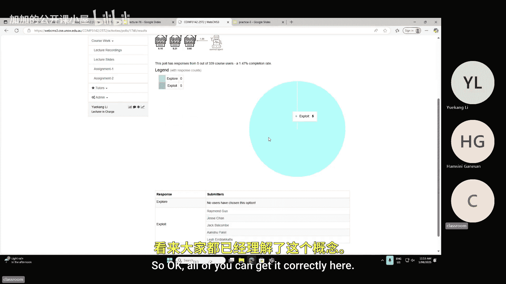
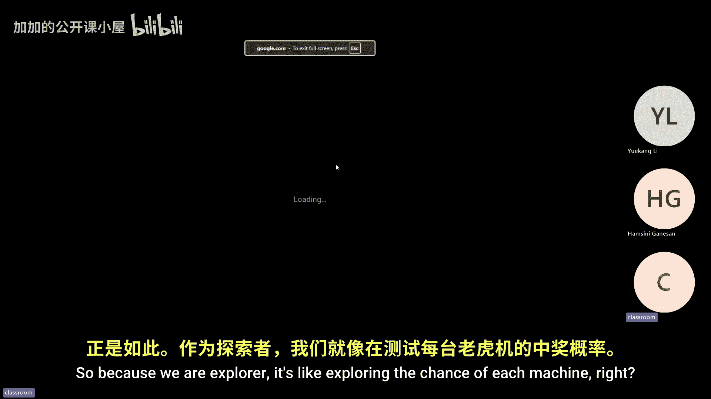
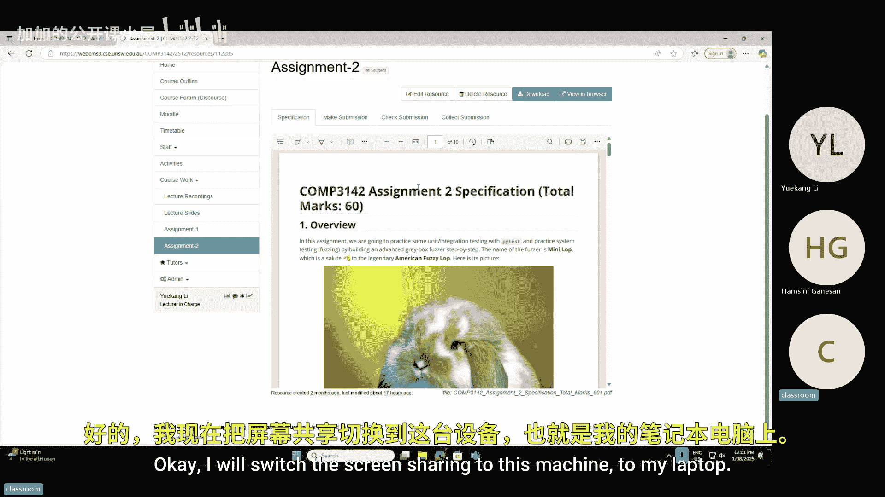
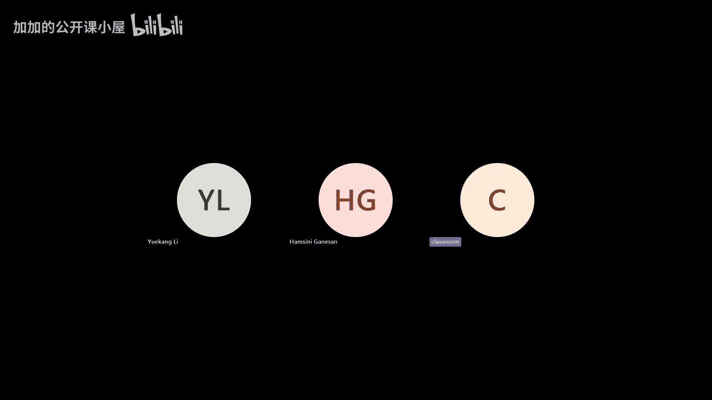
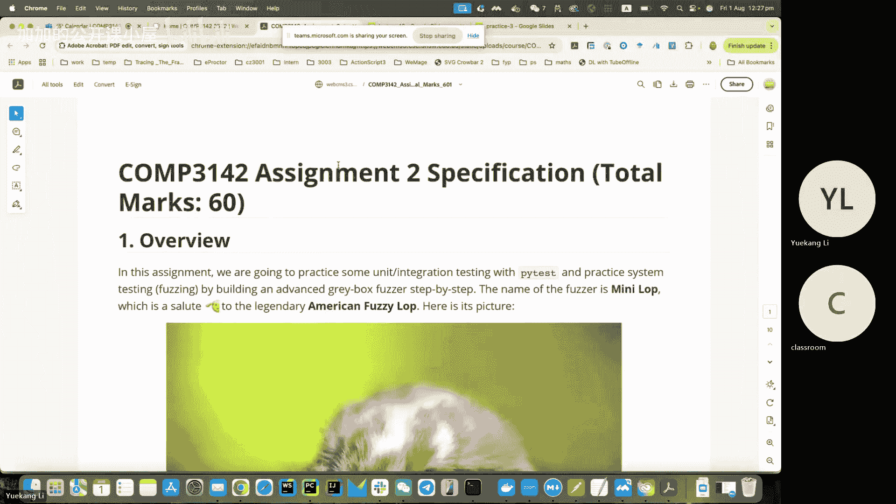
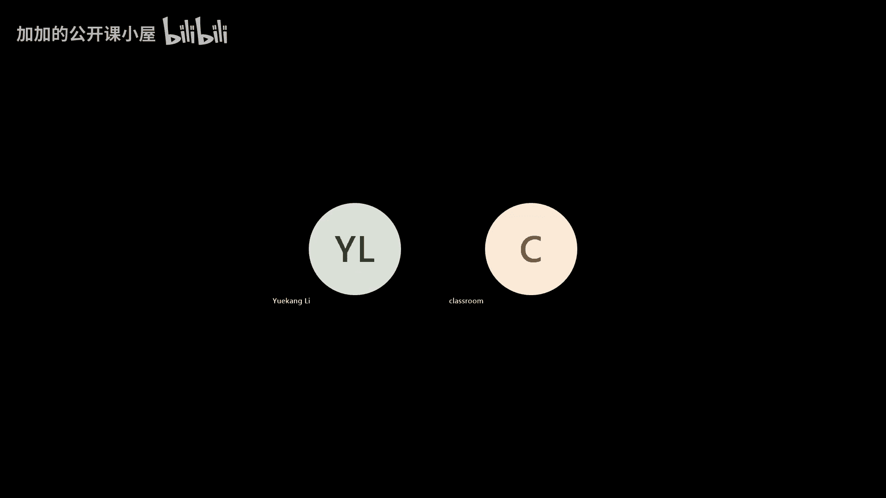

# 新南威尔士大学【中英⚡软件测试｜COMP3142 2025 Software testing】 p02 P2 Advanced Algorithms in Testing 2 -BV1o34HzBENA_p2-

Okay， let's wait one more minute to start。Yeah。So actually， we。

 we don't have too much content left for this course。

 So today's lecture might be a fast or quick one。 but we。

 but we are going to cover several things today。 So we are going to learn some other algorithms that could be useful for testing。

 And this was actually a bonus feature for72。 in the last term。 But this term。

 we decided to make things simpler。 So you just need to know this algorithm and。

Roughly know how it works。So， that's enough。 And then， we will。

We'll go through this practice to see how these algorithms work， and。呃，被被告呢。We're gonna learn some。

And we， we， we are going to learn what are the。Factors or parameters affecting the performance of these algorithms。

And， and then I， I will spend some time to go through the。

Some of the things are some of the issues you have encountered in assignment 2。

So we will spend some time today to go through the specifications of the assignment， tool， as well。

Alright， so let's get started。So。This is this is our。Actually， literally。

 our last lecture about the main content of the course。 because next week。

 we are going to have a recap of what we have learned， so。😊，嗯。😊，So what we are going to learn today。

Is an algorithm that is that is that could be useful for testing。And。

And similar to how we learn the previous advanced algorithms。 let's first think about how can we use。

 how can we describe the problem of testing as some classic problems in computer science。

 And then we can apply some algorithms for those classic。

Problems to solve the problem of testing here。 So we we will follow this logic here。

To learn the this algorithm here， so。So first， let's have a quick recap of what are heuristics and what are meta heuristics。

 I hope you can still remember that heuristics are like those assumptions or those experience based technique that can produce some solutions for us。

 right， So heuristics are like something or some thoughts or some。诶三。

Algorithms we come up with our experience。 So are some assumptions。So these， these are heuristics。

And typically， heuristics only work for some specific type of problems because。Those。

 because they are based on experience and they are kind of specific to certain algorithm certain problems。

And in order to have some general idea of in order to have some kind of general solution。

 what we come up with is。Meta heuristic。 So we want to have some systematic way to produce heuristics。

 right， And this systematic。Production of heuristic is called meta heuristic。 It is more like is。

 is literally meta heuristic。 It's like the meta method for finding or guiding other heuristics。

So because meta heuristics are like we are， we are， we are not using a specific， some。

 some specific heuristic or some specific experience。

 So meta heuristics algorithmgos are more general， and they could be used for solving some general problems。

So now let's learn another meta heuristic today。 So in our last lecture。

 we have learned one meta heuristic of genetic algorithm， right。

 we can think about problems as the evolution of chromosomes and genes。 And now。

 let's think about another type of meta heuristic， which is called bandit machine。 So。

Abandment machine actually looks like this。 So you can see that。But big。

Word bandit here on this machine。 And you can tell from it's looking that it's actually a。

I's actually a gamblingling machine， right， and。Do you know why it is called a bullet machine。No。

 I I guess it's because you will surrender your money to it。

 So you will lose your money if you play with these machines。 So don't gamble， but。

There are some good algorithms from gamblers， actually。 So like quick example home。😊。

The Monte Carlo simulation。 So if actually， this I hope I pronouncedun it correctly。

 So it's Monte Carlo simulation。 It's actually the name of a place。😊，Inside， I think。NowN Africa。

 I think。 so there's a。There's a famous casino there。

 And Monte Carlo simulation is actually used for， you know， in， in the very famous AI Alpha go。

 I hope you know it， right。 So in Al go， they use Monte Carlo search。

 So this is actually based on some。😊，Some strategies used by gamblers。And now， by name is another。

algorithmgorim inspired by these gambling games。So the problem of。

We are going to learn today is called multi armed bandit problem， so。Imagine there's a。

There's a machine with multiple arms， multiple a machine with multiple arms。

So we can pull these different arms every time。Or maybe all the problem could be like we have multiple one armed machines so we can have multiple machine with just one arm。

 So these are considered the same。And。Each， you can see that from each machine here， there's a small。

 There's a， there's a float number here， right， actually。

 each number here is like the probability of getting a reward by pulling the arm of this machine。

 So you can see that each one of the machine can have a different chance for giving us a reward。

 right。So the problem is described as this。 So each one of them has a fixed chance of randomly giving us a machine。

 giving us a reward。So。The problem is described like this。 We， we have our constraints。

 and our constrain here is that we can， like， when you play with these machines in some casinos。

 you may need to use some tokens， right， You need to insert a token and then you can pull the arm。

 So we have assume that we have a limited number of tokens。

 which means that we can only pull the arms of these machines for a fixed。Time。

So we have a fixed amount of times fast to pull the machine to pull the arms here。

And the question is， how can we optimize the total reward we can get。So because these machines。

 we don't， they all look the same。 We don't know what's the internal probabilistic of the internal chance of getting us a reward。

 So， so how do we know， how can we maximize the reward we can get by pulling the arms for a fixed amount of times。

So。The optimal solution here is， of course， we always pulled the arm with the best chance of getting a reward。

 right， But we don't know which arm is giving us the best reward here。 So that's the problem。And。

So we need to somehow， we need to somehow explore which machine is giving us the best chance。

 And once we know which machine can give us the best chance。

 We can always choose to pull that machine's arm， right。So this is a basic idea here。

So now let's come to today's live poll， which is the last one of this term， so。Always， so there are。

 so we are kind of encountering two terms here。 Exp versus explore， so。The the。

 the action of always pulling the machine with the highest chance of getting a reward。

 is this a behavior of explore， or is this a behavior of exploit。So is this considered explorer。

 or I this considered exploitd。Ex slideed， yes， we got it correctly。So。Okay。

 all of you can get it correctly here， so。

So it's exploit， actually， so。

Because we are exploring is like exploring the chance of each machine， right。

 Its an exploit is that once we know which one is the best， we try to。😊。

Leverage or we try to exploit the knowledge we have， right？So this is expired。And。

Explorer means we need to try out different arms to gather more information about the distribution of the rewards behind each machine here。

And exploit means that we try to exploit the knowledge about which machine is the best。So。

 this is exploit。And we need to have a trade off between explorer and exploit flight。

So because we have limitations。 We have a limited number of tokens， right。

 We have a limited number of tries for us to pull these arms。 So if we spend too much too many。

Of our tokens or chances to do exploration。 Then what are we going to have。

 We are going to waste too many tokens on those。AWor machines， right on those machines。

 which are not going to give us the best result。So if we do too much of exploration。

 we may waste some of the tokens。 We may waste some of our resources。And however。

 if we do too much of exploitation。Then， we are。We， we， we are kind of lacking exploration。

 So there's a risk that we couldn't find out which machine is going to give us the best reward。

So that's the problem here。 So we need to find a balance between exploration and exploitation。So。

Let's think about this。 So now we know that， okay， I may problem or arm band problem is like an optimization problem。

 And we need to balance between。Exploration and exploit and exploitation in this。Problem。

 and now let's learn why it is related to。Testing， especially gray box fuzzing。So。

Let's assume that the achieved coverage is the reward here， so。And then， each seed。

Each seed could be considered as an arm or a machine here。 So each seed， once we execute a seed。

Once we mutate and generate new test cases with the seed。

 we can get some kind of rewards as some coverage as rewards， right。So。

Each mutation operator could also be considered as a machine here。

 So every time we apply a mutation operator， we can get。

 We can generate some test cases that can give us some coverage。😊，So。

What about the number of tries here， so。So now we know that， okay。

 these two things could be considered as。The as the。Arms or the bandit machines here。

 So what's the token here， We are going to use。So the number of tries is like。

How many new test cases we can generate， right？ How many chance of execution do we give。

To each seed or each mutation operator。 So that's the number of tries here we are going to have。

 So we， so basically， we， we are going to use the number of executions of the program with the particular test case as the token here。

 we are going to spend or as the resource here we have。So。What we can do is。

Given a total number of executions， we can use a portion of them to do exploration to find out which seat is the best one to use。

Or which mutation operator is the best line to use。

 And then we spend the rest of our executions to exploit that good seed or that good。

Mutation operator。 So this is。The idea here。So， another， another。

Type of token we could use is like for example， if we。If we say that we。

 we want to run this fighting campaign for maybe 12， 24 hours。

 and then we can cut this 24 hours into different。Into smaller time units， right。

 And each time unit could be used as a token here。 So if we。let's say we have。

 We split this entire 24 hours into 100 time units。

 and then we can use a portion of the time units to do explorationir。

 And then the rest of the time units。To do exploitation。

 so we can use either one of them to as the number of tries here or the tokens we are going to spend here。

So。So this， this problem is actually。 so grip， as we can see here， gridbox phing could be。

Considered as could be mapped into with a multi-ar bandit problem， however。

I theres there are its it's not 100% or it's not a full match here。 So the reason is that actually。

 a lot of， actually， some research papers， they even try to map they。

 they are trying to map these gray box with multi Monday But。

 But I think there are some problems with this matching here。 So based on my personal experience。

AndThe default assumption that the because for multi armed bandit machine。

 we have an assumption that each one of the machine here is associated with a fixed number。

 a fixed chance of getting us a reward， so。So this， for example， this machine has a 0。6。

5 chance of giving us a reward。 And after pulling this arm for a few times， this reward。

 this chance here shouldn't change。However， for fast， when we do fast。The reward keeps changing。

 You know， like if we， if we use a seat several times， then the chance of giving us。

 then the chance of getting a new getting new coverage based on that seat actually。

Decreases over time。So actually， in finding this， the reward here。

 the chance of getting a reward for each machine here。Keeps changing， so。It may not be。Perfect。

 it may not be a perfect。 I problem here for Grboxox fighting。So that's a problem。But in this course。

 let's keep it simple。 So let's just assume that it works。 And it actually， in general， it works。Soう。

So let's now。 So just now we we learn。 Okay， we can。

We can transform the problem of gridbox fuing into the problem of multi armed bandit。

 And now let's learn an algorithm of solving this problem here。

 And this algorithm is called Epsilon greedy algorithm。

So I can tell from the name that it's a greeditty algorithm。So。

The Epsilon gradient algorithm allows agent。To X to do。

To choose to whether to explore or exploit at each step。 So every time it pulls the arm， it can。

 it can make the decision of whether should I choose the best machine to do exploitation or should I try some random machine to do exploration。

 So the decision is made at each step here for this algorithm。And。And this algorithm is very。

 very simple。So with a small probability epsilon， we just。So we just choose a random machine。

 We don't choose the best one we have observed。And with the probability of 1 minus epsilon。

 we will try to use the best machine。 Best ever machine we have observed so far。So， this is。

The algorithm is very， very simple。And do you know why it is called Epsilon here？So。Actually。

 it's my guess。 So because Eil often represents a small number。😊，So we often use this symbol here to。

To， to describe small numbers。 So because we， we， we just want to use a very small chance to do exploration。

 So that's why it's called Epsilon。And this algorithm is very， very simple， yet effective。

So this is a more concrete description of this algorithm here。First， we need to do initialization。

 So because at the start， we don't know which machine is the best， right。

 We have to make some assumptions about the distribution of or the chances of getting us rewards for each machine here。

 So what we can do is we can initialize the reward for each。

 The chance of getting a reward for each machine here with either 0 or some other small。

 fixed numbers。😊，So。And then we， we also need to define an epsilon value。

 And this epsilon value is typically between 0 and 1。 And it it normally it is smaller than 0 and 5。

Are even smaller。And then。We can after this initialization， we can run our agent。

 So with this small probability of Epsilon here， we just randomly select an action。

 So this is like we are choosing to do exploration。😊，And with。The probability of 1 minus eilome here。

 we just select the action with the current highest observed。AMchine， pass machine here。

 So this is the algorithm。 It's very， very simple。And then。We， when we， when we run this algorithm。

 we also need to collect the reward， right， we after we pull the machine。

 it there's a chance to give us a reward， and then we can accumulate the reward of each machine to estimate which one is the best。

 So this is what we do。 So we need to collect the rewards and we also need to update the estimation of which machine is the best。

 According to the rewards we have collected。😊，Based on our previous。Twice。And then we repeat。

 until we。Used our。Of our tokens。So there are some pros and cons for this inpsilon gradient algorithm。

🤧So the pro， the pro the advantages are that。This algorithm is very simple and easy to implement。

 right， As you can see， it's just a few steps。 and we can can easily implement this algorithm。

And it's actually a very provides us a very straightforward approach for doing for balancing between exploration and exploitation。

And then。We can。We can still manipulate the。The， the value of epsilon here to， to make。

 to adjust this algorithm， to make it adaptable for different problems。

So this algorithm still allows us to， you know， to， to twin its performance。So， this is。

Another advantage。 However， there are some drawbacks。Because in inside this algorithm。

 once we have chosen the value of Epsilon here， it is used for the entire。Campaign。

 right for the entire session， right， so we can't change the value dynamically。

 and it may not be very， very adaptive here。If we use a fixed number。

 and there are some more advanced techniques like the upper confidence Bo or Thompson sampling。

 which could。Solve the problem of adaptively exploring the。The， the balancing between。

Exiration and exploitation。 So here， if we， because the Eson doesn't change。 So it's kind of fixed。

 and we are not。We can't adaptively address the strategy here。

So that's the drawback of this algorithm。 And that's all for the introduction of this algorithm。

 And let's now try to。Have a look at some practices of applying this advanced algorithm。

 we have learned this week， so。Do you still remember genetic algorithm。Apart from its name。

 Do you still remember how it works。Roughly， right。So。

Genetic algorithmism could be used so the basic idea of genetic genetic algorithmism is to have a population of candidates。

 and then we evolve the population and increase the quality of the individuals inside this population。

By doing， by introducing more diversity for each generation and keeping the good characteristics or good genes using the fitness function。

So I'm eliminating the bad characteristics using the fit fitness function， right。

 So this is the basic idea of genetic algorithm。 And now let's。Try to apply this genetic algorithm。

 and use it。For in this scenario here。 And the scenario here is to guess a random screen。So。

You can also try it on your own。Laptop。So here we have a target strain， which is unknown。

To this algorithm。 So for the entire algorithm， we don't know what's。What's inside the target string。

 And what we want is we want to guess what are the character。

 what are the characters inside this target string here。So in this algorithm， what we do is we first。

 we need to set the population size， so。So what we so inside this population。

 each individual is actually a strain， right， we have， we can create a large a large amount。

 set of random strings as our initial population， And then we can try to evolve these these entire set of strings towards the target string to guess the target strain。

 so。So what we need to decide is first， the population size。

And then we also need to decide how many rounds of evolution or how many generations do we want to have for。

 for this evolution。And。And then we also need to decide what is the mutation rate。

 like because we are trying to after after cross doing crossover for using two parents of strings。

 We need to do some。 We may want to add some random mutations， right， to introduce more diversity。

 So we also need to decide what is the probability of applying the mutations to the offsprings。

 So this is another thing we need to decide。And。And during the each during the evolution process。

 what we do is we。First， we need to check whether should we terminate the entire process。

 Because if an individual， if an individual strain can exactly match the target strain。

 then we can stop the evolution， right， because we have found the， the solution from the individuals。

 And if， if not， and if we haven't finished using of using our generation limit。

 we should continue to evolve this entire this， this entire population， right， So。

What we do is during each in inside each generation， we select parent rings。Randomly。

 and then we generate offsps by switching。The the， the components are the hs of the parents to generate the upstreams。

By doing this kind of crossover and crossover， as you can see。

 iss kind of similar to a feature you are going to implement in a 7。

2 A is it's already a given to you。 Actually， in a 72。

 is's like the mutation operator used for fuuzzing， right。And then。And then we use。

 we have a small chance of applying the mutation to further randomize the content of the upspring to introduce diversity here。

And then。We can， We can log something and print out the entire process。

So let's try to run this program and see how it works。So you can see that in。

 this is our target stream。So in generation 0， we generate 100 generation zero is like which every string inside the generation。

 inside the population。Are just random strings。 So we have 100 per we have 100 random strings at in generation 0。

 And we can see that the best match here is this thing。 this random string here。

 The finish score of this string is two， which means that two characters matches the。

 the good position of this， matches the target string here。 I think this one is one of them。

 and the other one is。😊，嗯。Okay， let's， maybe let's forget about it。 But yeah， but it the is。

The finish score is two here。 And you can see that at the the 100 generation here。

 we are getting closer， right， The best match is getting closer。

 We are evolving the entire population。 This is because if。😊，If a string has a higher fitness score。

 it means that it has more characters matching the target string， right so。😊。

So we are like using the fitness score to keep the good characters， right， The good。

 literally they are the characters。 So we are keeping the good。😊，Strengs。

Are the good the strings wing。Characters that could match the target string。

 You can see that we are gradually getting closer to this target string here。

 using this evolution algorithm。And you can see that。We can find the target strain in generation。460。

 So this is。The the example here， and。And this this example actually works。

If we if we change the screen to another screen。So。This time。

 let's change the strain to a longer string， to target string to gas and。

And the expected generation used for guessing this string correctly should be larger than the previous one。

 And let's try to observe whether it is。看到好的。😔，Time out。 O， let's try to try not to run。😔，It's very。

 very long， but maybe。Comamp。语文腹通。😔，Sound。😔，So this is the screen here。Time out。

What happened with this one compiler here。嗯。Maybe。😔，Okay。

 because let's run this again and see what happened。Okay， so let's do it reversely。

 Let's try to make the string。 I think there are some problems with your cloud server。 maybe。

 but let's write， let's try to make the strange shorter。

 And this generation use required for guess the string should be smaller， right？

 So let's try to run it。And you can see that。 we can quickly get the。

get the result with 45 generations， so。So， the difficulty of the。As you can see。

 the difficulty is as the difficulty of the problem increases。

 the more generation we are going to use， right。And also。

 the population size could also affect this performance。

 So let's say we set the population size to be 10。And then what do you expect to happen here。So。😔。

If the population size is 10。Then we are going to have some troubles of finding this。

 And even after 1000 generations， we couldn't find the solution here because the population size is too small。

 We can't keep the， So the population is not diverse enough。 And we don't。

 we don't have the chance to really keep the good characters here。

 So that's why we can't really find the fitness。 We can't really find the solution here。😔，And。

If what if the population size is too large， let's say we have 1000 population here。

Will it be good or not。So you can see that。 okay， it， it doesn't time out。But。10。

 maybe it's not still not too large。 but normally if we have a too large population。

 we could also have problems because。Because we。because the good characteristics may not be combined together by doing crossover。

 They may not， the good parents may not meet each other here if the population size is too large。

 Maybe let's try 10 K here and observe what happens。So。The population size shouldn't。 Oh。

 it times out， O。So， but， but the the idea here is like， if the population size is too small。

 it's definitely not good。And if the population size is too large。

 it's also not good because the good parents are not going to。Get a chance to do crossover。

 If the population size is too large。 And if the population size is too small。

 then the population is not going to be diverse enough to get a chance to get the result。So。

 this is the basic。Idea of genetic algorithm， as you can see here， and。Oh。And we can， we can。

 we can see how does each。Prameter affect the performance here。

 And now let's have a look at an example of Epsilon greed algorithm。So。

Let's try to use the Epsilon gradient algorithm to play the multi armed bandit problem。看看。Some。😔，So。

 this。For this problem here。😔，So let's assume that we have five arms。And。Each arm is given a true。

A chance of getting us a reward。With a random number here。 So we randomly give each machine a chance。

 and we have five arms。And every time we pull this arm， it has a chance。So give us a reward of one。

 So this reward is like a score。 maybe so we have each time we pull an arm。

There's a chance for us to get to increase our final score by one。And then。Let's do a1000 trials。

 So what is the expected。 So if we， if we just pull the random。If we just pull the arms randomly。

 we should get the final score of around 500。 Do you know why， like， why should we get 500。

The final score， if they just。Pull the arms randomly here。Is it because the number of arms。

If the number of arm is 3， should it be 300。夜神 no。Yes。No， actually。

 it's not related to the number of arms。 It's actually related to the number of trials and how we initialize the probability of getting a reward。

 So because we are initializing the， So because we have five arms， right。

 And we are initializing the five arms with。A possibility of getting a reward randomly， right。

 So if we assign a value randomly here， the average possibility。

 the average probability of getting a reward should be close to 0。5， right。

 Because they are initialized randomly。 And if average all the values here。They should be around 0。5。

 and we have 1000 trials， and we are each trial can give us can have a 0。

5 chance of getting us a reward。 So the final estimated reward should be around 500 here。

So this is a calculation of this。Estimated reward。And。

And the Epsilon gradient algorithm should give us a better chance， so。

So the random strategy will just give us like the average amount of rewards we can get。 However。

 the greedy should give us around something like the best machine probability。

 We are going to have times 100。Reward。And。Why。Do you think he's like this。

It's because of the nature of eilon greed， because we are once we。

 we once we have found the best machine with our。With the exploration。

 we are going to always choose the best machine， right。看。So， sorry， it's not times 100。

 It's times 1000。 actually。 So， so we will have。We will。

 We will always choose the best machine if we find which one is the best。 So it's roughly the。

 but we will spend some of our tokens， some of our tries to do exploration。

 So it's roughly the best probability times 1000。So let's have a look and see。

🤧If our estimation is true or not， so， so。Let's assume that we use the Eilon value of ser pen，1。

And let's try to do this 100 times，1 thousand times。And you can see the eilon grade is very。

 very simple。So we just need to maintain an。We just need to maintain the estimated values or the rewards of each arm。

 so。你看C the。If the。With the chance， with the probability of Epsilon， which is a small chance。

We just choose a random arm。And otherwise， with a larger chance， with a quite large chance。

 which is0 9 in this case。We just choose the best arm we already have。

So which has the maximum value we have observed。And we just need to update。

 We just need to pull the arm and get the reward and try to update the estimation of each machine here or each arm here。

 So that's very， very simple。And let's try to run this program and see what happens。So。

 you can see that。So the true probability of each arm here is like。Exact this。

 So the the first arm is very， very poor。 So we have like 0 and 01。Percent there。

 there one probability of getting a reward。And this one gives us a 0。2。

And the best arm here you can see is the last arm， right。And。If we do epsilon greed。

 you can see that the average reward we can get is like 300 something， which is closer to 0。

43 times100， right。And if we just do random pulling， it's 200 something。 because this time we。

 we have a bad luck， all the。All the arms has a probability of。Let's than 0。5。 Let's run this again。

So， you can see that。This time， we are kind of lucky。 Only one of the arms has less than 0。5。

 And you can see that with Eilon greedy， we can get。Almost。

 we can get much better than result than random strategy here。And。

You can see that we can also try to use greed。 can also try to get get us。The best arm。

 But it's not always accurate。 You can see， because the arm 2。Am 2 and arm 3 are kind of similar。

Let's run this again。So you can see this time。Oh， sorry。

 is arms3 is correct because it's starting from 0， so。

You can see you greed can get us the best arm pretty accurately。

And let's try to tweak some of the parameters here and see what happens。

And the only parameter we can tweak is。The value of you see loan， right， so。

Let's try to give it a much。Larger。Value， maybe 08。So what if。🤧What we。

 what if we sette the value to be 0。8。So will we what's。

 what's the problem we are trying to introduce here。

 Is it too much of exploration or too much of exploitation。Which one it is。Explanation。Exploration。

 because。If。With the chance of Epsilon， we are going to do exploration， right。

 So if we increase the value of epsilon， we are going to do too much of exploration。😊。

And if we do too much of exploration， what will be the problem here， As you can see。

 when the value is 0。1， we can。😊，We can get the best arm correctly， right。

 We can estimate the best arm correctly here。But if we don't have enough。Explore。Sorry。

 if we have enough exploration， can we still guys this arm correctly or not。

If we increase the value of if， will this be affected， Can we still guys。The correct arm， correct。

 is the best arm correctly。Yes， or no。The answer is actually， yes。

 because exploration is to help us to explore which charm is the best， right。😊，If we have。

 if we just give too much effort doing exploration， we can still。

Try to estimate which arm is the best。 So this one won't be affected。 However。

 the total reward will be should be lower。And the reason is。The reason is that。We。

 we spent too much time doing exploration， and we don't have enough time。

 We don't have enough chance or tries to， to exploit the best arm we observed at。

So the total reward should be lower than。Should be lower than the best arm times 1000。

 And let's run this program again。So you can see that this time， the。The best arm is 0。8， right。

It should be 0。 It should be 700 something at least， right， If the E value is chosen correctly。

 But this time you can see。We can get the best。 We can get an optimal reward。 However。

 we can still guess the best arm correctly。 You can see it's quite。😊，Oh。

 the last one is the best one。 Yeah， so you can see it's quite accurate。

But we can't get the the optimal reward because we don't have enough chance for doing exploitation here。

😔，So although we can estimate the best arm， we don't have enough time。So。Let's find it again。

 And you can see， it's pretty。It's pretty true。 You can see it's not much better than random strategy。

 right。But you can see， you can still see that。The， the estimation is very， very accurate。

 You can see the arm 0 is the best one。And the estimated value is quite close to the actual value。

 so。This is the drawback of having a very large epsilon value。

 So normally we should choose a small Epsilon value here。 So what will happen。

If the epsilon value is too small。So let's say we use 0， pan0，0，1。

So what will be the problem here in this case。We will be lacking。😔，Exploration， right。And will this。

Estimation got affected or not。Yes， right。 because we don't do exploration。

 Then we don't know which arm is the best。And， of course， if we don't know which arm is the best。

 the final result will also be affected。 And let's see。So you看 C。呃。This is not a good example。

 Let's run it again， so。0，1，0， one， so， so you can see this one。This time。

 the strategy is giving an even worse。Result than random strategy。

 because we estimated the arm wrongly。 We got， we estimated the best arm wrong。 You can see in this。

In this run， the best arm should be。Should be arm 3， right。It's a fourth arm， and the index is 3。

 So it should be arm 3。 However， because we don't have enough。

 we don't spend enough effort doing exploration。 We are guessing that arm 0 is the best one。😔。

And we are。Sorry， we are。 We can't fully exploit。The best arm。

 So we are getting an even worse result than random。😔，Find the random strategy here， so。

The e value shouldn't be too large， shouldn't be too small。 And if the value is too large。We may get。

A result here， which is close to random， but still a little bit better than random， normally。

But if the value is too small， we may get a China。 We， we can't even estimate the arm correctly。

 and we may， we may get a result even worse than random。So。This is how this thing works。

And let's have a。Let's have a，5 minutes break， and。And that's。Go through the the specific。

 the specification of assignment7， tool。Oh。嗯。Assignment 2。 have you tried to run it。いさ no。No。

 not yet。Did you try to pull the docker and run it， no。Okay， you should start。

 You should start trying it because you may have some problems setting up the environment on some of your local machines。

😊，So the basic idea of the arrangement of this course is like we try to cover most of the concepts before flex week。

 And after Flex week， the， you can see the content is less。Le you。

 you need to learn less content so you can focus on doing your assignment and quizzes。

 So that's a basic idea。哎呀。Okay， I will switch the。

Screen sharing to this machine to my laptop。

嗯。All right。And let's start the second half。So let's go through the assignment to specification。

 So the total mark of this assignment is 60 and。And basically， in this assignment。

 you need to do two things， so。Sorry， this the sharing is not。好。Okay， it's projected。So。So。

 in this assignment。We are going to。Basically， practice the automated frameworks for doing unit testing。

 integration testing and system testing， which is gray box fuzzing。🤧And。

And the unit testing framework is like。is， is a very popular framework used by。🤧。Used to a python。

 So which is called pieized。And。And the system testing framework we are going to use is a framework developed by us。

 So it's a homemade framework， which is called Min Lo。And。

It's so the basic logic of winninglo is like it's a pethon。

 It's a peython version of American fuzzy lo。Whi is one of them。One of the most popular f areas。🤧No。

So because American Fauzz lab was written， like we have learned in our lectures。

 It's written in C 7000 lines of C code。 So it's hard。 I think it's hard too hard to。

 to do modifications as an assignment。 So we made it simpler by rewriting some of the。

 some of the logic in Python。 and。And middlelo is compatible with the programs instrumented by American Fuzzylo。

 So that's a basic idea， and。And this name is actually a name from a rabbit。

 And Min love is also a name from a rabbit。 So this is like a picture of how a million love would look like。

So basically， for this assignment， you need to。There are two parts。

 So the first one is a pie test practice。 And the second one is buzzuzzing。🤧啊。So。

Pet test practice is worth of 20 points of marks。 So it。

 so everything here is so although we are doing some kind of random testing。 So， but。

 but the design of。Deign choices of many of the assignments are not random。

 So it's purposefully made 20 marks because assignment 1 is 30 marks。

 and the two quizzes are like 10 marks。 And this one is 20 marks。 So you will have like 60 marks。

 So this one is considered as an easier assignment for you。

 So you will have 60 points of relatively easier marks for you to pass this course。😊。

And and like I said， I don't want to feel you。Yeah， year  three course。

 especially it's now a core course for。Software engineering students。 So you can get some easy marks。

 And if you want higher marks， you should try this a little bit more challenging assignment here of designing or writing a greenbox father。

So。And the design of this。🤧Of these assignment questions。

They are kind of large language model resilient。 So I， like I said， I。

 I encourage you to use large large language models to try to do these assignments。

 Unlike maybe some other courses， they don't want you to use large language model at at all。

 But I I think。And I'm， I'm quite open towards the usage of AIs。

 And I think because it can when you go to work， actually， you may。

 you might be using AI coding tools a lot like cloud code。 And if you don't use it， you may。

 you know， like while other people are using it， you know， it's like a disadvantage for you。

 So if you can master the usage of AI is good。But。But the purpose of this course is not to teach you how to use AI tools。

 It's still about testing。 So this question is designed to be AI resilient。

 And if you just through this question。Throw this question to GT and try to ask it to give you an answer。

 The the answer by default default is not correct。I can tell you it's not correct。

 If can cannot give you a correct answer。 You have to。You have to try to tune the prompt。

 maybe do some prompt engineering。 Maybe it can give you the correct answer。

 but body default it won't It won't give you correct answer。So。This is， so this is the pie test。

So for the pie test assignment， what you are going to do is you are going to write。

Practice the usage of fixtures in pie test。 So fixtures are the reusable components to set up and tear down resources。

 right， So you need to practice the usage of fixtures。

 and you also need to practice how to how to mock up things with pie test， because。Because when you。

 when you really do testing in development environment。

 you may sometimes do this kind of test driven development， right。

 And I believe you have tried that in comp 1，5，3，1。 and for these。For this test driven development。

 you have to write test cases before the， the actual program has been developed， right。

 And how do you make sure that the test could run even without something has been actually implemented。

 Then you have to mock up some of the things， right， And this pie test。

Pise a plug of doing this mock up， like properly。 So you can try to practice how to do mockups using pie test in this assignment 1。

Sorry， in this up 7，2。1。And， and then you need to come。

 You need to write test cases using the fixtures and mockups。 So that's basically。呃。

A relatively simpler problem here， because everything is kind of defined。And。

And for the more challenging of assignment， which is assignment 2。2， you will， you will be given。

 You， You will be given a framework of。Well gray box father， and which。

Which has some missing features。 And your task is to fill up the missing features or to implement these missing features。

 So you will have to implement four features。 Each one of them will worth 10 marks。So， the。Com。

The four features you are going to use， you are going to implement are the。A cold coverage feature。

 which is to maintain a global state of courage covered by all the seedss we have encountered during fuzzing。

And。And I would suggest you to read these hints carefully here inside this specification， because I。

 I saw some of you asking some problem some questions about。The， the total， the limit of， you know。

 like the， the edges we could track。 And actually， the answer is here。

 So each bite here in the beat map corresponds to an edge， so。It's not each beat。 is each bite off。

Of shared memory correspond an edge。 So if you read these hints carefully， you can。

You can you can solve most of your questions。So another， the second feature。

 the second feature you' are going to implement is the seed prioritization strategy。

 which is to decide which seat because we， we have a queue of seats， right。

 We can select seedss randomly for us to use and。The second feature is about the strategy of determining which seatd should be use next。

So this is the second feature。 And the third feature is the power scheduling strategy。

 which is the decision we need to make after we have selected a seed。

 So after we select a seed to use， we need to to determine how many new test cases should we generate based on this seed。

 right， So this is a decision we are making here with feature 3。And for future 4。

 its like a mutation operator， which is a random mutation operator。

 We could apply to change the content of the seed to create new test cases。

And so that's all the all the four features we are going to implement。

 And how should you validate the correctness of each feature。 That's a problem here。So eventually。

 we will be marking you by because we have an internal implementation of like a standard implementation of minilo without the features。

 So we will be running your submitted code and collect coverage and compare it with our implementation and market。

 So why we the reason of running your code again instead of asking you to upload the coverage information is like because fuing is the performance of ph is。

Is dependent on your machine， because fastuzzing is like you are。

 we are creating test cases and run it and observe coverage， right。

 So how fast could we execute and run these tax cases is important here。

 And different different devices could have different performance。 So that's why we。

We will run your implementation on our side， and market。And。So with that said。

 how could you check whether your implementation is correct or not， Its like you can。

 you can try to implement a feature and compare it with compare the coverage with the default implementation like the default thing we give you it can run。

He can already run。 So if you implement a feature and then with your new。

 with your newly implemented feature， your father can get more coverage。😊，Then the default one。

 then the， you know， the the original one。 Then it means that it's very likely that you are implementing that feature correctly。

However， however， the difference of performance or courage may may not be very significant At the first few minutes。

 You have to， you may have to run the ph for like 10 or 30 minutes to observe the difference between your。

your implementation and the original。The default implementation we give you。 So that's， the。

 that's how you could check whether your implementation is correct or not。

And let's try to have a feeling of how this。Thing would work， and。Let's try to。

Let's try to cover some problems you may encounter。During。doing this assessment assignment，2， so。

First。First， you need to install Docker on your machine。 and we have some materials to。

 to for you to install this docker environment and assume that you have installed Docker on your device。

 So what you can do is you can try to run this command to。Getuting inside the docker。

 So you need to first pull the image。 Of course， you need to what you need to do is you need to docker。

You need to run this command here。In to pull this image。

And then you can use this command getting inside doctorcker。 However， some of you may not be。You。

 you don't。 Some of you may not want to work with， you know。

 like using V to edit the code inside the docker。 come and of the docker。 But you can do is you can。

 you can mount。You can mount your。A folder of your host machine。

And match it with a path inside the dockcker。So this is the command。 You can try to run。

And you don't need to worry about taking a photo of this command。 I will share it。

 I will create a notification on Web C M S and share it with you。

 So what you can do is this is one of the solutions。 This is， this may not be the。

 the optimal solution， but this is one of them， one of a possible solution here。

 So what you can do is you can run this command。😊，So this， this remove means that the。

 the container will be removed once I stop running this container。 So I don't want。

 because each container you run will occupy some of your hard disk space。

 So I don't want to I don't want to use up my hard disk。

 So that's why I you add this remove option here。 So this we here means that we are trying to mount some volumes。

Well we are trying to map some volumes。 And this here， this pass here is。

The pass to a folder on my host machine。 And this pass here is a path to a folder in the docker inside the Docker image that inside the docker container。

 And this I T here means。We are trying to create an interactive batchsh。

 which allows us to type in things and。嗯，嗯ge out to。And this here， this。Command here is the command。

 We are going to run inside the container or inside the Docker image。So this is， let's run it。

So you can see the on my host machine， on my host machine， I have a folder called source， right。

And inside source currently is an empty folder。 so we don't have anything inside source。

And what we can do is。Now， we can also see this。 this source here is mapped as this minilo back folder inside the docker container。

You can see this minute back。 And now the minute back is empty， right。

 What we can do is we can copy everything。From。迷你。😔，Loob。Into mini。😔，嗯，sorry， mean up star is better。

😔，呃。I just wrongly clicked the inbutt。So。Now， let's copy everything into this minute back。

 So just now， we could see that on the host machine， this source is empty， right。

But because it's mapped between the host machine and the Docker image。

 So if we do any page within the Docker image， it's reflected on our host machine。

 And it's also the same way reversely。 So you can see we just copied everything into this host into this folder。

 And if we do modifications。 So， so now the files are actually accessible from your host machine。

 So you can see if I。If I open this folder here， you can see。 I can see all these files here。

And if I modify these files。Maybe just use text edit。 so you can， you can use。You can。

 You can use your favorite。Text editor to all your I DE on your host machine。

To is running very hard right now。 So it you can use， you can use your。😊，嗯。

You can use your IE on your host machine to access and edit the code here， right。

 So let's try to edit the code。😊，By。Printing。Maybe， hello。😔，And then。Exit。Here。

 so we modify the code of this man here， right， We modify the code。And then if we run it。

 you can see the， the code has been changed inside the docker as well。

So you can see the code has been changed。 and actually， the， the behavior is also changed because we。

Because we just modify the content。So you can see it's， if you just print as hello here。

So this is like how you can。Set up the developed environment for this。On7 2。

2 here with the Docker environment。 and the docker here is only to provide you an environment for executing the code。

And the reason of running it in Linux is because the。

The program we are trying to test here are already instrumented with AFL。

So they have to be they have to run in certain version of Linux。 So that's why we。

 we use Docker to provide you this environment。 So。

 but you don't need to worry about modifying code inside Docker。 You can modify。 You can。

 you can use this approach to map the source code on a host machine with the Docker environment。

 So this is what you can do。And。And some of you may encounter another problem。 Let's try to sorry。

 let's try to modify the code back to its default。So。Some of you may encounter this problem here。😔。

So， let's run this。They felt。Implementation。Back。嗯们。M打 PY。C。嗯 fixix。

So we need to specify the configuration file for running this f。

So the configuration file for Mji is this。So let's just run it。

 So you can see that the further terminates during dry run， which means that。

It has some problem with the initial speed。This is likely to be that the machine we are running this。

We used for running this。For running this funding tool is not fast enough， so。

The initial seatd times out when we during execution。 So for each。Execution with。

 we have a timeout for each execution。 So after the timeout is reached， this seed or is terminated。

 The the execution is terminated， so。If you encounter this timeout problem of the initial seat。

 what you can do is you can try to。Locate。You can try to locate the file in。呃You can try to locate。

This file here。The execution do P Y file， you can modify a constant number here。

So if you encounter the time out of。The default。Of the seas during dry run。

 what you can do is you can try to enlarge this。So you can just enlarge the value of the time out here。

 So by default  default， it was 100。 and then you can enlarge it to maybe 10 K here。

 And then let's try to run this program again。Let's see if the there are still errors。

You can see now the all the errors are gone。 We can run this。Pro。 So the default。

 the default implementation， you can see it will print out the courage of each seed of each test case。

 And your task is to accumulate the courage covered by all the seedss and print it out， so。

You can press control C to end the session here。 Otherwise， it will run forever。

 So the default behavior is' intended。 It' not a bug。

 It's intended to run forever because normally for the programs we are testing。

 the program state is like infinite。 So unless we manually stop it。

 we can keep exploring the state different states of the program， so。

So this is like the the the behavior of this。嗯。Of this mini develop D default implementation。

 And if you can see this， it means that you are sucking off the environment correctly。

 and you can start your development。And you can compare the because this， this thing here。

 you can run it。 It can run， right， You can。You can。

 you can compare Ya implementation with the default implementation here to check。

 to roughly check whether Ya implementation is correct or not。So this is the idea here。And if。

If your implementation is correct， I think you can， you can achieve maybe 3000 edge on MGs in like。

15 minutes， maybe I do it depends on your machine。 It depends on how fast you can execute programs。

 but should be able to achieve like 3000 edges in 15 minutes。

 And if you implemented all the features correctly， you should be able to find some crashes。

 like within the first 10 minutes。😊，So on MJ S， on CJson is's a much smaller program。

 So it's just for you to practice with another program， but we will focus on MG S。😊，So。😔。

That's it for。Today's lecture， we don't have。Too much content today。And。And hope you can。😔。

Hope you can enjoy this assignment， and。😊，Hopefully we can enjoy this course。

 and I'll see you next week， and we will have a recap of all what we have learned。

And that's it for today's lecture。 And thank you for coming on Friday。

 especially when it's raining heavily。 Okay， thank you and enjoy your weekend。😊。

