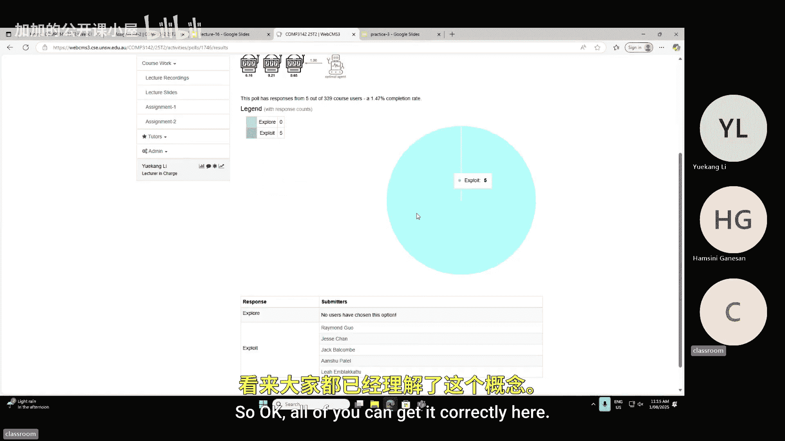
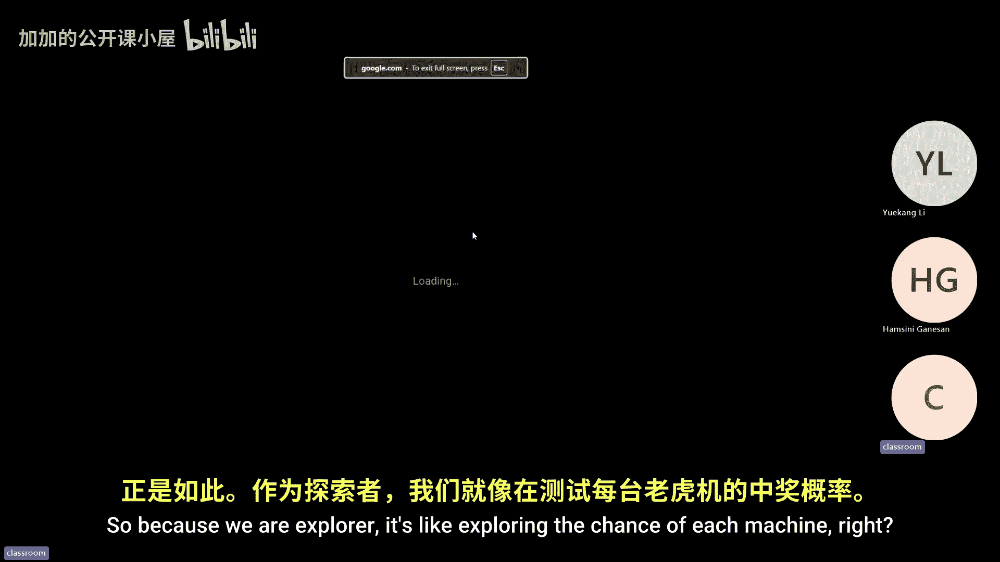
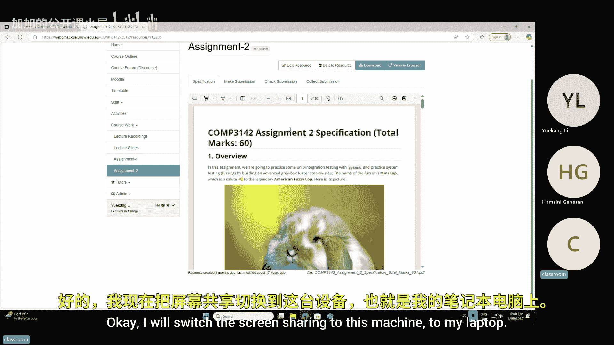
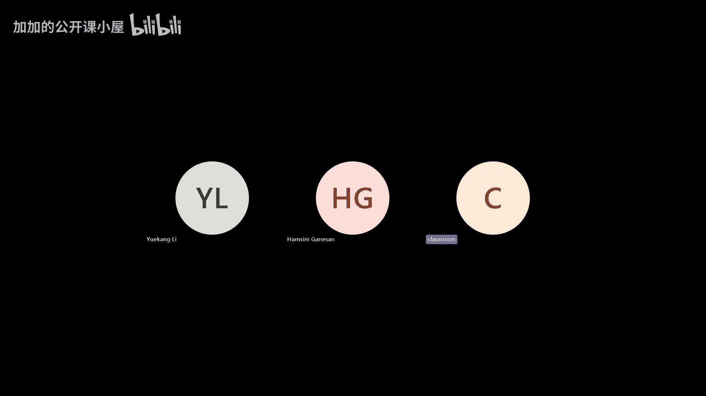
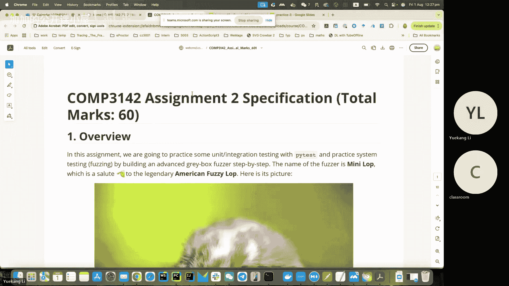
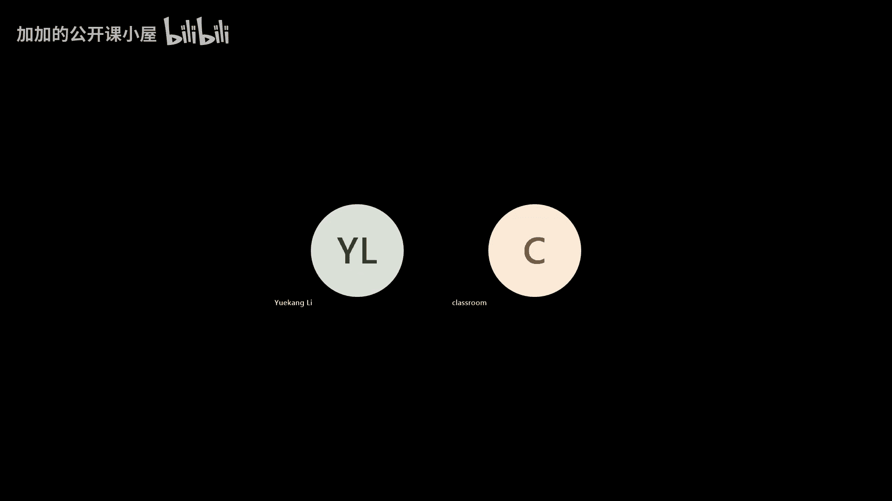

# 软件测试：P2：高级测试算法（二）🎯


在本节课中，我们将学习另一种可用于测试的元启发式算法——多臂老虎机问题及其解决方案。我们将探讨如何将灰盒模糊测试问题映射到多臂老虎机问题，并学习一个简单而有效的算法：Epsilon-Greedy算法。最后，我们将通过实践例子来观察这些算法的运行效果，并了解影响其性能的关键因素。

---

## 元启发式算法回顾

上一节我们介绍了遗传算法，它是一种模拟生物进化过程的元启发式算法。本节中，我们来看看另一种元启发式算法。

启发式是基于经验或假设的技术，用于为特定问题提供解决方案。它们通常只适用于特定类型的问题。为了获得更通用的解决方案，我们使用元启发式算法，它是一种系统性地产生或指导其他启发式的方法。元启发式算法更为通用，可用于解决更广泛的问题。





---

## 多臂老虎机问题 🎰

多臂老虎机问题是一个经典的优化问题。想象有一台带有多个摇臂的老虎机（或者多台单臂老虎机）。拉动每个摇臂后，有一定概率获得奖励。每台机器的奖励概率是固定但未知的。我们的约束条件是，我们只有有限次数的拉动机会（代币）。目标是：在有限的尝试次数内，最大化获得的总奖励。

最优策略当然是每次都拉动奖励概率最高的那个摇臂。但问题在于，我们一开始并不知道哪个摇臂是最好的。因此，我们需要在**探索**和**利用**之间进行权衡。

*   **探索**：尝试不同的摇臂，以收集关于每个摇臂奖励分布的信息。
*   **利用**：利用当前已知的最佳摇臂，以最大化即时奖励。

如果探索过多，可能会浪费资源在较差的摇臂上。如果利用过多，则可能因为没有充分探索而错过真正的最佳摇臂。

---

## 与灰盒模糊测试的关联

现在，让我们思考为什么这个问题与测试，特别是灰盒模糊测试相关。

我们可以将多臂老虎机问题映射到模糊测试中：
*   **奖励**：在模糊测试中，奖励可以看作是**达到的代码覆盖率**。
*   **摇臂/机器**：这可以对应两样东西：
    1.  **种子**：每个种子（测试用例）可以被视为一个摇臂。执行（变异）该种子生成新测试用例时，有可能获得覆盖率奖励。
    2.  **变异操作符**：每个变异操作符也可以被视为一个摇臂。每次应用该操作符生成测试用例，都有可能获得覆盖率。
*   **尝试次数/代币**：这可以是**程序执行的总次数**，或者**模糊测试活动的总时间**（被分割成小的时间单元）。

给定总资源（如执行次数），我们可以用一部分进行探索（找出哪个种子或变异操作符最好），然后用剩余资源去利用那个最好的选择。

**需要注意**：这种映射并非完美。在多臂老虎机中，每个摇臂的奖励概率是固定的。但在模糊测试中，随着一个种子被反复使用，基于它获得新覆盖率的概率会随时间下降。不过，为了简化课程内容，我们假设这个映射是有效的。

---

## Epsilon-Greedy 算法

解决多臂老虎机问题的一个简单算法是 **Epsilon-Greedy 算法**。从名称可以看出，它是一个贪婪算法。

该算法允许代理在每一步选择是探索还是利用。其核心思想非常简单：
*   以一个小的概率 **ε**，随机选择一个摇臂（**探索**）。
*   以 **1-ε** 的概率，选择当前观测中平均奖励最高的那个摇臂（**利用**）。

其中，ε 通常是一个介于 0 和 1 之间的小数（例如 0.1）。

以下是该算法的步骤描述：
1.  **初始化**：为每个摇臂的估计奖励值进行初始化（例如设为0）。
2.  **定义参数**：设定 ε 的值。
3.  **循环执行直到资源耗尽**：
    *   生成一个随机数。
    *   如果随机数 < ε，则随机选择一个摇臂。
    *   否则，选择当前估计奖励值最高的摇臂。
    *   拉动选中的摇臂，获得奖励（0或1）。
    *   更新该摇臂的估计奖励值（例如，更新为历史奖励的平均值）。

### 算法的优缺点

**优点**：
*   非常简单，易于实现。
*   为平衡探索与利用提供了一个直接的方法。
*   可以通过调整 ε 值来适应不同问题。

**缺点**：
*   ε 值在运行过程中是固定的，无法动态调整，可能不够自适应。
*   存在更高级的算法（如置信上界算法、汤普森采样），可以更自适应地处理探索与利用的平衡。

---

## 算法实践与参数影响

为了加深理解，让我们通过两个例子来观察算法运行和参数的影响。

### 实践一：遗传算法示例

以下是使用遗传算法猜测一个随机字符串的例子。我们可以观察不同参数如何影响性能。





```python
# 伪代码概述
1. 设置种群大小、进化代数和变异率。
2. 初始化：生成一个由随机字符串组成的种群。
3. 对于每一代：
   a. 评估每个字符串的适应度（与目标字符串匹配的字符数）。
   b. 如果找到完全匹配的字符串，则终止。
   c. 选择父母字符串（基于适应度）。
   d. 通过交叉操作产生后代字符串。
   e. 以一定概率对后代进行随机变异。
   f. 用新种群替换旧种群。
```

**参数影响观察**：
*   **目标字符串长度**：目标越长，猜中所需代数通常越多。
*   **种群大小**：
    *   太小（如10）：种群多样性不足，可能无法找到解。
    *   太大（如10000）：好的“父母”个体相遇交叉的机会可能变小，效率降低，甚至可能导致超时。
    *   需要选择一个适中的大小以保持多样性且有效率。

### 实践二：Epsilon-Greedy 算法示例

以下是使用 Epsilon-Greedy 算法玩一个五臂老虎机的例子。每个臂的真实奖励概率是随机设定的。

```python
# 算法核心逻辑
if random.random() < epsilon:
    chosen_arm = random.choice(arms)  # 探索
else:
    chosen_arm = max(arms, key=lambda arm: estimated_rewards[arm])  # 利用
```

**参数 ε 的影响**：
*   **ε 值适中（如0.1）**：能较好地平衡探索与利用，通常能准确识别出最佳摇臂，并获得接近最优的总奖励（最佳概率 * 总尝试次数）。
*   **ε 值过大（如0.8）**：探索过多。虽然可能仍能准确估计哪个摇臂最好，但用于利用最佳摇臂的次数太少，导致总奖励降低，可能接近随机策略的结果。
*   **ε 值过小（如0.01）**：探索不足。可能无法发现真正的最佳摇臂，而错误地利用了一个次优摇臂，导致总奖励甚至可能低于随机策略。

---

## 作业二说明 🛠️

本节课的最后部分，我们将简要说明课程作业二（Assignment 2）的要点。

作业二总分为60分，主要分为两部分：
1.  **Pytest 实践（20分）**：练习使用 Pytest 框架中的夹具和模拟功能进行单元测试。
2.  **模糊测试器实现（40分）**：在一个名为 **Minilo**（仿 AFL 的 Python 版灰盒模糊测试框架）中实现四个缺失的核心功能，每个功能10分。

需要实现的四个功能是：
1.  **全局覆盖率跟踪**：维护所有种子覆盖到的全局边覆盖率状态。
2.  **种子优先级策略**：决定从种子队列中选择哪个种子进行下一次变异。
3.  **能量调度策略**：决定选定一个种子后，基于它生成多少个新测试用例。
4.  **随机变异操作符**：实现对种子内容进行随机变异的操作符。

**如何验证正确性**：运行你的实现，并与提供的默认实现（未加新功能）进行比较。如果你的实现能在相同时间内获得更高的代码覆盖率，则说明实现很可能是正确的。对于提供的测试程序 `mjs`，一个正确的实现大约在15分钟内能达到约3000条边的覆盖率，并可能发现一些程序崩溃。

**环境设置提示**：作业使用 Docker 提供统一的 Linux 测试环境。你可以在宿主机上编辑代码，并通过目录映射在 Docker 容器中运行。如果遇到初始种子运行超时的问题，可以尝试修改代码中的超时时间常量。

---

## 总结

本节课中我们一起学习了：
1.  **多臂老虎机问题**：一个需要在探索未知和利用已知之间取得平衡的优化问题。
2.  **与模糊测试的关联**：将种子或变异操作符视为摇臂，将代码覆盖率视为奖励，从而将模糊测试资源分配问题映射到多臂老虎机问题。
3.  **Epsilon-Greedy 算法**：一个简单有效的解决方案，以概率 ε 进行探索，以概率 1-ε 进行利用。
4.  **参数影响**：通过实践例子，我们看到了遗传算法中种群大小、以及 Epsilon-Greedy 算法中 ε 值对算法性能的关键影响。
5.  **作业指引**：了解了作业二的主要任务、实现功能和验证方法。





希望这些知识能帮助你理解高级测试算法，并顺利完成作业。下周我们将对本课程的所有内容进行回顾。