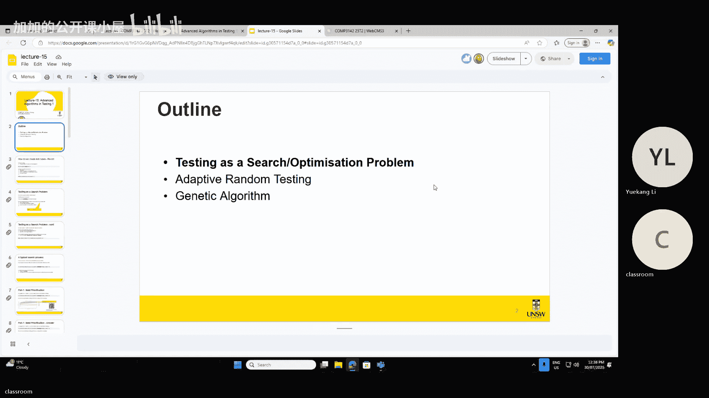

# 新南威尔士大学【中英⚡软件测试｜COMP3142 2025 Software testing】 p03 P3 Advanced Algorithms in Testing 1 -BV1o34HzBENA_p3-

Alright， let's start。Let me see if the recording is properly set up。好，O， so。Okay， let's start。

So before we actually start today's lecture， let's quickly have a look at what's next so this week is actually week nine is the second last week for this term。

And actually， it's towards the end of this course。 And we will be learning some advanced algorithms for doing testing in this week。

 And these algorithms might， might be not only useful for testing。

 but it could also be applied to some other scenarios。And and in our next week。

 we will only have one lecture on Wednesday， which is a recap of the entire course。So it's like we。

 we don't。 We don't have final exams， but it's good for you to。

 to to to have a recap or to have a systematic view of what you have learned this term。

 So you could see that everything you have learned in this course for this term is kind of connected to each other。

 so。This is roughly our plan。And okay， let's continue to today's main content。

So today we are going to learn some advanced algorithms in testing。And this is today's outline， so。

Before we actually learn these algorithms， let's try to formulate testing as a search or optimization problem。

 And then we， because we can formulate testing as some kind of problem。

 Then we can apply some algorithms for solving that type of problem， right。

 So this is what we are going to learn today。And first。

 let's have a revisit of how do we create test cases。

So we have learned that software testing is basically to。

Generate some inputs to try the program with the inputs we have generated and see what happens。

 right？ So this is essentially what testing does。However。However， when we generate these inputs。

 we don't just try any input， right， because it's not very effective。

So instead of just trying some inputs randomly， we have some purpose， right。

 We could have different purposes here。And we want the test cases to be able to find some faults。

 right， That's the most fundamental thing we want to do with testing， right。

 And we may also want to observe to obtain some coverage over some structural elements of the code。

 For example， the statements branches or even a path。

 So this could serve as an evidence of how much of testing effort。Have we done， right。

So we have some purposes here， and we may also want to create different combinations of representative values。

 right， This is kind of related to how we create test cases for equivalent class testing or combin testing。

 right， So we have different purposes here。 or if we use， if we use data flow information。

 We may want to execute all the di use pairs。So we have different purposes here instead of just generating the input with without any purpose randomly。

 right？So。After so we have different purposes。 but what does all these have in common。😊。

So let's think about this problem。So do we have a go。When we do testing。We do， right。

 although the goal could be different， we， we do have a goal when we do testing。

 we want to find more bugs。 We want to obtain some kind of courage。

 achieve a certain level of courage， right， we do have a goal。

And the second thing we want to think about here is， can this goal be measured。For most of the。Goes。

 the answer is yes， right， Because we can measure the number of faults we have found。

 We can measure the level of coverage。We can。 We can count how many pairs of combinations did we cover。

 right。So we can measure the goals here。Then。Because both of the answers are yes here。

 Then is we are like， kind of searching。For a desired test suite。

So why this is like searching for such a test suite， we can describe the problem again in this way。

So。We know that the input space is almost infinite， right， We can give a program any random input。

 its just that the program may refuse to take our input， but we can supply any input。

And we can give any inputs to the program。 So out of the。In near the near infinite set of inputs。

 we would like to have a set of inputs that can obey certain properties that can cover some some structures in the program that can try out all the combinations。

 right， We do have some goals here。So， it's like。We are searching for such set of。

Inputs that can satisfy all these different goals。From a huge input space。

 So it's like we are finding something。 We are finding a suitable thing。In a big space。 So。

 so testing could be。Described as a search problem， like we are searching for a suitable test suite。

So， this is。The idea here。And。Let's continue to explore this。

Kind of theory of thinking testing as a testing problem。

 So we have learned that it's actually impossible to justify that we have found all faults or all bugs in this in a particular program。

 because it's it's like the program space is infinite。 and the requirements could be changing， right。

 The environment of running this program could be changing。 So it's， we can hardly say that。

A certain program is free of bucks， so。We know that。 Okay， this， this final goal couldn't be checked。

 but。The testing goals we just mentioned， all of them could be measured somehow， right。

 We can measure how many faults we find。 We can't。 we can't say we can。 we find。

 We have found all faults， but we can measure。 We can count how many faults we have found， right。So。

We can。We can measure all these we can measure all these testing goals for the boolean goals。

 It's just whether a certain property is satisfied or not， like certain level， like， for example。

 have we tried all the possibility all the possible combinations of different options， right？

 So this is like a boolean goal and we do have a numeric goals like what is the percentage of coverage we have achieved for this program。

 So we can measure all these goals。😊，And if。If we can take。

 if we can take a certain test suite and check whether this test suite or this solution of this searching problem meets our goal。

 then we can write programs to automatically search for this solution， right？ So in this way。😊。

Because because we can convert testing as into a problem of searching for a suitable test suite。

 And this searching problem could the goal of this searching problem is measurable。

 and we can generate the candidates， candidate solutions automatically。

 Then we can use the program to automate everything here， right， So actually， most of the。😊。

Searching based testing techniques are kind of fully automated。 So it's like we can use a program to。

Fully， automatically。Generate test cases。And here is a typical searching process。So it's very。

 very simple。 actually。 So we just randomly choose or we use some strategies to choose a solution。

 And if this solution is not satisfactory， then we just try another solution。

And we keep on trying these new solutions until we achieve our goal。

 or we find out all the possible solutions。搜。As you can see here。

 we are choosing solutions one by one when we are and try to try to check whether they， they。

 they could help us to achieve the goal。 Then the order of selecting the solutions to try is important here。

 right， is， it could affect the efficiency of finding this。Final solution here。So。

So this involves this requires actually some strategies to to deal with。 So actually， a search。

 a searching problem requires some strategies for us to make such decisions like which solution to try out next。

 And these kind of strategies we are using here to make these decisions are kind of called a heuristic。

 So heuristics are actually used for like choosing these solutions or ignoring some of the solutions。

And talking about strategy and heuristic。 Let's think about this problem here， which is a live pole。

 So I don't know if you have if you have went through the assignment2 specifications。

But if you have done so， you may notice that in a 7，2 and2， the feature 2。

We try to implement a seed prioritization strategy。Which is a strategy for。

Prioritizing which seed should we select next， when we generate new test cases， right。

 So it's about the ordering of selecting seeds to try out， so。We know that。

The order that solutions are tried is important for improving the efficiency， so。

The question here is。Does this strategy or this heuristic we use for seed prioritization affect the final coverage after converging。

 So if you wonder what is converging， Converging means that so you can see that the the Y axis here is actually the code coverage。

 and the X axis is the time we do testing or fuuzzing。 So you can see that after certain time。

 the coverage doesn't grow。So it means that this algorithm of testing has converged。So。

 conorging means。It's reaching its maximum capacity。 So of this algorithm。 So do you think that。This。

 the strategy of。Which of。嗯。The strategy of the ordering of how we try out different seedss could affect the final performance after convergence。

So。Yes and no。😔，So you can just make a guess。Yes。😊，I no。So it just feel free to make a guess。

 And let's see the result。😊，I think most of you have chosen yes， but the correct answer is actually。

 no。So let me， let me explain why it is no so。Before we。Before， before I answer why it is no。

 we need to make clear two concepts here。 So the first one is efficiency。

 and the second one is effectiveness。 So efficiency and effectiveness are actually different in the context of testing。

 So efficiency means how fast we can do things， right。

And effectiveness means how well we can do these things。So efficiency here in testing。

 it means the converence is related to the convergence speed and effectiveness is related to the final performance after convergence。

 and actually， because see prioritization is only dealing with which one to try first。

 but it doesn't affect whether we should try something or not， right。So it only affects the ordering。

 but it doesn't affect whether we should try something。

 So it doesn't matter if if we try the good good seeds or good test cases first。

 then we can converge faster， right， the， the coverage will grow faster。But eventually， we will。

 we will try all the seeds given enough time， right。So it doesn't matter。

 So because given enough time， we cant try out everything。

 It doesn't matter in which order did we try these things， right， so。

So the ordering of buying out different solutions doesn't really affect the final performance。

So it only affects how fast we can reach an optimal solution here。

So see prioritization doesn't affect the coverage after converting。And talking about heuristics。

 there are some heuristics we have encountered， actually， before。

 when we learn some other algorithms， so。For example， So we know that okay。

 heuristics are the decisions or strategies we use to choose certain solutions or ignore some solutions。

So。Let's think about the problem of searching in a graph。

 So you you might have learned some algorithms of doing graph search， right。

 So if we arrange some nodes in a hierarchy。 And then we can apply B F S。

 which is to try out a graph by level by level。 So we try to exhaustively test all the nodes。

 visit all the nodes on certain level。 And then we move on to the next level。 So this is B， F S。

And we could also try out D FS， which is。To explore the。The graph by trying out the deep。

 the deepest node first and then do back trackingrack， right。So we can use different strategies here。

 And these strategies are actually kind of like some 13 heuristics here。

And these are some very naive but easy to understand and implement strategies。

 And we could also have some more advanced strategies when we do searching。

 We could do a star searching。So which is actually a greedy algorithm， so。

We can attempt to estimate a shortest path to our final goal。 And then this， this。

This shortest here could be estimated using different definition。

 We could estimate the time of reaching the final goal。

 We can use the distance towards the final target， right。

And then we examine all the next moves we can take and see which one will get us to the make us closest to the goal。

 according to the definition of shortest here， right， So this is a great algorithm。

 because we only check the next move。😊，And however， as you could see， this requires some。 the。

 the light is turning off again， so。And actually， this because we， we need to。

 we need to know which one is leading us to the is getting us closer to the goal。 Right。

 So we need to define this term of closer here， and we may need some domain specific scoring function to check the distance。

😊，And this。Doin specific scoring or function is actually a heuristic we are using here。

 So price first， the price here is the heuristic depth is the heuristic。

 And this domain specific scoring function is the heuristic here we are taking。

 It's like some kind of strategy or some kind of assumptions we make that could affect our decision making。

 So this is heuristic。😊，And talking about searching， let's come back to the searching。And testing。

 So previously， there was a， there was a workshop in a famous software engineering conference。

 which is called search based software testing。 And it's actually a workshop plus a competition。 so。

But now it turned into search basede and fastuzz testing。 So it it actually。

 it means that we can see that fuuzzing is actually getting very， very popular now。

 So that's why we choose it to， to be the topic of your assignment， too。😊。

And you can see that search based testing is actually a a very， very。

Popular topic in the field of software engineering。

And let's learn about some other key concepts in search based testing， so。When we talk about。

When we talk about some。Any algorithm we need to think about the budget we have or the cost incurred by the algorithm。

 so。The desired case or the ideal scenario is that， given a。Testing problem is that we。

 we should try all the possible solutions。But this is， this is desire， but this is not achievable。

 right。 So because we know that。The input space is kind of infinite。

So we cannot try all the solutions without constraining the problem。 So if we don't。

 if we don't apply some constraints， we cannot there are。

 There could be infinite number of solutions we can try。 but if we somehow can。

Apply some constraints。 Then we can limit the number of solutions to try， right， so。

This is the idea here。And this leads us to the， to the idea of bounding the searching problem with some kind of search budget。

 And this budget could be。In the form of the number of attempts we have tried so we can limit the number of。

Test cases on the number of solutions we are going to try， and we can also limit the budget by time。

 so we can say that， okay， we just want to run this phuzz process。 for example， by 5 hours。

 or so this is one。Iype of budget， right， And the other type of budget is that we can say， okay。

 when we run fast testing， we just want to execute the the target program like 10000 times， right？

 Then this is another type of budget。 So we can use either one of them as our search budget here。

 And this this search budget is actually serving as the constraint here。😊，So basically。

 the idea of the。Algorithm we are going to learn is to try to find a suitable solution before the budget expire expires。

So in this way， we can actually further convert。The problem here。So。

We know that sometimes true and false goals could be hard to solve under a budget。

So because if we want to say， because let's say we， we try to run。We try to run fast。

For maybe one hour on the on a particular program。 And we want to， and we didn't find any bug。

 Can we say that this program is free from bugs。 It's no。 we can't say that， right。

 because we don't know what will happen if we continue to run the testing， right。

So true or false goes here， like whether this program is free from bugs。

 It's actually hard to answer because of the budget， because we。We don't know what if。

 what will happen if we give。The program， if we give this technique more budget。 So we may return。

 We may get the answer of unknown if we can't find the satisfying solution here。So。

So we can try to use some measurable goals to convert this searching problem into an optimization problem。

 So instead of searching for a good or satisfying solution， what we want to do is。😊。

Instead of searching for a very good solution or satisfying solution， what we want is。

 we can optimize。😊，we can。 we can。 We can try to find a satisfying all the best solution within the budget or among all the candidate solutions we can get within the budget。

😊，So this is the idea。 So instead of finding the most ideal solution or the final solution。

 because we now have a budget right， so we can just。😊，Get a partial solution， so。For example。

 instead of having an。The best test suite we can get for this， for this， for a particular program。

 What we can do with a budget under a budget is we can。

 we can get the test suite that can obtain the highest。

 some kind of coverage among all the candidates we can get within the budget。😊。

So we are getting the optimal solution here， rather than。The best solution here。So we can actually。

 if we apply some limits or constraints or budgets。

 then we can transform these kind of searching problems into some kind of optimization problems。So。

The， the， the， the saying here that of searching for the best possible solution。

 given a budget is kind of an optimization problem。 It's kind of like we。

 how we describe optimization problems。So this is actually also similar to the concept of local versus global optimal。

 So for searching， we are kind of looking for the global optimal， right。

 So we are looking for the best solution。 But for optimization， since we have some limit。

 So what we can get is the best solution。Out of our the candidates we can have in this。

Within the budget， right， so。For optimization problem， we are。

 we are kind of looking for some partial solutions or local optum here。

So now we can rethink about the problem of how could we convert testing as an optimization problem。

So。The just now， we learned that we are instead of searching for the globally best。Solution。

 we are searching for the best solution。Possible among all the candidates that we can get within the budget。

So， this is。Optimization problem we get here。 And therefore。

 because we are having some kind of budgets or constraints here， right。

 So we don't have infinite resource for us to find the solutions， to try out different solutions。

 Then the searching heuristic becomes important。So if we use time as the budget here。

 then the time we are taking to create， execute and evaluate a solution becomes important。

And if we limit the budget， if we use the number of attempts as the budget here。

 then the strategy used to choose solutions， to select solutions is important。And but in practice。

 we， we do want optimal solutions in both categories。For the purpose of high efficiency。

So there are actually many， many searching strategies here that we can try out。

 And we can we are going to learn two of them today。 So next， we will learn。嗯呃呃。

A searching strategy called run adaptive random testing， so。Here。

 let's think about the most naive or most simple form of searching so that which is called random search。

 So what we do here with random searches that we just randomly formulate a solution。So this is very。

 very straightforward， right？ So for in the context of testing， it could be like this。

 So for unit testing， assume that we are testing an object oriented program。

 So what we can do is we can choose a class in the system as the unit we are trying to test。

 and then we can randomly generate a series of method calls。Of that class。

And then we can randomly select the number of calls， right， we can select random methods to call。

 right， And then we can， we can generate or supply random parameters to the methods we have selected。

 right， So everything is fully random， randomized。So for a gray box fuuzz， we can also try out。

These random searching strategies。So for the seed prioritization problem。

 So which is related to which seed to use next， what we can do is we can randomly select the next seed。

 right， And this is a default implementation for7，2。 You need to implement some advanced strategies。

So we can， after getting a particular seed， then we need to determine how many new test cases we could generate from the seed。

 right， And this is called the power scheduling problem， right。

 So when dealing with this kind of power scheduling problem we can randomly assign powers， right。

 we can randomly determine how many new test inputs should we generate。With the given seed。

 So this is also random。 And we can， of course， randomly mutate the seed to create new test cases。

So we can do things fully， randomly。And there are some advantages of doing。

This kind of random testing。Its actually also very， very popular。 The full random testing。

 because it's very fast。And it actually requires no planning at all because it's just pure random。

And it's also very， very easy to implement。 So you just need to write some random code generators。

And it's easy to understand as well， because everything is。Determined randomly， and。And there。

 and one more hidden or sometimes likely to be ignored advantage of doing full random or pure random testing is that all the inputs here are considered equally。

 So there's no designer bias。 So sometimes when we are。When we are trying to do testing。

 we try to apply some heuristics based on our experience， based on our assumptions or observations。

And these observations or assumptions may not hold all the time。

 So this is considered as designer bias， so。So， we may。😔。

So we may somehow run avoid this kind of designer bias by doing things purely randomly。

So randomness is actually not a bad thing。And when you do a to the feature tool， if you。

 because we are trying to use a priority queue for maintaining the seeds of the test case of the gray box father。

 so。If。If you just don't apply or don't select from the non favoriteed seeds。

It is considered as a designer bias here。 So you should avoid this。However就是。

 there are many there are many drawbacks of random testing as well。So。As we see that， okay。

 random testing is simple It fast， it could avoid wide。A wide designer bias。

 but it could also have many drawbacks， so。Let's see this example from this comic here。

 So you can see that。 Okay， this little monster tells us that。 Okay， there over there。

 we have a random number generator， and this random generator keeps telling 9。

 And then this guy asks。😊，Are you sure that's random。 Okay， that's the problem with randomness。

 You can never be sure。 So the problem is with randomness， we can never be sure。

It lacks actually both efficiency and effectiveness most of the time。

 If we do things purely randomly， so。That's a problem here。 So we need。

Although we could introduce designer bias， we still need some strategies and heuristics here。😊。

So let's think about this problem here。 And how could we design some heuristics so。First。

 let's observe the input space of the programs。So this is like an illustration of the input space of programs。

So。The sunflower here denotes the test that could pass。

And the ladybu here denotes the test cases that would fill the program。 So we can see。

 we can see from this illustration here that。Bs actually sparse in the space of the input space。

 So this is because like when we， like in， when developers write programs， they are， you know， they。

 they won't make some very， there is' very unlikely that they are making some very simple mistakes。

 right， So most of the bugs or。Fals are corner cases， right， So it's。

 so the input for triggering these corner cases are actually very sparse in the input space。However。

 it could be dense in certain parts of the space right， if they appear， because for example。

 when you implement some kind of program， there could be certain part of the program which where the logic is very complex and the code could be very。

 very fragile right and in that part of the code you could have a high density of bugs。

So although the faults are very sparse， they could be very highly。

 they could have a high density in those fragile。Vulnerable regions。And。

And if an input causes a failure， a similar input。Would also。

 is also very likely to cause the same failure， so。This is because。

 because they are very close to each other， right， They may。

 It's very likely that they trigger the same fault。So these， these are some observations here， so。

We can have our assumptions and heuristics based on this observation here。So。

Rather than what we want here is， rather than choosing has completely randomly。

 we favor input diversity。So。The strategy here is if a test case does not meet a goal。

Then when we generate the next test case or the new input。

 we should try a very different input from the previous ones we have tried。

So we can promote diversity here。So this is actually the most basic idea of adaptive random testing。

So， for example， we， if we have generated a test case like this。What we do is。

Instead of selecting a seed， generate another text input that is close to the one we have tried before。

 So instead of we， we don't want to try this one because its is's too similar to the to the one we have tried。

 So instead of trying this， we should try some。 we should randomly generate some other inputs。

 which are further away from。The unsatisfying input we have tried。So， this is。The basic idea。

 And this is， and this will， this will be， you can see from this figure that is more likely for us to find bugs if we try out more diverse inputs because of the。

 because that the bugs are kind of very sparse in the input space。So， this is a basic idea。

And there are some algorithmisms to implement this idea。So。

This algorithm here is called fixed size candidate site algorithmism。So fixed size， candidate site。

 adaptive random testing。 So this is a full name。So it actually makes use of two sets of test cases。

And this one is， the first one is the executed site。 So basically。

 it keeps all the test cases we have tried。And then。But and these test cases must also not meet our。

This goal。And the second side of test cases is the side， the candidate side。So， it's just。

A set of tax cases that have have been generated， but not yet tried。So， here are the steps。

Key steps of this algorithm。 So first， we generate test and then execute the test。And then。

 we generate。The random。So we generate the an side。And then。We， because we have executed this test。

 right， And if it doesn't。If it doesn't meet our goal。

 we will choose from the candidate side the furthest test away from what we have been what we have executed and then execute that candidate。

And then put that candidate back into the executive side if it doesn't meet the goal。So this is very。

 very simple and straightforward。 However， there are some decisions we we need to make in this process。

 right， you can see that we need to choose the test which is farthest away from the executed test and how do we determine this distance here is a problem。

 right。😊，So。So we need to have some strategies。 And before we look into the details of the strategies。

 let's， let's have a look at why this。Our rhythm is needed here， actually。It generates。

Because we are， we are only selecting the test cases。 We， we can generate， because here。

 as you can see in this step here， we generate N test cases。 We generate a set of candidates。

 and we only select one to execute next。 So you can see that we generate many more test cases than we execute。

😊，The test cases， right， So more test cases are generated than executed。In random testing， all the。

As case we generate are executed。We don't have any strategies for determining which one to execute or not not。

So。Normally， execution is more time consuming than generation。

So executing a tie target task case is considered to be more time consuming than generating a new task case。

So。So， in theory。We could we could run these adaptive random testing faster。 And because of two。

 because of two reasons， the first one is it can execute much faster because we are not executing as many test cases as random testing。

 right， And the second one is。We are trying out some strategies that can promote the final diversity of our test suite。

So these are the two reasons。And now， let's come back to how should we deal with some。

Some of the decisions in the， in this algorithm here。 So we need to。

I need to choose that the the key decision we are making here is to choose the next candidate for execution。

 right， And we， and it is according to the distance， right。

 So we want to choose the candidate that is for away from what we have executed。

 And here we have actually two strategies of calculating the distance here。

 So the first one is max mean method。 And the second one is max sum。My third。 So maximum means we we。

 we use the the distance between the closest。The the candidate is given a candidate test case。

 We use the distance between the the， the closest distance between the candidate and one of the。

The test cases in the executed test as the distance here。 So we only use the closest distance。

Against the the executive test as the distance of each candidate。

 And then we select the candidate with。The largest distance。 So this is I， the idea of maximum in。

 and the idea of maximum sum is that we use。The sum， because in the executed test。

 we have multiple test cases， right， we can use the sum of the distance between the。

Between a candidate and each one of the each one of the test cases in the executed test side。

As the distance here。Of the candidate。So we can use either one of them to， to calculate。

 to determine which candidate is farthest away from the executed tests。

So this is the first decision making point。 And the second one is。

 so now we know how could we determine which one is the first way。

 But we need to determine how far or what kind of measures do we use for measuring the distance。

 right， So we need to determine。The distance here， and。The distance could be determined。

 according to the type of the。Of the the candidate or the the value of the the type of the value of the candidate。

 So for numeric values， we could use Euclidean distance， so。

So the Euclidean distance is basically calculated like this。And for strings。

 we can use this kind of distance and many， many other distance calculation methods。

And for different types of values， we can apply different。Distance calculation methods。

And that's about adaptive， random testing， and。There are some variations of adaptive random testing。

 which are kind of considered as improvements。 So the first one so。

 so the one we are going to learn here is zone based algorithm， so。What we do is。

We we still the the basic goal is still similar to adaptive random testing。 We still want to get。

The most diverse。Test suite。 And what we do here is we define some ex we still use the concepts of distance here。

 So what we do is we define some exclusion zones。 So these exclusion zones are like some bubbles surrounding the test cases that we have already executed but doesn't meet our goals。

So。As indicated by the name of the exclusion zone。 So we， when we choose。The next input to execute。

 we don't choose from these， those inputs， which are within the execute exclusion zones。So。

So you can see that this is a little bit different from the idea of。Adaptive， random testing。

In adaptive random testing， we are choosing the test case。

 which is furthest away from the current test input， right。

 which is definitely outside the exclusion zone， right， so。😊，But here it doesn't。

 we just need to choose input out out of this these zones， and it doesn't require these。

 the the the candidate we choose doesn't require to be the furthest away。

 So this is a basic idea here。So this is roughly how it works。 So initially we。We。

We decide this exclusion zone to be of certain size， and then。All the zones are of the same size。

 Then we shrink。Shrink the size of the zones as more test cases are executed。 So you can see when we。

😊，Initially， maybe we are starting with the zones with the black or gray， dark， gray color here。

 and more test cases so we don't select from within these larger circles because and then we just select randomly from the other。

They are the places。 There are the spaces in the input space。But then。

But then after the more test cases we have tried because we will have fewer choices， right。

 because this entire input space will be very， very crowded。

 so we need to shrink the size of the exclusion zones， the more test cases we try。

So this is a basic idea。 And the other， another idea on top of this exclusion zone is called dynamic petitioning。

 So what we do is we break the input space into different reason regions， and then we choose。

The we choose a test from the largest on export region。 So， for example， now we have3。

3 different regions， right。And we have tried three different test inputs。

 So when we select the next one， we select from the largest region， which is。

 which has not been explored before。 So this can also help us to ensure the diversity of the test suites we can get。

So。This is roughly the idea。 And this the good the good thing about this dynamic petitioning is that because it it actually also depends on how we do the petitioning here。

 So the good idea is that we are not starvring any input because we it makes sure that at least one test input is selected from each region here。

 So because if we， if we don't do this kind of petitioning and we just select randomly out of the the exclusion zones。

 then we may。😊，We may end up in not covering certain regions， right， So because of the randomness。

 So we may end up in starving some of the regions。 So if we do this kind of partitioning and select inputs。

 according to the regions。Then， we can。We can evenly spread our test cases across the input space。

 So this is the idea of dynamic petitioning here。And theoretically， this。

 these zone based techniques are kind of better than the。better than the naive， adaptive。

 random testing。So， that's all about。The first half of today's lecture。

 And let's have a 10 minutes break。 And I'll see you at。7 past 12。So for these algorithms， you。

 you don't need to。You don't need to really know every detail of these algorithms。

 You just need to know that the the brief idea of how it works。 And， you know， there is such a thing。

And that's a basic idea。 So these are some advanced algorithms。 You don't have to。

Really master then you just need to know， okay， there's such a thing。

And they are not only useful for testing。 They could be useful for other problems。 Like。

 that's why we are trying to convert testing as some searching or optimization problem。

Because we can apply some general algorithms。So if we can transform the the problem here。Okay。

 let's start the second half。So。We are going to learn the genetic algorithm， which is an。

An even more advanced algorithm for doing testing or creating test suites。So。Let's。

 before we jump into the actual algorithm， let's revisit the problem of optimization。So。Normally。

 there could be too many restrictions for us to exhaustively do the search， right。

 So that's why we need to。 There's no way to try out our the inputs and。

So we need to explore some strategies for sampling from the input space or selecting the test inputs。

嗯But this。ButThis strategy shouldn't be purely random， right。

So we should have some kind of strategies here。 And the question is， so。

 so we can use some strategies to improve effectiveness and efficiency and to automate things， right。

But the thing is， just now， all the strategies or heuristics are kind of based on some of our observations。

Or some empirical findings， right。So how can we kind of automatically select the best strategy here。

Can we even。Autommate the selection of。Strategies。And actually。

 this leads us to the meta heuristic searching techniques。 So just now， all the。sorry。

All the algorithms we learned are kind of heuristic based algorithms。

And now we are going to learn some meta heuristic techniques。 And if you wonder， okay。

 what is the meta heuristic， It's like a heuristic for finding heuristics。 So this is like。😊，If you。

 if you wonder what it means， we can use another example to。To explain this idea of meta heuristic。

So， for example， let's assume that we are trying to generate。Constant or configuration setting。

 So the easiest way to do it is to use the precise value， right， We just fix the value。

And the better way of doing it is actually， too。To use a random number。

With a fixed seed to generate this random number。 and an even better way of doing this is to use a random number that is seeded with a with the system time。

 which could be considered as a changing seed， right。

 and the best solution here is to use a random number generator to generate the seed for the random number generator。

 And this random random number generator for generating the seed is actually consider the meta heuristic here。

 It's like the heuristic for heuristics。 So it basically to。😊。

Some meta heuristics that can help us to derive some other heuristics。 So this is a basic idea。😊。

And the， the， the optimization problem here is， if we can calculate。

If we can calculate a score for each of the testing goal， then under some constraints。

 then we can convert the problem into an optimization problem。

 and the score of that testing goal is like our optimization target。

 We want to maximize the maximize the score， right。So。

We can convert the test generation as an optimization problem here。

 So what we can do is we can generate a test。 We can score each one of the test with a fitness function here。

 so we can use some kind of function to assign scores to each one of the tests we have generated。😊。

And then。We can manipulate the solution according to some kind of strategy。

 And this strategy here is the meta heuristic we are going to apply。So this leads us to the。

Very basic idea of genetic algorithm， actually。So。As indicated by the name of this algorithm is kind of in inspired by some biology concepts。

So。What we are， the basic idea of this algorithm is that with multiple generations。

 we try to evolve a population of。The targets。 And then we favor the good targets or the good the targets are actually the solutions or the test cases here。

So we favor the good solutions。In each generation and filter out bad solutions in each generation。

So this is the basic idea of genetic algorithmism。And。Because we are。 because just。Similar to the。

Adaptive random testing。 So we have to promote diversity of this population here。

 So that is to cover the corner cases to find the bugs， so。

Diversity is introduced into the population of each generation here by keeping only some of the best solutions。

 but we don't keep。we， we may keep some。🤧嗯。So the this， this is the first step。

 So we keep the best solutions here because we are favoring these best solutions。

 So the the the diversity is introduced by randomly generating some population members。

 So we have a population size， but we don't feel the entire population size with with the best members。

 We still randomly generate some new members in the population。😊。

And then we create offsprings through mutations， like we can randomly mutate。

The members of the population。 So this gives us some diversity， right。

 And we can also try to do crossover by selecting some of the solutions in the population to generate new。

Offsps。So。This is the idea， the idea， the basic idea here。

So this is actually similar to what we are doing for them to for the father。So。

basic idea is to做 this3。😔，Its a meme。 So basically。

 the idea is to we have some best members in the population。

 and then we generate offsprings using the best members。

 So the idea of keeping the best solution is that because the best targets are having some characteristics characteristics that we want to keep in the population。

 And then we generate， we we generate the offspring is the the generation of the offspring is to get the population closer to what we want and to also introduce diversity。

So this is the basic idea。And here are some key concepts in this algorithm。

 So if you just watch the slides from here or watch the recording from here， you may think， okay。

 this is like some kind of biology course。 But actually， we are in a computer science course。😊，So。

This graph is actually borrowed from， from some biology textbook。

 So because this algorithm is actually inspired by by the biology concepts。

So the concepts we are going to learn here are not the cells all these protein or necklace。

 And we are going to use the chromosome and gl。So。Individual。So inside this population。 So we are。

 we are actually evolving the population generation by generation。 So that's a basic idea。

 And inside each generation， we have a population of individuals， right。

 And these individuals are like the solutions are the targets。 We are trying to optimize， right， so。

The individuals in the population compete for resources， and reproduce。That's a basic idea。

 And those individuals who are successful are calculated as fittest by the fitness function。

 Then reproduce to create more offsprings than filtered out ones。

So we can keep the genes of the fittest parent。And propagate because。

 and then we can propagate the fittest。Genes are the good characteristics。From the parents。

 and propagate these。Good characteristics throughout the generation。So。So that is why because we are。

 we may sometimes combine good genes of different chromosomes， right， so。That is why sometimes。

 and most likely， the offsprings can be better than both parents。 So that's the basic idea。

 And each chromosome is actually considered as an individual。

 an each gene here is actually some kind of characteristics of the chromosome。

 So it's like part of the。A part of the individual。So because we can generate。

 it's likely that we can generate offsprings， which are better than their parents。

 So the the quality of the entire population gets better and better throughout different generations。

 right。So the question here is， what do chromosomes quite respond Po according to the according to the description here？

Actually， I just mentioned the answer。 So the answer is chromosomes are actually like the individuals here。

 right。So what are the genes here。What are the jeans。 So jeans are actually。

The properties are characteristics of the individuals。So。This is the idea here。 And what。

 what is the population。So。😔，The population in terms of testing， What is the population。

The testing is actually the set of chromosomes， or the set of。

Individuals or the test suite if we want to evolve the test cases。

So this is actually the workflow of this genetic algorithm。 It's actually very。

 very simple to implement。 You can implement this algorithm with。

Like within 100 lines of code in Python。So the basic idea is， we initialize。The population randomly。

 So， for example， if we are trying to get a test suite。No。What we can do is we can initialize this。

 We can populate this test suite with a set of random test cases， right。

 we can randomly generate everything here。And then we can create offsprings with the members of the population。

 So what we can do is we select the parents and recombine them。

 So recombine them means we do crossover， like we select maybe the first half of a certain test case。

 And then we select the second half from another test case。

 And then we combine them together into a new test case。 So this is how we do crossover。

 And after doing crossover， we may。Use， we may have use a small chance to randomly mutate。

The offspring， we just generated。So this is to add some extra randomness or diversity to the population here。

 So after doing this offspring generation， then we can use a fitness function to。

To calculate the survival。Population， so we have to specify a fixed size of the population。

 So we don't to keep the population growing。 We have to fix the size because we just want to keep the best genes here。

 And the survival， this survival function here is used for calculating the fitness of each individual candidate here。

 And then。We use the fitness function to。Calculate a score and filter out the bad ones。

And only keep the good ones。 And then we keep on this。 We keep。We keep looping through this process。

 until we set。Until the stopping criterion is reached， or maybe like we have running。

 we have run out of budget or maybe certain number of generations have been generated。

 or if we have found the solution here。 So this is a basic workflow。So， here are some key。

Things that we could take note for this workflow。 So the first time is。When we initialize。

initialitize the population。 we can do random initialization。

And this process is also called reproducing。And when we do the survival calculation。

 we use the fitness function。 So you can see that the the design of this fitness function is very important here。

And the last one is。We need to terminate。 We need to set some termination criterion for this algorithm。

 and normally。We， we limit the number of generations we would like to try。

So this is the basic idea of genetic algorithm。And although it may sounds very cruel， like it's not。

 you know， we are eliminating some bad things， bad individuals， but they are just test cases。

 They are not like humans or whatever。 You know， it's like we are just eliminating some test cases and keeping some good test cases here。

 So this is a genetic algorithm。 And it， and it actually works very， very well， not only in testing。

 but also some other problems， optimizationim problems。So if a unit testing， actually。

 genetic algorithm has been used。Has been applied very， very successfully。And。And this is this is。

 this evil sweet is actually a。Its actually a。Unit testing generation framework for Java programs。

So you can if you click on this click on this link， you can get to this website。So。

It's actually a very， very successful unit test generation framework。

 You can use it to automatically generate unit tests for any given piece of Java code。

 So it has been developed it was created in 2010。 and it has soon dominated this field of doing unit testing。

 And by that time， you know， like there are， there were two groups of people。

 one of them is the evil suite group。 they were promoting this genetic algorithm for creating unit test automatically。

 and another group of people were trying to use you know， model based testing。

 So remember when we learn system testing system level of testing， we learned that we can create。

 we can model the behavior of the system， right， we can use some models of the systems to create test cases。

 and the other group was trying to use this model based。😊，Testing to idea to create unit tests。

 And they were fun eventually defeated by this group。

 So genetic algorithmism was kind of proven to be a very， very useful technique for doing unit test。

And considering that it was created in 2010， iss actually a very。

 very young technique because comparing to all other techniques we are learning nowadays， like。

 you know。😊，It's a very young technique。Many techniques we are learning are actually older than you could imagine。

 like， for example， for neural networks， it was actually created。

 The idea was created proposed in 1980s。 like by that time， the hardware was not powerful enough to。

 you know， to train good models。 So people don't take it seriously。 But。

 but then as hardware evolves， it becomes more popular。 So many techniques are very， very old。

 but this one is very， very young。😊，And let's come back to the genetic algorithm。And genetic。

 take algorithm them， actually。But also， the idea of this algorithm was also kind of reflected in the design of fathers。

 especially the American fatheruzzy love， we have learned so。Actually， there are。

 there are some differences in the process。 So we can see that American Fuzzy lab was trying to maintain a queue of seed inputs。

 right， This queue of seed input is actually somehow like the population， right。

 And it actually keeps。😊，Growing this queue of inputs。

 like and maintaining this queue of inputs and trying to make it better and better， right。

 this process of。Iteratively， making。The entire population better is similar to genetic algorithm。

 but there are some differences here。So the initial population or the initial seeds of these gray box father。

 whether it's A FL or mini lab， you are going to try in72。 They are。

 the initial seeds are not randomly。Generrated， they are kind of provided by the users。So。

 this is one difference。And the reason of using user provided input is that because if we just purely randomly generate the initial things。

 we may take a very， very long time to fully optimize the population， right。

 if we can already get some good or high quality seeds or high quality population or high quality test cases。

 Then it's。It will give us。Like a performance boost during the start of the testing。 So this is why。

One difference here。 And another difference is like。When we create offsps or new test cases。

 it doesn't。Always do this kind of reproduction using two test cases。

 We can still mutate a single parent。 Like in a 7，2， there are two types of mutation operators。

 One is called crossover。 The other one is called havoc。

 Havevoc is like purely randomly creating a new test input based on a given seed， right。

 But crossover means like we are trying to combine two seedss to create a new test case。So。

AFL doesn't always try to combine these。And another difference here is。

AFL doesn't try to kill certain population， so it doesn't discard any test input instead， it。

It calculates the favorite seeds。 so it doesn't remove these。 It just favor some seeds。

 So that's the difference here。 But essentially， the idea is similar。And the last thing here is。

 like some of you have asked questions in the forum as well。 So when should we。

 So it's like the father is running forever， right if we don't manually stop it。 Actually。

 that's the。That's the design。 that's the desired of behavior of fathers。 So normally， we just use。

The time as the stopping criteria here。 So we don't use the number of generations to have。

 So we just use time here。For termination。 So， for example， for A FL， we can specify that。 okay。

 this further will just run for maybe 5 hours or 24 hours。🤧So that's the last difference here。

 But the overall precise and the overall idea is very， very similar。Sorry。😔。

And that's of today's lecture。 And before we finally end。

 let's have a quick recap of what we have learned today。 So basically。

 we covered three different topics。 And the first one is actually the basis of the the other tool。

 So it's like we are trying to convert testing as a searching and optimization problem。

 The reason that testing could be converted or transformed as a searching problem is that we are trying to search from the infinite input space。

 a suitable test suite。 right， we are trying to find。😊。

The suitable test cases from an infinite space。 So that's why it could be considered as a searching problem And why it this searching problem could be further considered as an optimization problem。

 The reason is。😊，We can。Because normally， this involves。 this input space is infinite。

 and we can't exhaustively find out all the solutions to find to find the idea target， right。

 So we have to use some budgets， we have to have some constraints。

 And since we are we cannot find the best solution here。 We have to find the optimal solution。

 That is the socal best within all the candidates we can get with our budget。

 Then this problem becomes an optimization problem。

 Since the problem of testing could be considered converted into searching and optimization problems。

 Then we can apply algorithms that can deal with search and optimization problems to do testing right。

 to create test cases。 So。😊，In this way， we can apply some techniques like adaptive random testing。

 which is to basically to try out some Cs and then select the next candidates which are farthest away。

 And we can use some zone based variations to further optimize this algorithm。

 So that's the first one。 And the second one we learned today is a meta heuristic。😊，Algorithm。

 which is。Called genetic algorithm。 And genetic algorithm is to actually。

Optimize a population of individuals generation by generation。

 and we are introducing diversity into this。Into this a population by。

Reproducing offsprings with some parents in the population， right， And we are keeping the good。

Genes are the good characteristics by using a fitness function to filter out some bad solutions。😊，So。

 that's the basic idea。And that's it for today's lecture。 And thank you for coming。Okay。确实系。Yeah。诶有的。

