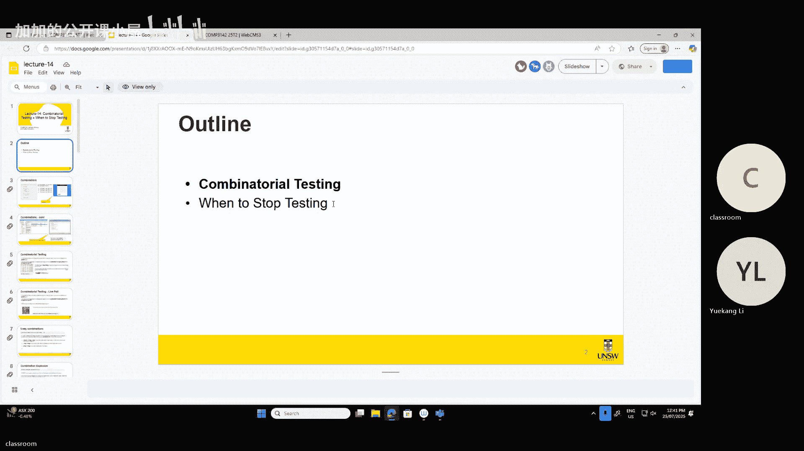

# 新南威尔士大学【中英⚡软件测试｜COMP3142 2025 Software testing】 p04 P4 Combinatorial Testing + When to Stop Testing -BV1o34HzBENA_p4-

Alright， let's start。So today， we are going to learn。And the last testing technique。

 we are going to learn for this course。 And because next week。

 we are going to learn some algorithms which could be used for testing and even some other scenarios。

 but the as for testing techniques， this is the last one to learn for this term。And for this course。

So the last one we are going to learn is cabinet testing and when to stop testing。So。

Today's sound line is pretty straightforward， sorry。And the outline is pretty straightforward。

 We are just going to learn combin testing， and then we are going to learn about when should we stop testing。

So first， let's have a look at combinatorial testing。 So in this。In the name of this technique。

 we can see the key keyword here is like combinationial or combinations， right。

 So let's think about combinations。So。In in this example function here。

 which is actually from the last question of assignment 1， we can see that。

These are the test cases we were trying to evaluate， right。

 So these test cases could be viewed as combinations of values of different parameters for this function。

 right。So we can see there are some combinations here。 So we are combining different。Possbilities of。

Parameterter values to make test cases。 So this is the first。Type of combination。 we are going to。

 We can see here。And。Another scenario where we can often see combinations in software is like something like this。

 So we can see that there are a lot of G U I items， right， when we are trying to use software。

 and inside the G U I of these software。 we have a lot of fields for us to input something there。

 So these， we can these are also where we can have combinations， right。

 we can have combinations of different names， different emails， and different phone numbers。😊。

So we can have combinations of input parameters。 So this is what we can have。

And let's think about more combinations we can have from software， so。In this example here。

 if you can't see it clearly， I can， I can read it for you。 So this is local group policy editor。

 So which is a。Policy editor for different groups of different groups of users。

 This is a setting for Windows。Operating system。 And you can see that we can configure different rules and policies here through this。

 And we can actually build combinations of。I'm not controlling the light。

 but I don't know why it keeps turning on and turning off here。 But yeah， so。This， actually。

 this is another type of combination we can observe here。

 So we can have different combinations of different policies and。😊，因微。

Try to click on some configuration items of， for example， Windows。

 So we can also see some system configurations。 So we can have。

 you can see there is these radio buttons here and these check boxes here。

 You should notice the difference between radio buttons and check boxes because this is also useful for your quizzes。

 If you observe for check boxes， it means that there might be more than one correct answer， right。

 And if you see radio button， then it means that there's only one correct answer。😊，So。So you can see。

 But let's come back to this configuration here。 So you can see that we can have different combinations of different settings here as well。

 So the second source of combination is like。😊，The， the configuration options of the software。

 which are not directly user inputs or input parameters， right， They kind of different。

 So we can have different combinations to test the behavior of that could affect the behavior of the system or the software we are trying to test。

And the question here is。We can use these combinations to trigger different behaviors of the software。

And we can use this kind of observation to do testing。

But how can we systematically generate the combinations。Of course。

 we can just randomly come combine different things。 but。

 but we don't want to do things fully randomly， right。 We want to systematically cover all。

OrSome representative。Coms。So this requires us to do combinial testing。

 So if you want to systematically try out different。Combinations or different possibilities。

 We could do combinial testing。And this is a definition， the definition of combination testing。

 So comm testing is actually a technique， a testing technique that tries to check all or just some combinations of the system inputs。

So the most common application of comm test testing is to check different combinations of the user or the input parameters or the different combination con configuration options of the system。

And you can see that this is an example of different。Different combinations of system system options。

 You can see we can try out different operating systems。

 and we can try to combine different different choices of operating systems of browsers of protocols of CPUs。

 And you can see that from the browsers。 We can see that you can see I。e。

 inside this list this tells us that this。Table here is actually quite old， right。

 And you can make a guess how old it is。Can you make a guess， Like， how old is this table here。

 You can see I。e， but you can't see Chrome。Actually， this table is from the NIST report。

 I'll tell you what is N IT later。 And， and they are the organization。😊，Ppo。

 proposing the the idea of combun testing。And in this report， they。

 they first mentioned the term comm testing and。And this combin testing was proposed by them like 20 years ago。

 So they did a study 20 years ago。 And in that study， they proposed the idea of combinator testing。

And commator testing is also known as。TV testing， and we will learn why it is called TVV testing in the following up slides。

And if you wonder， what is an I T， why are they interested in creating some new testing techniques。😊。

Actually， an IT is an US Department， which is called the National Institute of Standards and Technology。

 because they want to have some guarantee of the quality of。

 of different techniques and they want to provide some standards if。

 if they want to provide standards。 They have to have some evidence of the quality， right。

 So they are interested in investigating。New testing techniques。 And in this study。

 they proposed comb or TV testing。So now let's given this definition and。

The rough idea of comb testing。 Let's do a live pole。

 So which levels of testing does comm testing belong to。You can do。 You can scan the QR code。

 if you haven't。And if you are done， let's get to the question here。😔。

So you can see the difference between radio buttons and checkbox again。 So which levels。O I think。

 does。看 Millan。Just now， we discussed computational testing could be done for input parameters and system configurations。

Right。So。😔，Which one of these levels have。Iimple parameters or system configurations or system options。

Actually， all of them have。So， let's see the result。

I can't see who is doing the correctly here or just from here， but。😊，But all。But， actually。

Combinator testing can be。Sorry， I don't know why it's not full screen。 if I get back。😔，So。

So comm testing actually belongs to all levels。 So for unit level。

 we can combine different input combinations of input parameters for integration level。

 we can also have different combinations of input parameters， right。

 And maybe we can have some system configurations in integration level and for system level。

 we have both input parameters and。System configurations。And now let's think about another problem。

 What is the color of box for comb testing。Is it black box or gray box or white box。

What is the color here。So we， we， we just care about different combinations of input parameters or system configuration options。

So what is the color of wax。Yes， black box。 Yes， so。

Because we don't know the internals of the software。 we are testing。

 We don't have access to the source code。 And we are。

 and it's also not gray box because we are not kind of instrumenting the software。

 We are not getting information from the code。So that's why it's totally black box。

 We are just dealing with different inputs。And now let's come back to the term TV combinations。

 So just now， we mentioned。Let mentioned that。ACommun testing is also known as TV testing。

 So what is the meaning of TV here， Why do we care about this。来点 tea here。

So actually the the goal of呃 so TV testing or TVV comb testing。

The goal here is to test the combinations of input parameters。

 covering all the possible sides of parameter values for a specific integration level。

 So in interaction level。 So because we。We care about combinations。

 different combinations of variables。 So these variables or input parameters are kind of interacting with each other。

 right， And we can set。A particular level of interaction between different。Things for us to combine。

 like the input parameters or the system con configurations。

 So we can set in an inter level as our goal for testing， so。😊。

The inter the interaction level here is T。 So we have we use the term TV communication。

And let's have a look at some examples of different。levels here。

 So if we take the value and if T takes the value of 2。

 then it means that we are doing pairwise testing， which means that we try to create a test suite that can cover all possible pairs of input。

Prameter values for this system， for the program， we are trying to test。

So we try to cover all possible pairs of any two parameters here。So， this is。Then。

Definition of two way testing。 And for three way testing。

 we are trying to cover all the possible triples of。The input values of the input parameters。

 the inputs。So it's like the combination。 We are trying to cover all the possible combinations of three inputs。

😊，In our test suite。So this is three way testing。 and four way testing is like we are trying to cover all the combinations of four inputs and so on。

😊，So， this is。Right， he's called TVV combinations。And。😔，Let's think about another problem。

 which is called combination。Explosion， so did we encounter explosion this term here in this course before。

 in some lectures before。 Can you still remember that。Did we encounter this time before。

Like explosion in in our previous lectures。No。呵。I hope you can remember it。 Actually。

 we have learned past explosion before， right， so。😊，When we are trying to explore different parts。

 execution parts of the program， we can extract from the control flow graph， right。

 And whenever we have loops， whenever we have branches， we could have the problem of pass explosions。

 We could have too many paths for us to deal with when we are doing testing， so。So， this is so。

So exposure here means we have too many things to deal with， right。

 So it's similar here for combinations。So let's think about this scenario here。Let's think of let's。

Consider that we have N parameters here， and we are trying to do two way comb testing here for these N parameters。

And。What is the number of combining these N things together。

 And we take two of two out of the n things at a time。 So how many test cases。

 how many possibilities do we have here， If we do two way combination。

 So what is the maximum number here。No， this is actually some。

 I think maybe you have learned it in high school， like combinations and。😊。

Calculating combinations like we， we have n things。 We take two out of them。 So it's like C， N 2。

 right。😊，The value is。Yeah， so the calculation is like this。 So is C N2。 Yeah， C choose to out of。

And things。 And we don't care about ordering。So if we care about ordering here， then。

Then we don't need to divide the two factorial here。 The two we divide。

 we divide the value of n factor by this two factor here means that we， we don't care about the。The。

 the， the ordering of the two things。We are。 We are choosing。 And this n-2。

 We divide the the value of n-2 factor It means that we don't care about the。

 the ordering of the things we are not choosing， right？ So this is how it is calculated。

And this value。This this value actually equals to n times n-1。

And can you imagine how does n times n -1 divided by2。 Sorry。

 So can you imagine how will the curve of this thing look like。Does it。Growed faster and faster。

 Or does it grow slower when N becomes larger。Is it faster or slower。N times n -1， divided by 2。

Is growing faster， right。就。You can， if we consider the the X X as the the value of N。

Then this is roughly the how the curve looks like。So。So we will have too many pairs here。 if we。

 if we have a lot of input parameters。😔，And。And if we do， if it this。

 and this is only two way combination。 And if we do three way combinations。

 we could have this curve will grow even faster because it becomes n to the power of 3， something。

 right。If we， if we do combinations of， if we do C， N 3。So。So if we have。

 if the number of tea grows up， if the number of tea becomes larger， then we could have many。

 many more combinations to test。 So this is a problem of combination explosion。

So it becomes important for us to determine the value of T。 because if we have a larger value of T。

 the combination exposure problem becomes more severe， so。

So this is why we need to determine a suitable value of T and。

And we want to set an upper bound of the value of T。 So。

 so we don't need to test too many test cases。 So this is the purpose here。And actually。

 we don't need to worry too much of doing determining the tea to calculate a suitable T value on our own。

 N T， their study has given us some answers。 actually， in their report， they found that。

Most of the failures of bugs are caused by。The combinations are caused by one value or combinations of two parameters。

So you can see that from this。This graph here， This is actually from their report。

 So this interaction here means actually is the value of T。 It's the value of T。

 So you can see that they tested different types of software。 They tested medical devices。

 They tested browsers， servers and their distributed databases。 And you can see that。

If we set the value of T to be 2， for most of the system。

 we can already cover over or maybe around 70% of bugs。So， so we don't need to。 if we。

 if we set the value of T to be 3， then we can cover maybe almost 90% of。

bugs for all the systems here。 So normally we don't need to test the combination we don't need to test for 4。

5，6。So actually， most of the， because most of the failures。🤧Sorry。

Most of the failures are caused by only one or two parameters。 So that's why。

We don't need to worry too much about having a larger value of tea。So， this is。That。

And the funding from an I T。 And actually， this can save us a lot of effort。

 Like it can reduce the number of test cases we need to have by 22700。Times。So now， let's come to。

The another move on to another question here。 So since we have already determined the value of T。

 right， So we know that okay， how many。What is the in interaction level we want to have and what kind of combinations we want to have。

 But then how do we generate the test suite。Becomes the problem。

 So do we just exhaustively generate all combinations with some， you know。

 like when when you were doing your assignment1， you， when you do the equivalentence class testing。

 you do the the。Ctiian product， right， You， you try to use four loops to。

 to combine everything together。 So do we just exhaustively generate the combinations with some four loops with some loops。

😊，So the answer， the short answer answer is no， because there are some redundancies。😊。

And there will be too many test cases for us to handle， even if we just do too weak combinations。

 right。So。Instead， we try to use a concept called covering a race。 So covering a race。

Is a mechanism Its actually a is actually some some kind of a mathematical structure to keep some information。

 but the overall idea of。The covering array is that it can help us to keep track of what are the。

What are the combinations， What combinations has been covered by the test cases so that we can know that one particular test case could cover how many。

Different combinations。 So this is a basic idea。 So it is in general， it is just to help us to。

 to reduce redundancy， so。So if we try to define it mathematically。

 it is actually an n times K matrix。 So N represents the number of test cases。 So basically。

 each row is like in this covering array is like。A test case。

And each column here is actually the number of parameters。

 And each cell of this matrix is actually a specific value of that parameter。 So each。

So this is the mathematical definition of current array。And actually， if。

If we think about the real parameters we are going。

 the real things we are going to consider when we are trying to design test suites using for comb testing。

 we may， we need to in introduce some more。Concepts here other than N and K。

 We need to introduce the concepts of T and V。 So because when we are doing comm testing。

 we want to limit the the the interaction level， right。 So T here still stands for。

The interaction level， so。If we set the T to be 2， it becomes paravised。

 And if we set T T value to be 3， we are trying to test the combinations of triples。And we here。

V here means the number of possible values for each parameter。So this is to assume that。

 But this V here is just for us to do the。it it， it is only for us to simplify the problem we are trying to think about here because it's。

 it has a very strong assumption here。So this assumption is actually very strong。

 So here let's try to， let's try to assume that each parameter has the same number of values。

 So which is often not the case in， in reality。 But this could simplify the。

Now this could simplify the problem here。So， so let's assume that each parameter has the same number of possible values here。

So。Covering the rates are very， very useful。 So they they they can， like I just said， they can try。

 They can help us to reduce redundancy so it can help us to improve efficiency because we have fewer test cases to deal with。

 Then we can do things faster， right， And they can also help us to ensure coverage。

 So we are reducing the redundancy， but we are maintaining the coverage of different combinations with the help of。

😊，Covering a ray。 And then because。Because we are reducing reundancies so we can apply a higher value of T sometimes if we do。

If we try to use covering array。And that's all about the definitions and benefits of using current array。

 And let's use an example to see why it is useful， and。

Let's use this example to practice the concept we have learned just now。So， suppose。We have this。

 this covering array here。 So we don't know。 Let's assume that for now。

 we don't know the number of test cases we we need。 So N stands for the number of test cases， right。

 T， Do you still remember the value of T。 So T stands for。Interreaction level， right， and。

He stands for。The number of input parameters， right， So we have four input parameters。We have。

Each parameter can take。Each parameter can take two values。And。

And we are trying to do pairwise testing。So this is a meaning of this mass notation here。And。

So how many pairs do we have here， given this setting， so。We have four parameters。We have two values。

U we have， we have four parameters here。 And so how many pairs do we need to have。6， I hear 6。

 and that is correct。 So we have 6。 So C，4，2 is actually 6。So basically， we have P1 P 2， P1， P 3， P1。

 P 4。P2 P P2 P3 P2 P4 andP3P4。So we want to cover all the possible value combinations for each pair here。

 and each pair can actually take four values， right， So， for example， for。

 let's assume that each of the parameter can take only 0 and1。 So this makes things easier。 So。

Let's assume。 So， so each pair can actually take four values like 0，0，0，0，1，1，0， and 1，1。

So how many test cases do we need to have if we want to generate test cases exhaustively。😔。

Is it four times 6。Is it 24。To exhaustively test。So generate the task cases。

 So we have for six pairs， right。And each pair can take4。Is it four times 6。Yes。😊，Actually， no。

 it's only 16。Because 26 is kind of redundant。Because we have four values。 We have four values。

Each value， P 1， P 2， P 3 and P 4， And each value can be only 0 or one， right。

 We can consider them as four bits。Forbis。Forbits， how many possibilities do we have for fourbits。

 We have only 16。 So it's 2 to the power of  four total number of possibilities we have。

So if we want to test。Everything exhaustively， we only need 16。 If we use 24。

 we will have some duplicate。Cs here。So we need 16 if we want to test everything exhaustively here。😔。

And this is without using covering array array。 So we are trying to， if we just。Do this。 We。

 we need 16 test cases。 But if we use。If we use。Covering a ray， we only need6 test cases。

And let's learn， why do we need only six test cases。

So this right do here is actually a glitch with the， the animation of this page。

 But this page has a lot of animations。 It's very， very hard to fix。 And， but we will see。😊。

It doesn't matter that much， so。So let's assume that So these， So these are the six test cases we。

 we finally need to cover all the possibilities of all different pairs of combinations。

 And let's see why these6 test cases can give us 100% of。😊，Paraze combination coverage。So， we have。

Remember， we have six different combinations。So， first。Let's considerP1 andP2。so for P1 andP2。

We have。 We cover 0。 We need to cover 0，0，0，1，1，0 and 1，1， right。

 So we can use task case 1 to cover the case， The combination of 0，0， right。

We can use test case 2 to cover the combination。 The， the situation of 01。

They can use test case 3 to cover。The combination of 1，0。

 and they can use test case 4 to cover the combination of 1，1， right。

 So we can use four test cases to cover all the possibilities for P1 and P2， right。😊。

And now let's consider the second pair， P1， P3， so。Be can you。Task case one to cover。

The combination of 0，0 for P1 and P 3， right， So it's 0 here for P1，0 here for P 3。

 So we can use task case1 to cover it。And then for 0，1。

 we can use test2 to cover this situation for P 1 and P 3， right。And for 1，0。

 we can use tests 4 to cover。Combination of 1，0 for P and T 3。 and for 1，1。

 we can use test 3 to cover。 So now you can see that we can also， we can also cover。

Allder four different combinations for P1 and P3。Let's consider P1 and P4 here。So for 0，0。

 which test case do， do you think we can use。We can still use task case1， right？

 Ts case1 is covering the scenario where。P1 and P4 takes the value of 0，0。And for01。

 which test case do you， do you think can we， we can use。Tcase 2， right for you And4。And for 10。

 which one do you think we can use。We can use test case 3。What are1，1 we can use test for， right。

So we can cover all the possibilities of。Other possibilities of。P want before。

And then let's move on P2 and P3。 So for P 2 and P 3， we can cover。

 We can use test case 1 to cover the situation of 0，0。And what about 1，0， We can use tasks。

 We can What about 0，1，0， We can use task 3， right， for 1，0， we can use task 4 for 1，1。

 We can use task 2。What about P 2 and P 4。 So for P 2 and P4， we can use task case1 to cover 0，0。

 We can use。Which test is to cover0 one。 So now， just now， all the all these for。Pairs could be。

 We could。 We can use the first four test cases to cover， right。

 So the first four test cases are enough to cover all these。All combinations for these four pairs。

But for P 2 and P 4， for the case of01， we have to introduce another test case。So we。

 we need to use test case 6 to cover。然后。Soorrry， to cover the situation of。There are  one。 And for 1。

10， we also need another test case。 So we need test case 5 to cover 1，0 for people，2 to1 people。

 And then we can reuse。Tss two to cover11。For people to and people。And for P3 and before4。

 we can do the same thing here， we can see that we can use T 1 to cover 0，0。

 We can use tasks 4 to cover 0，1。 We can use task 3 to cover 10。

 and we can use task case 2 to cover 1，1。😊，So basically， we only need6 test cases here。For us to。

For us to cover all the pairs。In this。In this sample program。 but then you may think， okay， this。

Okay， this covering a array looks like it's very useful， right。

 We can use this covering a array to determine which test cases are covering which。

Possbilities of combinations， right， So， but the question is， how do we get this array here。

 So we are， we checked with this array that， okay， we can， we can。

 this is enough for us to cover all the possibilities。 But how do we get this array from scratch。And。

It is actually a not。 It's not very。 It's not an easy， an easy problem。

 We have to use some advanced algorithms to calculate the covering array。So there are many， actually。

 there are many research research papers about how to cover， how to。

How to calculate covering a ray effectively。And there are some several algorithms。

 We have simulated a neural algorithm algorithm， and we have genetic algorithm。

 We will learn genetic algorithm later next week， And we also have some simpler algorithm called greedy algorithm。

 You may。 You might have learned it in some other courses。

And let's learn how to use greedy algorithm to solve this problem here。

 because it's a relatively simpler algorithm。So， we like to be greedy。So。

The process of greedy algorithm is to， to， to iteratively select test cases that can bring us based on the current situation that can bring us the most number of covered combinations at each step。

So at a certain step， we are。 we may already have some test cases。

 and we might have already covered some combinations， right。 And for the next step。

 when we are selecting the test case， we just select the one that can bring us。😊，The most number of。

combinationbins to be covered。 So this is the basic idea of gradienty algorithm。 So it's very。

 very simple。 So you just look ahead by one step。So assume that we， let's re use the， the problem we。

 we， the example we used just now。 So let's assume that we have four parameters， ABC and D。

And we have。 We are trying to do two way combinations， and each value can take 0 and 1。

So the first step is we can。 We can just start from a random test case。

Let's say that we are trying to use the test case of0，0， all thearrows。

So this is a task case 1 we have。And this is the covering array。 So we are trying to build。

 And this is the table to keep track of the covering of all different， all six combinations。

 So we have six combinations to cover， right。So we can see that this test case is enough。 So this。

This test case is actually enough to cover all these six different。Differentent呃。

Different combinations here in this scenario。 So now let's do step 2。 So we have。

 we have six pairs of。Input parameters for us to try to cover， right。 So given this。

Given this test case。Given this existing test case。

 can we come up with another test case that can cover。

 that can cover all the six pairs that can bring new combinations for all six pairs。😊。

So we need to think about this problem in this step。 So the short answer is yes。

 So the test case we can high， We can find is something like this。 So it's like 0 for。

0 for a and one for the rest of the values。So in this case。

 we can use this test case to bring in six more combinations for all six pairs。So now。

 what do we need to think for step 3。We need to think about the same thing here， right， So the same。

 we need to think about the same question here for step 3。

 So can we come up with given the situation like this， So we have the covering array like this。

 We have the covered。Pairs like this。 So can we come up with a new test case that can cover all six pairs。

So in order to cover six pairs， we have to make sure。That so when we think about this problem， we。

 we can think we can think about we can break down this， this solution step。

 So since we already have 0，0 and 0，1 for A And B， right， we need to think about 1，0 for A And B。

 right， Because otherwise， we will， we are repeating the value of A And B， right。

 So we have to use 10。And since we already have 0，0 and 0，1 for A And C。

 So it's better we think about covering 1，0 for A And C， right and so on。

 So we can break down the problem of checking whether can we find an optimal test case with。

By breaking down this problem， and。The short answer of this question at this step is actually。 no。

 we can't find such a pair， so。So if we take the value of C to be 0 here， we are repeating 0。

0 for B C。 If we are taking the value of C here to be one here， then。

We may repeat the value of some other things， so。So let's assume that we take this test case three here。

 So this can give us actually。New pairs for。New pairs for  five。For five test cases， for B And D。

 it cannot now give us a new。A new combination。 So this gives us 5。5 more。

5 more combinations or patterns。And we can repeat the process。

So we can try out the case where A and B takes the value of one and one。

And then we determine the rest of the values， accordingly。So。Eventually， we， we can get this。

 we can get this covering array， and we can get everything inside this table covered。

 so we can cover all the possible combinations。 and we can build this covering array。

 So this is roughly the idea of the greedy algorithm。And for each step。

 when you are trying to deal with the the problem here。

 If we want to write a program to automate this， you can think about， okay。

 can we find a pair test that can introduce 6。 If the answer is no， then then we think about。

 can we bring up a test that can help us to cover 5 new pairs。 And if now。

 then we think about 4 and 3 and 2 and so on。So this is an how you can roughly write a program to reflect this。

Gray algorithm。Process。So there are some pros and pointss for this algorithm to。

 for using this algorithm to calculate covering a array。So the advantages are so first。

 it's very fast because you can see that we only look ahead one step， right。

 So we don't need to do too much of competitions。 It's very fast。 and it's quite practical。

And it can provide us near optimal test suites。So this is the advantage。 However。

 there are some limitations for this algorithm as well。

 So it may not produce the smallest possible covering array。

 because like most of the greedy algorithms， it doesn't provide us the global optimal solution here。

So especially when we have larger value of T or more complex combinations of input values。 just now。

 the input values input parameters can only take two values per parameter， right。

 if we can take more values。 And if we have a larger value of T。

 then this gradient algorithm may not。Is more likely to give us a nonop solution。And for。

 for those higher order of tea or more complex cases。

 some meta heuristic methods may give us a smaller test suite。So。That's all about呃。

The limitations and advantages of。Of this greed algorithm。

 And let's think about the limitations of combin testing。

So the first one is the parameter explosion problem。 So there could be a lot of just now。

 we we did a simple calculation of the potential。Combins we could have。

 So the challenge could be managed by selecting a lower level of tea。

And there another problem is there could be constraints。In between parameters， simple parameters。

 some input parameters are not are not practically meaningful if we combine them together。

 For example， you can still remember the radio button， right， so。If we combine the。If。

 if two values are kind of exclusive， so we can have either one of them。

 but it's not meaningful to put both of them together in our test case， right。

 So there are some meaningless combinations。 So due to the constraints of the maybe the constraints could be semantically derived。

 it could also be。Wri in the code， so。So these， there are some constraints for the for the。

呃For the the input parameters， which will。Make some of the combinations， not feasible or meaningless。

And if the， if the。So another the last limitation is like combination testing is good at detecting the fault because we are trying to deal with combinations of different combinations of different input parameters。

 So most of the bugs we can find with combination testing are likely to be the interactions between different parameters or different configuration values。

 So this may lead us to miss certain type types of bugs。 For example， those bug。 there are。

 there could be some bugs related not related to the interactions between input parameters， right。

 there could be bugs related to the program states。 So in that case。

 we may miss some bugs with combination testing。So that's the last limitation here。

And that's the first half of today's lecture， and。Sorry， let's have a 10 minutes break。

 And I see you at 12。5。Okay， let's start the second half of today's lecture。

So the second topic we are going to cover is when to stop testing。So。

So because like I just mentioned， combial testing is the last testing technique we are learning for this course。

And now， let's think about when stop testing。So we have learned many testing techniques on many。

Testings so far。 So he learned functional testing， right， black box testing。

 is' all about how do we divide the space， the input space。We can use boundaries to divide。

 if we can use Eous classes to divide the input space。 We can use。

The cause and effect relations to divide the input space。

And then we learned non functionalal or white box testing。

 So white box testing is all about different types of coverages， coverage， right。

 So we have statement coverage。 We have branch coverage， past coverage and de use coverage。

 which is related to data flow。And we learned gray box。Hestting， which is。

 we will be practicing it using fuuzzing。For someone，2。

And then we learned different levels of testing。 For example， unit testing。

 integration testing and system testing。And we also learned some testal related types of。Testing。

 for example， differential testing， regression testing and metabolicmorphic testing。So。

 these are historical related。And then， it learned。Mutation testing， although it is called testing。

 it is actually some technique to evaluate other testing techniques。So we have learned many。

 many testing techniques and concepts so far。 And just now， we learned one more combin testing。

And now， so we can see that。 Okay， testing is everywhere here in this course。So。

 but the question is when。Sorry。When should we stop testing。So。

Is it another type of testing called when to stop Its actually no， so。Maybe after this term。

 you can stop testing after taking this course after finishing a 7，2， you can stop testing。

 I that the case。😊，So I hope it's not because when you go to work。

 you still need to write test cases。So in practice。

 when to stop testing is an important thing we should think about， because for。

For a company to release the software， we have to do some kind of testing， but we can't test forever。

 right， We have to have some stopping criteria for us to do testing。

So how the question is about how should we know when we are done。

 so we can use several different metrics for us to set the stopping criteria here。😔，So first。

 we can use。The requirements。So we can write tests based on the requirements。 And when all the tests。

 according to the requirements， can pass， then we can stop testing。

And we can also set some metrics of using coverage， for example。

 if we can achieve maybe 90% of statement coverage， Then we stop testing。Or we can use budget。

 So when we don't have time to do testing， then we just stop。

 or when we don't have money to support to do testing， then we stop。😔。

So you can use budgetdge as well。Go we can use a plan。 supply plan is similar to budget。

 So basically， we just。Stop， according to the plan or budget。And then， but the ideal case is to。

Somehow measure the dependability of the software。 So if the software is dependable enough。

 then we stop testing。So remember， software dependability is。Actually。

 a concept introduced all the way back in lecture 1。

So software dependability is actually made up of correctness， reliability， safety and robustness。So。

So let's have a quick recap of all these four concepts， so。For correctness。

 a program is correct if it is consistent with its specifications。And for reliability。

 it is a measurement for the likelihood of having of behaving correctly during the observed period of time。

And for safety， it is。 It is the ability to avoid some hazards。

And for robustness is that the software can gracefully handle failures。 So this is robustness。

 So let's think about which one of the property here could be。

Could best represent software dependability in the context of testing。

So we need to somehow measure the dependability， right， We need to somehow have some。

We need to somehow extract some values or some statistics out of this qualitative。Measurements。

 so we want to do things quantitatively to to calculate， to make thing， to make these metrics。Coable。

 so。And we have learned that finding our faults is nearly impossible because the， the。

 the program could have infinite number of states， and they could have infinite number of test inputs。

 and we could have infinite。😔，A number of scenarios。

 And even if a piece of software can work correctly， according to the requirements today。

 it may not work tomorrow because the requirements might change as well， right， so。

It's almost impossible to find our fault， and it is too expensive to find our fault。

So this means that we can always test more， so。We must。

Establish some criteria for us to to stop testing to to make sure to to， to tell that。 Okay。

 the system is dependable enough。So。😔，Let's think about these four characteristics。

 according to this context here。 So correctness is hard to actually prove。

Unless we do some kind of formal verification， right， so。It's hard to use。

 Robbusness or safety are quite important。But they are not enough。

 So they are only representing a specific aspect of the software。 Safety is more related to avoiding。

Hazards and robustness is more related to handling failures gracefully， right。

 They are they are important， but they are not enough。And so。The most usable。

Matric here is actually reliability。 So it's actually the basis for arguing dependability here。So。😔。

Let's think about how can we derive some metrics， according to reliability。

So reliability is like the probability of failure free operation or behaving without any failures。

For a specific， observed amount of time in a specific environment。So。

This means that reliability actually depends both on the system and the users。

 So if the users are kind of malicious users like hackers。

 then this sometimestime may not seem to be very reliable。 However。

 if the users are just normal users， then the reliability could be observed differently， right。

So this is more like a formal definition。 and informally。 So it's like。

Reliabbilities like measuring how well the users think about this system， providing the services。

 the how well the system can provide the service they require。

So reliability is improved when the system， so。Then the faults， because it's related to the user。

 both user and system。 So it depends on the usage pattern。

 And if the faults in the most frequently used parts of the system are removed。

 then we can greatly improve the reliability， right， so。However， removing。

A particular percent of fault does not necessarily lead to an improvement exactly to be the same number here for reliability。

 And naturally， in a study。Researchers have found that radio removing。

60% of the files actually only LED to a 3% of reliability improvement。So this is roughly the case。

And， but。After all， the discussion here， like the definition and how it can be improved。 Actually。

 what we can get here is。😊，Reliability can be defined and measured。

 so it could be turned into some kind of matrix。So the first metric， we can。

Get from measuring reliability is the probability of failure on demand。Sorry。😔，So this is actually。

 you can this。The calculation of this is actually this， this。

 the name of this metric is actually self explanatory。 So we know how to calculate this metric。

 the value of this metric by from its name actually。

 So it's basically the probability of failure right on demand means per request。

So unemployment means is requested from the user。 So it's like failure per request。 Basically。

 so so it is calculated as the number of failures divided by the number of requests over a period of time。

😔，So this is an example。 If we have this。probability of failure on demand value equals to 0。 0，0，1。

 It means that one out of 100 service requests resulting a failure in that observed period of time。😔。

So it should be。 So this metric should be used in situations where the failure on requests is serious。

 So it's because this value here is independent from the frequency of requests。

 So it doesn't care about how frequently the user would request。😔，The service， right。

 He just care about。How likely a request would end up in a failure， so。

It's independent from the request frequency， and。And although you may think that， okay。

 this one out of 1000 requests sounds very dangerous， right， are very risky， but。

Let's assume that if this service is only used like 100 times during its entire lifetime， then this。

1 out of 1000 fi rate is not that bad， right。So this is the case。 It doesn't care about。

 So it doesn't care about the frequency of how frequent。The requests are used。So， frequency come is。

So if we want to deal with frequency， we need to think about time， right， And this gives us。

 if we think about time， we， this gives us the second metric here， availability。

The availability means。During a period of time。How much of time is the service available to the user。

 So how much of the time does this service run without an error。 So this is calculated by the。

By using the up time divided by the total time， running this service。So。

 so we should take repair and restart time into account。

 So this repair and restart time are considered as down time， not up time。

 So if the system is restarting， then it's still considered down。So。

And we don't care about incorrect computations or partial failures。

 So it means that if the system can gives us some wrong answers in some particular cases。

 but it's still running， then it's still considered as available。

 So we don't care about these kind of partial failures。 We only care about the。

 that the situations where the entire system is not available。 Its done。So。

Let's say we have this availability of 0。9，9，9，9。It means that this system is is available 99% 99% of time。

 And to give you a feeling of how this availability feels， is like。Every day it the 0。9 means every。

The system will is down for like 144 minutes。 So that's over two hours。 So 0。

 9 availability is actually not that good。0。 99 is like the system is not available。

 like every 15 minutes。😔，And0 by 99 means the system is not very available。For like，84 seconds。

And therefore 99 means only 8。4 seconds is not available each day。 So this is roughly。

TheHow does it feel in。Our daily life。And another。Another metric related to the frequency of request is the rate of occurrence of thought。

So this day is also self explanatory。 So basically。

 it calculates the rate or the frequency of errors。During a period of time。So。

This rate of occurrence of thought， If the value is 0 02。

 it means that there are two values in 100 time units。So this is the idea here。

So this is this metric is useful when。The requests are made on a regular basis。 So it means that it。

 it doesn't care about the counts。 The number of requests is， it's， it's only related to the time。

 so。So this is useful when when the system is receiving requests constantly。So。😔，Another。

Matric related to this。The the， the time based。Failure is， meantime， between failures， so。

Metime between failures is like the is basically the average length of time between two observed failures。

Like。😔，If we want to calculate this meantime between failures。

 we need to keep track of the time stamp where each failure happens。

 And meantime mean between failures of 500 means that the。

 the average time between  two failures is like 500 time units。So。In like just just now。

 we learned there are many， many metrics to， we can use to reflect the reliability of the system。

 And in order to， in order to collect values to calculate the values of these metrics。

 we have to collect data from the user sessions， right。

 from we have to make observations by running the system， right， so。

We have to capture some data here， and。For， and these are the data we could capture。

 So if we measure the number of failures per given number of requests， then we are。

 we can use it for the。For the error per request matrix， right。

 And then if we catch capture the number of failures with regard of the time。

 then we can use the time related matrix。 And if we capture the time stamp。

 we can use this meantime between failures。Matric。And let's use an example to learn about this。

 these different metrics。So， let's assume that we have。We have 10 K requests。And we have。

35 run results， And we have 5。😔，Re requestquests that crashes。So。

What is the probability of failure on demand here。So we cant。

 because we only have the information about the number of requests and the number of failures。

 we don't have the number， the。We don't have the information about the time， right。

 We can't use the time related metrics。 We， we can only use the probability of failure on demand。

 So what is the value of this one here。Actually， both run result and crash should count here。

Because they we are not dealing with availability。 And so we should care about all types of funds。

So we just need to use3，35 plus 5， which is 40 divided by the total number of requests。

And that is very， very simple。And let's consider another scenario。

 We run the software for  a and 44 hours。 And during this a hundred and 44 hours。

6 million requests have been made。 And the software field on 6 requests。 So what is the。

R of occurrence of thought here。 What is the probability of failure on demand here and what is the mean between failure here。

So let's first consider the rate of occurrence， because we have time information here。

 We can use the time related metrics。 So let's first consider the。Rate of occurrence of thought。

The rate of occurrence of fault is actually how many faults per time unit， right， So we have 6。

Request and144 hours。 Basically， we just use 6 divided by144。Sorry。So it means that the rate of。

Rate of occurrence of fault is 0。0，4 per hour。Since the timing is hour here。And what is the。

What is the rate What is the probability of thought on the failure on the mind， so。We should use。

We have6 fails， right，6。Failures， and we have 6 million demands。

 So we just use 6 divided by 6 million。And that is 10 to the power of -6。

And what is the mean between failures。So， so if we want to calculate it accurately。

 we should use the information of time stamp。 But if we just want to briefly estimate this value here。

 we can simply use the total number of time divided by the number of requests。 So basically。

 it's around 24 hours。2。P failureure。And， let's continue。So。

Let's assume that a piece of software has。A rate of occur is a fault of 0。0，0，1。Filures per hour， so。

😔，However， however， it takes。About three hours， on average to get the system up again。

 after a failure。😔，So what is the availability。配吉尔。So how do we calculate this。So first。

 we need to calculate how many。How many errors or how many failures could we have per year， right。

 according to the definition。 So every year， we have， approximately 8000。760 hours， and then。

If we high， if we use this。Many time And this rate here， we can get。This system may have 8。

76 failures per year。😔，And then let's calculate the downtime， right。

 The downtime is three hours per failure。 So it means that we have。Like，26 point。226，22，8。

Hours of downtime per year。 So we basically just use the total number of time per year minus the downtime。

 That is the up time divided by the total time per year。

 So the availability of this system is about 0。997。So this is the availability of the system here。搜。

😔，As we can see that， as we can observe， we can use these metrics to do a lot of calculations。

 and we can actually do some statistical testing with these metrics。😊。

So rather than like using the test cases to trigger failures to find bugs。

 we can actually also use test cases to measure the reliability， right， by observing。

 by running the system and observing for failures during a period of time。嗯。However。

 because we know that reliability is related to both the system and how the user would use the system。

 so。In order to， in order to。In order to reflect the real。Reliability in real scenarios。

 we need to make sure that the test inputs we have here could actually reflect the usage patterns or the usage profiles of users。

So this is the first thing we need to consider here。 And then when we do this。Oh。Sorry。

 when we do this testing for reliability， then we， we can record errors and other measurements。

 For example， the time stamps for errors， Then we can calculate the different metrics。

 and then we can sette an acceptance level of reliability， according to these metrics。

According handle of these metrics。 And once the metrics reach or the reliability metrics reach certain level。

 we can stop testing。 So this is the basic idea here。😊，So。So here。

 the key thing here is about how do we capture the operational profile。 How do we know that， Okay。

 this system is performing like what's happening in real life。 So for the operational profile。

 we want to reflect how the software is actually used in real world。 and。

It should It should consist different types of inputs and。

 and different types of inputs should occur。In the similar probability as their of their current in real life。

 for example， in real world。When we when we do testing， normally， we， if we are。

 if our purpose is to try to find bugs， we try to use color cases， right。

 But if we are trying to evaluate the reliability of the system。

 we shouldn't just care about the color cases。 that's because in real life。

 people are are most of the time， people are using the normal use cases， right。

 They don't use color case inputs in real life。 So when we are trying to test for reliability。

 we should make sure that our。The probability of appearance of different classes of inputs should be similar to how the system is really used in real life。

 So this is the idea here and。And this operational profile could be specified in in advance if we can get some hints。

😊，From other， from other similar systems。And for new systems。

 it's hard for us to determine because we don't have usage data。 and we don't have。

 We don't know how would users use this system。So what we can do is we can conduct better testing。

 which is to。Release the software to some to a group of users and let that group of users to use the system for a while so we can collect their usage patterns to。

 and then we can generate test cases similar to their usage patterns。 So this is the idea。

But we should keep in mind that the usage may change over time。 For example。

 different user groups could use our could use our software later on， right。

 So the usage pattern could change， so。So this is something we should keep in mind。

And the procedure of doing this is like this。 So we should study the existing systems or doing some better testing to collect the user user usage pattern。

 And then we can form an operational profile。 like we just mentioned。嗯。

And then we can construct test inputs that can reflect this profile。 So basically。

 we with the operational profile， we roughly know that。 Okay。

 how many% of the user inputs are related to which part of the code， right， Which part of the system。

 So we can construct test inputs roughly similar to， to the to the operational profile。

 And then we can。We can test。 We can。 We can test the system with the。

 with the constructed test inputs。 And then if once we have。We。

 once we have observed some number of failures， then we can calculate the reliability。So accordingly。

 using those metrics。 So these， these are the first types。

So this can help us to estimate the reliability without actual users。

 So but this requires the operational profile to be as realistic as possible。However。

 there are some limitations of doing this kind of statistical testing for reliability as well。

 So because as we could see from the procedure or the definitions。

This operational profile is the key here， so。If we cannot get a very high quality profile， then。The。

 the result of this statistical testing may not be trustworthy。So。

 and this profile could change over time， as well。So there could be high cost of generating test inputs here as well。

 because。If we want to simulate the real world usage， we may need a large volume of test inputs。

 So this could be improve this could be expensive to generate。

And it could also be some statistical uncertainty， so。For example。

 we may not encounter enough number of failures to make sure that these metrics are calculated with statistical。

The statistical significance。 So this is。This is this may in， this may cause us。

 this may give us some uncertainty here。 So we don't， in this case。

 we don't know whether the system is already very reliable so that it's free from bug or it's because we didn't have a good set of test case。

 right， So because we observe no bugs。 So this is also。

 this could also cause some uncertainty uncertainty here。However， however， normally。

 when we do statistical testing and we are improving the systems， according to our testing results。

 This is the failure rate or the the different matrix values of related to reliability should look like this。

 So the failure rate should drop。And when we observe the failure rate to be lower enough。

 we can set a stopping point。 So so we can。Stop testing when the failure rate is low enough。

 So although it it has many limitations， and it could help us to provide tool to have a。To have。

 to observe the failure rates of the system， to， to observe the reliability of the system。

 And once we think that the system is reliable enough。We can stop testing， and release the software。

And that's it for today's lecture。 And so once we think that you are。

 once we think that you are equipped with enough knowledge about testing。

 then we can stop testing here。😊，So it's similar to the logic of these cars。And before we end。

 before we actually end this lecture， let's have a quick。

 very quick recap of what we have learned just now。So basically， today， we， we learned two。

 two concepts。Combininator testing and when stop testing。 So for combin testing。

 we learned that we can combine different input parameters。

 We can combine different system configurations。 And combin testing is also known as TV comb testing。

 right， and the key keyword T here means the interaction level。 and。And normally。

 according to the report of anT， we only need to do a two or three way。Combination， however。

 we we can come， even we do comm testing， we may have some redundancies。

 and we can remove these redundancies using the covering array array， but。

 but constructing the covering a array is not simple。 We can use the greedy algorithm to。

 to construct， covering a array。 and but the drawback of using gradienty algorithm is that the calculated covering a array may not be the global optimal。

And that's about comp testing。 And we just， we also learned when to stop testing and when to stop testing is determined by whether the system is reliable or dependable enough。

 And we have several metrics for calculating the reliability of the system。

 And most of all of them are actually related to failures。

 but some of them are related to failures per request。

 Some of them are related to failures per time unit， right， So， and availability is a special one。

 It's only about the up time divided by the total time， so。This once we know these metrics。

 we can try to build some operational profile of the system and do statistical testing to。

 to get the value for these metrics and to to estimate the reliability of the system so we can tell when to stop testing。

And that's it for today's lecture。 And thank you for coming on Friday。😊，And have an nice weekend。

