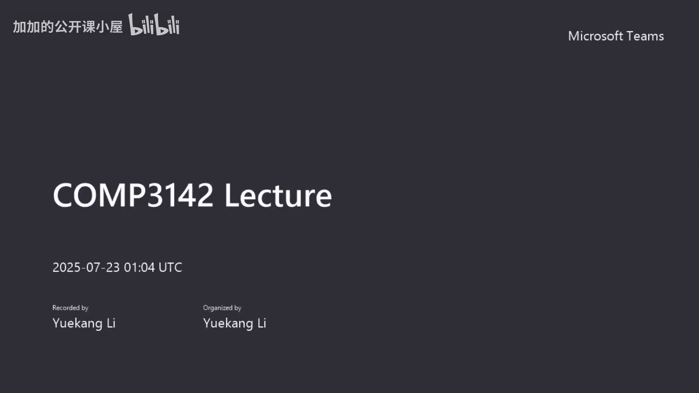
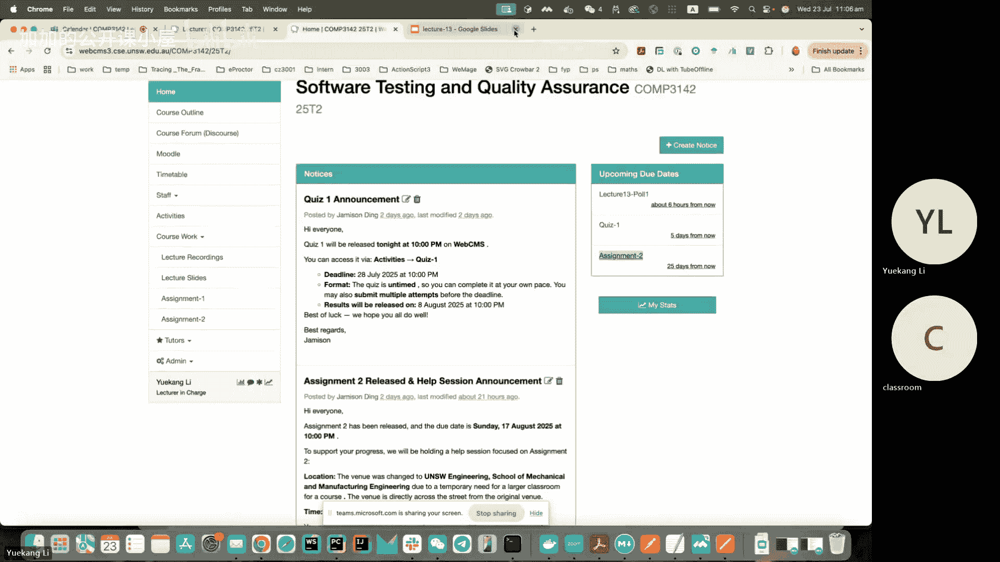
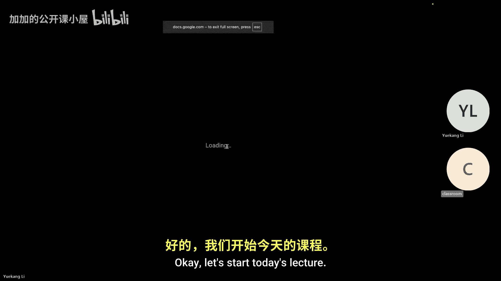

# 新南威尔士大学【中英⚡软件测试｜COMP3142 2025 Software testing】 p05 P5 Mutation Testing -BV1o34HzBENA_p5-

Hello， test。Let's wait one more minute to start。I just caught code。 apologize。 I apologize。If I。

 if my sound， if it sounds weird。So。你。Okay， let's start。Is 11，5。And。Before we start today's lecture。

 I would。Like to emphasize that。TheQuz1 was released on Web Cms。And the due date of quiz1 is。

Next Monday，10 PM。And， and you should try to do it， if you haven't。

And you can do do it multiple times。 Only the last try will be marked。So this is it。 And。

 and be careful that the last one is could have multiple choices。

You can see the difference between the radio buttons and checkbox。And that's about quiz。

 And the specification of a Simon tool has also been released。So， you can have a look。

And the basic idea of assignment， tool is to practice everything from unit testing to system testing。

 And we we want to build some automated testing tools or frameworks。So。

You should try to set up the environment and try to reach for help for during our help sessions。

So we can help you to set up the environment。

And that's about a7，2。And okay， let's start today's lecture， so。

Today， we are going to learn mutation testing。 So mutation testing is actually not yet another testing technique。

 Its a different。It's a different strategy。 It's a different technique。

So although it's named as testing。 So we can， we will learn about it later today。 So basically。

 this is today's outline。 So we will have an overview of。Mutation testing。

 We will learn some detailed techniques for doing mutation testing。

And well have a look at how to combine mutation testing with ph。嗯。So。

AndBefore we jump into the main content of mutations testing， let's。

Revisit the last question of assignment 1， which is an open question， so。

In the last question of assignment1， we have this function here。

 So which is basically to find the maximum value of A， B and C。And。So for this。

 So the first question of this assignment1， the last question of assignment 1 is。

For these four test cases， can we achieve full pass coverage。So let's have a look at how does。

What are the parts covered by these test cases。 So first， for this first test case。

 A equals to 4 and B equals to 2。 So a is。Let's have a look at it with a control flow graph。

 So for the first one。A equals to 2，4。 B equals to 2。 So A is larger than。B， right。 So we will go to。

 we will go to first。True branch here。And then。Time equals to a and 5 is larger than 4， right。

 C is larger than4。 So we will go through this true branch here。So， this is a。The program pass。

 covered by the first。The first。The first test case。 And we just omit this edge here， because。

Everyone， every task case we go through this edge。So， practice case， too。A equals to 4。

 B equals to 2。 So we are still going to the true branch。

 We are still taking the true branch in the first if condition here。But this time， C equals to  one。

 and one is smaller than4， right， So we are taking the false branch here。

 So the second test case will take this pass。And let's have a look at the third one。

 So the third test case is a equals to 2。 B equals to 3。 C equals to 4。 A is。AI is smaller than B。

 right， So we will take the false branch here。And。This time， temp is2。 T is3。 C， C is。

4 and C is larger than。The temp， right， So we are taking the true branch here。

And for the last test case。A is not larger than B。 So we will take the fourth branch。

And because here， time equals to B And C is smaller than。Time， right， We will take the false branch。

So these four test cases， as we can see here， can cover all the program path of this simple program。

 So this， these test cases can achieve full path coverage for this program。 So the answer is yes。

And the second question of the last question of segment1 is。

 can we modify one line of the code to insert an error that。

That allows the original program to pass all the test cases。

But produce incorrect results for some other inputs。And the answer is， yes。

And this is how we can modify this program。 So the mark criterion for this。

 for this question is a little bit strict this time。And we wanted you to practice。O by one。

 we wanted you to exercise off by one error here。 And this is also to emphasize the knowledge that using control flow graph is not enough to cover all the bugs。

And we will learn about what else can we learn from this。A question here。Today。

 so this is one of the solutions here。 So we can， we can add。😊。

We can change this line from a is larger than B to A is larger than B plus 1。

So let's have a look at this。So this， for the original program， for the， for these four test cases。

Since I is 4， B is 2。 A is。4 is larger than 2 plus  one， right。

 So this one will still take the true branch and it the other。The other。

 the second branch is also not affected。He the second test case。

The program will still execute the same path。 It's the same for the third， and false。So。

 for all these。For test cases。The the path executed by these test cases are not affected if we modify the program in this way。

So all existing path can still pass。But this is an open question。 And this is one of the solutions。

Possible solutions， so。The thing is， let's take one step further。 So can we。

Can we come up with the test case to capture this bug。So let's do a live pole here today。

 So which test case can capture the injected bug if we modify the program like this。

So which of the four tax cases can capture the bug here。Capturing the injected bug means。

The test case will give us a different result in this modified program。Than the original program。

From their任， so。Let's， I think most of you have finished。 So let's have a look at the answers。

The whole result first。 So most of you can get the answer correctly here。

 So text is4 is actually the correct one here。So let's have a look at why in detail。🤧嗯。So。

So this time， we are kind of creating a better test case， which can capture the bug， right。

So let's have a look at which one is the better one。 So the original program actually。

 it behaves like this。 So whether it it， it actually returns the largest value among A B and C。

 So some of you use test case 1。 But test case 1 is not affected because。Because here。

 it doesn't change the because we only care about whether a。A is larger than B。

 and A is larger than B plus one。Is affected only when A is larger than B， or A is。

Or a equals to B plus  one， right， So test is 1 and 2。 Actually， the A is smaller than B。

 So it's not affected by this change here。And task ray is also kind of not affected， because。A。

Is still larger than B plus one。Only test case4 is affected because a exactly equals to B plus1。

And let's compare， Let's use the comparison between task is 3 and task is 4 to illustrate why task is4 can capture the bug here。

 so。Let's use the red color to denote the execution path of tests cases 3 and try to run it with these two programs here。

So， protest case 3 here。A is in the original program。 A is larger than B， right。

 So we will take the true branch and。Tamp equals to a here。 So time is4， and C is smaller than 4， so。

So we take the false branch in the original program and we will return for here。

And for the updated program。A is still larger than4 is larger than B plus one， right，2 plus  one。

 So we will still take the true branch here， and we will still take the fourth branch in the second Eve。

And we will still return 4。However。For the task case4， let's use。The green color。

Note to denote the the execution pass。So for the original program， A is larger than B， right。

 So we will take the true branch of the first if。And after running this true branch。

 temp equals to a。 So temp is3 here right now， And 2 is smaller than 3， right。

 So we will still take the first branch。And we will return 3 here。But for the modified program here。

3 is not larger than 2 plus 1。3 is not larger than 3。 So we will take the fourth branch here。

 And this time， time equals to B， right， time equals to B。 So two time is 2 now。

 and C is not larger than。😔，These two，2 is not not larger than2。

 So we will still take the false branch here。But since time is 2 right now。

 we will return to this time。And then we found the bug， because。

The program should return the largest value of A， B and C。

 But this time it returns to for the if we inject a bug here。

 so we can find a bug with this test case here。So， this means that。And this。

So the original purpose of this assignment question is to practice the idea that。

U control flow using control flow coverage is not enough because pass coverage is like the most detailed control flow coverage we can get。

But even if we can achieve 100% of past coverage， these four the previous four tax cases are still not enough to find potential bugs。

 right。😔，So this is the original idea of this of this practice。And another， and actually。

 the when we find， when we try to design a better task case。Boundary value idea here actually。

 indeed helps， so。W is actually the a better one， because we are。

We are kind of testing the boundary of a， the relation between A and B。So。

 but the the question here is。Because we are kind of saying that test case for is a better task case for this program。

Because it can capture the minor changes。So how can we systematically tell whether a particular test suite is better than another one。

So this is a question here。So how can we systematically tell that these four test cases is better than the previous four。

 So how can we do this。😊，So the question is related to evaluating the quality of test cases， right。

🤧So。So we use previously what we learned is that we use test cases to evaluate the quality of the target programs。

And but we， we need something to evaluate test cases now， right。

 We want to know the quality of the test cases。 We need something to evaluate the the test cases。😊。

And then we need something else to evaluate this something here。

So this is kind of like a recursion here。 We need to evaluate everything， and。Based on that thing。

 we need to also evaluate that thing。 So this is kind of like a recursion here。

But we can avoid the recursion here。 We can somehow avoid it。And let's think about the problem here。

So we use test cases to evaluate what to evaluate the target programs， right。

So we use task cases to evaluate target programs。And if we want to evaluate。😔，Test cases。

 Why don't we just create some target programs to evaluate test cases。

 just like how we modify the program in a71 question to inject some bug。

 We can create some programs or variations of programs。To evaluate test cases。 So this is the idea。

 So we in order to create， in order to evaluate test cases， we can create target programs。

と言外る with them。So this leads to mutation testing， the idea of mutation testing。So。

We modified the original target program to create mutants， to test or evaluate。The test cases。

And you can see the key term here， mutant。 Actually， the term mutant is borrowed from biology。

 So it actually refers to some small variations to the organisms。And if it we talk about mutants。

 you may think about this。 So this is actually from。The game。A resident evil。

 So there are a lot of mutants， right， organism mutants。And， and actually。

 people try to kill these mutants， right， And we， we borrow the same idea here of killing mutants as well。

 so。If a test case can capture the modification of that mutant， then that。

 So if the test case can find out， okay， this mutant is different from the original program。

 then this test case is considered to be able to kill that mutant。So in games， we have this， so。

So this guy kills these mutants and。If a test case could kill a mutant。

 then this test case is considered to be a good test case。

 So this is roughly the idea of mutation testing。 And how can we create。

Target programs to evaluate test cases。And that's an somehow informal。Definition of mutation testing。

 And let's have a look at。Formal definition of mutation testing。So a mutant p prime of a program。

Is the result of。Making some changes to the original program， so。

So this p prime is used for denoting the mutant。And then given a program。

 the original program P and the mutant P prime。We have a set of。I'm given a set of task cases tea。

And if。For this test of， for this。Test cases， these set of test cases。

 every one of the test can pass on the original program。

 and at least one of the tests can kill the mutant。

Then at least one of the test cases can field on the mutant。Then， this。Pro1 P prime。

 this mutant is considered killeded by this test， this set of test cases。So， this is。

For definition of killing mutants。And given a。Given a program， P and mutant P prime。And。

A set of test cases。 If every test case can pass both P and P prime， then。

This mutant p prime is considered to be a live mutant。

 It means that none of these test cases can kill this mutant。

 Then this mutant is considered a live mutant。And。The mut the mutation score is。

The number of cube mutants divided by the total number of mutants。So。The higher the score is。

 the higher the quality of the test。This test suite is。So if a test suite can kill more mutants。

 then it is considered to be a better test suite。So this is the idea here。So， let's recall the。

The exact。And the， the， the comparison with the actual。mutants in the game。

 So how does the company create mutants。So if you are familiar with the game。

 you will know that they use T virus， some kind of virus to create these mutants。And。

 but how do we create mutants for a per one。We actually use mutation operators。

And now let's learn some mutation operators that we can use to create mutants。😊，🤧H。

So there are several characteristics for mutation operators。操。😔。

The first one is that musician operators are intended。To model those common types of faults。

And they are designed to be applied to any type of code without human intervention。

 So we want to automate。These mutation operators。And most of the mutation operators tend to be simple。

 syntactic。Fult。😔，So， for example， like replace replacing one variable reference with another or changing a comparison from smaller than to smaller than equals。

Or something like add one in our previous example from a71。So these are some examples here。

 And now let's learn some of the mutation operators。And for the following slides。

 they actually serve as a document of these mutation operators。

 You don't have to remember all of them。 You just need to know that， okay， there are such things。

 And when， and whenever you want to apply some mutation operators。

 or you want to come back to this piece of knowledge。 you can come back to these slides。

 So they are just like a document。But I will， I， let's go through them。

 and I will explain some of these mutation operators。

So the first type of mutation operators is the upper and modifications。

So a typical example is x for Y replacement， so。For example， opera are the things which are used for。

 which are used for computation， right， So for operations， so。So we can replace some constants。

We can replace constant with variables。Alright click the wrong button。

So as a constant is like a single value， but scale， scar variable is often。I refers to。

It's also a single value， so。We also replace a sca for constant。We can do all these replacements。

 So this is like。The first type of opera and modification。

And we can also apply modifications to expressions rather than just unit level operators。

 What we can do is for arithmetic operators， we can。There are some several operators like this。

 So what we can do is we can replace。Some operators with one another。So we also replace we have。

 we just replace them。And we can also insert some。Operators， for example， if we don't， there are。

 for example， if if there is only X， we what we can do is we can。We can insert x plus plus in that。

 in that expression。 So this is arithmetic operator insertion。

 and we can also try to delete some of these operators。 For example。

 if a line of code is X plus plus， What we can do is we can， we can remove the plus plus operator。So。

 this is。For the expression modification。 And there are more， even more。AndMs we can do。

 So for conditional operators， like what we can have are the binary operators like。AndThe logical。

Loic operators like and or And this single and here in C means bit wide， bit wise and。

 which means that we and the value of each bit of X and y。So。

And we also have urary conditional operators。 So this one means bitwise negation。

 and this one is just negation。 So bitwise negation means。

We are flipping the beat from 0 to1 and 1 to 0 inside inside X here。

 So there are some bit wise operators here， just。Notice that。And we could。

 There are also some relational operators like。Larger than or larger than equals to2。

Or equals or not equals。 and there are shift operators like shifting by one， shifting by2。

And what we can do is， similar to the。Previous arithmetic operators， we can do replacement。

 We can do insertion。 We can do deletion。And there are some several short card operators。

Like plus equals these kind of operators。 So for shortcut。

 what we can do is we can also apply replacement insertion and division， so。That's the basic idea。

And we can also insert absolute values。 We can also replace。

 replace a predicate of a value with a constant。 For example， for some conditions inside if。

 inside if statements， what we can do is instead of using these variables。

 we can always use true or use false。For some of the if conditions， so。

T can also modify the behavior of the original program to inject some bugs。

And we can also move one level up。 So just now， we covered the operator。

 the operator and modification， operator modification and expression modification， right。

 So now we move one level up。 We can do statement modifications。 So what we can do is similar to。

An expression level of modification。 We can do statement deletion。 We can replace for。

 we can do replacement for some of the。😊，Some of the statements， for example， for switch cases。

 we can do replacements。And we can shift some of the end blocks， like。

 because several code blocks are。Because we can use curly brackets to indicate code blocks。 like。

 for example， the code block for if， the code block for function。 So we can。

 we can shift the end block of certain code blocks And for C is like we we move the closing bracket for Python is like we can change the indentation。

 right。So this is what we can do for statements。 and for object oriented programs。

 we can apply some special modifications。😊，And there are several characteristics of object oriented programs。

 and we can do modifications according to these characteristics。 So the first characteristic of。诶。

Of object oriented programming is encapsulation。 The second one is inheritance， right。

 So we can also do modifications according to these characteristics。 So for encapsulation。

 What we can do is we can change the access modifier。 For example。

 some variables or some methods are public or protected or private。 We can change the， the access。

MoMoifier of these。Of these attributes or methods。And we can also delete some heading very variables。

 So hiding variable is like a variable in a subclass that has the same name as。

Same name and type as in the parent class。 This means that this variable is hiding the original variable in the parent class。

 so。What we can do is we can delete the heading variable。

 And if we delete the heading variable from the subplus。What will happen in the。

 in the program is that it will instead， instead of using the value in the， in the child class。

 it will use the value in the parent class。So this is like a very minor change of the program behavior and。

And it may out some bugs。And we can also try to insert some heading variables。

So this will help us to mask。Actually， mask the value from the parent class。 This is also。

 this will also in introduce some minor change to the program and also some bugs。

And we can also do more inheritance modifications， like we can。For。发。For variables。

 it's called hiding variables。 For methods， is's called overriding， right。

 So we can delete overriding methods。We can change the position calling positions of this or writing。

Methods， and we can also insert or delete some super keywords。 So this means that we are。

 we can change Basically， the the inheritance modifications is to deal with whether we are accessing the parent。

 the the method or attribute in the parent class or we are dealing with the child class。 so。

We can use， insert or delete the super keyword to change the behavior of accessing which class。

 right， So in the along the inheritance tree。So what else we can do is we can also try to rename the over method。

We can also try to delete some parent class constructors。So。😔。

Another characteristic of object oriented programming is。Polymorphism。

 So we can also try to design some modifications， according to this characteristic。So。

 polymorphism means that。Parent class can be inherited by some。 So a child class。

So it's like a class can take multiple types of forms。So this is called polymorphism。

 And what we can do is the first type of modification is to。

To replace a declaration of a method call with the child class type。

 it means that we cast the the parent class into a child class， and。We declared。

So this is an example here。And the second type of modification is。We can try to declare that。

 We can try to cast from a child to a parent， right。So these two are like the reverse way。

 So the first one is we are casting from parent to child。

 The second one is like we are casting from child to parent。So we can do。

 This is how we deal with polymorphism。 And there are many。Other modifications for polymorphism。

 So what we can do is。没看穿头。😔，I can try to insert or delete these。Type class， type type case operator。

 which means that we can delete。 we can。 we can try to modify the casting of the type of the object。

So this is similar Ca type change。 So it means that it's like a replacement of test type case。

Casting， so rather than deleting our insertion， we can also do in replacement。So， the last one is。😔。

We can we can不。😔，Do reference assignment with other compatible type， which means that we。

 instead of changing the casting， we just change the the variable type。

 So we just change the variable directly。So that's what we can do。And there are many。

 many more changes， like using these features。 like， for example。

 if they are overloading function methods。 So overloading means。We can have two more。

 two or more methods have the same name if they have different signatures。 This， This is very， very。

 very useful for some。For some classes with methods that can handle different types of inputs。

So if we have overloaded methods。What we can do is we can change the content。Inside the。

Inside across different overloaded methods， we can switch the body of these methods。

We can delete some of the methods。And we can also change the argument of these methods。Okay。So。

 that's all about。The mutation operators。 So you don't have to worry about remembering or memorizing all these mutation operators。

 So these slides are just for like a reference or a documentation。 So， you know。

 there's such a thing。 And if you can't remember it， you just come back to find the relevant。嗯。

 knowledgeledge inside the slides。So that's about the first half of today's lecture。

 And let's have a 10 minutes break。对。Alright， let's come back to start the second half。So。Just now。

 we learned the definition of mutation testing。And we learned some actual mutation operators we could use to generate mutants。

 And now let's have a look at how should we conduct mutation operating mutation testing in practice at what other。

Things we need to concern。 We need to think about when we actually do mutation testing。

So the general workflow is first we select given a piece of target program。We。

 we just the first step is to select these mutation operators， right。

 the suitable mutation operators， because we can see from the mutation operator designs。

 there are some， some of the mutation operators may require some program characteristics to be able to apply。

 right， So we need to select the suitable ones。 And after that， we can generate mutants。😊，So， we can。

We can apply the mutation operators one by one to generate mutants。

 So one mutation operator leads to leads to one。Mutant。

after that we can apply the same tests used by the original program。

 which can pass the original program to test the mutants and see if they can kill the mutants。So。

A mutantton remember the definition of killing mutants。 So a mutant is killed。

If the test can pass the original program， but it fail on the mutant。

And life mutant is the mutants that are not killed by any test cases。So， but。As we can see here。

 we need to apply the test cases for all the mutants we create， right， for a program。

 we can create multiple。Vient or multiple， a lot of mutants。

And this means that we are actually doing a lot of。We we， we need to run the test cases against many。

 many programs。 So this leads to the concern of viability of mutation mutation testing。And。

The first thing we need to answer， here is。Most of the mutation operators， as we could see。

 they actually reflect small synthetictactic mistakes。 like， for example。

 we switch some of the operators or we remove some operators。Right， awesome some variables。

Programmers do make such mistakes。However。Many faults in real life are due to conceptual logical mistakes。

😔，So for example with me。Make wrong assumptions about the program requirements or the program specifications。

Or maybe， we may the programmers may even forget some of the requirements， right。

 So they may forget some of the requirements， so they may forget to implement some restrictions or some features。

So this leads to the question of。Because mi operators are。Small synthetictactic errors。

 So can mute these mutants really reflect the faults。That。Could be made by the developers， right。

 This is， this is actually to evaluate the viability of mutation testing。

And a short answer to this question is it depends。 So we need to make or add some hypothesis or some requirements。

For mutation operation mutation testing to be viable。So。So mutation testing is valid， if。

TheIn or injected faults are representative of real faults。And the first hypothesis we need to。

 we need to have。Here to make sure that mutation testing is viable is the competent。

A competent program hypothesis。 So this assumes that。The software under test is close to correct。

 It means that the programmer is good enough to avoid some large errors。 So it means that。

 for example， the programmer does does not forget any requirement or does not make any big mistakes about understanding the requirements。

So this is the assumption here， so。It assumes that the software we are testing is close enough to the correct program we need to have。

So this is the first hypothesis here。Second one here is related to something called coupling effect。

So。Many thoughts are small， syntactic errors。Especially the ones introduced by the mutants。

And conceptual fault actually， are。Mostly， they are made up of some small。Syntical errors。

And complex fault may。Result in larger difference。Howeverever。However。If。

 if the test cases can still capture the。 So， So even if we recreate some simple test cases。

We may still capture the complex errors。 That is because complex errors are often made up of。

Smaller faults。 So if we can capture some， we can use。

 if we can use some simple tests to capture the simple errors or the simple faults that is part of a more complex fault。

 Then it means that we can use actually use these simple test cases。To detect those complex faults。

So this is a basic idea。 And so this leads to the hypothesis of coupling effect hypothesis。 it means。

Complex faults can be modeled as a set of smaller faults。

So a complex change to a program is a series of。Smaller changes。And。Mutation testing is effective。If。

Both。😔，The competent programmer hypothesis and coupling effect hypothesis。Hold。

 so it means that the program should be close enough to the。Toold the the desired program。

 So we are not missing any requirement。 We are not misunderstanding any requirement。😔。

And the coupling， in fact， means the complex errors inside this program could be made up of some simpler。

 smaller errors of thoughts。So， this is the idea。And。And now， let's just now， we covered the。

Whether the mutation operations we applied or the mutants we generate。

 the mutation operators we applied are viable or not。 And now。

 let's have a look at the quality of the mutants generated by these mutation operators。

So in order to be used in testing， these mutants must be valid。So， it means that。

Mutant must be able to compel and execute。Because many of the。Mutation operators， if you apply them。

 they may totally destroy the syntax of the program。 for example， if we。For example。

 if there's a X plus y larger than that in an if in an if condition there。

 if we remove the plus between X and y， the program will will not be able to comp or even run， right。

 because。It's a very， very。It's a very， very naive syntax error that will get captured by the compiler。

 so。The mutant must be variable。 So must be valid。 It means that the mutant should be able to compel and execute。

 Otherwise， we can't even run the test cases against these mutants， right。

 So this is the first requirement。 And the second requirement is。The mutants must be useful。

 It means that。The mutants must provide information on how the system works。

 So this useful requirement is a little bit more。Complicated to analyze in real life。 So we need to。

Make sure that the mutants are not semantically equivalent to the original program。 Otherwise。

 it's not meaningful to create this mutant， right。So， for example， in Python。

 we can use is nu to check whether a variable is a nu value or not is none， And we can still。

 we can still use equals equals to check whether a value is none or not。

 And if our mutant is just switching between is and equals equals to check the non value。

 Then they are semantally equivalent。 And then this mutant is not very useful， right。

 because it cannot capture the。The minor difference or the。The mechanism of the target program。So。

Now， given the definition of valid and useful。 So can a mutant be valid， but not useful。y神 no。

The short answer is。Yes。😔，So， because。Because mutants could be able to compile and run without capturing the。

Small mechanisms， difference of the program， right。So。

Mutants might remain live if they are equivalent， so they are semanally equal equivalent to the original program。

😔，In this case， they are valid， but not useful。And。

And if we say a test suite is not adequate for a particular mutation。For example， there。

 There could be multiple reasons。做会然后 if一。If we if the original problem is a is small than or equal to B。

And mutant is A is larger than or equal to B。And if we have a test case， we are A equals to B。

 then this test case。Is not adequate for this mutation here。

 It means that the quality of the this task case cannot kill the mutant here because the program behaves the same。

 The mutant behaves the same as the original program。 So this task case is not adequate。😔。

And this is。And there are the， the case study in the start of this lecture is also an example of inadequate test test suite。

 where the original four test cases cannot differentiate， then cannot capture the bug we， right。So。

 this is one reason。And the other one is。That the this。

 this is to evaluate whether the task case is inadequate or not。

And now let's come back to the mutant score and coverage。 So mutant score means from the definition。

 if you can still remember， is the number of Q mutants divided by the total number of mutants， right。

 So let's revisit this concept with more details here。

So this is the definition we have seen from the formal definition slides。And。

This value here can be used， can actually be used to measure the quality of a test suite。Because。

We want more mutants to be killed by a test suite。 It means that the more mutants a test suite can kill the。

 the higher the the quality of the test suite is， right。So。Mutation， and this actually。

 this also leads to mutation coverage。 And actually。

 mutation coverage can subsume structural coverage metrics we have learned。In E 5， so we can。

And I still have the statement coverage。And for example。

 if we apply statement deletion to some certain statements。And we， we need to。

 we need to achieve 100% of if we can achieve if the test suite can achieve 100% of statement coverage。

 then it， it is able to kill the mutant， right。So for for branch coverage。

 if we can achieve 100% of branch coverage and the mutant is mutated according to some modifications or some mutation operators related to branching。

 for example， we are modifying some if conditions and。We can。We may be able to kill this mutant。

And these are the。These are the conceptual things。 And now let's think about how can we apply mutation testing in practice。

So mutation testing is actually very， very expensive because we。He must run all the test cases。

For all the mutants we create， because if at least one test case can kill the can fill the test can feel the mutant。

 then this mutant is killed， right， So in order to check at least one test case can kill this mutant。

 it means that we need to run every test case on every mutant， right， So we and， and in practice。

 we can create many， many mutants given a piece of program， for example， we can。

Given a piece of program， we can create mutants， according to each operator and each operator and also each statement or even higher level。

 So we can we can actually generate many， many mutants， given a single program。So， this means that。

This means that we are， we are， we are using。 we， we are running a lot of executions If we want to kill our。

 check whether a test suite can kill all the mutants。And this will give us a cost issue。

 And if cost is an issue here， what we can do is we can try to use weak mutation testing。

 This means that so in the previous assumption， what we do is we。😔。

As far as we apply one mutation operator， we are getting one mutant。 And for weak。

 mutation testing is what we can do is we can apply multiple mutation operators per mutant。So。😔。

The good thing about， about using one mutation operator per mutant is that we can tell exactly。😊。

Where a particular test case is fail， right， because。

Because we only apply one mutation operator on that on that mutant。

 And if that mutant is not killed by the test cases。

 then we know exactly we know exactly where the test cases fails to explore the program behaviors。

 right， Because we only apply one mutation operators in one location。

 But if we apply multiple mutation operators per mutant。 and we are。

 and this mutant remains alive after testing， then it's harder for us to check where this why this test suite cannot kill this mutant because we modified multiple locations。

 So this is。This is why we should try to apply one mutation operator per mutant， however， however。

However， we can this weak mutation testing is still useful。Because you can save us some cost。

So for victim testing， the steps are so。We can see multiple files into a single mutant。

 and this mutant is called a metamant。 and then we divide the program into segments and track the internal states。

Of both the original program and all the mutants。And when executing that segment of program。

And then we kill all the detected mutants when the intermediate state differs from the original program。

 So because we are injecting multiple。Multiple errors here。 and we can。We can。 So that's。

 this is how we can locate where exactly this test case cannot cannot pass。

And this can actually help us to decrease the number of test executions。

 But this requires us to monitor the intermediate state of the programs。

Let's have a look at an example of how this thing works。收。A normal， for example， for this program。So。

Let's say we we let's say， let's say we still apply only one change to the， to create the mutant。

And this is actually from the last question of assignment1。

 So let's assume that we have this test case， which can kill actually kill this mutant。

 And let's see how it works if we apply the idea of checking intermediate states in weak mutation testing。

So if we do normal or strong mutation testing， what we need to do is we need to execute the test case in the original program and。

The buggy program from the start to the end。 And if we execute this program on the original program。

It what this is the。The program pass we can get。 So for the first if branch。

 since a is larger than B。Will take the true branch。 And since time is。Time0 is 3， and C is 2。

2 is not larger than 3。 So we will take the fourth branch here。 So we will need to execute。

The the program from the start to the end， so。This is。😔。

How we do strong mutation testing Anous mutation testing on the original program。

 and for the bun program， we need to do。the similar things。

So what we need to do is we execute everything。 In this case。

 it takes a false branch at the start because 3 is not larger than 3。And then it takes the false sp。

 and it returns to。 So we will know there's a bug by checking the return result here。This is for。

N么 a strong mutation operating， a mutation testing and for weak mutation testing。

 because we are checking the internal state of the program。 So what we can do is we are we。

Execute on the original program。 We still need to execute everything on the original program。

 But when we execute on the。Target for mutant。 What we can get is we can see that in this。

In this intermediate program state here of the true of the first Eve。

 we are not taking the true branch。 We are taking the false branch here。

 So the program state actually changes。哦。Vious here。 So immediately， we。

 we know that we can find a bug because。😔，We will found the bug because the program behaves differently or takes a different branch here。

So， this is。The idea of checking the intermediate state states， instead of just。

Running through everything and checking the return results。😔，So this is weak mutation。

 the idea of weak mutation testing。And last。Topic we will learn today is。Mitation testing and fast。

So we have learned about mutation based fuzzing， right， So mutation based fuzzing is。

To is to create new test cases by mutating some seed test cases， right。But they are very。

 very different。 So in lecture 9， we learned mutation based fast。

 which means that we are not creating。嗯The test cases from nothing。

 we are creating test cases by with some seedss。And generation based buzz means we use some templates。

 or we use some models to create the text cases from scratch。收。Although the names are very similar。

 So mutation based testing or mutation testing， but concepts are totally different， right。

 So mutation based testing or mutation based buzz is to。Is still to test the target programs， but。

🤧Sorry。But mutation testing is related to evaluating the quality of the test cases， right。So。

So what we eventually can do is because mutation based phing is to create new test cases with some seed test cases。

And mutation testing is to evaluate the quality of test cases。 right。

 So what we can eventually do is we can use mutation testing to evaluate the quality of mutation based fuzzing。

And this， there's actually a research paper of this。

Switch is to systematically assess the quality of mutation based ph。Using this mutation testing idea。

And this paper was published。 and it it is associated with a guitar repository here， so。

If you are interested， you can have a look。And actually， this。The the。

 the authors of this paper are from Cipa， which is Germany。

 And there's also one guy from University of Sydney and。

And this this thispa is actually a research institute like Data 61 here in Australia。

 but is in Germany。And， and actually， there's there are some back stories about this。

 So we were considering to use this mutation based analysis to evaluate your implementations of the。

Of the father in assignment 2。 So if you have a look at the specification of a assignment2。

 you were asked to implement a mutation based further， right。

 So we were considering using this for assignment 2。

 But then we give up because it's very hard to use this for one。

 And because it will generate a lot of invalid mutants。 And remember。

 a mutant is valid only if the mutant could be compileelled and executed， right， So this。Bchmark。

 actually， it generates a lot of。Invalid mutants， which will give us a lot of。啊。Trouble。

So if we look at the mutation operators inside used by these。By these researchers。

 we can see that they are actually design， designed for。Designed for C programs。And they are very。

 very similar to what we have learned in the mutation operator slide。 So you can see they。

 they are trying to， they are trying to do some mutations for the opera。

 They are also trying to do some mutation operations， like the replacements。

Or the conversion of types。All these variables， right。

So these are the mutation operation operators they have used。

 And you can observe how the design of these mutation operators could reflect real faults make by developers。

 like the of by one errors， like the the errors of not writing some operators correctly。 For example。

 you may make make mistakes of writing。😔，Equals to equals， check to an equals assignment， right。So。

 these are the。Inationation these are the that wraps the。

The comparison between mutation of mutation testing and mutation based buzzuzz。

And before we end today's lecture， let's have a quick recap。Of what we just learned。So。Today， we。

 we learn we had an reha of what we did for assignment 1。 The last question。

 So the idea is to learn that。Using control flow coverage is not enough to create a good test suite。

 right， But then it leads to a question， how do we evaluate the quality of a test suite。And then。

How do we systematically evaluate the quality of a test with test suite。

 And then we learn a technique to do this， right？ And this technique is called mutation。

Mation testing。And the idea of mutation testing is to create。Variations of target programs。

And apply the test cases to all these target programs and see if the test cases can capture the modifications or can capture the updates of the variations of the target program。

 And if。A test at least one test case in the test suite can capture this。The change。

 then this changed program or the mutant is considered to be killed。

 And the more mutants could be the more mutants are killed by a test suite。

 The better the quality of that test suite is right。 So that's a basic idea of。

Mutation testing and the the statistic or the value used for。

Cpturing the quality of a test suite is the mutant score。

 and mutant score is calculated by the number of killed mutants divided by the total number of mutants。

 right。And then we also learned several mutation operators。And these。

 the design of these mutation operators are to capture the real mistakes that could be made by developers during development。

 And but most of the mutation operators are just simple syntactic errors， right？

 And if you wonder whether these simple syntactic errors are viable to reflect real real bugs。

Then we need to have two hypotheses。 The first one is the。Competent programme or hypothesis。

 It means that the target program is close enough to the correct implementation。 It means that we。

 we are not having big mistakes of misalignment with the requirements。

 And the second one is the coupling effect hypothesis。

 It means that these complex errors could be reflected by。😔。

Or the complex errors are made up of smaller ones， or they could be reflected by the smaller errors。

收。😔，That's， that's the。Because that's a too hypothesisthe we need。

To make sure that mutation testing is viable and mut and mutants could be。

 And if we evaluate the quality of the mutants。We could consider whether a mutant is valid or not。

 right， We could also consider whether a mutant is useful or not。

 Val means the mutant could be compileelled and run， and useful means。

The mutant is not semantically equal to the target of the original program。And lastly。

 we learned mutation testing and mutation based phuzz。🤧And。

Although the names of these two techniques are very， very similar， but they are totally different。

 Muation based fuzz or mutation based testing。Is to create test cases。

By mutating some seed test cases is to create still to create test cases to test programs。

But mutation testing is to create programs， to test。Test cases。

So mutation mutation testing could be used to evaluate。Other testing techniques。So， that's。

How about today's content。And thank you for coming。Thank you for coming。

