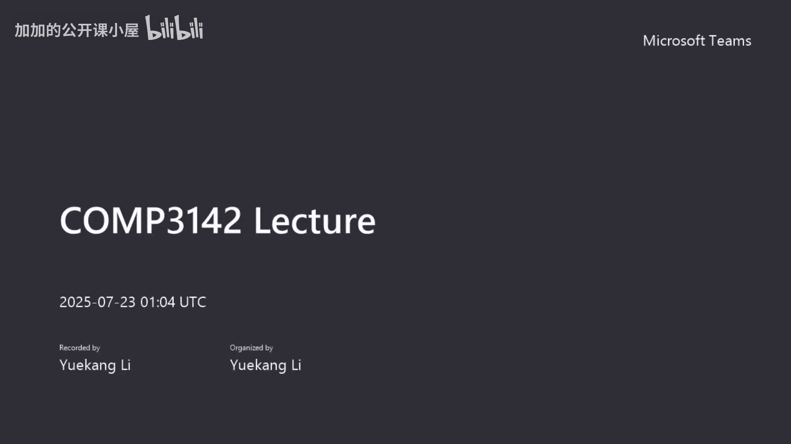
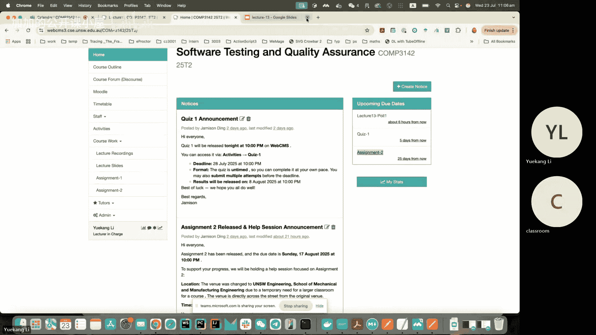
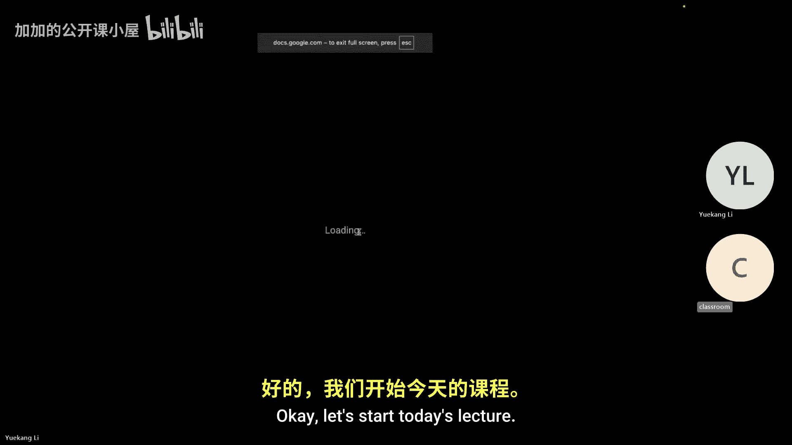

# 软件测试：P5：变异测试 🧬

在本节课中，我们将学习一种评估测试用例质量的技术——变异测试。我们将了解其核心概念、如何生成变异体、评估测试套件的有效性，并探讨其在实际应用中的考量。

---

## 概述

上一节我们介绍了基于控制流的测试覆盖准则。然而，即使达到100%的路径覆盖，测试套件仍可能无法发现某些潜在缺陷。这引出了一个核心问题：如何系统地评估测试用例的质量？本节我们将学习变异测试，它通过创建程序的微小变体（变异体）来评估测试套件的有效性。

## 变异测试的核心思想

变异测试的基本思想是：为了评估测试用例，我们可以创建目标程序的变体（称为“变异体”），然后看测试用例是否能“杀死”这些变异体。这里的“杀死”借鉴了生物学概念，指测试用例能发现变异体与原始程序的行为差异。

以下是其形式化定义：
*   **给定** 一个原始程序 `P`，一个通过微小修改 `P` 得到的变异体 `P‘`，以及一个测试用例集合 `T`。
*   **杀死变异体**：如果 `T` 中的所有测试用例在 `P` 上都能通过，并且至少有一个测试用例在 `P‘` 上失败，则称变异体 `P‘` 被测试套件 `T` 杀死。
*   **存活变异体**：如果 `T` 中的所有测试用例在 `P` 和 `P‘` 上都能通过，则称变异体 `P‘` 是存活的。
*   **变异分数**：用于量化测试套件的质量，计算公式为：
    `变异分数 = (被杀死的变异体数量) / (变异体总数)`
    变异分数越高，表明测试套件发现潜在缺陷的能力越强。

## 如何生成变异体：变异算子

为了生成变异体，我们使用称为“变异算子”的规则，对原始程序进行微小的语法修改。这些算子旨在模拟开发者常犯的简单错误。你无需记住所有算子，只需了解其存在和基本类型即可。

以下是常见的变异算子类型：

*   **操作数与表达式修改**
    *   **操作数替换**：例如，将常量替换为变量，或将变量替换为另一个变量。
    *   **算术运算符修改**：替换（如 `+` 换 `-`）、插入（如 `x` 前插入 `++`）或删除运算符。
    *   **条件/关系运算符修改**：修改逻辑运算符（`&&`, `||`）、关系运算符（`>`, `>=`, `==`）等。

*   **语句修改**
    *   **语句删除**：删除某条语句。
    *   **语句替换**：例如，在 `switch` 语句中交换 `case` 块。
    *   **代码块边界移动**：移动 `if`、循环或函数体的结束括号（在C语言中）或缩进（在Python中）。

*   **面向对象程序修改**
    *   **封装相关**：修改访问修饰符（`public`, `private`, `protected`），或插入/删除隐藏变量。
    *   **继承相关**：删除覆盖方法、修改 `super` 关键字的使用、重命名覆盖方法等。
    *   **多态相关**：修改类型声明或类型转换，例如将父类引用改为子类引用，或反之。

## 变异测试的可行性与假设

变异算子主要模拟简单的语法错误，但现实中的缺陷可能源于复杂的逻辑误解。因此，变异测试的有效性依赖于两个关键假设：

1.  **称职程序员假设**：假设被测试的软件已接近正确实现，程序员没有严重误解需求或遗漏主要功能。
2.  **耦合效应假设**：假设复杂的缺陷可以由一系列简单的语法错误组合而成。因此，能检测简单错误的测试用例，也可能间接检测出复杂的逻辑错误。

## 变异体的质量与测试充分性

一个有用的变异体必须满足两个条件：
1.  **有效**：变异体必须能够成功编译和执行。
2.  **有用**：变异体在语义上不应与原始程序等价。语义等价的变异体无法提供任何关于测试有效性的信息。

测试套件对某个变异“不充分”可能有两个原因：一是该变异体与原始程序语义等价；二是测试用例未能触发导致行为差异的执行路径。

## 实践中的考量：强变异与弱变异

在实际应用中，为每个变异算子生成一个独立的变异体并执行全部测试（称为**强变异测试**）成本非常高。

为了降低成本，可以采用**弱变异测试**：
*   它将多个变异算子应用于同一个程序，生成一个“元变异体”。
*   在执行测试时，不仅比较最终输出，还监控程序执行过程中的中间状态（如变量的值、执行的分支）。
*   一旦发现某个代码段的中间状态与原始程序不同，就认为“杀死”了所有导致该差异的变异体。
*   这种方法减少了需要完整执行的程序副本数量，但需要工具支持以监控中间状态。

## 变异测试与基于变异的模糊测试

请注意，**变异测试** 与之前学过的 **基于变异的模糊测试** 虽然名称相似，但目的截然不同：

*   **基于变异的模糊测试**：是一种**生成测试输入**的技术。它通过随机变异已有的“种子”输入来创建新的测试用例，目的是发现程序漏洞。
*   **变异测试**：是一种**评估测试用例质量**的技术。它通过创建程序的变异体来评估测试套件发现缺陷的能力。

有趣的是，变异测试可以用来评估基于变异的模糊测试所生成测试用例的质量。已有研究将变异测试作为基准，来系统化地衡量不同模糊测试工具的效果。

## 总结

本节课我们一起学习了变异测试。我们从如何评估测试用例质量的问题出发，引入了变异测试的核心思想：通过创建程序的微小变异体，并计算测试套件能“杀死”多少变异体来评估其有效性。我们介绍了用于生成变异体的各种变异算子，讨论了保证变异测试可行的两个关键假设，并区分了强变异与弱变异两种实践方法。最后，我们明确了变异测试与基于变异的模糊测试的本质区别。变异测试为我们提供了一种超越代码覆盖率的、系统化衡量测试套件质量的强大工具。