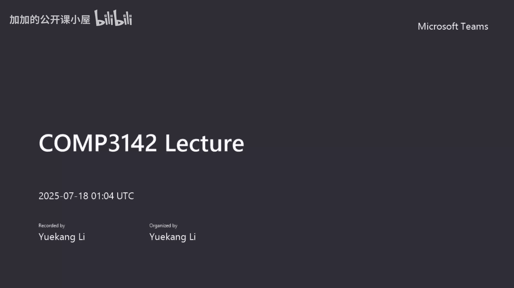
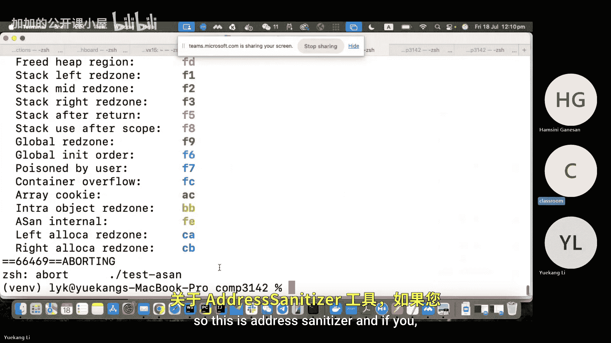
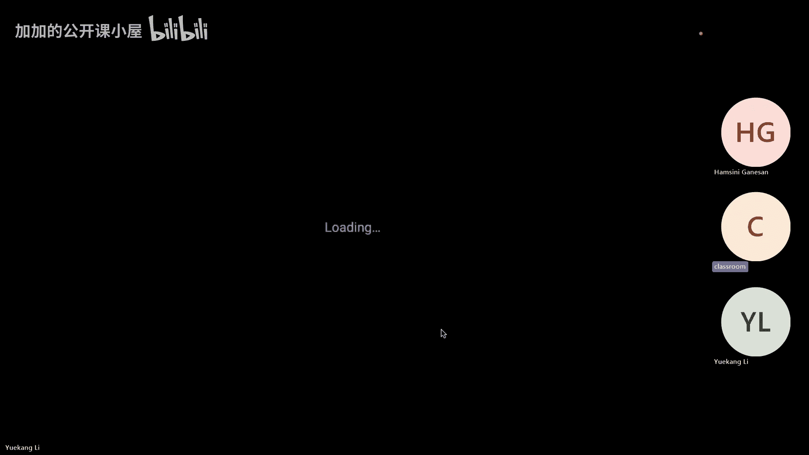
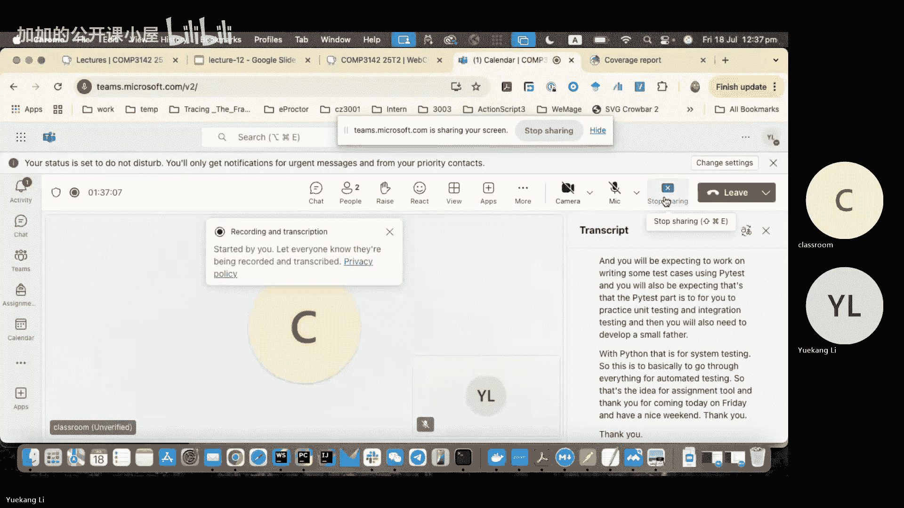
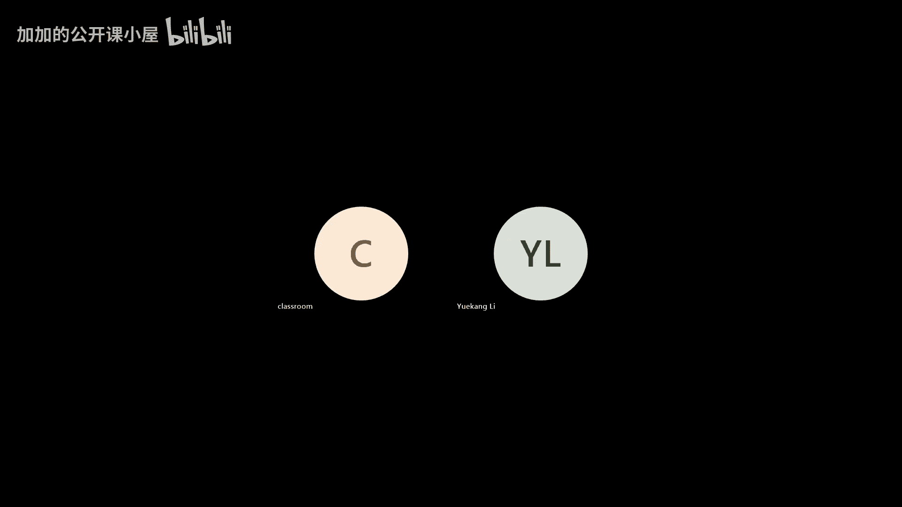

# 新南威尔士大学【中英⚡软件测试｜COMP3142 2025 Software testing】 p06 P6 Test Oracle -BV1o34HzBENA_p6-

Test。Okay， I I， I think the recording is working properly now。So。Let's get started。So today。

 we are going to learn test Oracle， which is another important concept in software testing， so。

Here is today's outline。 So we are going to have an overview of test oracles。

 and then we will learn some specific we will learn three different types of four different types ofle oracles。

 specified oracles， derived oracles， implicit oracles and human oracles。And。

So before we jump into the。The content， the main content of test oracle today。

 Let's have a quick recap of what we have learned and see how does test oracle relate to what we have learned。

 so。Remember， in lecture 8， we learned test skyfolding， and we have this diagram here。And actually。

 inside the diagram， you can see there is a small text box telling us that we will learn more about text oracles here。

 So basically， we have seen it before。 And in this small piece of。😊，Test skyaffolding code the。

The two asserts， the two assertions here are the test oracles。 So basically， they are the。

we have to turn out the light， because。Because otherwise， you can't see the screen properly， so。And。

So let's continue。 So these two assertions here are like the test oracles。 So basically。

 you can see that， okay， oracles are somehow related to comparing the outputs， right， So。

 but what we are comparing against is the key here。😊，So， let's continue。So let's。

 so we have seen test oracles in some of the materials before。

 and let's have a formal definition for test oracles。So according to the definition。

 tests are actually s sequences of stul and stimuli and observations。 So basically。

 we means it means that we care about the inputs feeding to the target program and the output of the of the program。

So。And。The observation here means we check the actual output against the expected output。 and if。

If the。If the actual output is the same as the expected one， then the part， the test is passed。

 Otherwise， the test will fail。So this expected output here is the test oracle。So。

So if we have a look at。收收一飞。😔，Try to further provide formal definition for oracle。 It is like this。

 So this oracle is actually a precate that determines whether an output from the system is acceptable or not。

 So it is。Like the factor that determines whether。The a particular test can pass or fail。

 So this is the definition of test。And like indicated in this very simple example here。

 the test oral will respond with either a pass or a fail。 So to tell whether a test is。

Acceptable or not。So unlike， you know， if you if in your daily life， oracle is like this。

 But in testing， testing is like telling whether something will fail or pass。

 So it's similar in but it's similar to what we will see in。Our daily life， the oracles。So。

And another concept that is related to test oral is specification。This is because。In verification。

 we， we learned that。The we， we want。Our implementation to be。

To be compliant with some specifications， right， And when we do testing， we want to check our output。

Against some kind of test oracles。 So we want something。

 we want the program to to be complied to some specifications。 And when we do testing。

 we want the output to be checked by oracle。 So it seems that there are some relations between。

Specificationations and oracles， because both of them are kind of discussing what is the desired behavior of the program。

 they they are similar， but they are actually different， so。The question here is。

 is an oracle a specification or is a specification an oracle， Can they be interchangeably used。

The short answer is no。 They are very， very similar， but they are different。

So an oracle is not is not necessarily a specification， but it can be based on。Specificationations。

 so an oracle is， is more is very specific。 It tells whether a particular output for un given input is acceptable or not。

But。A specification is。More general。 So a specification is like specifying how the program should behave under certain。

Scenas， so it doesn't。 It doesn't really tell us how should what is the expected output of the program normally。

 So it is the the， the relation here is like this， so。Oracles are more specific。

 You could think of it。 They are， they are like。They are specifying the expected output for certain inputs。

But the specifications are more like high level descriptions of program behaviors。

 thats So this means that they are similar， but they are also different and oracles could be derived from specifications。

 So this is the relation between test oracles and specifications。So。

There are several components in test oracles。 So the first one is the oracle information。

 So this oracle information is the information used for judging whether the the correctness of the implementation。

 So you can think of this oracle as。The expected value of the program output。

 So this is the first component。 And the second component is the procedure。

 because this oracle is used for checking the whether the test is passed or not。

 So we have to have this action of doing this check， right， so。Given a desired value。

 we need to check it against the the actual output and this。

Checking procedure is the second component here， and it could be very， very simple。 We， we can just。

 you know， use a simple equation check to check whether the。

Whether the system actual output is expected or not。 So this could be very， very simple， but is。

And iss a component of testal。And therefore， normally， ourac are cold because we a we can。

 we can use。Cold to do this to to embed both the oracle information and the checking procedure。

So because they are code， So they must be developed somehow。 And like the entire project code。

 oracles are like we just discussed。 They， They are derived from requirement specifications。

And similar to code。It is subject to how does the developer interprets the specification， right。

 So different developers could interpret the specification differently。 And therefore。

 these oracles may contain errors。And。And like a piece of faulty code， a faulty oracle could be。

 could cause us some troubles。 Like if we， if we pass， or if we let a fault to pass。

 then we we could have false positives。 if we let if we let a benign program to fail。

 then there could be false negatives。 So。😔，So we want to ensure the correctness of test oracles。

So we need to somehow do like how we verify or validate the correctness of our programs。

 We need we also need to verify or validate the correctness of oracles。So。

We can similar to the normal functions of the code。

 We can perform verifications or validations to these oracles。

We can this means that we can test the oracs。And this becomes a circularity problem。

 So we want test oracles are the code。But for judging a particular system， right。

 And then we want to build a checker for this checker。 So in the end。

 we are like building checkers of checkers of checkers， so。

This seems like there seems to be no end for this problem。So。We， so therefore， we， we， we。

 we don't want to fall into this circularity problem。 So， so that。

Oracles should be subjected to a lightweight verification process。

 So normally we just do a code review。 and more importantly， we。Instead of。

Instead of checking the correctness of Oracle， after we have implemented the oracle。

 we want to make sure it's correct from design。 So it is actually a design issue here。So。Normally。

 when we write， when we write programs， we are actually good at coming up with new inputs for a program。

 So， for example， this is a small function for calculating the Fibon Nazi。呃。Values。

 so we can come up。 We can easily come up with different input values here， right。

But it is much harder。 So， but although we it's easy to， it's easy to come up with inputs。

 It's hard to come up with the expected results。 For example。

 if we can come up with the input value of 100 here， but we。

 it's hard for us to get the expected values of this。How this function here？So。Most commonly。

 when we design the test oracles， the oracle information or the expected output of the program was written manually by developers。

So。Normally， we write the oracle information by hand， and they are tied to some specific test cases。

 because， for example， if we write， if we， if we manually calculate。Un value for this100590 value。

 Then it is not reusable for other inputs， right， So they are tied to some specific test cases。

And this means that it requires a large amount of manual effort and time to create these test cases。

 And this is what we don't want， because。Because we we， we， we， we want to automate things。

 We don't want to devote too much of manual effort to do testing。

 And there are many ways of generating test oracs automatically。

So we do have some low effort test ors， which don't require too much of coding and。There are some。

 however， there are some trade offs of using these low effort oracles， so。

The most ideal way of writing a test oracle is to。specify the exact output。For this system， right。

 we can just manually come up with the expected output of the system。 But this is。

This is the most accurate way of writing tests， but it is very time and effort consuming。

Or we can trade the precision for generality。 So what we can do is we can specify some properties that should be obeyed beyond a function。

 So there are some properties that should be followed。Without followed by every implementation。

 rather than a particular implementation。And then we can build， for example。

 we can build a model of a function。 Then this model can capture the behavior of the desired behavior of a group of functions。

 right。And then we can check the type of anomalies against the model we have built。So， for example。

 normally in C programs， a function should return 0 if it succeeded。 So this。This property here。

 that is not tied to a particular function， right， So we can use these kind of properties。To。

 to generalize the design of our test oracles。So， for example。

 another example is a function should not crash。 So if a function crashes， then it means it's buggy。

 So this is also another type of property that all functions should follow。

So the key here is about the oracle properties。So。An a test oracle is。Considered because， because we。

 we could have some abstract properties of the oracles， which are not tied to some specific outputs。

 so。So we， we have to check the properties of this oracle。

 And one of the properties is called completeness。 And a test oracle is considered complete。

 if it can。If it can verify any test input， then this test oracle is considered as complete。

And a testal is considered sound。If。It can if it can provide the overall or the globally correct verdict for any test case that it can handle。

 so。It means that。This， if a test orle is sound， it may not be able to handle all different test inputs。

 but as far as。8。It sayss。 it predicts whether this input fails on passes passes。

 Then it is definitely correct。 So this means this test is sound。 However。

 a complete test may not be sound because。They are because we are losing precision when we want to achieve higher generality。

 So sometimes we have to trade off between completeness and soundness。So。A test is。

The third part is like Te or correctness， so。A testoracle is correct if it is both sound and complete。

 and it is partially correct if it is sound， but not complete。So。Now。

 we can come back to the problem of judging the judge， like judging the。Quality of tests， so。

Which criteria should we use here， so。In reality， we have to in in theoretically， we。

 we just need to consider the correctness like the。Completeness or soundness。 But in practice。

 we have to consider the cost for building these oracles。 So we want to have lower costs。And。

And although weally， we are， we still need to check the accuracy， right， we want high accuracy。

 We want high soundness。And for completeness， we also want higher completeness。 So we want。

To cover as many test cases as possible for with our test oracles。

So there are different types of oracles we could use。In practice。

So the first one is specified oracles。With the specifications of the program。

 we can developers can extract the some properties of the test oracles。

So we can check the correct behavior of the program。 So this is the first type。

And the second type is called derived oracles。 So derived oracles are not coming from the specifications of the project。

 It is coming from the actual code or the actual implementation of the program。

 So you can see specified are coming from something like the documentations and derived are coming from code。

And the third one is implicit， so。Ilicit implicit oracles are like sales general oracles。

 which uses the properties that all programs should follow。 For example， a program shouldn't crash。

 So things like that。 So this is implicit oracle。 And the last one is human oracles。 So basically。

 we just fall back to human to， to manual effort。 So we just let humans to check the correctness of。

The program behaviors。So now let's jump into the details of specified oracles。So。

For specified oracles， they judge the behavior of the program using the specification or the documentation。

So。So， this is。So this is this is a typical workflow of a test oracle。

 And we can see that the expected output here of this type of specified oracle is actually from the。

It's actually from the specifications。So。Most of the oracles we are seeing every are specified oracles。

 For example， when you write some assertions in your unit types， actually， normally。

 it is considered as specified oracles， because it is manually created by you。

 according to some kind of higher level of specifications， right， about the program behavior。

 So most of the。Oracles we are seeing every are specified oracles。So for example， this。

 a assert here。And for specified oracles， there are different variations。

 And the first variation is the expected value oracles。 So this is like the simplest one。

 So we we just check what is the expected value of some particular inputs and we check against the the expected values。

😊，So， this is very。Very， very simple。 However， the drawback of this type of oracle is that it's normally not reusable。

 right， because each expected output is tied to a particular input。 So once we change the input。

 we cannot reuse this oracle here。So remember， in when we try to design tests for practice。

 we want to increase completeness。 So we。We want to extend this oracle to be able to handle multiple different inputs。

Then what should we do。What we can do is instead of putting the assertions inside the test。

 we can put。 We can add assertions to the actual implementation of the code。

And these assertions are known as self checks。So， rather than。Rather than。

 rather than having these assertions inside our tests。

 we can put some behavioral assertions or behavior checks into the original code。

 And inside our test， we can just observe for assertion fields。So this is the idea here。

 So rather than having the check together with the test case。What we are， what we want to do is we。

 we put self checks into the programs。And then we only observe for our assertion fields here。So。

So an example is like this。 So what we can do is instead of checking whether we。

 instead of asserting whether C equals to a particular value inside our test。

What we can do is we can， we can look。 We can look for assertion fields in our test。

 and then we can move these assertions inside this implementation here。 So， so in this case。

 in our tests。 we can reuse the the oracle is reused for multiple different programs。😊，So， this is。

One of the solutions here。And then it comes to， then the designer of these self。

Self check becomes the next thing we need to look into， so。Normally， we。

 we write the self checks at function level， so。So for each function， we just we just。

Observe the high level features of this function。 And then we extract some properties that could capture the behavior of that function。

And then， we can。Right。Asertionions for， for， according to those properties， so。So， but however。

 there， there are some drawbacks， for example， if we in our previous slide。

 we only check whether the C values is equal to 0 or it should be larger than0。

 not So these subts might only be accurate for the properties we are observing。

 So this is the the limitation here。 However， if we can easily solve this problem by considering more properties。

 right， So， for example， in our in the in the example of the previous slide。

 we can not only observe add assertions for the value of C， we can also add。

Asions for some other values。 But if we observe more properties。

 then it is more expensive for us to write these self checks。 So there is a trade off here。

And that's。The function level of solution of generalizing these expected value oracles。

 and at system level， we could also have some solutions here。So it's similar to levels of testing。

 We also have level levels of oracles。 So you electro in system testing。Lecture。

 we have learned about。Model based testing。 So model based testing is basically to。

Use some abstract models to do， to describe the programs。

 And then we can check the program against that model。

 And can you quickly come up with a name of an abstract model。We have used it for assignment 1。

 actually。😔，呃。😔，Decision table。 decisionion table is actually a model here， a system model here。So。

So we can use actually， the actions in the decision tables to design test oracles。

 and we can use and， and this is if， if we use decision table as a model here。

 and if we use finite state machines， we can use the error states in the finite state machine to design test oracles。

 So once， like， for example， once the program enters an error state， then it means that the program。

Runs into some bug。 So the test fails。So， this is。How we could use system models as oracs。And。

That is。TheThose oracles are actually coming from the specifications or the documentation of the program。

 They are not coming from the actual code of the program。

And we can also derive oracs from the actual code。And these are called derived oracles。So。If。😔。

If we don't have specifications or if we don't。We don't have some very very complete documentation of the program。

 We can automatically derive。Oacles from the code。Or some existing sources of information。

 So we can derive from。OnSome artifacts， we can also derive from some executables of the programs。

And the first type of derived oracle is called differential testing， so。Differential testing is。

So the basic I don't get overwhelmed by this big definition here。 So to keep things simple。

 differential testing is to run two versions。Of programs with similar functionalities。

 and then compare the results。So that is the the basic idea of differential testing。 So， for example。

 we have。2 P DF readers。1 is maybe from Adobe。 The other one is from Google。

 maybe then when we open a P Df file， these two， these two P DF readers should give us the same rendering result of the same P D F file。

 right， If the results are different， then it means that one of the implementation must be wrong。

 right， So this is a basic idea of differential testing。 So it looks for the。

 the differences in the outputs for。For two versions of the same program。 So that's the idea here。

So the first step， of course， is to select the the variance， right。

 We need to select the variance to compare the results。Against it。So we can。

 normally what we can do is we can select two versions of the same program。

 or we can select two different programs doing the same thing， so。

The first step is to select the variant， and then we can just generate test inputs。

 and we can generate inputs with some other testing techniques like all the black box。

 all the green box and fuzzing techniques。So we can generate the text inputs， and then we execute。

Both。Vs of maybe more than two variants。 We can execute all the variances with the same the same input。

And then we can compare the， the outputs across all the different versions of the program and then analyze the differences。

 And differences could indicate that one of them is wrong， so。And actually。

 there are many different ways of comparing the outputs and analyze the difference。

 And this is where we can do some research。And the second type of。

The second technique for deriving historicals is called regression testing， so。

Reggression testing is to make sure that the new updates or the new changes。

Does not adversely affect the existing functionalities。 So because when we do development。

 we are not writing the therapies in one run， right， we are adding features。

 we are adding in features into the system。Gradually， so。So we can test the。

 we can run existing tests on the。On our newly implemented features to check whether this new feature breaks existing functionalities or not。

 So this is a basic idea， so。So this the aim of regression testing is to make sure that the changes to the program does not give us new issues to existing functionalities。

So。In this case， we the， the basic idea is very， very simple。 So when we when we change。

 make changes to the program， we just rerun all the test。 So because when we。

 when we add new features， normally the new feature is。😊，Associated with some new tests， right。

 But we don't just run the new test。 We are writing。 We， we run existing tests。And in this sense。

 the older version of the program is like the oracle because the tests of the older version of the program would all pass。

 right。 But in the， But if， if it doesn't pass in the new。Program in the new version。

 it means that there are something wrong。 So this， this idea is very， very straightforward。So。

 this is regression testing。And the last type of。And。

 and another type of derived tests is called metamorphic testing。

 And there are some backstor of metamorphic testing with。Australia here。 And actually。

 this idea was proposed by T Y Chen。 And this guy， this is this guy。 He's still alive。

 and he's currently a professor in Swburn University。 So in Australia， he's currently in Australia。

And like many valuable research， for example， deep learning。

Mathemorphic testing was not recognized by academia when it was invented。 So when， when this。

 when this guy proposes Mamorphic testing， when， when he proposes this idea， he was in Hong Kong。

 and you can see that this。It's not very clear on the screen， but I can。Read it for you。 So this。

 this idea was only published as some kind of technical report within the university。

 But then it becomes。A new， it starts a new whole new research direction for software testing。

 So by that time， people don't know the impact， but now it becomes very， very impactful。

 And that's the back story here。 And let's come into how does it work。 Why it is so impactful。So。

The basic， the definition here is。That the it is good at。 It is good at。

Getting hints for the expected outputs of a program where the expected outputs are hard or unknown。

Or to to to get， so。It actually deals with the problem of getting the expected values here。

And it uses some kind of something like code。Mathematicic relation， so。

These metamorph relations are the properties that that relate multiple inputs and outputs。So。😔。

We can transform the input data， according to these metamorphic relations。

 and then compare the outputs。And to get the idea of whether。The program is correct or not。

And the key here is the metamorphic relation。 And this is very， very abstract。

 And let's have a look at some。Concrete examples。 And here with metamorphic testing。

 we are actually sacrificing precision for generality。So normally。

 the test oracles extracted using metamorphic testing are more applicable for more test inputs。

 but they may not be as accurate as。How as if we specify the actual value of the expected output。

 But here， since some of the expected outputs are very hard to establish， so。

We could use this idea here。 And let's have a look at an example to show you how it works。So。😔。

Assume。Assume that we have an implementation of the function， sine X。Of the functionsine X。

And it's actually very hard to get the expected results， right， So without a calculator， we。

 we don't know whether。What is the expected output of this function here。So， however。We know that。

Sine x equals to sine pi minus- X， right。So if we design the， if we design the a test input 1。

 then we can use pi -1 as the second test input。And then because we know that if the sine X is implemented properly or correctly。

 sine 1 should equal to sine pi -1， right。So。So we can use this idea here to check whether the program is correctly implemented or not。

 So if。If sign 1 equals to sign pi -1， we don't。 We don't know what is the value of sign。

 We don't need to know what is the correct value of sign 1 here。 We just need to know that whether。

 we just need to run the program twice with both sign 1 and sign pi -1 and check whether the results are equal or not。

 And if they are not equal， it means that the program is definitely implemented wrongly。 However。If。

 even if sine 1 equals to sine pi -1。The program may not be implemented correctly， right。

 because it it might be implemented as cosine 1 or cosine pi11， so。Mathematicic testing can。

Can be used for checking errors， but it is not totally precise。 So this is the idea here， so。

The metamorphic relation is sine X should equal to sine pi minus X。

 and we can do input data transformation， according to this。Mathemorphic relation。However。

 we need to satisfy the presentation here， because even if。This one pass。

 It doesn't guarantee that the sine X function is implemented correctly。

So let's have an exercise of metamorphic relation or metamorphic testing。

 So let's consider a function that could。😊，That could be used to sort。

Any an array of numbers from mean to Max。So。Which of the following Maic relations are valid。

So this is a multi twice。Mtitraize question。 so you can have multiple correct answers。

 So the first metamorphic relation here is。If， if we reverse the input array。😔。

And then pass the inputry to the sort function。The output should be the same as。The original。😔。

Aray getting starteded。So this is the first panmorphic relation。 The second one is。

If we add an identical element into the array。 So the output should maintain。The same order。

 but include the additional element in the appropriate relation。 So which means that this。

St allows duplicate values， and duplicate values are not merged during the thought。

And the third Maemic relation here is。If the array is sorted and concatenated with another sorted array where all elements are larger。

 then sorting the combined array should give us the same result as sorting the two arrays separately and concatenating them。

So。These are the three metamorphic relations， so。Which are valid。I think you may have finished。

 So let's have a look at the result。All 3。Yes， yes。 Actually。

 The correct answer is all three of them are correct。All of them are correct， metamorphic relations。

And let's have a look at。Why。😔，So。Let's come back to this。So assume that we have this array of 5，1，4。

2，3。 And if， if we sort it， it should give us 1，2，3，4，5。And let's have a look at the first。

Matmaticic relation。 So if we reverse this array here。After sorting。

 it should be the same as how we thought the original array， right。 So this is obviously a。呃。

AMemorphic relation that we could use for checking the correctness of this function here， so。

Because given as far as two arrays have the same elements， the same set of elements。

 they should be after sorting， we should get the same results。 So no matter the。

 it doesn't matter about the， the original ordering of the arrays。

 So even if we reverse the original array， we should get the same sorting output。

And the second memorph relation here is if we add a duplicate value into the array。

 it should be still there。 It should be， the duplication should be kept and it should be in the appropriate position。

 So， for example， if we add another tool into the array。

 then we there should still be two number of tools， right， If。

 if if we don't have two tools in the array in the sorted in the new sorted array， it means that。

Maybe the。Maybe the sorting function is wrongly implemented by merging the the duplicate results。

 because it is very likely in real， in real life， that we write when we write merging functions。

 when we write sorting functions， we may merge duplicate function， duplicate elements。

So the third magmorphic relation here is。If。😔，If the array is sorted and then concateated with another sorted array where all elements are larger。

 So it means that。In this case， we sought a very large array with the original array and a newer newer array with new with larger values。

 Its the same as we， we can。 we， we put them together。 It's the same as we。Start them individually。

 and then put them together。So， this is actually。Uable as a matmorphic relation here。

 because this is the desired behavior of sorting， right。

 So if we add 6 and 7 and then we merge 6 and 7 with the original and then sort it。

 it should give us the same result as it， as if we sort。

Both array individually and then put them together。 So this is the desired behavior。

 So all these three are valid， multi metamorphic relations because they can correctly capture the behavior of the program。

And。The last type of derived oracle is to use invariant detection。

 So an environmentvariant is a property or condition that remains true。

During the execution of the program had some specific points。

 So regard it it so we have actually learned one type of envariant。

 And that is called loop invariant。 When we learned the loop on folding in， in white box testing， so。

So environment means that value or that property。Is always true or always false。

No matter how we execute the program。 So， for example， if we the the most。

 the simplest example are constant values defined in the program。

 So if we define some constant values， then those values should remain the same。

 no matter how we execute the program， right， So these are environments， so。

I have actually encountered this loop environment before。 And if you click this link。

 you can jump to that slide。And they there are also method of function environment。

 So which means that there are certain properties that would remain always true when we。

When we run the methods or functions。So。There are some algorithms for us to extract invaris out out of a piece of code。

 And then we can use these envaris as test overacs， because if。😔，If。

If we are very sure that certain properties are invi， then they shouldn't be changed。

 And if they are changed。Then， it means that。There are some errors in the program。

 So this is how we could use environmentvari to。As tests。 So they are just like， naturally。

testest oracles。And before we。😔，Before we have a look at the rest two types of tests， let's have a。

Let's have a 7 minutes break， and I'll see you at 12。Right， let's start。 So we can see from actually。

 this outline here that all the oracles are getting more and more generalized。

 So specified oracles are actually， if we just use the expected values， they are very very specific。

 right？ And if we use some models， they are， they still need， they are still quite specific。

 And most importantly， they are all specified somehow by。

Some humans and then derived oracles are more general。 You can see we can apply this。

 We can out automatically extract some oracles with different versions of the program with an older version of the program with。

Some metamorphic relations。 So now let's learn an even more。General type of oracle。

 which is called implicit oracle。So implicit oracles require no domain knowledge or specification at all。

 but instead， they can be used。 They are like the properties that could be used for checking any runable program。

So。Implicit oracs normally detect some particular anomalies that any program could run into。

 for example， the crashes or dead。 These are the two most common types of implicit。

 some into most common types of anomalies， and they don't require some expected output to detect。😔。

Because if a program crashes， it definitely， it definitely means that the program runs into some problem。

 right。So。Actually， the。And the key here of using these implicit oracles are how sensitive we are towards these。

Anomalies。 so we want to capture very small anomalies of the program and to improve improve the detection sensitivity。

 We can use some tools called sanitizers， so。There are many different types of sanitizers。

 and we are going to learn one of them in our lecture here。 And that is called address sanitizer。

 And address here means actually address in memory。 So inside memory。

 There are some address for each memory block。 So this address here。

 So this sitizer deals with memory errors of programs。😊。

So a dress sitizer is actually a compiler and runtime technique。That can。

That can improve the sensitivity of certain。Up notormal behaviors of the program。So。Basically。

 it detects all these types of bugs。 And you can see that there are a lot of overflows here。

That could be captured by a dryline tier。And the basic mechanism of this。

A dressent is that during compilation， we instrument the target program with some extra logic。

 This is how similar to how we do gray box fuzzing， right， And then we， But in this instrumentation。

 instead of collecting some execution information， what we do is， because all programs。They， when。

 whenever they are requiring， they want to， they want to use a piece of memory。

 They need to invoke some system calls like melo。 They need to allocate allocate a piece of memory。

 right， Then this instrumentation actually replaces the melo and free functions。 So they can。

 So when a new piece of memory is allocated。 some， it is some。

Some this memory is protected by some red zones。 So whenever we create a piece of memory。

 we add some red zones near the newly created piece of memory。

 And then whenever some factorss points to the right zone we have allocated。

 Then it means that there are some errors。 So this is a basic idea of。😊，Addres sanitizer。

 It actually increases the sensitivity， because normally， if we don't have these right zones。

 if we just overflow the buffer by maybe one or2 Bs， the program will normally not crash。

 We just continue to run。 But if we add some right zones near the memory we have allocated。

 Then if we overflow by one or two bys。 we are accessing something inside the right zone， right。

 Then the program will be this behavior will be captured and crash the program。

 So that's a basic idea of address sanitizer here。😊，And it is very， very easy to use。

 We just add this。Dash F sanitize equals to address when we do the compilation of in the。

 in the compiler flags， so。This is actually an report of if we， if the program crashhees。If。

 if the program instrumented by this address andizer crashes， it will give us。

 It will print out a report inside the terminal and。So the， I think the text here are not very。

 very clear， but basically， it will give us some useful information。 For example。

 the in this report here， the memory safety bug is， if we can see the bug type。

 So it's a global buffer overflow here。 And we can see how many， how many bytes are。Overflow。

 you can see there are four bys stored outside the defined values。And they can see the。

 They can see a stack trace of this。And we can also see which variable was involved。

And we can and there are many more details。 You can。 You can find。 You can find out more about how。

The report were of a address anr look like and some more detailed explanations by click on this two links。

 And let's have a look at。Of how a dress scientistr works in real examples， so。

Let's try to have a look at this buggy program here。So。Let's get rid of this。嗯， test。😔，Let to see。

So in this program， we allocate a piece of。A piece of memory with five integers for this array here。

And then。😔，We initialize the array elements with some values here。And then。We， we just。

If this array has five elements。 and since the index starts from 0。

 So it means that index 4 is the last element of this array。 and this， it means that this line of。

Accessing element access is still within the bound。Yeah， I just display the line number here。

 So line is17 is still within the bound。 However， if we。If we try to access the array with index 5。

 it's out of the bound。 So it's like。1 integer out of bound。Normally， this program won't crash。

 won't crash if we just read 1， read 4 bytes out of bound。 We won't crash。😔，So。😔。

So let's compareel this program with without hydr sanitizer。So this will。

 this program is compiled as test do test dash Rao。

And let's compile another version with with address sizer。 So it's very simple。

 We just add this flag during compilation。 We just add an extra flag。And then we compare the。

 We can compare the results。 We can run this。Compild program。So if we run the original program。

 we can see that。The the。The element at index 4 within the bond is correctly printed。

 And if we read the value out of the bond is default by default is0。

 it it depends on how the memory was initialized， but it the0 here。

 So we can see that although this program behaves wrongly。 It doesn't crash。

 We don't know there's a bug happening in this program in this case。However。

 if we run the program which was instrumented by address sizer， we can get this。 So this is。

Is actually complaining about heap buffer overflow。

And because because we use mylo here to allocate the memory for this array。 So it's stored in the he。

 And if we don't use Malo is normally stored in the stack。

 So this one actually is a he buffer overflow。 And we can see that we can read its a read of size 4。

 which means that we are reading four bys because it's an integer integers are four bys long。

 So we read four bys at some location in the program。 And you can see here this this here。

 this is actually the offset of the program of the bugging instruction in the binary of the program。

 And if we want to see source code information， what we can do is we can compare when we compare the program we add this dash G option。

 which will include debugging symbols in the compiled binary。 And if we run this program again。

You can see address sitizer will make use of this。 debugging information。 You can see。This time。

 it prints out the actual location of where the bug happens。 So a dress sitizer is actually very。

 very useful， not only for， you know， like finding bug， but also good for debugging。So。

This is address dress， sanitizer。

And if you， if you tried out， if you have tried out the。

The practice materials in last week in flex week， you， you might have seen this address and before。

 Like， it can actually help to improve the a funding capabilities of the fathers。 So it so this is。

Oh， it is a very useful tool in practice。And last the and this address anizer can actually is also related to test oracle speed because it makes the program crash more easily。

 And it's a very cheap way of getting oracle， right。 We just need to add a flag during compilation。

 We don't need to do anything else。 We don't need to change our code。 We don't need to。😊。

Write some expected values。 We just need to add a flag。

So this is a very useful and is a very practically useful tool。

And the last type of oracle is con human oracles。 So we can always rely on humans to。

To provide the expected values or to predict whether a pass and whether a test should be a pass or a fail。

 so。If no automation or specification exist， we can always。Let a human to judge the final output。

And is very common in practice。And normally even if we our testers cannot find the bug。

 when we send out the our results to our customers， they may report some bugs， right。

So humans are the final type of oracles。And， actually。It， it is very popular recently， because。

For large language models， when we are， when people are training these models。

 sometimes when you use a。When you use try G， you may you may get prompted with two results。

 And then G open AI is trying to ask， ask you which result is preferred。

 And if you click on the button to select your preferred answer。

 you are actually help them to provide some oracles for testing their outputs。 And actually， these。

 they will collect your feedback as。呃呃 as a way of twinning their models。 So human oracles are。

Recently getting more and more popular in machine learning and especially training these large large language models。

And there are some ways of crowdscing these， the the labeling of these type of oracles， so。

They are so we can。We can outsource using some platforms like Amazon's mechanicalchan Tuque。

 which is one of the most popular。One of the most popular services now。 And if you。If you are。

If you have a need， you can。You can try to look for the services from these platforms to ask people to help you to generate some test ors。

So， this is。This marks the end of the main content today。 And before we look into the。

 before we look into the details of before we continue to learn pie test。

 let's have a quick recap of what we have learned just now。 So just now， we learned that。

Test oracles are an important component of doing testing and test oracles are basically telling us something to tell us whether a test is passed or field。

 and there are many different types of oracles， we can use specified oracles。

 which could be some expected values which could be some system models。

 which could also be some something from the specifications， and we also learned derived oracles。

 which could be automatically derived from some program artifacts for differential testing。

 we can compare the results of the same input across different variations of the same of the program with the same functionalities。

 and for regression testing， we can test the existing tests on both。

The old version of the program and the program with a small change or update。

 And for metamorphic testing， we can， we just learned that metamorphic relation is the key here。

 and we need to do some input transformations， according to these metamorphic relations。

And we also learned。Theres a very general way of getting test oracles。

 which is called implicit oracles and to improve the sensitivity of checking these implicit test oracles。

 we can use some sanitizers。 And we just learned and have seen how a dress sanitizer could help here。

 And it is a very easy to use and very practically useful tool。And lastly， we just learned that。

 okay， we can always fall back to human， and humans could be。

could always be the judge of whether a program fast a test turned out。And now。

 let's continue to learn this。😔，I test。 And I hope is this clear enough， because。

I think he's clear enough。😔，So。So in， in our last lecture。

 we just finished learning about the usage of fixtures and fixtures are especially useful for。

 for us to。For us to set up and tear down some required resources， right。

 So inside this test skyfolding， actually， we can see that。

Fixtures are something like what's happening in the driver or the harness。

 So we are handling setting up and tear down with fixtures。And。😔，And when we do testing。

 we also need to have some stops because for example， for test driven developing。

We have to do testing before we actually implement some program， right。

 then we need to mock up the some part of the program before we implement it。

 and the mock mocks are inside the stop。 And now we are going to learn how to。

 how to actually implement mockups using the features of pie test。😔。

And before we look into the mockups， let's learn quickly learn another small feature of。Py test。

 And that is related to marking the tests。So basically， we can just use these。At。

Decorators to provide some markings for。Sup providerov some markings for these tests。

And if we provide some， and basically， they are just like labels for these test tests。

And then we need to register our pie test custom markers inside the file called pie test dot I。

 N I file and。拉面。😔，For example， if we。If we register this， if we， if if we have this slow。😔，Test。

 slow mark。 We have to register it inside this configuration file。 And otherwise， we can't use it。

 and we can run particular tests。With certain marks。

So we can run the run all the tie marked as slow with this command， and we can run all the。

Tests that are not marked as low with this command。 So， for example， in this。In this folder here。

Let's we have two。 We have two files holding the ties。Test math and test time file。

 So let's have a look at these tie。So inside test mass， we can see that。

We have this mark called mass。And。And inside the test time file。😔，In this type， test time found the。

The program， the test doesn't have any mark。 So this is the structure of。This demo here。

 So if we just want to test。If you just want to test the math related tests with pie test。

 What we can do is we can just use。 And remember， we need to register this。

 these tests in this pie test， not an I configuration。 So you can see that we are。

They are registering the math marker here。 And if you just want to test the math related。Tests。

What we can do is we can just use pie test。但是 I'm， which means marker。Nash aim。And。

You can the codes here inside command line parameters are used to indicate that that parameter is a screen。

 So if it's just a single word， we can omit this code here， but it is not a single word。 We have to。

 And you want to make sure that。Multiple words are passed as one parameter。 You have to have codes。

So。For example， if we just want to run math。所以看。😔，You can do something like this。

 So you can see that it has collected three ties。And one of them is deselected。

 which is the file related test。 and two of them are selected。 and one of them fill here。 So if we。

 if we just， if we want to test。The tests， which are not marked as math。

 What we will need to do is we just need to。Tell that。This is not。We don't want to test。Markers with。

Ts marked as math。 So we just use not math here。 But you need to but we need to have codes here。

To make sure that this， this entire thing is counted as one parameter， otherwise。Otherwise。

 the command line passer， the option passer will not pass this。Not mess correctly。

 So we have to use a code to wrap them up。And then we can see that we still collected three items。

 but we only。We， we deselected two of them， which are the mass related tests。 And eventually。

 we are only testing the。Test inside the temp file test。So， this is how。Mars work for pie test。

And now， let's come into the。A more important topic， which is called mocking。So mocking is very。

 very useful when we don't have， when we haven't implemented certain feature inside our system。

 but we still want to test that。Feature， so。What we can do is， we need to install。😔。

If you go back to the start of this。Document document， you can see that we need to install。

barin called太test mock。And this mark， this plug in here will give us。

Will brings us a mocker or a mock fixture that。That actually wraps the unitized dot mark。

Which is the， which is a default unit marker for implemented by Python。 So this。This mocker fixture。

Its a built in fixture。 So you don't need to import。

 You don't need to importpart in in a Python file if you just want to use it。

And you can use it as any fix， other fixtures by passing it as a parameter of your test function。So。

 and we focus on practicing Moer dot patch function here。

 So Moer dot patch is basically to provide a patch of certain。Part of the system。

 So this part of the system could either be an object， could either be a class。

 could either be a function could could be。 It could also be an attribute of a class。

 So it could be almost anything here。 So we can use。

Marard patch to provide a mock up for like anything of your system。

So here are some examples that we could patch。 So this is a， this is a。

 this is how you could interpret this document here。 So first， we。

 you can have a look at this summary here so you can see how we can patch a function。

 how we can patch。😊，A function that is imported from another file。 We can also patch。

 patch an instance of a class， which is just an object。 We can also patch， patch class methods。

 We can also patch the attributes of an instance。 We can also patch a class attribute。 We can also。

 you can even patch environment variables。So。So roughly the syntax of the patch here is we we just invoke mocker do patch with the thing we want to patch。

 We want to simulate， we want to mock up and then the actual the value of the mock cap so because we are we we haven't implemented that part of the program。

 right， we are mocking up， so we have to specify some specific values or some expected values of that mock up。

So this is roughly how the syntax works。 But it， there are some minor differences here。 For example。

 if you want to patch。A method of a particular object。

 You have to use market dot page dot object here and。We have to specify the instance。

 You have to specify the method。 and then the the thing to replace that。My third。So。

So followed by this table here， we have some examples。

 So let's have a look at one particular example， and I will skip the rest of them。 So you can。

 you can play around this after the lecture。And this is， And will be practicing this in a assignment。

2。So。So， for example， if we want to patch a function here。 So this is the example here。

 So let's say that we have some utility。😊，Module of the program， and。And then this， we haven't。

 Let's assume that we haven't implement this。The correct logic of this get URLL feature。

Then what we can do is。Let's try to impart。Let's try。 if we want to write tie for this get URL。

 get API URLL function， and we haven't implemented yet。

 What we can do is we can just pass mocker like how we use other fixtures。

 but we don't need to import marker here， because。It is a beauty in fixture。

 so we don't have to import。 and we just pass it as a parameter to the test function。

 And then we can invoke Mo patch to replace this get API URL file to make sure that it can return this value here。

 So we can specify any values here， we can。 So even without implementing this。😊，Function here。

 We can。Just mock it up。 And in this， in this file here。

 we don't need to really implement the actual logic。 So this is roughly how。How marker works。

 So after patching this file， you can just use it as how you expect the program would work。

 So this is how we use patch。 And you can see some other examples of practicing how to patch other。

Types of。Components in the program， so。So， these are them。These are the the。呃的。

Different examples of doing patching。 So now。If we have a look at this test scaffolding structure。

 we have captured almost everything here， so。We captured how to use fixture to provide some environment。

 like what's happening for the harness and driver and tear down。

 And we just learned how to use mocker to mock up some to to mock up some something things here。

 And then today， we just learned how to generate test oracles， right。

 So we have can learned everything in this test scaffolding structure。

And another useful feature of pie test。Although which is， although it's not related to。

It's not related to how we actually do testing， but it's useful when we are doing developing。

 And this is to display the coverage of your test。So。

You have to install this pie test dash curve login。And what you want， what you。

 what you need to do is。If you want to use this feature is to specify the the files for which you want to collect coverage from。

And then you specify how this coverage report。Should be stored or should be displayed。

 And then you can check the actual coverage of the。Fse， so。

A very user friendly way of viewing the report is to view the HM L report。

 And this is what we can do。So what we with this example here， let's try to generate an H M L report。

So what we need to do is。They just run。海t。😔，You just run pie test。Doouuble dash ca equals to dot。

 dot means the current folder。 So we are trying to track all the coverage of the personthon files in the current folder。

And then we specify that the report is should be written as an HM file for。Easier reading。

 And then we just run this。 and it automatically runs all the tests， and it generates this。

ARe inside the folder called HM L curve， and we。We cant see what's inside this file。So， basically。

 it's。It's just a photo collecting all the。All the coverage of individual files and。

 and the entry point of this whole small website of coverage is this index dot H M L。

 So let's try to open this file。This open command is。It's not。😔，It's not for Linux。

 It's only for Mac。So it will use the default application to open the。Some files。 you can。

 You can open any files with that command。And you can see this coverage report here。

 So although this， this file is not part of the test， but it's also collected by default。

 it will collect all the personython files that are being that is with inside the specified folder。

 and we can see that。We have covered all the statements here。 So if a statement is cover covered。

 then it's marked as green here。😔，And we can also see that we covered all the。

We achieved 100% of statement coverage of this。Pump file type。

 So this is very useful when you have larger programs。

 you want to see which part of the logic is not。Tested。

 then you can roughly know which part of the program could be potentially buggy if you don't。

 if it they are not tested。So。So， okay， that's it for， for the main content of mastering pie test。

And。And there are some other useful plugins for you to try out。 if you are interested。

 but there are they won't be use for your Simon， too， so。So there are some。 so nowadays。

 I think I always very， very popular when you write height functions， because。

We are dealing with large language models， and we are basically calling APIs， right。

 And if we want to speed up our process， we don't send out our request  one by one and wait for response and send another one。

 We want to send out our requests in parallel， right， So if we want to do that。

 I think I O is needed。 and pie test I think I O is to handle the mock up and everything related to I think。

Cuse。😔，And we also have some randomly。To do some to deal with some randomness inside the code。

 And we also have。Had has time out because for some test cases， it could。 it could take a long。

 very long time to run， and we can use this one to kill the test cases， which are timing out。So。

 and there are some small cheat sheet here， so。That's how。 So basically， this file helps us to。

Helps us to learn。😔，Everything here with some concrete examples in Python。 So that's the basic idea。

 And in your assignment， too， you we will release the specification by this weekend and。

And you will be expecting to work on writing some test cases using pie test。

 And you will also be expecting that that the pie test part is to for you to practice unit testing and integration testing。

 And then you will also need to develop a small father with Python。 That is for system testing。

So this is to basically to go through everything for automated testing。 So that's the idea for a7，2。

And thank you for coming today on Friday and have a nice weekend。 Thank you。😊，Thank you。

