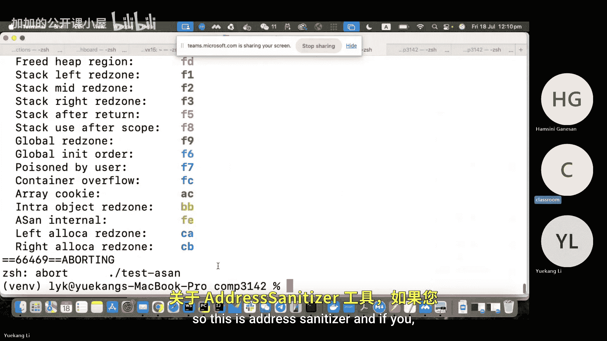

# 软件测试：P6：测试预言

在本节课中，我们将要学习软件测试中的一个重要概念——测试预言。我们将了解它的定义、组成部分、不同类型以及在实际测试中的应用。

## 概述

测试预言是判断程序输出是否可接受的标准。它决定了测试用例的通过或失败。我们将探讨测试预言与规格说明的关系，学习四种主要的测试预言类型，并了解如何在实践中应用它们。

## 测试预言的定义与回顾

上一节我们介绍了测试脚手架，本节中我们来看看测试预言。在之前的课程中，我们已经接触过测试预言。例如，在测试脚手架代码中，`assert` 断言语句就是测试预言。它们用于比较程序的输出。

测试预言是一个谓词，用于判断系统输出是否可接受。它决定了测试用例的通过或失败。这与日常生活中的“预言”概念相似，但在测试中，它特指判断程序行为正确与否的机制。

## 测试预言与规格说明

测试预言与规格说明密切相关，但两者并不等同。规格说明是程序行为的高层描述，而测试预言是针对特定输入判断其输出是否正确的具体标准。测试预言可以从规格说明中派生，但它更为具体。

## 测试预言的组成部分

测试预言包含两个主要组成部分：

1.  **预言信息**：用于判断实现正确性的信息，可以理解为程序的预期输出值。
2.  **检查过程**：将实际输出与预期值进行比较的操作。这个过程可以非常简单，例如使用等式检查。

由于测试预言通常以代码形式实现，因此它们也需要被开发。与项目代码类似，测试预言也可能包含错误。一个错误的预言可能导致误报或漏报。因此，我们需要像验证程序代码一样，对测试预言进行轻量级的验证，例如代码审查。

## 设计测试预言的挑战

在设计测试时，我们擅长为程序生成新的输入，但很难确定预期的输出结果。例如，对于一个计算斐波那契数列的函数，我们可以轻松给出输入值 100，但很难手动计算出 `fib(100)` 的正确结果。

最常见的做法是开发者手动编写预言信息，并将其与特定的测试用例绑定。这种方法需要大量的手动工作和时间，而我们希望实现测试自动化。因此，存在多种自动生成测试预言的方法。

## 测试预言的质量属性

理想的测试预言是精确指定系统的预期输出，但这非常耗时。我们可以在精确性和通用性之间进行权衡。例如，我们可以指定函数应遵循的某些属性，而不是具体的输出值。

测试预言有几个关键的质量属性：

*   **完备性**：一个测试预言如果能验证任何测试输入，则被认为是完备的。
*   **可靠性**：一个测试预言如果对其能处理的任何测试用例都能给出全局正确的判断，则被认为是可靠的。
*   **正确性**：一个测试预言如果既完备又可靠，则是正确的；如果可靠但不完备，则是部分正确的。

在实践中，我们需要在构建成本、准确性和完备性之间进行权衡。

## 测试预言的类型

以下是实践中常用的四种测试预言类型：

### 1. 规定预言

规定预言使用程序的规格说明或文档来判断程序行为。这是最常见的预言类型。例如，单元测试中的断言通常就是规定预言，因为它们是开发者根据高层规格说明手动创建的。

规定预言有以下几种变体：

*   **预期值预言**：最简单的形式，检查特定输入对应的预期输出值。缺点是通常不可重用。
*   **自检断言**：将行为检查（断言）嵌入到程序的实际实现代码中，而不是测试用例里。在测试中，我们只需观察断言是否失败。这提高了预言的可重用性。

我们可以在函数级别或系统级别设计自检断言。在系统级别，我们可以使用**基于模型的测试**。例如，可以使用决策表或有限状态机等模型来设计测试预言。当程序进入错误状态时，测试就失败。

### 2. 派生预言

当没有规格说明或完整文档时，可以从程序代码或其他现有信息源自动派生测试预言。

以下是几种派生预言的技术：

*   **差异测试**：对具有相似功能的两个（或多个）程序版本运行相同的输入，并比较它们的输出。如果输出不同，则至少有一个实现是错误的。
*   **回归测试**：确保程序的新更新或更改不会对现有功能产生不利影响。其基本思想是，在更改程序后，重新运行所有现有测试。旧版本的程序及其通过的测试用例就充当了预言的角色。
*   **蜕变测试**：当程序的预期输出难以确定或未知时，这种方法非常有效。它利用**蜕变关系**——一种关联多个输入和输出的属性。通过对输入数据进行符合蜕变关系的变换，并比较输出，来判断程序是否正确。例如，对于 `sin(x)` 函数，我们知道 `sin(x) == sin(π - x)`。我们可以用输入 `1` 和 `π-1` 测试该函数，并检查输出是否相等，而无需知道 `sin(1)` 的具体值。
*   **不变式检测**：不变式是在程序执行过程中某些特定点始终保持为真的属性或条件。例如，循环不变式。我们可以从代码中提取不变式，并将其用作测试预言。如果这些本应不变的性质发生了改变，则表明程序存在错误。

### 3. 隐式预言

隐式预言不需要任何领域知识或规格说明，它们基于任何可运行程序都应遵循的通用属性来检测异常。最常见的例子是程序崩溃或死锁。这类预言不需要预期的输出值，因为程序崩溃本身就意味着有问题。

为了提高检测异常（如内存错误）的灵敏度，我们可以使用**净化器**工具。例如，**地址净化器** 是一种编译器和运行时技术，可以检测多种内存错误（如缓冲区溢出）。它通过在分配的内存周围设置“红区”来实现。当程序访问红区时，就会被捕获并导致程序崩溃。使用地址净化器非常简单，只需在编译时添加 `-fsanitize=address` 标志即可。

### 4. 人工预言

当没有自动化方法或规格说明时，我们可以依赖人工来判断最终输出。这在实践中很常见，例如用户报告Bug。近年来，在机器学习领域，人工预言变得越来越流行，例如在大语言模型训练中，通过人工反馈来优化模型。我们可以通过众包平台来获取这类人工预言。

## 总结

本节课中我们一起学习了测试预言。测试预言是软件测试中的重要组成部分，它告诉我们一个测试是通过还是失败。我们学习了四种主要类型的测试预言：规定预言、派生预言、隐式预言和人工预言。规定预言源自规格说明；派生预言可从程序工件中自动推导，如差异测试、回归测试和蜕变测试；隐式预言利用程序的通用属性（如是否崩溃），并可借助净化器提高检测灵敏度；最后，我们总是可以依赖人工作为最终的判断者。理解这些不同类型的预言有助于我们在不同场景下选择合适的方法来有效验证软件行为。