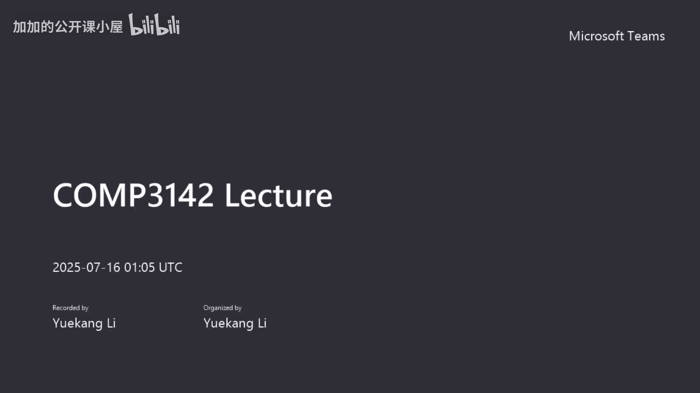
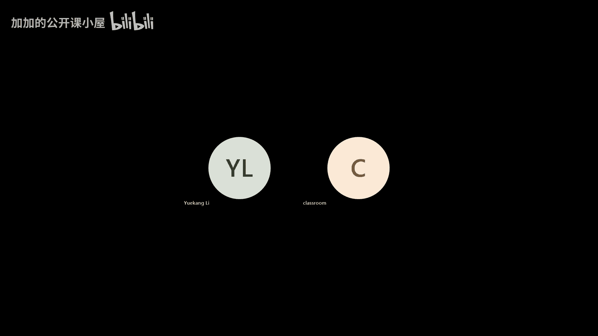
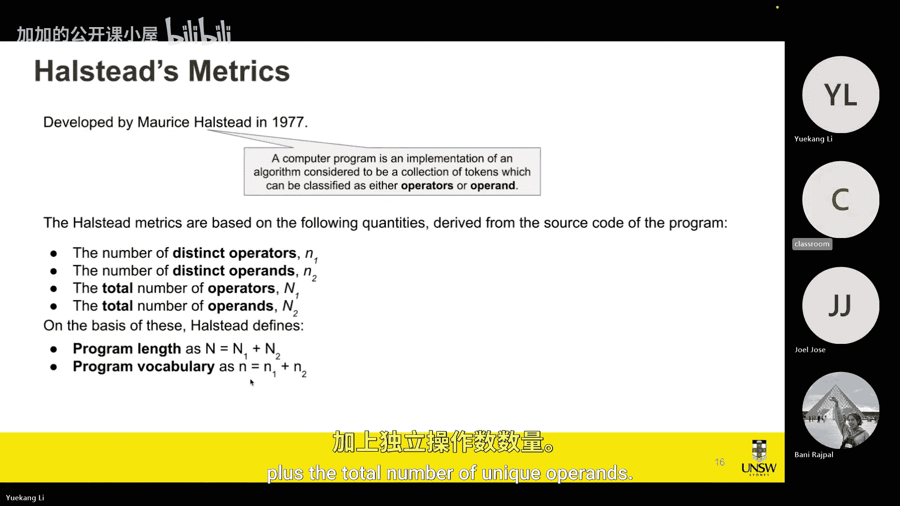
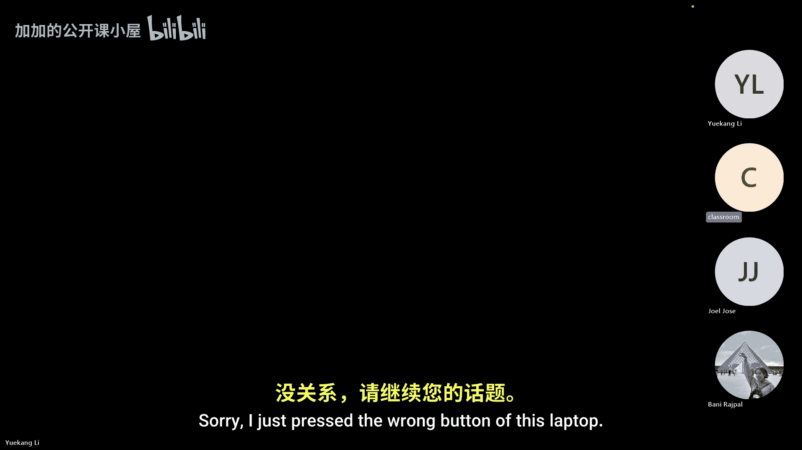
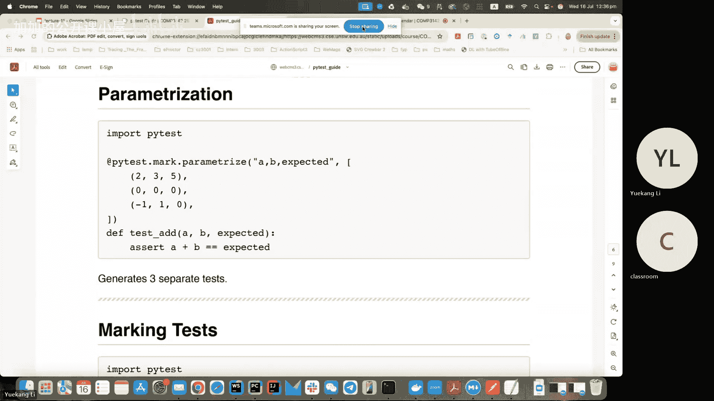
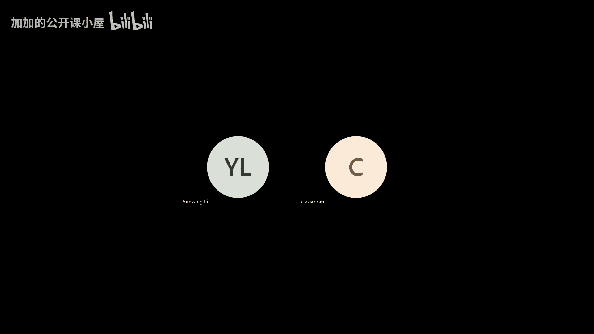

# 新南威尔士大学【中英⚡软件测试｜COMP3142 2025 Software testing】 p07 P7 Software Complexity -BV1o34HzBENA_p7-

Test， test。O。

I hope you had a very。Nice flex week。 And you have a good rest。And let's welcome back to。Class and。

Let's start the second half of this term。And， and before we start today's lecture。

 let me quickly go through what we have。For some updates of this course。And。

We have we have released the marks of assignment1， and you can send us emails for a breakdown of your marks like how much。

 how many marks did you get for each question。 And if you if you have questions regarding the why you got some marks deducted but you think that you have done it correctly。

 then you can come to the help session and ask for explanations from our cause means。

So we will be sending out notifications about these help sessions later。And。

And by the end of this week， which means by the end of perhaps this weekend。

 we will release the specifications for assignment 2 and the deadline for assignment 2 is in week 11。

 So you will have around one month to do assignment 2。Ander 72 is more about coding。 So hi。嗯，好的。You。

 you did what。Oh， you don't have it yet。 I think maybe you can， you can let us know。

 You can check with custom mean here about your marks。

 because we have marked all of your assignments， but maybe the system takes some time to display some of your marks。

 So you can check with our custom mean here。 We we do have a backup a copy of your marks somewhere else。

 apart from the school system。 So you don't need to worry about that。 if you can't see your mark yet。

So。But， but if you still cannot see your mark by the end of this week。

 you definitely should come to us， and we will look into the problem there。 So， okay。

 so let's continue to our lecture content today。So today。

 we are going to learn about software complexity。So。This is today's outline。

 We will go through an overview of software complexity。

 and we will go to go through three different levels of complexities。

We will go through the unit level， the the integration level and system level。

And we will learn different metrics of calculating software complexity。So first， when we are。

 when you see this term complexity， it is somehow familiar， right， when， when you are。

 when you were learning algorithms， you have learned complexity， right。

 So we have learned when we learned algorithms We have learned。

 there are different complexities for searching algorithms。For example， we have the time complexity。

 We have learned the space complexity for these searching algorithms。

And we have these notations marking the complexity of these these algorithms like O1 means the complexity is constant。

O， N means it's a linear complexity， and N square means it goes。呃， like a呃 square。So。

So these are the complexities used for these algorithms。

 but they are not usable for measuring the complexity of software。 And that is because。

These complexities are computational complexity。 So they are used to measure either the time we need for computing something or the memory space we need for computing something。

 but they don't measure the complexity of the structure of the code。

 So that's the key difference here。 So it is。So you may have learned this concept。

 but although the name is the same。The actual the actual concept behind the term is different。So。

 let's have a more detailed。Look at this。The difference here。 So for computational complexity。

 it is actually used to measure the resource required for doing certain calculation and。

So it is used to， to check the efficiency of these algorithms and whether these algorithms are feasible for larger inputs。

But for software complexity， it is different。 It is used to measure the structure of the software system。

 and it is used to to help with thinking about how to understand how difficult it is to understand the software to maintain the software or to update the software。

So。It has nothing to do with the actual computation。

 It has nothing to do with the actual computational resource when executing the software。

 It has only， it is only related to more like the cognitive part for the piece of code。So。

 it only measures。How difficult it is for human to use or to maintain the code。

 So this is the difference between software complexity and computational complexity。And because。

Normally， why suddenly we have some。I call here。And normally， because。

Because it is believed that high complexity is associated with high risks of having bugs。

 So that's why we are learning software complexity in this course because we are we are doing testing right。

 we want to find bugs。 And if we could identify which part of the software is more complex。

 Then we can focus， then we can focus on testing。 that part of the software to find bugs。

 So this is why we need to learn software complexity in this course。Now。

 let's continue to some metrics for calculating software complexity。

 and we will learn it according to different levels of the system。

 similar to how we learn different levels of testing。So。First。

 we will learn unit level of complexity， and we will learn two metrics here。

 The first one is calledcyclmatic complexity。So by definition。

 psychomatictic complexity could be used for calculating the complexity of any graph。

And in terms of a control flow graph here， the。The formula is given as this。

So psychomatic complexity equals to the number of edge minus the number of n plus two times。

The number of sub partss of the entire graph， so。E here stands for the number of edges。

N here stands for the number of nodes。And P here is the number of connected components。 So basically。

A a graph could have multiple subgraphs， and each sub graph is considered as。A P here。 But normally。

 normally， because we are thinking about unit level of testing here。 So may。

 we only care about one particular method or one particular function。 So normally for one function。

 we only have one connected parts。 So every sub graph is connected together as an entire big graph。

 So we don't really have subgraphs for unit level of control photographs。

So P here is one is just one。 So the formula could be simplified as。一 minus N plus2。

So we just use the number of edge。us the number of nodes plus 2， as the final。

Number of psycho complexity。So。This is a formula we are going to use here。

 And let's have a look at an example of how to do this。Calculation。So let's consider this program。

 And you have practiced in in。As one of how to draw a control flow graph， right？

 So can you draw a control flow graph of this。So what is a control flow graph here， so。

It's pretty straightforward。 We have two eve here， two nested eaves。And this is a control flow graph。

And what is the number， what is the psychomatic complexity then for according to this control flow。

 it should be E minus the number of nodes plus 2， right？ So we have four edges。

 We have five nodes and final number of complexity smatic complexity is。4-5 plus 2。

 which is just one here。So it is pretty simple and straightforward。

And let's think about for a given program， which factors could affect。

Thecyclmatic complexity of this program， so。Let's consider doing some variations for this very simple control flow graph。

So let's say， let's say we add an exit basic block here。

 So does this modification increase thecyclmatic complexity here。Does it increase。No， right。

 because we use in the formula is like E minus N。 So we care about the number of edges。

 new edges and the number of new nodes。 And in this update。

 we are bringing in one more node and one more edge。And we， if we do in minus- n。

 then this update is kind of。Doing nothing here， so。

They' are not increasing the psychomatic complexity if we do this modification。

And what if we change this return here， this return to here into。A go to whiches。

 which means that we are having a loop here。 We are looking back to this very first basic block。So。

Will this increase the psychomatic complexity。Yes， right。 Because we are not removing any nodes。

 but we are introducing new edges。So we are increasing the psychomatic complexity here。

 So the observation here is。So what is increasing the complexity here。 So actually。

 the branches and loops are increasing the psychomatic complexities。

Because they are the sources of new edges， or extra edges。

So branches and loops are one of the factors affectingcyclmatic complexity。

 but they are not the only factor here。So let's consider this example here。So， if。

If we simply modify the program like this。Are we introducing new。And， and， but， but if we do。

 if we simply modify the program like this， this program is not really a valid one because we are actually lacking some exit point here。

 and we need to， add some return。Basic blockss。 And if we modify this program like this。

 are we having， Are we increasing the psychomatic complexity here。No， right。

 Although we introduced a branch， we are not increasing the smatic complexity here。

 So introducing branches does not always。In increase the psychomatic complexity。And。

It is not the only factor here。 So if we modify， further modify the program。Sorry。😔，I think oh， okay。

So if we， if we change the basic block into one return instead， instead of two returns。

Are we increasing thecyclmatic complexity？ No， we introduced three basic blocks。

 and we introduced four edges。 So we are increasing thecyclmatic complexity。

 if we do the update like this instead of having two returns。 So we can see that。Although。

 although introducing branches， if we just stop here， if we don't add the two returns。

 we are increasing the number of psychomatic complexity， right， because we。sorryrry。

 we don't we are not。 And if we reduce the number of returns。

 we are increasing the number of the thecyclmatic complexity。 So actually。

 returns and exits are also affectingcyclmatic complexities， and they have a negative effect。

 as we could see just now， if we have two different returns。We have。Leice complexity here。So。

And some， some online materials， they just ignore returns， which is wrong。 But if you see them， you。

 you just ignore that， but they should consider returns here。So according to what we have observed。

Actually， we can have a way of calculatingcyclmatic complexity faster than having to draw a control flow graph and count the number of edges and nodes from the control flow graph。

 So we can skip the step of。😊，Drawing a control flow graph。

 if we know which factors are affecting thecyclmatic complexity。And the fast。AC here is。

TheThe formula here is two plus the number of ifs plus the number of loops。

 plus the number of cases inside a switch minus the number of returns or exits。

So this is the new formula， according to the factors affecting the smatic complexity。

So let's have a look at this program again here。So。

We know that ifs and loops are these type of things are bringing in new branches and returns are reducing。

 So this roughly explains why this formula looks like this。 So。

 and let's verify it using this program here。 So just now we know that using control flow graph。

 thecyclmatic complexity for this program is just one。 And using this formula here。

 So how many ifves do we have， We have two ifves， right， And we have no loops， we have no cases。

 And we have three different returns。 So it's 2 plus 2-3， it is still one。

So post formula will give us the same thing here。So， this is。

This is how we can calculate samatic complexity faster using this formula without really building a control flow graph。

And let's have a。Live pole here today for the jam mark， so。This， this is a program we have。

 and you are encouraged to use the fast calculation method。

To calculate the psychomatic complexity here， so。呃， formulaS。

2 plus the number of ifs plus the number of looks， plus the number of kiss， minus。

The number of returns here， so。The the the control flow of this program could be very complex or too complex to draw in a few minutes。

 right， But you can quickly calculate by counting the number of some special statements like the Eve or loop or return statements。

So。Remember， the formula is like this。 So can you。Calculate the smatic complexity for this function here。

So it's like， it looks like this。判登。Yes。You have to make a guess whether how many cases should be counted here。

 Like whether the default case should be counted as a case。It's a case， by definition， but。

You should think about it， because。We count the number of ifs， right in the in this example。

 But they didn't count the else here， right。So。Does this default is the default the same as case here。

 It's not the same keyword。 at least， right， It's it's considered as a case。

 but it's not using the case keyword。So you can just make a guess because we are not really checking the correctness of your answers。

 It's just。😊，A practice。So。Okay， I think most of you might have got the answer。

 and let's have a look at。So we have the same number of 6 and 7。 Actually。

 the the correct answer is 6。 So default does not count here。

 And let's have a look at why default is not counted。By looking into the details。So。First， let's。

 let's use the control photograph to check the ground truth to check the correct value of。

The psychomatic complexity here。So the control flow graph is like this。

And we just use the number of edge divide minus the number of nodes plus 2。 And it should be 6。

 So now we know the answer is 6。And let's come back to the fast calculation formula here。

 So we have how many eves do we have， We have two eavves， right。And how many loops do we have。

 We have one loop here， this well loop here。And how many cases do we have， actually。

 when we have two cases here， we don't count。The default case。 And we have。1 return here。

 So the calculation is 2。 But you may wonder， okay， why didn't we count this default case。

 So we can think about one extreme case where this switch。

 This entire switch statement has only one default case。Let's imagine this entire switch has only。

Lets assume that this。We don't have the case  one and two。 We just have one default case。

Then this entire thing is just one basic block， right， It doesn't have any branch。

 It doesn't have any extra edges。So this default case actually works like else here。

 It doesn't bring in new edge。Socyclmatic complexity is more about。

More is about having more edges in the graph。So comparing to the number of nodes。 So because。

This default case is not bringing in new edge。 So that's why it is not counted。

 So if we think about this extreme case。So that's why we don't。 Sorry， we， we don't count。

We don' count the default case here。However。So you can see that psychomatic complexity is quite easy to calculate。

 and it can help us to understand the structural complexity of a graph or。AForgiven piece of code。

 right， we know how complex is the control flow or forgiven piece of code。

And that's the advantage of psychomatic complexity。 But it has some limitations。

 Let's think about this。P one here。Because psychomatic complexity is an over simplified metric。

 And I's think about this program here。 So this program actually checks whether three given numbers come form a triangle or not。

 so we can use compound conditions here to just have one if and one else to do this check。

And if it calculate， the smatic complexity is very low， It's only two。 However。

 we can also write the same program。By decomposing this compound condition here， we can write。

 We can write it with nested eves， right， So we can write the program like this。

And if you draw the control photograph graph and calculate thecyclmatic complexity。

 it's increasing the psychomatic complexity。 But， but actually。

 these two programs are essentially the same。So。The we can see that one limitation here of psychomatic complexity is that it only calculates the。

The， the complexity of the control flow graph， but it doesn't count into the。Beta flow。

 So it doesn't check whether because we can use compound conditions to make the control flow graph look simpler。

 right， But it doesn't mean this program is more it doesn't mean the the program below is more complex than the previous one。

 because in compound in in these compound conditions， we are we are equally likely to make mistakes。

 here， right， So it doesn't really simplify the program。

So psychomatic complexity only measures the structural complexity of the control flow graph。

 and it it doesn't consider the data part。That's the first limit。 And the second limit is。

It actually ignores the code size， which is actually very important for。Findunning bugs。

Because we can have a very large function， maybe with a few hundred lines of code with no if and no else and just execute sequentially this big function。

 We could have this scenario here。 And this big function has a very low psychomatic complexity。

 right， because because of the lack of branches， but it could be very very buggy。

 So the second limitation of psychomatic complexity is that it ignores the size of the code。

So that's why we need some other metrics to measure the unit level of code complexity。

 And the second metric we are going to learn here is called house tides metric。

 You can infer from the name that this is actually from a person's name。

So this one was developed by this guy in 1977 is very old， but it is still used。 It is still used。

And。And by that time。And even still， even now， it is still like this。 So by that time， actually。

 programs were kind of written in some language similar to assembly code today。

 So programs are considered to be made up of operators and operators。So。

So this metric is all about dealing with。Operators and operators。So。So it is based on the following。

Quantities here。 So there are， there are some concepts here。

 and we will learn it through some examples later。 but We don't need to remember everything in this slide right now。

 So， but we will go through this one anyway， so。The first。

 the first variable here used for calculating house tides complexity is the number of distinct operators。

 which is which is denoted as the lowercase N here， N1。

And we also need to calculate the number of distinct or unique opera。

Which is also denoted with a lower letter N， but it is N2。

And we also need to calculate the total number of of operators， which is denoted with an uppercase。

 N， N one。And we also need to calculate the total number of opera， which is N two in upper case。So。

Based on these， we have several metrics for measuring the complexity or the size of the code。

 So the first one is program length。 So basically， program length is the number of the total number of。

Operators and operas。 So we just。Calculate。N1 plus N2 in upper case。

 So upper case means total number and lower case means unique。Things。

So the vocabulary in like the vocabulary in natural language iss like we。

 we only count the unique things， right， So the vocabulary is。

The total number of unique operators plus the total number of unique operators。

Sorry， I just price the wrong button of this laptop。

Okay， so the program volume is calculated like this。 So it's。The program L times。Lo with two base。

 the program vocabulary。 So it is defined like this。 and program difficulty is calculatedd like this。

So we can， once we have these four numbers， we can combine them together to calculate different metrics。

And we can also finally calculate the program effort， which is。Could。

 which could be considered as the final product here of house tight complexity。

 But there are some other final products of this set of metrics。 And we learn them later。 But。

 but I don't personally， I don't like those。Mattris， and I will explain why。So。

So these metrics should be language independent， but they cannot avoid language features nowadays because it was proposed in 1977。

 And by that time， you know， like programs are all written in something like the machine code or the assembly code。

 So everything is could be considered classified as either an opera or an operator。 But now we have。

 for these， for the programming languages we are using today。

 we have many different program language features， right。

 And it's hard to cut to classify something as an operator or as an operator。 So。

There are some language features affecting the classification of operators and opera。

 And here we provide some rules for C programs。 And I won't。

 I won't read through all these rules in this lecture here。

 because you can see iss quite overwhelming， but you can use this lecture slides as a piece of lecture note to。

 to check whether something is is counted as an operator or an opera。

 So this is just for your reference。😊，So basically， you just know。

 you just need to know that and these， these rules are dealing with whether something。

 whether a keyword or something should be counted as an opera and or operator。 So that's it。And。

Let's have a look at of。How， how that metrics work with an example here。 So remember， we。

 we need to account for basic things， so。What are the， what are the operators in this program here。

 So we need to count the number of distinct operators， right， So what are the number of。Operators。

So operators are things that are being operated， right， So I'm here。 is an operator。

3 here is an operator。Oh， but sorry， sorry， sorry。 Operas are things are being operated。

 Operas are the operators of the of the， of the expressions， so。So sorry about it。 And that's oh。

How can I remove everything。😔，Era on。 okay， so this smaller than is an operator here。

So this plus equals is another。 minus equal is another。 This equals is an assignment operator。

 It is also， it's assigning value to K， right， So it's also counted as an operator。

And this modular is also an operator。 This divide is also an operator。

And this plus is another unique one。 Times is another unique one。And what else。

 we don't have more unique operators here， right， So these are all the unique。Operators， so sorry。

 if is also another unique operator。 We omitted this if here。

 So these are the unique operators of this pro one here。 And therefore。

 the number of distinct unique operators is 9 here。

 And then we need to count the number of occurrences of each unique operator。And then， we will get。😔。

Will you get this。 So the total number of operators is 21。 So， for example， this。

Equals appears three times， right， We just have three here in this table。

 And then the total number of。This the total number of operators increased by 3。

 So the total number of operators is 21 here。 And let's have a look at the number of opera here。

 So the operas are the things that are being operated。 So these are the the objects here。 we have。

 So we have M。 We have3。We have 12。 We have Y。 We have one。We have K。 We have 100。You have J。

The have day of week。They have D here， They have M here。😔，26。很。And K has already been counted。

 and we have。J has already been counted。We have 5。 We have 7， right， We have all these unique。

Operators。So operas。 So these are the operas here we have。 So the unique number of operas is 15 here。

And。Similar to how we count the number of occurrences in。嗯， in。For these operators， we can。

 We can count the number of occurrences for these opera。

And then we have the total number of opera equal to 25。

And then we can calculate the rest of the metrics using these four basic values so we can have the program lines as。

TheN upper case N1 plus upper case N 2。 So the program is 46。How we have the vocabulary as。

Lower case one plus or lower case until which is 24。We can have the program volume calculated with。

These values。And we can also have the program difficulty， so。

This is how we can calculate these measurements。 And， of course， we。

 we should have the final product， which is。The programming effort here。And actually。

 in the original house tights metrics， we also proposed two other values we could calculate。

 The first one is time required to program。 So it is calculated like this。

 So it is the programming effort thought。Divided by 18 seconds。 That is the estimated time for。

For writing this for one。 But we will see this is kind of ridiculous。

 I don't think this value makes sense， but it is defined like this in house tights metrics。😊，But。

I don't think it's， it's real。 And the second one is the number of delivered bugs。

 It's the number of program volume divided by 3000。

 or or we can use this formula to calculate this the number of estimated bugs in this program。

 in this program。And。As far as the actual bugs， we find in the code is smaller than this estimated number of bugs。

Then this quality of the program is considered acceptable。

 So that's the basic idea of house tights metrics。And let's come back to this example here to see why I think it doesn't make sense。

 so。If think。If we， if we use the。😔，The the the algorithm audit。

The formula to calculate the time required required to program this thing here is like 87 seconds。

 So I don't think。If， if you could figure out the logic of the program。

 you don't need 80 seconds to type in out everything here， right， But if you。

 but if we think about this big formula here， maybe it takes more than 80 seconds to think about this program here。

 So that's why I think this。The calculation of this time required to program is not。Realistic。

And the number of delivered bugs is 0，1，0，7。 But I think personally。

 I think this big formula here is could be very buggy when I， if you ask me to write this program。

 So I think this。These two metrics are not very， very usable， but。Pad the programming。

 I thought here could be used as a measurement of。The volume of the the entire program。

 So this one is still useful。But these tool， you can just use it as， just use it as a reference。

It doesn't mean anything for real。So。So that's why I think。

You should just focus on using this programming effort here。P。And those are the。

Those are the unit level of complexity。 And before we jump into the second half of today's lecture。

 let's have a five minutes break。 and I'll see you at around 1151。走啊看看黑看看黑板的。

Maybe let's solve the problem after class， so。Let's continue the second half of today's lecture。

 So just now we learned two unit level of metrics for calculating software complexity。

 And let's have a look at some integration level of metrics for this complexity calculation here。

 So the first one is the because we know that complexity。

 psychomatic complexity could be applied to any graphs， right。

 And remember when we learned unit testing and integration testing。

 when we learned different levels of coverage。We learned not only the control flow graph。

 but also the call graph， so。We have learned it before。Let me learn different levels of testing。And。

And we， we know that To a cargraph is still a control flow graph， but is it is on a higher level。

 It is more focused on。The connections between different sub routines， Basically， normally。

 there these nodes are just functions。So。Since we have。

 since smatic complexity can be applied to any graph。

 we can also calculate thecyclmatic complexity for call graphs。 So if we have a call graph for a。

Particular program or a particular piece of integration of units。

 Then we can calculate the psycho complexity。Of that integration。 And for this example here。

 the smatic complexity is 6。So。So， basically， we。So basically， we， we， we， we need to use。

The we need to use edge minus N plus 2 formula to do this for call graphs。

 We can't have the fast calculation。 We don't。 we don't have if， and we don't have well loops。

 We don't have the different statements here for us to do a quick calculation。

 So we have to use a graph here。And another metric。

 another set of metrics for integration level of complexity is。The object oriented complexity。

 So that's why object oriented programming is one of the prerequisite for this course。 But。

 but since this course is becoming a core。 I don't want it to block your graduation。

 So maybe we will remove the requirement。 And let's just go through this part of the knowledge。

 and you just need to know that then you are dealing with object oriented programs。

 you can use these metrics， but they don't learn them in details。So。

So the metric here is called the C K metric， which is not the brand。 You know， the C K brand。

 It is related to two names and。It is It is one of the best known set of metrics for object oriented software and。

😊，There are  six metrics here， and you can roughly know what does each metric mean by reading its name。

 So basically， the weight methods per class is kind of related to the number of methods， right。

 So the number of child classes is literally the number of child classes and these things。

 But let's select some key concepts and explain in more with more details。

So the first one is the weight methods per class。 So the weight here we apply is actually the complexity of the metric method。

 So we， we don't count the plane number of methods。

 So we count the complexity of each method and sum them up。 And that's。嗯 basicallyically， the。

The first metric here。 And we can use psychomatic metric complexity。 We can use host metric。

 So we just， it's just a sum of the complexity of the metrics inside this class。

And we could also count。The coupling in between classes。 So this is。To check why how many class。

 the number of classes， which are related to a particular class。And。

 and this relation is bidirectional。 So if that particular class calls this class。

 then this class is。Consider coupled with that class。

 And if this class cause a method inside another class， then it's also counted。

 It's also counted as a coupled coupling here。 So basically， videos count the number of。

A number of classes that are。That are coupled with this particular class we are looking into here。

 So this is the second metric here。And the third one。

 we are going to question in detail is the response for classes is actually the is actually calculated by adding the number of methods inside the class。

 except for the in the inherited classes。Plus， the number of distinct method calls made by the methods in the class。

So it's basically how many responses from method cause we can have in this class。

 So as far as we are calling some other methods and we are getting some responses。

 And that method is not an inherited method。 Then it is counted for this class。

So this is literally the， you know， like the number of responses inside this class we get inside this class。

 So these concepts are pretty。Much self explanatory， so。So。

 but the last one is requires a little bit of comprehension。

 And let's have a look at the detail here。 So in object oriented programming。

 we have learned the concept of we are encouraging to have high cohesion。

 but low coupling for our code， right， we， high cohesion means that we put similar concepts together。

 So。So they they， this high cohesion and low coupling。

 they are kind of related in object oriented programming。

 So high cohesion means we are putting similar things together and low coupling means。

Different things should be separated。 So we are kind of modularizing our design of the code so we can reuse some modules。

 and we can replace some modules and， and update them independently in object oriented programs。

 So this one here is regard。 This metric here is related to how do we calculate the cohesion within the methods of the of a class。

And it has five different variants。 And we will only learn one of them here。

So we learn the simplest one。 So the simplest one is the。

 the steps for calculating this lack of cohesion。Here is that we start from listing all the methods and attributes of the class。

And then we determine the relationship between the methods and attributes， so。We。

 we just have a look at which methods are using which attributes。And then。We evaluate method pairs。

 So basically， if two methods are related to the same attribute， then we pair them together。

And then we can calculate the lack of cohesion on methods a metric using the number of method pairs。

😔，So。😔，So let's have a look at an example。 I won't go through the too much of details within this here。

 Let's use an example to explain this。So assume assume we have this class here。

 and we want to calculate the cohesion between methods inside this class。 And in this class。

 we have three attributes。 A1 A 2 and A 3。 We have3 methods。 I 1， M2 and M 3。 So basically。

 we can just list all of them here。 And then we can calculate the relationships between methods and attributes。

 So basically， M'm 1 uses a 2 and A1 and A 2。 and I'm2 uses a2 and a 3， And M'm 3 uses a 3， right。

 So and then we compare pair them together， according to the shared attributes between these methods。

 So we can see that。😊，Cory， the pen is。Oh。So。We can have these pairs。

 So I'm 1 and M'm 2 shares a tool。 So it's cohesive。😊，cohesive。 And I'm 3， and I'm， I'm1， and I'm 3。

 They don't share any attributes。 And I'm 2。 and I'm3。 They share a 3 here。

And then we have non cohesive pair， which is M1 and M 3。 We have one， and we have two cohesive pairs。

 M1， M 2 and M 2 I M 3。And we just use 1-2 to calculate the lack of cohesive。In this。Class。

 so you can see that from this。Calculation here from this formula here。

 it is encouraging methods to share attributes of the class。 So it means that basically。

 it roughly means if more methods are using the same attributes within the class， It means that this。

These functions， these methods are similar to each other， and they are kind of cohesive。

So this is the basic idea here。 And there are different。Variations for this L C， O M。

 And you can find a summary of this。Of these different very variations here。 And actually， this。

 I just updated this link this morning。 and I found that the previous link was now no longer available。

 It was actually from。Some materials from another university， but I don't know why they put it down。

 So I replaced this with a paper here。 So you can， if you are interested。

 you can have a look at this。Detailed material here。So that's integration level of complexity。

 And now let's jump into system level of complexity。Actually， for system level。

 we don't have unique unique complexity metrics。 We just use the same metrics as we are using for the。

 the integration level of complexities， so。But for system level of complexity。

 we do have some interesting。Knowledge to learn here。 And there was a study in 2018。

Which is related to is software complexity， positively related to。Moulnerabbilities or bugs。

 which means that。If a piece of software is more complex， then is it more likely to be buggy or not。

 So this is the research question， which is trying to be solved by this study here。

And the finding is actually hard to tell。 So we can hardly say that。

A more complex piece of code is more likely to be buggy or more likely to be vulnerable。

It actually all depends on different situations and scenarios。

 You can imagine that even when you are writing a very complex code piece of code。

 maybe you are more focused and you are less likely to make mistakes because you are paying more attention when writing the code。

 right， But when you are writing a relatively easier piece of code。

 Maybe you just lose your attention， Maybe you are。You know， doing having some tys and。

It could lead to some bugs。 So it's hard to tell whether whether complexity is positively related to bugs or not。

 So although in general， people think that more complexity means。More likely to be buggy。

 but this is not the case， actually， according to some research。And this is a research paper。

 If you are interested to have a detailed look， and they have many， many different tables， different。

Data inside， but。But actually， they， they have actually used many different prediction methods to check whether a piece of code is buggy or not。

 And these prediction methods could be very complex。 They are using some complexity metrics。

 They are using some machine learning models or even some deep learning models， but。

But most of the prediction methods cannot outperform by simply counting the number of like the volume of the code。

 like， for example， the lines of code。 So it means that more lines of code means more bugs， so。So。

 we don't。稍微微微稍。😔，So this is the situation here。And the relation of software complexity， however。

 we are still learning it here。 And because in some， when you go to work in some companies。

 they have requirements on psychomatic， complexity per function。

 So they don't want you to write over complexity functions in your code。

 So the relation with testing and funding here is that we can still use these metrics。

 some complexity metrics to identify valuable targets because。Because。😔。

One of the methods we have learned just now， like the house tight metrics is related to the program volume。

 Like it's a better version of counting the lines of code， right， so。

So we can still use these metrics to calculate valuable targets。

 even though that we don't have scientific evidence showing that more complexity means more bug。

 but they can still use them to identify targets。And there is。

 there is actually a practical tool here， which was developed by a guy in New York University。

It is called fable， and。As indicated by the name of the tool， it basically identified the。

Functions which are fible， which could be applied for to which could be used for fuzzing and。

You can see that。 It has。AFibility score。 And this score is actually calculated with this。

 You can see that complexity orcyclmatic complexity is one of the metrics here。

 And if you wonder why it doesn't use houset matrix， iss actually because。Syomatic complexity。

 although it has several limitations。 It's very easy to calculate。 We can just， you know。

 even use a stream measure to match for if and if well loops for loops inside the program to quickly calculate thiscyclmatic complexity。

 So that's why it is used here。And that's all for the main content today。

 And let's continue our journey of learning pie test。So。

Pet test is actually usable for your assignment to assignment， too。 So that's why we are learning it。

😊，And because72 will be more focused on writing some code。

 although you have written some code for a71， but we will write more in72 and。And basically。

 we will practice unit testing and integration testing and system testing in assignment 2。

 So you will be writing automated tests for these， for this assignment。

 And this is to get you prepared with the actual library you are going to use for assignment2。

So in our last lecture， we quickly went through the concept of fixture。

 but I think you might have forgot， forgot about it。 So let's have a recap of what is a fixture。

 So a fixture is actually。It's actually used to provide reusable。

 composable set up and tear down for this for a piece of test。

 And you can see this in this example here。 Let's use this。With a larger font。

So you can see in this test。嗯。就。So as you can see here。We have。In this test。

 we just read from a temporary file and check whether the file content equals to hello world or not。

 And if this file content does not equal to hello world， it will return an error。 Otherwise。

 the test will pass。That's very simple。 However， we can see that this requires us to read a file。

 right， This requires us to maintain a file in our test， and we don't want to generate many many。

 many files because we in reality， we could write we could have multiple tests and we could have thousands of tests actually in some bigger projects。

 and we don't want to generate thousands of files and keep them there after running the test， right。

 we should have some process to create that file， and we should have some process to remove the file after doing testing。

 and this lifetime of setting up and removing files is actually handled by this thing called fixture here。

 So you can see that this file， this test function here。 Actually it accepts this temp text file。

 which is a fixture。Which is defined as a fixture for this。Environment， and inside this picture。

 we can see that。We could have a set up， a piece of set code， which can create the file。

 And then we could have a piece of tear down code， which will remove the file， and we have。

We have a statement here called yield， which will pass the file we just generated to the to the actual test using this fixture here。

 and we will learn why are we using this keyword yield instead of return here。

And this is roughly the structure of this fixture， and this test。

And let's have a look at how it works in action， so。We just run pie test not B。

 And we can see that this test has been passed。 And if we look at this folder。

 we can see that there's no temporary file created， right， because we are properly。

Setting up the file。 And we are properly tearing down the file。 And to verify this。你看。

What we can do is we can try to comment。You can try to commend these tear down two lines of tear down code and see what will happen if we run the test again。

We just commented this two lines of code， and。If we run this test again。

 you can see we can we are still passing the test。This is a little bit annoying。

And if we run the test， again， we， we can see we can still pass the test because we are doing the setup up and test correctly。

😊，But if you look at the folder， you can see the1th file was kept there because。

You can see it has color world inside。 And that's because when we are skipping the tear down process。

 so。The fixture is actually helping us to。To write clean code for setting up the environment and tearing down the environment for doing testing。

 And we can use both yield and return in。This fixture here。 So， so basically。

 the fixture is to provide to return something to the actual function that is going to use that thing。

And that environment object。 So this， that environment object could be either a file or a connection handle of some。

 some web clients， so。So the you may have learned the keyword yield in Python。

 and it is a little bit different from the usage of this keyword is a little bit different from how we use it in normal Python code。

 So basically the if we use return in the code。 It will terminate the execution of the current function。

 So if we use return here instead of yield， it's actually skipping the entire ti down。

 So it's basically the same as how we comment out this tear down here。

 So return will terminate the current function。 However。

 yield will not terminate the current function， it will just suspend the execution of the current function。

 So。And normally， the return value in Python， the return value returns。Just the value。

 And you will just give us a generator object instead of the actual value。

 And we can use that generator object to do something。And if we。

We can use this program to practice to recap or to recap。What the keyword youd。Test。😔，No no太。😔，Try。😔。

So， you can see this。In this program here， we are。For this， actually， for this range here is return。

 iss actually returning a yield a generator object。So in these squares， you can see we are using。

 We are We are creating a。We are creating a generator object that will emit some integer values here。

 So it will return us  three different values，0，1 and 4。And if we assign this。This。

Ud value of the squares。 So what do you expect to be the type of this a here， this variable a here。

Is it。😔，A list of values。Or what， what is this object A here， What is this variable A here。Actually。

 you can。 we， we have just seen it in the slides in， not， not in the slide， but in the material here。

 So it's actually a generator object。😊，So， this。A here is a generator object。

 It's not a list of values。 And if we want to extract values from this generator object。

 we have to use the keyword next。So， or we can use。

A full loop to iterate through this generator object， the items of this object， so。

So what do you expect to see here with this next。With this line of print。

So what do you expect to see， Because we are kind of extracting values from this generator。

 So what is the first value to be extracted。But this for one。0， right， should be 0。

 But what about this inside this loop， If you continue to run this program here。And。😔。

Inside the loop， will， will we get 0，1，4， or we will only get 1 and 4。0，1，4。Actually。

 the state of getting next is global。 So we will only get 1 and 4。

 And let's see how this program runs。😊，So you看C。Inside the loop， we can only get 1 and 4。

 once we got this next here。However， if we comment out this。

So if we comment out this calling of this next function here。

What do we expect to see here in this follow。We would expect to see inside for Lo 0。

 inside for loop 1， inside for loop 4。So this is what we are going to see here。

 if we don't call the next here。 So the the state， the status of which value has been visited in the in a generator object is maintained globally。

 So this is。This is roughly the mechanism of yield for a patternyth。And。And we are using。

And we are using it here in P test to， to use the feature that yield will not terminate the control flow of the current function so that。

We can still run the tear down code after using the result。 So if。If a， if inside a fixture。

 you don't need a tear down。 For example， you just want to create that file， but you。

 you don't want to remove it。 And then you can use return。But if you are。

 if you want to have some teardown code， you have to use you here inside the fixtures。

So that's the basic idea here。 And you can， you can inside in test inside one fixture。

 you can use unlimited numbers of returns。Because return will terminate the execution of the current function。

 So it doesn't。Mice up the， the control flow of the entire program。 But if you use yield。

 you can only use exactly one here because。Because otherwise， the test， which is using the fixture。

 will be confused。 It won't know which object to use inside the actual test。So。

For the number of times point of view， we can use many returns， but we can only use one yield。

And the return here is。So this is a little bit different。

 The The behavior is a little bit different from the Pythons。Behavior， so in in pieized， in return。

 if you use return is the same as how it works in Python。 So you just get whatever it is returned。

 but。Use， if you use yield， you are not。Getting an generator object here in the test。

 So you can see that we， we just use the fixture here。 The return， the yield value here。

 the same way as。As if it is it is a path， right， as if it is a path。

 So we are not using this one here as a generator。 We are not using next to extract values from this thing here。

 right， So this is， this behavior is a little bit different from the default behavior of Python。

 So in pie test， what we get from this yielded value is actually the expression of this thing here。

So we just got whatever the value of this expression is instead of a generator。

So this is a little bit different from the behavior of Python。And if we just use return。

 we will have no chance to do tear down。 And if we use yield。

 we can do the tear tear down process after the the yield statement。So this is roughly how it works。

 And if you wonder how the precise is like。It actually works like this。

 So we just run the setup code inside the fixture， and then。We use the value。

 and then the control flow is passed to the test function。 Then the test will just run。And then。

We will get back to the logic。 The control flow will be passed back to the logic of the fixture to do the tear down。

 So this is how the control flow works in this case。 And you may see that this we can see this。

 this small notation here， the first test needing this。呃Neing this。呃。

Needing this code is needing the fixture is doing the setup up。 Actually， this is because fixtures。

 as we have learned here， is used to be is to create reusable。😊，Resources。

That could be shared among different tests。 So once we have created this fixture of file。

 this temporary text file， we can use it in multiple tests。 We can we can use。

 We can use it across different tests。 And only the first test using this fixture is doing the setup here。

😊，So， that's the。That's the case here， and。Because multiple multiple time呃 multiple呃。

Multiple tests could have could be using the same fixture。

 so we can have scopes for fixtures to allow only certain tests to see this。To see this fixture here。

 and we can have different， several different levels of scopes。 We can have function level。

 We can have class level and module level package or session level。 So this is from the。

Low lowest level to the upper。this is the order here。 So basically。By default。

 the scope is a function。 So only a function can use a scope。 However。

 we can also specify the scope to be a class。 So inside the class。We can。

 everything can can use this fixture here。 And for modules， modules in Python like is like each。

Each directory or each folder is like a module。 And for a package。

 package is like a group of whenever， whatever you have installed using。Pep is actually package。

 So a package is like a collection of different modules， different folders。

 different individual files。And a session is like。Where are this fixture could be usable for all the packages We are which are involved for running this。

Session of testing。So these are the different scopes。And we can also。

 there's another feature of fixture， which is called auto use。So， if inside the。

I think the screen is a little bit blur。 Can you see it clearly so。

Maybe you' are not seeing it at all。 but， but the thing is using in the。

 in the annotator of the fixture， we can specify this。😊，We can specify this。How to use parameter。

 we can set it to be true to make sure that。This is to make sure that every test can can can use this fixture。

 So by default， by default， we have to。Maybe I need to enlarge this。So， by default。

But default thought， if we want to use a fixture， we have to specify the name of the fixture in the test that is using the fixture。

 However， if we set auto use to be true。 Then we don't need to specify the fixture name here。

 We can use it directly。 inside the code。 So that's the usage of this auto use s。

 and this is not encouraged to use， this is just to let you know there's such a thing。

 but normally we we don't use it because it will， it will mess up your。

As the readability of your code。So， that's。The thing here。And actually， that's all about fixtures。

 And fixtures is more like， if we come back to the， to our previous lecture about test skyfolding。

 it is more like what we used for。For a driver of the program。 So。

 so basically it's driving the entire testing process。And。And before we end today's lecture。

 let's learn one more concept for P test。 So which is called parameterization。

 So when we write tests。😊，嗯， maybe it's better to share the。😔，PDF files for this one。

So you can have a clearer look。😔，So。This looks better。So in many cases， we are。When we run。

 when we write a test， we， we may want to have many constant values as our test cases and the assertion values。

 right， So， for example， when you were in your assignment one， when you create those test cases。

 here are， these are those are like constant values， right。

 we have maybe for one function that is being tested。

 we have a list of constant values as test cases here。 And if we do a white box testing， we。

If we don't， if we don't have the the feature of parameterization。

 we will need to write multiple pieces of。Unit test， holding each。Collection of constant values。

 right， so。So this parameterization actually solves the problem of rewriting tests for different constant test cases。

 So what you can do is you can parameterize different values here。

 and then assign values using these parameterized grammar here。 So basically。

 you just have a string as the first parameter， which is used to indicate the names of the variables you are trying to parameterize for your test。

 And then you have a list。Of tus。 And each tu is actually a。A set of constants。

 constant values to be passed as the parameters here。

 and the parameter values could be used as variables of running the test or the assertion values here。

So。This is parameterization。 It is。It is very good for you to write clean code when you have multiple test cases with constant values。

So this is a very useful feature， and。And maybe let's skip the and let。

 let's leave these for the next lecture。 And let's end today's lecture now。 And thank you for coming。

 And if you have any questions regarding to marks or。For your assignment 1。

 you can come to our course admission here。 And if not， that's the end of today's lecture。

 And thank you。

