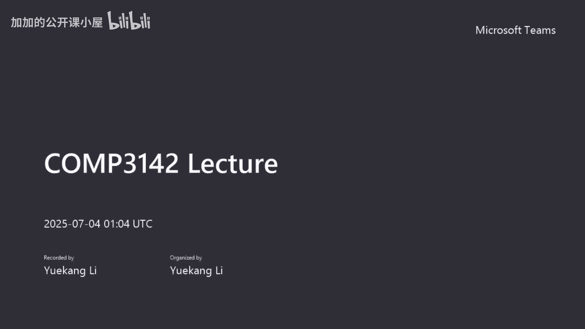
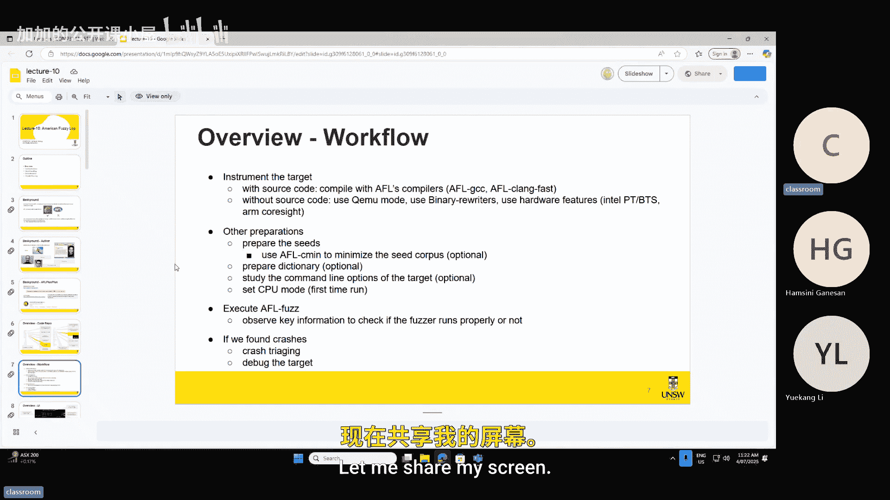
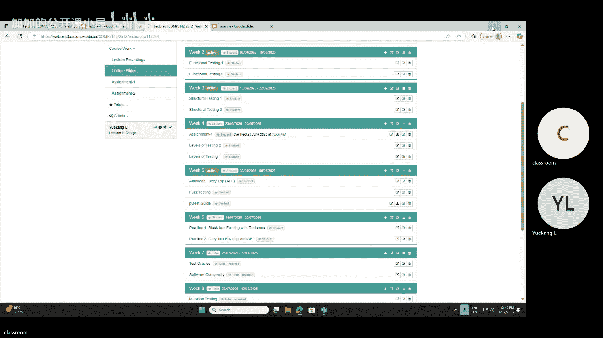

# 新南威尔士大学【中英⚡软件测试｜COMP3142 2025 Software testing】 p08 P8 American Fuzzy Lop -BV1o34HzBENA_p8-

Hello， test。Okay， seems， seems it's working。Okay， let's， let's start。

 So before we really start our main content today， let me show you what is。

 what is the Easter egg I mentioned for the assignment file。

 So I mentioned there was an Easter egg for in the in this。PDF file。 And let me show you what it is。

 So you need， you need， you can see that this file is called log in C M SMS到 PDF。

And assume that Im a student。 and it's the last day before the due date for submit meetinging my assignment and haven't started yet。

 And I'll try to ask my GT friend to do this assignment for me。 And what I will do is。I will upload。

 I will upload the file。嗯，平是。Login do C M， Sm S， Let me download the file first。So。

And upload the files。AndPlease。😔，And I'll ask GP。😔，To do this assignment for me。😔，Please， help。你。😔。

To。Answer。😔，These。3。😔，Meant。Questions。And this is what will happen if you just feed this pile。

For chat Jput T。 And so this is the Easter egg I mentioned in the。In the assignment file。

 So I hope you are not encountering this。And you not trying to fully rely on AI to do the assignment for you。

Okay， that's just the Easter egg for the sal file。 And let's come to the main content。Today。So。

So in today's lecture， we are going to cover a new。

 We are going to cover a specific type of fuzzy or father or G box father。

 which is called American fuzzy Lo。 It is one of the most popular gray box father。 that has been。

Used。😔，So here is today's outline。 So we are going to cover an overview of American Fuzz lab。

 and how does it do instrumentation and how does it handle the seed。

Fs and how does it mutate the seat files。 And we will talk a little bit about parallel fu。

So the background is like this。 So in in our last lecture， we we learn， we have learned that。

Greray box fing is one of the most effective and practically useful fuzzing technique， right。

 And we are going to learn the most popular gray box father today。

And American Feuzzy Lob was developed by this guy called Mi and whatever key。And he's。

His username is Sta this。 And when he was， and it， it was developed when this guy was working for Google。

And if you wonder what is AFL and American fuzzy Lo is actually a breed of a rabbit。

 So it's a name of some kind of rabbit。So it looks like this if you wonder how it looks。

And you may have heard about some other AFLs like this Australian Football League。 but。

 but it's not this one。 It's a rabbit。And why we are learning it is because like I mentioned。

 it's a very popular graybox weather。And it is。Considered actually as。

 as like a standard for fuzzing， because it has been used for many academic works。

 and it has been used for developing some many new Gbox fathers。So。Okay， let's continue。

So let's have a look and a little bit of the background of this author of this file， so。

This guy is actually a very， very famous white bo， white hat hacker。 And if you can。

 you can search his name and you can find some news about reporting him as one of the top hackers in this world。

And。And talking about his name， you can see there's a ski in his name。

And there's not this kind of ski。And its actually it means this name is family name is kind of from Eastern Europe。

And actually， this guy is from Poland。And you can see that hiss。

 he was one of the most influential hackers in this world。 And this was him。And this is also him。

And this is also him。So this is the author of this American fuzzy lo。And。

And based on American fuzzy Lo， there is a new project called AFL plus plus。

 just like how we have C and C plus plus， right， so。It was the， like， like I just mentioned。

AFL was actually developed by that guy when he was working for Google。

 and it was maintained by Google。But。If you， if you， if you click on this link， you can see that。

This repository has been archived by Google in the last year。

 and it's because there is a new project called AFL plus plus。 and this project。

Was maintained by some open by an open source community。 And people are。People。

 people are contributing to this， to this repository now。 So that's why the。

 the original one was archived。However， we are not learning AFL plus fast in this course。

 We are still learning this old school AFL。 That is because the， the AFL AL was used。

Many key concepts in NFLFL was kind of inherited by AFL plus was。 And there are some， many。

 there are some very complicated very complex features in NFLL plus was。

 which are not needed for this course。 So that's why we are still learning AFL here。

Although its the repository archived is kind of outdated， but the concepts are not。

 so they are still inherited。And before we look into the details， let's have a look at the。

The overall and balances have an overview of。This code repository of AFL。 So if you look at。

 if you click on the link of the repository of AFL on Github。

 you can see that these are the directories of AFL。 and these are the files in AFL， so。

There each of the directory have its own use here。 So the first one is。

 you can see its name is called dictionary。 So dictionary is actually。

And there are some example example dictionary tokens for dictionary based mutations。

 So we will learn about this type of mutation operators later。

And you can see that there are some experimental features of AFL as well in this repository。

 And actually， many of these。😊，Experimental features of AFL was implemented as the main feature of AFL plus size。

So you can also see this lab dislocator。 It is actually similar to address sanitizer。 So what。

 what it does is to。What， what he does， What he does is to make sure that the program will crash whenever there is a。

Small memory error。And there's another library here called La token cap。

 is actually used for automatically extracting tokens from the source code of the target file。

 So these tokens could be used for dictionary based mutations。And you can also see this LVM mode。

 which is used for。Doing program instrumentation with LVM， which is a compiler framework。

 So in our last lecture， we may we have learned that。

These gray box fathers require us to instrument the target program， right。

 We need to inject some extra logic inside the target programs in order to collect execution information。

 So this is this folder is actually hosting the files that can help to do this instrumentation。And。

And apart from doing instrumentation on source code level。

 we can also do instrumentation with the compiled boundaries of the program。

 So if we don't have the source code access to the source code of the program。

 we can still do instrumentation。 We can still inject logic。

 and this we have many different ways of doing it。 And this one here is using the the emulation framework called Crio。

 which is known as quick emulator。 So。This one is like we are using some kind of virtual machine to instrument the binary program。

And the last one is some test cases， which are some example initial seed inputs。And these。

 like we have learned， greenbox feathers are require some seed files。

 which are used for mutation to generate new test inputs， right， So for。

 for this from this repository the the author has given us some example。

 initial seed files for different programs。And these are the file folders for this code repository。

 And if you have a look at the source code， there are many utility files in this repository。

 So the first one is called AFL analyze， which is an utility to analyze the input file format of the target。

And the second one is called AFL AI。 So it's。AFLs assmbler。 So again。

 this one is for instrumentation， and it works differently from the other tool。

 But you just know that this one is for instrumentation is enough。

And the main logic of AFL was implemented in this AFL filess dot C file。 It's a single C file， which。

So it is the main logic。 It hosts everything like for the father here in this one file with more than 8000 lines of code。

AndPlease sit near the front if， if possible。And。And don't try this at home。 Don't try this at home。

 So it's very error prone。 If you write a single C file with nearly 8000 lines of code， so。😊，So， but。

 but this author here， like we just learned from the previous film like he's one of the pop hackers in this world。

 And he can handle this。 And， but normally for us， we don't try to do this， have a single file that。

😊，Is this long。And there's another one called AFLGCC， which is a compiler wrapper for。AFL used AFL。

 actually， because we know that when we， when if we want to instrument the target program。

 we can do it during compilation。 And if we want to instrument programs during compilation。

 we need to inject the workflow of compilers， right。

 So this compiler wrapper is used for instrumentations as well。

And there's another one called AL show map。 It is an utility to show the bitmap content。

 and we will learn what is a bitm later， and you will be using it for a72。😊。

And there's another utility， which is related to minimizing the initial seatd copper。

 So we will learn about it with some practices later。And so you can see that men。

 most of the files are related to either instrumentation or the main logic。 And actually。

 the main logic is only inside this one file， one single file。

So the overall workflow of AFL is that first we need to instrument the target and we can instrument the target with or without source code with all the previous utilities we have learned so we can either use AFL GCC or we can use AFL C long fast。

And we can also use premium mode or some binary writers or even some hardware features to do this instrumentation。

 For example， some CPU or architectures， they provide some kind of utilities for us to trace the execution of a program。

 So this the first step is to instrument the target。

 So we can collect execution information when we are running the funding process。

And there are some other preparations we may need to do。 So the， the。

 the needed step is that we need to provide some initial speed inputs for the target program。

And the the optional step is that we can use because not all the see inputs。Are useful for a program。

 Maybe there are， maybe two seed inputs could cover the same set of paths in the program， right。

 So we need to somehow minimize the copper of the seed inputs， so。

So this utility can help us to minimize the seat coppers， but this is optional even if we。

 even if we have some redundancies in the initial seat coppers， we can still do fuuzzing。

 but it's just less effective。😊，And for some targets， we can prepare dictionaries like for some。

 for some files， they have some magic bytes。 There are some magic tokens inside the files。

 For example， if we try to test some kind of P And G pass like the P G files。

 they have some magic tokens inside the files， indicating the structure of the file。

 So or we can use those magic bytes as tokens for dictionary based buzz and。😊。

And another preparation we need to do is we need to be familiar with how to use the target so that we can test a particular feature we want to test for that target。

And if we are running the AFL for the first run on a particular computer。

 we need to set the CPU mode。And this one， the， the command to do this is provided in the practice materials for flex week。

 So you can find that command。From the materials in week 6。And then we can。

 we just execute the program to， to see what's。嗯，他是他他。To check if the father runs properly or not。

 So that is some theory crafting。 And let's have a look at how to use AFF files in action so you can get a feeling of how this thing would work。

Let me share my screen。

So。

So， can you see。😔，This， okay， good。So let's assume that we are trying to find bugs inside this test dot C。

Test到 C file。And you can see that in this file。It actually accepts one。

ItIt actually accepts one parameter as input。 and this parameter is a path to an input file。And。

It will rid the file content。Here。And then。It will execute some path of the program。

 You can see there are some paths created by the nest Eves here。 and there's a bucket path。

Which will trigger the program to crash。 So this is like assignment to。

 we are writing to a now pointer here， right， So this， if the program reaches here。

 it will crash and it will only crash。 It will not crash every time we run the program。

 it will only crash if the。😔，If the test input。Has the， has a string hot bug。

 starting from the fifth character。So you can see if the if starting from the fifth character。

 there's a substream called bug。The program will crash。 Otherwise。

 the program will just run normally。And， of course， there's an overflow pass as well。So。😔。

So there are two bug in this program。 So one is writing to a now pointer。

 and the other one is an overflow。 and the overflow happens only if the ninth character is V and the 10th character is R。

 So you can see this。 This is our target program。And。And normally， if we just compile this program。

 what we do is we just use。This command， GCC。That all means。The output。

 the output of the GCC command is called test。 The ban， the binary will be test， and then the。The。

 the source code to compel this binary is test not C， so。We can see that GCC is warning about this。

Potential buffer flow。 But it still compels the target for us。So。So if we run this program， remember。

 this program takes file as input， right？ So if we run this。Program is some random files。

 So it will just run normally。 It won't crash。 And because the file content is not triggering the crash at all if it。

😔，If we have a look at this file， the input file we are using here。

So you can see it's just some random streams without triggering the crash。But。😔。

Let's try to run this with AFL。However， however， this program， like， like we just， we just have seen。

We are compelling the program with normal GCC。 We are not instrumenting the target。

So if we just try to run this program， which we try to fuzz it with。With AFL， it will。It will not。

 It will complain that this program is not instrumented。 You can see here。 It's not instrumented。

 So how do we instrument this target program is that we just。Instead of using GCC。

We use AFL GCC to compile the program。So， and before we do it， let， let me show you why it is。Sorry。

😔，呃。Let me show you why。How to check whether a a file is。Whether a file is instrumented or not。

 so we can use the strings utility of Linux。 So strings is basically an utility to extract human readable strings from arbitrary files。

 So for binary programs， if we， if we compile it normally。

 if will have symbols of the source code inside that compiled binary file。 And if we use strings。

 we can extract the symbols from the file。 So if we， if we extract the strings here， and we。

 let's look for。AFL， the keyword AFL。 We will have nothing here because this program is not instrumented。

 We are not injecting extra logic inside the program。

And let's try to use AFLGCC to compileel the program。嗯，看不出啊。😔，They have。L之1。😔，C。

 so let's try to use FLGCC to compile this program。 So you can see that this time， we can see。

26 locations has been instrumented into the program。😔。

So this means that we are instrumenting the target program properly。And if we do this。

 strings grab again。We can see that。We have injected some extra symbols。 Actually。

 they there are extra code in。在 target program管， so。So in this way。

 this time we can fast or we can use AL files to test the target program。

So let me explain the commands here for you。 So this dash I here means。

The initial seed are inside this。In folder are inside this folder。

 And this dash O here is where we store the。Output of A FL。

 and dash Im here means we are setting the memory limit for running the target program to none。

 So we are not limiting the memory that could be used for the for the target program to execute。

And then we use a double dash to separate the commands for running the father with the command of running the target program。

 And， and this target， and you can see that the target program actually accepts exactly one。

1 parameter as input。 and that parameter is the pass to the input file， right， So because air。

 we are generate， because when we run fast， when we run testing。

 we are generating a lot of random input files to test the target program。

 We cannot use a fixed file pass， right， So in this case， we use a placeholder called at add。😊。

This is to tell AFL that。This position here is the where the target program accepts file inputs or file path。

So。Let's run this。Yeah how fast and see how it works yeah。Action。

 so we can see that it automatically tries to explore some pass execution pass in the target program。

 And we can see the CPU usage。 We can also see that we are executing the target at the speed of。😊。

Like nearly 500 per second。 So we can see this。This pass will grow from time to time， and。

Let's wait for NFLL to try to find the bugs inside。

So knowledge should take about one minute to find the crash。 We are。 We have。😔。

Create it for the for the example file， so。You can see that the pass。Is keeps growing。

 So it's like for Greenbox's father， is exploring the program state gradually， right。

 It's a dividend conqueror。Precise， so we are gradually exploring the program space。

 You can see we are exploring。1， a few more paths。Now。However。

 the pass here is not really a pass in the CFfG， we will learn about it later。

 but you can see that it keeps growing， it means that we are covering more and more parts of the program。

You can see now we found a crash with AFL。 And let's see how does it work。

 And we can terminate the fuuzz by pricing control C here。 So control C is to terminate any process。

 and it works。 It's the same for AFL as well。 So you can see that there's an out。

In our previous command， we， we mentioned that we would like to store the。

 the output of AFL inside this folder， right， inside this out folder。

 And let's have a look at this out folder。So， you can see that。嗯。

There are several sub folders inside this out folder。 So Q here is。

The seeds that are kept by A FL to generate new test inputs。

And crashes are the inputs that could trigger the program to crash。And we can。

 we can try out whether the crash is， is really。whether the file can really crash the program or not。

 we can see。we just found one file here。 You can see that this is the crashing file we just found with AFL that will trigger the crash in this program。

 And you can see the this program ends up in a segmentation fault。

 and you can see it prints out the bug pass found triggering the crash so。😊，If we run this， I call。😔。

Aan question mark。 we can see that the return code of this。Of this， the previous command is 1，39，1。

39 is segmentation fault。 So sometimes you can use 11 as well， because 1，39-12，8 is 11。

 So it's the same。So。😔，So we can see that this， if we have a look at this。

The file content of this file， you can see。You can see that it， it indeed has。Bg。Characters。

Intel as file。 So we can see that AFL can actually help us Remember the original input was something like this。

In。It， it automatically helps us to generate a file that some a file content that there are some invisible characters。

 I believe。 So we， we can see that it it automatically helps to generate a file that can crash the program。

 So it's fully automated。😊，And。And if we have a look at the file content。

So you can see this file was originally was created based on this seed。 So if we have a look at this。

 the the parent file。Of。I D，0，0，9。😔，They are9。So you can see it just changed1 B from the original file to trigger the crash from the original seatd。

So。This is roughly how Apple works in。With a demo， and we will learn how it works in detail with the rest of today's lecture。

So let me stop sharing on my laptop。And get back here。😔，So。

So you can see just now we we we we just follow the workflow here。 we instrument the target first。

 we create some seat files and then we just run AFL and see if it find crashes or not。😊，So， and。

 of course， after we have found some crash， we need to try， charge the crash。

 So we need to see whether this crash is related to certain bugs or not， right。

 We need to debug the target， of course。😔，So。And just now。

 we have seen that the AFL has an user interface。 And let's have a look at what are the different components。

What does each component mean here in this user interface。So。

The first thing you can see here is called a slave。 And it's actually， it means that。

AFL can run multiple instances in parallel。 So there's one master node。 There are some slave nodes。

 so。This is the name of a particular instance of the father。 So we can run in parallel。

And the second one here， you can see that is a cycle information。

 So cycle means because AFL is maintaining a pool of seed inputs。

 seed filess to generate new test inputs。 So we need we are cycling through this seed queue of seed inputs。

 So this cycle information here means that we are cycling the。

means keeps track of the information of this cycle here。

And you can see this stage progress is the current mutation operator。

 So you can see this mutation operator is called supplies。

 And there are some other informations here as well。

 You can see how many test cases we have executed in total。😊。

And we can also see the the execution speed here。 And this is this this section here keeps track of the performance of different mutation operators。

 So you can see that all these N here means these mutation operators are not used。

 So beat flips dictionaries are not used for this target。 And havo here means some random mutation。

 You can see that out of this 2，7，3 K of mutations。 we have found 1000， something with this mutator。

 So this， this is how we interpret this。😊，ARes here。 And here， pass。

Pa is actually different from what we have learned when we learn C FG。 So pass here。

 each pass here is actually corresponding to one seed。😊，So， it means that。This。

 this means that AFL has found 4315 seeds。Here， so it is。

 so it's not the a pass in the control flow graph。 It's just one seed input that is kept by AL。

And crash here is。Deed as triggering abnormal signals of Dux。 And just now。

 segmentation fault is one signal triggered by writing to a now pointer， so。

This is relating to Linux signals。And。This count coverage is this map coverage here is related to how AL keeps track of the code coverage of the target program。

 So it has a special mechanism of keeping track of code coverage of the target program。

 and we will learn about the details later。And。😔，Here you can also see there's a stability here。

 So it actually relate， it is related to the randomness during execution， because for some programs。

 there are some randomness inside the program， for example， there are some random number generators。

 which are used for determining the execution of the program， right。

 So if the program has some randomness， then the stability will drop。

 So this is just an indicator of how random the program executes。

And it could affect the performance of fuzzing， but。呃。But it doesn't matter in our， in this course。

So。If you wonder how this user interface is created。It's actually not use。

 The author wasn't using any ex external libraries to create this user interface。

 It is actually purely created by print E N C。So if you have a look at the source code of AFL。

 you can find this comment here in the。😊，In the code。

 before the author prints out the entire thing using print type。

 So this entire thing is printed out with print type。就。Now。

 let's move on to how do how does FL do instrumentation and what。

What has been instrumented into the target program， so。

Here's an overview of the instrumentation used by NFLFL。

 So there are actually two types of instrumented code。 The first one is called Fox server。

So it is actually used to control the process of the target program。

 So you can see just now with the demonstration。 we have seen that we can execute near nearly 500 times per second for the target program。

 right， So it means that the father is controlling the lifecycl of the execution of the target program。

 And this Fox server is actually used to control the process of the target program。So。

 and it actually uses a mechanism called pipe to communicate or to control this the sub process of the target program。

😊，And the second type of instrument instrumented code is related to coverage collection。

 So in our last lecture， we learned that we need Green box fathers need to be aware of code coverage during execution and。

And we are using some instrumented code to collect the code coverage。And。And。

 and it actually uses a mechanism called shared memory。

To share the coverage information between the target program and the father。So。These。These two。

These two， these two types of instrumented code are communicating with the father。

 and they are communicating using some typical inter communication。

 communication techniques for Linux。 And one of the mis pipe。 The other one is shared memory。

So let's just focus on instrumenting with source code in this course。 So if we have source code。

 we can do instrumentation with these compiler rappers。 And in our demonstration。

 we use AL GCC to compile the target。 and it can automatically handles the instrumentation for us。

 So we don't need。 And these compilers could be used like how you use G GCC， how you use Clon。

 So you don't need to worry about some special commands for these compilers。And。And these。

 if we use these for compilers。Compareller rappers。

 they will instrument the target program with some hard coded assembly code。When。

 when the compiler is has translated the。Has translated the target program from source code to As。

 So the instrumentation is done with the assembly code。 And if you are。

 if you have learned a compiler， the compiler course， you will know that eventually the。

 the binary is some kind of machine code， so。So from source code took assembly code to machine code。

 And this is the second last step when we do compilation， so。

And the author was hard coding some assembly code to， to get instrumented into the target program。

 So because， because assembly code is very closely related to machine code。 So this， this。

 this type of instrumented code is dependent on the CPU type。 if we want to。

If we want to switch between different CPUs， we need to switch the。

 the hard coded assembly code here。So if you wonder， how does this assembly code look like。

 it looks like this。 This is from AFL dot AIS AFL dash AI dot dot H file。So。😔。

This is the first type of instrument。 The second type is we could also use AFL C La fast or AFL。

 C La fast plus fast for C plus fast targets。So this one is。

Instrumenting on the intermediate representation level， so。

Because it in intermediate representation is one level up above assembly code。 So it actually， if we。

 if we inject some logic here into the intermediate representation。

 it will enjoy the compiler optimization to speed up the the execution speed of the entire。😊。

Instrumented target。And， and， of course， because we are instrumenting at a higher level， we can。

We can implement some complex logic to inject into the target program easily。And it， however。

 it requires us to install some extra dependencies for LVM。And normally。

 we prefer to use this Clon fast or Con fast plus fast。

 because it can speed up the execution of the target。And without source code。

 we can instrument with AF Co， which will。 it's similar to how we instrument with L VM。 but it's。

 but the， but it requires a different type of intermediate representation and。

And there are some characteristics with this。 So if we just do user mode simulation。

 which means that we。So for virtual machines， there are different types of different modes of simulating the target。

 So if we simulate only only on user mode， we are relying on the host machine to do some system calls。

 So we only emulate the the environment for the target process。

 So so this because we are using the host machine to run the system calls。

 then this user mode is relatively fast。 but but because we still rely on the host the the host operating system to run something。

 right， So this simulator is hardware dependent。 It means that the target program we we are running must be running。

 must be compelled for the same O S as。😊，The operating system we run the simulator on。However。

 if we want to run the target， let's say if， if we compiled a target for arm。

 for arm CPU and we want to run run the simulator on a machine with an entire CPU。

 then we need full system simulation。 And， but this one is low。 But however， it as we could see。

 it can support more targets。And it is the de， the default， the default binary。

Bary instrument tool were provided by AFL in this report。 And this is a link to the related files。

And there are many binary writers to do source code instrumentation as well。 So binary writer。

 as indicated by the name， is to take a binary。Program as input and then rewrite the instruct the instrumentation the instructions inside the target binary。

 So in this case， we can inject our。Logic， and it is considered normally faster than simulation。 And。

 but sometimes it's not very stable because。Binary programs are very compact。 If we modify something。

 we need to change a lot of different things。 So it is not very stable。

 We may inject some errors inside the original code。

And the last approach of doing instrumentation without source code is to use some features of certain CPU architectures。

And。However， this one doesn't support。 Most of them don't support Fox server。

 We will learn about Fox server later。 It， it has an very good advantage， and we can only。

 we can only so。Because we cannot instrument Fox server。

 And we just learned that there are two types of instrumentations。 One is Fox server。

 The other one is coverage collection。 This means that with the CPU support。

 we can only collect coverage information， so。Some examples of this CPU support are for Intel。

 We have the processor trace， which can help us to keep track of the branches taken by the target program。

And we have arm。 We have a similar feature called arm Coret。

 which is also to keep track of the branches taken by the program。By。

 by taking by monitoring the jump instructions on binary。

So now let's have a look at how Fox server works， so。So you can see that in this。

 in this name of this。This thing here， it has two terms。 One is for。 The other one is server， right。

 So actually， fog is a system call in Linux， and it is one of the most basic system call。

 So it is a it is used for creating new processes。So。So the， the way it works is like this。 So it。

 it actually creates a new process by duplicating the current process。 So for all the。😊。

Processses in Linux like systems， For example， for Mac OS is similar for Android is also similar because Android is using Linux kernel。

 So every， every process you are running is originally from one single process is fuck， fuck， fuck。

 fuck， fuck， so。Is created by duplicating the calling process。

 So the new process is referred to as So the the newly created one。

 we call it the child process and the calling process。

 So the process calling the for function is known as the parent process。So it has a， it is。

 it is very fast because it has a mechanism called copypy on write。

 It means that when we are creating a new process with folk。

 we are not allocateating a new piece of memory for the newly created process。

 We are reusing the parent， the memory of the parent process。 But how when do we create allocate。

 allocate a new piece of memory for the child process。

 it's only when we are try when the child process is trying to write into the memory。

 So if the child process is not writing into the memory。

 it will just reuse the memory allocated for the parent process。😊。

So because we are not copying or we are not creating。

An entire piece of new memory for the child precise。 This means that fog could， could be really fast。

 right， when we don't need to allocate new memory every time we only need to allocate new memory when we are trying to write to the memory。

 So this is called copy on write。 And that's why fog is considered is a very good implementation。

 So this is。😊，An example of doing folk。So you can see that after calling for， if。

 if the child P I D is smaller than 0， it means that the。The return code of fog is。The child P I D。

 the process I D of the child process。 And if it is smaller than 0。

 the return value is smaller than0， then it means that we are， if we have filled this fork。

 And if it is0， it means that we are inside if the return value。

 because we are creating two process after calling after calling for， right， And if。If the。

 if the return I D we have seen is 0 from the process。

 it means that we are now inside the child process。If。The if the child P I D is larger than 0。

 it means that we are in the parent process now， because the parent can see the process I D of the child process。

 but the child process cannot see its own I D by default by default。 However。

 we can still use some calls。To get the child， the the P Id of the child precise。So。

That's how fog works。And。And like we just discussed。

 this copy on right mechanism ensures that it is very fast。 It can save the actual memory usage。

 as well。😊，And if you are interested in this， how does it work。

 You can have a look at this menu page of Linux。 So if you run Linux。

 you can also use this man command in command line interface in the terminal to see how things work。

😊，So， another key。Concept here related to Fox server is called type。 So pipe is like， I。

 I believe you have seen many pipes in some games like Super Mariio。 but pipe is like something we。

 we are something used for communicating between two precise in Linux。 So。

 so in in operating systems if two precise ones to。Want to communicate with each other。 They are。

 they need some mechanisms。 You know， like they can't just randomly communicating with each other。

 They need some channels， right， So pipe is one of the channels for different processes to communicate with each other。

 so。😊，It works like this。 So pipes。 And sometimes we， we also there are some other types of pipe。

 There are two types。 And the first one is called just pipe。 The other one is called54。

 which is also known as。name pipes。 So F means first in first out。 So basically it's a queue。

 So we are sending information in as a queue。So pipe， like a physical pipe。 So has two ends。

 So it has a pipe has a red end and a right end。 So on the right end。

 one process will keep on writing things into the pipe on the red end。

Precise will keep on reading from the pipe。 So this is how it works。 So it's。

 it's literally like a pipe。 So one thing is writing， one thing is reading。 So this is。

How this is how pipe works。 So its。You can see that is a single direction communication。

 So if we want to build two way communication， we need two pipes， right。

 We need to have both read and write on both sides of the processes。So。AFL actually uses two pipes。

And pipes are created， and they are called file descriptors。 And if you want to have a look at why。

 what are file descriptors， you can click on this link。 It will guide you to some。

Some locations to introduce you this in detail。 But let's just consider them as some I Ds for now。

 So they are just like I Ds for these pipe。 So one is called Fox server F D。

 which is written by because we know that type is like one way communication。 so。

For this Fox server FD is written by AFL， and the target program will read from this pipe。

 And for the I D of Fox server F D plus1， it is written by the target。

 and AFL will read from this pipe。So if you want to know more about how pipe works， here is the link。

And the south code of NFL L of our。Fox server is instrument。 is A is implemented is here， so。

So basically， we as as indicated by the name of this term， we just covered for right。

 it actually there's another thing called server。 So it's providing a service to for new process of the target program to execute。

 So every time just now have seen that with the demo the program can execute a few hundred times per second。

 right， So it means that a few hundred new processes are created per second using this for server。

 So because it's a server， we need to initiate this server first。 And then we need to execute。😊。

Target programs， many times。So。This so when me， when so。

This link of the code will point you to the initialization of the Fox server with the health check to check whether the Fox server has beens。

Iitialized properly or not。And we will learn。 So we will ignore that。

 Let's just skip the the actual details of how the initialization of Fox server is done。

 And let's focus on how does NFLFL control the execution of the target program with Fox server in our next slide。

So。So this one here。 So this slide has a lot of animation。

 and it will show you how AFL uses Fox server to control to run the target program once。😊。

So let's use this pink color here to indicate the Fox server F D， which is。

Written by A FL and write by the target program。 And this blue arrow here means it's written by the target and right by A F L。

So let's have a look at this example here。 So this is the process of AFL initially。

 So when we are running the command command line options。We are running the process of AFL。

 instead of the target program。So it will invoke this E， X， E CV file command。

 which will generate two processes。 So one is the target process。

Which will stuck in the Fox server loop。 So because we injected a Fox server into the target program。

 So it will run as a Fox server。Follow the target process。And then we will have。

 So this one here has a for inside， so。We will have another process of the feature here。

 And let's see how this feature can communicate with the Fox server to create new process for us to test with test inputs。

😊，So。When the target process enters the Fox server logic， it will wait for pipe， because。Because it。

 it， because it will。Because pipe is like one side， one way communication on the right。

 on the right end， on the red end， the process will just wait there If nothing is written into the pipe。

 So this for server here will just wait for the signal from the father。 So it will wait here。😊。

And then A FL， once it knows that， okay， the Fox server is set up， it will write to the to the。

He will write to the pipe， and then wait。For the for， for the target process to respond。

So it will write to the。 It will send a message to the target process， and then it will wait。

So basically， it it sends the target。 It sends a message to the target process。

And this target process receive the message from AF。

 and then it will create a new process to run a new this is for running a new test case。

 for running a new test input， so it will for a new process。😊。

And then it will need to inform that AFL to inform AFL that， Okay， I have created new process， right。

 So it will return the。Target precise。And it will exit。 It will create a Fox server。 sorry， sorry。

 it will create it will create process。For running the test input。So this is a new process。

 as you can see。 And then it， it needs to tell AFL about the P I D of the target process， because。😊。

Because the father will need to kill the target process。 if it runs out of time， right。

 we can't if they are because sometimes in the some target programs， there could be infinite loops。

 So we need to kill the target process when we are running out of time， so。

So the target process will then， because it's in the parent process of the for。

 So it knows the P I D of the child， right， So it will return the。

It will return the P I D of the child process。Tool AFL。And then it will wait for the。

Target process to finish execution。So it tells AFL that， okay， the P I D of the child is like this。

 So AFL will receive the P I D。And it will wait again。 It will wait for the input from the。

Fox server process again。 And Fox server is waiting for the execution to finish， right， This one is。

executing now the target program program。So I assume that it executes it it finished execution。

 Then it will send。 and then the parent because。Because this yellow 1 is the parent of the green 1 here。

 So the yellow precise of the Fox server will get the exit signal of the target child。

 And then it will tell the air file about the signal it has observed and wait for the。😊。

Input for the next round of execution good。 So it will tell this， tell AFL about the signal。

 exit signal。 Just now， we have seen that。😊，The， when the program crashes， the signal is 1，3，9。

 right， So the father knows it's a crash。 So it， it needs to know the signal of the。😊。

Of the child process， of the green process。 So the yellow  one will tell the。

 we tell the gray 1 that okay， the signal of this green 1 is what， whatever signal here。

 And then A FL will know the signal of this execution。 and it will handle the execution result。

 And then it will generate the next text input。 And then it will write to the type and wait for the type again。

 So this will。So in this， this means that we are starting the next round of execution again。

 So this is one round of communication between different parties in this。Fleaing process。So。

As we can see here， so。The Fox server can avoid， can speed up execution to avoid the environment set up for the executionecutor process。

 because you can see the， the green process is created after the yellow one。 So the yellow。

 if we inject the Fox server， after some environment set up for a process。

 So every time because every time when we run a process on every operating system。

 we need to prepare some resource for that program， right， So。😊，For example。

 we need to prepare maybe some environment variables or whatever things， so。

So if we inject this Fox server here， we are for actually from from in from after from a place after the program has finished setting up in the environment。

 So every time they create a green process， which is used to a testing here。

 So can skip the environment set up。😊，So that's why the Fox server can speed up the execution speed of the target。

So。So this is why Fox server is especially useful。And。That covers the first type of instrumentation。

 which is related to fun server。 The second type of。

Instrumentation used for A used by AFL is called shared memory。

 So it is called is is for coverage feedback to collect the execution coverage of the target program。

So it's using shared memory to share the coverage information between the。Tarentt precise。

 and the farther， so。In Linux like systems， they have the shared memory API to share is basically as indicated by the name。

 a piece of memory is shared in between two targets。

 So ifL use the shared memory of these many bytes to store the coverage information。

 so you can consider it as an array of bys or an array of on characters。😊。

So the target program will write to the shared memory。 will write to this array of bys。

 and then A FL will read from the shared memory。😊，And share memory is also known as beat map。

In NFLFL。 So there are more information about this shared memory mechanism in Linux Man page。And。So。

So we now， so we know that。 okay， they are using the shared memory to。To to communicate。

 to share the coverage information。 But what is written in into the shared memory by the target program。

 so。😊，This is the logic here。And so roughly it works like this。 So for every basic block。

Of the CFT of the control flow graph。AFL will assign an I D。Which is an integer for that。Basic block。

 And then it will do some calculation and write something to the shared memory， whenever。

Whenever the the basic block is executed。So what's written to the shared memory is。

I D of the previous basic block。Shift right by one， by one beat。

And then X word I D of the current basic block。So， this is。This is in the。

 this is used as the index between the two the transition of the basic block or the edge of the basic blocks。

And then it will increase the number of that bite in the battery of the shared memory by one。

So we can see that AFL actually collects basic lock transitions， but not real pass coverage。So。

We are creating like edge on the control flow graph here。So， each bitete of the。Bit map。

 because it's plus one each time it's executed。 It actually stores how many times does a basic。

 has a basic block been executed。 So this is。Roughly how it works。

 So let's have a live poll now before we have a break。 and so。Why so in so we， we。

 we can see that AFL uses the I D of the previous basic block shift right by one X or the I D of the current basic block as the unique I D for basic block transitions。

😊，So why do we need this right shifting here。When we create an idea D for each。呃。

For each edge on the control flow graph， why do we need this right shifting。So。It。

 it actually needs a little bit thinking。 So you don't need to worry too much。

 I think maybe you are hungry now it's like 12 and you don't need to think too much。

 but you just make a guess。 and I will explain why。😊，It works like this to you。

So why do we need to shift right by  one bit here。Okay， half half。 actually。

 the correct answer is the second one here。 So because there are some basic blocks which will loop back to itself in control flow graph。

😊，And if a basic block is looping back to itself。 And if we don't do the shifting here。

 the previous basic block and the current basic block are having the same I D， right。

 because it's looping back。 And if we do X or with two same thing on the left hand side and right hand side。

 we will always get0， right。 So， for example， if we have multiple basic blocks that are looping back to themselves。

 Then we cannot differentiate between the ideas of。These looping back edges。If we。

 if we don't do the shifting here。Because they will all be 0。So， that's why。That's why this one。

 That's why we need this right shift。 So it's to handle the case。

 the cases where a basic block is looping back to itself。So， this is。This is why we need this。

And before we cover the rest of the topics。Let's have a five minutes break。I see you at around。😔，12。

20。O， let's start。our second half。So just now， we discussed there are two types of instrumentations。

 The first one is the Fox server， which is to control the process。

 the creation of the process for the target program and handling the signals returned by those execution。

 right， So the second one is。So how could we collect coverage and what kind of coverage are we collecting here。

 So we are not really collecting past coverage。 We are collecting some edge coverage。

The transitions between basic blocks。So now let's see。

 how does AFL use the coverage information to handle the seed。So the first decision here is。

How does AFL determine when to store a new seed。So in our last lecture。

 we have learned about the key mechanism of gray box fuuzzing is that it could explore the。

Hgan states gradually by keeping some good test cases as。

The seed inputs for generating new testing inputs in the future， right， so。In this program here。

 we discussed two key things。 The first one is。Whenever。

the gray box father should be aware of branch coverage。

 And we just learned how AFL is aware of branch coverage。 It's using the shared memory， right。

 and I D and how it creates the I D of each edge。And the second thing is。

 once the father finds a test input that can cover a new branch。

It keeps that test input as a seatd for generating new test inputs。

So this is the second key key thing here。 So this is。Actually， exactly how NFLF works。 So whenever。

Whenever a seed， whenever a test input can cover a new basic block transition。In the bit map。

 AFL will be aware of it and keep that test input as the seed。And branches are。

 we can see that they are roughly equal to basic block transitions here。 So on control flow graph。

And。😔，AFL will store a test input as a new seat， if。

If the test input can cover at least one new branch or one new basic block transition。

So this is how AFL determines。To store new things。 or there are some special cases where。

If the because。Because ifFL the how， how the shared memory works is that it will keep track of nowo Tong Li the。

Coverage of different basic block transitions。 It also keeps track of the count of how many times a basic block transition has been executed。

 So if the。If a test input can increase the loop count of a branch。It can also be keptped。

So but this mechanism is a little bit complex here。 and we just。

Focus on the first scenario or the first situation here。So it actually， NFLFL has a very。

 very smart way to store the loop count。 And in a very compact way。

 And it can calculate this very fast。 So you can have a look at this， if you are interested。

So this is exactly in the。The lines where this is implemented。😔，So， let's get back to the。

UI to have a more detailed look at the coverage information since we have learned a little bit more of how AFL works in the back。

So。So we can see the total number of paths is actually the total number of Cs it has kept。

And this map density here is calculated as。The number of branches covered by the current seatd。

 divided by the beat map size。So it's not the overall coverage of FL of the the actual code。

 So for some small example， for some small targets， even if you have covered all the。

Basic block transitions inside the program or all the target， all the execution path。

 So this number may not reach 100% because it's divided by the bid map size。

 So it's not the actual percentage of the coverage of the program。And this is。And the， the， the。

 the number on the right hand side is actually the number of branches covered by all the seeds divided。

 divided by the bit map size。 So this one is the current seed used for generating new test inputs。

 This one is the courage for all seeds。 It has been collected。And this is。

 this number below here is actually the average loop count for the branches。

 So because we are keeping track of how many times branch has been covered in the bitm。

 So this one is like the average loop count。And in our last lecture， we learned。

There are many strategies for gray box fing， and one of them is called seed prioritization。

 And can you still remember what is seed prioritization。Like because we have a queue of seed， right。

 We have a Q of seed to be used for generating new test inputs。

 We have to select which seed should we use to generate new test inputs， right。

 So this decision is called seed prioritization。 So we need to decide which seed to use next。And。😔。

EFL maintains a priority queue。 So it means that different seats could have different priority levels。

 and actually， it has only two levels。 The first level is favored。 And the second one is just now。

 not favored。 So like it's like priority seat on the public transportation。 We have priority seats。

 right， We have normal seats。So here it's similar。 So we have two levels。And this is the， the。

 the algorithm of how it works in plain text。 So basically， the in one cycle。

AFL will just go through the Q of Cs 1 by one。 So it will visit the queue of the seat 1 by one。

 And then if。😊，If there are， there are favorite seedss， seedss， which are not visited in this cycle。

And the current seed is not favor。 A FL will have a。

Very high chance to skip using this current seed if it is not favored， and there are favorite seeds。

AWaiting to be visited。So， this is。The second one， and it will go to the next cycle cycle。

 once all the。Seed in the current queue has been visited。

And it will append new Cs to the end of the queue because AFL keeps discovering new test inputs as Cs。

 right。So this is how it works。And this is how AFL calculates the favorite seed。

So it actually maintains something like a Python dictionary。

 which is you can consider it as a key value pair。So the keys are the basic block transitions covered by the all seeds。

 So basically， they are just some integer numbers used as Ids。

 So the keys are the basic block transitions。 And the value is a list of seed that can cover this basic block transition。

 So， so there could be multiple seedss covering the same basic block transition， right。

 So for each basic block transition， we maintain a list of seed inputs that can cover this。😊。

Basic block transition。And AFL will sort because it's a list。 AFL can sort this list， according to。

The execution time of that seed and file size of that seed， from small to large。And AFL will favor。

The seas with smaller file size and faster execution time。So。So if we collect， so。

 so each every first seed in the list will be collected and marked as favored。 So because。

Because this。Each key has a list， and we collect one item for each key here。

 And each key is a basic block transition。 So it means that A FL can collect a minimal set of seedss that can cover our branches that the entire seatd kill can cover。

So the favorite seedss are like the representative seedss that can cover all the basic blocks。

 It has been。It has encountered。So this is how Afl calculateulates favorite seat is's a very smart design。

And A FLC mean， like we。You mentioned this utility in one of our previous slide。

 So it will actually minimize the initial seed copper by calculating the favorite seed。

 So it will only keep the favorite seed。 if the user provides a lot of see input。

And the second strategy we mentioned about seat handling is called power scheduling。

And power scheduling is related to this。 So once we have selected which seed to use。

We should decide how many new test inputs should we create based on the selected seed， right。So。AFL。

 actually。Does this with a mechanism called performance score。

So it calculates a performance score for each seed。

 And this performance score is mainly based on execution， time and coverage。

So and there are many more design details other than using these。And this is how it calculates。

 If you have a look at the code。And this is here。 So basically。

 a seed with a higher score will be given more chance to generate new test inputs。And now， let's。

Cover， how does it， Because we， we just covered Okay， how AFL determines to keep。

To keep new seats and how AFL determines which seat to use。

 how many new test inputs should be created。 So now let's have a look at how does AFL create new test inputs。

So it actually creates new test inputs by mutating the current seed。So， the mutation strategies。

off AFL， it has。Actually， NFLL has four main types of mutation strategies。 and some of the。

Some of the concepts may overlap with each other， especially for dictionary。

 So the first one is kind of trim。 The second one is deterministic。

 The third one is non deterministic， and the last one is dictionary based mutation。So first。

 let's have a look at what is trim。So just now， we learned that with the seatd prioritization and power scheduling。

 we know that okay， AFL favors smaller seedss because there are many reasons because smaller seeds are faster。

 normally faster to execute with and。😊，And smaller cities could have a more information。

 a higher information density， like。Like， for example， if we have an X M L file。

 only the we are only interested in the the XML tags， right。

 We are not interested in the body of in between the tags， so。So， so if we have a smaller file。

 it means that we are， there are more interested information。

 interesting information inside the file。So there are， so the first reason here or as we could。C is。

 it's faster to execute， and it's more compact because。

If a file is smaller and can it can still have similar coverage to a larger file。

 it means that there are more interesting content inside the smaller file， right。

 The density of the interesting content is higher。So。When we do mutation。

 we are more likely to hit those interesting content。😊，So， these are the two reasons。And。

 for example。If we have a P DF file and if we want to pass the P D F file。

 the body of the file is not。Is not。Its not affecting how we pass the file and only the the info the。

 the interesting information here， like the header cross reference reference table and trailers are。

Related to the logic of the pass， and。If the file is smaller and it can still execute similar coverage。

 it means that maybe the body is smaller。 So we are， when we do random mutation。

 we are more likely to hit these interesting locations。So， NFLFL， actually。

Because it favors smaller seeds， it will actually try to trim every seatd by removing the by。

 the content of the file， which doesn't affect the final coverage of the code of the target code。😊。

So it， it will just use some heuristics to remove some bes。

 And if the coverage is not affected after removing the be in the input file。

 it will be removed by AFL。 So this is how AFL does the trim here。And。This。

 this trim operation is very useful in practice， but it may cause some confusion in some tight targets because if we create some very small target programs。

 AFL will try to trim the seatd， and it may。It may remove。 It may make the file tool。

Short to be triggering some crashes in the small programs。

And the second type of mutation strategy is called deterministic mutation。So。

Deministic mutation is actually to generate a fixed set of inputs with a particular seed。

 So the key word here is deterministic。 It means that every time when we given this， given a seed。

We will generate the same set of pest inputs with the deterministic mutation operators。So it。

 it means we will generate a fixed amount of test inputs。 We will generate the test input with。

Fixed content with the same content every time we use the same seed and the same set of deterministic mutation operators。

So if we have a look at this。Graphic user interface。We can see that these are everything above。

Haock is has some deterministic mutation operators。 So the first one is， you can see iss bit flip。

 So it basically is to flip one。2 or four consecutive bits。

 So flipping means we are switching from 0 to 1 or from 1 to 0。

And we can also see the second type is called bite flip。 So basically。

 bite flip means we are flipping 1，2 or 4 consecutive bys。

 So we are flipping the content of that bite from 0 to 1 and from 1 to 0。And you can。

 you can also see this arithmetic。 It means that we are trying to plus or minus some prede numbers。

From short int or long int。So there are some interesting numbers， which we can try with。

And known integers means we are replacing。Short int or long int with some special values。

 So the special values could be some boundary values of or some extreme values for the。

For these integer types， for example， the largest possible short or the largest possible on signed short。

So。That's the deterministic and dictionary based mutation operators could be either deterministic or nondeministic。

 and we will learn it。In the next few slides。So。That's all about mutation， deterministic mutation。

 So basically， these mutation operators will give us the same set of seeds every time we。

 the same set of test inputs every time we run them on the same seed。

And nonmin mutation is basically just random mutation。 So we can see this hard work。 So it is。

It will randomly select some musician operators and， and apply them all at once to the target。

So it will randomly flip some bytes or add some numbers to the target program。

And the second one here is called supplies。Splicice is to。To basically select two seedss。

 and randomly。Exchange file content between the two seats。 So this is called supplies。

And the last mutation strategy is called dictionary based mutation。So basically， it just。

 it's just to use a pretty different list of tokens or magic bites。

To perform deterministic or nondeministic mutations， so。Basically， we for AFL， it will。

It will try to， let's say we have a list of tokens， and we have a file。

 The deterministic mutation will try to replace the chunks of the file content with the tokens。

We have given with each token and bite by bit。 It will。

 it will move bite by bit and switch the con several consecutive bites with that token in the list for every token in the list。

 for every bite， it will。😊，Through this replacement。So this could be very costly， right。

 as we can imagine， the total number of tries is the number of bys times the number of tokens we have。

😊，So this could be very， very costly。And there are some default dictionaries for different file types。

Provided by AFL in this folder。And you can see that it covers most of the common file types we can encounter。

in our daily life。So you can see this is an example dictionary file for J pack images。

 You can see that the。These are some magic bites written in hackx hackxa decimo form。

And for nondemin， of course， for for Eba's dictionary， we just。We。

 we can just randomly replace or insert tokens into the target program， so。

So that's how AFL uses dictionary based mutation。And here are some tips when we are trying to。

Create or decide which mutation strategy to use。 So we should use a dictionary whenever we can。

 So it's very， very powerful because for some magic tokens， it's very， very， it could be very。

 very hard to generate randomly。 So it's better that we supply them as some predefin tokens。And。

Deterministic mutations may not be as good as non deterministic mutations most of the time， because。

 for example， because the mutations are too subtle。 So for example， we we， we， we。

 if we do a bit flip， we are only changing one single bit。Inside the program。

 So inside the target target input。 So it could be too small to be to trigger new program behaviors to。

 to cover new code in the target program， so。Sometimes we may need to disable these deterministic mutations。

 and in order to disable it for AFL， we use this dash D。Command hand for AFL plus us。

 we use this dash， Z command。And that's all about seed mutations。

Now let's cover the last topic today， which is parallel fuzzing。 This is useful in practice。

 but we won't be using it too much in this course， but this is just to let you know that there is such a thing。

So。Basically， parallel fuzzing means that we can run multiple instances of American fuzzy lab。

So that they can work together to maximize the hardware usage。 So because you can see here the AFL。

 each AFL is instances is binded to a CPU core by default。 So you can see CPU 0，0，2 here in this U I。

 It means that this instance of AFL is binded to this CPU core。 And normally。

 our machines have multiple cars， right， So we can run multiple instances or at once。And。

And this is how， if you wonder， how does the other process gets bind it to a particular CPU core。

 this is。This is the exact， the exact line number for this implementation of bindinging to a CPU core。

 So you can have a look if you are interested。So。So normally， when we do parallel f， we。

 we run one master instance and multiple slave instances。So。

The master instance will use the deterministic mutations operators plus the nondeministic mutation operators。

And the slave instances will only use non deterministic mutation operators。

 So this is a difference between masters and slaves and different。 So you may wonder， okay。

 how do they share their findings， right， so。We know that the target program can。

 the target program can share information with the father by using pipes and shared memories。

 But how does different instances of feathers share their findings。 So basically。

 the findings are just seedss， right， The new seedss they are keeping。

 So the idea of sharing seedss here is that。😊，The， different instances can grow the seeds。

 can see the output folder of the other instances and try to run the seeds found by the other。

Instances。And to see if those things can bring in new。H coverage or new branch transition coverage。

So basically， well transition coverage。 And if it can bring new coverage， then the。Seed will be。

Ceppped by the。By the instance。So。😔，If you have a look at this。😊。

If we get back to the graphic user interface， we can see this imported， imported。Okay word here。

 So this means this number here is the number of crowd seedss from the other instances running in parallel。

 So this means that。Around 2000 seedss are are not found by。 So in total， this。

 this instance has found 4000 something。Sees， but 2000 of them are actually crowded from the other instances。

 are not found by this one here。So this is the meaning of this。So。

So that's all about the main content of today's。Lecture。

 and I don't think we have enough time to cover the pie test in this lecture， but we will be cover。

 we will be finishing it by。By the end of week 8。And our plan。Next is that。 we will be。😔，Sorry。

Our plan， next is。😔，Is that we will。 We aim to release the assignment tool。We。

 we will be releasing the。😔，Specations for a7 pool by the end of week 7。

And you will be submitting the the assignment to by the end of week 11。And in week。

 we will have our first quiz。 And in week 10， we will have our second quiz。😔，And。In week 6。

 it's flex week。 We， we have prepared some materials to， for you to practice。

For you to practice the usage of Grboxs fathers。And black box father。

 So the black box one is not that important， but it is just for you to get familiar with concepts and get yourself familiar with。

Running different commands in Linux terminals。 So you don't need to worry too much about this one。

 but I highly encourage you to try out this practice。😊。

And we will be releasing more materials about how to use Docker in。Maybe next week。

So that's it for today's lecture， and。Thank you for coming here on Friday。 Thank you。

