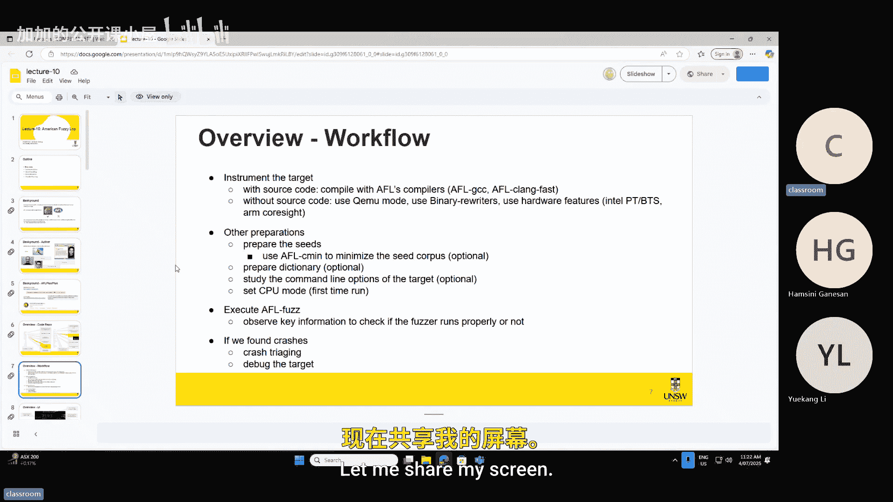
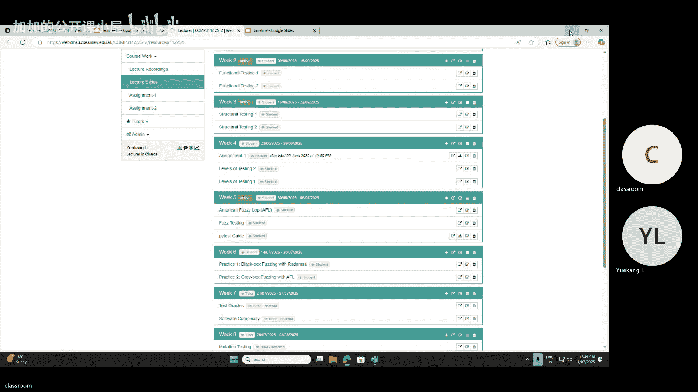

# 软件测试：P8：American Fuzzy Lop (AFL) 🐰


在本节课中，我们将学习一种非常流行且实用的灰盒模糊测试工具——American Fuzzy Lop (AFL)。我们将了解它的工作原理，包括如何对目标程序进行插桩、如何处理种子文件、如何进行变异，以及如何进行并行模糊测试。

---

## 概述

AFL 是一种高效的灰盒模糊测试工具，它通过插桩目标程序来收集代码覆盖率信息，并利用这些信息智能地生成新的测试用例，以探索更多的程序状态。它被认为是模糊测试领域的一个标准工具。

---

## AFL 的背景与作者

在上一讲中，我们学习了灰盒模糊测试是一种非常有效且实用的技术。今天，我们将学习其中最流行的一种工具。

AFL 由一位名叫 Michał Zalewski 的安全研究员开发，他的用户名是 `lcamtuf`。他在 Google 工作期间开发了 AFL。有趣的是，“American Fuzzy Lop” 实际上是一种兔子的品种。

我们学习 AFL 是因为它非常流行，并且被许多学术研究和新的灰盒模糊测试工具作为基础或参考标准。

AFL 的作者是一位著名的白帽黑客。基于原始的 AFL，现在有一个名为 `AFL++` 的新项目，由开源社区维护。虽然原始的 AFL 仓库已被归档，但其核心概念被 `AFL++` 继承。本课程中，我们仍将学习原始的 AFL，因为其核心概念足够清晰，且 `AFL++` 的许多复杂特性超出了本课程的范围。

---

## AFL 代码仓库概览

让我们先了解一下 AFL 代码仓库的结构。在 GitHub 上查看 AFL 的仓库，可以看到以下主要目录和文件：




以下是 AFL 仓库中的主要目录和文件及其用途：

*   **`dictionaries/`**：包含用于基于字典变异的示例令牌文件。
*   **`experimental/`**：包含 AFL 的一些实验性功能，其中许多后来成为了 `AFL++` 的主要功能。
*   **`libdislocator/`**：类似于 Address Sanitizer，用于确保程序在发生小内存错误时崩溃。
*   **`libtokencap/`**：用于从目标程序的源代码中自动提取令牌，这些令牌可用于基于字典的变异。
*   **`llvm_mode/`**：包含使用 LLVM 编译器框架进行程序插桩的文件。
*   **`qemu_mode/`**：使用 QEMU 仿真框架对二进制程序进行插桩，适用于无法获取源代码的情况。
*   **`testcases/`**：包含一些示例初始种子输入文件。

主要的源代码逻辑集中在 `afl-fuzz.c` 这个文件中，它包含了模糊测试器的核心逻辑，代码超过 8000 行。其他重要的工具文件包括：
*   `afl-gcc`：用于编译时插桩的编译器封装器。
*   `afl-showmap`：用于显示位图内容的工具。
*   `afl-cmin`：用于最小化初始种子语料库的工具。

---

## AFL 工作流程

AFL 的整体工作流程如下：

首先，我们需要对目标程序进行插桩。我们可以使用 `afl-gcc` 或 `afl-clang-fast` 等工具在拥有源代码时进行插桩，也可以使用 QEMU 模式或二进制重写器在没有源代码时进行插桩。

其次，我们需要为模糊测试提供一些初始种子输入文件。

此外，还有一些可选的准备工作：
*   使用 `afl-cmin` 等工具最小化种子语料库，去除冗余的种子。
*   为目标程序准备字典文件，包含文件格式中的“魔术字节”或关键令牌。
*   熟悉目标程序的用法，以便测试特定功能。
*   首次在计算机上运行 AFL 时，可能需要设置 CPU 频率调节模式。

最后，执行 AFL 命令开始模糊测试，并检查其是否正常运行。

---

## AFL 实战演示

让我们通过一个演示来感受 AFL 是如何工作的。假设我们有一个名为 `test.c` 的简单程序，它读取一个输入文件，并根据文件内容执行不同的路径，其中包含两个会导致崩溃的 bug。

首先，我们使用普通的 `gcc` 编译程序，但这样编译出的程序没有插桩，AFL 无法使用。我们需要使用 `afl-gcc` 进行编译：

```bash
afl-gcc -o test test.c
```

编译时，AFL 会提示在程序中插入了多少个检测点。我们可以使用 `strings` 命令检查二进制文件中是否包含 AFL 的特定字符串，以验证插桩是否成功。

接下来，我们运行 AFL 进行模糊测试。命令的基本格式如下：

```bash
afl-fuzz -i input_seeds/ -o findings/ -m none -- ./test @@
```

*   `-i`：指定存放初始种子文件的目录。
*   `-o`：指定 AFL 输出结果的目录。
*   `-m none`：不限制目标程序的内存使用。
*   `--`：分隔 AFL 参数和目标程序命令。
*   `./test @@`：运行目标程序，`@@` 是一个占位符，AFL 会自动将生成的测试文件路径替换到这里。

运行后，AFL 会启动一个用户界面，显示执行速度、发现的路径数、崩溃数等信息。稍等片刻，AFL 就能找到触发程序崩溃的输入文件。我们可以在输出目录的 `crashes/` 子目录中找到这些文件，并手动验证它们确实能导致程序崩溃。

---

## AFL 用户界面解读

AFL 的用户界面提供了丰富的信息。以下是各部分的含义：

*   **process timing**：显示模糊测试已运行的时间以及最近发现新路径、崩溃等事件的时间。
*   **overall results**：显示总的执行次数、运行速度等。
*   **stage progress**：显示当前正在使用的变异操作符及其进度。
*   **findings in depth**：显示发现的路径、崩溃、超时等详细数量。
*   **map coverage**：显示位图覆盖率，这与代码覆盖率相关。
*   **stage execs**：显示不同变异操作符的性能统计。
*   **total execs**：总执行次数。
*   **exec speed**：当前每秒执行目标程序的次数，是衡量性能的关键指标。

这个用户界面完全是使用 `printf` 函数输出的，没有借助任何外部图形库。

---

## AFL 的插桩机制

AFL 主要依赖两种类型的插桩代码。

### 1. Fork 服务器 🍴

Fork 服务器用于控制目标程序的进程创建。它利用 Linux 的 `fork()` 系统调用和管道（pipe）机制，与模糊测试器进程进行通信。

`fork()` 通过写时复制（Copy-on-Write）机制快速创建新进程。Fork 服务器在目标程序环境初始化之后启动。之后，每次需要执行一个新的测试用例时，模糊测试器通过管道通知 Fork 服务器，Fork 服务器再 `fork()` 出一个子进程来实际执行测试。这样就避免了每次执行都重复进行环境初始化的开销，极大地提高了执行速度。

### 2. 共享内存与覆盖率收集 🗺️

AFL 使用共享内存（Shared Memory）在目标程序和模糊测试器之间传递覆盖率信息。这块共享内存被称为“位图”（bitmap）。

AFL 收集的不是完整的路径覆盖率，而是基本块转移（edge）覆盖率。它的工作原理如下：
1.  为控制流图中的每个基本块分配一个随机 ID。
2.  当程序执行从一个基本块（prev）转移到另一个基本块（cur）时，计算一个唯一的边 ID：
    `edge_id = (prev_id >> 1) ^ cur_id`
3.  以这个 `edge_id` 作为索引，在位图对应的字节上进行计数加一操作。

**为什么需要右移一位（>> 1）？**
这是为了处理基本块跳转到自身的情况（循环）。如果不右移，`prev_id` 和 `cur_id` 相同，异或结果永远为 0，所有自循环边都无法区分。右移一位可以避免这个问题。

---

## AFL 的种子处理策略

### 如何决定保存新种子？

AFL 的核心策略是：当一个测试输入能够覆盖至少一条**新的**程序边（即基本块转移）时，它就会被保存为新的种子，加入队列供后续变异使用。有时，如果一个测试输入能增加某条边的执行计数（例如触发了更深的循环），也可能被保留。

### 种子优先级调度

AFL 维护一个种子队列。它采用一种两级优先级（favor）机制：
1.  **Favored seeds**：被标记为“偏好”的种子。
2.  **Non-favored seeds**：普通种子。

在一个测试循环中，AFL 按顺序遍历队列。如果存在尚未被本轮访问过的 Favored 种子，那么 AFL 会有很高的概率跳过当前的非 Favored 种子，优先测试 Favored 种子。

### 如何计算 Favored 种子？

AFL 会为每条被覆盖的边维护一个列表，记录所有能覆盖这条边的种子。然后，它根据**文件大小**和**执行时间**对这些种子进行排序（从小到大）。对于每条边，它选择排序后列表中的第一个种子（即最小最快的）标记为 Favored。最终，所有被标记为 Favored 的种子构成了一个能覆盖所有已发现边的最小化、最优化的种子集合。

### 能量调度

选定一个种子后，AFL 需要决定基于它生成多少个测试用例。这通过为每个种子计算一个**性能分数**来决定，分数主要基于执行时间和覆盖范围。分数高的种子会获得更多的“能量”，即生成更多测试用例的机会。

---

## AFL 的变异策略

AFL 通过变异现有的种子来生成新的测试输入。其变异策略主要分为四类：

### 1. 修剪

AFL 倾向于保留更小、更快的种子，因为它们通常信息密度更高，变异时更容易命中关键代码。因此，AFL 会尝试对种子进行“修剪”，即移除文件中那些**不影响当前覆盖率**的字节，使种子文件最小化。

### 2. 确定性变异

这类变异操作是确定性的：对同一个种子，每次都会生成完全相同的一组测试用例。主要包括：
*   **位翻转**：翻转 1, 2, 4 个连续的位。
*   **字节翻转**：翻转 1, 2, 4 个连续的字节。
*   **算术运算**：对整数进行加减一些预定义的数值。
*   **特殊值替换**：用一些特殊整数（如最大值、最小值、0、-1等）替换数据。

### 3. 非确定性变异

这类变异是随机的，包括：
*   **随机 havoc**：随机组合多种变异操作（如随机位/字节翻转、随机块删除/插入等）一次性施加到种子上。
*   **拼接**：随机选择两个不同的种子，交换它们的一部分内容，生成新的测试用例。

### 4. 基于字典的变异

如果用户提供了字典文件（包含目标文件格式的“魔术字节”或关键令牌），AFL 可以利用它进行变异。
*   **确定性方式**：遍历种子文件的每个字节位置，尝试用字典中的每个令牌替换该位置开始的一段数据。
*   **非确定性方式**：随机地在文件中插入或替换字典令牌。

**使用建议**：尽可能为目标程序提供字典，这能显著提高发现深层 bug 的效率。对于某些程序，确定性变异可能过于细微，可以使用 `-d` 选项（AFL）或 `-Z` 选项（AFL++）来禁用它们，以提升测试速度。

---

## 并行模糊测试

为了充分利用多核 CPU 硬件，AFL 支持并行模糊测试。可以运行一个**主实例**和多个**从实例**。
*   **主实例**：使用确定性变异和非确定性变异。
*   **从实例**：只使用非确定性变异。

各个实例通过定期检查其他实例的输出目录来共享新发现的种子。如果一个实例发现其他实例的种子能为自己带来新的覆盖率，它就会将这些种子加入到自己的队列中。在用户界面中，“imported” 计数就表示从其他实例导入的种子数量。

---

## 总结



本节课我们一起学习了 American Fuzzy Lop (AFL) 这款强大的灰盒模糊测试工具。我们了解了它的背景、整体工作流程，并深入探讨了其两大核心技术：**Fork 服务器插桩**和**基于共享内存的边覆盖率反馈**。我们还学习了 AFL 如何智能地**处理种子**（包括优先级调度和能量调度）以及如何通过**多种变异策略**生成新的测试用例。最后，我们简要介绍了**并行模糊测试**的概念。掌握 AFL 的原理和使用方法，对于进行高效的软件安全测试至关重要。