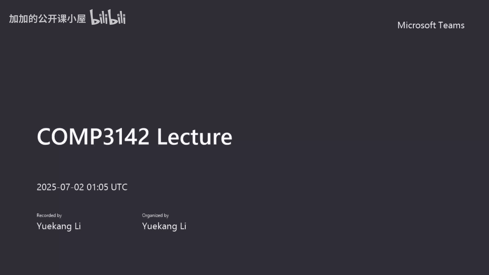

# 新南威尔士大学【中英⚡软件测试｜COMP3142 2025 Software testing】 p09 P9 Fuzz Testing -BV1o34HzBENA_p9-

Alright， let's start。So before we start the main content of today's lecture。

 let's let's have a quick look at our plan for the next half of this term。 So basically in this week。

 we are going to learn about fast testing and particular and very specific father or fast testing tool。

 which is called American Fuzz Lo。 and both are related to a assignment2。

 and and next week will be Fl week， and we will be releasing some practices for you to have to have some Hanzang experience of doing。

Fuzzing， and we will release some materials for you to practice the usage of Docker as well。 And。

 and after that， in week 7， we will， by the end of week 7。

 we will release the result of assignment 1， and we will we will release the specification of assignment 2。

 and the and assignment 2， we will won't be， we won't be reusing the。

The previous specifications were Simon2， so it will be slightly different from the previous one。

But it will generally cover P test， which will be for which will be used for you to practice unit testing and integration testing。

 And we will also cover fast testing in a7，2。So， that's our。plan for the next half of the term。And。

 and let's start today's lecture， so。So in today's lecture。

 we are going to learn a particular type of system testing， which is called fuzz testing。

 So before we jump into the main content， let's have a quick look at what we have learned so far， so。

Basically， we have learned functional and structural testing。

 which are related to the strategies of designing test inputs or test suites。

And we have also learned different levels of testing。

 which can help us to determine the target we are trying to test。

And we have learned three different levels， unit testing， integration testing and fat testing。

 And now I system testing。 And now we are going to learn a very specific and very practically useful。

System testing technique， which is called fuzzing or fuzz testing。So this is today's outline。

 we will learn three different types of phuzzing techniques and we will be focusing on gray box phing。

So here are some definitions of fuzzing or fastuzz testing。

 So basically it's an automated testing technique， which means that it doesn't require too much of manual effort。

 So the test cases are created automatically。 and the the basic idea is to provide the program with a large amount of random or invalid or unexpected data as input。

 and then execute the program and monitor the program for some abnormal behaviors such as crashes or filling assertions or some other issues。

 So the key terms here are we are going to。We are going to send a large amount of random data。

 as input。And then we execute the program with the large amount of random inputs。

And then we also need to monitor the results。 So these are the three key terms here。

So these three key terms。Deter determine how we design fast strategies， so。

The key characteristics here are is called fuzzy or fuzz， right？

 So when you see the term fuzz testing。 So you might have heard about this term in somewhere else before。

 like， for example， when we talk about fuzz， we may think about something like this。

 And we we also encounter this term fuzzy in washing machines。

 like they have some many washing machines。 They have the fuzzy mode。

 which means that you can put anything inside the machine。And。Another， another look。

 another situation where we encounter fuzz is in machine learning， we we have fuzzy logic。

 which is like instead of having some。Deterministic logic呃 bulling logic。 We can have fuzzy logic to。

To match different specific values into some labels。

 So these are the terms of this is a term of fuzzy。 So fast actually means highly random。

 So we are trying It' like very blur， very random。 So it it is related to randomness。 So that's why。

This because we are we are feeding the target program with a large amount of random data。

 So this is this technique is called fast testing。So。According to the definition of fast testing。

 we have the three key terms right。 We need to generate a large amount of random data。

 We need to execute the program with the random data， and we need to monitor the progress。

 So according to this definition here， we can have a general workflow for doing fast testing。

 So first， we need to create this large amount of。Random inputs， right。

 So please ignore that the term here， random is quoted。 And because in reality。

 we don't want to feed the target program with fully random data because that will we。

 we will learn about it later。 And because that is very ineffective。

And the second step in the workflow is to execute the target program with the inputs。And the third。

Step is to observe for abnormal program behaviors， such as crashes。And。This， the。

 the tool for doing these three things automatically is called a fuzzing tool or in farther in short。

 so。So fastuzzing tool is actually a very， very practical and very。

 very useful technique because for it is as you can see this workflow is very simple。

 it could be fully automated by writing some programs like writing a father do this。So developers。

 actually in practice， especially security when we do， when we try to do security testing。

 people prefer fuuzzing over some traditional testing techniques， such as writing unit tests。

 because it is mostly done manually。 So it requires manual effort。 But this one is fuuzzing。

 We can do it automatically， so。According to this workflow。

 let's come to the first poll question today， so。According to the workflow。

 which factor does not affect the performance of a father。So， let's think about it。

So here we have three different things here。 So we need to create these inputs。

And we need to somehow execute the program。 And then we also need to observe the behaviors。

 So which one do you think does not affect the performance of a father or do you think all of them will affect the performance。

I'll give you some time to think about it。呵呵没必要。😊，来迟一。Okay， actually。All of them will affect。

The performance of fast， so。First， the quality of the test input we are creating will affect。

The the testing result， for example， if we are， if we do some kind of。

If if we borrow the idea of boundary value testing。

 we can create some extreme values in our random inputs， right。

 which is more likely to cover some corner cases， which might be。Overlooked by the developers， so。

So the quality of the generated input will affect the the performance of fuzzing。

 And the second thing is。Executing， you may think that okay。

 executing the program may not affect the performance， but actually。

 it will affect because the execution speed can affect the overall performance normally we do have a time budget when were trying to do testing。

 right， we may we cannot run testing， even if it is an automatic tool。

 we cannot run it forever because it is occupying the the CPU of our servers or the computers。 so。

So we have a time budget and within the time budget。

 we want to execute the target program as many times as possible， right。

 so the execution speed here also matters and we can speed up the execution of the target program with some tricks when we do gray box funding and we will learn that in our next lecture。

And the third one， obviously， it matters， right， because we need to be sensitive enough to capture certain。

F certain abnormal behaviors of the program。 For example， in one of our previous slides。

 we have learned that。Of if we， if we read one bite over in an array of a C program。

 the program may not crash。 However， there's a bug there。

 So we need to somehow capture these abnormal behaviors to be sensitive enough to capture these abnormal behaviors so that we are not missing any bugs。

 So the observation of abnormal program behaviors also matters here。 So all of these three。

Characteristics can affect the performance of a father， so。That's about the overview of fast testing。

 So the basic idea is very， very simple。 We just need to run the program with a large amount of random data。

And now， let's。Have a look at some specific fuzzing techniques here。

 So the most intuitive or the most simple one is called black box fuzzing。

 like when we do functional of black box testing， we can just treat the target program as a black box。

 We just need to know what is required by the program as input and we just need to observe the output of the program。

 So we don't need to care about what's happening inside。

And here is a little bit of the history of black box fuuzz。 So it is one of the。

The earliest or the most basic fastuzz technique。 And， and it is created back in the 1980s。

And however， the random testing is not is was。Was invented or was introduced by some researchers before the 1980s。

 and it was not done for software。 It was done for hardware。 So during that time。

 we don't have that many operating advanced operating system。 We don't have that many software。

 So we just so people were testing hardwares with some random testing techniques。 And then in 1980s。

2 researchers proposed the idea of random testing， and then it was formulated as。

Fs testing in a class in 19。88， so。So this term actually。

 so when we talk about the history of fastuzzing or fast testing。

 it is actually back into 1988 and the earliest form of fast testing is called black box fuzzing。So。

That's a little bit of history。 And the entire idea of black box fing is based on this infinite monkey theorem。

 I， I believe some of you might have heard about this theorem before。 So this theorem is about。

Something like this。 So if we have a monkey sitting。

 sitting in front of a keyboard or typewriter and we give this monkey an infinite amount of time and allow this monkey to randomly。

Tap a type with a keyboard or a typewriter。 Then we can almost surely。

Get any given text or any text we want， including the complete works of William Shakespeare， so。

The key here is infinite amount of time。 So we need to assume that we have infinite amount of time。

 so。And， and we can get any text we want， so。So this is based on this serum in 1983。

 like after the random testing for software was proposed。

 an engineer in Apple developed a program called the Monkey。

 which is considered as one of the earliest tools for doing fast testing or random testing and this。

This tool can automatically generate random data that can be used for testing software， so。However。

However。We don't have in reality。 We don't have infinite amount of time， right。

Instead of infinite amount of time， what we have is。A budget。 So normally we have time budgets。

 We need to meet certain time budgets。 So we need to， we need something more than purely a monkey。

 more than purely a pure random strategy。 So we need some strategies to design our random data generator。

So。Remember， when we in our in the practice question just now。

 we learned that all these three different factors can affect the final performance of the testing process。

 right， so。Among these factors， which ones could be controlled。Which trends could be controlled。

On the fathers side， On the tester side， rather than the target programs side。

So which could be controlled by the。By the testing tool。So。Of course。

 how we generate the testing inputs could be fully controlled by the tester， right。And actually。

 we can also speed up the execution。For the target program， especially with green box fast。

And actually， we normally， we can't。We can't control the。Behavior of the how we。

 how sensitive we are。For the program， abnormal program behaviors。

 So we don't have control on the fathers or the tester side。

 We need to do some code modification on the target program side。

 So these are the two things we have control。With the automated testing tool。So。

Based on what we have， what we can control， we can design different strategies of black box testing。

Tos。So for black box testing tools。 So， so this we。

 we can't even control the execution speed of the target program because we。

We need to somehow modify the program and use some interactions with the father。

So what we can control only with a black box father is。How we can generate test inputs。

 So based on what we can only control for black box， black box fathers。

 we can divide the strategies into two different types。 So just now we learned that。 Okay。

 we can almost only control how to generate test inputs with black box fathers。So。So。

 so this is the only factor that determines the type of black box buzzing here， so we have two types。

Mutation based fuzzing。 So the first type is mutation based fuzzing。 It is。

Where we can it is related to how we generate the target test。

 the test inputs by mutating or modifying some existing program inputs。

So that's why he's called mutation based fuuzzing。And this is an example borrowed from aversy machine learning。

 So basically in asy machine learning， what we we try to do is we try to add a small of example。

 this is a classifier neural network。 it given any given any picture or any image。

 it will output as input， It will output a label or telling us what is inside this object or what is inside。

 what object is inside this image， so。What we do for adversarial testing for these deep neural networks is that we add a small perturbation to this original image and then with the newly generated test input we can mislead the deep neural as a classification neural network to generate a wrong label。

So， this。Small perturbation here is like a mutation to the to the original test input。

 So in in fast or in im based fast testing， what we do is we try to design straight。 we。

 we need to have some original program inputs。As seed inputs。

 And then we can apply some mutation operations to these seed inputs to generate the test outputs or the the test cases。

 So this is how we do mutation based testing。So the key here is seed。

 So the seed here is related to the program input that is used for tweaking or mutating the。

To to generate new test inputs。 So in this example of testing for adversial or adversial testing for digital neural networks。

 the see here is actually this image here。And the second type of black box f is called generation based fuzz。

 So generation based fuzz is like instead of having some existing。

Program input and applying some mutation operators。We have no access， we don't have any。

 we don't need access to the existing program input。

So we are trying instead of having using these applying these perturbations or mutationations to some existing test inputs or some seeds。

What we do is we generate test inputs or test cases from scratch， according to certain ruless。

And actually， these rules could be we have learned some of these rules in our in our previous lecture of system testing and one of them one of the rules we have could be context programmemarrs。

So for example， we can follow these context programmers to generate some programs or some some scripts or some XML files to test compilers。

 interpreters or passers， so we need to follow some rules to generate the test inputs here。So， it is。

It is normally considered as more effective than mutation based fing for the targets that accept structure inputs and the targets could be what I just mentioned for for context free for using context programmes to do testing with for example。

 some compilers or some code interpreters could be the targets here。

 So because we are not randomly generating some malformed testing inputs we are following some rules to generate the testing inputs so that this。

The generated test input could pass。The validity check of the input。

 So to reach the deeper logic inside the program。 So that's why this generation based ph is considered more effective for the targets that to accept structure inputs。

So here are some more examples for these targets， these type of targets， for example， PDF readers。

 PDF files are highly formatted， so if we want to generate some PDFf files randomly normally they will be rejected by the PDF reader and they won't be testing the deep logic of this。

Pland here。And this is B 8， which is the jascript engine powering the。

Ploring the Chme we are using every。 So it is used by Google， Google Chrome and。The jascript。

 of course， the code is highly structured， right They can't generate a piece of code randomly。

 especially if we want to generate some valid code to test the the the the jascript engine or the code interpreter deeply。

 So we have to follow some rules。 for example， contexts to generate some test cases。So， however。

 however， because we need to have these rules。generation based fing is considered as less automated because normally。

 these ruless will need to be created， meaning need to be created manually。

 So that's why compared with mutation based fing。These generation based funding techniques are。

Considered less automated。And that's the most basic form of black box testing。

 And now let's learn white box。So， white box fastuzz normally。

People use this term to refer to symbolic execution。So。So symbolic。

 the definition of symbolic execution is the process of building predicates that describe which execution path will be taken。

And it will estimate the effect on the program state。

So here are the three different here are the three key characteristics or key steps need to be done for symbolic execution。

 So the first one is that we need to determine the conditions under which a path can be taken。

And we will learn these key terms with some examples later。

The second step is to identify some invisible parts。And。That can be taken when they shouldn't be， so。

So， these are the。The second， this is the second step。 and the third step is to。

Is that it can be used normally because we are， we are trying to systematically execute different paths in the program by computing by computing some inputs that can take a particular pass so we can generate some test cases that are targeting at some particular parts。

 we want to test in the system so。These are the three characteristics of symbolic execution。

 and let's have a look at a concrete example of symbolic execution and normal program execution， so。

For。For symbolic for normal program execution， it actually executes the program with actual inputs。

 while symbolic execution execute the program with some symbolic values instead of some actual values。

And these symbolic values are actually some variables or some symbols that could take any value in that type until it is solved。

 according to some conditions， so。So these are， this is the first difference。

 The second one is statements compute because the programs are made up of statements。

 So statement in concrete or in normal program execution。

 So statement can actually compute do the computation with the new values of the variable that are received in that statement。

 right， however。For symbolic execution， whenever we are trying to execute a target。

 because the symbolic values are like variable values that doesn't take any concrete value until we solve it。

 so。We don't have any concrete values for the statements to compute with。

 So instead of computing with concrete values。Statements computed with symbolic expressions。

 This is a second difference。 The third one is。Programs state could be characterized by the concrete values of different variables while during symbolic execution。

 instead of having concrete values of variables， we use predicates made of made up of symbolic expressions。

 and let's use an example to show the difference between symbolic execution and。Concrete execution。

 so。For example， we are trying to execute this statement。

 So what we do with concrete value execution is。When the program reaches。This statement here。

Then the program reaches。This statement here。If we do， if we， if we are doing。

A normal program execution with some concrete values。What they do is。

Let's assume that before we execute。The program， we have。The value of low as 8， and。

We have the value of high as 12。 This is the assumption that we we have this program state like this。

 before we execute。TheThis statement here， so you can see that all the variables are taking some concrete values。

And。After this， we execute。This statement， the program state would be。

The value of low because we are not modifying the value of low。

 so the value of low is still 8 and the value of high is still 12。And。

Because we are assigning the the average value of low and high to meat。

 so the value of meat here becomes 10。So you can see that during。

Normal program execution with concrete values。All the values are taking some all the variables are taking some concrete values and program states are made up of variables with。

Their values， right， So this is。For executing the program normally with a concrete with concrete values。

 And if we execute the program with symbolic values， what we do is。Like this。

So instead of assigning a concrete value to the。To the variables as program states。

 we assign some symbols。Which means that。 so L here means that the value of low can take any value。

Any integer on numeric value here， any numeric value。 and this uppercase letter H means。

呃The variable of high can take any numeric value here。So， but， which is a different value from L。So。

 of course， L and H could also be the same， but it means that there are two independent variables。So。

After execution， so instead of having concrete values here， what we have as。

The program state is the value of low is still taking the value。

 taking the concrete taking the symbolic value L。And the variable high is still taking the symbolic value H。

 Well the value of mid is taking this expression here of L plus H divided by 2。 So。

 so as you can see， for symbolic execution。Instead of。

Instead of having the concrete values here as program states， what we have。

Are the symbolic values assigned to all symbolic expressions assigned to different variables as program states。

 So this is。The symbolic， this is how we execute a statement。

 And for taking branches with symbolic execution。We can use this example to see what's happening here。

 so。Assume that we are doing a symbolic execution with the program。

 and the program reaches this point。Of this if statement。 And after this if statement。

 we can take two branches， right， the true branch and。The false branch。So。

Let's first assume that we are trying to force the program to execute the true branch。

 What will happen here with if we do symbolic execution。

So let's consider the program stay before them。Before we reach the Eve condition here。

 So let's assume that we are following this statement is followed is following the previous statement we encountered in the previous slide。

 So before we execute this。Before we execute。This。If statement， what we have is。These。😔。

Expressions as this program state。And after we execute， we take the true branch。This is the。

This is a program state。 we are going to have， so。You can see that we have one more expression here included in the program state。

 So this expression is because we are taking the true branch。This condition must be satisfied。

 and since the value of high is taking the symbolic value of H。

 the value of low is taking the symbolic value of L。

 So the condition that must be satisfied to reach。This program state to take the true branch is H is larger than or equal to L。

收。Similarly。Let me take the false branch。The the program state before we we execute the program is actually the same。

 obviously the same as if we take the true branch。 So we don't need to talk about it here。

 And however， because we need to take the false branch this time。 we have to satisfy this program。

 this condition must not be satisfied。 So。It means that we are taking the reverse of the condition here as the program state。

 So you can see that we are adding。A reverse。Of the expression。

 it for us to take the true branch here。So， this is。About taking branches。

 as we can see that once we reach some conditions， we reach some branches。

 we are adding a constraint。 We are adding one more expression to the program state。

So you can imagine if we execute a program made up of different statements， different branches。

 we can accumulate these constraint。😊，Right， in order to reach certain location in the program。

 we are accumulating。This conference。So， however in。In reality。

 there could be some conflicting constraints which will lead to inible branches or infeible code or unreachable code。

 which is also known as dead code in some cases。So as we so just now， we mentioned， okay。

 we can accumulate constraintsstrain when we， when we execute the program。

 but how do we know that which input can lead us can satisfy all the constraints。

 we need to know because because only knowing these constraints are not enough， right。

 And we only collecting these constraints are not enough。

 We don't even know whether they are invisible or not， right。So。In order to find a solution。

 according to the constraints， we need a tool， or we need a technique called SM T solvinging。

 So SM T stands for satisfiability modular series， so。

It is actually a problem of determining whether a mass formula is satisifiable or not。

 And here in the context of symbolic execution， because as you can see。

 the program states are made up of different expressions or constraints to the inputs， right。

 so we can。We can try to use SM T solving techniques to find a solution。

 to find a concrete value that could satisfy these these conditions。

 or we can also try to determine whether these conditions are conflicting or unsoolvable， so。

So we need to in so we need to use SMMT sewing techniques。And。

And SMMTs solving technique is trying to solve the is trying to convert these， you know。

 like because for for the for the constraints， we are collecting from a program。

 it could be made up of a constraints of numbers or some numeric values or some other data structures of。

 for example， we can in programs we can have these arrays and strings， right。

 So we we need to so we need to convert these conditions into。

Conditions or constraints into a boolean satisfiability problem。 So basically。

 instead of instead of having all these， we are trying to convert this problem into a boolean problem by answering the question of whether。

This condition could be satisfied or not。 So it becomes an yes or no question， right， so。

We are trying to solve this。 Yes or no question。With SM T， solar so。

So this is there are some automated tools。 And these tools are called SM T servers。

 So which can help us to solve the accumulated conditions。

And one of the most famous S T server is called Z 3， which is currently maintained by Microsoft。

So let's have a look at an example here。So let's assume that we are taking the false branch of the previous if statement。

 So this is what we have as the program state or the constraints we have in order to reach this program state or this basic block。

To take the fast branch。So what we have is L needs to be。

Taking the value of low needs to be taking the value of L。

 high needs to be taking the value of H meet needs to be equal to this thing here and。

H must be smaller than L。So what we can do with that3 is that we can。Assign this。

Values assign these variables。First， so we can declare the symbolic values for these。

For these variables first， you can see that we need to determine。The type of the value。

 when we create the symbolic value here。Because we are trying to come because in in programs。

 different data structures or different data types should be solved differently， so。

Here we know that。 okay， these are low， high and meat are on。They are all。

 they are all numeric values。70 use real。The real type for these variables here。

And then we can add the consequence here。 So because L equals to low equals to L is kind of。

I these two conditions are like something we could have by default。

 so we won't be adding them here as explicitly as cons。

 so what we can do is we can add the constraint of mid equal to this as a constraint。

 we can also add H is smaller than L as constraint here。

So we can add the constraints after declaring the variables。And then。

We can check the satisfiability of this， of this condition here。 So this program is runable。

 So if you install that three with pe。And you you， you copy and run this program。

 What you will get is an example。Input or an example。

 some example values that could satisfy the constraints here。 So it will give us some values of。L。

 H and meat。In order to set， which could satisfy this。This。

 these conditions here as the solution here。 So you can imagine when we are trying to execute。

 when we are trying to build test cases， This could be very， very helpful， right， We can。

 we can accumulate the conditions。Through a pass。In order for us to reach certain location in the program。

 and then we can use an SP server to give us a solution that can satisfy all the constraints。

And then we can use this solution here as the test case。

For us to reach or for us to execute this particular program pass。So。So， this is。

Why SMMT solvinging or this is why symbolic execution could be used。As a testing technique， and。Here。

 here we can also observe that actually pure symbolic execution is actually a static。

Technique or static analysis technique， although it has execution in its name。

We don't actually run the program。 We don't actually execute the program。 we can somehow。

 for example， this is。Assume this is a control flow graph or where we only care about。

Different conditions for reaching each basic block。

 So if we only care about the conditions of reaching each basic block。

 what we can have is a symbolic execution tree of the program， so。We can。

 we can accumulate different conditions along the path inside this symbolic execution tree。

 And in order to reach certain location or in order to find an input that can help us to reach a particular location inside this program。

 we don't really need to run the program， we just need to。

We just need to collect all the conditions and send it to the server。

 and the server will will give us a result that can certainly reach a location here。😊。

Unless it is unsolvable or unsatisfied。So unsatisfiable， because there are sometimes where。

Conditions could be conflicting to each other， so。So， in this case。We。

 we don't really need to run the program。 We just need to do the calculations here。 So。

 but this has some limitations。The first one is the pass explosion problem because we can see that this symbolic execution tree is actually is actually very similar or it it could be built from control flow graph and in control flow graph we have learned that once we have a loop we can have an infinite number of path right and whenever we have branches we doubles the count we double the count of path in the program。

 so we could have past explosion problem where we have too many paths for us to solve。

That's the first problem。 The second problem is， even， even if。A condition is satisfiable。

 which means that there is a solution for that constraint， for that condition there。

Dear could that condition could be unsolvable for the for the automated server。

 So because because these， these servers， they are very。They are they are mathematically proven to。

To， to give us correct result。 So which means that whatever it tells us。

 whenever it tells there is a this thing， something is a solution。

 Then it is a it must be a correct solution and。However。

 the conditions could be too complex for the solar to solve。

 So when there are there could be some cases where the conditions where where near the bottom of the tree。

 We are collecting too many conditions for the solar to solve within a feasible amount of time。

 So there could be unssoolvable conditions， which could further limit the usage of symbolic execution。

 and another important limitation for symbolic execution is about environment interaction。

 So there could be some。Environment interactions， which couldn't be。

Which could be hard to be converted into constraints or conditions for the servers to solve。

 for example。A program may request。May request from an external service。 And this external service。

 for example， may call a restful API。 And then this restful API will return some values to the program and。

And it is hard for us to simulate or to， to symbolize this。

This return value here because we normally we have limited knowledge about this data structure here so。

And for example another example is the creation of files。

 So maybe we are creating a file somewhere in this program in here。

 we are writing something to a file。 and then we read the file content in another location of the program。

 And it's very， very hard to symbolize the content of the file， right。

 We don't know what's happening inside the file。So environment interactions could also cause problems for us to do symbolic execution。

So。The idea here of solving this problem is。We can combine。Concrete program execution。

 So which means that we can use some concrete values to execute the program。

To generate some pass execution path with some concrete values and then only symbolize certain interesting values along this。

Concrete value of pass。So this can help us to solve this。

Some of to to mitigate some of these problems， for example， when when we have past exposure problem。

So instead of calculating or the unsvable conditions。

 instead of computing a solution for all the variables， we can， we can try to execute the program。

 with some concrete values and then only symbolize certain values in order for us to to tweak the program。

 for example， for this for this branch here。 only the counter is determining this branch， right。

 So what we can do is we can set all the values all the values which will not affect the value of counter to be concrete values to to take concrete values。

 So it can reach the maybe maybe it can execute this branch here， so。

Let's assume that we have a concrete input that can execute this branch here and what we want is what we want is we want the program to execute this branch so what we can do is with this concrete value with this path of concrete values can we can use the concrete values of the variables which won't affect the value of counter here。

 which won't affect this condition here and only symbolize the。

Value of which can affect counter here and then use the S M T server to calculate a solution here for this。

 for the variable that can affect the value of counter here。 And then that solution。

With the rest of the variable values as constant。Could be used as a solution or as a test case that can help us to reach the target branch we are trying to take。

 So， so by combining the concrete values and symbolize values， symbolic values。

We can have something called concolic execution， which means that。

We are using both concrete values and symbolic values。During execution。

 so this can somehow mitigate some of the problems here。

And here are some facts that may affect the practical usage of symbolic or concolic execution。

Normally， symbolic orlic execution is used in automated program verification because because of the。

RigBecause of the rigor from the SM T server， so。It is normally used for automated programming verification。

And because the capability of solving some two complex conditions。

 it is normally used for some small but critical systems。

And now an symbolic execution is also popular in some capture the flag events like capture the flag is like basically doing some security。

嗯。Security context， so contexts。 So so it's popular for some small programs in in those contexts。

And it is normally hard to be applied to large real world programs because of those limitations and even with Concolic execution。

 there could be problems for large programs because we may not find a suitable input that is close enough to the target path we want to reach。

 and if we can't have a path that is close enough to the telelib branchch we reach。

 we still need to symbolize a lot of variables， right then in that case。

 the conditions could still be very complex and maybe too complex to be solved。

 So even with Concolic execution， it's still hard to be used for large real world programs。

 So in most of the cases， we don't in most of the real world programs we are dealing with we seldom use concolic or symbolic execution。

And in my opinion， symbolic execution or concoic execution。

 although some people may call it white box fuzzing， in my opinion， is not。

 they are not exactly fuzzing because。Fuzzing， as indicated by the name。

 is it's relying on some random inputs， but symbolic execution or concolic execution is。Very precise。

 So we are， we are solvingwing the constraints to reach certain location in the program。

 So in my opinion， it is not they they are not considered。 They are not exactly or f techniques。

And before we move to the。Last part of today's lecture， Let's have a three minutes break。

And let me see if there are any questions。Come online。Okay， so pass good。对。对。O。

 let's呃 let's continue。There's no more question。So。Let's continue。 So just now。

 we learned about black box fuzzing， and we learned about white box fuzzing。

And now let's learn the last topic， G box。So。Black box s may suffer issue， effectiveness issues。

 For example， if we are， because we know nothing inside the program， right。

 we are just purely randomly generating the test inputs and these test inputs could be too random。

 such that they may get rejected early in the program。 in most of the software we are using today。

 They have some validity checkers for the inputs， right， For example， if I， if I try to open。

If I try to open a， maybe a a dock file A a random text file or even a P D F file with PowerPoint。

 it will reject to， to open that file， right， because it may check whether the file is a valid PT file。

So most， most of the software， they have validity checkers for the program inputs in order to reach deep into the。

Logic of the software we are testing。 We can't purely randomly generate these inputs。

 So black box fuuzz may suffer effectiveness issues。

due to the lack of knowledge about what's happening inside the program。

And white box funding may suffer scalability issues， because。Because just now。

 we learned that we need to accumulate the conditions in the program across different program states。

 and we need to solve these。Conditions or constraints with some SM T servers。

 And they could be very complex， and they could be too complex to be solved。

 So white box phuzz or white box testing could suffer scalability issues。So you may think， okay。

Why not？ What about black plus white， Why don't we just somehow combine them together to have a new technique to have a third technique。

 What about black plus white。So。So we don't really have black plus white in fuzzing。

 we may have black plus white for bears， but we don't have black black plus white for buzzuzzing what we have is gray。

 so instead of black plus white we have gray。Thegr box发看。Can be both scalable and effective。So。

 let's。Let's have a look at the key idea of gray box fuuzzing， so。The key idea here is first。

So we need to address the shortcoming of black box testing， right， So。

 so we can't ignore what's happening inside the program。

 So what we do is we need to collect information during the target program execution。

 So we collect information from the program。However， when we collect the the information program。

 we only collect partial information or the program information needed for testing， unlike white box。

Testing。Or white box， for white box fuzz for for symbolic execution。

 we are actually collecting all the program states， right we are。

We are trying to solve all the constraints。 and are we know everything。

 every piece of information during execution， but not all of them。Are needed for呃 for for testing。

 So we only collect partial information。 So this addresses。

The problem of having too much information to to deal with。 so we can we can we can。

In in large programs， so we can use green box funding for larger programs。So this is a key idea。

So the key idea。 So let's get back to the to the general workflow of buzzing and see what's different here so。

So green box funding， we still need to create a large amount of random inputs as test cases。

And then we execute the target program， and then we observe for abnormal behaviors we observe for bugs。

And。What's different here is。Apart from only observing for bugs or crashes。

 we also collect execution information after we execute the program here。In green box fighting。

 and then。We use the runtime information or the execution information to adjust how we generate the test inputs。

So you can see that this is like a feedback loop。 So we are。

 we are generating some random test inputs first。 We execute the program with the random inputs。

 and then we collect information。 we evaluate。 Okay， which input is better， which input is worse。

 and then we use such information to update。The strategy for the next round of。Input generation。

So this is like a feedback loop so we can improve the effectiveness。In comparison to black boxuzzing。

 And because we are only collecting some execution information。

 We are only collecting some lightweight information so we can apply gray boxing to some larger programs。

So， so you may wonder before this lecture， before we reach here， you may wonder okay。

 why didn't we learn these topics in the the order of coloring like black， gray and white。

 Why did we learn it like black， white and then gray， right， So now you understand。

 So gray is actually having the best of the two worlds。

 So that's why we learn it as the last topic today。And in my opinion， gray box fuzzing。

It is reflecting the aesthetics of violence。 And there's a little bit of backt about this。

 these terms here。 So during my Ph D or during my doctor doctoral study。

 my when I was writing my first paper research paper。And I。

 I came up with a title of my research paper like this。 So whatever name， the aesthetics of violence。

 And then I present this paper， this title to my PhD supervisor。And。

 and this is literally his facial expression after seeing the title I proposed。😊。

And his feedback was like， you don't look violent why there's a violence。

 this term in the paper title。 and there's no aesthetics in this paper。 So this this is。

These are his like comments and this is his。Flay face after seeing this title。However， however。

 I still think that。呃。Gre box buzz is reflecting the aesthetics of violence。 And let's see why。So。

So let's explain the terms here。 So basically there are only two meaningful terms in this small expression here so。

😊，The first term is violence。 So why do we need violence for gray box fastuzzing or testing。

That is also actually related to the monkey theorem， so。

So we need to create a large amount of random inputs。呃In order to cover current cases， for example。

For example， we have a form， we have a web form like this。

 so this is like a registration form we may use every day。And what we can do is。

We need to try out different things with the with this form， right， we can try some normal input。

 We can try some extremely long input。 We can try some random characters。 We need to try。

Random test inputs in order to cover something that is。

That has been overlooked by the developers during development。 We need to。

 we need to be random enough to cover。To cover the。诶 네。The quantities is， however。

 we also need to have a large amount of such inputs。Because。Because normally， the developers。

 they are very smart people， So they they will consider most of the when they write the code。

 they will handle most of the cases。So we need a large amount of such inputs in order to。

 to find something that is。Unexpected， so we still need this large amount。

 And using this large amount of random input。Could be some。

 something like we are violently cracking the program。 So basically， for， example， when we do some。

When we are trying to guess a password， there are some。

 if you are trying to use some automated password geers。

 the the default mode of those guysers is like a violent mode， which will just randomly guess， right。

 So we are like when we its similar for for gray box。

 We are like randomly using a large amount of input to， to cover unexpected behaviors。

 So we are like violently cracking the program。So this is the term violence。And however。

 violence does not always work。 So we need aesthetics， so。

I believe many of you have heard about this fairy tale。

 which is a big bad wolf and three little pigs。还没看。I't know why there's a annoying。Frame， so。

 so in this， in this fairy tale， there's a big bag wall three little kidss are trying to build homes and。

There are and there are two the the third pig is using the first pig is trying to use some straws to build a home。

 The second one is trying to use some wood to build a home， to build a house。

And the third little pig is trying to use bricks to build a house。

 and the wolf is trying to eat these little pigs and get them out of the house， right so。

Here we can compare this fairy tale with how we douzz。 So the father， the testing tool。

 the tool we are creating is like the wolf。 And this wolf is hunting these little pigs， right。

 And these little pigs could be considered as vulnerabilities or bugs inside the programs and pigs in comparison。

 They are inside houses， right， so。They have houses of straw， house of wood and houses of bricks。

So in the fairy tale in this story here， the big bad wolf。

 the wolf can easily break the house of straw and the house of wood with violence， right。

 It can easily destroy the house violently。 However， it cannot break the house of bricks violently。

 right， So violence doesn't always work。And instead， in another fairy tale。

 the wolf can break into the house of B smartly。 So in the little right ridingiding hood story。

 the wolf pretend to be the granny for that。 The little girl， right， then say knock knock。

 I'm your granny。 Please open the door for me。 So。This in this story here。

 the wolf is using some kind of strategy and to to break into the door and reach the target， right。

 so similarly in fast testing， we need somehow to design some strategies to in order to reach the buggy location or in order to find the vulnerabilities。

 and this is considered these strategies。Could be considered aesthetic statics here。

 so that explains this expression here。So let's come back to the key mechanisms of greenbox fing and see how this the key mechanism of Grbox phing could be related to these fairy tales。

So assume that assume that we have a father that we have a program that can take any random string as input and this father can generate。

A random random strings at any length for that target program。

And this program is could be as simple as this one here。

 So let's assume this program just takes the input string and compare it with。2 bites， A and B。

 And then。If服。If this condition is satisfied， then the program will crash。 So this is a bug。

 So we want to we want to use random strings to crack this program， to crash this program。

So remember， one bite。Can have 8 bits。 And each bit could be either 0 or  one。 So what is。

 So if we guys， So if we are trying to generate this input stream randomly。

 So what is the maximum number of tries for us。What is the worst case for us to trigger the crash here。

So can you do a quick calculation of this。So。So let me tell you the answer。

So since we have eight two bys。So and 8 beats， each bit can take， can have two choices。

 So what we get is two to the power of 16。Tricces， possibilities。

 And the worst case is that we try out all the possibilities， right， So basically。

 we will try this amount of。Numbers in order to reach in order to crash the program。So。

So you may think， okay， this number looks very large， right？However。

 it is not large enough for computer。So， assume that。Assume if we can。

 assume if we can run 1000 test cases per second， which is。

Easily achievable by normal computer modern computers。

 So we only need like 65 seconds to try out all the possibilities， right， So that's about one minute。

 So only need one minute to try out all the possibilities。

 So this program is like the House of straw or house of wood。 We can easily destroy this program。

 or destroy these two houses with violence， and we can easily try out all the possibilities with our computers。

To find out， To find the crash。So， so this is。An example of the House of straw and House of wood。

 So what about House of B， So let's tweak the program a little bit。So。This time。

This are instead of matching two bites。Let's try to match 5 bites。 Let's try to match 5 bites。Then。

What is the maximum number of tries to trigger the crash this time。So I， I will give you。

Like half a minute to think about it。系。有。So similar to the previous one。

 we just need to change the two to the power of8 is unchanged because each byte can take two to the power of 8 different values。

 right， So this one is unchanged。 We just need to have a times we just need to change the times 2 from we just need to change from times 2 to times 5 here。

 So it's2 to the power of 40。 and this number is this big。And。

Do you think this is still not a big number？Actually， it's a very。

 very large number if we still run the programs a000 executions per second。😊。

TheInstead of using one minute to try out all the possibilities。

We will need around 35 years to try out all the possibilities for this program。

 and this program is only adding three more bytes for this simple string comparison。😊。

So you can see that this prevent could be considered as a false house of bricks。

 and we can't destroy this house of brick using violence， right， We can't just randomly。Guys。

 this input stream to trigger the crash， right， so。

And most of the programs are more complex than this one。

 So most of the programs we are encountering are house of bricks。 so we can't。

Easily using using violence to we can't easily use violence to to to trigger to crash them so。

So we need some strategies。So， let's add one。Assumption for the father here。 So let's assume that。

Apart from the capability of generating strengths at any length。This time。

 the father is aware of branch coverage， which means that once we have passed。A branch。

During execution of the program， we informed father。 Okay， let's， let's assume that we have。

Let's assume that we have passed。This branch， we reached normally。

 normally by default most of the time， because if we just random randomly generate the string。

 we are。We看呃。If we just randomly generate the string， most of the strings won't match here， right。

 So normally we will go to the false branch。However。However。

 let's assume that the father has awareness。哦。Brunches。Or like， for example， if， if the， if。

An input triggers the program to take the true branch。Of this program。 then we just tell the father。

 okay， this input， this input。With I'm as a prefix。I'm something here。Can't take the true branch。

Of the program， we just informed father。 Okay， this input can take the true branch of the of the。

Of the program， you should adjust。Your strategy accordingly。

 you should address your generation strategy accordingly。 Let's assume that。This time。

 this father has disability here。So， you can see that we are just now。 previously。

 we are doing black box buzz。 We don't。 we don't care about what's happening inside。

 And now we care what's happening inside the program。 So let's assume that we have this ability here。

 So in this time。So。The strategy is once the father， because it has this kind of awareness。

 So once the father finds the test input that can cover a new branch， like passing a new branch。Then。

 it keeps。The the seed that can pass that branch as a seed。 and then you。

 I hope you can still remember that the definition of seed， and then it can use this seed input。

To create new test inputs。Then what is the maximum number of tries to trigger the crash this time。

What is。The maximum number of tries here。I will give you about one minute to think about it。

So remember， this time previously the。Each bite can take this。

To to the power of eight different values， right？And we have five beds。

So the problem is still the same。 We have five bys， and each bitete can take2 to the power of8。

Different values。But this time， what is the chance， but we are dealing with the problem differently。

This time， we are not guessing the entire as a whole。 We are guessing the。They are guessing the。

Bs of the stream，1 by one。So。We are not doing guessing the entirety of the stream as a whole。 We。

 we try to guess it one by one。So what is the chance here。

So the difference is that about where we position the five。So previously。

 because we are trying to guess the value of the entire magic stream here。

 the entire input stream here。So，5。Is。Above is used in the is used as part of the exponential value there。

 but this time。It becomes a factor。And the actual value is。Total the power of 8。Times 5。

So it's about a thousand0 something。Sorry， it's like total28。 I think it's one。 Oh， it's 2，5，6， yeah。

So is like。呃。100 something。 And if we assume that we can still run the program 1000 executions per second。

Then this will roughly take one second。For us to find out。The magic bite。Because once we。

 because once we know about it here， there's two to the power of it。 once we guess I'm correctly。

 we know that I is correct， we can fix it。 We can ignore it。 We can try to guess the next one。

 And the next one is still two to the power of8。 So basically it's two to the power of 8 plus 2 to the power of8 plus2 to the power of8。

 five times。 So basically it's2 to the power of8 times 5。 So that's why it's around 1000 something。

So this will take only about one second for us。To solve the problem here。So。

This is like we are using some strategies here。 So this time， we are not using violence。

 We are trying to break through the。House of bricks， this。Strategy here。

So this is why gray box fuuzzing can be effective。And this idea is actually a divide and conquer idea。

 We are dividing the problem into smaller ones， so we we are dividing the exploration of the program different program states into some intermediate steps。

So this idea is basically a divide and conquer idea， and we are gradually searching program states。

So this is why Grbox funding is。Effective。And okay， so just now we learned， okay。

The key mechanism of gray box fu is to get the father aware of。

Some certain coverage inside the program， right， like， for example， here， the branch coverage。

But the question is， how do we get the father aware of this branchch coverage during execution。

 So how is this done。So。This is normally done by program instrumentations。So you may wonder， okay。

 what is program instrumentation， So program instrumentation is to modify the program。

So that we can perform some kind of analysis。And this modification of program could be done on source code level or before compilation or on binary level after compilation。

So。Basically， if we want to modify on source code level。

 what we do is we try to do this instrumentation。 Iation is like we are modifying the program automatically using some automated tools by。

 for example， injecting some extra logic that can capture the coverage of the program and。

We can do this。Either on source code level or on binary level。

 And if we want to do it on source code level， what we can do is we can modify the compilation process。

 We modify the compiler。To add some extra steps to inject the extra logic to for。

 for this coverage collection。Or if assume that we don't have access to the source code。

 we can still use some binary analysis tools and use binary rewriting tools to rewrite the compiled program。

So this is about programming instrumentation。And programming documentation。

Could enable the profiling here because， because we can inject any code or any logic we want。

 Obviously， we can inject some logic， extra logic into the program to report the code coverage back to the。

呃faer， right to the automated tester。So it could be used for measuring some dynamic behaviors during a test run。

So， let's get back。Toold the green box finding workflow here。 So now we understood， okay， why this。

Gre box surprisinging why we need to collect this extra information。

 because it can improve the effectiveness。 And how do we collect this extra information。

 We are doing it through。Program instrumentation。And now let's have a look at what kind of strategies can we play with？

According to this workflow here。So。Because as we can see， we， we can。

We need to collect this information， and we can collect this this information。 But how。

 how can we use them right， just now this we have seen an example。

 We can use it to determine whether we should keep certain inputs as。Seat for the next round of。

Input generation。 But what are， are there any other strategies we can do。So basically。

 there are three different strategies that we can that we can design based on the the execution information we collect。

 So the first one is called seed prioritization。 The second one is called power scheduling。

 and the third one is called test input generation。So。Forceed prioritization。 So just now。

 we learned that。 Okay， Green box fathers can keep。Some inputs that can。Cover extra branches， as。

Cize， right。So they can keep once a test input can reach。Certain。Certain extra branch in the program。

 The father is aware of that， and they can keep it as a seed for the next round of input generation。

 So it maintains a pool of seeds。And since we have a pool of seed。For us to。

 to generate new testing posts with。We need to determine which seed should we use。

To generate the the tax input， right， because we have many seats we need to determine which one to use next。

So。This decision process is called seed prioritization。

So this requires us to evaluate the quality of the seed。 So， for example。

 we can use the coverage of the seed。 So whether this seed can cover many basic blocks or many branches。

How fast this seed can execute， normally we prefer the seed that could execute faster， right。

 because this will speed up the entire testing process。So。

There are many factors that are affecting this seed prioritization。strategyrategy。

And the second strategy is power scheduling。So once we have selected a seed。We。

 we want to apply some random mutations or some random perturbations to generate new test inputs with the selected seed。

 However， there's a another decision thing。 There's another decision we need to make。

 So how many new test inputs should we generate based on this seed， right。So。

This decision here requires the strategy of power scheduling。 So power scheduling is to determine。

Given a seed how many new testing inputs should we generate。

And this requires us to evaluate the quality of the seed again。

 so basically we can still use the cold coverage of the seed。

 you can still use the execution time of the seed and so on to evaluate the quality of the seed and determine how many new testing inputs should be generated based on a particular seed。

And。The last strategy we can play with is how do we generate new testing inputs。So。Here， again。

 like black box testing。 So we have mutation based。 We can。

 we can do mutation based generation for generation based。Fing here。So。

So we can actually we can use some advanced algorithms here， but it's kind of case by case， which is。

Wehich should be dependent on the target we are trying to test。So， for example， if we are trying to。

 if we are trying to test some files with structured input， we prefer the generation based buzzing。

 And if we are trying to use。诶 some。We are if we are trying to test some targets without very highly structured test input。

 we can just use mutation based strategy to generate new test inputs。And most of the time。

 we just because green box f， unlike black box f， gray box f is providing some hints for us from the。

Based on the the execution trace of the target program。

 So we can use mutation based strategy more effectively than black box。Fing。

 so that's why most of the gray box fighting nowadays are mutation based。So。But is case by case。

 it depends on the target we are trying to test。And。

So after we have learned all the key mechanisms and different strategies of gray box fasting。

 let's let's talk about why do we need to learn it and。That's we need to learn Gbox fastuzzing here。

 we are particularly interested in this technique here in this course is because。

Gre box Fing is actually very， very popular recently。And。For example。

 this is a trophy of a black box father。Which was developed， like in。10 years ago， I think， so。

This is a trophy。 So you can see that after CE is like common vulnerability exposure。

 which is a project maintained by the US government and。Each one of them is like a。

 you can consider it as a vulnerability from some public or some commercial products。 So you can see。

In Redama in this black box， father， it stops finding new。

A crashes or new vulnerabilities since 2018。Although it has been。

 it has a quite relatively longer history。And it has very limited number of。

A vulner abilities in its trophy， however， in comparison to a gray box father。

And this gray box father is not even in its newest form。So this data was this。

 this was a screenshot from the original web page of this。

Of this particular gray box father years ago， like it can find vulnerabilities in many。

 many different famous products。 And， for example， circle light， which is a vi。W is。

In by default in almost every Android phone and even open SL， which is which is used in。

All of our brothers to handle H P S request。 You can see even in an Internet Exper。

Or Apple Safari or Mozilla Firefox， you can see in all these。

Very popular projects and well maintained products。 G box fuzzing can find vulnerabilities inside。

 So， so it， it is actually very， very popular。 And actually， many。

 this American fuzzy lab was developed by the guy when he was working in Google。

 And now he's no longer working for Google。And。And many， many big companies。

 they provide funding services as well。 So， and for example， Microsoft。

 they provide a platform called one F。 and Google， of course。

 they provide a funding service for almost every open source software。

 as far as your your open source project can reach certain level of stars can have like I forgot what is the requirement。

 But you you can as far as you can have like a few hundred of stars on Github。

 Then you can use Google's open source funding service。And AWS also provides f services as well。

 So and most of the services they are providing are based on green box。

 So that's why we are particularly interested in green boxing for this course。

 And that's why we are going to practice of practice how to create a small green box in a summer too。

 so。That's all about today's main content。And let me see if there are any questions。Yes， yes， yes。

 that's only。Based on the assumption that we know that it takes exactly two characters。

 If we don't know the length of the character， how many characters is used in that comparison。

 we the possibilities could be there could be more possibilities there。 So。

 so you can see that even for such a simple。Program， if it know nothing inside。

If we know nothing inside the program， we can we， we， we。

 we may not be able to crack the program properly。 So， so that's why we need。

We need to collect execution information。 That's why we need to do gray boxox fing。And。

And you may notice that in our last lecture， we are having some。

 I are having some extra materials called。High test guide。

 which is similar in a similar format of our previous Python syntax guide。 So this。

 this extra material is useful， will be useful for your assignment2。

 because we will be practicing unit test in testing and system testing。

 particularly fastuzz in assignment 2。 So this is helpful for the first half of。

For the first half of assignment，2。 and let's， let's try to go through。

Let's try to go through briefly go through fixtures today so。So。Let me use this。Mardownfi。

 we should look better。 So， so let's have a quick recap of why do we need very interested in learning pie test is because Python。

 of course， it it offers default unit testing library as its standard library。

 but we are still trying to use pie test here， because it has simple is syntax is very simple and straightforward and it has some。

Provide that some flexibilities of dealing with dependencies。 and。

 and it has a very rich plug ecosystem， so。So in our last lecture。

 we just covered how do we install this。 and we run through a very simple example。

 Oh we have compared the， we have learned that。 okay。

 the the assertion of peptideized is more powerful than the default assert of Python because it can give us more information。

And there are some flags when we run this。Pe test from command line。

 And now let's learn an important feature of pie test， which is called fixture。

 So fixture is actually。Particularly useful for composing test， set up and tear down。

 And remember in our last lecture。In our last lecture for the test scaffolding code。

 we have learned that in order to， for some cases， we need to set up the environment for fuuzzing。

 And then we also need to do tear down， to tear down the environment。

This is because some test cases may require us to to have some side effects。 For example。

 maybe we need to create an extra file with the with the function we want to test。

 And then we need to remove that that file before we run the next text， right， because otherwise。

 the the file the the the file created in the previous test run will affect the result of the second test run we don't。

 we don't want to we don't want them to affect each other。

 So that's why we need to tear down the the testing process。 we need to do some tear down properly。

 another example is。For example， when we if we want to test a particular function。

 we need to set up a connection to a remote server。 maybe its a DB server。

 And then we need to close the connection after doing the test right we don't want to keep the connection there so。

So in order to tear down this connection， we need to add some extra code after we do testing。

 So this is why we need fixtures and fixture in pie test is is used for hosting these setup and tear down code。

So。This is an example of fixture code。And。那你说啊。You here。 So this is。This is the example tear down。

 this is an example fix for code。 So what we need to do is。We how we， how should we tell？来。

 let's have a look at this。So first， we need to import pie test， of course， so。Then the second thing。

 maybe let's use this is looks better， I think。The second thing you may notice here is that we are trying to have our fixture defined here and use it for our test。

And， and when we are writing tests， remember in pie test， we can it depends remember how do we。

 how does it discover test cases， functions starting with the prefix of test underscore are counted as tests。

So when we write the test， we can， we can。 We can have the fixture function。

We have defined before as the input to tell the， to tell pie test that。This test case。

Is using this fixture here。So this is， and then we can， we can use。

 we can use value returned by the fixture in our in our test case， in this example here。

In this example here， we as as you can see， this fixture is giving us a path。

He's giving us a pass as the context for running the test。 So inside this test function here。

 we can use the return value of the。Of the fixture。Of the fixture function。

 And as if so as if it is provided already provided。

As if it is already provided by the contact set up， and then。Use and then use it as a。

 as a context here。 And then we just do the assertion here。 So we don't， we don't in inside the test。

 We don't need to care about how do we do the setup， We just need to use it。 So。

 and we don't need to care about how do we handle the setup up after we run the test。

 We just need to simply use it。 So inside this example here， What the test does is it it raise。

From a random， we read from a temporary file。This function will read from a temporary file。

 And if the， if the file content。Is hello world。 It will pass the test。 Otherwise。

 it will feel the test。 So this is very simple。 So we can see that。

The requirement of this file is this。Is required for the setup。

 and we need to create the file for the setup。 And then we need to delete the file in when we do tear down。

 right， So let's see what's inside the fixture and how does it handle this setup up and tear down。

So you can see the first requirement for running this test is that we need to have a file。

 so what we need to do is we just need to create a file in the same folder as the script。

And then write， write something inside the file。And then return the file to the fixture。

 You may notice that this keyword yield is used instead of return here for fixture。

 This is because return will terminate。 We just we just terminate the execution of the fixture of the of a function。

 Then we can't do tear down if we， if we just use use return， because this code。

 this part of the code will be unreachable， So we need to use the keyword yield instead of to to。

To provide the， the， the path of the file we just created。To the user of this fixture。

 And without terminating this function， because we still need to run the tear down。

 And when we run the tier。 And then after the program uses what what we have。Given to it。

We will run this tear down code automatically here。

 So you can see that we try to do the setup before the yield。

 we try to do the tear down after the yield。 And that is the basic structure of a fixture。

 And if you wonder how this， how is the flow of execution for this。 This is it is。

 it works like this。 So we run the setup code first。 And then we yield the value。And。

The test function will take the value and use it as context for running the test。And then。

It will run the铁 down code。And there are several。 And this is the basic structure and basic pattern of fixture。

 And we need to use this decorator here to tell pie test that。

A particular function is used as a fixture， and we need to pass it。

 pass that function as a parameter for our test functions in order to tell that， okay。

 this test function is using this fixture here。And this is roughly the。

Basic structure and basic usage of fixture， and we will learn more about the details like why do we。

 when do we need to use yield， when do we need to use return and what's the difference between you and return like these details in our next lecture。

 And thank you for joining today's session。And let me see if there are any other questions。And it's。

It seems there's no other questions and thank you for joining today's session。

And that's time for today。

Thank you。