# 新南威尔士大学【中英⚡软件测试｜COMP3142 2025 Software testing】 p10 P10 Levels of Testing 2 -BV1o34HzBENA_p10-

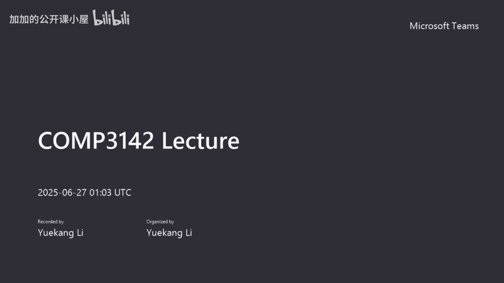

So can people from online hear me。啊O， good， good。Let's wait one more minute to start。Yeah。

 so todays Friday。 So I think no， nobodys like coming to school。So please move forward， if possible。

We do have some people joining us from online。So。Let's start。呃， once you areRCed。😊，呃。Alright。

 let's start today's lecture。 So today， we are going to continue our。

Learnings journey about levels of testing， and test automation。So。In our last lecture。

We have learned different two levels of testing， unit， unit testing and。And integration testing。

 today， we are going to learn the third level of testing， which is system testing。 And after that。

 we are going to learn some test automation technique， which could be useful in practice。

 and it will be covered by a Simon tool as well。So before we jump into today's topic。

 let's have a quick recap of what we have learned so far。So。😔，In our， in our previous two weeks。

 we have learned functional testing and structural testing。

 which are both related to how do we design test inputs or how do we design a test suite。And。

We just learned。😔，Levels of testing in our previous lecture。

 which is about how do we determine the testing targets， For example。

 we can select functions as our testing targets。 We can combine functions into some sub systems as the testing target。

 And， of course， we can use the entire system or the entire software as our target for testing。And。

And in our last lecture， we have learned unit testing。

 which is normally done by the developers and during development。

And we have also learned integration testing， which is about how to build different integrations or different subsystems。

And now we are going to learn system testing and system testing could be either functional or nonfunction。

 as we will learn later。So these are roughly our plan。

 So we have learned this functional and structural testing in week and victory。 And in this week。

 we learn levels of testing。😔，And。System testing。 And here comes a。Definition again。

 So system testing is about testing the entire system or the entire software。

 So the key word here is that we are。Testing the the complete， completely integrated products。

 And we are testing with specific requirements。For un functionalal or non functional aspects。

 So system testing could be both functional or non functional。And here。

 the functional and nonfunction is a little bit different from the definition of functional verse。

structuraluc。 so nonfunction doesn't mean it's structural。

 And we will learn some nonfunction properties of programs today， so。

So about among the three different levels of testing。

 the system level is actually closest to our everyday experience because we are using the end products。

 not just functions or some combinations of small different functions， right。

 So this is like we are testing from the user's perspective。And for functional test。

 for functional system test， what we care is about the features or the business logic of the poor one。

 So we tire we we， we target the test， whether the system can function well or not。

And the method is normally that we provide some test inputs。

 We validate the the outputs of the program with some expected results。

And for non functional aspect here， is's not like we are testing。 We are focusing on the source code。

 We are focusing on the code structures。Instead of that， we are actually。This one is blocking， so。We。

 we focus on some non functional features rather than， you know， like structural aspects， so。

Instead of focusing on the business logic or the features of the program。

 what we test for nonfunctional system testing is we test for the performance of the system。

 We test for scalability， usability and some other quality attributes。And the。

 the method is normally to find a way to measure these nonfunctional features。

 And then we somehow benchmark these features and evaluate。

And the evaluation is not against some expected results because for these nonfunctional features。

 we don't。 They couldn't be。 Most of them cannot be captured by the system output。

 So instead of checking or validating against expected outputs， we。

 we evaluate the results based on some predefined criteria， according to the。Nofunctional attribute。

So this is an overview of system testing。And talking about functional or nonfunctional attributes or features。

 Let's think about an example with what we may have seen every。 So the tra system here in Sydney。

 So you can see that this is there's a keyword test in this photo here。And for functional features。

 let's think about two。Ccenas， so the first one is we。

 we can test the trans scheduling feature of this entire system。

 So this is considered a functional feature of the of this entire system， because the。

Crime scheduling is like a main functionality of this system， right， so。

This is why it is considered as a functional feature to be tested。And。

Another functional attribute is to test is the passenger information system。 For example， we have。

 we can see some information with some screens inside the cabin of the tram and， and we can。

Verify that whether the displayed information is accurate or not， so。

This is also a function of this system。 So this is considered if it test this system。

 then is considered as a functional system test。And let's think about them。 non functional features。

And one example is about scalability， so。For example， during some events or festivals。

 there could be more passengers than normal right。 We may schedule or we may allocate more tras during that period of time。

 So we can test whether our system is scalable enough to handle more passengers during events or festivals。

 and this scalability testing is actually considered as nonfunctional。

 because it is not related to the key functionality of this system。

 So scalability a property that is good to have， but it is not something that is a must to have feature for this system。

 So it is considered as nonfunctional。And another thing is we can also test for maintainability of this system so we can assess whether it is easy for us to。

To do maintenance tasks。 for example， here， we are maintaining the road。 maybe。 so we。

 we could access， we could assess how easy it is for us to do maintenance。

 And this maintainability is another example of non functional。

Proties we are interested in for testing。 So as you can see here， normally。

 functional attributes or functional testing are more specific to the system。

 we are testing right now。 So if we test some other systems， we， we couldn't。

 there's no such thing called tra scheduling or passenger information system， right。

 We are testing different other features。 But for for other systems。

 there could also be scalability and maintainability right。

 So for nonfunctional attributes or nonfunctional features， they could be。

 they could different systems could have similar attributes or properties。😊。

So this is an example of functional versus non functional for system testing。So。

So given the definition and an example of functional versus nonfunction testing， let's consider。

Weather security。Is a functional feature or nonfunction feature in software systems。

I give you some time to finish。😔，So， security， whether it is。啊。

Must to have thing for software or not。Is it related to the functionality of the software。😔，A not。

So let's have a look at the results。So。Actually， the correct answer is could be both。Because。

Because for most of the software we use everyday for， for many of the software we use everyday。

 security is not a must have feature。 Like， for example。

 for the calculator of the the building calculator app within Windows。

 we don't really care about security security is not a feature for this software。

 but security could be a key feature for some software systems， for example， the firewall installed。

 or the Windows default， there they have a defender app。 And for these applications。

 security is important。 And， and for Web C M S， of course， security is important。

So security could be either considered as functional or nonfunction。

 depending on the software system we are trying to use。So here is a quick comparison of functional。

 What is nonfunction testing in the context of system testing。

 So functional testing is actually mainly about testing。

 The functionality of the product and nonfunction testing is more about testing different quality factors。

And。And most of the functional testing are could be done during unit integration or system testing。

 and most of the nonfunction testing are actually done during system testing。So。

These are the differences。 And another key difference here is that normally for functional testing。

 we， we can just use one set of configurations to do this because we are only care about the business logic of the software。

 We don't need to care about different scenarios， different。Conditions。

 But for nonfunctional testing， because we are trying to cover different properties。

 and some of the properties may require some specific set or specific environment for us to do testing。

 So the configuration could be different for different test suite for nonfunctional testing。

And now let's introduce some concrete strategies or some concrete metrics for doing functional testing and nonfunction testing。

And for functional testing， one of the most popular are the most well known technique for doing functional system testing is called model based testing。

 So this is because。In my， many of the software we are using today could be modeled。

 Their behaviors could be modeled or could be captured by some models， and。

Instead of testing the software just based on its implementation。

 we can test the software based on the models to check the behavior against the models we are trying to use。

 and these models could provide could help us in both ways。

 The first the first thing is it can help us to design the test cases。

 And the second thing is sometimes these models could help us to verify that。

 whether the program behaves normally or not。 So。So here， what we mean by normal。 Oh I model is just。

 it is just an abstraction of the system we are testing or we are developing， so。We can， we can。

 the the advantage of using this abstraction here is that。Because we。

 we don't care about some of the details here。 We can do some more powerful analysis。

 as we will see in our following slides。And。These models could be derived from either specifications or source code。

And so it means that we can develop them from both requirements and implementations。

So talking about deriving models from requirements。 Actually。

 we have learned one requirement based model。 Can you guys， what is that model we have learned。

Based on requirements。A functional testing or black box testing。

 So what is the model we have learned。Yes， yes， correct。

Decision tables or cost effect graph is actually a model we have learned。Based on requirements。

And we will see some other models here in this。Lecture。

 so here are some typical models you may encounter in some literature in practice。

 So the first one is finite state machine。 And most of the software systems we are using today could be modeled as a finite state machine。

And， and this is， and this is especially useful when the system has well defined states， for example。

This is a finance state machine for the， for the vending machine。 So you can see that whether the。

Whether the， the system is locked on unlocked is。Is related to whether we push the buttons or we have coins。

 or we insert coins or not。 So they there are most， many。

 many systems could be captured by this financed in question。

 And another typical example is the protocols we are using everyday like the HP protocol。

 the TP protocol。 These protocol Ins。 They do have well defined states。 So。

AndThey could be modeled as finite state machines， and we can。We can derive test cases。

 according to this model here， to trigger different transitions to to trigger to reach a particular state or to or check whether our system enters an error state or not。

 So this model here could be used for both deriving test cases and checking the behavior of the entire system。

And another。Another model here， which is somehow similar to the finance aid machine is called Peri night。

 And this is。This is a little bit。This is not often seen in computer science， but it is。

But it is very useful in information science。 And Patite is actually good at capturing the behaviors of distributed systems or systems with concurrency。

So patron is actually made up of places and transitions。

 So you can see the circles are here are the places， and the rectangles are transitions。

 so we can reach from one place to another through some transition and each blacked out here。

 You can see is actually a token。 We are carrying from one space to another。 So these are。

 So this model here。 it is good at capturing the behavior of。😊。

You can see the transitions between spaces carrying some information。

 So this is more suitable for testing some distributed workflows or distributed systems。

 So these are some two typical models here。 And we have a lot more models。So。

Another model here is so those two models are actually based on graph。

 and there are some models which are not based on graphs。 For example。

 we have some text based models， which is an example of them is a context programmer。

So context grammar is actually normally described like this。

 So we can define a grammar of what we are doing being what we are trying to test。

 And this grammar can capture the can capture the structure of the input and normally。

 this context grammar is used to represent some languages， whether it is a programming language。

 or it is a domain specific language。 So because it is a grammar which can capture languages。

 It is good for testing compilers interpreters or some。Language pass。And。Another example。

 non graph based example is decision table。 So it is our good old friend decision table。

 So decision table is good at capturing the， capturing the rules。

And each of the rule is actually made up of the effect， which is the。

 the final action of the system and the input， which are the considered as the causes。

 So this is good at capturing the logic between different inputs and between the input and the output。

 So this is decision table。 And actually， there are some pitfalls when we are trying to the when we are trying to design decision tables and this is。

 there are some pitfalls we I observed from last years。😊，Assignment。

 and you can see that I skipped one of the pit filess because you don't make this one this year。

 So it's good。 So let's skip that one， but。One of the pitfall I observed from the requirement from the assignment is that。

Some students just try to focus on the actions when they design the rules。 So they don't。 But。

 but actually， when we design the rules of the。Of the decision tables。

 we shouldn't just focus on the final actions。 We should also。Try to呃 try to。

Build up rules according to the inputs or according to the causes in the class graph， right， so。

Let's think about an extreme case where we have a very big Q And A system。 You can consider it has a。

As a big AI system， which can take anything as input。 However， it can only output E， or， no。

So the output is only years or no。So if we just focus on actions when we design the decision table。

 then it's very simple。 We just have two rules， one rule cover， covering the yes。

And one rule covering no， right。 But that is not the case because this is a very complex system which can take any which can take anything as input。

 and， for example， it can take whether the question of whether comes through one photo is a good cause or not。

 and it can also take the question of whether Sydney is in New South Wales or not。

 So these are actually two types of questions。 if we think about it。 So comes through one photo。

 whether it is a good course requires us to reason， right。 It is not something like a fact。

 like it's a bad course， It's a fact it's a good cause It's a fact。 Its no。

 it requires us to reason about it。 So if we do this if we although this is like a black box system for us。

 So we can think about the internals of this system that it may have some kind of reasoning system inside。

 right， So to deal with this type of questions。And for whether Sydney is in New South Wales or not。

 its， it is actually about checking against some kind of facts。 And we may think that， okay。

 this system may have some fact tracking system inside， so。So when we design rules。

 we should think about what could be the potential causes。 So in this case。

 instead of two rules to cover yes or no， maybe we could design four rules。

 which can try to cover the reasoning question， reasoning type of question。Causing years and no。

 which can cover the fact tracking system， which can result in years or no as well， so。

So when we design decision tables， we should avoid just thinking about the effect。

 We should also think about causes。And let's continue。 There are some more models。

 So those are the previous， those， those previous models。

 whether they are graph based or they are not graph based。 Most of them。

 they are dealing with the inputs。 So they are not。 We don't care about the actual implementation。

 We don't care。 They are not derived from the code。

And there are some other models which could come from code。

 which could come from the actual implementation of the。Of the program we are trying to test。

 And one of them is called Markov chainin。 And Markov chain is actually a probabilistic model that represents states and transitions with probabilities。

So this is often， this is often used for phing， which will be。

 which we will be using in our assignment tool and。And why can we。 So， so Markov Chen。

 as I just mentioned， is a model that comes from the source code。

 And why can we model a piece of code as a probabilistic model。 So the the thing here is like this。

So assume that because most of the cases， most of the time when we do random testing。

 we are feeding some random inputs into the program。

 And whether if we feed a random input into the program。

 whether we can reach certain part of the program。Is actually related to some probability。So。

 for example， here。We have。 we have this program called Crsh me， and it has four niceed Eavs。

 It will each one of the Eve condition will check the value of 1 bite。Of the screen here。

 And if the screen， if that bite matches a particular specific character。

 it will move on to the next level of the if condition。

 So whether we can reach certain level or certain。Statement here。

If with a random input is associated with a probability， right。So this is why we can capture。 We can。

 We can model a program as a probabilistic model。 And that is because if we feed random inputs into a program。

The probability of。Reaching particular， reaching a particular location inside the program。

 it could be calculated。And this。This， this figure here is actually a screenshot from a paper。

 and it is well calculated。 actually。 So if you think about why this。Why the。

 the probability of reaching from。From the input to passing the first if condition is 2 to the power of -10。

It is calculated like this。 So first， we need to make sure that we have selected the correct by here。

 right， we， we have4 bys。 So it is 2 to the power of-2。Which is one over 4。

 We have this chance of reaching here。And we need to make sure that this bite is。Created correctly。

 right， And how many。How many possibilities do we have for each bed。

How many possibilities do we have。So each bite is made up of 8 beats。

And each bit could be either 0 or  one， right。So we have 8，0 ones。

 So the probability of making a bitt of guessing a bit correctly is。2， to the power of-8。

 because we have 8，0 or one。 We make them all correct。 So it's 2 to the power of -8。

 So we select the correct by。 We select， we make that。B， correct， so。

This will give us to the power of-10。 And do you know why the reason of staying here is for，3 over 4。

Like the probability you， you can see that this edge here is associated with this。

Because if we are not selecting the correct bit。We will be jumping back， right。

 So this is actually related to selecting the correct bag。So。

Because we need to select a here to move to the next stage。 Otherwise， we will remain at this state。

 so。The chance of staying here is。That we select the other three bytes， except for the second one。

 So it's 3 over 4。 So this。So the entirety of this program， if we feed it with a random input。

 could be。 We could calculate as a probability for reaching a particular location in the program。

 But as you can see here， this is。The calculation here is very costly。

 and it actually depends on the conditions inside the program。 And normally theoretically。

 it is possible for us to do this calculation。 but normally we we need to do an approximation of this。

So this is Markov Chn。 And this is an example from this paper here。And。Talking about啊 and。

And after we learned the model based testing， let's move on to some nonfunction features that we could use for system testing。

So。like I just mentioned， non functional testing here in the context of。

System testing is not about structural testing。 It is more about different quality factors we we can use to evaluate the quality of the software。

And it actually， compared with。Functional testing， it involves more time。

 effort and resources to tie to do。 This is the key reason here is because we need to set up different configurations。

 and we need sometimes it requires us to set up a near real life environment。

And the details and the details。Could be related to the customers hardware set up and other many other information。

 So this makes the this makes non functional testing a very tedious precise， so。Normally。

 when we do nonfunctional testing， we only need to care about these four types of resources。

When we test software， So they are CPU， network， memory or disk。And。And this is actually。

 this is from the textbook， which is quite old。 And can you think about another example of resource that we would care nowadays。

😊，Another type of software here。 Well another set set a type of resource here。Actually， that's。GPU。

 So because now we have， we are using AI everywhere， right。

 when we try to train these AI models or when we are trying to use。These models for。Doing inference。

 we need to， we may need to use GPU results。 So here， instead of using CPU here。

 I would rather call it computational resource。 So we， we care about computational results。

 We care about network results。 We care about the memory of the system。

 and we care about the disk usage， which is the storage of the system。So。The first。

So that's about what type of resources we care when we do。

 when we try to come up with the quality factors。 And now let's come to the first quality factor where are we care about。

The first line is performance testing。So。Perform for performance testing， we。

 we can consider these following metrics。 So the first one is load testing， so。

Load testing is to check how the system behaves under expected load conditions， so。An example。

For example， normally here for。For classes in C SE， we could have some big。

A cohort with like 8 to 1000 students， right， So 500 is considered within the expected load。

 So we may test Web CMS S by simulating whether 500 students are concurrently using it。

 whether it can handle or not。So this is called load testing。And we can also do stress testing。

 So stress testing。Is in comparison with load testing。

 load testing is more like the normal test case。 when we do boundary value testing。

 So it's like we test against normal conditions。 But for stress testing is more about testing。

 whether the how the system behaves under some extreme conditions。Beyond its expected maximum load。

 so。For example， if a news website is designed for。For 1000 users to use it concurrently。

 we can try to increase the user count to 10000。 And during a major breaking news and see if the website crashes a not。

So this is about stress testing。And there are some other metrics for performance testing。 And。

 and the third one is spike testing。 So spec testing is a test by how the system performs when there is a sudden increase or decrease in the number of users or required resources。

 so。The difference between spike testing and stress testing is that stress testing cares about。

The final number or the overall number。 So the overall number is beyond the expected number。

 and spike testing is more about the sudden increase or sudden decrease is more about the。

The change of the of the resource usage。 So it's more about sudden change in resource。Usage。

 and another example is， like， for example， before。Before assignment。

 we can suddenly increase the user account to we can suddenly increase the concurrent access of。

From the students。So we can。 we may have a sudden spec of 1000 students accessing the system at all at once。

 So this could be a used for spec testing。 So this value doesn't have to be an extreme value。

 So 1000 is still considered as within the expected load， but it's。

The what we care is about the sudden change here。And another example。

Another metric for doing performance testing is called endurance testing。

 So this is to ensure the systems。S stability and performance over an， over an extended period。

 So normally。So a piece of software is expected to run for a period of time， right。

 And we try to run it for a longer time and see whether this software can still perform。

Normally or not。 an example is， for example， we， we are actually recording this video using Microsoft Teams。

 right， What if we left this meeting open and have it record for like more than 24 hours。

 Will the system crash or not， right， And this is one example。

 and some there are some other examples for， like， for example。

 they are streaming services from T or YouTube。So you can run them for an extended period of time and see if there are memory leaks or some other performance issues over time。

 And actually， some older versions of Chrome has an a Mac as has a problem of memory leakage， so。

I don't know if this is the case on Windows， but let me see。😔，So， Chrome actually has。

Has implemented a feature。 I don't know if you have noticed or not。 but let's have a look。稍等声音。😔。

I don't know if。So you can see if you hover your mouth over something here， let's open another。

L page， which may consume little bit more memory， so。So if you open a different web page。Whiper。

So you can see here。 if you hover your mouse over the the pad here， you can see that。

It will display the memory usage of this tab。You can see 365 MBB。

 And this one here is is much smaller because we are not handling some videos in the web page。

 This is a simply a landing page， so。Actually， Chrome has a if you left the type open on my Mac eyes and in some older versions of Chrome。

 especially when there are video stream or streams services on that web page， there could be。

 if you left it open for maybe more than one day。 or if you。

 if you just forgot to close that type on your Chrome。AndYou will。

 you may have a performance issue for your computer due to the lack memory leak issue。

 So there could be such issues。So this is called endurance testinging。 It's more about。

呃Testing executing the software for an extended period of time。So。😔，Apart from performance testing。

 we could also do scalability testing， so。Scalability testing is more about testing。

 whether our system can scale up or down as per demand by adding or removing resources。

 So the key here is about。Adding or removing resources in our system to do the testing。

So it's more about resources here。 So an example is。We can gradually， we can， if for example。

 we deploy。 Let's assume we deploy an application in some cloud service。 For example， AW S service。

And we can gradually increase the number of the servers we have on A W S or the number of other the。

The resources we have for these servers on AW S and see if it can maintain the performance when the user number increases。

And。Normally， this is done for a cloud services or the elastic instances。 So for for AW S。

 I believe that you may have heard about the term called E 2， right， E 2 is actually。

EC to is actually the the full。The food terms here are called elastic computing services， so。

So the thing so because most of the cloud service， if we。

If we rent a server that is expected to host， for example。

 if we expect100 users are using our service， but we don't know when will the 100 users use our service。

 then normally we don't require。 We don't need to rent a server that can fully support100 users and most of the time。

 We can maybe let's say rent a server that will that can。

 that we has a resource to handle 5 or 10 users to use。 And then the system can help us to increase。

 for example， the number of CPUus to handle the services or the requests from the users as the user number grows。

 So these cloud services actually， they， they allow us， they they allow automatically。

They allow the automatically allocated resources。 So， so we can try to we can try to。

Increase the number of resource required to test whether and try to scale up and scale down the resources we have to see how the system performs。

So this is about scability testing。 It's all about adding or removing resources in our system。

And another metric is called usability testing。So usability testing is more about humans， because。

Most of the software are created for humans。 And this is more about assessing how easily users can learn and use the systems。

 For example， we can， if we have a healthcare app， we can give it to a group of doctors and see if these doctors can。

Can use this app easily to perform some actions or not。

And this feedback could be used to improve the U I and U X design。

 And this is related to human computer interaction。And another metric here is called competitive。

Compatibility testing。 So compatibility testing is to ensure the compatibility before between different components of the system and between the。

The system， the software system and the context or the environment it is running in。

So an example is we can， we can test the a mobile app on different versions of Android system like Android。

 they have different versions， and we can also test whether how performs on different operating systems and with different screen sizes or OS S versions。

So。So normally， this compatibility testing is done for some software that could run on multiple different devices and a typical example。

A software that is mostly done。That is mostly used for compatibility testing is actually web page we are using everyday。

 So because。Most of the web pages nowadays seem need to be designed responsively， for example。

If we we can， we can still use the。The come the。The web browser， as example here。 So actually， edge。

 Microsoft E is actually using Chroium is not developed on I。e。

 Its actually the same origin from Chrome。 So many features are similar。 So if you click inspect。

 if you right， click on any web page， you can see this inspect button here。 And if you inspect。

 you can see many interesting。 interesting features which you can。Which you can use。

 And one of them is to to。 You can see this to device emulation so you can select different devices here and see how your web page looks on different devices。

So。Most of the。Most of the。Most of the the。Front end， front end frameworks。 nowadays。

 they allow responsive design。 For example， if I drag this。

 you can see the menu here is automatically。Hidden when I， when the screen is very narrow here。

 So this is quite a good design， so。So this is an example of compatibility testing。 So it。

 it it can test whether our。Whether a web page is compatible for different screen sizes。So。

That's compatibility testing。And there's yet another。

Matric for performance or for non functional testing， which is called availability testing。

So availability testing is to verify the system availability or up time under specific conditions or。

Under during a period of time。 And then we can measure the downtime as well。So。For example。

 we can test。A booking an online booking system to ensure that it is。

 It has a 99% 99% of availability rate。Which means that there's only 0。000。01% of time。

 which is when the system is done。 So on average， that means only about 4040 minutes of down time per year。

 so。😔，This could be， this could be useful for some， for some services。 So， for example。

 Google service might have some downtime， right， So we need to test the availability of the software。

By calculating its uptime and downtime。And the last one here is called reliability testing。

 So remember， the purpose of doing software testing on and quality assurance is to ensure the reliability of the system。

 And here。The reliability is defined as the system could perform normally and consistently during a。

The period of time when we are observing it， so。The key here is about this defined period。

 So during a period of time， this system has no problem。 Then we can say that， okay。

 this system is reliable during that period of time。 So what we can do is we can。

And test a system for and observe it for a period of time and see whether there errors and crashes observed during that time。

However， this。Reliability testing， as you can see here。

 all the other metrics are related to a particular property of the software。

 and reliability is more about， you know， like observing the system during a period of time。

And this actually overlaps with other functional testing。

 because when we are observing whether there are problems or not。

 we can observe for performance issues。 We can observe for downtime。

 up time and all those kind of things。 So this has actually， this reliability testing actually。

 it overlaps with some nonfunction testing。 Some other testing metrics。😊。

So here is the overlapping between reliability testing and some other things， some other。

Types of nonfunctional testing。So。And before we， before we have a break， let's do a live poll。

And to practice or exercise what they just learned。So。

Which non functional testing techniques are these two example。Requirements related to。

 So the first one is。We， the query of 1000 records should have a response time， less than 3 seconds。

😔，And the second one is 25 clients login should be possible in a configuration that can only take 20 clients。

Oh， have you done。😔，Okay， let's。Check the results。Okay， most of you can do it correctly。

 So the correct answer is load testing and stress testing。 So。

 so I could see that this is what I expect。 actually。

 the second most choice here should be scalability testing。 So so we need to。😊。

So what's the difference between scalability testing and stress testing。

 So they are all about testing the system with some extra number， extra number of required resources。

 right， So the difference here is about whether do we increase or modify the resource we have in the system。

 So if we do a scalability testing here， what we need to do is not only to observe whether the 25 clients should be handled or not。

 we should allocate， we should see we should try to allocate the system with more resources as more clients comes in。

So。So scalability testing is more about managing the resources or doing scaling up and scaling down the resources in the system。

 So because we are not trying to modify the resources here。

 So that's why this is only a stress testing。 So we are not doing scalability testing here in this example。

And。Now， let's have a 10 minutes break。

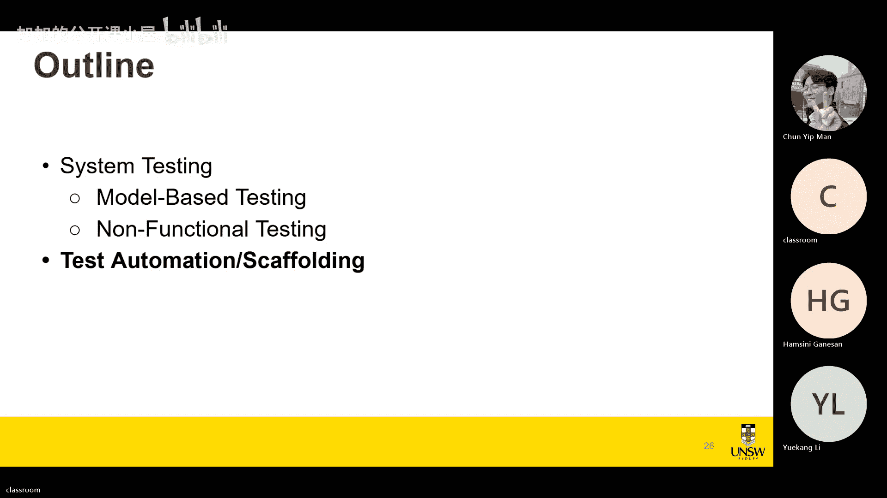

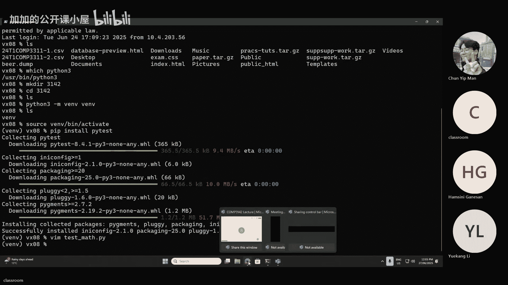

Oh， allright。 let's start the second half， so。We， we just covered the different functional and nonfunctional system testing in our first half of today's lecture。

 And that Max marks the end of levels of testing。 So now let's move on to another topic。

 which is related to test automation and skyfolding， which is also related to how do we。

Do testing during the process of software development。手。😔，By now。

 we have covered many techniques to derive test cases for different targets， right。

 So we learned black box and white box techniques to derive test cases。

 and we learned how do we identify different targets for testing。But how do we actually。

 we have the targets， We have the test cases。 But how do we run them and。We should run the code。

 and if we can run the code and check the results manually so we can feed the inputs to the targets we have manually and observe whether there are problems or not。

😊，But please don't do this in practice。Because。Humans are slow， expensive， and sometimes errorprone。

And testing design， actually。Requires effort and creativity， as you have。

 as you may have experienced in assignment 1。And。The design should require effort and creativity。

 but execution should not。 So we should somehow automate the execution of the test cases on our targets。

So this is about test automation and scaffolding， so。

So test on automation is actually about developing some piece of software or some useful scripts that can do the execution or the。

Repetitive tasks from the do do them for us。 And so that we can focus more on the creative aspects of testing。

 like how do we design the strategies。So。Automation actually controls how and when these test cases are executed。

 So basically takes care of the the environment and preconditions of running the program。

 and it can also， it can also help us to automatically compare the results to check whether there's an error or not。

 and it can also helps us to automatically re execute some field test cases。

And test skyfolding is actually the a set of programs that is written to support this process of test automation。

And it is normally not part of the product。And it is often temporary， so。Test scaffolding is like。

 how do we create some helpers or others for us to do test automation。

And this is a typical structure of a piece of test scaffolding code。

 So we can see that the entire thing here， the entire thing is called a harness。

 So a harness is like a substitute of all of a part of the deployment environment。

 It actually depends on whether we use all the deployment environment or part of it depends on the unit we are testing。

 So basically everything here combined， whether they are considered as the testing harness。And。

 and we have learned driver and stop in our previous lecture， right。

 Can you still remember what is a driver and what is a staub。A driver is， like， one layer。Above。

The target unit， the target unit， we are trying to test。 So since it is one layer above。

 it actually provides the。The， the context or the environment for us to run the target unit， right。

So， a driver is like。Substitute of a main calling program for the target。

So it prepares the environment for the for the， for the target。And a sta is like one layer below。

The target unit。So it is actually a sub componentent of the。A target unit。

 We are trying to task test。So。A sta is a substitute of the system functionality that hasn't been。

Implemented or integrated for testing yet。So both of them could be mocked up to prepare the environment for testing。

 for the program unit to run properly。And then we need， since we need to execute the program。

 we need to find bugs。 We need to know whether the output of the program is expected or not。

 So we need to have a piece of output comparison code。

 And this output comparison code is also known as test oracles。 So basically。

 an oracle can tell us about the future right about what will be expected。 And it's similar here。

 So we can use some expected outputs of the program。To do the comparison here。

And see whether the program behaves normally or not。 And normally。

 we can use assertions to do this output comparison。😔，And in some cases。

 we we also need to have this piece of tear down code。

 So tear down means any steps that must be taken after we run a particular test。 For example。

 we may have created some temporary data in the database。

 or we may create a temporary file when we repair the the execution for this program。

 or maybe this program， the target we are going to test can modify the the database or it can modify some files。

 So we need to resetite the system date before we run the next round of test， right， Otherwise。

 the the next round will be affected。So we need to also have some tear down logic here。

So there are some frameworks for us to write the structures of to write the test skype voting code。

So。They are considered They are so called unit testing frameworks。

 But normally when we are talking about unit testing， when we are actually doing it in practice。

 we are actually doing integration testing。 It's not just normally。

 we don't just test one single function write tests， so。For different languages， they。

 they all have their own frameworks for for Python， we have pieth。 We have no to。For Java。

 we have J unit for Javascript， we have j， which you have might have been using in 1，5，3，1。

We also have moquito。 and for C fast， we have G test for rest。

 it has it actually has a built in testing framework。

 And Python actually also has a unit test library， which is also a built framework。 but it。

 but P test is a little bit better。And we will be using P test for our assignment tool as well， so。

Let's have a look at some concrete examples， using。어 삼八5。Some code from these frameworks。So。

For example， let's assume that we are trying to test the the implementation of a small calculator program。

 and this small calculator program has an other class。

 which just have a simple function that can add to numbers up and return the the sum of these two values。

 and this calculator can invoke this other function to calculate the sum of two numbers。

This code is definitely not a good implementation of this function。

 but let's just use it as an example here， so。What we can do is assume that。

 assume we haven't implemented the error。Class， yet， what we can do is we can create an other stop。

 which will just return。Some number here to simulate the behavior of either， actually， with P Y test。

 with a plugin of P Y test， we can do better more cs， but we will learn that later and。

Yes assume that we can。 we can。 We can write the stuff like this。

 and then we can do the testing like this。 So now let's try to think about which part of test scfolding does each。

A piece of code。 correspond to here。So first， what， what is this other step。

What is the corresponding component。On the left。So obviously， as indicated by the name is a stop。

 So sorry， sorry， it's theres something wrong with the animations。 But anyway。

 So this stop is actually a stop。But this entire thing here is considered as the harnesss。

So everything here basically， is harness。What about these assert two assertions here， What are they。

They are just output comparison， right， That's very straightforward。

let's have a look at another example。 So with J unit。 So this is basically a J unit test case case。

And。So in this J unit， we are going to show you what is a tear down。

 So a tear down is basically for this one here is to to release the object memory here。 But， but。

 of course， Java can do garbage collection automatically。

 but sometimes we can still manually do this tear down or manually release the memory of an object。😊。

And this is another example with G test。 So we can see that we。

 we also have all these kind of things。 We have this set up。Which is actually。

 the entire thing is the harness。And we also have the tearer down， which is to release the resource。

 and we have these output comparisons here。😔，And that's all about the main content today。

 in order to。Practice， test automation and test scaffolding。

 We are going to learn how to use pie test in practice。 and。

 and similar to how we learned similar to how we learned the Python syntax I've created a file that can help you to learn pie test。

And you can't see this file yet because it's under week 5。 And it's not availableable to you yet。

 And I'm still improving this。 So， but today， we are going to cover the first few sections here。

 So it doesn't matter。 but you will be。 you will have access to a full version of this file next week。

And。😔，So。Why do we need to learn pie test？ There are several reasons， so。😔，The first one is。

The very first reason is that we are using Python a lot in this course。

 So let's use a framework in Python。And the second reason is that its syntax is very simple。

 and it its it the assertion of pie test is also very， can give us rich information。

 We will see later。 We will see with some examples later， and。

It actually also provides some fixtures which could be used to manage some environment set up when we prepare our test cases。

And pie test also has。A very diverse and very useful plug systems。

And we are going to learn two plugins here。 One of them is pie test mock。

 which can help us to create stops and drivers。And another thing is pie test c。

 which can help us to inspect the code coverage of our test cases。

So the installation is just similar to how you install other。

Pet test about how you install other python packages。 So what you can do is on your。

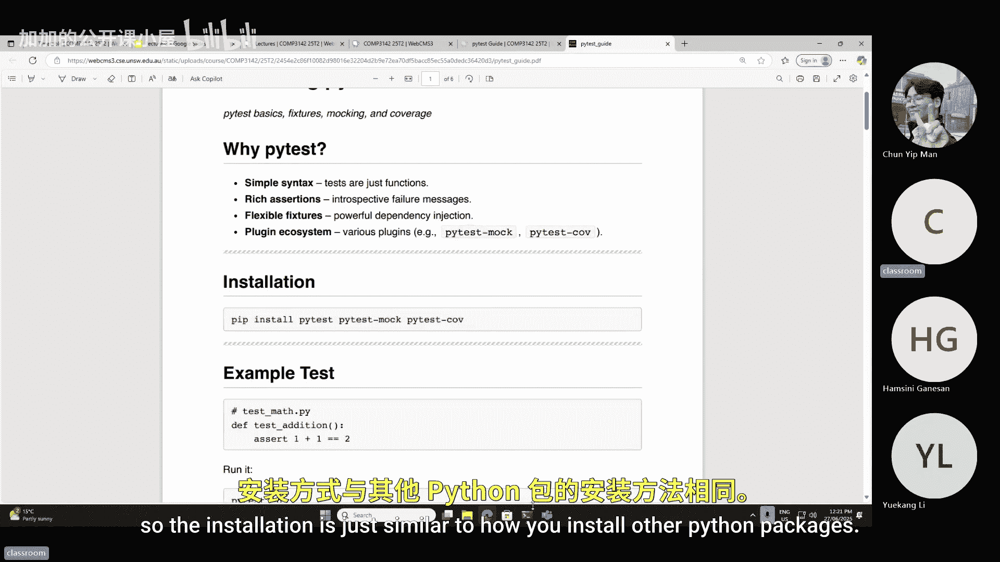

Log in server。😔，On the C SE到 login到 CSE server， what you can do is can you see this。Okay。😔。

I mean enlarge the forms。😔，嗯。Okay， I， I just enlarged the。The fonts。And let's start from scratch。So。

So now you can see that I'm in this folder here。😔，and there送你。😔，Sorry， I let me remove this。😔。

So there's only this one single Python file here。And what we do is。

When we use Python is a good practice to use virtual environments。 And I， do you know。

 Do you guys know virtual environments。Person， yes， okay， that's very good。 That's very good。

 Actually， there are many virtual environment management software like Qda or something else。

 And if you are using if you do some AI products projects you may have been using this a lot。

 But now let's just use the beauty virtual environment manager of Tyon。

 which is a virtual V and V module， And we just use this command command to create a new virtual environment。

 So this dash I'm here means that we are trying to invoke the virtual environment module。

 And the second parameter here。 V and V is just the folder to。😊，The folder to。

To store the virtual environment。 So let's just name it as V E N V as well。

 So let's create this virtual environment。 as you can see here。Now。

 we have created a folder called V E V。 And how do we enter this virtual environment。

 We just need to to run this。You just need to run the activate script under the。The be folder。

Of the virtual environment we just created。 So we just。Exece this script。 So this is automatic。

 This script is automatically created。 And if you can see something like this， it means that in your。

 in your command line or in your terminal， this means that you are inside a virtual environment。And。

The way of getting outside this virtual environment is also using another command。

 which is called deactivate。 So we just， if we just deactivate， then we just。

At outside the virtual environment。So， these are some basic commands。And now。

 inside this virtual environment。We can install。Pieized package。So， using this。Pep install。

 We can just install it。So。After that， we can verify whether it's installed by running this。P test。

 since I've just written a test file in this folder， it will automatically。😔，It will automatically。😔。

Run the test。 I have written。So basically， as you can see in the test。

I just write a test addition function， which will just a whether one plus  one equals 2 or not。

 And it automatically gets executed by the pie test command。 So this is。

 these are some basic commands we can use to install and run pie test。

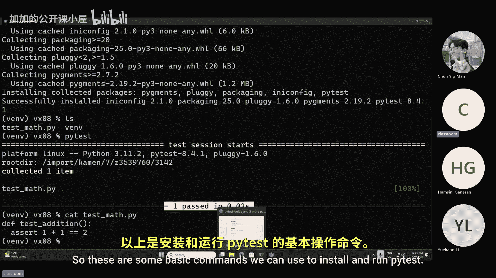

So。So this are， this is an example。And。And like we just discussed。

 pie test has the advantage of giving us rich information for assertions。 So let's。

 let's try to use one compiler as example here。So， let's try to do this。😔，So。😔，Let's say。

 we have this。This assertion here。Which compares。I need to enlarge the font here。哦。Basically， this。

 this assertion will fail because， because these two。These two leads doesn't equal to each other。

 So this assertion will fail if we invoke this function。So if we run it。

 you can see that it just reports throws out an assertion error， which is never catch。

 And this assertion can only tell us， okay， there's this assertion fields。 So that's basically the。

 the information we can get by default。From Python， however， however， if。

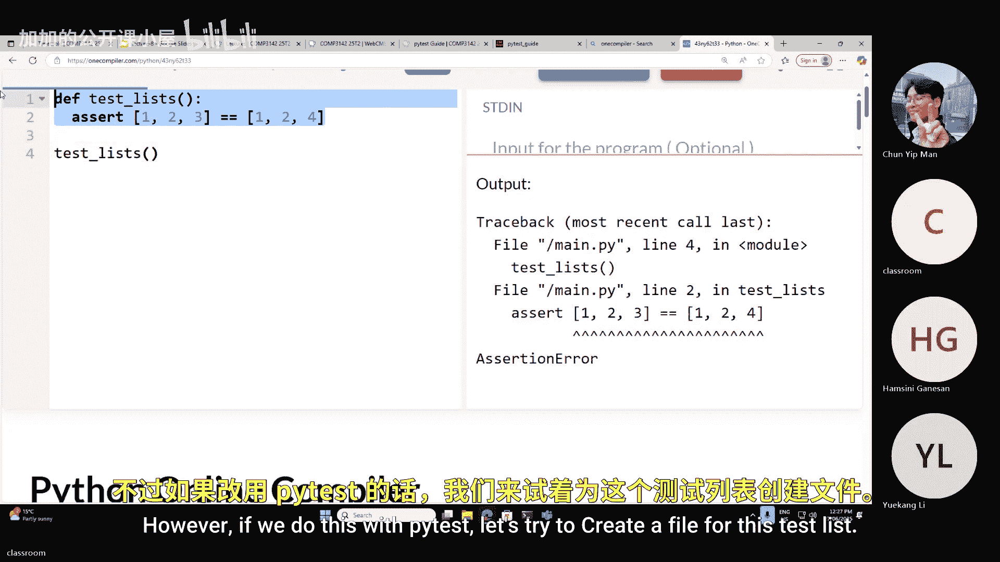

If we do this with pie test。Let's， let's try to。Create a file for this。As。😔，list似。😔，Yes。

I think there's something wrong with Wim here。😔，哦。O， it's可以 now。😔，So let's run high test again。

 As you can see， it gives us where exactly the di is。😔。

So we can get much more information from pie test。Than the assertions of pie。

 than the assert of the python itself。

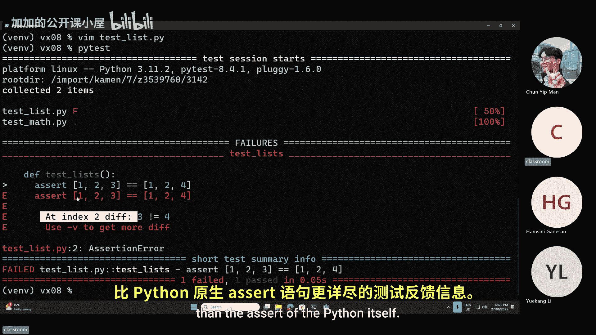

So。😔，So this is the difference here， as you can see。😔。

And that's one of the reasons for to use P test。 And there are many other reasons。And。

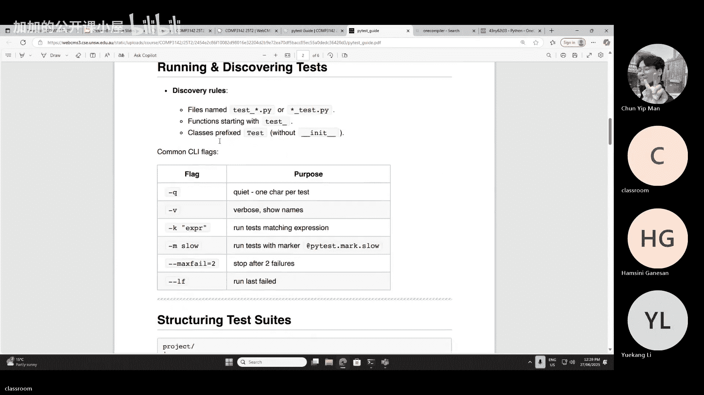

And just now， as you can see， if I run pie test under this folder in this folder。Except for the。

For the environment， I only have two files。 Each one of them has only one function， right。

If we have a look at these files。 So we， we only have two functions here。

 And how does piet know that it needs to run this。These functions。 if I invoke pie test here， so。

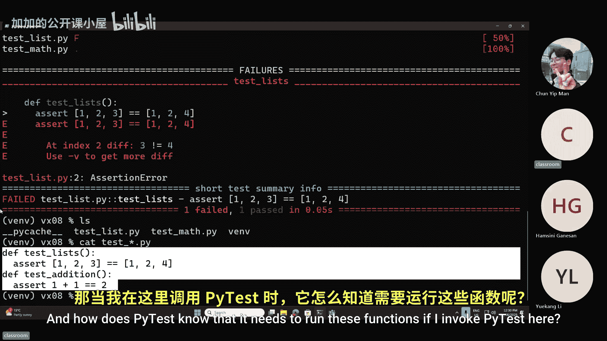

This is how it discover past cases from the code， from this folder so。It tries to find something。

 First， it will， it will check through the file names。 The if the file name is something like test。

Under something or something underscore test。 Then it thinks pie test will think， Okay。

 this file is written for storing some test cases。And then it will look for test underscore something。

Fs inside these files。 And this is one source of tests。And the other source is that it can also。

It can also。Check， look for classes with the test prefix。In the class names。

So this is how pie test can automatically discover test cases。

And there are some useful command line flags for us to play around with pie test。

One of them is whether do we want to have quiet or were both。

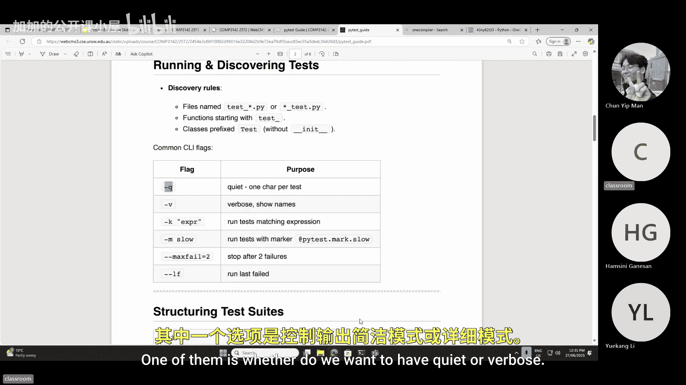

Number of our both output， for example， if we run。If we run pet with， nothing is by default。

It by print out a little bit more information than quiet mode。嗯For example， if we run quiet mode。

As you can see here， it。Instead of， instead of showing where the test cases is from。

 it will just show one。It will just show one character per test case。

 and it will it will also omit some other informations like how many items it has collected。And。Some。

 and some printing format will also be changed。And there are some other。 There are some other。

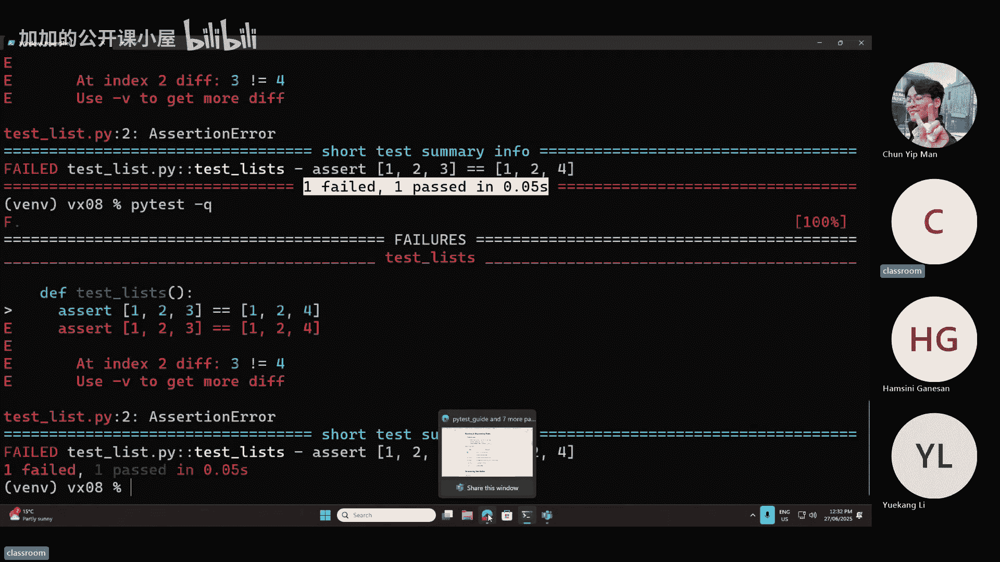

There are some other command line flags as well。 For example， we can also use。

Dashk to run particular。Tests which whose name can match certain expressions。

And they can also try to run tests with some markers， so。Mars means we can use。😔。

Decorators to annotate our test functions， and then we can invoke these markers。 We can in。 we can。

 we can test only the test cases with certain markers using this dash I command。 for example。

 we we just now， we have two test cases。 And let's try to。

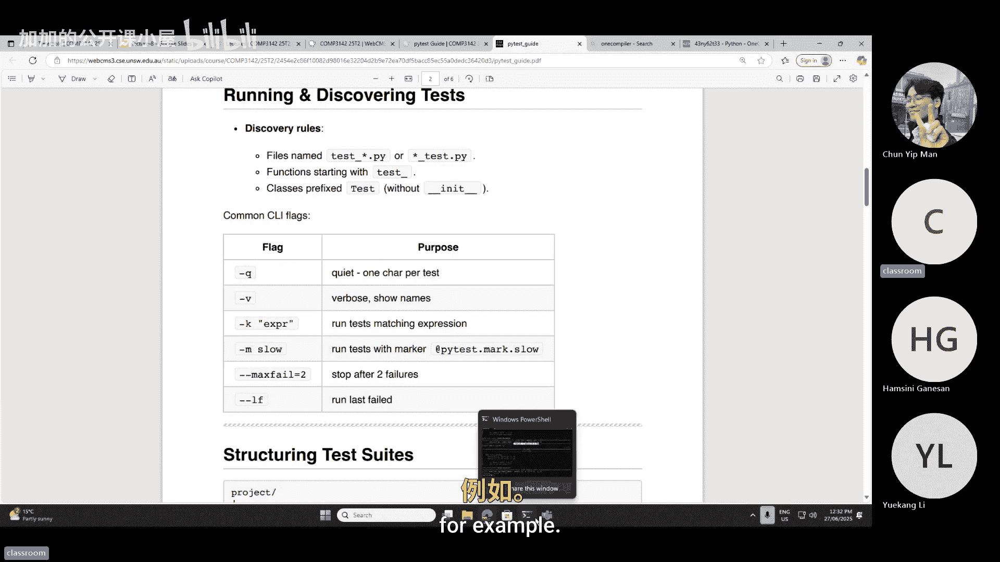

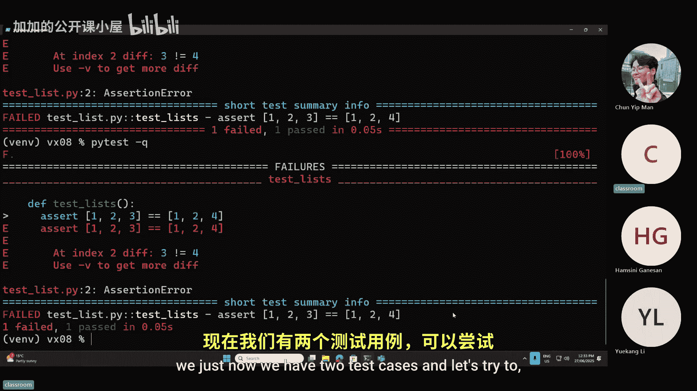

Let's try to mark one of them。

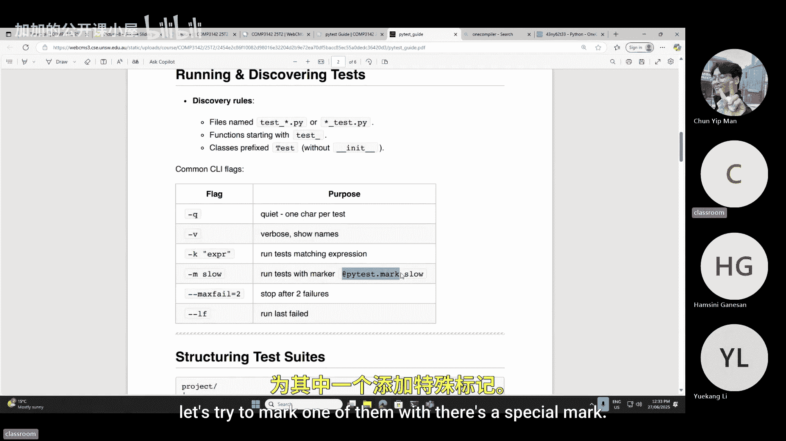

With。😔，Its a special mark。Example， let's say。😔，You can name it， as maybe least。😔。

We can use dash I list。😔，Oh， sorry。 We need to import。😔，If we want to use this decorator here。

 we need to import pie test first。😔，Yes。就。😔，As you can see here， it actually。Give us this。

 But we can， we also received them warning because this is like a pretty fine name in personthon。

 So the character warningns us， but it also， but it still allows us to run this test。

 And you can see that we can， we only。You can select two items。 However。

 one of them is deselected because we we specified that we are only interested in the test cases。

 which are marked with the decorator called list， so。😔，This is another useful。

 another useful flag for us。😔。

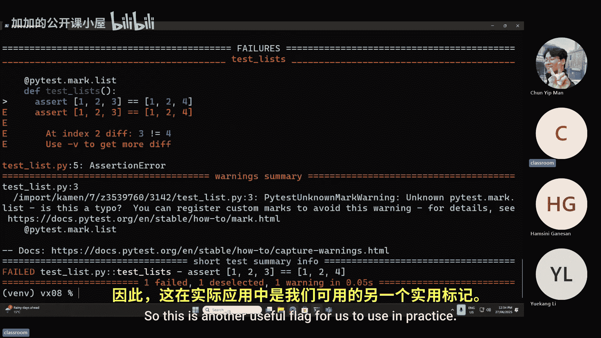

To， to consider to to use in practice。 And we can also specify the。

We can also specify the max limit for failures。 For example， if we have like in some real projects。

 we could have hundreds of test cases。And if we are at an early stage of development。

 we may encounter dozens or even sometimes hundreds of failures when we run test。

 when we run the testing， and we can limit the number of failures for us to， to see。😔，嗯嗯，妥头。

To minimize the effort of debugging the the code。 So this is to and to also avoid overwhelming the the final output report。

And there are also another useful flag that you may use， which is dash dash L F。

 which is to run the last field test cases。 So this is to automatically run the， for example。

 if we just run pad test， it will， it will run two test cases。 and。

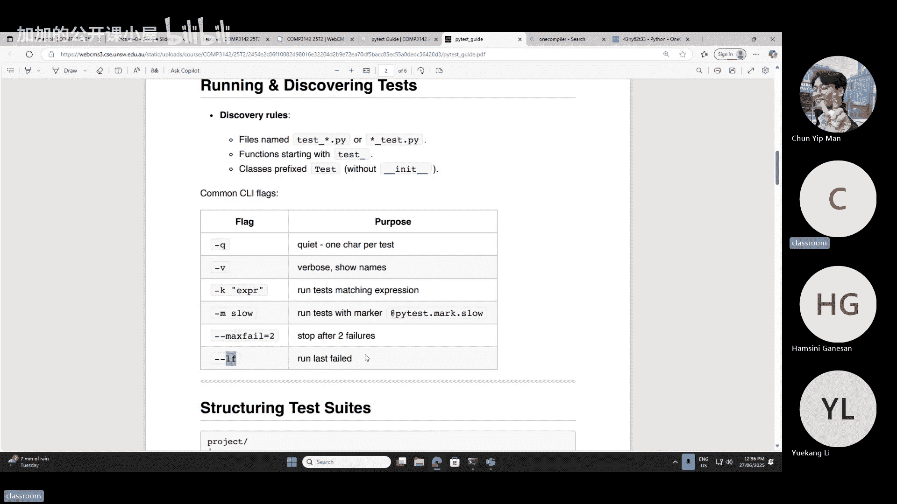

If we just run dash dash L F， it will automatically rerun only the field。Task case。

 So this can also help us to， because when we are， when we are doing the actual development， we are。

😊，Once we find some failure of the test case， we are going to look into our code and try to fix the error。

 right， And we are， and once we fix the error， sometimes we are only interested in the field code。

 So this command can can help us to speed up the process by skipping those。Past text cases。

 So this is。The usage of LF。 And it， it is often used together with。

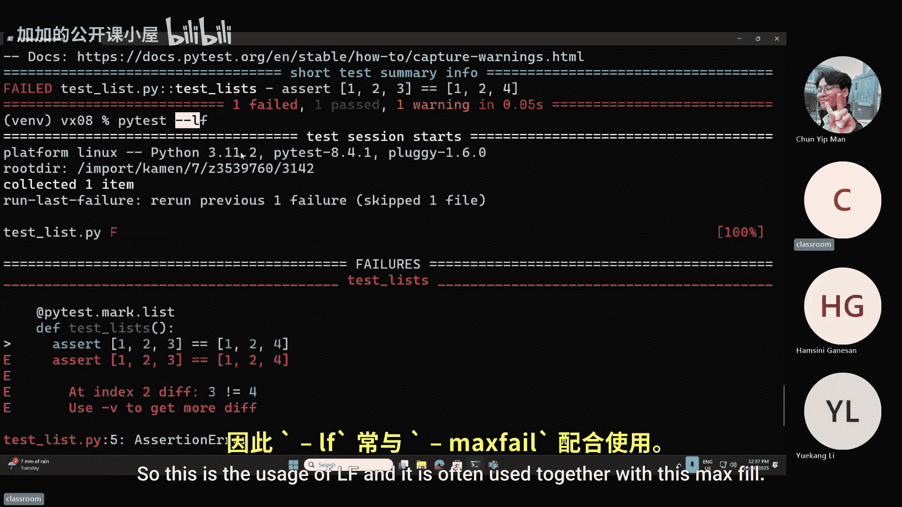

With this max file， if we set the max file to be one， and then we can always test the。

The single failure， we are。Dealing with。So， this is。These are some useful。

These are some useful flags。And。And normally， for us， for us， for a peython project。

 this is how we structure our test suites when we use。Pie test。

 So normally we just put everything inside a folder called test， and then。We。

 we can write our unit test。 We can put all of them in one folder。

 and we can put all of our integration test in another folder。

 and we can put some commonly used fixtures。To。😔，We can use some kindly fixed used fixtures in this。

😔，Conf test dot P file， which could be used to to develop test cases。

 And this conf test dot P Y is not only used to store the fixtures。

 and fixtures are actually corresponding to the。Yeah。Cresponding to the drivers and stbs。

Or sometimes the higher level of environment set up in harness。 So these are the these are handled。

 all handled by fixtures in pie test。So。😔，So okay， that's let's cover a fixture， maybe in next week。

And that's all of today's lecture。And before we end， let's have a quick。

 quickercap of what we have learned。In the last two hours， so。And also， in the last few weeks。

So we learned everything start we start from we start from how do we design test cases or test suites with different strategies with black box strategy with white box strategy。

 And that is what we have practiced in assignment segment1。

 And then we looked into and that's about how we design test cases。 And。

 and because we have a big piece of software， we need to identify the targets from for testing from this software。

 So that's why we learn different levels of testing。 and our last lecture， We learned unit testing。

 And each unit is normally a function or class and all these functions。

 And then because unit is not enough for capturing some of the failures。

 because some software failures come from the interaction between different functions or between different units。

That's why we need to do integration testing to， to try to combine different units together into some subs systemsstems that could be tested。

 And for integration testing， it is all about how do we。Combine things together。

 and we can combine things according to functions， and we can also combine things according to code structures。

 for example， you can use call graphs and。And if we further。

 if and if we combine everything together， if we put everything together。

 then we are doing system testing。 We are testing the the entire system as a whole。

 And for system testing， we can do functional testing， which is。😊，Different from the function。

 the functional testing we have learned before。 the context here is functional testing means that we are focusing more on the actual functionality of the software。

 And for nonfunctional testing here， we mean， it means that we are carrying more about the quality factors that could affect the。

😊，Final quality of our software。 And for example， we can， we can do some performance testing。

 We can do scalability testing。 We can do availability testing， usability testing and so on。

 So these are the non functional testing techniques。And after that。

 we learned all the everything about how do we design test cases， How do we determine test targets。

 And then now we have test cases， we have test targets。 But how do we execute them， right。

 How do we automate things。 This is related to test automation。

 And to in order to do test automation， we need to write some skyfolding code。

 And for these skyfolding code， we know the basic structure， right， we know what is a harness。

 what is a driver， What is a stop。 And we also know that for every test case。

 we need to have some output checking。😊，Component， and sometimes we also need some tear down code。

And that's all about today's lecture。 And thank you for coming on Friday and have a nice weekend。

 Okay， thank you。😊。

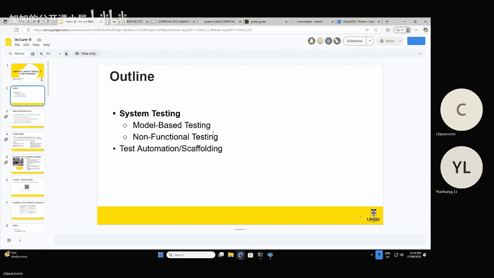