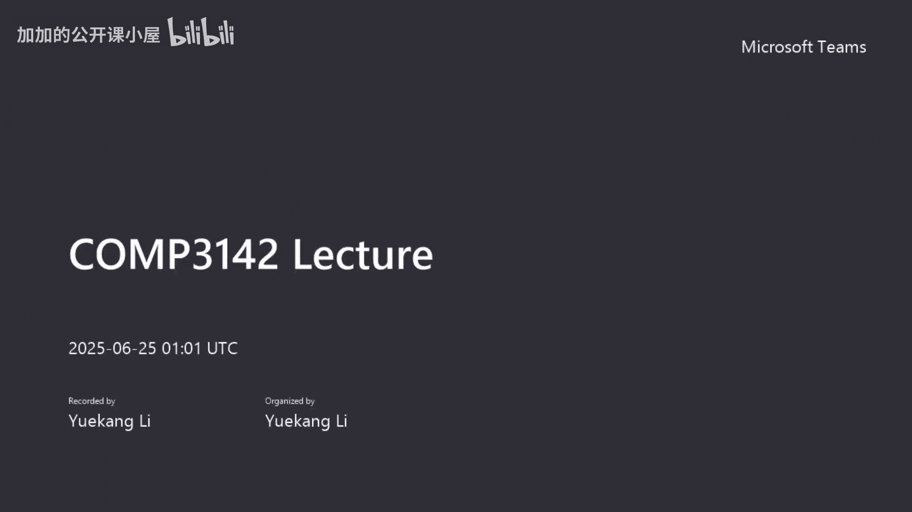
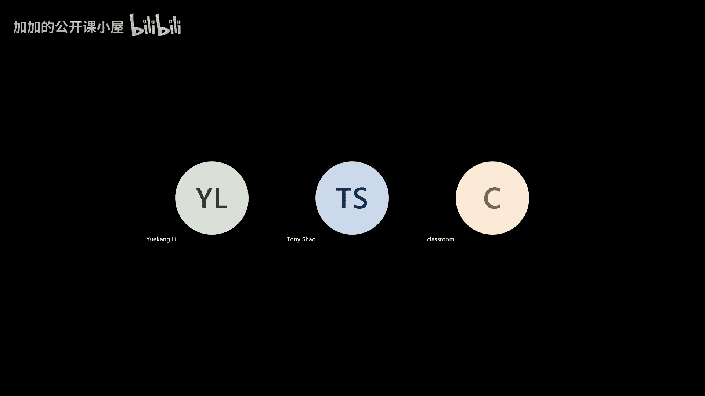
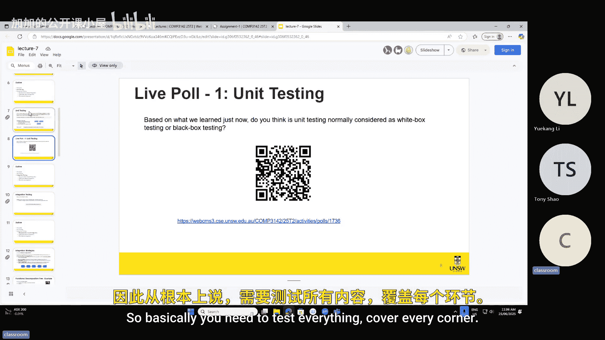
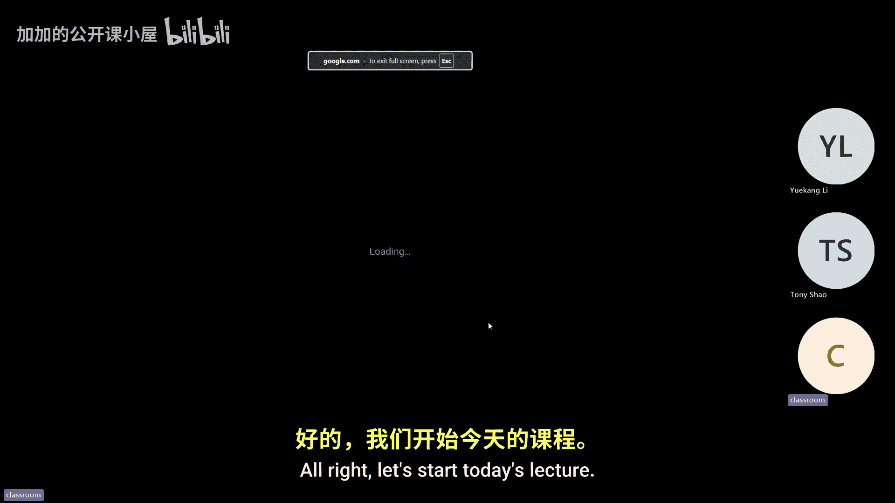
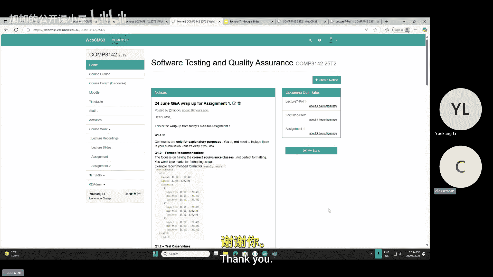
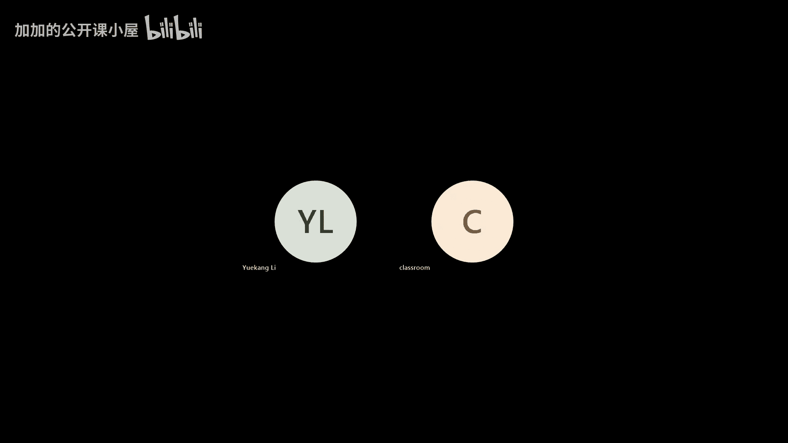

# 新南威尔士大学【中英⚡软件测试｜COMP3142 2025 Software testing】 p11 P11 Levels of Testing 1 -BV1o34HzBENA_p11-

Before we start， how， how is your assignment 1 going， Is it good。Not， okay， good。

And and before we actually start， let's have a look at this poll here。 Actually， one of you guys。😊。

Did this poll before 11 AM。 and is actually Max is Max here。 I actually sent you an email。

And I think you may have found a loophole in Web C M， because I purposefully made。All of these。

 like these。Close viewable to students。Until 11 AM。 and you shouldn't see it。 You shouldn't。

Have access to the link。Before the before 11 AI。So you， I think Max is not here。 But anyways， I。

 I you won't get punished for this。 This is allowed because we are actually testing course。😊。

And we encourage you to test all the corner cases everywhere。

 So including the the assignment specifications， you have asked all the different questions about every detail for this。

 And this is very good。 Actually， this is the spirit of testing。 So basically。

 you need to test everything cover every corner。😊。

So。Alright， let's start today's lecture， so。

In today's lecture， we are going to cover different levels of testing。And this is today's outline。

 So first， we will have an overview of different levels of testing。

 and then we will cover two levels today。So what we have learned so far in the previous weeks are functional testing and structural testing。

 They are actually related to how do we。From which aspect do we view the test targets。 So。

 for example， for functional testing， we are not given the source code。

 We only have access to the specifications。 So we are testing from the the customer' point of view and for structural testing。

 We have access to the source code。 So we are more like testing as developers。So。

One of them focuses more on requirements， and the other one focuses more on the actual implementation。

And that is actually from the testing target point of view。

 and from the entire testing precise point of view， we can actually separate testing techniques。

According to different testing levels。And in this week。

 we will be learning different stages and levels of testing。

 So this is like we are learning the different techniques from another， from another。Aspect。So， and。

 and both and all these， all these techniques are the methodologies or the systematic approach for designing test cases。

 So both the， the functional and structural testing are actually from the。Target point of view。

 And here we are going to design test cases from the testing precise point of view。

 So this is what we are going to learn and the relation between what we have learned。

So we will learn three different levels here。 The first one is unit testing。

 and the second one is integration testing， and the last one is system testing。

 And I believe most of you have heard about unit testing before taking this course。 However。

 in reality， most of us are actually doing integration testing。 and I will show you why。So basically。

 as indicated by the name is very， iss kind of very simple。 So unit testing。

 we focus more on testing different units inside the program。

 and the definition of unit could be different from for different programming languages。

And for integration testing， we care about components made up of different units。

 So for integration testing， the key here is how do we determine what could be integrated together and tested together。

 And for system， for system testing， as you can see in this illustration。

 all the nodes are connected。 So we are testing the entire program as a whole。

So that's roughly the difference between these three different levels。

And let's have a look at the details。 So here the， you may wonder， okay， what。

 how do we determine the nose here， Right， Let's have a look at the details。So。

How do we determine the different levels of testing is actually related to a model called the V model of development。

 So this we model here is actually is actually used for modeling the process of software development and testing。

 So as you can see here， on the left hand side of this v shape。

 we have all the different stages for developing a software。 And on the other hand。

 on the right hand side， we have the corresponding testings we need to do at each stage of development。

放 example。This is the， this is a software development lifecycl。

 And the other one is the testing lifecycl。 So this is how the re model is used for modeling the correspondence between development and testing。

And。Just now， we mentioned that we can do unit testing where unit testing is actually when down when we do the detailed design。

 and you can see that is more at the bottom and is closer to the actual implementation。

 And if we go level up， We can see that for integration testing。

 we are actually mostly testing the architecture of the software。

 And then for system and acceptance testing。 we are actually more like testing the requirements of the software。

 And you may wonder， okay， we， we just mentioned unitized integration testing and system testing。

 But what is acceptance testing here。 So this is actually a special term that is used to to describe a set of testing techniques that are related to different acceptance。

AreWhich we won't be covering in detail in this course， but I will expand this term briefly here， so。

There are many different metrics or aspects for acceptance。 For example。

 we could have user acceptance testing where we can do alpha testing or better testing。

 So alpha testing means we are doing this testing with some invited users before we release the software and better testing is like we release the software for some to some users and actually test it。

 so。Oh， this is to test whether the how does the user feel about our software。

 And there are many other acceptance。 And the most typical one is regulation acceptance。 Actually。

 there are many different regulations that companies needs to follow before they release the software。

 For example。AndDo you guys know how the auto autonomous driving of Tesla work。So how does it work。

 Like， is it using some kind of Li or radar to detect the environment， No， right。

 it's actually using computer vision。 And actually this computer vision has the problem of affecting the privacy of the pedestrians and other cars in the during the in the road。

 you know， it's actually recording videos in real time。 And if if if you are a pedestrian。

 you don't want your face to be recorded by the by Tesla， right but those autonomous vehicles。

 So actually Europe， they have some kind of regulations about this privacy issue for this autonomous vehicles。

 especially the computer vision based ones。So before we release the software。

 we need to resolve these。Regulation。 So that's why we also need to do regulation acceptance testing。

 But these， as we could see， these acceptance testing are all these acceptance。

Matrics are related to different definitions， and it is very， very diverse。 So we don't。

 we don't cover them in this course。 We cover more about the strategies for designing different levels of testing here。

 so。So we， we just focus on system testing in these cards。

And now let's move on to the actual details of each levels of testing here。

 So the first one we are going to learn is unit testing。So as you can see。

 we have a very long definition of unit testing here。And basically， we， we can。

Instead of paying attention to the entire whole big sentence。

 we can try to focus on some key terms here。 So the first one is unit testing is actually focusing on testing an atomic unit unit of the program。

And different programs or different programming languages could have different atomic units。

And then we need to run this。Atomic unique， right。Because we are doing testing。

 and testing is a dynamic technique， which requires us to actually run the code。

And we need to run this code or run this target with some prepared test cases。

 And these prepared test cases are considered as the inputs to these units we are testing。

And the last one is。After we run this unit of。A code or the unit of the program。

 We need to verify that whether this program behaves correctly or not， right， we need to find bugs。

 So that's why we need to compare the actual results with some predicted results or test oracles。

To verify that， okay， this program is buggy or not。So the key terms are， we are testing atomic units。

 and we need to run this with test cases and then compare the execution results。So。The here。

 the key here is that unit testing is the process of testing the smallest isolated unit that can be tested。

 So you can see that the key is how do we determine the unit for a program。And。And the importance of。

 the importance of， so。The importance of doing unit testing is that， because。

Because we are testing smaller units inside the program， it could be easier to design test cases。

For example， if we decide that a function is a unit。

 then we just need to care about the function parameters。 So it's easier for us to。

 to design the test cases here。 and it could be more exhaustive because we only care about very small portion of the program。

 so we can somehow exhaustively test all the possibilities。And。

Unit testing is also an important technique for test driven development。

 where we can write unit test first， according to the requirements and。Actually， implement our code。

So as you can see here is close to the bottom and is very related to the testing。

 the actual detailed design。So now let's answer the most important question。 So what is a unit。

 What is a unit。So normally， a unit is just a method or a function。

 And in object oriented programming， a unit could be considered as a class。

With all of its methods inside。 So that could also be considered as a unit。

 And for non object oriented programming languages， we， we just treat。Normally。

 just trade a function as a unit。So now let's come to the。First live poll today。

 which has been done by some of you before the lecture starts。So。

Based on what we have just learned now， do you think。

Un need testing is normally considered as white box or black box。If we try to connect。

The new knowledge we have learned just now with the knowledge we have learned in previous weeks。

 So do you think is's normally considered as white box or black box。Oh， sorryorry。😔。

I wait for some of you to finish this。So actually， these are some of you。

 When you come to the help session， you mentioned this as a quiz。 but this is not a quiz。

 So you just need to participate。 You don't need to get the correct answer。

 You don't to worried about， you know， answering it。😊，Correctly， but you。

 you should try that your best to answer it correctly。So， let's see the results。

So most of you think it's white box， and some of you think it's black box。So。Actually， actually。

Unit testing could be either black box or a white box， so。But。

 but since this is this question here is a radio button。 you can't choose both It's not a checkbox。

 So， so you know need to worry about the correct answers here。 So its actually both are correct。

 It depends on how do you do unit testing。 So like we discussed in the previous slide。

 So unit testing is helpful for test driven development， right， for test driven development。

 we write our test first before we actually implement our code。 And in this case。

 we are actually doing a black box testing。 According to the specifications。😊。

So the unit tie are written as a black box here。So in this case， we are doing black box testing。

 however。However， we can also write unit tests after we have implemented the code。

 So you in this case， unit test is a white box testing technique。

 so it could be either black box or white box。So。This is all about unitized， and we will。

We will practice unit test with and integration testing with our assignment，2。

So let's move on to integration testing。Integration testing is also known as subystem testing， so。

InInstead of testing the units one by one， we want to have a look at how does each unit interact with other units。

 Because many of the times most of the times the bug does not only come from a single unit of the program。

 It actually comes from the interaction between different units。

 So we need to care about how could we test these kind of interaction between units。

 So we need to somehow combine different units together into some sub systems。

 and integration testings are all about how do we do this combination or integration。

So there are a few variants here， and we will learn them。And。😔，The rationale， like I just mentioned。

 is。Most of the software works by combining different interacting components。

 so we can use unit test to test the performance or the actual functionality of these individual components。

 and we can also test their interactions。 So many bugs actually comes from the interactions between different components。

So the key here is how do we determine the sub systems here。

 and this actually leads us to the different variations of integration testing。

So we are going to learn three different。Types of。The three different approaches for designing the for identifying the subsystems from a whole big system。

 And the first one we are going to learn is decomposition based integration。So。

The the integration strategy here of this decomposition。

based testing is we could use a functional decomposition tree here。So。

A functional decomposition tray is。As indicated by its name is a tree that is used to break down the different functionalities of a big system。

 So you can， you can view the requirements of a big complex system as a tree of different requirements of different functionalities and。

This actually helps us。so this is like how we can view different。 This is quite natural， right。

 We can break down a very big system into smaller branches into smaller， smaller components。

 And these small， some of the small components could be grouped together as。Another feature。

 And then eventually， we can get a tree of different functionalities。

 and it it is actually derived from the requirements inside of the programs。

 instead of the actual implementations。And inside this tree。

 we can actually capture how does each functionality interact with each other's and how does each functionality contribute to the entire。

ASystem here。So there are a few terms here。 We need to care about when we deal with function。

 functional decomposition tree。 So the first one is the top level function， which is。

Normally considered as the top of the tree or the root node of the tree。

 and which is the most general function of this system。And there are many sub functions。

So we can break down。 We can further break down the top level function into some sub functions。

 which are necessary to achieve the goal of the top level function。 And these are the sub functions。

 And we can further continue to decompose each sub function into smaller functions until we reach the most basic level。

 So this is。How we how how we determine the。How we construct this function。

 functional decomposition tree。And normally， this is what we do。

 So what we do is we identify the main functions， and then we divide the main functions。

 and then we define relationships between different functions。

And then we represent the relationships， and then we refine the decomposition。 So this is now。

 normally how we construct this。And because we need to care about the interaction and contribution of each individual component。

 So we need to define the relationships correctly here。 So this is a key focus of this precise。

And let's have a look at an example。 This is the definitions are kind of overwhelming， so。

Let's consider a calendar program。So。This kind of program has these functionalities。

 So the first functional is that it reuses our old brand next date function。

 so it can give us the date of the next day。😊，It can calculate leap years。

 It can give the day of the week corresponding to the date。 For example， it can give。

 tell us whether a date is a Monday or Tuesday or whatever。

 And it can also calculate the zodiac sign of the day。 It can it can recognize some memorial days。

And can also help us to calculate the most recent Friday the 13th and talking about Friday the 13th。

 I think most of you are thinking about this。😊，But not this one here。

 we are not going to talk about movies here。 So， so I assume that we have this kind of program that can do all these features。

And what we can do is we can have a functional decomposition tree like this。So。So， it is。

So this functional decomposition tree， as you can see， is。Actually。

 it's actually not from the actual implementation of the program。 Its pure， is's purely from the。

Functional descriptions are the requirement specifications。 So you can see that。

 of course we the this functional the main function of this program is to serve as a calendar here。

 So that's the root node here。 And we can further break down the。😊。

We can further break down each main functionality， according to the description here。

And we can further decomppositionite some of these functionalities， for example。

If we want to get the date。If we want to get the date of the next day。

 what we what we can do is we need to check the validity of the date。 We need to check。

Assume that it is done。I assume that this function follows the follows the。

The implementation in our previous examples， we may need to calculate the last day of the month。

 We may need to convert the data into the number of days and so on。 So we， we need to。We need to。

 we can further decompose the functionalities of some of the functions here。

 So this is what we are doing here。 And if you ask me， why is Mondays doing is related to Memial Day。

 And let's just assume that this program works in this way， so。So we can。

 we can have a functional decomposition tree， according to the。

Logic of different functionalities within this complex system。So with this tree。

 we can play with different strategies of creating different integrations or subystems。

 So with the tree， when we are trying to traverse the tree。The most intuitive。W we are。

 we will be thinking about is that we can do top down travel。 So right， we can similarly。

 when we are creating the， we are， when we are creating a sub systemstem for us to test。

 we can also do top down integration。So what we are doing here is。

We start when we are testing the system。 We start with the main function or the root of the tree。

And any lower unit。That is invoked or called by the main program up here as a stop。And a stop。

 you can consider a stop as a mock up code that marks。

 marks up the actual functionality of that particular function。So， for example。For example here。

 when we， when we start from the root node。Instead of。Instead of testing all the。

Instead of testing all the system with the actual code。

 we replace all the functionalities with some stops with some mock up code。

 So we assume that all of them will work correctly and return the value correctly with some hard coded programs。

 So we just assume that all of them work properly there。 So you may wonder， okay。

 then how do we do testing， right。😊，So， we gradually。We gradually replace the stepss。

 with the actual implementation。So， for example， here at the top level。At the top level。

 when we are dealing with this main function here。 First， initially。

 we provide fake or hard coded implementation of all the。

Of all the functionalities in the next level here。 And in this case。

 the program should work properly， right， because we assume everything works properly。

 and we are providing some fake results， which are。W。

 which works as if they are correctly implement implemented。 So this one will not give us any error。

 And in order to test the actual code， what we do is。If， for example， in this， in this thing here。

 first we。What we can do with next is we replace this stop with the actual implementation。

And then if we find any bug with this setting here。

It means that the bug is happening within this sub module or this sub function。And similarly。

 once we have replaced this。The next step is we can replace the next sub stop。

With the actual implementation。 And if we find any bug here， then we know that， O。

 the bug must be happening within this functionality。So， we are gradually。

We are gradually replacing the stops with actual code。When we do top down integration testing。

 So this is。How we can。This is how we can do this。 top down integration。So， for example。

 if when we do the。When we， when we were testing the calendar program and thezodiac calculation。

Or identification could be a stop。And the Zdiac stop， if。

 if the main function cause the function cause thezodiac calculation with this date。 sorry。

 it's blocked。H let me。No。Let me erase， please。😔，Re result， so。So if。

 if the program is provided with this date， then it should return on Smin9。And。

And what we do with the stuff is that we just create a small function that returns as driven I hear or or whenever the input is this。

 So we don't need to care about the actual implementation。 We just。Pretend that this can replay can。

Can give us the correct result。And。And for each and when we and integration testing only cares about how we prepare the test target。

So we can still apply the proper functional or structural testing techniques we have learned to look for the faults。

 So this， this top down integration actually only helps us to prepare a target for testing。

 right when we design test cases for that target。 We could still apply the knowledge we have learned for functional and structural testing。

😊，So。This is a relationship between。This and what we have learned。And。

When we are convinced that a particular target is。Correct。

 then we can gradually replace the stops with actual code。 So in this way， we。

 we know exactly which part went wrong。 So this is top down integration。😊。

And do you think this is more like a DFS or DFS when we are doing this replacement。

This is more like a B， F S here。 So we do with this level。 we do with this。 we do with this。

 And then we move one level。Lower。 so we are doing B F S when we do top down integration。

And when we have a tree， we have top down。 and naturally， we can think about。

 can we do things bottom up， right。So。Pottom up is like a mirror of the top down。

But the difference is that instead of because we are doing bottom up。

And most of the leaf nodes inside the tree， their execution actually requires the context provided by their parent node。

 right， When we are testing some programs， for example， when you are。

 when you try to run a particular function of the of a program。

 you may need to provide the context or dependencies of that function， right， so。

For bottom up integration， since we are starting from the bottom layer of this complex system。

And these bottom layer components， actually， they are。They don't require stops because they are the。

 the actual implementation of those functionalities。 So instead of requiring stop。

 they require something called a driver module。 and driver module actually provides。Actually。

 they are used to emulate the units' next level up in the tree， in the functional decomposition tree。

 and they， the drivers are used to provide the， the execution context of the component we are testing right now。

 so。😊，So。Here we are focusing。So this is the illustration of this concept of bottom up integration。

 So here we are focusing on these targets here。 And when instead of creating。A stop。

 because they these are the， they are the actual implementations。 So we don't need stops。

Instead of needing stop， we need some dependencies or context， which are called drivers。And。

This driver is used to simulate is or mock up the implementation of the functionalities one layer up in the tree。

 So this is what we do here。So in this， in this bottom up integration， we start from the leaf。

The leaves of the tree。And then we test them with some code drivers， so。As you can see。

 we have less throw away code in the drivers than stop。

 because stop are more like more cops and drivers are more like providing contacts or dependencies。

 So we don't have that many， you know， fake implementation of something so。

So this is a difference between drivers and stop and。Because。Because most of the system。

 most systems， they have a very high fan out， which means that many leaf nodes could share the same parent。

 So in this case， we if we do bottom up integration because they share the same driver。

 So we don't need to care about creating too many drivers here。

 So we can different nodes can share the same drivers。And since we have bottom， top down。

 we have bottom up， can we combine them together。And the answer is， yes。 So if we combine。

 top down and bottom up together， we can get sandwich integration。😊，So。

So so the sandwich inhibition is like we try to identify a full pass。From the root。All the way。

To the live。And then do the testing with this full pass of program。

 And this is called sandwich integration， so。So there will be。

 so compared with bottom up and top down。 There will be less stop and driver development effort thought。

 because we， we are not mocking up anything here。 We just try to provide a slice of the program to test。

 so。So this is， this can actually help us to save some efforts to develop these staff and drivers。😊。

But。But sometimes in this example， it's very clear that we can do the separation in this way。

 But in many real world cases， there could be。 It could be hard to find this。A slice of program。

 And it could also add difficulty to fault isolation。 So just now。

 we mentioned for top down integration， We are gradually replacing the stepss with actual code。

 Then we can identify we which。Exactly feature causes a bug。 So， and similarly， for for bottom up。

 we are gradually testing different nodes。 We are。 We know exactly which node or which functionality causes a bug。

 but for sandwich integration， since we are dealing with a whole slice of a program。

 When a bug happens， we need to it， it's a little bit harder to。To identify the buggy location。

 So this is the drawback of sandwich testing， compared with。The prayer tool。And last but not least。

 the strategy of decomposition based integration testing is called big bang integration testing。

 So big bang integration testing is that we combine all the components of modules we have implemented right now。

 together as a single unit for testing。 so。Sandwich could be considered as like a big bound of a sub of the program。

 and big bound integration testing is like testing the entire。Flay here。So but wait。

 if we combine everything， if we combine every component together。Are we doing system testing here？

 So what's the difference between big bangang integration testing and system testing。Actually。

 the difference is quite subtle， so。The big balance integration testing actually。

 they are actually high the the。The target being tested here are actually the same between。

A bigig value integration testing and system testing。

 They are both testing all the components of the software。 However。

 the difference is that when we do integration testing。

 we focus more on the internal interactions between different components。 Well。

 if we do system testing， we， we just care about the behavior of the program as a whole。

 We don't care about the what's happening inside。 So that's the first difference which is about the scope。

And the second one is， when we actually do。When we actually do testing during our development。

 the timing of applying these two testing techniques are different。

 So big bang integration testing is still an integration testing。

 So it is normally considered to be performed after unit testing and before system testing。

And system testing is conducted after unit testing。

 and another difference is that integration testing most of the time is done by the development team and system testing is actually done by a dedicated testing team。

 which is normally a different team in the inside the company。So， these are the differences。

As we could， as we just learned。 So all these decompositional based integration testing are about how do we decompose the system into different subsystems。

 For example， for top down， we can gradually replace。

 build our sub subsystem with the help of stops for bottom up。

 we can gradually build our subsystems with the help of drivers for sandwich。

 we can use slices of the programs as subsystems for big B， we just combine everything together。

And there are props and cons for doing things in this way， so。So the pros here are， this is。

So because we are more， for most of the strategies here， except for a big bang and。

We are gradually adding even for sandwich。 We are gradually adding units or components into the target we are testing。

 So whenever a bug happens， we know where exactly it is even for sandwich。 We know that that。😊。

Slice of program have has error， even though we may not know which exact function causes the program。

 We know that slice is causing problem， so。So， it is。

It is easier for us to check the to do fault localization whenever we find a bug。

 So this is the first advantage。 And the second advantage is that。

Remember of the six principles we have learned for testing。 So observability is important， right。

 So we need to somehow。Observe the progress of doing testing and integration testing is could be easilyed against the decomposition tree。

 So we know the progress how our progress is if we compare。

 if we compare what we have tested with the full decomposition tree。So。These are the two advantages。

 And there are some disadvantages as well。 So the first one is。That。The because we need。

 we need to write。 we， we need to write the。The the functional decomposition tree。

 So most of the most of the the decomposition strategies are based on the functional decomposition tree。

 right， and the functional decomposition tree， like we just mentioned。

 is not from the actual implementation of the code。

 It is instead from the functional requirement or the requirement specification of the program。

 And in reality， the developers are the ones who write unit test and integration test right。

 but they are not the ones who came up with the requirement specifications， right。😊。

The requirements specifications in。Most of the development teams are managed by the project managers who are not the developers。

 So there could be some issues with the management of this。

And the second drawback is that for top down and bottom up integration testing。

 we need to develop some mock up code。And this， this mock up code could be could be either stop or drivers。

 And and writing these mock up code could be could be could cause as additional effort， right， so。

These are the。Drawbacks。And。And there are some， there are some factors which we could consider when we。

 when we think about which method third should we use， so。If。

 if the program has clear requirements or design， which means that the design is stable。

 So the requirement won't change that much。Then。It's easier for us to do top down approach of testing。

 and top down approach of testing is more like how do we do。Test driven development。 So we can。

 we can mock up some code first， because the the requirement is stable。

 We know that the requirement won't change so we can easily mock up some functionalities with stops。

😊，So。So if the requirement is clear and stable， then we can。

 we can consider to use top down approach to do the decomposition。However， if。

If the requirement constantly changes， let's say， from the users。 So if we do top up， if we do。

 if we still do top up based integration， we need to change the behavior of our steps a lot， right。

 because of the change of the requirements。So in this case， we don't want to do top up。

We don't want to do top up decomposition。 We would like to do bottom up。Approach， because of the。

Changes in the。Requirements。And if the。If the structure of the code。

Our design of the architecture of the code changes， but the the requirement is stable。

 Then we can consider to use sandwich approach， which means that we don't need because because the functionality doesn't change a lot。

So we can， we can easily。We can easily so the slices of the program or the functionality composition。

 functional composition tree won't change。 So in this way， the slices won't change。 And because code。

 the actual code changes。 the actual architecture changes。 So we can。😊，So it's actually hard to。

To maintain the drivers。 So that's why we， we can do sandwich testing。

And if everything is becoming stable， then we can do big bang。

 So which means that we can test everything together。 We can combine。Everything together。

So these are the pros and cons and some。Practical concerns when we are choosing different methods。

And before we move on to the second half out of today's lecture， let's have a 10 minutes break。

And I'll see you at 12。3。嗯。Okay， let's continue our lecture， so。Like， so for integration testing。

 the entire idea the different strategy is all about how do we。Do this integration， right。

 How do we identify the subsystems， And just now， we， we explored a set of strategies which use。

 which use the。The the functional requirements to do the decomposition and similar to what we have learned。

 So we can use。 We can do functional testing。 We can view this target from the functionality point of view or the requirement point of view。

 We can also try to view the target as source code or actual implementation。

And similar for these integration strategies。 So we can do the decomposition of the integration with the functionalities。

 like what we learned just now， we can also do this。

Subsystem identification or integration identification with。Regardlessgar of the source code。

 So we are going to learn two different set of strategies。

 The first one is call graph based integration。 The second one is pass based。

 and both of them are from the source code point of view in comparison from the requirement point of view。

So。The yeah， like I just mentioned， the actually one of the。Drawbacks， how one of the pro counts。

 one of the accountss we have learned。Of the decomposition based of integration is that it requires the functional decomposition tree。

 which。Which is derived actually， from the requirement and not the actual implementation， so。So。

 this is actually not。Not very available for the developers。 So we want to care。 We， we。

 we want to care more about the actual implementation。So。So instead of using the requirements。

 we can just use the actual code。And。Here we can use the call graph to do this decomposition。

 And you may wonder， okay， what is the call graph。 And actually。

 a call graph is a special type of control flow graph that represents the core relationships between sub routines in a computer systems。

So each node of the graph represents a procedure， and each edge indicatess that one procedure calls another。

 So， so in most of the cases。 In most of the programs。 Each procedure is just a function。

 It's just a function。 and in some special cases， there could be macros in C or C plus files， right。

 they could also be viewed as procedures， sometimes。And sometimes you have go to in C。

 which could also trigger the something like a procedure call。 So， but most of the cases。

 in most cases。The nodes of the call graphs are just functions。 So if function A calls function B。

 then we add an edge from A to B。 So that's very simple， so。

So this is somehow echoing how we determine the units of the program。 Like in most of the cases。

 a unit of a program is a function， right？ So here。We are combining units together using this graph。

 So each unit is actually a node here， which is a function。 So in the previous。If we。

 if we reuse the calendar program as example here， this is an example call graph we can have。

So this is。 So each node is a function and。Each h means that a function is calling another function。

 and that's。The idea of a chograph。And with this call graph。

 we can develop different integration strategies。So。The first one is。

We can do parawiseise integration， and。Have a pairise integration， we restrict each test session。

 So a session means the target we are testing。 So the the target the target part of the program we are aiming to test。

So， each session。Is only a pair of units in the callgraph。

 So because a callgraph is made up of address and nodes， right， So a pair of。

A pair of units is like a pair of nodes connected by the same edge。

So we restrict each session or each test target as a pair of units。 when we do pairwise integration。

And。This ends up。That we each integration test session is aimed for each edge in the cover of。So。

 for example， for this one here， so。This is so what we can do is we can do paraise integration。

 So these two examples are actually not correct。 This is from the textbook。

 So we only care about these nodes， which are connected by an edge。 We don't， we don't do this。

 So this is。This is an error with the。Textbook。So， when we do para innovation。

 we only care about the calling relationships。So。The main advantage of doing pairwise integration is。

That we can achieve high degree of about isolation。

 because we are only testing a small part of the program。 And we care and for integration testing。

 remember， the the difference between integration and unit testing is that we care more about the interactions with different between different units。

 right， so。So the the smallest interaction here is actually the calling relation。

 right is one edge here。 So we can have a very， very high or maybe even the highest degree of fault isolation。

 if we do parawise integration， because we only care about。😊，그。呃tTwo functions each time。However。

 theres a， there is a drawback， so。There' is a drawback。

 When we identify some errors inside using this， the test cases we designed for a particular integration。

And we can， and imagine that the we are developing some fixes for the bug we have found。

 and that fix。😊，If we， if we only look at the pair。

 this single pair here and that fix only applies to a single pair。

 It means that it the the fix may not be a applicable to other pairs。

 which means that the fix may not actually fix the the problem here。So because we only care about。

Because， for example， if I， if we find a bug with this pair the 16 and 9 here。

 So we know that and assume that we are fixing the， we are fixing the error with within function 9。

 And actually， the， we can also fix it here。 So in， in most of the cases。

 we can fix the program from different places。 And let's assume that we fix the error and note 9。

 But。But the actual error could also be fixed at note 16， so。In this case， we may miss。

 So the bug could still happen with the pair of 16 and 10， because we are only fixing it here。

 So because integration time for for the pairwise integration， we only care about a small， very。

 very small part of the program， which means that we are， we may miss out some context。

So when we do fixing， we may， we may not fix。The root cause of the the bug。

 So that's the drawback here。So， however， we do have the advantage of。Of of。About localization。

 we can easily tell that okay， the bug is either here or here。 But if we choose to fix the bug here。

 we may not fix the the entire of the bug。So this is the drawback and advantage。And， let's have a。

Look at an example。 So based on what we have learned just now。

So how many test sessions or how many targets could we derive。From this kind example。

 using pairwise integration。 So how many test sessions could we have。What do you need to count here。

😔，Like Pariss。Now， how many pairs do we have。Even though this is not marked。

 you should still try your best to get it correct， because。

I can also use this as a feedback of how well you just learned things。So对。

Are you messing up with all the nose and edges。So。Are you finished。Yes。ok。Let's see the results。

I think most of you have got it wrong。😔，Let， let's do it here manually to check。 So。

 so we need to care about Paris like this， but not， not these， not these。 Paris like this， so。😊。

Actually， we just so that。I highlight this part of the slide is that we， for each pair， we just。

 we can just use the number of edges to get the number of pairs。😊，So。

You can just calculate the number of edges。 So let's calculate together。 So 1，2，3，4，5。6，7。😔，8，9。1011。

12，13。😔，4een。😔，15，161718 and 19。😔，So most having you got 18， but he's actually 19。So， yeah。

 so you just need to calculate the。The address， you don't need to care really about， Okay， the nose。

 the pairs， these kind of things。 You just calculate。 You just count the number of address。sorry。

Let's continue。So。The easy， the the easiest way of doing integration with callgraph is to do pairwise and。

The second easiest way of doing integration is to do neighborhood integration。

 So what we do is for each。So。So we need to define the what， what， what we need to do is we。

We need to define a radius for this neighborhood。 So， for example， for this node 16。

 for this function， number 16。If we set the radius to be one， the neighborhood radius to be one。

 then we just collect all the node that are one edge away。

In we just include all the nodes that are one edge away into our neighborhood。

So if the radius is one， then we just collect one edge away。Of this node。 And by default thought， we。

We， we use the neighborhood of previousius one。Because it is the smallest unit for isolation here with neighborhood integration and。

And actually， this can help us to reduce the number of inition test sessions。

 and I will show you later， and。😊，It also helps us to avoid stop and driver development。

 because we are grabbing both。The the， the parent and the。

 and the children of the of this of a particular node。 So we don't need to prepare the children。

 We don't need to prepare the parent。 So it can help help us avoid both staff and driver development。

And neighborhoods are similar to sandwiches， as we can see here。

 So sandwich is like a subre of the functional decomposition tree。

 And the neighborhood is like a small subre of this cowgraph。So a small sub graph of this call graph。

 so。So this is the neighborhood， the definition and some exam and a simple example of this neighborhood integration and。

Let's do a quick practice with this one here。😔，So what are the， what's the neighborhood of one。

 So what are the nodes that could be that should be included here for one。Are these。And3 T， yes。😔。

So these are all the nodes。 Ne， This is a neighborhood for note one。

And this can help us to save the number of test sessionss。 So， let's have a look at an example here。

 So let's come back to the calendar example， so。How many test sessions do we get if we do neighborhood integration with previous one。

What do we need to count here。So how many sessions。1，5，15。 Okay， great， great， grid。So you got the。

 you got the correct answer。 So 15， because we just need to count the number of nodes here。 We don't。

 We don't really care about how the neighborhoods。Look like we don't。

 we don't care about how the neighborhood。 We just need to create one neighborhood per function。

 right， So one neighborhood corresponds to one test session and one neighborhood corresponds to one node。

 So we just need to calculate。 we count the number of nodes here。 And we have 15 nodes here。

 So we have 15 test sessions。 So in comparison to pairwise integration。

 We can save some test sessions。 As you can see， in most of the cases， because most of the time。

 we have more edges than nodes inside the callgraph。😊。

And like decompositional based integration strategies。

There are pros and cons for this callgraph based integration， so。

The problem of callgraph integration is that。It is。it actually。

 instead of just care about the structure of the program or you know。

 like the the actual implementation of the program， we。

 we do capture some behaviors in with the call graph by capturing the the edges between different nodes。

 So they are actually capturing the interactions between different components here。

 So instead of purely based on the structure of the code。

 we when we design the test cases using the callgraph based integration techniques。

 we can capture the behavior。Of the program， the interaction between different components。And。😔。

Most of the time， the technique could help to could help us to eliminate the requirement of stop out drivers。

 because we are， for example， for neighborhood。We are capturing the entirety of the parent and children of a node。

 And for parawise， we are eliminating the requirement of staff for the parent。

 and we are eliminating the requirement for driver of the child。Note。

 so this can help us to save some development efforts。And。And because this。

C graph based integration is based on the the F the， the core relations between different functions。

 It actually matches the。The way we do development。

 So it could be easily it is relatively easier to be。

Conducted by the developers or the the development team。However， there are some drawbacks， so。

The first one is about false isolation。 So just now， by default default， we。

 we use the neighborhood of one。 and even for neighborhood of one， there could be。

We could end up in having some very large neighborhoods。

 and this could cause us the fault isolation problem。And another。Another， another problem is that。

If its also related to fixing the bug， like what we。

A discussedis for functional decomposition testing。 So when we are fixing bugs， we。

 we need to make sure that we are fixing the root cause of the bug and a node or a unit or a function could appear in different neighborhoods or in different pairs。

 So when we are fixing that bug。If we because we， we only care about the neighborhood。

 We only care about the pair， we are missing a larger context here， so。😔。

If that we may not solve the root cause， that the first problem。 And the second one is。If we。

 if we fix the， the， the node or the unit could appear in different neighborhoods in different pairs。

 If we fix that thing， we need to rerun all the task caseses related to that thing。

 So this would also cause some extra effort。So these are the two major drawbacks of。

Doing howgraph based。他呃 integrationtegration。And the last integration we are going to learn today is pass based integration。

So， similar to。Similar to how do we do structural testing， we， when we do structural testing。

 we have the control flow graph。 and we we， when we use the control flow graph。

 we could use the nodes and edges of the control flow graph， right。

 and the most complicated coverage metric。 we could extract from a control flow graph is called a path。

 right， And similarly for。For car grass， we are the modules。 we could also have path and。

And the the idea here is， and before we jump into this the details of this pass based explanations。

 there are some technologies we need to know before we look into the details。

So the first line is a statement fragment is basically basic unit unit or basic block in the control flow graph。

 So as we can see here with this example。Each one of the。

Block here is considered as a statement fragment。So it's basically a a basic block in a control flow graph。

And the source node， source node is actually a。Statement fragment or a basic block at which the program execution begins or resumes。

So， in this case。In this case， this。This linear sequence of procedure here。

 block 1 could be considered as the source node。Because it is where the program execution begins。

 right。And resumes means that the control is given back to this。Flow of program。 for example。

 add here is a function， right， We are invoking the add function。 and for add function。

 let's assume that it is implemented by us。 and it is， and we want。

 we also want to test the correctness of the implementation of this add function。 So in this ad here。

 when we invoke this function。 The control of the program is given out to the add function， right。So。

 we are going out。To the add function， to the logic of the add function。 And then we go back。

Here after add returns， right。So this means that we are resuming the execution。

When we are returning from a。So log 2 is also considered as a source node here。

 because it is used for。Resuming the execution。So both block 1 and block 2 are considered as source node。

 And you may wonder， okay， why block 3 is not considered as a source node here。

 Because print print is print is a function invoking， right。

 That's because print is like a beauty function。 We don't want to test。

 We don't care about the correctness of print， right， Because it's a。Its like a standard。

 Its a function from the standard C library。 So we don't care about it。

 So if we care about something， then。We should。 we should draw its control flow and care about whether the control is given out to that part of the program or not。

 And if we don't care about some functions， we just treat them as normal。Statements without having。

 without transferring the program and execution。 So that's the basic idea here。

And that's source node， and。A mirroring concept to the source node is called sync node。

 So it's a statement where the execution terminates。So， basically， obviously。

The exit point is a sync node。And let's use another color here。 So the exit point is a think node。

And because basic block2， when we reach this basic block here， we are giving out the。

We are giving out the the， we are giving out the。Control over to add to the function add。

 So that's why block2 is also considered as a signal node。

So these are the concepts of source and think。Here， and。A model execution pass。

Is just a sequence of nodes connecting。SSo and things。 And with， with no intervening signals。

 So there's in this M EP or module。Execution pass。 there shouldn't be multiple thing note。

 It's just one。Its just from one source to one thing。 for example。

 from basic block 1 to basic block 2， we have one。Sohou and think from basic block 2 to exit。

 We have1 thousand think。 So these are two M P in this simple example。And message。

 message is like a mechanism of transferring the control to another unit。 For example， we。

 if we invoke。Let's use yet another color， so。Is is the mechanism of transferring control to another unit of the program。

 so。This unit of program is， let's assume this is a function， right。

 So it in whenever it invokes another function， its actually transferring control to another unit of the program。

 which is another function here。 So function invoking is actually could could be considered as a message here。

 And there could be also other， some other。😊，Techniques that could be used for transferring messages according to the programming language。

 but that's just。Consider the most common case， which is function invoking。Here。

So these are the termies we need to use here。And the last one is called a module to module pass。

 So a module to module pass is like。Connection between different sub sub and E P。

 So it's basically sorry， it's like。So this thing here， this line here is a module to module pass。

 So each one of the module here， a unit is actually a function here。

 You can think of this as a control flow graph for each。Whi each function here。 And at basic block 4。

 we， we somehow invoke B。And at basic block 5， somehow we get back to this。

 So there are some cases where we can transfer between。呃， we can we can we can。

We can transfer the control without using a return。 For example。

 we use a go to in basic block B to go back to some places in function A， so。

So this whole thing here is connecting different modules is called module to module pass。

 Its basically the an execution pass across different units， across different functions。

And it is made up of different。Module execution pass。

 which means that is made up of different connection of different sources and things。So。

This is M M pass。 And this is also from the textbook， which has a small error。 So this。

 this pass here should be this graph， these graphs here should be directed。

 and this pass is also directed。And this Im pass graph。

Given the definition of all the previous things is you can consider it as basically。Basically。

 several， you can consider it as a call graph of the entire system by connecting。The by。

 by linking up the calling relations between different functions。 So each one of each thing here。

 each sub graph here is a control flow for a particular function。And we just connect them together。

 according to which function is calling which function。So， that's。The basic idea。

 And that's the M M pass graph we are going to use。So where all these。

Tyminologies and concepts in mind。 Let's try to work out through an example。So。So this is an M。

 M M path graph， which is made up of three functions here。 So the first one is function A。

在开麦 function B。😔，Tize function C。So， and they are connected using these messages。

 These could be function in workings or returns， or。You know， like something like go to。

And the solid line is an M M pass。The solid line here is an pass。 so we can see that。

The execution of the program is like this。 So we are executing here。 And at a 4。

 we invoke function B， and at B 2， we invoke function C。

And then we execute through function C and then returns from function C and continues execute。

In function B， loop once， and then。Go to呃 B5 and then go back to function a。

And then continues the execution。 So this is， actually， this is， this is。

 this should be a dotted line here。So this is the execution path in this entire system。

And let's try to answer some questions here。 So can you identify some source nodes from function A here。

So a function， a source node means。The basic block is the the block where the program or the unit begins execution or resumes execution。

So。Obviously， a one is。A south right because it is where the function begins。

And what are the points of resuming executions。Yes， it's very obvious。

 It's like when we are returning from other。😊，Units， so a 6 is。The other。😔，South here。

And what are the south notes for B。Yes， be one， because it's where we receive a new message， right。

And。Me too。 Yes， because it's where we are。Receiving messages where we are returning from other functions。

So be one B2。So what are the signals for a。哦。A A it is very obvious because it's an exit point How of this execution。

A6。Or a4。 So where does the execution of a terminates our。Somehow， stops。A4 6。A 4， actually。

 because in a 4， we stop the execution of a and gives control to B， right？ So a 4 is the other thing。

So， a4 and A A。the think points。So what are the， So given the sources and think。

 what are the module execution path。O a here。So， basically， the， they are the。Ha。

 we connecting sources and things with no intervening things。So。😔，It's very。😔，obvious right。

 So it's like a1 to a 4 is one pass。And a 62， a 7， A8 is。The other pass。So we have to pass here。

And we can use each one of the sub M EP here to build our integrations。 So each。Each green line。

 each green line here could be our integration or our target for testing when we design test cases。

So this is how we can do integration with M M pass。And。Like we have discussed for other techniques。

 So there are pros and accounts for using M M pass to do integration， so。

The the advantage is that it is actually a hybrid of functional and structural testing。Because。It。

 is similar to how the this advantage is similar to call graph based decomposition or or call graph based integration。

 because we are using the interactions or messages to capture the interactions between units， right。

 So this is。Providing us some functional hints about the program。 and for the structural side。

 because we are。Testing the actual source code。 We are testing the actual implementation。

 So we are doing some structural testing as well。 So this is like a hybrid approach。And。The。

 the second thing is。Because。Because we are， We care about different execution scenarios across different units。

 So it is actually close to the to the actual system behavior instead of， you know， like。

Using some other techniques here。And the disadvantage is that because we are capturing path。

 like what we have done with the path of control flow graph。

 there could be pass explosion problems whenever we have if and else， whenever we have branch。

 whenever we have loops， we may have pass explosion problem。And how about this。

This pass exposure problem might be。Might be acceptable because we don't have to like cover of。

Integration， we don't have to develop steps and drivers most of the time when we do this。

So this might be worth of it in some cases， but this is a potential problem of this approach。So。

That's how of today's content。 And before I。And the in today's lecture。

 let's have a quick recap of what we have learned。 So what we have learned are the。So basically。

 in our last two weeks and assignment 1， we have learned that we can test program from。

The target point of view， whether we have source code or not without source code。

 we can do black box or functional testing。 So with source code。

 we can do structural or white box testing。 And that's from the test target point of view。

 And from the development process point of view。 we can have different levels of testing。

 And the bottom most level is unit testing。 And。How do we determine a unit。

 A unit is normally just a function or a method for object oriented programming。 Of course。

 it could be a single class without all the methods。 and for integration testing。

 we move one layer up， We are trying to combine different units together and test the integration between these units。

 And for integration testing， the most the key here is how do we determine。The integration。

 How do we。How do we extract subsystems from a big system and similar to what we have learned。

 we can extract the subsystem。 According to the requirements。

 And that actually gives us the decomposition based integration。

 And for decomposition based integration since it is based on the requirements。

 we need to build a functional decomposition tree， which is from the requirements。

 And with that tree， we can do top down， We can do bottom up， we can do sandwich。

 We can do big bound integration testing。And for。And like structural testing。

 we can also try to do integration according to the structures of the program。

 and for the structures of the program， we can actually have callgraph based integration。

 for call graph based integration， we can do parawise integration。

 We can do neighborhood integration。 and for parawise integration。

 We care about the edges for neighborhood integration。 We care about the nodes。

And like control how we deal with control flow， we can also do pass based integration。

 and we can try to connect the control flow of different functions together and identify these M M pass and try to extract sub systems according to this。

I am a pass graph。And。That's how for today's lecture， and。Today is also the due date for assignment1。

 So if you， if you have special consideration， you can request through the school。

 And if not 10 PM today is the deadline， you can still submit after the the due date。

 but you may get some penalties。And if you have any questions with regard of the specifications or if you have any confusions。

 or if you think there are some ambiguities。You can you can send us messages on these course。

 You can also send us emails。And please also go through the notifications about some detailed explanations of some。

Some， some terms are some kind of cases here and。That's how。 I hope you have a great。

Experience with assignment。Okay， and thank you for coming today。 Thank you。😊。

