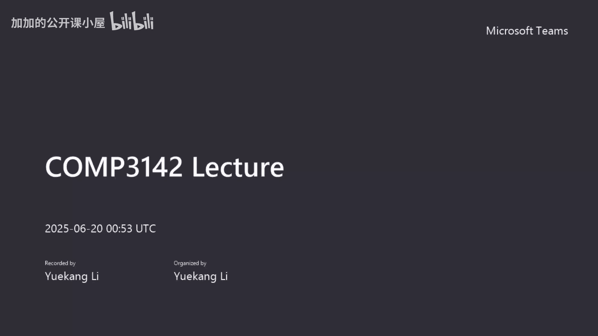
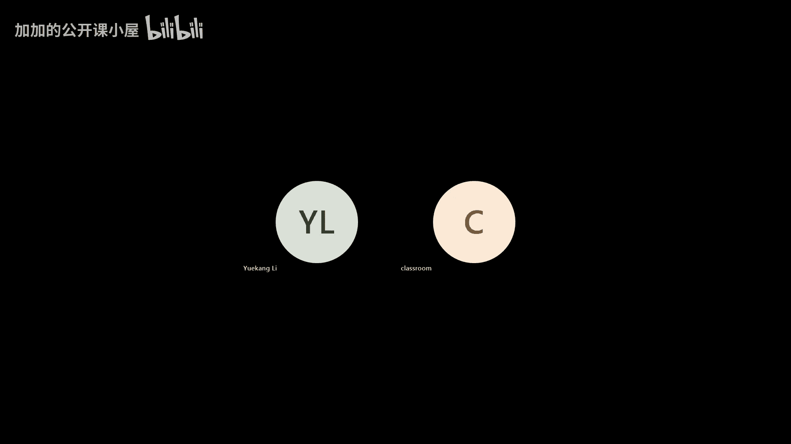
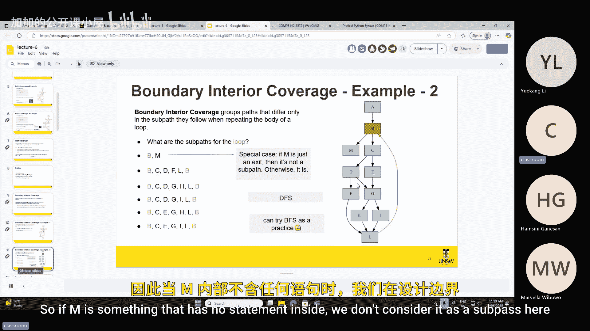
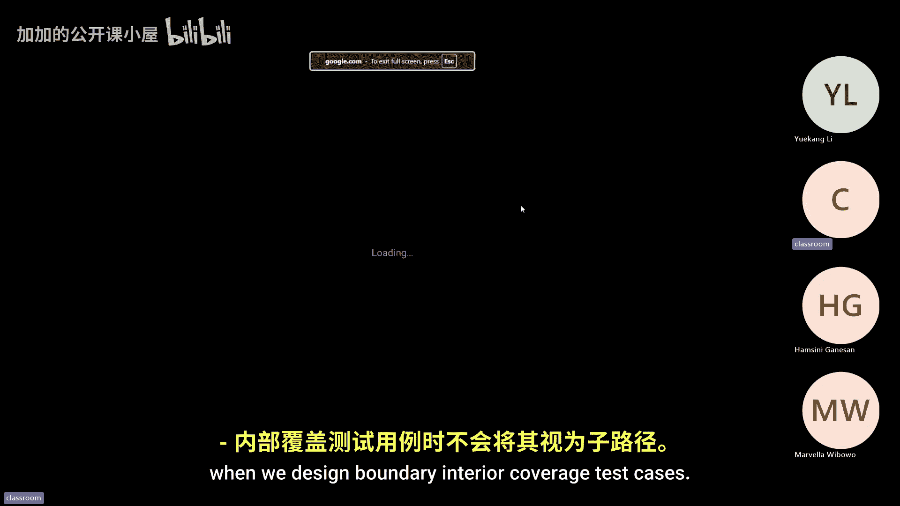
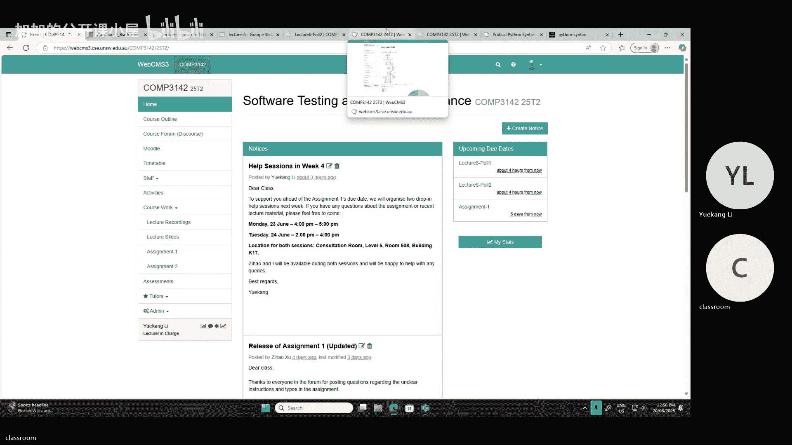

# 新南威尔士大学【中英⚡软件测试｜COMP3142 2025 Software testing】 p12 P12 Structural Testing 2 -BV1o34HzBENA_p12-

Paest， past。So， so have you tried a summon one。Started， O， so do you have any questions or doubts。

So far， no。a bit。Yeah， you can ask me during the break。 and you can also come to the help section。

 I just sent an notification today， yeah。嗯。I think because we， we don't。

 We don't require you to install any environment for this assignment 1。 So it's。

It could be better if you download and try to run it on your own。Computer， yeah。

Nice wait for the rest of the class。O， let's start。So。In today's lecture。

 we are going to talk about structural testing。 and， and it's also about white box testing and。

So here are today's topic。 So we will basically cover a new coverage criteria or criterion we are going to use for white box testing。

 And we are also going to learn about the limitations of structural testing。

 And then we learn a little bit of data flow testing。So。So， before we start。Our main content today。

 Let's have a quick recap of what we have learned so far。 So for white box testing。

 we know that the most important thing is how do we measure the test coverage。

With regard of the code， we are executing and all the courage metrics are coming from a graph called control flow graph。

And。We have learned three different types of coverage metrics in our last lecture。

 The first one is statement coverage， which is。Basically，的。

Basic blocks and other the statements inside the control flow graph。

And we also learned branch coverage， which is related to covering all the edges inside this graph。

 And we also learn condition coverage。 So conditions are kind of related to branches， right， However。

 the difference is that if there are conditions used for some expressions or some statements。

 We are also considering those conditions。 not only for the， for the branches。So。😔。

All these three different types of coverage metrics。Are focusing on single elements。

 So either we are focusing on。The basic blocks or we are focusing on the branches。 So we are not。

Training up different elements。So。However， in practice， when we execute the program。

 we are not executing， let's say， only the statement or only the branches， right， We are executing。

 executing a mixture of nodes and address in the control flow graph， so。

So all the test cases actually in practice， they are executing certain paths inside this graph。So。

Why don't we just use。The different path in this control flow graph as a new coverage metric。

And that actually gives us。A new coverage metric， which is called path coverage， so。

It requires actually， all the path through the control flow graph are covered。

 and each pass is actually made up of a sequence of。

Noes and edges on this control flow graph that are executed during the。

During the test case execution。 And because it's a sequence。 So the order actually matters here。

 So inside the loop， for example， if we order， if we if we loop once inside the loop。

 which execute B B2 and B3 this time。 And then we loop again inside this loop， we。

 we encounter B B2 again in this time， the note the second time of execution of basic block 2 is considered as a different path from the execution in the first run of the loop。

So。Sequence of execution actually matters here。And let's have a。

 let's use a question to warm you up with the the identification of path from the control flow graph。

 so。How many test cases do you think。Do we need to cover all the path inside this control flow graph。

So， actually， this。This program， in in our last， in our last lecture， we also used this example。 So。

 but instead of。Doing a past coverage， We were， we were talking about doing branch coverage。

 We were also use using this example for basic block or statement coverage， so。

In our previous example， we can use one single test case。To cover all the basic blocks， right。

 Can you still remember that。So。So， basically， we can。😔，What we can do is we can use。We can use one。

😔，Single test case。Cover all the basic blocks。With a loop。We can also use one single test case。

To cover all the branches。Right。So what about pass。

 How many test cases do you think do we need to cover all the path here。So remember。

 a pass is like a sequence of。Notes and address。Which are covered during execution， so。

And a pass is considered unique if the nodes and edges are the same， right。

 If two passes are two path are considered the same。 if they， if they have the same number。

 if they have the same。Noose and edges covered。And they have the same are they are covered in the same outer。

And if。If the length of the pass gets changed， it's considered as a new pass。

 So how many test cases do you need to cover all the path in this program。Actually。

 the correct answer is4 of more than 4。Because， because we have a。We have a loop here。

We have a loop here。 and， and this loop could be。Very， very long。 Right。

 could be could be could look many， many times and。This。😔，O， present。So。So because we have a。

 we have a loop here。😔，We have a loop。 We have a look here。

 and this loop can execute an infinite amount of。😔，Times。So each time we in， we enter the loop。

 we get a new pass， actually。Because。Let's say B， B， let's say we， we use B， B1，2，3，4，5。And兔。😔，And 6。

 this is a pass， right，1，2，0，5 and 6。 This is a pass。And if we enter the loop twice。

 we got a new pass 1，2，0，5，6，5，1，2，0，5，2 and 3。And 4，5，2，6， again， right？ Each time we enter， we。

 we enter the loop， we get a new pass。 So there's actually an infinite number of paths for this loop。

 for this program， for this simple program。And assume that we limit the loop to 100 times。

 So can you imagine how many paths do we get。From this。Assumption。

If we assume that this loop can execute at most 100 times。So how many partss can you got。Each time。

 each time we enter the loop。😔，Each time we enter the loop， we can get two possibilities here， right。

So because there is an Eve branch here， so。Harry time we enter the loop。We may。😔。

We may either choose to execute for。😔，Or we can directly jump to 5。So each time we enter the loop。

 we can have two different paths。So if we have， if we loop 100 times。

 we can get to to the power of 100。Potential pass。So。And that is。This。Number， it is very large。

 Actually， is 1。 something to the 10 to the power times 10 to the power of  30。

And assume that we can execute 1000 test cases per second。

 and this will take us four times10 to the power of 19 years to finish executing all the test cases。

 covering all the potential paths。And guess， how old is our earth。啊。So。The。

 the earth is actually only 4。5 billion years old。Which is very， very old。

 considering the lifespan of humans， but。It is not long。

 long enough for us to run all the test cases here。 like a billion is like 10 to the power of 9。

 right， It's far from enough for us to execute all the test cases。

So it means that it is invisible to cover all the potential parts。Of a program。

So even if we have a very simple program like this。

 where we have only one loop and one branch inside the loop。So。Even for this simple example。

 we cannot cover all the path。So。Theoretically， past coverage is the strongest courage metric for structural testing。

And， and because it is on， unlike the statement coverage or branch coverage or condition coverage。

 which only care about single elements， past coverage can actually。

Represent the interactions between different individual elements， right。

 Because we are training them up。However， generally， this is， as we have just seen。

 it is impossible to achieve 100% of past coverage。😔，Because。

Loops can give us an infinite number of pass variations。 So each time we enter the loop。

 we get a new pass。And even if we bound the number of loop executions。

 the number of potential passs could still be invisible for us to exhaustively try out。

 because there could be。😔，Branches。Inside loops。 And each time we enter the loop。With the。

 the number of potential paths will grow exponentially， so。

Even if we bound the number of loop executions， it could be we could。 We can still get a very。

 very large number of path for us to try out。So， generally， this is。

It's impossible to use past coverage。In testing。However。

Are there anyway wayss for us to get some of the benefits of past coverage without the huge。

 potentially very huge cost。So， let's think about it， so。This is about， we are talking。

 We are talking about infinity here， right， Like we could have infinite number of paths。

And the last time we encounter infinity， Can you still remember。

 when is the last time we encounter in infinity in this course。😊，Like， have we encountered， have we。

 have we even encountered infinity before in this class。No。😮，For black box testing。

 do we encounter in infinity。Because for black box testing。

 the input space is considered as infinite， right。Because for black box testing。

 we don't have access to the actual implementation of the program。

 We only have access to the specifications。 and we what we can only control is the test input and a program we can actually input anything to a program。

 right， So the input space is considered as infinite。

 And how did we deal with infinity for black box testing。How did we deal with black。

 the infinity in black box testing。We tried to do petitioning， right。So instead of exhaustively test。

 try out a potential test input。 What we did was we tried to use some metrics to petition the entire input space。

 For example， we can use boundary values to do this parting。

 We can use equivalent classes to do parting。And here。

We can also use the idea of doing petitioning to。Ial with the problem of infinity for past courage。

 So we could have an infinite number of paths。😔，For us to try out。 However， what we can do is。

Instead of trying out every potential path。We can somehow try to petition the path and try to only execute or only test those representative path for each petition or for each group。

So this is the idea here。 And following this idea， this gives us some strategies for doing path based testing。

 using some variations of path coverage。And the first variation we are going to use。

Is called boundary interior coverage。So。Remember， we。

 what we want is we want to petition the the infinite side of pass into a finite number of。

Classes or groups。And。Hundry interior coverage actually groups the path that differ only in the subpas。

When repeating the body of a loop。So inside the body of inside the body of a loop。

 there could be different surpas， right， because of the branches inside the loop。

 So we only care about。The path in we only care。 We we， we can group the past。

That has the same surpass inside loops together。As one group or as one class。 So。

 and then we can select a representative pass from each group for testing。

And the basic intuition here is like if we if we execute a loop for many， many times。

And it will give us a different loop。 It will give us a different path than executing the the loop for just a few times。

But we may execute the same surpass inside that loop repeatedly。 And this is somehow meaningless。

 So we only care about unique surpass that could be executed inside a loop。

And let's have a look at an example of how this works。So remember， we only care about。

The surpass of the body here inside the loop。 So we only need to cover each in in this example here。

 we have one loop， right， And we have how many surpas do we have inside this loop。

How many is that pass。Inside this loop。We only have two， right。So。This one is。The first surpass。

And this one is the second surpass。😔，In the loop。So we have two subpaths in the loop now。

 and we only need to cover each one of them once with our test suite。😔。

So how many test cases do we need now in order to do this。In order to cover each one of them。

 at least once。So how many of them， How many test cases do we need。

I see that all of you look quite confused。 It's like we only need one test case to cover all the subpa at least once because of the loop。

 So we， we only need to cover this。😊，And this。And jump好 here。So we only need one test case now。

Because we just want to cover each sub pass once。Inside the loop。

 So we don't care about how many times do we loop。 We just care about whether each line of the subpass gets executed at least once。

So， this is。Boundary， interior coverage。 And this is an example for us to， to do this。

To cover all the surpass。So。Let's come with a more complicated example。 So can you。

Identify all the subpas in this loop。We can， we can do it systematically， actually。

 because this is like a graph。 and we can use different strategies to explore the graph， right。

 So let's try to do it together here， so。😊，The first one is A B，M， right。So。😔，So。

 because we we don't， we don， we only need to care about the subpa of the loop。

 We don't care about a here。So we just start from B。And we got Bm is the first surpass。And then。

We explore this。This is another subpass， right？Because because we。

 we only care about what's inside the loop。 We don't。

 We don't care about when whenever we are getting back to the start of the loop， so。

The second one is。BCDF。Well， and then we go back to B。And。And the third one is。

Our last branching point is D here， right， So instead of exploring the life hand side of B。

 we can explore the right hand side of B。And when we encounter G。

 we explore the left hand left hand side first。And then we get this surpas， right， So it's。BCD GHL。

 and那go back to B。😔，And similarly， the last decision point is Zhiyi。We看。😔，Expled this surpas， red。

And this gives us， gives us。Another surpass。And repeatedly， we can also get。

We can also diverge our execution here at point C。And when we encounter G。

 we explore lifetime side first， this will give us B C， E， G， HL。And similarly。

 we can get the last surpas by execute by executing the right hand side of G。So看看 this。

So did we just do a BFS or DFS just now？This is not an algorithm course， but I hope you can。😊。

Answer this。 So what， what strategy did you use just now， Like a D， F S or B， F S。

It's actually a BFS。Because we are reverting the decision at the latest decision point。

 branching point。 So it's actually a D FS。😊，And similarly， because we are exploring a graph。😊。

You can also try out B， F， S， as I practice when。If you are interested。

 that you have spare time from， apart from doing your assignment。😊，So you can try out on your own。

To to explore all the surpass inside this loop。And。There's a special case， however。If。

Im is just an exit。Then it is not considered as a surpass。Otherwise， it is。

 So here we assume that Im。Is a basic block that contains at least one statement。So you may wonder。

 okay， what， what is an example of I'm being just an exit。 Actually。

 we have seen this in our previous slides here。😊，So because we need to know that when a loop gets terminated。

 right， So in the control flow graph。 So there could be some cases where。There's a basic block for。

The exit of the loop without any statement。 So if Im。Is something that has no statement inside。

 We don't consider it as a surpass。

Herere。When we design boundary interior coverage test cases。

So。Bundary interior coverage actually helps us to remove the infinite loop based pass， right。

 Because we don't care about how many times do we， do we execute a call a loop。

 We only care about whether we can cover each subpass at least once。So。However， however。

The number of pass through the code or inside the loop could still be invisible for us to test out。

 because whenever we have a branch， whenever we have something like a eve。

We will double the number of potential paths。 we need to execute。So。For boundary interior courage。

The number of paths could still be invisible for us to test out， because if there are many。

 many branches inside the loop， we still need to。 We， we may still have a lot of subpaths。😔。

For us to try out。So there are still problems with boundary interior coverage。And。😔。

So we may need to apply some additional restrictions on the path。 We should。Execute。

 and this gives us a second variation of pass based coverage。

 And it is called loop boundary coverage。And。It is also focused on the problems related to loops。

 of course， and it covers。The scenarios which are representative of how loops could be executed。

So just now， for boundary interior coverage， we don't care about how many times a loop could be executed here。

We东。We are。 It is a。 It is like a complementary strategy for boundary interior coverage。 So here。

 instead of caring about the potential。The potential surpass inside the loop。

 we only care about how many times a a loop could be executed。So。Here。

 the strategy of developing test cases， according to loop boundary， is like this。

We can write a test case that will skip the loop entirely。

Fmin said we are executing the loop zero times。And then we can also write test case that can execute the loop exactly once。

😊，And then we can write some test cases that can execute loop two or more times。And optionalally。

 we can select an upper bound for this loop execution and select some special values。😊，To test out。

 So if we select an alpha bound an。We can select。 We can try to execute the loop M times where I is larger than2 and smaller than n。

And we can also， we can also run， write， write test cases that can run the loop N minus-1 times exactly n times and N plus one times so。

😊，Does this sound familiar to you。So， the values here of。Times。We， we execute the loop。

 Is this familiar， Is this similar to something we have learned。Yes， yes。 boundaryundary。

 You got the answer， so。This is actually to boundary value testing。

 You can see that we are not randomly choosing these numbers。

 We are actually systematically trying out things。 So the I here is like a normal value for boundary value testing。

 And here-1 is like a small value that is valid。 a value that is valid and it is within the boundary of。

A test case。 And N is exactly on the boundary。 And N plus one is a little bit。In外类的。

So that is why this is called loop boundary coverage。

 So we care about the boundary values of how many times we could execute a loop。So， however。

 as you can see from the definition here。This applies only for simple loops。

 And this looks quite simple， right， So we only we can。

 we can write test cases that execute to loop zero times one time or。😊，Two or more times。

 So this is very simple。 And this only applies for simple loops。 Simple loops means。

We only have one loop， and the loop condition is independent from other loops。

 which means that there's no nested loop here。 and there's no。Consecutive loops， which could enter。

 which could affect each other， so。So we will， we will discuss how do we deal with more complex scenarios later。

 But let's have。Look at why this loop boundary。 let's look at an a different representation of the CF FG for dealing with loop boundary coverage or loop based testing here。

 So this is related to one of your assignment questions， actually， so。

When we are given a control flow graph like this， we can actually unfold this control flow graph。

 according to the loop here。So， the basic idea is。Let's say we limit the iterations to three times。

What we can do is we can just copy and paste， copy and paste this part of the code a few times。And。

And basically， just simply unfold this control flow graph and get。Something like this。

 So this actually can help us to have a better look at。😊，The actual coverage of our test cases。

 For example， if we have some test case that execute pass one or the， the left hand side pass in the。

The left hand side pass in the first iteration。And then。

The second pass in the second iteration and the third one， we are executed life hand side。

 So this unfolded control flow can help us to have a better look at what's happening in between loops。

😊，So this can。 So this is just another alternative representation of control photographs when we have loops and just to help us to get a clearer view of what's happening in between loops。

So， this is unfolded。Control low graph。And just now。

 we mentioned that the strategy of using some special boundary values of how many times do we execute a code。

 or do we execute a loop is only applied for simple loops。And what if we have nested loops like this。

 we have one loopbe。Add basic block B。 And we have another one at basic block F。So， how。

Could we design our test cases in this case， using loop boundary。Courage。So。

What we can do is we can execute similar strategies for each level of the loop here。😊，And we start。

 We should start from the innermost loop。And then， we move。😔，We can。

 we can try out to execute the innermost loop。There are one or two times。And then， we can。

Move one level up and execute the outer level of loop 0，1，2 times。And so on。 So this is。

How we deal with nest loops。So in this example here， what we can do is we can focus on executing F。

 the loop at F here first。We can execute it once because it's here we don't have the choice of skipping this loop。

 So we executed once。 we execute the loop twice。 We can execute the loop three times and so on。

 We design the boundary value。 We can use the boundary values。And then。

After we finished designing the test cases that can execute the innermost loop， we move one level up。

😊，What we can do is we can for this， for this test case。我看。We can continue the execution here。By。

Executing the second， the outer loop in B here twice in B here for three times。And so on。

 for each front of them。 So this is how we deal with nest tip loops。

And there are another case of concatenated loops， so。If the loops are independent。

 then it's very simple for us。 We just test them one by one。And by independent。

 I mean that the loop condition is not affected by the upper， the other loops。So。However a if。

 maybe this。The， the loop condition of the second loop is affected by the code logic inside the first loop。

Then。We can follow a strategy of how we deal with the nested loop。

 So what we can do is we can start with the bottom loop。

 which is kind of controlled by the logic of the previous ones。

And try out the strategies of developing test cases that can execute the bottom loop。0，1， two times。

And we can move。呃We can， we can move one step upper。And so on。

 So this is similar to how we deal with nice loops。And basically， it's just a bottom up strategy。

 So we identify the one which is being affected by all the others。And then we can move on。So。

So apart from the intuition of what we have learned。From。呃From boundary value testing。

 like when we design the loop boundary。Cage， we are inspired by the design of boundary value testing so we can test some boundary values of the loop。

 Another intuition for us to use the strategies of boundary interior coverage and。😊。

And loop boundary courage is。From the formal verification aspect， so。In order to。

 in order to actually， actually， in order to prove the formal correctness of a loop。

 we would like to， what， what people would like to do is they would like to establish preconditions。

 post conditionsition and environmentvis。That are true for each execution of the loop。

 And then they prove that these conditions will hold with the particular implementation of that program。

 And if you wonder what is the precondition， a precondition is the program state or the program context before the execution of the loop。

 So it's basically， you can consider it has all the potential values of the variables before executing the loop。

 and post conditions are。Like all the。Values for the variables after executing the loop and the invaris are the values that doesn't change across different executions of the loop。

 So they are called invaris。 And for formal verification。

 what people do is they try to identify the these conditions。

 and then prove that okay for these loop， it doesn't it works。

 And why we care about formal verification here is because we we we just introduce in our introduction lectures that formal verification is considered to be one of the。

Sttrongest means for ensuring software quality， right。

 because it's formally proved that a program will behave in certain ways。

So the strategy we just introduced actually echoes。😊，The idea of formal， formally。

 how people formally verify the properties of loops， so。

The loops execute if the loop execute zero times， which means that we are not entering the loop at all。

 right， So it means that the post conditions must hold。In advance， so。

Post conditions are the conditions or the context of the program one before after we execute the loop。

 and because we are executing the loop zero times， it means that these post conditions are true in advance。

😊，And。😔，The loop environmentvari are the variable values。

 which doesn't change across different runs of the loop。

And it is true if we execute the loop once and if it's。

 it should also be true when we execute the loop for many times。

 So that's why we choose the value of 0，1，2 for。The loop， boundary coverage。And， of course， the。

 we can also use the environmentvari and the negation of loop condition to imply the post condition。

 because the environment shouldn't get change gets changed， even inside the loop post condition and。

The loop condition should be negated in the post condition in order to get outside the loop， so。

These are the。These are the strategies。 So this this is a an explanation of why we use0 1，2。

For the boundary values。 So it's not like randomly chosen。

 So it's because it we are trying to systematically echo the strategies used for formal verification。

So it's not random number，01，2。 It's not random。 So it's chosen because of these reasons。So just now。

 we mentioned。We mentioned two strategies for dealing with loops。And there are。

 there is another petitioning approach for us to deal with the infinity problem of path。So。Just now。

 for boundary interior testing， we care about the surpass within a loop。However， you may think about。

 okay， what's， what about the surpa outside the loop。 So in this case， we create。

 We have a new strategy which cares about the surpa。😊，Of the entire program。 and this。

This strategy is called。L C， S A J， which stands for linear code sequences and jumps。 So in this。

 based on this coverage metric。A surpass is。A piece of code that is executed in sequence。

Until it reaches a branch or a control diverge point， diverging point， so。Basically， we each surpa。

 you can consider it as a sequence of code that will always execute together。

 So without any branches in between。 So it's considered that subpa。And like a single。

 a single subpas represents like one linear segment of the program。

 So because that segment of code will always execute together。

So this is the basic definition of L CI A J。And let's have a look at an example here。So， remember。

In this definition， J stands for jumps， so。Given a control flow graph。

 what we need to do is we first identify all the potential jumps。 So inside this control flow graph。

 we have three jump jumping points， right， The first one is。Where we are。😔。

Where we are jumphangpinging， where we are ignoring the loop at all。 So we don't。

 we don't enter the loop at all。 Sa this is jumphangpinging。1。

And jumping point2 is an if condition inside the loop。

 and jumping point3 is where we gets back to the start of the loop。So。

 and this jumping point3 is actually similar to go toolss in assembly code or C code。So。

So the first surpas in this example here is actually from the entry point to B1 to jumping point1。

 right， so。So the from the start and end of each surpas is where the program starts， ends or jumps。

So the first one is from entrypon。To jumphangpinging point1。 and what are the sequences。

What are the basic blocks inside this sequence。From entry to J1。我他的。Basic blocks。Be1， be 2 and be3。

 right。😔，So can you identify a second。A second。Code segment here。

We can start from entry point to any。Zhangpinging point。

So what we can do is we can have from entry point to J2， right。So。This will give us B 1， B2， B3， B4。

 and B 5。And what about the third segment here。Entry to J3， right。

So this will give us be one up to be 7。And what about some other sub sections。

 Some other sub segments or sub paths inside this。So we can start from any jumphping point to another in order to get。

A sequence of surpass。So。We can start from J1。哦。😔，Be兔，right。So if it' sorry， we can。

 we can the first one is we can start from J the exit point of the program。 That's very obvious。

 And we can also try to。😊，Got the segment of。呃， executinging from J one until J2。 So you can改 the。呃。

J21 J three sorryry， and my stop is a sequence here。 We can also get J  two from J3。

 and we can also get J3 from J two back and we can also get J1 until J2 and so on。😊。

So these are the subs we can。 We can try to combine different。Entry points。

 exit points and jumping points together to extract sub sequences or sub passs。T of her life。

 And you can see that。This actually， somehow forms。

Some kind of coverage here we could use for designing test cases， right。

 we can design test cases that cover each of the scenario here。

So this could be used as a coverage metric。 and we can we can we can develop test cases。

 according to this coverage。And。😔，And we can， we can。

 We can require the courage of our of all subequs of these。Different individual components of lens N。

Which means that we can chain different surpas together。 For example， we can。

Execute from X entry point to J1 and from J1 to J to return。

 we can change them up together into a larger sur pass。So。If we train。

 if we allow training of two subpass， it means that we are using the number of two here as an。So。

If we say the number of n is to one， then this coverage is actually equivalent to statement coverage。

 So which means that we are。Not repeatedly executing the subpa。

 And if we sette the number of n to be2 here。ItHe goes to branch coverage。

So it's like we are turning two surpas together。 And because each surpass ends by a jumping point。

 if we turn。Something， if we turn something from， let's say， B1 to J1 and J1 to J 2。

Then we can and get。The branches here。 And if we turn。B1 to J1 and J1 to exit。

 Then you can get the false branch here。 So if we chain。

 we allow the training of two individual subpa。 It means that we are actually doing branch coverage。

So the higher the， the value of N it is， the stronger it is。How the closer it is towards。

Full pass coverage。 So L C S AJ actually gives us control over how。MHow， how much how。

 How many passes do we want。In the end。And。We can define a threshold that offers because this N allows us to somehow control the number of path we can get in the end。

 So this can gives us a。this can we can set a threshold with the number of n here。So just now。

 we learned three different。Strategies or sort even types of。Coverage derived from past coverage。

 Let's practice the usage of this。Courage strategies with an exercise here。

 So let's reuse the search function we used in our last lecture。 So basically。

 this function accepts three values。 The first one is。The Austriatrian。

The second one is the length of the screen， and the third one is the character we are looking for inside that screen。

And this function will return the either the index of the string。

Of the character in that string or -1， if the。Character is not inside the string。

So let's try to generate test cases for boundary interior coverage， interior coverage。

 So do you still remember， what do we care about for boundary interior coverage。

What's the difference between boundary interior coverage and loop boundary coverage。O， look。

But confused。 So boundary interior coverage is like， as indicated by the name。

 We care about the interior， right， We care about what's happening inside loops and what could be。

 what could we have inside loops。😊，We could have surpass inside loops， right。

 So for boundary interior coverage， we what we need to do is we ensure that each surpass inside a loop is executed at least once。

So we care about the interior here。So。Before we ask the question。

 So is there any loop inside this program。Yes， right。There is a well loop here。 You can't。

 Can you see。Okay， so there's one。玩 loop here， right，有兄弟玩 loop here。

And how many subpas do we have inside this。Lope。😔，How many arepa do we have。Cool， okay， great。

 We have to surpass inside this loop。 So one is。😊，Here。The other one is here。So this。

 although this one is an exit point， it， it's not the same as， you know。

 simply exiting the loop because it has a statement inside。 So it。

 it should be counted as a surpass here。😊，So we have tools that pass。So we have two。

And we can create。Two test cases for each of the sub partss here。Or are。We can use one。

Test case that can loop back。Un execute。The sur pass。Liz。😔，By executing the， by entering the loop。

 two times。Can we do that。Actually， we can。We can write a test case。That can。Enter the loop， once。

To execute this surpass。And。Look twice， so。We have two subpas。 We can develop each。

 We can develop a test case for each one of them。 However， if we want to reduce redundancy。

 we can just use one test case here。😊，You can just use one test case。So let's practice。 Okay。

 you can see A QR code pops up。😊，And。Let's practice loop boundary coverage。

 So do you still remember what do we care about for loop boundary coverage。

So as indicated by the name， we care about the boundaries of loops， right。

 We care about how many times do we execute a loop。So here we only have one loop that is good。

 So the question here is。😊，Because for loop boundary coverage。

 we care about executing the loop zero times。 We care about executing the loop at least once of exactly once。

 and we care about。Executing the loop two or more times。 So for this example here。

 is it possible for us to execute the loop zero times。

 which means that is it possible for us to skip。Entering the loop。😔，When we reach basic block 7。

Is it possible。Yeah， yeah yeah。 you got the correct answer。😊，Before I。

I think even before some others are finishing with， so。Sorry for spoiling the answer。 O。

 here are many responses。😔，Well than I was expecting， actually， the correct answer is no。

It's not possible。So。Let's have a， sorry。This是。Screen。This presentationation is not。Okay， so。

It's not possible for us to execute the loop zero times when we reach。Basic box 7。

 because of the conditions。Conditions of the variable values we have accumulated when we reach basic block 7。

So， let's。Let's have a look at why。So when we reach basic block 7。

 So what controls whether we we will enter the loop。

 which are the variables that we need to care about when we think of when we， when we。

 when we try to think whether this loop could be in turn or not， what are the variables here。

 So you we have two variables， right。Yes， yes。 You， you are spoiling the。 the answer here。 Okay。

 so we only care about index and N， right。😊，So the value of n here， in order to reach basic block 7。

 we have to make sure that n is at least two because of the restriction of basic block 6。However。

We this value is also， this condition is also determined by the value of index。

 and index is initialized as 0， and it is never。Incrme and it is It doesn't increase during this execution。

 right until we reach basic block 10， we never increase the value of index。 So here。

 when we reach basic block 7， index is always 0 and N should be larger than or equal to 2。

 So this condition is always true。 when we， when the first time we， we。Rich， basic block 7。

 So it's impossible for us to execute the loop zero times。And。

Is it possible that we enter the loop just once。Not possible。It is actually possible。

 because although n equals to2， this program。Is。Ely written， actually， because。We can exit here。

Without entering the loop for a second time。So can you imagine what is the test case for for executing the loop just once。

😊，So， we enter the loop。And then we immediately return from this function。So that is。

 can you imagine the case。Without。Looking at the slides。嗯。Yes， actually， it's like。

Where we have a string that is that has at least two characters， which means that n is at least2。

However， the。The character we are looking for is exactly the first character of the string。😊。

So index is still0， right， And what we are looking for is。Has been found。

 So we just returned the index of the row。So。This is。

How we can exactly look once inside this program。And， of course， we can look twice。So in this case。

 for loop boundary coverage， we cannot write test case for executing the loop zero times。 However。

 we can write test cases for loopping once and loopping twice。O。So。That's。

About the different strategies for past based testing。

 And before we jump into the second half of today's lecture， let's have a。

Let's have a 10 minutes break。Okayy。Alright， let's start the second half of today's lecture。So。

The second half。 so just now， we have learned that we learned a new metric for white box testing。

 and that is a combination of different single elements from the control flow graph。

 and that is called past coverage。 However， we also quickly learned that pass is kind of invisible。

To use in practice， because there could be an infinite number of paths in even for a very simple program。

 as far as there is a loop。So we have to deal with loops。

 and we learned three different strategies for using some variations of path coverage。

 The first one is boundary interior coverage， which is。

Which is related to executing the surpass within loops。

And the second one is called loop boundary coverage。

 which is related to how many times do we execute certain loops。And the last one is LC C S A J。

 which is about how do we combine different， identify and combine different sub paths to build a courage metric。

So now let's learn， like how we learned the limitations of functional testing。

 Let's learn about the limitations of structural testing。So the first one is quite obvious。 So there。

 there is the invisasibility problem of developing。A white box or structural test cases。 So we can。

 we could see that many of the strategies we have learned just now could give us an exponential。

Amount of。Test cases or tests。So there are several situations where。We couldn't apply。 And there are。

 there are some additional sources for invisibility here for doing white box testing。

 The first one is。Like what we have seen from the。From the second poll today， the second。

The practice we did today。 So there could be impossible combinations of conditions。So just now。

 we learned that when we try to do the。Loop boundary testing for the search function。 just now。

 we couldn't find a suitable test case that can execute the loop zero times， right。😊。

So it's because there could be some conditions。Which will lead us to impossible cases。

 So there could be some。Some situations where we have impossible combinations of conditions。And。

In some， in some of the cases， there could be unreachable statements for inside the program。

 And one of them is from the defensive programming， which means that we are trying to be very。

 very conservative if we try to capture all the all the potential errors that may not even occur in practice。

 So this will give us to some unreachable code。 And in this case， if certain code is unreachable。

 then we can never then， and if we consider their。If we consider their existence when we try to design test cases。

 we are kind of。呃，We are kind of introducing redundancy。

 And if these unreachable statements are particularly。Complex。

 we are introducing some kind of invisible test cases。

And their could also another source of unreachable statement is like the dead code in legacy applications。

 Like， for example， if we update the version of the code， we may have some。

 some code which are no longer in used， right， So these are considered that code。 And they are never。

Uable again。And there could also be some inaccessible portions of the code for of the shelf systems。

 So which means that， for example， we most of the software we use are cross O eyes。

 which means that they could be executed on Windows。 It could be used on Linux or Mac O eyes。

 and they have some O eyes specific code， which could only be tested under certain environment。

 So these are in inaccessible， Consider。So。So this， this is another source of。Unreachable code。

 which couldn't be tested for white box testing。 So these are like the sources for invisibility here。

 A apart from the pass or test case explosion problem。

And this is how we could usually address the the invisibility problem caused by unreachable code for structural testing。

 So what we can do is because we can collect coverage， right。

 we can somehow measure the adequacy of the coverage we have achieved。 So what we can do is we can。

 we can define a threshold for the coverage。 So let's assume that we think maybe 60% of code coverage or statementn coverage is good enough。

 Then once we achieved 60% of branch coverage or code coverage， then we just stop testing。 However。

 this。This， this threshold is， is normally empirically determined。 So the larger the threshold it is。

 the more budget it requires。 And however， the， if we lower the threshold， we may miss some bugs。

 So this， this， the determination of this threshold is also sometimes。Problematic， and。Another。

 another thing we could consider in real。In real world scenario is that not every piece of code is equally important for finding bugs。

 So example， most sometimes we can assume that the more complex a piece of code is it is the more likely it is to be buggy。

 So we can focus on certain part of the code instead of the entire entire of the software。

 So that's also a potential solution here。And we can also provide some manual justification of why we would omit some of the scenarios here。

For example。We can， for example， we can try to identify the that code inside the program manually so that we don't need to write test cases for those dead code。

 We can also try to identify those O I specific code inside the program， and we can ignore them。

 but this could be very， very time consuming because it involves manual effort。So。Finally。

 what's the answer provided by the industry or most of the company for。

Determining when the testing is done is when either when the money is used up for doing testing or when the deadline is reached。

 So they maybe the company promised to release a piece of software by maybe。By the end of this month。

 then。They have to release their software before the testing is done， so。It's all about budget。

 the budget we have again， in practice。So， just， so we have learned many。

 many different coverage metrics that could be used for structural testing。

 And now let's have a comparison of these。Cage metrics， so。Let's。

 let's compare the potential budget required for these。 So basically， the statement coverage is。

Normally， requires。The least number of test cases and branch coverage could have。

Could require more computational power or could end up in more test cases。

 And LC C S AJ is a special case， because when we set the number of n equal to one。

 which means that we are not combining any subpass at all。

 It means that it it actually is equal to statement coverage。

 And if we sette the number of n for L C S AJ to two。

 it means that we can combine two subpass together。

 then it it kind of it is equal to branch coverage。And if we enlarge the number of n， it could。

 it could get closer to pass coverage。 So this L C S AJ is a special case here。And。

And we also learned loop boundary testing。 So normally。

 loop boundary testing requires fewer test cases because we only need。To。

 we only need three different test cases most of the time， right， for each one of the loop。

 So we executed20 times  one times and two。Two times。And for boundary interior testing thing。

 it could be impractical。 So although we only care about the subpaths in each one of the。

In each one of of the loop， there could still be many， many paths。😔，So do you still remember why。

 why this could give us。So， many test cases。Even if we just want to execute each surpass once。

We still may end up in too many test cases。喂hy。Not because of the loop。

 because we only care about the subpass。 we don't care about the case where we loop back。

 We don't care about the number of times we loop。Its， it is because。Inside the loops。

 there could be branches， right。And every time we encounter a branch。

 we double the count of path we have。So。😔，The number of test cases required for boundary interior testing could still grow exponentially。

And that's why this could be impractical。And， of course。

 past courage is kind of considered as impractical and the most expensive metric here。And。

And apart from the。The apart from the coverage metrics， according to the。

A structure of the control flow。 We can also try to think about the condition coverage。

 So the basic condition coverage is kind of similar to branch coverage。

 So we just collect the conditions from the branches and also the conditions from the expressions。

And。Of maybe value assignment or variable declarations。 So it's kind of similar to branch coverage。

And， and， of course， we can use both branch and condition coverage together。 And for MCDC coverage。

 it is。 it requires more test cases because we need to consider different combinations。

And for compound condition courage， it is kind of impractical in most of the cases， because we need。

To have the conian product of。Each s condition for。For most of the decisions。 So that's why it is。

It could be impractical， in this case。And let's continue， so。😔，Another big。

And apart from the practical concerns， from the theoretical point of view。

 there is another limitation for structural testing we have learned just now。

Of because the all the coverage criteria we we used are coming from the control flow graph。

 And in our last lecture， we mentioned that there are two types of graphs within a program and。

What are the two types of graphs， Can you still remember that。So the second， the first one we we。

 we are very familiar with control flow graph now， right， And the other one is data flow graph。😊。

So we are not considering data graph at all。So， the。

The rationale of using control flow graph based coverage metric。Is that we assume that we。

 we can never find a bug within a statement。If we， if we don't execute that statement。

And this is true。 however， is the reverse true， which means that if we can execute a statement。

 we can certainly find the bugs inside that statement。 If this is a reverse one， true or not。

Is actually not true。Because。Because executing aligned contains of fault doesn't guarantee a failure。

 And here is an example。So， for example， if we write a condition like this。呃。

The the the desired condition isA should be smaller than or equal to B。And if somehow we made a typo。

 If the developer made a typo， like by writing the smaller than to larger than。 So this time。

 the code becomes。A is larger than equal to B。And if if we write our test case as a equals to B and execute this condition here。

The program will behave。The same， right。With the correct and wrong implementation。So。

Even if we can execute a line of code that contains some error。

 we may not be able to expose that error。We have to consider。We have to consider， how did we reach。

This line of code。Like， what values do we have when we are executing this line of code。So。

But control flow graphs。Doesn't cannot give us the answer of。

Which values do we have when we reach certain point？ It is not enough。So。

The observation here is just executing the code is not enough for finding all bugs。

 This is not enough finding all bugs。We need to it it。

 it depends on how we reach certain point of the code， and we need to care about the values and data。

 So that's why we also need。To consider data flow when we design test cases for a white box testing。

However， in this class， we still focus on the usage of different metrics from the control flow graph。

 And we just do a brief intro of how could we use data flow for testing。

So dataflow is like providing another view of the program。

So control F is like we are considering the program statements as commands that could。

That could cause the program to transit between different states。

 So the commands are helping the program to transit from different states。

 And for data flow point of view， we are viewing the program statements as a。

As a computation and transformation of data， so。What we care about is how data is passed through the program。

 so。It， it is all about reasoning between data dependencies。 So if。

 if we observe a variable is used in certain statements。

 what we want to know is where does the value of this variable come from。

 and we also care about is the value ever used anywhere inside the program is the variable properly initialized。

 and if。If。😔，We change。 if we assign a value for a pattern for a variable， what else。

 which else part of the program could be affected by this value assignment。

 So these are some examples。Or some example questions we care about when we do beta flow analysis。

So like I just mentioned， we just do an introduction to the Fflow analysis in this course。

 because it is covered by some other courses here in USW。And。For data flow。

 you may encounter two typical concepts which are definition and use， so。We， we。

 we say that a piece of data is defined。When when we encounter these cases， we are like， we have。

 if we have variables as declared or assigned values， then a piece of data is considered as defined。

 So this is data definition。And a data， a piece of data is considered as being used when these are these variables are used for performing computations。

So this is， this is the。The dive use relations could help us to capture the flow of information or the flow of values through the program。

 and。L， according to this definition here， inside a program， When a variable is declared initialized。

 assigned with values or received as parameters for a function。Then we consider that， okay。

 a new value is defined。 And whenever a piece of。Data or piece of value is used in expressions。

 conditional statements， parameter passing or。呃，P passing means invoking function with particular。

Value， and or it is used in some kind of statements like the return statements。

 Then that piece of data is considered as being used。So let's have a look at an example of how。

Definition and use are defined in this simple program。

 So this program actually helps us to calculate， given a list of numbers。

This thing actually helps us to calculate the mean max value of that。

Of that list of positive integers。So。Inside the first line， let's， I'll give you an example。

 and let's try to do the rest of them。 according to this example。 So here。We。😔，A sign we create。

 or we declare the variable of mean here。So this is a definition of variable mean。

 And what are the depth and use for line 2 here in this program。We are defining the value of max。

 and we are using the value of n here in this program。And what about line 3 here。

Are we defining anything here。😔，Yes。😔，So what is being defined here。😔，Meade。

And do I use anything here。Max and me and right。So if I made and use Max and mean。

And do you define anything online for。No， yes。We use the the array of a。

 let's assume a is different and somewhere else or passed as a a parameter before， so。A。A meet。

 which is the element of a， is being used。Me is also being used because it is used as the index for accessing array elements。

X is being used because it's in the expression of a meat， not equals to S。And。

Me and Max are obviously also used。What about line 5 Are we。Dfining anything。

 or are we using anything。😔，We are actually defining the value of meat， again。😔。

So define is not only about definition。 Its also about updating the values。

 So we are defining the value of mid again。And we use me and max。In this line 5。

And what about line 7， Are we defining anything in line 7。Yes， right。

 Because we just encountered line 5。 We are defining mean here actually。

 and similar for line 8 line 9， So for。😊，L line 7 and line9。

 we are also defining where呃 we are also defining values for me and Max。

 This is like呃 redefining the values。So。By considering the。Definitions and usage。

 we can build dive use pairs for variables， so。We can say that there is a diffuse pair whenever all these conditions are。

Satisfied， so first， there need to be a definition of。X at certain location。

 And then this variable X must be used somewhere else。 So this because we we we want de use pair。

 So we definitely have to have a definition and use， right？ And these are kind of by default。

 And the third requirement is that we have to have a path。In the control flow graph。

From the two locations， from the death location and use location。Otherwise。

 if there's no control flow graph between the two locations， it means that there is。

It is not possible for us to。Run the program from the dev to use。

 It means that the de use pair doesn't exist。 So we had to consider control flow graphs when we。

Try to capture Dafu pairs， and。The past should be。Definition clear for X。

 which means that in between the execution from A to B， there shouldn't be another。Definition for X。

In between A and B。 So this is because we can see that。We can reassign values。

 We can update values of variables。 for example， if。然， for example， for the。For the from 3 to 4。

 we can say that there is a deuse pair for meat， right， Because in3 in line 3， meat is defined。

 and in line 4， it is used。 However， we can't say there is a deuse pair between line 3 and line 6 for meat。

 That is because。It is not definition clear from 3 to 6， because meat is redefined。イビ円です。Sury An 6。

So， the， so the first two conditions are easy to remember。 is's like because it。

 it is called depth use pair。 We have to have a definition。 We have to have a use。

And the third one is also easier， easy to remember because we have to make it feasible， right。

 we can， we have to make it allow the program to execute from the F to use。

 And the last one is the variable shouldn't be redefined。On the pass。 So this is difuse pair。So。

Let's have a look at an example， with the previous。With the previous program。

 So let's try to find diuse pairs for mean instead of meat， like I used， for example just now。

 Let's try to use mean here。So， first。Min is defined at line 1， right。So where else is it is it used。

 It's used in line 3。So is there a diffuse pair between 1，3。Yes， right。

 Because we can execute from 1 to 3。 And there's no。😔，Reefinition of。

We are not reallyfin the value of meaning in between。 So 1，3 is a diffus pair。

 Can you quickly identify another one。Fromund this program。1 and。😔，1 and 4， right，1 and4。

 So14 is another one。And what about  one and 5。Is it。😔，A valid diff use pair。It is， right，1，5。

What about 1 and 7。 Is it a valid diffuse pair。No， because。Because 7 is like redefining， right。

And since 7 is really finding， we can use 7 as a starting point for finding more diffuse pairs。And。

And because this is a loop， we can loop back to 4， right。😔，So7 and 4 is another diffus pair。 and。

 of course，7，5 is another one。So these are the diffuse pairs for mean and for for this pair variable mean。

So。So since we have， we have something like deff use pairs。 So why not。

 Why don't we use it as a metric for calculating coverage。

So what we can do is we can develop two types of coverage metrics from the definition of de use pairs。

 The first one is deuse pair coverage。 The second one is de use path coverage。So。Like。

Courage is everywhere for white do testing， so。We， we just care about different metrics of cow。

 how we can calculate or how we can represent code coverage。So。The first。

Coverage variation here is di use pair coverage。And it requires each diuse pair to be executed at least once in the program execution。

And。This is。This could be。And we can， we can actually easily achieve structural coverage without covering all diffuse pairs。

 So even if we can cover all line of code。 or even if we can cover maybe all the potential parts of a program。

 we may miss some diffuse pairs。 So because because they are。

 we are viewing the program from two different points of views like for the structural for the structural coverage。

 we are more we are they are derived from the control flow graph。 however。

 the diffuse pairs are derived from the data flow graph。 So even if we run a program。

 even if we reach certain point of the program， we may not be reaching that point of the program with the desired values of the variables。

 So like we have like we have seen from the example of。

largerger than or equal to small than or equal to right。

 So we may reach certain line of the code without。The desired values， so。

So this diffuse power coverage can actually help us to capture those errors which couldn't be exposed with the control flow graph based coverage metrics。

And calculated and calculation of discourage courage is。Like others。 So basically。

 we just divide the number of exercised or executed diffuse pairs by the number of total diffuse pairs。

And the second variation here is called dive use path coverage， so。Difffuse pass is something like。

Is， is with regard of the execution path， so。Like I， like we just mentioned， de use pairs。

 there must be a pass connecting the location of definition and location of use， right。

 for a de use pair to exist。However， there could be many。Execution pass from。

The location of definition and the location of use。

 So what we do with diffuse pass is like we combine the data flow graph and the control flow graph and try to find out the potential execution pass for each diffuse pair and use the。

The， the execution pass of these deuse pairs as the coverage metric here， so。

This is called Dafus Pass coverage。And this similar to how past coverage。

Diffs from the statement coverage or branch coverage。

 Pass coverage can give us like the interactions between different。Single elements， right。

 So diuse past coverage can give us a more comprehensive。😊，Courage for the， for the program， and。

This could have the pass explosion problem， similar to。The control flow based。Testing coverage。So。疑问。

Even without， even without the， even without the looping pass， there could be the， the。

 the number of thefuse pass could be exponential to the size of the program。

 And that is because that is， this is similar to why boundary interior。

Coverage could give us exponential number of test cases because there could be many branches which can give us different paths in between diffuse pairs。

So， for example， we could have a lot of。We could have a lot of， if and else。

 which can give us a lot of。Which can give us a lot of potential path for a program for this program here。

 if we try to capture the diffuse pair between。This this parameter receiving。

Here and the usage of this C， H。Varable here， we may have。Toto the power of。😔。

Total的 power of six pass here in between。ToSo， total the top of7 here。So， that's why。

That's why even if without loops， we could have a lot of pass and there could be pass explosion problems。

 which makes a diffuse path invisible in practice。And before we end today's lecture， let's have a。

 let's finish the last part of the practical Python syntax and。And we only have one part left。

 And and when you implement your assignment code， you don't have to follow the best practice because we are。

 we don't。 We don't really care about your coding style and all those kind of things。

 But this is just to just to provide you some a little bit of additional thing that you may use in the future。

 So let's continue the very last part。😊，So I think you may have used this a lot when you write your code。

 So it's like。Whenever when you have， when you have a。

When you have a collection of a variable that is like a collection of values like， for example。

 the variable is a least a site or a dictionary。 How can you do with individual elements of this variable。

 right， encounter this scenario， you want to handle the or precise the individual values。

 So what you can do is you can use for loop here to iterate through all the elements within with one line of code。

 So， for example， if we want to， if you have a list of integers from one to9。😊，What。

 and we want to double the value of each of the integer inside the list。 What we can do is。

Instead of writing a full loop， writing a few lines of code。

 we can just use one line to update the to to to， to， to update the value here。 and we can。

We can use。 We can even use。If conditions within this single line of code。 So this means。If的。

If the element。If the element is。Is an odd number。 Then we doubles the that number。 So this is。

This single line of code。 And similarly， we can also use the wireless expression。

 the wireless operator we have learned previously。And this will save us from defining the variable with another line of code。

 so。This is how we can use the followup to iterate through the list elements。 Similarly。

 we can also do similar things for for the， for the dictionaries and for dictionaries。

 whenever we are。for， for for strings。 and for for dictionaries， we are also。

 we can also do similar things。 and we can， and by default。If we don't write these D dot items。

 if you just for。Something。In a dictionary， what are we looking for here。

Let's say we don't have this 4 K V in D dot items。 We just have for， maybe for something in D。

 So what is the value of something here。播 something in d。What are we looking here。

We are actually looking for the keys by default。 If we don't specify the。D到 items。

 we are looking looking for kids。And this is how we can simplify the writing of the code。

Or complicating the writing of the code that it looks clearer if you just use fewer lines so。

AndAnd we can also try to do multiple dimension expansion。 For example， we have multiple loops。

 we can we can for。We can for the these multiple loops a few times within that lineup code。

 and this can give us。M this， this can give us a quoesition product of other combinations of these three loops here。

 so。This will give us。For every element of I， for we can have a combination of all the possibilities of the single elements of J And K in these other two loops。

 So this is like this will give us three times  three times 3，29 items here。In the end。

So we can nest， we can have nested loops in this kind of expression here。And we can also try this。

 this is particularly this， This is actually similar to how we can use。

Higher order functions to achieve similar things。 For example， we can use when when when you。

 when you learned textscript or javascript I believe you have learned those higher order functions of dealing with list。

 right like map and filter in 1，5，3，1。😊，I hope you can see。 remember that。 Yes， so actually。

 this is like a replacement。 This is similar to how we can use map and filter。

 So instead of writing a。😊，Instead of invoking the map or filter， we can。

 What we can do is we can just use this simple expression to do similar things。And。

That's all about the practical Python syntax。 And that marks the end of today's lecture。

 And if you have any questions regarding the regarding the the assignment 1 or any lecture。Content。

 please come to the help session is held in， is held in level 5 of the C， S E building。

 so you can come to us。 I will be there and how will also be there。

 So you can come if you have any questions。So that's how for today's lecture。

 And thank you for coming。 Thank you。😊。

