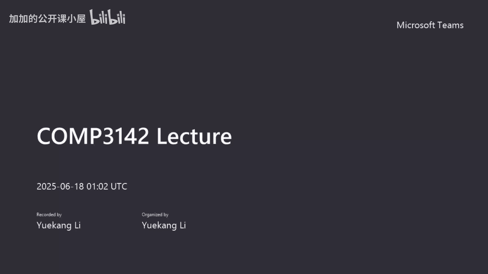
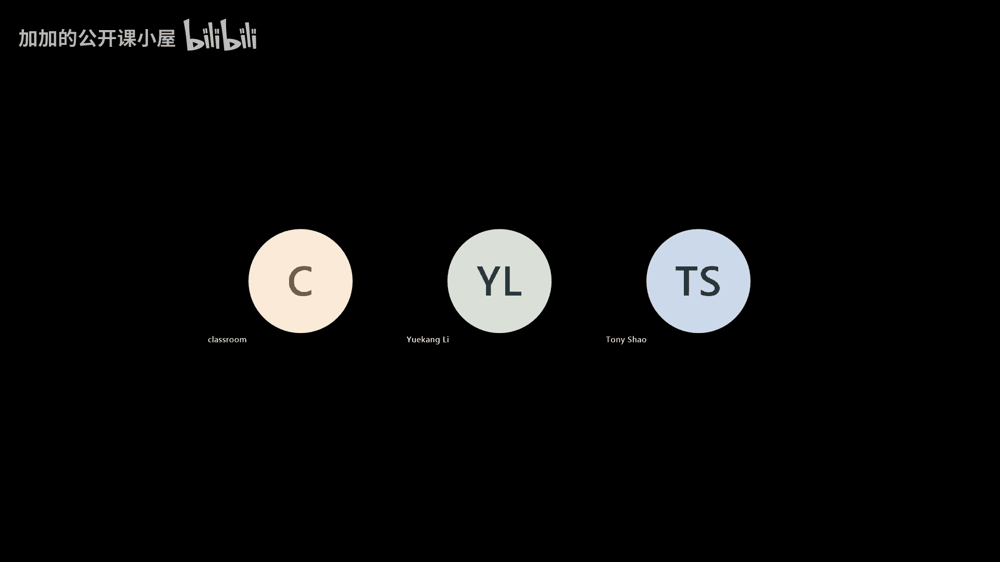
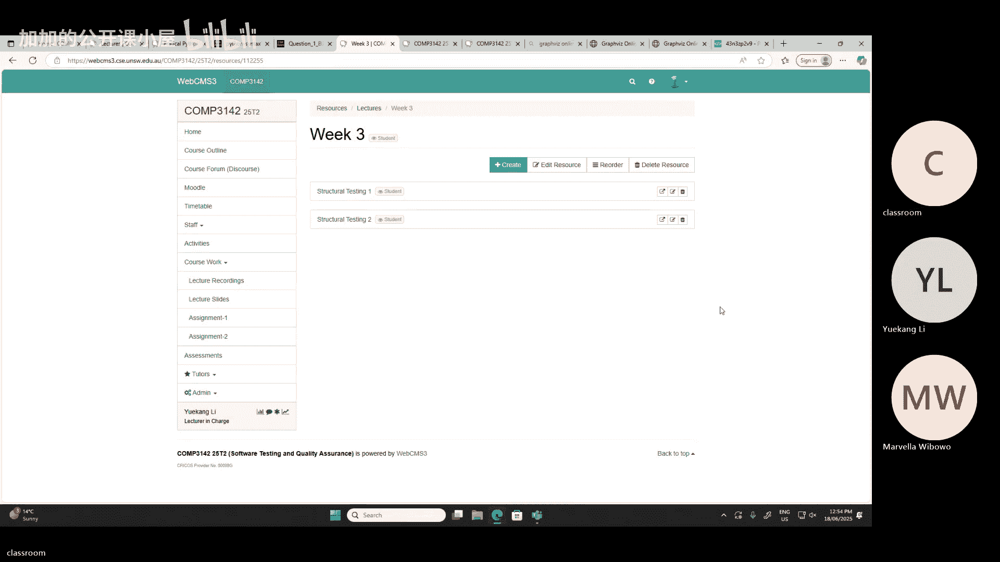
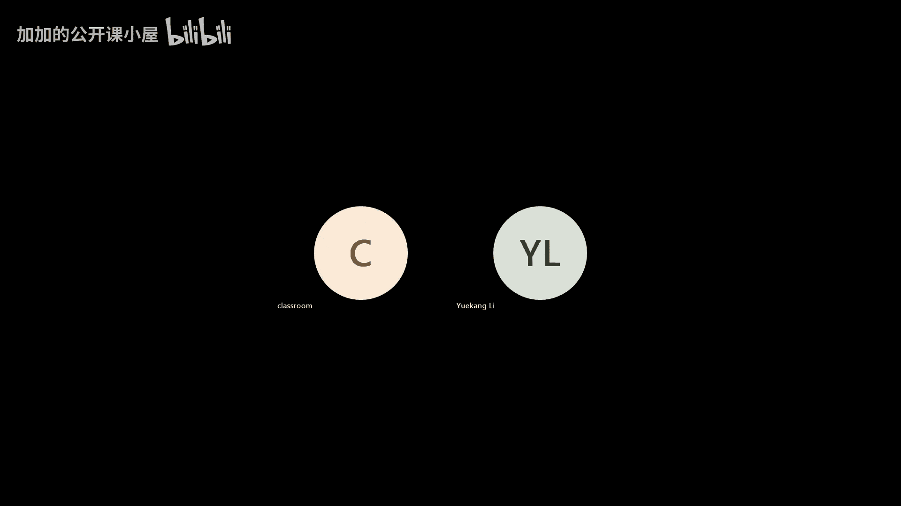

# 新南威尔士大学【中英⚡软件测试｜COMP3142 2025 Software testing】 p13 P13 Structural Testing 1 -BV1o34HzBENA_p13-

Can can people from online hear me。So can you hear me from online， from teamss。Oh，O， great。

Let me share entire screen。So。Just a quick update before we start our lecture today。

 So we have released the specifications for assignment 1， and iss basically about。

The content in week 2 and week 3。 So basically， we will cover the。

Bla box testing techniques and several white box testing techniques。

And what you will need to do is to write some programs that could generate test cases。

And answer some questions accordingly， so。We have made some updates in comparison to the very first release。

 and updates are highlighted here in this P D F file， so。If you have。

 if you can find any issues or ambiguity within this specification or the questions。

 please feel free to let us know on。The cost for room。So。Okay， let's start today's lecture。

So in today's lecture， we are going to learn structural testing， which is another testing technique。

So before we jump into the details of structural testing， let's think about a dilemma。

 So every software company actually faces a dilemma， and that is。If。

If the customer experience no bugs。Then why do we need to do testing or quality assurance， right。

 Because if。If the program runs smoothly and customers are reporting no bugs。

 then why do we need to do testing。And。On the other hand。

If there are bugs or issues with the software， we have released。

Then it could be too late to do testing or quality assurance。So this is kind of like a dilemma here。

 And in order to solve this dilemma， we need to know， we need to generate some kind of proof that。

 okay， this soft， this piece of software we have given to you is。Up to certain quality level。

So we need to have some kind of proof to show the customers that， okay。

 this piece of software has been tested。So in order to show the just showing that the software is tested is not enough。

 It has to be shown that the software is well tested。But however， here we need to define。

How well is the software tested。So we need to， we need to。 We need to think about the question of。

 are the test cases we have good enough。So， tests can always be improved。So。

So in order to answer in so it's hard to， it's hard to answer。

 are the test good enough because it's never enough。 And so we we， let's make the。

 let's further narrow down the scope and make the question more specific。 So instead of asking。

 are the test or the test cases good enough。 Let's think about are the test cases good enough for the testers to stop writing new test cases。

So in order to think about how well it is， how， how well the test has been done or the quality of the test cases。

 we need to， we need to measure the adequacy of the testing process we have done。And。

Talking about adequacy， we need to think about another concept that is known as impossible， so。

What we want is。We， we want to find all the potential bugs inside the piece of software。However。

 the reality is。We can never find all the bug inside a piece of software。 That is because of many。

 many reasons。 The first one is for most of the software， the input space is infinite。

 we cannot exhaustively test all the inputs， although we can use the black box testing techniques to petition the input space。

 but we cannot exhaustively test everything。 that's the the basic idea。

 and the other reason is that the environment of running the software could change over time。

 So a software that fits the current situation may not。mayy not run without any bug in the future。

 So that's why。It's impossible to find all the bugs。嗯。So what we， however， on the other hand。

 this is impossible。 So it's impossible to find out the bug。 on the other hand。In reality。

 when we do testing， what we usually get in the end is something like this。 So we compile them code。

 and it doesn't。 It can compareel。 It can run。And。And we run out of budget。

 either we run out of time or we run out of the money to hire people to do testing。So in that case。

 we are not doing any testing at all。 Maybe we will just release the software as。

It is and like the customers to use it and report bugs for us。 So that is also not desired， right。

 And in this case， it is considered as inadequate， which means that。We're not doing。Testing at all。

 or it， is not well tested。So。A good measurement here should compromise between impossible and inadequate。

 which means that we have to do。Testing， but we don't aim at finding out the bugs。So。

 so if you think， okay， we， we are not aiming at finding out the bugs。

 So what are we aiming to do here instead of finding out the bugs。

So we need to meet certain criteria that could be used for measuring adequacy here。So。

So these metrics are used like a scoring system that could measure the completion of a set of test cases。

Oh， this is kind of from， this is my personal point of view。

 So this is somehow similar to blockchain。 So blockchain is like。

 you prove that you have done some computation， right， as some kind of token。

 And here we need to have some some kind of proof that we have done some testing。

 So using certain metrics here。So let's try to find out。 what are the proper metrics that we can use。

For。From scoring， testing adequacy。So first， let's start with the audio case。

So the ideal case is that we want to find all the bugs。

 and we know that it is impossible to find our bug。 So， but it is impossible。 Can we。

 but can we approximate this。Behavior of finding out the bug。So。

Let's think about this situation here。So if， so if the test cases。

Cannot reach a particular line of code in the program。

 Then we can never know whether that line of code is buggy or not， right。

So we have to cover the code or the program somehow。And。😔，If。That's about the code。And。

And apart from code， we can also think about specifications or requirements。

 So if the requirement discusses two outcomes and we can only cover one of the outcome with our test cases。

Then this test case is also considered as inadequate， right， It's also not enough。

So we need to think about the metrics from both the requirements point of view and the program point of view。

And we have already discussed。What are the possible techniques for covering different。

Outcomes from the requirements。 And now let's think about how can we approximate the behavior of finding all bugs from the code point of view。

So we need to somehow generate some coverage measurement， whether it is code or specification。

 And let's focus on code in today's lecture。So。The。

 the rationale of using coverage is that if we don't cover certain behavior of the program or if we don't cover certain parts of the code。

 we will never know whether that part of code or that behavior is could be buggy or not。

So we need to use coverage to。As the approximation for finding bugs。And this。

 this usage of coverage as the matrix here is。Widely used in industry。 And normally， there are many。

 there are many tools to automatically report code coverage of a test suite。And。Some of the。

Some of the metrics， as we just discussed。Are based on the courage of from the requirement specifications。

However， another major part of the coverage auto metrics are coming from the elements related to the source code。

And we are going to， like I just mentioned， we are going to focus on the south code point of view。

 and that gives us structural testing。 So the basic idea of structural testing is to derive test cases。

 according to the structures of the program。 and then。

We designed the test cases in order to achieve certain adequacy metric to improve the coverage of that metric。

And this metric is also related to the program structure。So that leads us to the main topic today。

 structural testing。So like we just mentioned， the adequacy metrics are kind of related to coverage。

 and for structural testing， we are focusing on the source code。 So there are。

 So these metrics are actually related to program structures。

 And there are several common structural coverage metrics that we could use for source code。

So these are the four metrics we will be learning in this course。

 So the first one is statement coverage。 The second one is branch coverage。

The third one is condition coverage， and the last one is path coverage。

 They are all related to different structures inside the program。So。The basic idea of this is。

That the structure of the program itself can provide us some information here。

 So this information is valuable for both。Creating new test cases， and。

TheMasure how well the program has been test， has been tested。 So it could be used in two aspects。

 and because。In this structural testing， we care about the program structure。

 We need to know the the actual structure of the program。 We need to have access to the source code。

 So that's why it is also known as white box testing。

 So functional testing is black box and structural testing is white box。So these are these metrics。

These metrics are used for defining to， to， to is defined as。

A certain percentage of the the courage is related to a certain percentage of the code。

 So do you know why we， we aim to exercise only a certain percentage of the code， but instead of。Iry。

 like achieving 100% of coverage here。So。😔，Because is。

It's impossible to achieve 100% of coverage in certain metrics here。 And we will learn that later。

 So the goal here is we achieve a satisfiable percentage of coverage using these metrics。So。

 and the basic idea behind the usage of these metrics is that we can't find all the bug。

 all the faults without exercising all the code。And how we define the exercise， the。

 the exercise of all the code。 How do we define all the code。Is according to these metrics。So。

Comparing， comparing with functional testing or requirement specification based testing。

 the motivation for us to do white box testing is like this， so。For requirement based testing。

 it should be able to execute。Most part of the code。However， it。

 it cannot systematically execute the more or all the code we care。So， for example。

 sometimes we have some helper functions which are not directly related to the main features of the program。

 Therefore， the logic of these helper functions are not described in the specifications。

 So if we do requirement based testing， we may not be able to cover the logic or test。

 the logic of these helper functions。And the other thing。

 the another example is about the error handling code。So， sometimes。

There are some error handling code inside the program。And we could handle the errors differently。

 according to different situations。Which may not be well documented by the requirement specifications。

 And in this case。We may also miss some of the the interesting program behaviors。And lastly。

 the requirements could miss certain outcomes of the program。

 So that's why we should have a look at the source code to design test cases， not only。

So we should not only do black box testing。 We should also consider white box testing。And。

As I just mentioned， structural testing is actually a complementary technique for functional testing。

 So functional testing is more focused on the requirements。

And structural testing is more focused on the actual implementation。So， therefore。

Functional testing are good at exposing conceptual bugs。

So these conceptual bug are like whether the program。

Is works as how it is designed by the specifications。

And structural testing actually is good at exposing actual coding or implementation mistakes。

 like whether the。Like sometimes off by one mistakes。

 Like if we are reading an array by one more element， these kind of minor implementation issues。

So structural testing is better at exposing implementation bugs。

So given all the concepts and definitions of structural testing。 So let's come to a question today。

 So we have learned six different principles of doing testing。

 So which principle do you think gets embodied by white box or structural testing the best。So。

 you can either。You can either scan the QR code here or。Use the link here。So， we have learned this。😔。

电。Our second lecture， so。There have six basic principles。For doing。😔，Dynamic analysis and testing。

走为传。😔，Is embodied by the。W box testing the best。So you don't have to think too much。

 This is not a quiz。 It is not marked。So， that's just。Have a look at the results。

So it seems that most of you can get the can get the answer correctly。 So it， it is more related to。

Visibility and observability， because。Invisibility and observability， we are talking about。

Whether we can。Extract useful information from。A software artifact。

 And with whether we can measure the progress or status a car against goals。

 So the coverage is something like。We can is something like the progress。 What we can use， right。

 We can test。 Okay， we have now covered 50%。Of the lines of code in this program。

 then it could be a progress。And they can also use it。

As something that could that can help us to design past cases， as we will see later。 So we can use。

The program structures， in both ways。So like I just mentioned。

 we can use the program structure or the。The actual implementation of the code to help us to design test cases。

 And we can also use。The coverage of these。InThe code inside the code。As a measurement of adeququacy。

 So we are using it for two purposes。 So first， we use it to design the test inputs。

 and then we can use it to measure the quality of the test outputs or the quality of the test outcomes。

So， that's。And let's have one more chunk of definition and concept before we jump into the actual technique。

And this is also quite important for us to understand all the different testing coverage metrics。

So it is related to the control flow and data flow inside programs。So。

Before we jump into the control flow and data flow。

 let's think about what is the most basic component of a program。

So in most of the programming languages we are using today are called imperative programming language。

 For example， C or C plus， they are all imperative programming languages。

Which means that we are giving where。 the program is made up of a list of command。

Given to the computer， so。Each command can help us to change the state of the program。So， that is。

Why it is called imperative programming。 And most of the programming languages we are using today are imperative programming languages and。

It， it is considered as a programming paradigm similar to object oriented programming or logic programming or functional programming。

 So this is。So in this programming paradigm， we are considering the program as a collection of commands。

 and each command。Is considered， could be considered as a statement。

 So programs are using statements to transit from one state to another， so。So therefore。

 a statement is like a syntactic unit。Of in in this。And imperative programs。So there are many simple。

 there are many simple statements。 For example， assignment of values。

 We can assign a value to a variable。 It is considered as a statement。if we invoke a function。

 it is also considered as a statement。And if we do an assertion， if you do a go to。

 if you do a return， they are all considered as statements。So， basically， if you are。

Writing click code， each line of code could be considered as a simple statement。 However。

 there are some。Other cases， we are a block of。Code could be considered as a statement。

 and these statements are called compound statements。 So， for example。

 the first one is counter statementment loop， which is just for loop。And bio loops and if statements。

 So these are like these statements are representing a block of code。

So these are all considered as statement。So they are the basic。

 very basic unit of an imperative program。And control flow and data flow are the two type of logic flows that determines how the program。

How the programs are executed， so。Normally， we know that， although the。

The imperative programs could be considered as a collection of commands。

 These commands are not executed sequentially， right。

 We may have branches when we do decisions when we reach certain point of the program。

 We may have branches。So。The conditional branch， the observation here is that conditional statements can result in branches in execution。

Which means that when we execute a program， we may jump between different blocks of code。

 We are not executing it line by line。So， for example， here in this program。

 whenever we are reaching this well， whenever we are reaching this well loop here。

Let me see if I can do。😔，So whenever we are reaching this well here， we are not by default。

 execute the program line by line， right， we need to check whether this condition meets or not。

 whether this pointer is a is an empty pointer or not。 If this pointer is an empty pointer。

 we just go get outside the loop， We are skipping the loop。 Only if the pointer is。Notote。

Not a now pointer。 We are going through this code piece of code。 And it's the same for this E here。

 We are not executing the program like a sequence， like a pure sequence。Only if this condition holds。

 we are executing this line of code。 Otherwise， we are skipping this line of code。So， that's why。诶。

Condition statement， conditiondal statements are giving us some。

G us some branches inside the programs。And。😔，The control flow is about how the control。

Gets passed between different blocks of code。So control flow is more about the logical sequence of how we execute different code blocks。

That is control flow。 So it's more about how the program gets executed。And on the other hand。

Data flow is about the information of how variable values are passed。Inside the program， for example。

In this program。We have this。We have this pointer here。And。We have defined a charge here。

 So the the variable， the value of variable C gets assigned by the as the value of the pointer of the character pointed by the pointer。

 So this means that。The data is flowing from this pointer into C。 And this is called data flow。

 So we don't care about how this program is executed。 Instead。

 we care about how the values are getting passed throughout the execution of the program。

So these are the two types of flows that we can observe during the program execution。

And in this course， we care more about control flow。

 And we will also discuss why data flow is important。

 but we won't jump into details of how should we use data flow for testing。

And since we are more interested in control flow， let's introduce another concept that is called control flow graph。

 So control a control flow graph is actually a directed graph that represents the flow of control through the system。

 So basically， it represents how this program gets executed。 So in our previous slide。

 this program could be control could be converted into this control flow graph。

And an important concept in this control flow graph is。About So for， for， for every graph。

 there are nodes and edges， right， So the nodes here are considered as basic blocks。

 So basic blocks are a sequence of blocks of。Statements。

 which are always executed together sequentially。 So that is considered。As a basic block。

 and each edge。Is used for representing how the control is passed from one block to another。

So these are nose and edge。 And if there are multiple edge coming out of or into one basic block。

 it means that there are some branches there。So based on the definition of basic block。

Can you identify the error inside this example， basic log here， bit a control flow graph here。

 There is an error here。According to the definition of basic block， Can you identify that。

So in a basic do means。The， the statements inside that code block are always executed together。

 So if one。Statement gets executed。 The all rest of the statements will also be executed。

So I think one of you has identified the error there。So。😔，Do you have an answer。Yes， yes。

So thearrow is here。 So C shouldn't follow this well loop， this well statement here， because if。

 if this condition is not met， like we just discussed。 if this pointer is an empty pointer。

 then this tra C is never executed。 So this tra C should belong。😔，To basic block2。And。

And if you wonder， how can we。Draw these graphs or how can we represent these graphs。

 This will also be used for your assignment1。 So this， it is。It is drawn， using。ARe called。

Dot format， dot format， dot file， which is。B fails。Yeah。It is a standard。Oh， sorryrry。

 thought format。好烦。😔，So it it is a， it is a standard。Doomain specific language for describing graphs。

 And you can use this。You can use。You can use this tool if you search graph vs online。

 So graphraph vs is basically the organization or the community creating or maintaining the dot format。

And you can use this to render do files。If I copy the control F graph here。

And this is a fixed control of the graph。 So you can see。It is rendered on the right hand side。

 and it is interactive。 You， if you change something here， it will gets reflected instantly。 So。

 for example， if I change this connection from B， B 5 to B， B 2。You can see the。

You can see the changes reflected automatically， and。嗯。And in some cases。

 so there are several conventions we when we are creating this control flow from the。From the pro1。

 so。Basically， we， we are trying to identify the basic blocks first。

 and then we identify how they are connected。 And then we most of the time。

 because it's a it's a sequence of commands。 We need to exit the sequence。

 So we need also to have an exit basic block。And in some cases， in some conventions， this。

 some people would like to put the compound of branching conditions in an independent basic block。

 So this one is considered correct。And let me show you an alternative。W。Thanks。

Let's open another one。So。This one is also considered correct。 So can you see the difference。So。

 basically， it's like。If you split。 So these two basic blocks are actually。

 there's no branch in between these two basic blocks。 Actually， they are mergeable。

 We can merge them together into one。 However， some， sometimes some people would like to make。

The branch branches clearer， look clearer。 So they would like to split the condition。

Condition the conditional statements as an independent basic box。

 So this is also considered as correct。So。So you can see the difference is whether we split the if into an independent basic block or not。

 So this is， both of them are acceptable in this course。So， let's continue。So。

So the control flow graph is actually where we can extract the different metrics of。

Coverage or structural coverage。 So if you can still remember。

 we have discussed four different types of structural coverage。 The first one is statement coverage。

 So basically， the statements are like the nodes of the， the control flow graph。

And branches are some of the edges inside the control flow graph。 So can， can you come up with。

 So basically， this， these， this is like a block of statement。And branches are here。

 like where we have。好啊好啊。Eges coming out of one basic block。 So these are the branches。

And we can also have conditions。From the conditional statements。

 we also have paths which are a sequence of， which are sequences of。Noose and edges。 So basically。

 this control flow graph is like the butter and bread for all the structural coverage metrics， so。

It's very， very important for us here。And before we jump into。The second half of the today class。

 Let's have a five minutes break。 and I will see you at。1148。So have you had a look at this。

This specification for71。Yes， no， I could see some smells， which means no。😊，And。And don't worry。 But。

 but like this year， I don't know why the consensus data is like in the middle of Big4， right。

 So normally we。It's by the end of week。 And we make our deadline one day before consensus date。

 So you can drop the course freely， but。So that's， But today， but for this。Term， it's。

A little bit earlier。 So we have to make the due date a little bit earlier。

And you have more than one week to finish this assignment。

And I would suggest you to have a look at this specification earlier。

 because if you have any ambiguity or if you have any questions you can ask earlier。For us。

 And there's an Easter egg inside this file。 And I hope you won't discover that Easter egg， and。

And I will show you what it is after the due date of this assignment。 But there is an Easter egg。

 and I hope you will never。😊，ItEn that。走。😔，Okay， so this is about the assignment。啊，房他们。

So let's start the second half。And so assignment 1 is actually more about testing and practicing the conceptual knowledge we have learned。

 So basically， black box testing and white box testing。So they have a lot of important concepts。

 And this is more the， the， the purpose of assignment one is for you to practice。Writing some code。

To generate some test cases， according to the knowledge or the concept you have learned。

 So basically， Simon1， you won need to do a lot of implementation。

 And for Simon2 is more about practical skills， like how you write automatic test cases or how you write automatic。

Testing techniques， so。So it's more about practicing the concepts we have learned。 And this is。This。

 the concepts are kind of， you know， I think some people they they think that okay。

 it's kind of boring， but they are quite important because。诶。

They are the fundamental things for testing， and。And if like。

 if you will out and say tell others that， okay， I have learned some testing in USW。

 and other people may ask you， okay， what is robust boundary value testing， And you can't answer。

 then that's。Not a good thing， right， so。So it， it's boring。

 but it's also useful and fundamental for you to。Do testing。So， let's continue。 So we have discussed。

So in order， in order to measure testing adequacy。 So in order to show that， okay。

 we have done proper testing， we have to show others that we have done adequate testing。

 And in in order to measure the testing adequacy， we have to look into some metrics。

About whether we have covered certain outcomes of the requirement or some part of the code。

 And in order to。In order to measure， in order to come up with the metrics from the code point of view。

 we have to think about program structures。 and that leads us to structural testing and。

TheFor structural testing or program structures， the most important thing here is about the control flow graph。

 and， and we will extract different metrics from the control flow graph。So the first one。

 first metric we are going to learn is statement coverage。So it is very， very intuitive。

So the statement coverage is all about whether we have covered all the statements， at least once。

So you may wonder， okay， why there's at least once here。

 So can we cover a statement multiple times using a test case。Is there such a case。Yes， it is， right。

 because there are loops inside the program。 So we may execute a statement several times during one run。

收。The basic idea is like， is following the basic idea of structural coverage。So if we cannot。

 if we cannot even cover that statement， a part a particular statement。

 we can't tell whether that part of the code is bugging or not， right。So we have to cover。

 We want to achieve 100% of statement coverage。And statement coverage is calculated as the number of statements covered divided by the number of total statements。

So。Let's。Consider before we jump into。How do we calculate the statement coverage。

 Let's practice what we have learned just now。 Like how many nodes are there。

 Because statement is related to the nodes inside the CF， FG。

 So how many nodes are there inside this program。For the CFG of this program。

So don't need to overthink。 So this is just a pole It not a quiz， Not a quiz。

So just you can randomly put anything there。And it's fine。 It's just like something like attendance。

 But， yeah。It's also for you to think during the lecture。So。How many nodes are there。Okay。

 interestingly， we have equal number of 5 and 6。 And actually， both of them are correct。

 It depends on whether you。😊，Whether you put。The the initial。

Statement here together with the condition here。 So like I just mentioned in this slide。

 when we were introducing the do format。We discussed that。 We can put。We can put the statement of。

We can put。 We can have the conditional statements as a separate， basic block。

Or we can merge them together。 so we can we can help have this condition as a as independent basic block。

 or we can put everything together。 So it's similar here。So if we merge these two together。

 then we get one。 we get 5。 If we split them， we get 6。So。Is。😔。

Quite interesting that you we got equal numbers of 5，1，6。😊，Okay， that's good。

 which means that you have learned。How to build basic， how to build a control flow。 Okay。

 so let's continue。So let's assume that we use this。This one here。

 this space this control flow graph here， because it's clearer to see the。Bunches。收。😔。

How many test cases do you think we need。To cover all the。Basic blocks。You have seen the slides。

 right， No， no， okay。Actually， we only need one test case to cover all the noses。😊。

So the reason is because of the big loop here。 So what we can do is we can。

The program can execute like this。So first， we need to go to when we encounter this value loop here。

 we need to take the true branch。And then when we encounter this if here。

 we can take either one of them。So let's assume we take true this time。And then we loop， loop back。

 right。😔，After looping back。After looking back。This time， we still take the true branch。

And then for if here， we take the false branch。And then， we look back。And after that。

We can take the false branch here。So。One single test case can actually cover all the。😔。

Can actually cover all the nose here。Can actually actually cover all the nose here。So。That's。

So that's actually the， the case。 Oh， sorry， we don't even need the blue1。 As you can see， we don't。

You don't even need the。Second loop， we just need one loop to cover all the nodes。

And if we just use the red and green。We are actually missing。😔，One particular。Branrunch here。

So if we just take。Red and green。 So we may miss some edges if we just aimed at covering all the nodes。

😔，Inside this graph。So we may miss some edges， and we may miss certain bugs。 For example， if this is。

😔，Falsefully implemented as smaller than or equal to 0。 And we， and our test case is。Smaller than 0。

 not equal to 0。 And we are now taking the false branch。 So we may miss an implementation error here。

So if we don't cover all the boundaries。So。If we just aim at covering all the statements。

 we may miss some edges。And that leads us to branch courage。So， branch coverage。

Means that we are trying to cover an。😔，Control branches。

 We are trying to cover all the different branches taking。AndS。

So this actually helps us to identify fault in those decision statements or those decision points。

And the coverage is calculated as the number of branches cover develop。

 divided by the number of total branches。So。To introduce this after introducing this concept。

 let's introduce another concept in this cover for these coverage metrics。 So that is substion。

 So one metric subsumes another metric， if for every program。And that is， that is being tested。

 every test suite， satisfying A also satisfies B。 So it means that。If we can achieve 100% of。

Matric A coverage。 Theres no need for measuring metric B。

And branch coverage subsumes statement coverage， which means that if we can cover all the edges inside the control flow graph。

 we don't need to care about。Whether we have covered out a node。

 because they are already covered by default。 So this is。Subsumption。So I think the question comes。

 So should we always choose a stronger metric that can subsume other metrics。Yes。😊，No。So not always。

 because although， although we may miss some bugs， if we use some weaker。😔。

Some weaker coverage metrics。We don't have。Enough budget for some stronger metrics most of the time。

 so。So。What happened to this， O。So。So normally， we， we don't。

 we not we we don't always use a stronger。Coverage metric， we。We just choose the proper metric。

 according to our budget。And let's come back to this example and think about the branch coverage。

 So how many test cases do we need to cover out edges。Actually， I have just shown you some example。

 I， Okay， there's the lighting problem with this room again。So。O， let's just ignore the light。So。

So how many test cases do we need to cover our address。Actuallyctor still  one， right。

 I just shown you with an example that we， we just need to loop twice within this well loop in order to cover our edges。

So we still need only one test case here。😔，So let's consider another example。

 So let's tweak this program。 Let's change the well into if。 So what if。This well is changed into if。

So do we need to modify this control flow graph。If you change from Bellll to Eve。Yes。😊。

So we need to remove this line， right， we need to remove this edge of jumping back。

So this becomes another exit of this entire function。So。😔。

How many test cases do we need to cover all the edges in this case。3rry， okay， that's pretty fast。

So we need three test cases。 So basically。It's like this。So， we need one test case。To cover this。

 these branches。We need。We need another test case。To cover these branches。And we need one last。

Maybe one last。😔，Paskcakes to cover this。Bunch。These edges。 So we need three test cases in this case。

 if we don't have this loop here。So this means that when designing test cases。

 you may need to consider the effect of loop to save you some number of test cases， right。

 when you design test case。 So if there's a loop， you may consider。To have it。

 looping multiple times in order to cover more branches with a single test case。

So that's about branch coverage。And the last coverage we are going to learn today is about condition coverage。

And before we learn what is condition courage， we need to learn two basic concepts。

Decisions and conditions。So。A decision is。A complex boolean expression。

 So often used for control flows or conditional statements。So， for example。

 inside this loop statement。This inside the parentheses is a decision。

 so this is considered as a decision， however， it is not only used for conditional statements。

 it could also be used for assignment statements， for example here。

 we can assign the booleying value of this complex expression to a variable here。

So this is also considered as a decision。And decisions are actually made up of conditions。

So using the boolean operators and or X， or or not。So， so basically， we。

 so conditions are like the simple bullolean connectives。 And what。

 what do we mean by simple bullolean connectives。 So it means that。で。Value of A。

 B and C are actually。Conditions and。The smaller， the sub expressions like A And D is also considered as a。

Condition and not see is also considered as a condition。 So decisions are made up of conditions。

 So you can think of things like this。 And decisions are not only used for conditional statements。

 but also used in any Boolean。The expression related statements。

So since we have decision and conditions， let's use them as coverage measurement metrics。So。

 for a decision metric。So。Oh just now， we learned branch coverage， right，Actually。

 this branch coverage deals with the subset of decisions。

 So why buy branches are a subset of decisions。That's because。

Branches are dealing with these conditional statements。

 Well decisions are dealing with all kinds of bullolean expressions。

So this value assignment doesn't give us branches。 However。

 it could be used for decision for measuring decision coverage。

 So that's why branch coverage is actually subset of。Decision courage。So。Normally。

 decision coverage requires all boolean value decisions to be evaluated true or false。

So we need to make sure that our test cases can cover。

Both the true and false values for each of the decision here in order to achieve a higher decision coverage。

So decision coverage is considered to subsume branch coverage。

And it is calculated as the number of decisions covered divided by the number of total decisions。And。

After talking about decision coverage， let's think about condition coverage。 So just now。

 we learned that。Decisions are made up of conditions。

So the first type of condition coverage is called basic condition coverage。So。

Condition coverage is could be because。Conditions are the components of decisions。

 So it's like we are looking into the details of these decision related statements。

 So using condition coverage can help us to identify errors within the decision statement， so。

The most basic form。Which is called basic condition Co is to make， to allow each condition to take。

True and true or false。Every time。 So the basic。The coverage is calculated as the number of truth values for all the conditions divided by two times the number of conditions。

 because each one of the conditions could be true or false。

So assume that we have two conditions here， and the decision is A and B。

 So how many test cases do you think we need to achieve 100% of。condition。

 basicic condition coverage。So we need to take whether A。

 we allow a to take true both true and false。 We need to have B taking both true and false as well。

 right。So is， is it two times 2， The number of test cases required。No。

 because we can combine them together。 So， for example， we can do this。 we can。

 whenever we we take a， we take the true value of a。We assign B as false。We make B a false。

 Take false。 So in this case， we are covering the true value of A and false value of B。

And in the second test case。Because we have already used the true value for a。 We， we can。

 We have to use false for a。 And because we have used false for B。 So we use true for B this time。

 So in this case， we only need two test cases to make sure that both A and B can take true and false at least once in our test suite in our test suite。

So。So， this is considered as basic。Condition coverage。And。Because。

Because as you can see in this case， A And B are。 The decision point is like the decision is like。

Always false for both test cases。So we are not consider E E assume that this decision point is used for a conditional statement。

We are always taking the false branch with these two test cases。

It means that basic condition coverage cannot subsume branch coverage。So， although decision coverage。

Can subs branchnch coverage。This basic condition coverage cannot subsume branch coverage。

So decision is about allowing A And B to take true or false。

 So we still need two test cases here for00% of decision coverage。

But we need a different set of tax cases here。So。In comparison to the basic condition coverage。

 there's something called compound condition coverage。

Which is to evaluate every combination of the conditions。

 So it is like a courting product of all the true and false values of different。Conditions。

So let's assume we still have these two conditions， A and B， and decision A and B。So this time。

 we have。4 different combinations than therefore we have。

 we need to have four different test cases in order to achieve 100% of compound condition coverage。

So this。This thing here actually subsumes branch coverage， because。

It exhaustively evaluate all the combinations。 So actually， it also subsumes decision coverage， so。

But however， this could be expensive in reality， so。It is normally not used。😔。

And another thing about decisions and conditions here is about short circuit evaluation。 So actually。

 short circuit is also a useful programming skill。So in many programming languages， if there is a。

 there is a compound or complex。Buian expression inside a conditional statement。

So if the first condition can already determine the bullolean value of the entire condition。

 of the entire decision， then the rest of the decisions are not evaluated。So。For example。

 if we have decision A and B， and if a is already false。

Then B will never get executed by that program。 And this actually， this feature。

 short circuit feature is useful when we do programming， right。 So when we， for example。

 if we check the。If a is like tracking the existence of a file and B is like the first。

 the first bite or the first character in that file equals to some special， some special character。

 so。So。If when we write the program， we can we can write A and B instead of B and A right because we need to check the existence of the file first and then check the content of the file。

 So this actually helps us to ensure the correctness of the program when we write when we write the program and it actually also helps us to write clearer code because we don't need to write it into two conditional checks。

 We can write them into one if statement。 so。If a is false。We don't need to evaluate value of B。

 So when we design test cases， we can also consider this short circuit evaluation scenario， so。

So when we， if we want to assume that we are designing a compound conditional coverage。

 we are using that。We， we may not need。To write test cases。For。We may not for when。

 when A takes false， we may not need to write test cases for B to take the value of both true and false。

So this is the basic idea here。 So because if A is for us， B is that never executed。

 So the value of B doesn't matter here。 So we don't need to write test cases to test out the program behavior。

 because the program doesn't even behave on B。 So that's why。We only need to consider。One case here。

And similarly， if this condition is A or B， and then if a is true。

 then we don't need to consider the value of B。 So this is a basic idea。

And the last metric with regard of conditions and decision is called modified condition decision coverage or MC DC。

 in short。SoMDC actually requires our the。Below during testing。 So it， it is more about。

Its a specialized form of condition and decision courage， which is more practical， so。

It actually requires each entry and exit point gets invoked。By the test cases。

 That's the first requirement。 The second requirement is each decision should take every possible outcome。

 which means each decision should take at least。True the true value once and false value once。

And each condition inside a decision should take every possible outcome。So， this means that。

Each condition should also take the value of two or false at least once with our test cases。

 And the last one is。Each condition， in a decision。

Should be shown to independently affect the outcome of that decision。

 This is a little bit hard to understand， and I will show you with an example。So let's still use the。

 let's still use the， the example of A and B。 So basically， we have。2 conditions。

 A And B and one decision， A And B。 So we can， we can have at most four test cases。

 and let's evaluate whether they are useful for MDC or not。

 So because we don't have an actual program here。 So we don't need to check about whether each entry and exit point is invo or not。

And。And this， this test suite is enough to satisfy the requirement B， right。

 The second requirement is like because the decision can take both true and false every time。

 So it means that we， however， this， this test suite is a little bit redundant for MDC， so。

But in order to make sure that each decision can take every possible outcome。

 we have to keep test case A here。 We have to keep test case A here， because。

This is A is the only one that allows A And B to take true。And let's think about。The third one。

 this one is also satisfied because A And B can take both true and false with all the four test cases。

And the last one is。Each condition。Is shown to be able to independently affect the outcome of the decision。

 So here let's see how it works。 So for a here。If the the value of a takes true。

 then the decision is true。This is a test case  one。 So it shows that。A is true。

 and the decision is true and。We also need to make sure that when a is false。

If a is false and the outcome of the entire decision gets changed。

It means that a is affecting the outcome of the decision， right when， when let's say。

 let's say we we because the first one is A is true。 B is true， and the result is true。

 and we want to show that A can independently affect the outcome。

 We need to make sure that A takes the value of false while keeping B unchanged。

 and then the result is changed。 This means that a is shown to be able to independently affect the outcome of this decision。

And let's consider B。 So the first case now we have test case A and test case3 selected so。

With task case one， we can see that when when A， when B is true， A and B is true。And now。

 let's consider to keep A unchanged and flip the value of B。And then， we get。A is true。 still true。

 And B， if we got B flipped， the value of the final decision is also flipped。This means that。

B is also shown to be able to independently affect the outcome of the decision。

And so test case 1 to 3 are actually enough to satisfy all the conditionsians here。And therefore。

 we don't need the。Fourth test case。And why we learned this， this is， this is actually a very。

 very old coverage coverage metric。 and it is a very。😊，It is a very strict courage metric。

 as you can see here， because it requires a lot of different things。 And therefore， the program。

 the programs adopting this metric shouldn't be too large。 And the programs that are not very large。

 yet very important are the ones used for aerospace or space exploration。 So for those。Spaceships。

 because they don't have big enough space to carry very huge computational devices。 So normally。

 they use I O T devices and they can run some very simple programs。And you know。

 to ensure the programs are correctly written， so they need to sacrifice。 they need to satisfy。

All the different conditions here。 So MCDC is actually required by NASA for the software component used in their space programs。

早好。😔，Now， let's after learning how these different concepts， different courage metrics。

Lets do an exercise with。A search function here。So， this search function is。Its implemented in C。

 And you can see that it takes three。 It takes three parameters。 The first one is。

The stream here to be searched。And the second one is the the length of the string。

 The third one is the correct character we are looking for inside the string。

 and this function will return as the index of the the character we are looking for。

 And if that character is not inside the string。 It will return as -1。

 So this is the basic logic of this。Of this program， of this function， and。

This is the corresponding control flow graph of this function here。So。

Let's try to generate test cases， to cover all statements。

So how many test cases do you think we need。To cover all the statements here。So remember。

 you can save。Test cases with loops。So。😔，We need one here， right。We need one here。

 Let's consider the exit point first， because these are simple。And。If they go here。😔，And here。

 we need one here。And if we go this way。😔，So we need four test cases， right。So we need four in total。

 And let's consider， because remember， these metrics are useful for not only checking the final coverage of the program。

 but are also useful for us to design test cases。 Just now， we were。

Just drawing lines and showing that， okay， these are the program execution traces that are possibly used。

 Let's think about how can we generate test cases in order to execute the program。

 according to what we want。So。The first one is about basic block 1， basic block 2， and basic block 3。

 so。The test case we can build is。We can。This means that the first， the。The condition is satisfied。

This means。N equals to one， which means the length of the string should be one。

 And the character we are looking for is exactly the first character。

So this will give us this test case here。And the second case is， we are executing 1，2，4， and 5。

Which means that we are not satisfying the first condition here。 However。

 we are satisfying the condition of n equals to 0。 So we need to make sure that N is。0。

 and we don't need to care about the rest of the parameters。So this is what we can get from one，2，4。

 and5。And similarly， for 1，2，4，6，7，8，9。We have to make sure that N is larger than one。

This will automatically give us a force for the B2， and。We need to we need to get inside the loop。

And we are getting the true branch of the loop。 So which means that。And。

So which means that we are actually getting the。So the， the string is longer than one and index0。

 So the first， the first character is what we want。So， in this case。

We can extend the stream with one character， and keep it。As it is。

So this is how we can execute the third。Third test case。And the last one is。We are not。

 We didn't find what we want， which returns at a -1 here。 So we can slightly modify the。

The parameters to make sure that we are not bend it inside the stream。 So， so this shows that。

Actually， how we can design test cases according to statement coverage。

 So the basic idea is given a program， you need to draw the control flow graph first。

 and then you need to identify the potential execution traces that could be used to execute all the statements at least once。

And then。You consider how can you build test cases in order to execute the program in such a way。

So this is an example of how we can apply statement coverage for testing。And now。

 let's think about branch coverage。So how many。And let's think about conditions and decisions and branches。

So how many conditions do we have here。And how many decisions do you have。So， we have。1。2，3，4。

5 decisions。However， the first decision is made up of two different。Conditions， so in total， we have。

6 conditions。 And we have five decisions。So for decision one， let's think about。

How can we design test cases。你拿到头。😔，In order to cover the。You know。

 with regard of the short circuit evaluation for compound。Condition coverage。

So remember for short circuit evaluation， if the first condition。Because this is end here。

 So if the first condition is false， we don't need to think about the second one。

 So what we can do is we can design the。Test cases， according to the truth table of the。

Of the decisions and conditions。And we can think about test cases。

 which can satisfy these conditions here。 So because the because because because of the short circuit evaluation principle。

 ones condition， the first condition takes false， we don't need to consider the value of the second one。

 So that's why。If we only need to select， if we can。

 you can also use false value here so we can use either true or false for the second condition in our test case design。

And that's。And they can generate test cases accordingly， according to the conditions here。

And let's consider another one。 So the second decision n equals to 0， which is very。

 very straightforward。 We just need to make sure that it can take either true or false。So。

We can build。 We can build test cases where n equals to0 or an is not equal to 0。 So that's。Very。

 very straightforward。And before we end our class today， let's get back to our。😔。

Python syntax journey。So。Although for， for， for for your assignment1。

 you are required to write some test cases。 write some simple script。

 So as you can see in the in in some of the required files you are required to write。

Test cases that could generate list of test cases。 You， you need to write some scripts。

You don't have to follow the。You don't have to follow the syntax practices。Taught in this。

 in this file here。 You don't have to follow this。 But this is somehow like the best practice for you to follow。

 It's not。Is only help is helpful for writing clean code， but it doesn't。

It doesn't matter as far as your code can work。 So we。

 we don't mark your code according to whether it is， it is clean or not， so。So。

 so you don't need to worry about it。 however， when。When you are trying to write larger projects。

 it could be helpful for both you yourself and your teammates。 if you can write clean code。

So let's continue this journey of Python。Syntax exploration。So last time we ended here for the。

For the format screens， and we can continue。Oh。So。A new syntax。

Introduced in Python 3 9 is about how can we merge dictionaries， so we can use。We can use。

You can use the value or to merge two dictionaries together。

 So this one was previously used for sites， but it could also be used for dictionaries and。

The value of the if the two dictionaries has have the same keys。

 The value of the first dictionary with that key gets overwritten by the value inside the second dictionary。

 And this is a default behavior。And we can also unpack dictionary values using the double exterior sign here。

 So this will。This will give us。This means that we are copying the key value pairs of dictionary a here。

And we are copying the values of dictionary。Be here。So。

Can you can you imagine what is the value of B after we do this。Inside the final dictionary here。

So can you imagine how does it look like， Is it a nest dictionary or iss a plain dictionary with only。

Key strain as keys and integer S values。Can you imagine how does it look like。No。O， let's， let's run。

 let's run an one compiler。Ex山后。😔，Becauseuse I'm using the， because I'm， I'm using the。

Windows desktop here。 I don't have。 I don't think they have Python interpreters installed。 Let's try。

 Do they have。Present 3。4。 O， we are talking about personython features after person 3。5。

 and they exactly have person 3。4 installed， okay。😊，So， let's copy the code。呃From here to here。😔，就。😔。

This could be helpful when you are dealing with。When you are dealing with dictionaries in Python。

 because。😔，Because personython is like in inside personython， dictionaries can take。

And take any type of values。As the values for key， but however， the。Kids could be。

The the keys are only serializable objects could be used as keys。Like， this cannot be used as case。

So。Let's print out D 3 here。 D 3 is actually a plain dictionary。

 which means that is not a dictionary of dictionaries。And you can see the value of。B is。

Taking the value from D2， which means that its overwritten， so。So， it's over written by the。

Lettter value， we are X， we are unpacking here。 So the second value since the D two。

 the value inside D2 gets unpacked later after the value， the values of in D1 gets unpack。

 So the value， the final value takes the value from D 2。So this is the final dictionary here。So。

 let's continue。And。And inside， in in， in P 3。5， there's a feature allowing us to specify the types of parameters and return types of functions。

This is， this actually， this actually doesn't affect the behavior of the program。

 This is only like to make the code easier to read。

So because Python is is a dynamic typed programming language。

 which means that the variables of inside Python can take any con。Type during execution。

 So when other people read your code， if it is not typed。Then it could cause some problems。

 sometimes。And。😔，Before Pythonons rep 10。When we declare the type of a variable。

 when we or of a parameter or the return value， we can only specify one particular type。 However。

 there are sometimes when a type could take the non value， right。

 or a type could take multiple different or a parameter can take multiple different parameters。

So in Python 3 and 10， we can write the type in a very compact way where we can use this all sign here to make to indicate that this parameter X can take either a type of interior or a type of screen。

And this。 this one here means。AV of x can be either a least or a non value。

 So we don't need to write。Additionalitional code。With union type。

 we can specify all the possible types here。In one line of code。And inside P 2 10。

 there's another new feature card for the context manager。

 So the context manager is often used when we are trying to open。Open some files。

 So we need to have this， this thing， something like a file pointer here and variable before we can use it to manipulate the file and。

And before Python sequence turn， if we want to open multiple files in one context， in one with。

Statement， we have to write everything in which we have to write everything inside one line of code。

 And if we are assuming that we are opening many， many files。

 then this line of code could be could be very， very long， right？

 And if we want to make it into multiple different lines， we have to use backlashes here。

 So it means that this is。Still considered as one line by the personython interpreter。 However。

 in Japan10， we have this syntax here。 We can use something like a tuple to hold the。

The results of these of the with context。 So instead。

 instead of using a using back slashes to make the code look clearer， we can use。

APesis to wrap everything around and naturally have multiple lines for the conditions。

 for for the context。And it's similar for asy with。 So for sometimes we may need to use。

We may need to use。contactact， we may need to use connections or some some sessions as。

Context for a piece of， for a block of code。And then we need to use ay with。 And for I think with。

 it also has this feature here。 So we can use parentes to wrap up all the context we need and write it into multiple lines。

And。The next thing that is useful in Python context is called first class functions， so。

Python is a language that has first class functions。

 which means that it has higher order functions and lambda functions。

 So a higher order function is a function， which either accepts another function or something callable as a parameter or it returns a function as the return value。

 So it's like either the input is another function or the output is another function。

 So if this is satisfied， then this function is considered as a high， higher order function。 and。

And higher order functions are very， very useful。 In some cases， For example。

 if we want to use sorted， this is a beauty function for us to sort。Listists in Python。

 And if we don't want to use the default sorting。呃，收听。Criiteteria， what we can do is we can use。

 We can provide this function with us with a key for doing this sort。

 And this key could be another function。That returns the value to be compared during sorting。

So this sorted function is actually an example of a higher order function。

And another example is about the the another example of using this sorted is we can。

 We can also use the attribute getter as the function。

 the the function provided for the sorted function。And for lambda function， it is。

 you may also encounter this， this case， this keyword， Lambda here， when you do， when you read some。

 some code。 So lambmbda function is like an anonymous function。So， anonymous function is。

It is called anonymous because we are not assigning any names for these functions。 So it is only。

 it is something like a function that is only used once because we are not assigning any names。

 We cannot call this function again， right？ So normally。

 Lambda functions are just a one line simple function that is used as you as an utility for higher order functions。

So this is an example。 So when you do a sort， when you try to sort a list。

 what you can do is you can use。A Lada function to specify which are the values that should be compared during the sorting process。

 And for this Lada function， it's actually。Taking X as an input。

 And X is an element from this group here。And the return value of this lambda function is a tuple。

 which， which consists of two elements。 The info dot H from x and the name of x。So。

These lambda functions are， as I just mentioned， is often used as parameters or arguments for higher order functions。

And they can only be expressions， but not statements。

 which means that we can't even have returns here。 But however。

 this value after the semi column is considered as。啊。Returned at the return value。

 And this is considered as the input value。So the the usage of Lambda function is to help us to save some to reduce the redundancy of the code。

 because we don't need to otherwise define a new function here， Al right， So。

 but it sometimes it may affect code readability， because if you write a lot of Lada functions。

 people， other peoples won't know what you are writing about。 So。So use it carefully。

 use it carefully。And。😔，Another useful feature for us to play with functions in Python is called partial。

 So this partial。Is actually considered as。A higher order function that can take other functions as inputs。

 So if you want to use it， you have to import it from fun tools。

 This is an integrated library of Python。So， so this。Partial function。

 What it does is to provide some default values for other functions。 For example， we have add here。

Let's assume we have this。 We have this add function here， which takes， which is very simple。

 It just takes two parameters， A and B， and then return the value of a plus B， so。We can implement。

Another function called plus one using partial。 So instead of， let's say。

 create a function that wraps around at。Add by making the by。

 by invoking add one inside that function。We can use partial to， to， to， to tell them。

To tell the parameter that one of the parameters is。1 here。 So this means that。A， this。

 this partial invoke here means。We are providing。Part of the or partial partial parameter list to this invoked function。

 So we are， in this case， we are。This， the， the mechanism of this partial add one is like。

 we are all this plus one function equals to add 1， B。 So that's。Whats what the partial does here。

 so。A common use of this partial function is。We can fix the value of certain parameters without modifying the original function。

 And this is somehow like inheritance in object oriented programming。

 So it's like we are inheriting the， we are inheriting the。Behaviors of the。The。

 the full function here。 And we are providing some fixed arguments， which are use。

 which could be used as new functions。 So this can actually help us to write cleaner code without let's say。

 invoking this ad again and writing some wrapper functions。 So。

 and this is particularly useful when we are trying to create logger functions。 For example。

When we create this， we can create a base function called log。

 and we can have different levels of logs。We can have different levels of logs。

 and we can have a log message。And if you are familiar with some developing frameworks like the Android developing framework。

 or maybe you have used X G I before。 So you may notice that there are different log levels。

 There are warnings。 There are debug levels， There are info levels。 So what we can do is。

Instead of implementing different functions。That are that are wrapping these。

 this log function and invoke the log function。 What we can do is we can use partial to。

Fix the parameter of the value for that level。 For example， if you want to implement log 1。

 what we can do is we can just use partial log and supply one as a fixed value for level。

 And if we implement log info。 Similarlyly， we can use partial log info for that。And。So， this is。

This is about partial。 And the the in these two examples。

 we just shown you how to use positional parameters inside partial because you can see that we don't specify the name of this parameter。

 And it actually automatically goes into the very first argument as of the original the complete function。

 So if we want， let's say if we want to specify the knowledge instead of the level here。

 what we can do is instead of using the positional parameter like we have learned before。

 So instead of using the positional value， we can use a name parameter。 So we can assign a name here。

 when invoking the log。 So in this case， if we want to modify the message instead of level。

 what we can do is we can assign the we can assign a fixed value for a。As message here。

 So this will give us some。A utilityity functions that with fixed message， instead of levels。嗯。

However however， this。This the because the partial， the partial function is。Still。

 the the fixed value is not。 The fixed value is not。It's not like unchangeable。

 We can still override the fixed value by explicitly passing the specifying the value inside the when we are invoking the partial function。

 for example， here， although when we create the function。

 we fix the value of message into a string high， We can still override the value of this message by explicitly assigning a value for it。

 when we are invoking this。functionunction here。And that's it for today's lecture。

 And thank you for coming。😊，Thank you。So in our next lecture， we will cover the last part。

And we will cover some other。Structural testing techniques， which should be。Useful for your 71。

