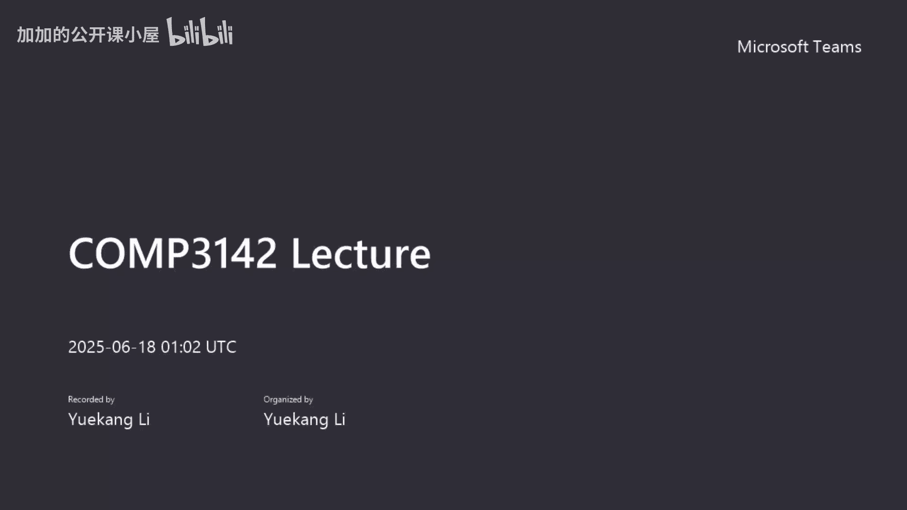
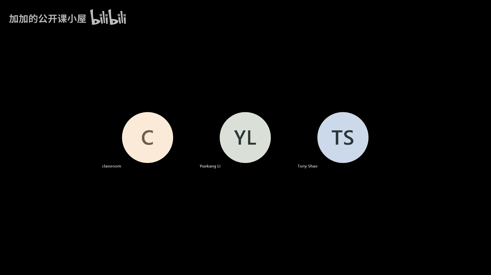
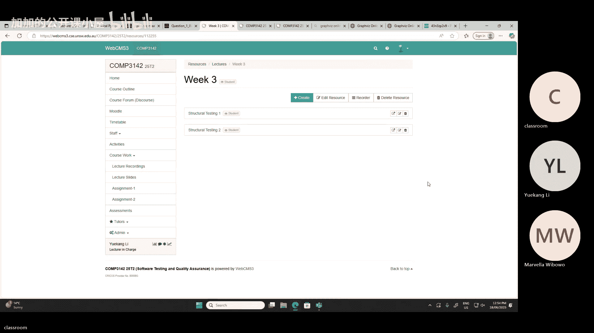
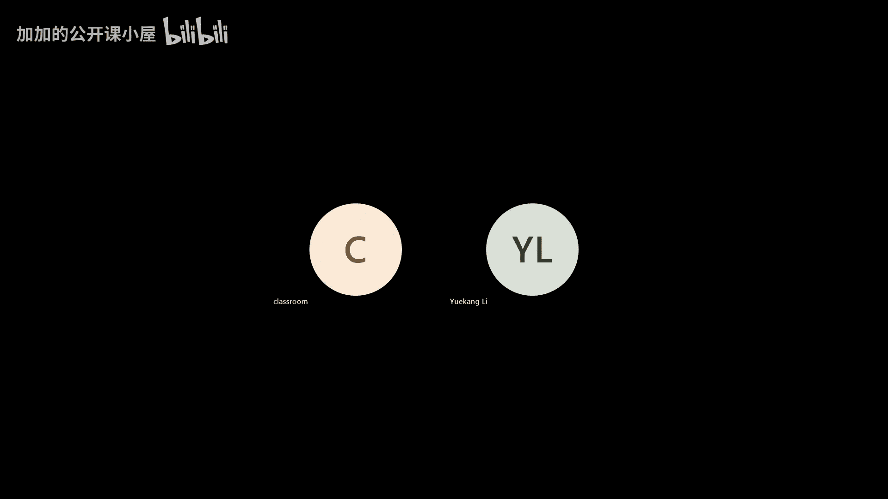

# 软件测试：第13讲：结构性测试（一） 🧪

在本节课中，我们将学习结构性测试，这是一种基于程序源代码结构来设计测试用例和衡量测试充分性的技术。我们将探讨其核心概念、不同的覆盖率指标，并通过实例理解如何应用它们。

## 概述

软件公司常面临一个困境：如果软件运行良好，为何需要测试？而如果软件发布后出现问题，再进行测试则为时已晚。为了解决这个困境，我们需要证明软件达到了特定的质量标准。仅仅声称“软件已测试”是不够的，必须证明软件经过了“充分的测试”。因此，我们需要衡量测试的“充分性”。

然而，由于输入空间无限、运行环境变化等原因，找出所有潜在缺陷是不可能的。另一方面，完全不进行测试，仅依赖用户反馈，也是不充分的。因此，我们需要在“不可能”和“不充分”之间找到一个平衡点，即设定一些用于衡量测试充分性的标准或指标。

这些指标就像一个评分系统，用于衡量一组测试用例的完成度。我们将从两个角度来寻找合适的指标：需求规格说明和程序源代码。本节课，我们将重点关注后者，即基于源代码的结构性测试。

## 结构性测试与覆盖率

结构性测试的基本思想是根据程序的结构来推导测试用例，旨在达到特定的充分性指标以提高覆盖率。这些指标与程序结构相关，因此结构性测试也被称为白盒测试。

以下是本课程将学习的四种常见的结构性覆盖率指标：
*   **语句覆盖**
*   **分支覆盖**
*   **条件覆盖**
*   **路径覆盖**

程序结构本身为我们提供了有价值的信息，既可用于创建新的测试用例，也可用于衡量程序被测试的程度。由于结构性测试关注程序结构，我们需要访问源代码，因此它属于白盒测试。

这些指标用于定义代码被覆盖的百分比。我们通常不追求100%的覆盖率，因为在某些指标下这是不可能的。其背后的基本理念是：如果不执行所有代码，就无法发现所有缺陷。而“执行所有代码”的定义，正是基于这些覆盖率指标。

与基于需求的功能测试相比，白盒测试的动机在于：功能测试可能无法系统地执行我们关心的所有代码。例如，一些与主要功能无关的辅助函数逻辑、未在规格说明中详细描述的错误处理代码，或者需求可能遗漏的某些程序结果。因此，结构性测试是功能测试的补充技术：功能测试擅长暴露概念性缺陷，而结构性测试擅长暴露实际的编码或实现错误。

## 控制流与数据流

在深入具体技术之前，我们需要理解程序中的控制流和数据流这两个重要概念。

我们目前使用的大多数编程语言（如C、C++）都是命令式编程语言。程序由一系列命令组成，每个命令可以改变程序的状态。这些命令被称为**语句**。语句可以是简单的（如赋值、函数调用），也可以是复合的（如循环、条件判断）。

程序并非总是顺序执行。条件语句会导致执行路径的分支。**控制流**关注的是控制权在不同代码块之间传递的逻辑顺序。**数据流**则关注变量值在程序中的传递信息。

在本课程中，我们更关注控制流。为了表示控制流，我们引入**控制流图**的概念。CFG是一个有向图，表示系统中控制流的传递。图中的节点是**基本块**（总是顺序执行的一组语句），边表示控制权从一个基本块传递到另一个基本块。

CFG是我们提取所有结构性覆盖率指标的基础。语句对应图中的节点，分支对应某些边，条件来自条件语句，而路径则是节点和边的序列。

## 结构性覆盖率指标

现在，让我们深入探讨具体的结构性覆盖率指标。

### 语句覆盖

语句覆盖非常直观，它要求测试用例至少执行程序中的每个语句一次。

其计算公式为：**语句覆盖率 = （已覆盖的语句数 / 总语句数）**

基本思想是：如果无法覆盖某个特定语句，我们就无法知道该部分代码是否存在缺陷。因此，我们希望达到100%的语句覆盖。

### 分支覆盖

分支覆盖要求测试用例覆盖控制流中的所有分支（即CFG中的边）。

其计算公式为：**分支覆盖率 = （已覆盖的分支数 / 总分支数）**

这有助于发现决策语句中的缺陷。这里引入一个概念：**包含关系**。如果一个度量A包含另一个度量B，意味着对于任何被测试的程序，任何满足A的测试套件也满足B。**分支覆盖包含语句覆盖**。这意味着如果我们能覆盖CFG中的所有边，那么所有节点也自然被覆盖了。

然而，我们并不总是选择更强的、能包含其他指标的度量，因为预算通常有限，我们需要根据实际情况选择合适的度量。

### 条件覆盖与决策覆盖

在了解条件覆盖之前，需要区分两个概念：**决策**和**条件**。
*   **决策**：是一个布尔表达式，通常用于控制流或条件语句。例如，`if (A && B)` 中的 `(A && B)` 就是一个决策。
*   **条件**：是构成决策的基本布尔连接词。例如，在决策 `(A && B)` 中，`A` 和 `B` 就是条件。

**决策覆盖**要求所有布尔决策都至少被评估为真和假各一次。其计算公式为：**决策覆盖率 = （已覆盖的决策数 / 总决策数）**。决策覆盖包含分支覆盖。

**条件覆盖**关注决策中的各个条件。最基本的**基本条件覆盖**要求每个条件都至少取真和假值一次。其计算公式为：**基本条件覆盖率 = （所有条件取的真值总数 / (2 * 条件总数)）**。基本条件覆盖**不**包含分支覆盖。

另一种更强的形式是**复合条件覆盖**，它要求评估条件的所有可能组合。这虽然包含分支和决策覆盖，但通常因代价高昂而不被使用。

在实际编程中，许多语言支持**短路求值**。例如，在 `(A && B)` 中，如果 `A` 为假，则不会评估 `B`。在设计测试用例时，可以考虑这种场景。

### 修正条件/决策覆盖

**修正条件/决策覆盖**（MC/DC）是一种更专业且实用的条件/决策覆盖形式。它要求：
1.  每个入口和出口点都被调用。
2.  每个决策都取遍所有可能的结果（至少一次真和一次假）。
3.  每个条件都取遍所有可能的结果。
4.  每个条件都被证明能独立影响该决策的结果。

MC/DC是一种非常严格的覆盖率指标，通常用于对安全性要求极高的领域，例如航空航天软件（NASA就要求其太空程序中的软件组件满足MC/DC）。

## 实例：应用语句覆盖设计测试用例

让我们通过一个搜索函数的例子，实践如何应用语句覆盖来设计测试用例。

假设有一个C语言函数，用于在字符串中查找字符并返回其索引（未找到则返回-1）。我们首先为其绘制控制流图。

为了达到100%的语句覆盖，我们需要设计测试用例来覆盖所有基本块（节点）。通过分析CFG，我们可能需要多个测试用例来遍历不同的路径。设计过程是：给定程序，先绘制CFG，然后识别出能至少执行一次所有语句的潜在执行路径，最后思考如何构建测试用例来使程序按所需方式执行。

## 总结

本节课我们一起学习了结构性测试的核心概念。我们了解到，为了证明测试的充分性，需要基于程序结构定义覆盖率指标。我们重点介绍了四种覆盖率指标：语句覆盖、分支覆盖、条件覆盖和修正条件/决策覆盖，并理解了它们之间的关系和适用场景。我们还通过实例学习了如何根据语句覆盖来设计测试用例。在下一讲中，我们将继续学习其他结构性测试技术。