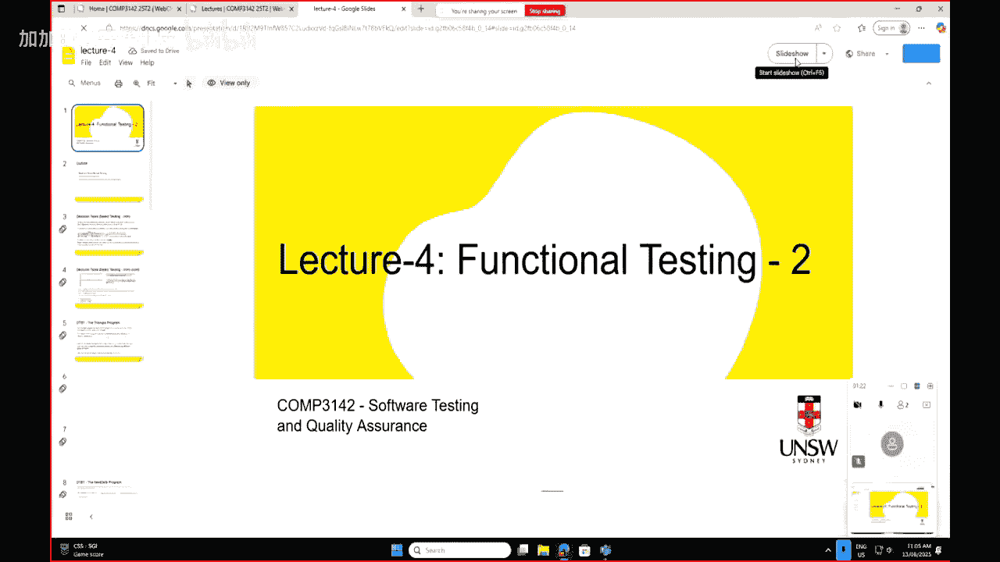
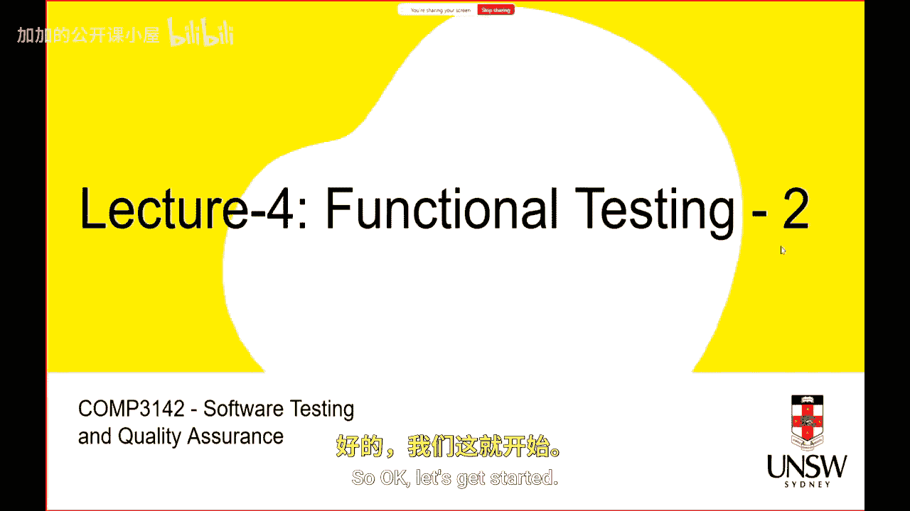
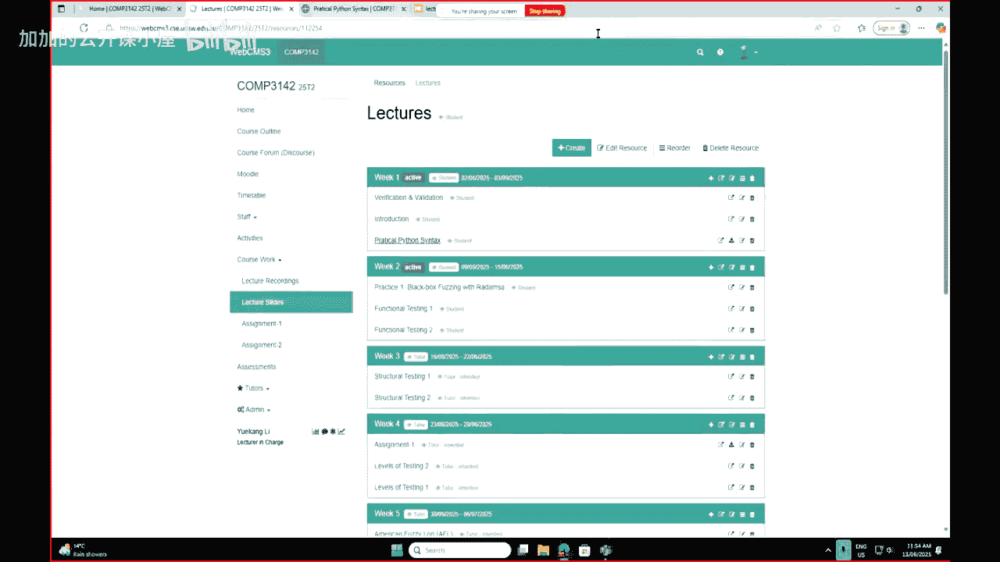
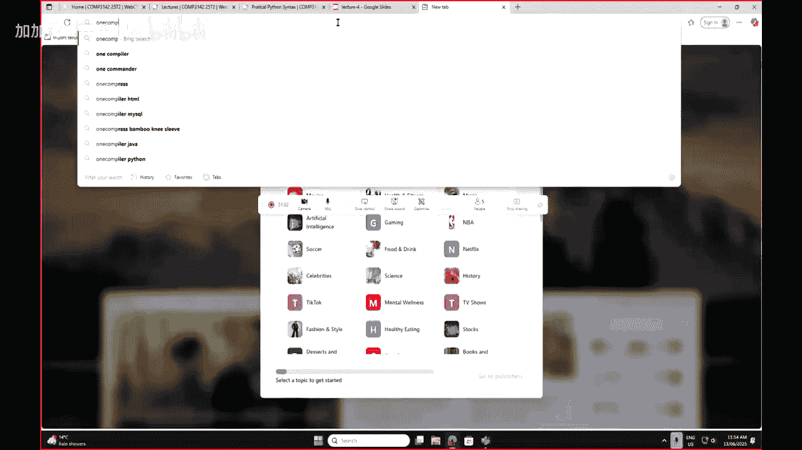
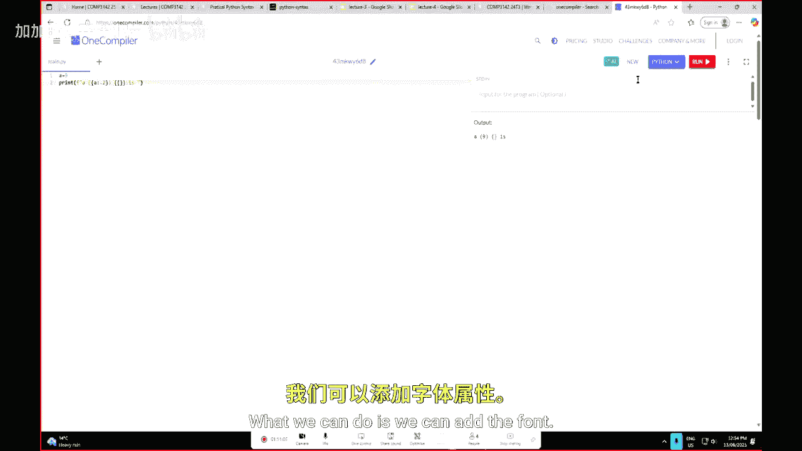

# 新南威尔士大学【中英⚡软件测试｜COMP3142 2025 Software testing】 p14 P14 Functional Testing 2 -BV1o34HzBENA_p14-

。

So can can the online people hear me。Can you hear me from online。那，你试着你。Hi， hi class。

 sorry that we have to spend some time settinging up things here because this classroom has a problem of connecting external devices in with the screens here。

 So， you know， like we， we are kind of similar to hogwords like each classroom has its own unique characteristic。

 So the previous one and the previous room has some issues with recording the screen with echocho 3。

60。 And this one has some problem of。😔，Connecting the external laptops。With the projector here。 So。

 but anyways， let's get started。So this time we are prepared。 We are not。

Caught off guard so we can set things up earlier in this classroom， so。Okay， let's get started。

In， in our last lecture， we， we have learned some。 we have learned the the basics of functional testing。

 and we have learned two types of functional testing techniques。

And the basic idea of doing functional testing is to somehow find petitions for the input space。

Because because we are testing the software as a black box。

 So we have an infinite input space for us to choose the test cases from。

 So that's why we need to somehow petition the。Test input space and try to select representative。

Represent test inputs as test cases。 And similarly， we are G for。

 for the two testing techniques we are going to learn today。

 They are also about how do we part the input space。

So the first one we are going to learn today is about decision table based testing。

 The second one is kind of related to the first one。 It is called cause effect graphing。 And where。

 and after we have learned all these four different techniques。

 we will provide a guideline and some comparisons of these techniques we have learned。So。For。first。

 let's jump into the some kind of boring definition of decision tables， so。Basically。

 decision table based testing is to first。Build a decision table that can capture the。

 the actions we take and their relevant effects for the program。

 So this is why it is called decision table based testing。

And it is considered to be more rigorous than the the previous techniques we have learned because the decision tables can enforce logical rigor。

 and we will learn about why it can enforce such kind of logical rigour later。And normally。

 a decision table has four portions。 The stop portion， the entry portion， the。

 the condition portion and the action portion。So。The basic idea is to。

The basic idea is to see how different actions we take can。Under how。

 how different actions are taken by the program。Under different sets of conditions provided by the user。

 So you can consider these conditions are kind of the test cases we are going to have。

And the actions are somehow like the， how do we group the program behaviours。

 or call it for equivalence class， so。The actions are actually like the outputs of the program。So。

So according to this。according to this definition here， we can。

 we can group the decision table into four portions。 And normally。

 this is how we represent a decision table。 So first， we have the stop portion。

 which is denoted with the thicker border small squares。

 and the stops are con could be considered as table hideers。

 So they are not the actual content of the table。 So they are basically the。Hers of the table。

 And the entry portions are actually where we hold the actual or concrete data。

 So you can see that these are denoted as with the squares with thin lines， borders。

And then we have condition portion。 Conditions are like the inputs from the user。

 So the conditions are denoted with the yellow colour。 and we also have action portion。

 which are the。The outputs， the outputs of the program。So each one of them is like it's。

 it's called a portion because it's not a single cell of the table。 It， it represents multiple cells。

 And we will see a concrete example later using these deote diote annotations。So。So a column。

 a column in each entry portion， like I just mentioned。

 is the is a pair of A A set of conditions and a set of actions。 So basically it， it。

 it is called a rule。 So each。Rule is a pair of。 You can consider it as a pair of inputs and outputs。

So， and the input is represented by a condition entry。

 and the output of the program is con represented by an action entry。So。So basically。

 rules are like the indicators of which actions are taken by the program under which conditions。

So let's have a look at an example decision table with the annotations we just defined。

 So you can see that on the left hand side， we have the stop portion， which is represented， which is。

Represented by the rectangles with thicker borders。 So basically。

 the steps are like the table headings， so。For example， on the。

 on the upper side of the stop portion， we can have three different conditions。

And on the lower part of the stop portion， we have four different actions。

So the conditions are like the inputs。 The actions are like the outputs。And on the。

 on the right hand side， we can see that we have a set of。a set of entry columns here。

 And each rule is represented by a set of。Conditions and the corresponding actions taken by the program。

So this is what we can observe from this decision table， and。

In there are two variations of decision tables。 So in this example here。

 it is considered as a limited entry decision table because all the conditions here can take only binary values where each condition could be either true or false。

So， you can imagine the。You can imagine the conditions as whether， for example。

 parameter X is smaller than 10 or not。 So it's either true or false。

 So this is con limited entry decision tables。And there are some cases where each condition can take multiple different values rather than just true and false。

 So and these tables are called extended entry decision tables。And。

you don't need to get worried about all these different definitions here。

 We will learn them with some examples later。And。😔，And you may， you may notice that。

You may notice that there are just now， we mentioned each column。

 each column in the entry portion is corresponds to a rule。 But in this table。

 we can see that there are。2 rules， sometimes two rules could correspond could be put into one column here。

 So this is because of the hyphen symbol here。 And actually， this hyphen symbol means。Don't care。

 So whenever this， it means that whenever these two conditions of C 1 and C 2 are determined。

We don't need to care about the condition of C 3。To for the program to make the action of a 4。

 So there are some conditions because it depends on how we design the conditions。

 And there are some cases where some of the conditions when some of the conditions are fixed。

 Then we don't need to consider the rest of them。 So we can put the hyp here， don't care。

 We don't care about that condition。And in this case。

 because this value could be both true and false。 So it， it actually corresponds to two rules。

 So one of them is true， true， true， false， true。 The other one is true， false false。

So each hyp actually doubles the rule count。So。For。

So the number of the number of rules needed for each decision table is actually determined by the number of conditions we have。

 because we are building test cases， according to the combinations or permutations of different conditions and for。

 for for the limited entry decision tables So each one of the condition could be either true and false true or false。

 So assume that we have n conditions， So can you calculate how many rules do we need for limited entry decision table。

How many rules。Yes， to to the power of and rules。 So I， this， this is actually quite accurate here。

 We are not using how many columns do we have， right。How many rules do you have， So we。

 we need to to the power of n rules for limited entry decision tables。And like I just mentioned。

 according to the definition， this is how we develop test cases。 According to a given decision table。

 We just use conditions as inputs。And consider the actions as output of the program。So in this case。

 we can we are s it is。 It is still about how we group。

The how we do parting for the input and output space。 So for equivalent class。

 we are actually grouping inputs according to the the output， right， outputs of the program。 and for。

 for boundary values， we are grouping the input space。

 according to the according to some boundary values of the inputs。 So。

 and here we are actually considering in both the the potential conditions that could be taken by the inputs and the potential actions that could be。

outputted by the program。 So we are considering both inputs and outputs to do the parting of the input space here。

And let's use a concrete example to go through how decision table works。

So let's reconsider the the triangle program。Where。The programme accepts three integerters。

 A B and C and， and it， and each one of the。Each one of the integer is taken as a side of a triangle。

 and then the output of the program will will be the shape of the program of the shape。

 the shape of the triangle。 or it will， if， if these three integers cannot form a triangle。

 it will just output not a triangle。And for simplicity here。

 let's just ignore the range limits of A B and C。 And so we don't care about And we'd only care about how the because decision table is。

 is more about the the logic logical relations between inputs and outputs。 So here。

Let's just ignore the range limits we have set in our previous example in the previous slides。

 We just care about how the。How potentially the input could affect the outputs here to design the conditions and actions。

So we just care about the lens relations。 In this case。

 we just need to care about the lens relations among different sides。So。First， let's try to consider。

 Let's this is。A decision table here。 And whenever we are trying to build a decision table。

 let's start from the easiest part， which is the action that could be taken by the。

The actions of the program， so。Can you imagine what are the actions stops here。

What could be described by the。As the actions here。Like， I。

 I won't ask you how many actions do we have Because you can just count it here。 Like。

 we have five actions。 But what are the five actions。Like， we have four outputs， right。

But why do we have five actions。🤧So。I we can use。We can use the four different types of outputs， as。

For actions for this program to be， to take。And the last one is called impossible。

 And this is because in some I actually， in many cases。In many scenarios。

 we may encounter contradictory conditions which could never be satisfied。

 So that's why we need an extra action called impossible here。 and we will。会不有。We will。

 we will see an example soon。And for the conditions。

We just need to care about the relations between different sides of the triangle。

 The first one could be whether a is smaller than B plus C。 And this is related to whether this。

 this size could form a triangle or not。 And similarly。

 we can have whether B is smaller than a plus C or not。And similarly。

 we can also have whether C is smaller than a plus B or not。And that's about whether this。

Whether the size can form a triangle or not。 and， and about the shape of the triangle， it。

 it depends on whether some certain size are equal to each other， right， So in this case。

 we can design the conditions as whether a could equal to B or not。

Whether a could be equal to C or not， whether B could be equal to C or not。

 And that's how the conditions we can have for the inputs。

And let's try to create some concrete rules， according to the true and false combinations of these conditions。

So， first。Assume that。A is smaller than B plus C is false。Then。😔。

We don't need to care about all the rest of the conditions。 Do you know why。Like。😔，The happensphone。

The the， the happens here means we only care。 No， don't care， right， so。

Because if a is larger than or equal to B plus C， then。The action is already determined， so。

It's not a triangle。 So no matter how they change the rest of the conditions。Is not a triangle。So。

 that's why。We， we don't care about the rest of them。 And its。

Just we can just ignore the rest of the。Conditions here。And similarly， for be。

 if we set C 1 to be true。 And if we take the fourth value for C 2。

 then we don't need to care about the rest of them and just output the the not triangle output。

And similar， similarly， for C3， we can also have this。And。

And the next one could be all of the C1 and C 2 and C 3 are true。

 And let's assume that all C 4 and C。Until C 6 are also true。 So in this case。

 what is the output here， What is the action here。Yes。Aquilateral。

 so because all the sides are equal to each other。 So that's why。The actual action is a 4。

And then let's change， let's change one of them to be false。Assume that we turn C 6 to be false。

Weturn C 6 to be false。So what would be。The condition here。What's the condition here。看你声诉。

It's actually conditions。5 impossible。 That's because if a。Equals to B， and A equals to C。

How can we have not be not equal to C， right， Because they are both equal。 They are both equal to a。

 So they should be equal。 So that's why we could have some impossible actions here。

So this is an example of impossible action because in， in， in real world cases。

 it most of the time it's inevitable that we， we build our， we have。Conflicting conditions。

 So that's why we need to have an impossible action， most of the time。And similarly， we have。

If we just turn one of these values to be false， it is an impossible case。 And if both。

 if two conditions from C 4 to C 6 are false， then it isless。Yes， and。

And this one should also be impossible， right， because only one of the condition is false。

And similarly， if two conditions are false， from C 4 to C 6， is science socialist。Similarly here。

 And if all of them are false， then it's just scaling， so。

This is how we can build test cases systematically， with a decision table。And this。

 this decision table is a limited entry decision table because each of the condition here can only be true or false。

Now， let's consider the test cases we could have from this decision table。So。

Do you still remember why each。Why each rule count is like this represented by each column here。

This one is 3032， because。We have five hyps， and total， the power of 5 is 32。And this one， similarly。

 is two total the power of 4。 This one is two total the power of 3。So， in the end。

We can have in total， we should have 64 rules， right， because we have 6。Conditions。

 and we should have to to the power of6 ruless， and。Because this。We， we， we。

 one way of counting the number of test cases is to just count the number of columns here we can have。

 And a quicker way of doing this is to use 64 to-33-16-8。 And that is 8。 and use 8 to plus 3 here。

 So that's 11 cases。So we can have 11 test cases。Out of this decision table。I know that all these。

 for， for these impossible cases in， in real life， we。In real life。For these impossible cases。

 we cannot build corresponding test cases in real life。So。So in the end， we。

 we may only have 8 test cases for an actual program。And let's consider another example。So。

To show you how decision table based testing works。 And this example is the next date program。

 So actually， this example will demonstrate why decision tables can capture the logical relations between inputs and outputs。

收。The next date program， it takes three different variables。The month， day and year。 And it。

 it returns the date of the next day as output。And let's assume the year range is like this。

So what conditions can we have out of。The description of this。放声一点。So in our last lecture。

 when we do。When we do decisionion呃 when we do boundary value testing or。When外都。

Equvalence class testing。 These are the conditions we have。 We have。Months is in between 1 and 12。

 Day is in between 1 and 31 year is in between this range。

 Sorry there's some this small inconsistency here。 So but let's just use this one here， so。

So these are the conditions here。 But as you can see， some of the。

 they are somehow connected or they have some relations between each other， like， for example。

The number of days， the range of days is actually determined by the month we use， right。

Some month could have 31 days。 Some months could have 30 days。 And for February。

 we could have either 2，28 days or 29 days。So， and the number of days。

U February is also depending on the year， right， So whether if a year is a leap year。

 then the F February could have 29 days。 And if a year is not a leap year， it can only have 28 days。

 So this actually， theres。So this。These conditions here are not。

And not rigorous enough to capture the。The logic in between each。The the the amount day and years。

So this is not very ideal to test out the。Very the to test out the behaviours of the program comprehensively。

 so。What we can have instead is to break the conditions into some more detailed ones。

 or smaller ones。So， for example。We can have。We can have three different types of month。

So the first one is a set of months where each month can have 30 days。

 The second one is where a set of month where each month can have 31 days。And third one is February。

And similar for days， we can have the conditions where day is in between 1 and 26，2028。

 We can have the condition where day equals to 29， and we can have days where day equal to 30 and the condition where day equals to 31。

And for years， we can have year is a leap year， or year is not a leap year。So。

These are the conditions we can have。To capture the logic。The detailed logic between。

Da year and month。So what are the actions we can have。So let's not consider the， the actual very。

Concrete S detailed step taken by the program。 Let's just consider the output dota program， so。

We can have two different actions。 The first one is still impossible because if a month has 30 days and it is February。

 and it has。And it falls into D1。 Then it's contradictory， right， So it's impossible。

 And the second one is the program just accepts the input and tries to calculate the next date。

 So these are the two actions we can get。So， let's think about。How many conditions。

Could we actually use if we use a limited entry decision table。

 So we are each one of the condition can either take true or false。

 So how many conditions do we finally need to use。Here。😔，Remember， we don't want to see。

So how many do we need。😔，How many conditions。 So the number of rules is actually determined by the number of conditions。

 right， So how many conditions do we actually need if we part the input space like this。1，2，3 plus 1。

2，04，5 plus 2。 I that the answer here or not。Actually， if we don't think about。

 if we don't think about it， if we don't care about redancy， we can just use。2 plus 4 plus 2。

Which is 8。Conditions， however， the last one here if。If we take y1 is true。

 then vital2 is automatically false。 And if we take y2 to become true。

 then y 1 is automatically false so we can just use one of them here。So we only need 7 conditions。

 and we only need total the power of 7 rules here。So， that's why。sorryrry， we。

 we only need to use 8 conditions。 So we don't need to care about。 We just need to use y 1。

 either y1 or y2 here。So this is why we need。 So this is how we can reduce redundancy when we do this design。

And however， this。This will need us to have a large number of rules if we do that。

 if we make the decision table like this。We can further refine the design of this decision table。

Remember， remember。Remember， just now， when we， when we。

 when we were trying to consider the action of the program。

 we only consider the whether the program can take impossible or just accepts the input。

 we doesn't really care about the actual concrete action or the actual concrete step taken by the program to calculate the next date。

 right， we， we just need， we just check whether the program accepts the input or not。

 So if we consider whether the program， whether the program。how how the program process the data。

 We can have more detailed actions。And with only two actions。

 we are already having to to the power of。6。We are already having two to the power of 6 to the power of 8。

can of total the power of 8。So， test cases or rules。 And if we， if we do this。

 we may need to refine the conditions and have more test cases or rules to be used。 And if we。

 because if we can if we change the condition， we， we also need to think about the corresponding actions or con if we take。

 if we change the actions。 we we also need to think about the actual。

Conditions that could could cause these actions。 So we may also need to update the。The actions here。

 And remember this， this program or this technique is only used for black box testing。 We don't。

 We don't really know what is the actual implementation of the program。

 So these actions are actually based on our guesses。 So we。

 we guess that the program needs to increment the number of days， We guess that the number， the when。

 when whenever the day goes beyond the limit of one month。

 we need to recite the number of day and increase the number of months。

 So this is only because we are doing black box testing， we。

 this is only the actions are only determined by our guesses here。 And since we have changed the。

 the actions to reflect more to。To represent more details， we need to also update the， the。

 the corresponding conditions in order to。In order to， to cap， in order for them to。

Reflect the changes of the。Of the actions we， we have taken， so。So， for example。

 the changes here are like this。So we need to think about whether because we are thinking whether the program will increment then increment day month or year。

 So we need to think about the last day， last month and last year。

 So in addition to the original conditions here。 What we have is we need to consider whether the month is the last month of the year。

Or whether the day is the last day of a month， because 22 could be28 could be the last day of February。

 So we make make it an individual。Condition here。 and for the。For the leap here check。

 we can keep it as。As it is。 So you can see that we are actually introducing two more ruless。

 and we are already having2 to the top of 8 rules。 And if we do these， we may。if we do this。

 we may have more。Rules， and in the end， more test cases。 So as， as I just mentioned， we need to in。

 we need to consider the last month of a year。 We need to consider the last day of year and， and we。

 we are having two more conditions if we want to further refine our design of the test the decision table to capture more detailed behaviors of the program。

 so。In this case。So， in this case。Let's consider that although we are we are although we are building more test cases。

 although we are we we， if， if we just， if we still use true or false， which means that we。

 if we still use true or false， which means that whether M1 could be true or false。

 some two could be either true or false， then we are having too many rules。 So we can。

We can refine this， further refine this using the extended decision table representation。

 which means that。Each of the condition here can take。Can take not only to a false。

But it can select from one of the conditions here。So， for example。

 from the from the predefined labels。 So， for example， for C1。

 instead of having Mm1 equals to true or false I'm2 equals true true or false。

 I'm 3 equals to true or false。 instead of having that， we can have whether I'm a month。

Belongs to M 1， M2 or M 3 or M 4。 So this is extended。This is extended decision table。

 So you can see when the table。 the entries are not just true or false。

 They could be the labels from。From what we have defined just now。So， it is。

So it is similar for days and years。 So in this case。

 we can actually save the number of rules or test cases and make the design clearer。

And let's consider how， how the new design could affect the test cases we have built and how could they cover different behaviors of the program。

 So， for example， for。For C， for， for the first。3 test cases。 C 1 is where the month has 30 days。

 and all the days are。Smaller than 29。So， it means that。We only need to increase。

 We only need to increase number of day here， right？

 So they are corresponding to the same action here。 So these three rules。

And for the number rule number 4。 So when the month has 30 days。And the day is 30。

 And if we calculate the next day， what do we need to do。Here， what actions are taken here。So。

That month has 30 days， and we are on day 30， and we want to calculate the next day。 What do we want。

 what do we need to do， So we need to recite the day， right， because we are going to the next month。

So， an increase increase month。So we recite date and increase months。 So as you can see here。一尺。😔。

So each set of conditions could cause multiple actions to be taken because we are considering a more finger definition of actions here。

 not just whether the program will c access to calculateal the next date or not。So。😔。

So we can take two actions here。And if， let's consider if I'm1 is。If the month has 30 days， and。

And we are。 the day is on the 301s day。 So what is the action here， In this case， rule number 5。Yes。

 it that's impossible because that month has 30 days。 We can't be on day 31 for that month。

 So it's impossible。And for the rest of them， they are all the same。 We。

 we just need to increase if the。Number of days。 if the date is smaller than the number of days in that month。

 we just need to do that。 And for the last， the， the last rule here in this table。

 So if that month has 31 days and it is not December and。And we are on the 31st day。

 So what should we do。We should。😔，We should recite day first， right， then we should increase months。

 So that's how we can do。 But is that all for this decision table， Are we finished with this table。

Yes， we are far from finishing this table。 You can see that we are not even considering the years here。

So if we continue the design of this table， we can further expand it to have the second half。

 And instead of going through all the details here， let's consider this。Number 15 rule。

 So what are the corresponding actions that could be taken if they use this test case here。

So what behaviors of the program。Will be triggered。Like the month is in December。

 and we are on the 31st。Day of December。 So what will be done by the program。

How what actions will be taken。3 actions。Yes，3，5， and。6， yes，356。So。So in this case， we are。

 although we， we， we， we don't know what is the actual implementation of the program。

 but we can design more test cases that could comprehensively or and systematically cover the pro behave potential behaviors of the program。

 so。This is And you can also see that how each。Condition can be can the， the logic of each condition。

 how each condition is related to each particular action could be captured by this decision table here。

So that is why decision table is considered as more rigorous than boundary value testing and equience class based testing。

However。This is， although this table is refined。Its better than the previous one。

 It is not still not the best because it has some reundancies。 As you can see here， all these。

All these conditions， they are， all these conditions。 They are having the same effect， right。

 Because， for example， when I'm 3 is， we are， we are dealing with December here with all these conditions and I'm 3 D1 is because D1 and D3。

D 1， D2 and D 3， they are all used for dealing with February the month of February。

 and Im 3 is unique for December。 And if we have permutations or combinations between M 3 and。

D 1 until D3， we are kind of having some d reundancies here because these dates。

Are only used for dealing with the February case。 and we are in。

 we are fixing the month to be December here。 So we have reundancies here。

 and it is similar for this M for here。 So we have。Some reundancies。So。

What we can do is we can further merge the actions。That could be taken by the。By the month and year。

 So， so we can further merge the。Merge the columns here。 So instead of having M1。

 M1 D1 M1 D2 M M1 D3， we can merge them together。To make the decision table look better。 So this is。

The final decision table we can have。From the previous one。

So you can see that we can merge different conditions in order to。Reduce redundancies。

And that actually covers decision table testing。 And before we jump into the next topic。

 let's have a five minutes break。

Alright， let's start our second half。 So this cause effect graphing is actually not another technique for creating test cases。

 instead， it is related to how we build decision tables and it's actually how in early days。

 but in it， it is actually in， how in early days， computer scientists build decision tables。

 because in early days， this the the programs are not like the softwares we have right now。

 they are like hardware。 So it is actually a hardware testing technique。

 which leads to the modern design of decision table based testing。

But we are still learning it because it can somehow help us to understand the logic why decision tables can capture the logical relations between causes and effects or the conditions and actions。

 So let's continue to this。So this page is full of definitions and is quite overwhelming here。

 So basically， the。So the basic idea of cause effect graphing is to。

Only consider the desired external behavior of a program。 And。

 and that ex desired external behavior is called effect。

 and cause is actually somehow corresponding to the conditions we have or the inputs from the users。

 So the F the steps of doing this。Cause effect graph graphing based testing is to identify the input conditions or the causes first and actions。

 and then develop， we， we can develop a cause effect graph。

 and then we can convert or transform this graph into a decision table。

 and then we can convert decision table rules into test cases like what we have just done。So。

So the difference here， as you can see from decision table is that instead of after identifying the conditions and actions。

 instead of building a decision table directly， we develop cause effect graph first。

 And this graph can actually help us to understand how these causes are linked to the effects。So。

 this is。So you can see that it is。 It is not yet another testing strategy or technique。

 It is just an aid for creating decision tables or representing the program behaviors， so。

Of as we are talking about graphs， we need to know about the basic components of a graph and how do we how。

 what are the notations of these basic components， so。Remember。

 I just mentioned it is ca effect graph is actually adopted from hardware testings。And hardware has。

 a hardware has logic gates。 and logic gates are like and or or X or different kind of gates or node gates。

 So these are， this is one of the type of notations。 as you can see here， this。

This image I is actually from a textbook。 And you can see it's very old school style textures here。

 So it's actually a very old technique。 And this is one of the notations here。 So basically， this。

C 1 to E1 means C 1 can cause E1。 So condition 1 or cause  one can cause。Effect one。And C， one。

Not even means。not see one can cause1万。And。😔，These C 1， C 2， C 3 or。

E1 means either one of them can cause E1。 And the last one means both C 1 and C 2 must be satisfied to in order to have E1。

And。This is not the only。Notation that could be used。 So you may some this is from another textbook。

 And you can see that they are slightly， they， they are slightly different。 but， but they still。

 they are still having the same basic components。 So these。

 these are corresponding to logic gates in hardware， actually。 So basically， the or end gate。

 not gate。Or gate or X or gate。So， X or R means。Either one of them could be true。

 but not all of them can be true。 So this is X， or。So。

So that's the basic notations of cai effect graph。And let's have a look at an example to see how it works and how it can help us to capture the behaviors of the programs。

So let's reconsider the triangle program where the three inteors are taken as。

test are are taken as the input of this function here。

And we can have and similar to how we design the decision tables。

 These are the six conditions we can have。 So X is smaller than y plus a Y， similarly。

 we can have Y Z smaller than the other two， and we can have equality relations among these different sides。

 so。Basically， we have these six conditions here。 And for the effects。

 we can also have all the five effects we already have。And this is the。This is the example。Example。

 cause effect graph given by the textbook。 However， however， it is， it is not very rigorous。

 It omitted some links。 It is， It is not accurate， and it doesn't use causes 6。So。Let's see why it。

 why it is correct。 Some which part of this effect cause effect graph is correct and which part of the cause effect graph is wrong。

 According to our understanding of this example here。So， let's。Let's focus on the effect here。

 So let's start from effect 1。So。In this。This link here means so either C，1， c，2 or3，3。

Eith one of them， I mean， not and plus a n will cause E1。Which means that。Either one of them。

Is in that not all of them is satisfied will cause even。 Is this correct or not。Not our。C，1，2，3。

3 are satisfied。 will cause Yan。It is correct。 Yes， it is actually correct。

And let's consider the situation of E2。 It means that not， it means that all of them， either。

 either one of them is co correct。And C 4 is not correct， which means that x is not equal to y。

So it will give us a scaling triangle。Which means that。Not every side is equal to each other。

I are these conditions enough to give us a scaling triangle。So this C 1， C 2 and C。

3 are satisfied means that it is a triangle， right。

 It is a triangle and X is not equal to y because C 4， you can see is considered to a n。

Before it's not correct， is this enough to give us a scaling triangle。No， right。

So it's actually missing C，6。Sanctuary missing C，6。搜。😔，Why shouldn't equal to that， right。

Because only x is not equal to y is not enough。 We should have more than two sides， not to equal。

 not equal to each other to make sure that it's a scaling triangle。And let's consider E ray here， so。

C 4， is satisfied， which means that x is equal to y。 and C 5 is not satisfied。

 which means that x is not equal to z。So is it enough to say that this is an is socialless triangle。

So， x is equal to y。And why is not equal to that。This is actually still not enough。We need。

 we need to make sure that it is a triangle。 So we need to。

 we need to have the conditions about C1 and T and C3。 So it's missing a link here。

 He's missing a link here。So。It， it is similar for E4。

 We are missing the link for We are missing the link for because here the in in the sorry in the in in what was given by this in what was given by this example here。

 It only checks C 5 is true。 X is equal to that is true， but it is not enough， right。

 X is equal to that doesn't mean y is that is also equal to that。

 which doesn't give us an equilateral triangle。 So make。

 we must make sure that all the size are equal to each other。 So that's why we still need C4 here。

 So there's a another missing link in this graph。😔，And for the last one， there's another error。

So let's take a look， so。E 5 means impossible， and not C 5 obviously。

 is not enough for having not obvious， right， We should also have a contradictory。

A contradictory condition for C 5 to make sure that the final effect is impossible。

So we can use C 4 in this case， as the contradictory。

And C 4 and also C 6 as together as the contradictory。

conditions to cause the final effect to be impossible， so。As we just。扫。

The cause effect graph looks quite tedious if we want to make it correct and comprehensive， and。

And even textbooks can make mistakes。 and a lot of mistakes， actually in this graph。

 But why do we need this thing here， so。Why do we still need this concept。

 Is it just because it's part of the history of how we develop strategies and techniques。So actually。

 there are two reasons for us to use ca effect graph。

The first one is it can help us to actually track the logic links among inputs and outputs。

Which can actually help us。With debugging debugging the per one。 So， so in the end。

 after we do testing， what we want is we want to do debugging， right。

 It's not finished one swift when we just， if we just find bugs。We， we still need to do debugging。

 and we still need to fix them。 And in order to fix the bugs， we need to know what causes the bug。

 right， We need to know the relations。 So here。The cost effect graph is actually helping us to clearly see which conditions are having what kind of effects for each one of the output here。

 So you can see if we track E1 here。 assumed this is， this is this is correct。 So we need。

 we know that okay， either not all of them is true。Means that。we， well give us E1 here。

 So this is quite clear。So for E 2， it's similar。 We can see that it is related to assume that this is correct。

 We are not missing 6，6 for E 2。 So assume that this is correct。 we can clearly see that okay， C 1。

 C 2 and C 3 and C 4 are related to E E 2。 And the relation is that either one of them should be satisfied and not C 4 should be satisfied for this。

 So if we use this kind of graph。We can clearly see how inputs and outputs are related to each other。

 So that's the first reason for us。So you use causal effect graphing。And the second one is。

 we can also track the logical links。Not among inputs and outputs， but among the inputs themselves。

So this can actually help us to reduce reundancies， for example。In this example here。

 we cant know that C 1， C 2 and 3 are。Related to each other with a or condition here。

 So which means that when we create test cases to violate this condition here。

 we only need to use one of them to violate one of them。 So we don't need to violate all of them。

In order to have certain conditions。 So this can help us to reduce redundancy。So， that's why。

That's for that's why we may still need to use cause effect graphs。

 although it it is kind of a tedious precise， and it may have many errors。

 So this is why we still need to do it。And so far， we have， that's before we come in。

 before we come to the last topic of today's slides。

 let's have a quick recap of what we have learned for functional programmings and what are。

 what are the techniques we have learned。So for functional programming。

 as I mentioned for many times。 So it is a black box testing technique。

 which means that we don't know what happens inside the program。 We only。

 what we only have are the specifications or the requirement specifications of the program， right。

 and。The basic rationale of doing functional testing is to petition the input space。

And there are many different ways for us to part the input space for boundary value testing。

 We part the input space， according to the different boundaries of the inputs， and for。

And for equivalentence class based testing， we class we do the partitioning of the input space。

 according to how the。How according to the output of the program and for decision table based testing。

 we are not only considering the outputs， but we are also considering the logical relations between the input and outputs so we can。

We can design test cases more systematically， and。And that's。

 and that's how the techniques we have learned。 And classifiedified graphing is just a visual。

 You can consider it as a visual aid for decision tables。So。

After we have learned all these techniques， let's have a look at how could we use them and compare them in real life。

 in real scenarios。And。And before we， before we do the actual comparison。

 let's first think about the limitation of。The first， very first technique we learned。

So boundary value testing， so。Let's consider which condition is not suitable for boundary value testing here。

So， in this example。I'll leave this QR code for now。 if you want to scan it。

You can also use the link here。So which condition is not suitable for。Bundary value testing。

So does this make it clearer。Let's have a look at the result of this poll。So。

It seems that most of you can get it correctly， so。

The first one is not suitable for boundary value testing because it has only two values。

 and we don't even have boundaries here， like。There's only。There， there's no boundaries between is's。

 it's just true and false， right， We don't even have mean value。 We don't have max value。

 We don't have。A normal value。 So we don't have。We don't have boundaries here。

 But for the second one here。It， it， it is， it is put here to confuse you。 So like for months。

 we have， I actually， there's a hidden。 There's a hidden range between these month， like。

It should be between 1 and 12， right， So we， we couldn't have month 0。

 We couldn't also have month 13。So that's why there are boundaries here for month。搜。

This is why the second one could still be used for boundary value testing。So。

So apart from this limitation， actually， in our last lecture。

 one of you guys from online has actually asked a very good question。But I。

 I didn't have a chance to look at the chat last in our last lecture to answer it。During the lecture。

 so。呃。I think its Jack。 He actually， he asked whether。He asked in this example here。

 in the boundary value example here。We are not。The test cases we have designed。Doesn't cover。

One of the output。One of the potential one of the potential output of the program。

And that is scaling。 So all the test cases are not covering。The case where the function will output。

Scaling here， so。That is because。That， that doesn't mean that this boundary value testing is not usable for testing。

 That is because when we do boundary value testing， we only consider the boundaries of the inputs。

 We are not considering the output of the function。

 So it is quite normal that we are missing certain behaviors of the program if we only do this boundary value testing like this here。

So that is another potential limitation of boundary value testing。And let's look at this example。

And the limitations more systematically， so。Bllan values， like we。

 what we have shown in the previous slide Boolean and logical variables present a problem for boundary value or analysis。

 So normally。The boundary， the buildinging values or the。Logical variables。

 they don't have boundaries， right。And。Boundary value testing or analysis actually requires each of the variable to be truly independent on each other。

 Otherwise， because if they have connections with each other。

 we are creating a lot of invalid test cases。So。So can you think of an example where variables are not truly independent。

We have using the examples we have learned we have used in our previous slides。

Can you think of an example。We were using just now。For example for the next date example。

 So the number of days is determined by。The month， and is also determined by the whether the year is a leap year or not。

手。😔，It's not always the case that each variable is truly independent to each other。And。

Most of the times the test cases are， you know， not very comprehensive because we are。

 when we build the test cases， we are not really considering the the actual behaviour of the program。

 We are only considering the boundaries of the inputs。So that's why we may miss a lot of。

Inesting behaviors of the programs with the test cases built with boundary values。

So these are the potential limitations。And here are some tips for using boundary value testing in。

Real world scenarios。So， the first one is。Robustness testing is a good choice for testing internal variables。

 So this means that。So robustness testinging means we are trying to make。

Some invalid or out of boundary。some test cases outside the boundaries。

 So this is a good choice for testing internal variables。 And by internal variables。

 the meaning is that So the meaning is like this。 So， for example， if we set。

 let's say we use let's say we use C， let's take C as an example。

 So let's say we have a variable with one as a1 byte integer。

 And let's say that when we write the program， the condition is x is smaller than 10。😊，And I。

 let's assume this is。This is a s integer， so。Ice is， X is smaller than 10。 is actually。

There's I actually a hidden condition here， not rate。

 not reflected by the condition of x smaller than 10。

 And that is a lower boundary of a s integer that could be taken by。The， the。

 the lower boundary of a s integer that is of one by length in C。

 So we need to consider underflow or overflow cases and robustness testing can actually help us to capture these behaviors if we try to build out of boundary values。

With a consideration of the actual ranges of the different data types。And。And the second one is。

 we can create extreme boundary boundary results from non extreme input values。Which。

 which is because。For example， for example。We have。We have。

 let's say an a program takes two integers as。Input， and it somehow。

 let's say the two integers are X and y， and。It and let's say， it takes three integers， A B and C。

 and it calculates C divided by a minus B。 So we can create a boundary value where an internal variable A minus B is 0 without using extreme boundary values for both A and B。

 right。So we can create extreme boundary values。From non ex extreme input values， because we don't。

 because it's a black box， we don't know how it is precise inside the program。 So if we consider。

 if we think of， if we can guess how this program is in， is implemented。

 then we can create some boundary some extreme boundary values inside the program with。

 with some non extreme inter input values。So this is what we can do。And。

For the tips of using equivalentence class testing。

So the weaker form of equivalent class testing for both normal and。

Robust and not comprehensive as the corresponding strong forms， because。The。

 the weak equivalence class testing， we are not doing permutations of all combinations of different equivalence classes。

 right， So they are not as comprehensive， and they may miss some of the behaviours of the program。

And。And。Its for some program， for， for some target targets。

 they are implemented with a strongly typed or statically typed。Programming language。

And the input values can cause runtime errors。 So it makes no sense to do some robust testing。

 for example， in Java。Java is considered as a statically typed programming language。

 and by statically typed， it means that the type of a variable is determined at compile time。

 but not during run time。So if let's say we assign we， we create an an integer variable。

 then that variable is always an integer in Java。 We cannot reassign it as a string， right。

 It is staticly typed and。And if we， let's say， if we have a function accepting an integer as a。As。

As a parameter or as an input。 And we， and we supply strings as the input as the test cases for that variable。

 then。We may get run into runtime errors captured by the Java virtual machine。

 So it makes no sense to， because it makes no sense to create such form of invalid test cases for robustness testing。

 because we are not。Testing the， in that case， we are not actually testing the implementation of the program。

 We are testing more like we are testing the。就java。软谈。 So that's why。That's why if for those。

For those。Pro written with strongly typed or statically typed programming languages Its better not to use the robust equience class testing。

And because equivalentence class testing is more related to grouping the inputs。

 according to the outputs of the potential outputs of the program。

 and boundary value testing is more on the input side。

 So we are considering the boundary values of the inputs。 So they could。

 they are actually complementary to each other。 And we can combine them together。

 to build a hybrid approach to build hybrid to， to consider both of them when we design test cases。

And that's。A useful tip。 And the last one here is。Strong equivalence class testing。

 where we can do permutations of different equience classes。

 It still makes the assumption that the variables are truly independent to each other。

 which is similar to。Boundary value testing where we have more than one variables。 So this may。

This may cause some issue because it， it is not the being truly independent is not a restriction for the program to be。

Able to to be， to be tested by E class testing。 However， if we。

 if the variables are not truly independent， we may。We may cause some redundancies。

 when we create strong。Strong equience class testing， because for strong equience class testing。

 we need to combine different。You can classes together。 And if， if they are not truly independent。

 then we are creating a lot of invalid test cases， right。

 because of the internal connections of these different conditions。

So we may have a lot of redundancy in the end， if they are not truly independent。

And for decision table testing。 So decision table based testing。So。The。

 these are the conditions where the decision table based testing technique is more suitable， so。

First， if the program has a lot of， if then else logic inside。 So we。

 although we don't know what's happening inside the program， we can make guesses， right。

 So if the program has a lot of these kind of logic。

Then it is more likely to be suitable for decision table based testing。

 And if there are logical relationships among input variables。

 then it could be also s more suitable for decision table based testing。And， of course。

 if there are calculations in involving subsetss of the input variables。

Then it is also more suitable， and。And if there are cause and effect relationships among inputs and outputs。

Then it's also very。Suable。 and the last one is actually similar to the first one。

 If the program has a highcyclmatic complexity， then it is also suitable for testing。

 And you don't need to worry about these terms。 What。

 what is like acyclmatic complexity is it is actually related to the number of branches inside a program。

 And we will cover the different。Measurements of software complexity in week 7。

 So don't need to worry about it here。That is is， it is briefly related to the number of if L or loops。

And decision table。 the， but there are some limitations for decision tables as well。 For example。

 decision tables do not scale up。 Well， we need to。

 we need to factor some larger tables in some smaller ones to re redundancy， for example。

 in our in our second example。We have learned today， with the next date。Program。

 we can further refine the definition of conditions and actions to capture more behaviors of the program。

 but we are also introducing some redundancies， and we can remove the redundancies by merging some columns together。

And so we have to iteratively work on decision tables to refine the definition of conditions and actions and remove redundancies during this process。

And lastly， we let's do a comparison between these different techniques。

 And these two figures are not created for a particular program because for different。

Programs for different programs。 the co conditions， the situations could be different。

 but generally speaking。Bundary value testing。Will。Bunary value analysis is the last。

 the least complicated technique here。And， but however， it could give us the most。

 the largest number of test cases。Remember， we could have the number of test cases required for strong。

 robust boundary value testing could be exponentially large， right， according to the number of。

Bundaries and variables。And for decision tables， we need the least number of test cases。 But however。

 it is。Consider the most sophisticated。Tnic here。And for the effort in identifying test cases。

Of course， boundary value is considered to be the simplest one。

 and this table is considered to be the。1 that requires most effort， because we need to。

 we need to draw the decision table， and we may need to refine the design of the table step by step。

So。Its all actually about。Traing of efficiency and effectiveness。

 where efficiency means how fast we can design the test cases， how fast we can do things。

 And effectiveness means how well we can do things。

 So it's like how we can trade off between how fast we can create。

 test these programs and how comprehensively we can capture the different behaviors of the。Program。

And that's all about the main content of today's lecture。 And let's continue our journey。

With the Python syntax。Like， do you need a quick recap of what we covered here for the last part。

Like no， okay。So let's have， let's jump into the Python syntax here。So， there are actually many。

Useful new features since Python 3。5。And。The first one is the virus operator， so。Sometimes。Sometimes。

 we。Because I'm， I'm using， because I'm using this Windows Windows computer here to do this。

To to give this lecture， I don't have access to a local python compiler。 So this is what I can do。

 You can also do this with your own machine。 so you can just open this one compiler come。Website。

 and you can select this python interpreter here， and you can copy and paste code here to play around with it。

So。And it's using Pyson， Python 3 plant 12， so。All the features we have covered here are supported by this one compiler dot com。

 so。That's it。 And for the virus operator here is denoted like this and。And the， the reason of this。

 the， the， the， the advantage of using this operator is to make your code clearer。

So it helps you to write clean code。 And it doesn't。

 It actually doesn't introduce any new logic or new feature language feature。

 It just help you to write cleaner code。 So before we， if we， if we don't use this operator。

 let's assume this， we have this condition here。 So we have， we have a variable。And we have a。

 we have a piece of data where this variable is used as a key for retrieving。

So this one here is like， if data is a dictionary， then a is a key。Then we can， and then we can。

 we can use this key here to store this variable here。So。So， we need to check。

We need to check whether this key is inside this table。

 right before we can successfully store the data into the variable from the dictionary。

 We need to do this in two steps。So first， we need to create a variable cut A here。

 and then we can assign a value。Inside this if here。 however， if we don't want to， if we can， if。

 if we don't want to do this extra declaration of this variable， we can use the virus operator。

 So this it is called virus operator because it looks like a virus he head。Rotated left， so。

You can search， it is actually u。Because it's， it's an animal like this。

 So you can see it's like rotated virus， so。Is called virus operator， so。So this can。

 if we use this here， it actually means we are declaring a new variable called a。

 And we then after we have declared it， we store the value inside a。😊，And that's it。

 So we are saving one line of code here。If I， if we want to do this， so。This is。

 this doesn't introduce any new logical or new feature。 So this is just save the。Ls of code。

 So it's similar here。 So if we。If I use。If， if we want to use the length of a here and we want to use the number of n after。

We， after assigning it to the value of length， we don't need to declare this variable explicitly here。

 We can just use this virus。Operator here。So we don't need to declare it explicitly。 So that's it。

 It's very straightforward and simple。However。However， various operator。

 because if we chain up operators as expressions in Python。

 there are priorities of how they are calculated， right？ So， for example， if we， if we do this。

 for example， if we do this。1 plus。😔，Two times 3。So。

This times here is calculated first before we do the plus， right。So以 seven。So we。

 when we turn up different operators， there are priorities of how they are used for calculation。

 And this virus operator has the lowest priority。 So if you want to use it， you have to。

 you have to use it， put it into a parentes for safety for the purpose of safety。

 So let's say if you don't have these two pairs of parentes here。Then。😔。

This command becomes the comparison result。Of input and quit。Instead of。The input value here。

So because it， the virus operator has the lowest priority for during computation。

And the reason of giving it the lowest priority。Is to make sure that。The syntax is clearer， so。

We don't need。 So， for example， in many cases， we need to calculate a complex result and put it into a variable。

 right？ In that case， if， if this virus operator has a very high priority。

 then we need to put parentes afterwards， right， then it may introduce some reundancies in the syntax。

 however， if we give it the lowest priority， in most of the cases。

 we don't need to put parentes anywhere。 So that's why we。It's it's。Benefiting the。

syntax clarity by giving it the lowest priority for calculation。And the second useful feature。

After 35 is the pattern matching introduced in 3 10， so。The syntax of Python was very。

was very tedious before Sil 10， if we。Like in， in C programming， we have switch cases， right。

 We have switch cases。 But in Python before 10， there's no switch cases。

 And if we want to have a switch in Python， we have to use nested E and else。

 So it's basically a large chunk of code。If we want to do that， however， in。P in python 35，10。

There's a new feature， called。A called match Ma or matching。 So the keyword is match。

 So you can consider this as a switch in other programming languages。And。

 but it is much more powerful than just a switch。 So if we just use it like a switch in other programming languages。

 then we can what we can do is we can match。We can do some constant matching。 for example。

 let's say if we are handling the response or the status code from an H TP request。

 what we can do is we can match the status code and use different cases here to do different actions。

 and you can see。This。There are some syntax here。 So this underscore symbol means it's a we card。

Maature， it means the default case in switch。 It works like default in switch。 So basically if。

If none of the previous cases can capture the pattern here， the status here。

 then this case is matched。 This， this line of code is executed。So。But it is， like I just mentioned。

 iss much more powerful than merely a switch。 So we can also do type matching。

 So instead of just matching the value of this。Varable here， this。this switch case here。

 What we can do is。We can。We can also match the type of this variable。And if you think that， okay。

 type matching is not still not powerful enough。We can also do sequence matching。So， if the。

If the variable to be matched is is of a sequence type， then we can。

Match the actual value inside that sequence。 like， for example， here is a depot。 And if the。If。

 if this。So we can， we can match We can match the values of each element inside this sequence。

 We can also match。We can also combine the， combine the matching between type matching and constant matching here。

 So we can also match the type of that variable of that element of each element inside the sequence。

So you can see we can have a lot of， we， we can do a lot of things with this， right。So。😔。

And there are more syntax， if we。If we want to assign a name for variable。That is matched。

We can use the as syntax。This means that we can assign this matched result。As a variable here。

 as a variable here。And。未看啊未看。We can also use。The rest keyword。the U can use the the S。

To capture the rest of the elements inside a sequence。So we can， if we run this。

We can observe the result。搜 basic name。😔，We need to。 We need to do a proper indentation。Butai。

 this is not。Capture， sorry。Instead of， instead of。Returning， we need to do printing。

So if we run this。What we can see is。W does not match the pattern。What happened here。Case。😔。

Oh dictionary， because it acquire requires a dictionary as the first input。

So let's give it a dictionary。So you can see it can actually match the type here。

Does not match again。Okay， anyway， let's delete this one here。Oh， it's because。Sorry。

 it's because why and that is not the second here is， if you delete one or 1。

 you can see it's very strict。And they can match anything here。你看C。We can。 We can validate whether。

A given。Dictionary with complex structure matches what we want or not。

 So this is particularly useful for validating inputs given to a function。

Especially when the input is given as some some。Some some variables with very complex structures。So。

 so that's why it is particularly useful for parsing configurations to check whether a confi configuration is correctly set by the user or not by doing this。

 As you can see， just now， is's very strict。 It's very， very strict。

 It can be used for checking the type of certain variables。

 It can be used for checking the values of certain variables。

 and we can re we can assign variable names for the matchshed patterns。 so we can reuse。

 imagine this。This thing here is passed as a set of configurations or a set of S a list of settings。

 What we can do is we can， we can match。 We can check the validity of this setting here。

 We can also extract values from the settings， so。This is very。

 very useful for passing configurations， so。This is just an example of how can we use。This match。

Syntax to do configuration validation。And。Here's another example of the advantage of using match。

As we can see here。let's imagine we are trying to extract。The first piece of data from a list。

 which should be a dictionary。And the， the key of that dictionary is prices， and。

 and the value of that price is key in that dictionary is a list。 And the first element of that list。

Is another dictionary and which is called USD， which is the currency。And what week。If we。

 if we don't， if we don't use this pattern matching， how can we use this data safely。

How can we use it safely， What we can， what， what we need to do is first。

 we need to check whether data is non， is a non value or not， right。

And then we also need to make sure that the length of the data is larger than 0。After that。

 we can safely use data 0， right？ So we have to have。The first if here to make sure that， okay。

The first I， the first element in the data is valid。 at least we can use it。And then。This one here。

 we can， we can。 We can get the corresponding value of the prices key， however。What if， what if the。

 they， the， the first element of data is not a dictionary or it doesn't have the guide method here。

Then we cannot safely use it。 We， we may need some extra checks here， right。

 we may need some extra check to make sure that prices。the data， the。

 the first element of data can use guide。So。We may so we may need an extra if condition before this one。

 And after that， we need to check whether。The prices same is same for data。 it's safe to。It。

 it's safe to。To be to be accessed with array or list indexes。Then we need to do this check。

 And finally， we need to do this guide again。 And if we want to do it properly。

 we still need to check whether this element allows us to invoke the guide function。

 So you can see it's very， very complex。 if we don't use match pattern。 However。

 if we use match pattern。 This is this line of code we need， we just need。

 So we just need to write whatever we want to have in the end。

And it will automatically handle the rest of the cases。 the all the invalid cases here。

 if it doesn't match。So this can save us a lot of code for input validation。

 So this pattern matching， it is very， very useful。And。😔，A new。

 another new feature of Python syntax is since Python 3 6。Before pattern 3。6。

 when we want to do format screen， what we need to do is， for example。

 let's assume we have a variable card 9。And， let's have this。Function here。A is。 So what。

 what do we do if we want to print out the value of a。Or a。

 maybe maybe instead of we what we can do is we can， of course， do this。Plus， a， we can。

 we can create put it into one string。 That's very straightforward。 But what if we want to do this。A。

 what if we want to print a in between these processes。So we， we may split it as multiple screens。

 But what we can do also do is we can also use。For screen。And use this function here。

 you can see it's a keyword。 It's a built in keyword。Format a。没看到 so do this。So a is9， so。However。

 this， this syntax is a little bit tedious。So what we can do is we can。We can just use the F string。

 So Python allows us to annotate strings with some characters。 And F means it's a format string。

 And you can see that this。synyntax highlighter turns the color of these braces into a black color。

 It， it means that it's a variable here。 So let's put in a there。And then it is print out the same。

 is's the same as dot format， but it's clearer， it's much clearer。And。And this is F string。

 So you may wonder， okay， how do we print out princesses， How do we So how do we print out braces。

If we， if we do this， if we do， if we p try to print out the curly braces like this。

 it will complain that。It， it requires。Valid input。 And what we can do is we can use。打保。

B curly braces to escape。So in this case， we are printing out the b cur braces within the F screen。

And there are some other types of strings like B string， like which is。

 which means that it's a bit valued string， But you don't need to care you most of the time。

 you don't need to use that。And。F string is actually giving us。

 is actually helping us to print out things more。How' is much easier。And。

And another thing is within Fstream， we can also do some formatting for the different values。

 For example， if we want to format the float floating point number。 what we can do is we can add。

are not wireless， but。We can add a semi column here。And then we can do whatever。Maybe dot2。We can。

 what we can do is we can add the F， sorry。

It's not allowed in。