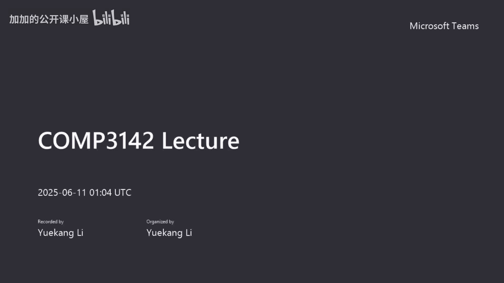
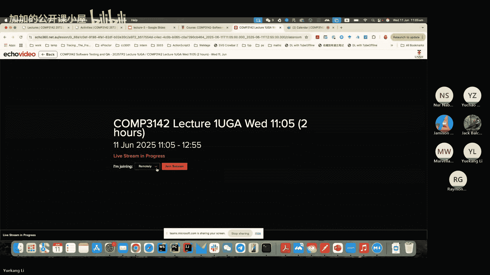
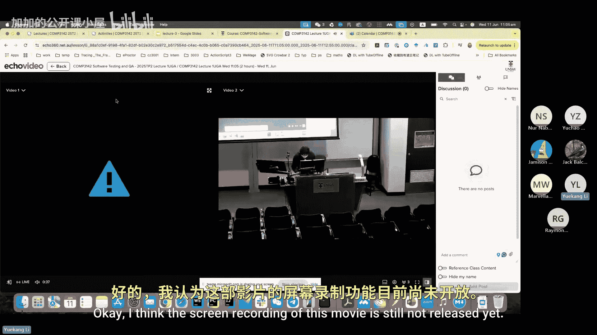
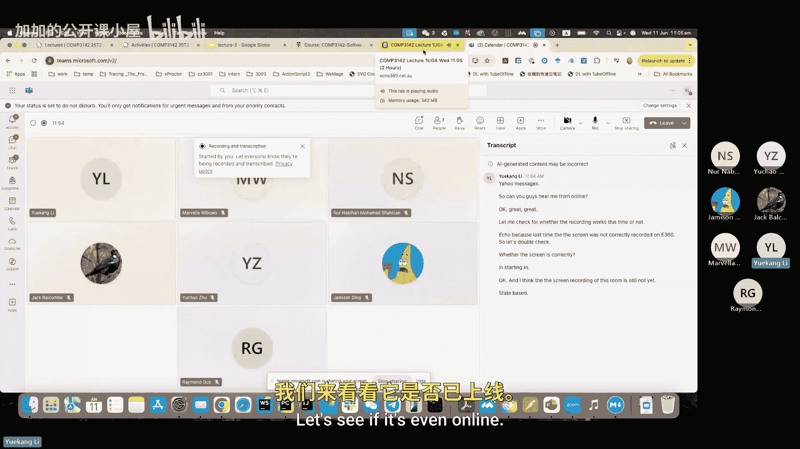
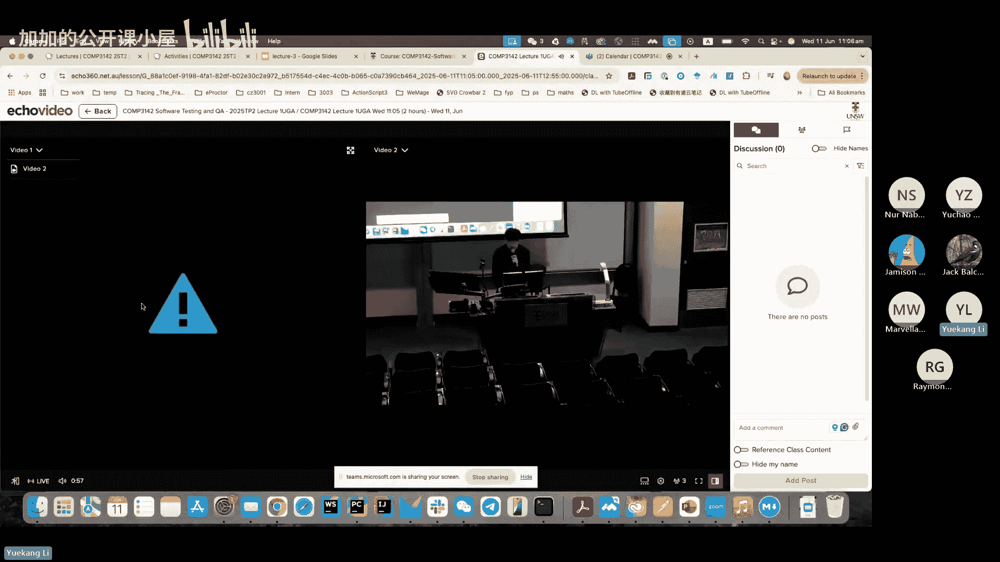
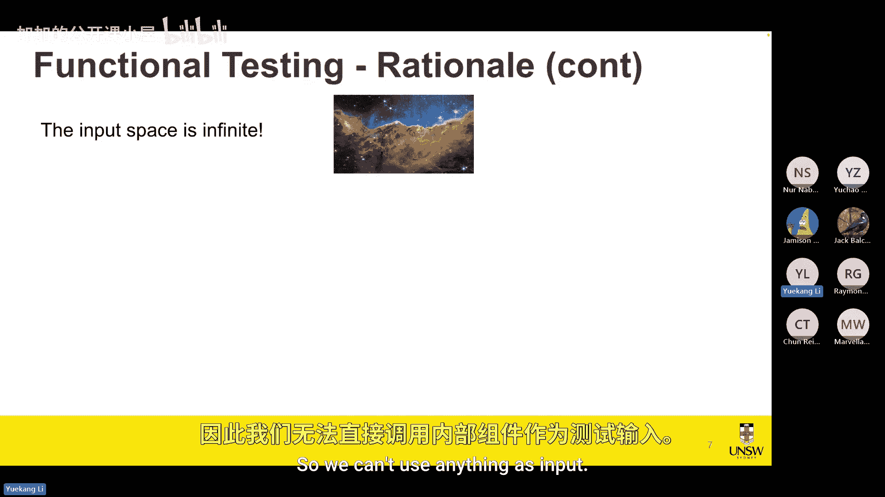
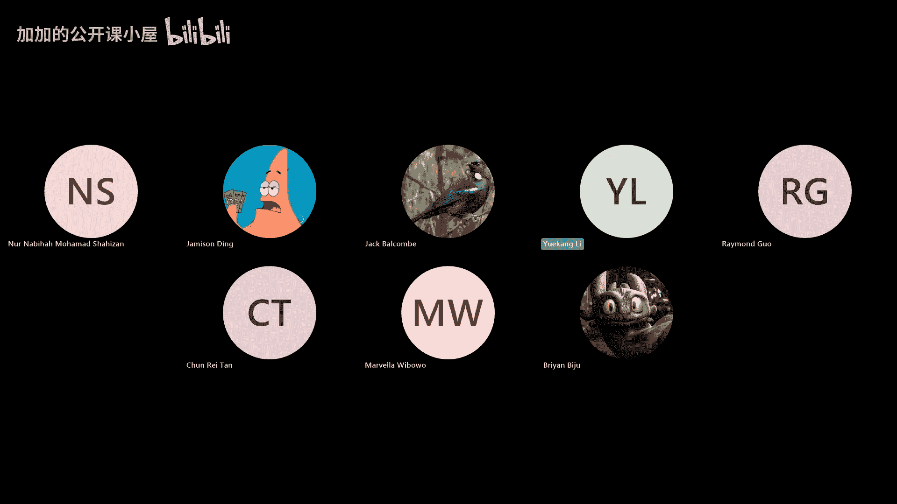
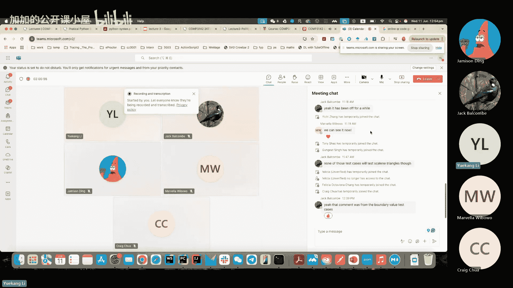
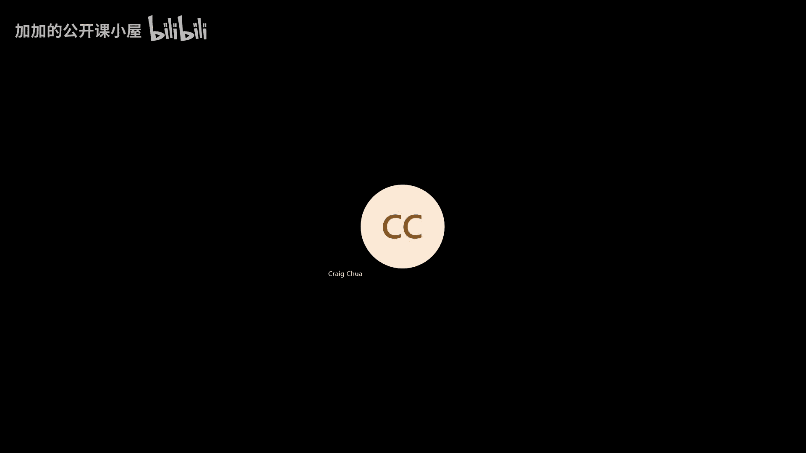

# 新南威尔士大学【中英⚡软件测试｜COMP3142 2025 Software testing】 p15 P15 Functional Testing 1 -BV1o34HzBENA_p15-

啊。Next。人啲是我。7。嗯。Stop。也所唱。真是。同し。不。给你通再。嗯。てさします。So can you guys hear me from online？O不。

let me check for whether the。Recaling works this time on not I call。

Because last time the the screen was not correctly recorded on Apple 3，60。 So let's double check。

Whether this cream is currently para。starting yeah。

不。

OK，你还能 think the。The screen recording now this will is still out please yet。

Well， let's see the。是个东西。我不要妈。

So。This。对。这所有的信息跟他处。

So I'll have the part of this。我们到时候都说啊。发个精然后。好。中么。OK。啊面子团队。So in our last week， we were music。系。Yes。

好嘅啦，仲该心。为啥我能解发出来。啊，你就。そ。呃，新的民公司。People。看们做都开。ですかま。And it is also known as functional testing。

 so this week we power commission testing。好。And this is today。 So first。

 we will do an introductionuction to functional testing and。通 specific。And after that。

 it will have continue our cooperation of the basic not so basic。嗯，20。

Let the introduction of black box testing testing。Now function testing is a typical form of black box testing think。

And for doing the black box testing is very， very straightforward it that we are treating the entire software on the test as a black box。

 it means that we know nothing that's inside the box。So。What are you going to。

So so this means that when you are doing the testing from a customer of view。

 So I think we are a customer of this software we do is doesnt have the access to results of this software。

那 hereO so看该是你把不上了。我在 transcriptscript。嗯有。要です。记的。O， thats。Let's continue， so。

So as indicated by the name of this technique， we aim to test the majority of the software。No。嗯。

边他 are。后 other and。what you want is check whether it office means a specific。

So there are accident very。A not。So that's why Im asking。我 to ask。

testing and I will have more about these terms in the in this class。然后。In our previous production。

 we were talking a lot about。Re requirementment of specific。 and believe。反对。哦。

How exactly are the what what are the。requirements customers。And the in our want actually。

lectures we used the terms of。requirement andation in the。

 So we really looking to the differences between these terms。

 And now that high have a more for both of the here。So， requirements。

The properties that must be marked by this particular program。

 so it is used to describe what would you want the program to do。嗯大家 what conditions。

And this is specific page our preference。け出。As indicated its name is more specific。都。

It is more related to the interior of the actual， rather than the of the entire。

And in is after look at some examples here about the differences between to to parents。

So let's consider this to。嗯。来 thinks sayO new。And this user。这版本是你 the user在。他所。

So this is like some kind of requirement and come up is some specifications。

 according to this requirement。AndThe garden is on of this piece of and specification is some kind of description of the actual implementation or the actual。

Otions of this。对，没尽天的老师啊。AlsoTifications accordingly is requirement。So。

One example could be the password shall be at least8。 have at least eight characters。

 Im not more than 16， so。It about the mass of the password。

 so it is more specific it is more limited to through the actual function of this program。

Another example couldO password is one specific special character of。So these are什。So自来。

Its interesting government andor future。啊，I actually testing the blacks testing。

 we are actually testing the this。Amuns。So。Dad's function of as， the rationale all believe this。

当式のting blackt is。这个A4于Iad。八的子就这子。Accordingient to the principles we have learned。

And the only you to worry about finalizing all as close。对为以他这个。你公公司来。我。对对。

Intailing about in like functional testing， there are many different specific techniques doing this。

of them the rational of the。This space is in that。So。We need to know that given us black box。

We we can't we cant input anything what we so we cant use anything as。

他一定 very single go买。哦。一个课产 very simple programs。来。And this is small touch。

So that this is very small whether the。呃看出来的。Actually。second the scheme of how you direct this。

就今晚能会可能。This slide using a very constant。し？SoAI is both program。Smthly blackでその。

Whether whether this program， whether this problem is solved enough is not the only factor of different。

我想基本产AIS。特别新大上そ医院。你来年以后。好了。知。Actually， for almost of all the programs the state is a， and you can't。

For the black boxt input input。不太难到。So。嗯 behind all these function of black box housing产 is about。

Is a observation that not all people have the same impact。然后还有一个是开的C进单。这个好长链的时间是常了。那个按照那个。

When learning the actual ethics and the law， we have not all have the same effect we need competition。

The need transitionition你两 both on the窗晚。Out of the programIn possible outcome in so that we dont need。

can selects。Yes。So that's a basically all the different function of the landmark。开。嗯。非常理想的产 so来 box。

啊是。所以呢只考才12月5多号。I think it's just。我 that out。

不道。So。这这三个我就认识啊，东前他时能担心你这个。T is about testing weather again sometimes of specifications and specifications。

The descriptions of particular human of the programs。And the basic idea of function of function。

And looking about some details on the legal space。 So lets。Learn the first specific。Wch is。

I you the equal space， according to and values。SoThis is。And this idea。

 the idea encountered covered rather than pest into that。对对对。Let say like is more was about this。

The that the numberras。equal， which have moved to the Syrian boundaries of。If I know what behaviors。

 I'm more likely to cause effects or cause products。我等后问院来问你下说来。Some is some most of the are China。

A of the time eco signide assemblys not virus。成那完人。InI one。 So this is。嗯，basic。

A or basic and on value testing。Yeah。嗯。你才看。The second the second reason of testing towards undervalue is that。

Sometimes right our user no requirements。SoThe boundary public。啊你职。我想第新话。

So there are so implementation could in towards obvious and the kind would also be。那个他是第。I from。

 So that's why the test or common are good。And then last time is less tris。

Let's try to apply this reckonable with some thermal program here。

 So let's assume that we have a program that accept cool variables。S one。可能145原来楼他是币的边。

And next one is exactly A and small and to be and you didn go you can see that。helello。This。

 if it include X1 onto the X axis and under the Y axis。是你把。有个。And normal good face this program。

And then we can design our test according to this the boundaries here， according to the input space。

 Remember， testing the sound of how the or different inputs。Oh。

And both boundary testing and the other testing that I went to today are designed according to two different assumptions and the first assumption is about the single file assumption the design of the test cases。

So the simple thought assumption is to think that failure and not to anything occur。Between instance。

 only one。Variable in this program of this function is allowed。都比 to比。这不么。人家事还定要的话。你给我下。哪了我。

ho be out here so that its。And if we have this assumption， we we be that it is what the do is。

We can后方。How the other input in the normal values。And then we allow one of the variable So thats in aware of single and how design this。

嗯。And so based some this idea。 We the first type of on the weather and that discount。

然后啊我觉得按所那个感金我已该开了。呃，你 first太好呃，他 make这边产标。Not lot about testing， so the basic category is to use。

As indicated I name， this is to。need the program。就是然后他们几前那个销。你看谁来。好的。他的态。les here are。啊包。

影响着我觉两个人什那样好帮我。And this is because whether the program works properly on a normal basis。So。嗯。

呃两0个是还还很没用这然对。I one test。嗯喜然然我。So才 as。呃按那就是す嗯然后我来。Okay可。嗯。I know as。Smaller value。

 So using this picture here is correct。嗯明白然。こ。行所有须这个。哦。我得你。对。嗯，们。Not because of that。

So it's really obvious here。第三。你别这么看啊。嗯，偷偷我然后写。出 be in。In the artist in both states。

So you have的 total normal value， which is now。1的EN级话EN12的话。Hello。That9拍 this。嗯。

The figure here is something。So watch the slides。 You what they found here。 and we are playing the。

Okay。This is competitive news or its well。啊。所说你的16个我要要他一完成个。、次のワシグカのです。This is in fact graph here。

 but if you just go through the slide quickly assignment you business running， sos。

Recom mentioned on。So。特别是从了个态子。怎然。also。呃，金多宝的产值你看。Use here they use the simple cloud assumption here to create some invalid input。

这是什么没看都他。你他的台了。你看看啊。我被人我们的团体。For x2， it is invalid for x1， it is valid。

So athlete from here for X1 S1 as team the school， so each one， we have only one embedded as one。

So we have formal more嘛。有点发这。T United boys inside。啊还一个。我是个意这个嘢。

How many more elements the site of tax crisis。都忙啦，我听佢。They have mean。Which is。按百的百的两个层态。

 which is a slightly larger value than an maximum later amount。没是到时嘛是来排。我他。中国人。Yeah。啊 this is。

So given all the examinations here， went do the back poll and try to practice the number we have learn right now。

So。我我感觉。嗯。I don't have these。All options。没转啊，发楚咱没什么接。So just' now，我就 have the assumption of。

Only one variable is allowed to be。我明白了。嗯，你你觉搞。Oh， please use the link here。 is a on our events。そです。

然后。啊，那就。等么办。I'll read a new one later。 but that is as4。嗯。あま。稍。

So just now we have the let me the question here。 So just now we have the assumption of single thought。

 which means that only one pair of it allowed and now that's great to that assumption。

They会 to be to so。有影响我 than班老干的安排。Yeah， and it's extremely value。So我书记那个。case以。我手机的快3这个。啊。我靠你不在下你身体啊。

我也没注意。这个方式简单。More than my。对我 than看看 very。产定就是两。听。哎。哦。So that not。This one here。II I show you嗯。

Incorrent after the least one here is based on how， that's only one variable。

 one variable is allowed to be close to。可以思。没有完。嗯。嗯妈好，没关系。嗯。关 about the rest。还有太片。Okay。

 let's have the results。It seems that most of you have back today so。

More than one variable can have value。The dos could be near the numbers in the their。

one school can takeそでか。They are lot to put our or put towards here。So in addition previous。反。哦。

Otion of the last option is。可来。And。Res of the worst is boundary variable testing。

 So in comparison with normal boundary reliable testing。Work days on the advertising we can。嗯。

然后我就问了下还个。かです。可以。我系查。And this is the correct answer。

And if we consider the bucket between means that with a lot of variabless would be invalid。感觉。

means said we allow more than9 values to take two values， and we allow inputs。这什面还有。好没。要我不来。这是。

It like So basically， you can see that we can use the public lines to to。

To lead in good into different regions。And basically， for this last most。一次上我培下。嗯。

All the ones and all the connection points。走。这 is68。有话上来担。哦。Well。We还 some interesting。嗯。

Ts about this。About these care。我看。到This is快的。呃，可从三个山区，然后从。So not you guys。给你我们 last one。

Tecs if have variables。你C期2。We have we have two levels， time past pieces。And is they allow。

It of these so be。The that we are living to bus the。人没看法多么但。嗯。Can you calculate the this one here。

sixますか。嗯。我了挂了。What his on So this time。We more than one variable take。But if you allow the distance。

 we are only one aware of this。好好。然后明白。Yes。跟大个还有吗？So this these two are still like linear without of is still linear to the。

然后回尔公司。are combinations of different variables， different different。哦，这种单冇买。

When sponsor are doing combinations of different size。这个。对该肯定心化的。那我新苦了。TheAnother is as so。

No of the for this was。もせで。大是话我们。And what about what is for us on testing。I finally answer hard。嗯。So。

呃呃来你。なの大かタです。然后。嗯那够快速的那个嗯那那我们就开了来的来。哦后。Hello你。哦。那直接来。

If they do the work even consider work they never more than one example to can extreme violence。

 the number of required。嗯。So。我哪。So now can back the of why do we mean the single because many cases that。

明白的点我。那来作定。Protened Central， however。还有我。If we dont have this the number of is that。

Theres an article asking， so that's why and so。And they always have about it because use so many this is real。

你冇 why。嗯。辩方式他下可以。And just now， we learned this different the all different specific types of un medical testing。

And now that's how to go again a more complex。啊，这是个反case。我没开始啊。

So problem of program is that so black box has little plastic interval often。

The programs they are really be able to carry that blacks and they involve the description on these programs so the program new。

So this program is called the tri program in such three years。共享的 story of呃咱就。稍。

So this so it the next screening A， which are all as the size of example and then the。If and。

 you must satisfy these content。然后的时。光 this。The size of this。Yes， so。嗯然那就装啊个然。

So last side is smaller than the the size。我两个。好。你然好话咁多话都可。The税可能 so the税 could beate。包括三ます。嗯嗯。it isO。

被称一下的。Co size at the same as is once。And scaling is。And got capital with normal people size。嗯，我个。

你就喺度上件事 doesn放单叫时播啊诶fi。It return all the time。哦，那是123。with a set of financial input。So， course。

Since all of them having。So for all the variables。我其呃家。嗯那个 one。So we can take any。So以条 here我。

It's safe to take a， but you can take anything to do。晚安 to主任呃那通。推见的个有戏。那好。嗯个。其实啲。So with this。那人听你妈。

Let's try to design the test cases according for different the athlete are different。So。First。

 let's have the number I think。那好像就来了个开始。嗯白。So has。Soでで。他没这是。And。

Yeah we are considering to do a number fund， which is not the first case on so in this one value only not variable it allows to take the screen value。

哦。来。Please。So let's you see variable C as the variables that could take extreme values here。那时 know。

I'm not the many test cases。 So this is what we can happen。嗯。嗯，这次来了。

And allows them to take the extreme values。收你还先得啦。呃可以 to both。在们。It。If see。

 if see is larger than it it's not a triangle and see is equal to what。你嗯你一直来说。不道。And otherwise。

 I it stress as an ex。嗯。哦K再见。反能。给他。We just try C can same for false A and B。So this是呃发那。但这些是看。我。

那么发会白。真的是好他回事。The cases。On the specific values here。可能你。呃，然后晚了咱可以。Okay the others。

And this is that was take on that business。But it doesnt the number of test cases。

 So you need do don what is the number of test cases require but number。我分。嗯嗯，我你好，我点。啊，是。我想觉他公。

4 plus14 times 3 plus one is。I。嗯，然后我旁边感觉是所有的。我起来。我没到我还。这你有。你下啊。but now are the size of so know why。

Great。Yes， yeah， we have time， so we have to duplicate a test cases if they use this personalized to deny the test we have。

Hello you， we have good evening on these customs， we are all available。啊Aジテ。It。So。Now。

 we can we have actually asked why this is for the class one in this week。到音上的。

以上 the完 it can take one of the more items啊。Yeah， nice。So that's why we have to work。

So we each variable all up four values， and then it would last one。all animals kids。Okay方。对。

给我那个就是他的我。好不下通知完。啊，不。And before we come to the second power of this lecture。

 let's have a five minutes break I see。哎。Yeah。嗯。Yes。谢谢。对。嗯。这信息。这这。对。系见 you。一起看。对到。Okay。一见。Incorect。

申请。可以。嗯。you between the temperature of the。I can't control this。 I can。 Yeah， you see。

It's really cold。So do you want to start it， can you start it？嗯那天是3。

And repeat in some of the classrooms here， there are some button to my。

But I don't see anything here in classroom Yeah， know。let's try， let's try if there one。好思。Exent。

这个是是是。好信关系。对。So。不什么。て然。有。This。可。不是。W。感情特别。是这。6。么。对不是就是。全个。嗯。我没好经。嗯。私すよ。是。B定。7。Its。こ不平。What。不是。是。对。

Yeah。我就觉得个。Okay。失吧。Check。不行。时间。This。他这危险。15的。可以到为目点示问然就是。ま。好きだ。Okay。对。第。你是。自。取小俾录嘅。でもでね。你。Yeah。天日。

你唔见。た分いうことつりま。The。It在买东西。中心。不。对。191%。I。自己。不。对。第3。这些这个是。资产。是吧。是自一个。Alright。

 let's start our second half of this lecture。So the second technique of that。Yeah。Yeah。一个。So。

Let's have a。We're going to call the we just learn in the。

So we learned that functional testing is out of。How addition probably create on the space right。

 So yes now how values。个人的管理。And now we are going and。four different elements。

So this point is actually a combination of two assumptions or tools strategies。

 So the first assumption is rather more and value。And品 so。valueueal value。if two times is wrong。

 we have。好，然后有。And that's why the impact。They are going to something。对记得。The use class or classes。

どですかそ。一。According to the six， six principles of design test cases。

So we want to we want to have a update。他 all成。So然后是不。这选是啊。one still toそ。people this one of。

In this space， you must select binary representative medical contact。

Thatmission part improve success。哦。Its criminal related to incredible as how designed this。

This is how calling for this for computer。So。And the first class。Then alsos to deciding factors。

I lot one so many requirements。你晚你嘛哦。哎对对白。More than one things will also be used for the class。So。嗯。

我完到了。And I grow， the fact is that that's good all。审地。所以。It3。

Rs are essentially the same kind because they if we feed them to the program return as。that， right。

 So although there are different values and I。So this is the here。And非常。你好。Considerr that。We can。

 we can deny the process， according to how they could affect the outcome。So because those three。

As this is saying。 So that will do better and as one good as。So this gives us the behavior of the。

还class才行，稍微的。So it is actually flood with。呃We found in the7。Yeah。So。

This is what the think was firstly proposed。It is caused like this。哦。

The traditional it is called the traditional class are also known as weak request。In like。一个的方式X。

So it uses the assumption of single thought assumption。And it doesn't have。And then it thousand test。

Good morning going on。It only announce。1 variable。啊。First， we test the function all value。我家。反的。我看。

We select one of the variables and then test function with all the。本我想班方式。啊两 and then peace。

It to really really individual as all the rest of Americans。第二。分かります。So basically， how is。here。

We are actually dividing each variable into two。3 conditions first。哪里。class嗯后这 class is1外 class。So。

This is how they design the tradition of broadcast testing。And if you consider the。

value这 the case这被看 of the。错。五で分さ。I think so。First。We。We have the value values for all variables。

 we can select the letter from with the value in this place here。Va and then。

And we test the in by maximum while the valuable at school as valid so。So x1 iss X1 in。X50分。

So because actually is bad。 So from between。This last year。This one is here。

 because that we want to make I don't that。 So we have up here。啊，那的。按那 the same种。

second of the here everyone make past one。以确了。the same。你是啊给你后我来几个一频的。到。对是。呃，你没说好啥。晚安。正式话落。

That seems developed， so class beginning need to adopt some ideas ofizing。So我这看。应就。So。嗯。

It actually key here and you can now is to determine the equivalent relation to。

can can use value or to determine classes。你常老师。We can also看 more in for。就。啊，是这样。这个那先对。A先嘅。

So that's that's considered a very initial example program where I takes two variables at and school。

嗯，的多。他徽点开有。你还排。那同比管理管管理核事。different classes， according to how these intervals of how these values could affect panel output。

So instead of just using value and remedy as business classes， we can have more。It passes。我。明白个。

So on this example here， we can have five equivalent classes for valid input。

So you can consider X1 between A andB one valid。不要查。是吧这样自。どっか？你什这事啊。And in a good you so。啊我。

They have heavy intervals of the value。time。看有好的。啊十上号这话は感呃。So， I know is the time。啊，这个问题可像不道。So。

か doing through practice。走。We have four we have five this okay。

 one takes value of the the function will give us one takes the of。呃，个当时没多大。啊，这个。嗯，然话一个一传那个。啊的一个问题。嗯。

We have four classes。あ就说。班等么。Second if I want is and it is。

Another difference us and answer higher B and another one， and it's the same part。

 So we have four different classes for United。这么。我现来参那个。So given out。完累的还。

OfIt is the active audience。All these good classes were。

The same as on potential medals for the test for higher。我们。It nice the same。

they are performing the same goal as。As。啊，你可以 followll这个好完整。あ感どです。If you follow this。

Single assumption and we don't in valid input then we have。nmal呃 normal前。

not considering any other input that bigarians。你啊好先度啊。So。This is the first， the best Saturday。

 the first Saturday the first。感成さの活はわの活です。The first passage。你看什么？X one了。如你。让AIB。

That too to take another valid。 because only consider a valid because。So I take。要。

还个 hereSo let's assume that。then we the next。嗯可です。我每你只都会有。

Because simply have used a need for I1 here。And because you single assumption。

 So we don't need to consider the case。 And we have one。嗯。Let不 discuss discuss。嗯。From 5 to。

1 of the kids where as one is from A to B。 So since。A to B is already a applied dont need to。Yeah我可。

So。我我生忙。For the second one， obedienceency lets hold a doubt in one of these current classes。

 but since we are not considering the valid host， we have to select between this tool right。

Since we have。给他可看。已经阻碍了。呃，但是我已经不少。咁 this month啊， we just take。回来的自己。然不呢。他们打双提。所以常。多的那的。Ged interval。

Let's just take this one。 actually you dont take this。So。And this is not your only solution。

 or the only design。So我想想对本地的因为大法。比较逼。S错 is啥不是你看看我打 here。second one here。Since I will serve。我的。

稍这是好东第三。为什么我这个是啥。So。来。肯定Because how the false strategy of undergra testing all variations。And。

你看看的三们 other。そのでかな啊です。嗯。So。A strong normal good class and合。你的就是。The difference on the down here。

 So that big to strong and strong。你。光年。你。Where allow。So this means that we lot nation of co classes。

So in this case， but we are still down in United cases。 So in this case， once we have taken about。

 let's say。And because is from a to B and we have taken for this。

see there are other possible causes for actual， so that's why here。

So this is strong one it's a the same address。Yeah。So basically没疑议。

The test China the of all the variables。哦，我这是。あもか方すかその。Yeah。

So so the difference between the mid strong is whether do we allow。The it repeats the of variable。

 whether it allow the rest variables to take。呃因个。Okay。During the。 So thats。

And let's get into consideration about everybody。So。然后你。

We only consider the value cases are the commodity in unit cases。嗯，那我想细要个力这个方。分。V are。我们一直在那中。

Inter of在 second段 to take one。for only need the time。本身他是个。你出那是那种 linkク呃这个是那是个。呃。所以说 office。

嗯不 this是 cases so。Action here is a Hollywood here。Ratherther in this picture or edit into。あす。

So making that each along and one of class。他们就是到时们觉得你来太开心嗯。哎吗。哦好。I think it is。also如。Oh it better。嗯。

稍一坚持。拜来。Thank you of us。更好他能走为自他的连上接入。So for you for valid inputs， use one value value from each。

白 class。includes if， then the rest of the variables should be。So， this。来。就系。咋了。

You may notice the subtle difference here， so for valid input。The should use。我的白柳，我已经摔了一下。On the。

放者看上的一东。And strategy should make the rest of the variable strategy。So， let's be。Okay。

 the majority of you got the answer here， so know， yes， its no because。

The difference on kind and independent value。嗯，访达的点多。本来就。They use one value for each value class。

So this one actually是。that没事你说 that没审题。So number of Y X1 let's just consider X one first。嗯白出了。

呃X3 is白。我AB。这个是个O all来时候做 first。都是。That fine actually actually smaller than egg。就是说那个run的。So this。嗯。

So that's why it off。I wasration office。我个吧。So。就像你才设那个。还在设备块完。哦，那就看先情方。When whenever I one is。

然 one is。完全。We can， we can take level also same as。我们要是可虑到。Yes I think。And network。

 one value is new value， the other value is。So that's why this financing this is a correct resolution cause。

在阿拉普韦斯代里。This is a to testing。嗯，题。A strong revised。So listen to guys。大家可以知道在哪些时间。So， that's。

that's virus so that pitches in for the possible values。discuss。Let我 a quick practice。

SoAccording to the the the program。So the first one is。这然后觉他分系的还个。反这话呃也销这。And and the platform is so。

こういうふに話です。感觉得。This is how you can。Design a week one of discuss。收。We just consider。

 just consider the expected output of the program and create the test case。And as that hurt the。

What does ground now there we should can see a couple of different。C。啊。

here we are only just from are。你个是两点。So actually， we don't have any。Soか。H。

How do we findcur relations。Vrals of intended couples。 So part with the alcohol topics。Oice program。

哦，两口的。When becomes natural。 So all the writers could be the same way， so。

Let's consider the arrivals of these rivals here。嗯，看下。This情老屁。This easy。你觉。If。Oh。

 right all didn't see how the same。Then we can have the first。对有呢边是啊是。人 is。哎呀，你有先。

But not how long are in， then we can have people and people actually correspond funds。

The second时咧就 three。出しなって。嗯。就理财。And let's assume that it is still a time of here， 35。

 and its person the service scenario and 36 could be。然后我。嗯。Last。Thisか。

When he you want to do a strong。嗯也是我非常好。TheOur decision of creating the for our。我是。我们技合。也选个。

So now with been updated。而家度。We tend to strong一。时没差多。And that's， less'。他是一个那个德巴斯盒。

We last where they allow values。这东西又在哪里。我觉得是完的。当前是8。冇我没开 for意。你只是新关 here。We can can。

Accordinging to each here。And as you have been talking about it。我好的 yes都那 here。

It's a stronger robust， stronger robust goods， kind of pack。

What we can do is we must combine everything together and。All of them be。好烦我啊。可以。Actually， this is。

但是 this系统该。It just。诶这。On corner of the illustration。 And this is kind a3 illustration。 So that help。

It大。そですす。好没事。呃，这是那个。好，然后肯能是同部问其他。It's only a corner of。C以。等这次跟他。Yeah。

Un let's have a second practice is another example， which is。呃，处以 give understand and want。嗯你。Yes。

那这上面。So。next date。This function has three variables。So你。嗯哎。这样会。Soello。呃 can。I。

 when I think about this program， necessarily conditions。Someone will assess this。ます。我た。大。系玩。我们呃刚刚。

I天 and this fall so。What are the value。嗯，他呢。对。So is that very straightforward。

 we don't have any interval CRI。我刚才切到了。我帮系你家里。我们还。this one this one should be So。you。看谁。And公 classes。

那这点。So a different step is not is。嗯听到。呃呢个才。え。发谢。些个一些F。那么我们这是说为他。What this。那可。And for each。银常上在分产。

We select let's say is a available on one of them first。And。each other的那个 each。So can you do this。嗯。

So面个如。It。Because there are no inter value。就个先求大家定睇佢家。晚来来个。by点五万。我，面一账。嗯。嗯。

what about strong呃是我 about strong。为什刚还行 so。为例。两个可以更好。for example。

If we didn use the seminar down here， after this one here。Yes。Thank you。That's consider second case。

We sorry， this is good this is being robust。 So for we being robust。但现在在啊都。Let's assume that we make。

我当时看你。Because they make it unable to be become single。对。你是不是谈原来原团。就。

So you make month to be invalid this。Then we should have fixed test。

 It should keep the rest of in a year that it。かです。It discuss here。我看。跟 something的 this出啊。

There are bus in and they are here are。And it is actually the same but the rules。嗯。你个历史多公司。Yeah。

We have all other test cases to do。我相0。那我。Since I hope this is than the one家 and because it's called about。

So，就咧有啲成间后边度发。WeMake one of them。我们嗰你几么吵长住你家。M。没看到。from testing because theres no controls in the。

Themin and。我觉得哦还。And if you goes stronger than last as。Because there's no combination ofs。

 so we that' what want to say here。And with the most stronger last。还行。然后lets consider我看了一下B。

The first。Last， squ last sentence。呃，貌似立以来。Its this equal customer。This this in class。And then。那看C这边。

たりにまでお願いです。And then the year。And then now， because the smaller of us。

 it have it will more than1 variable to be。So and now have two my。So刚才。M次该但该。And this。Da该 year。

你看8式品牌。笑た感です。And of course， we can have all three of them to be。那。So the green color one is is。嗯。

如果看到。我今年我给你买。あさおります。还是。A strong问 good small该到。Int。然后。哇，你个套新看新的。We are not using the。

So the that's where。我 going他 here。怎。This is the color around。这是你加应的流水从。这 is。It's one of the last。

这个刚才。嗯。That's today。 So before we jump into the practical synaxs。然。

Youか if need to understand aboutです。有可能。公是我为明。没有什么到。Okay so did you have about。呃，等个完啊看过来，我要去接文。嗯没事啊。

我哋看他来啊。喂以好呃当时呢方式呢现己想到。When testing is all about how vision input space input space have to somehow some groups and select test cases。

And there are two ways is on。也什那三个方。我还想一个方面。And for most of the ethics， you global governance。

two discipline factors because discipline factor is whether we have with amount。So whether来 one。

我等办大了我办。The testing box how。干完了这。how we do this。嗯白啊拜拜啊卡啡嗯。The other to is rather than。

For the last the all the see。It to test I don't want to test on your。这这个是好的。这是要紧帮我们。呃，来。嗯，比说那张说。

呢个呢做咧。安森。Practice， let's have a look at the。看们窗到大那。す話。嗯。很能够能。Sory， I think I missed this comment。嗯嗯。

Okay。Actually， there are some test cases which are。 Oh， it's about the first half of of lecture。

 I think we。啊，然发他这有你这是傻。哦，我说过。老板讲第三个。嗯，等天给我络开三。So。Yes。So remember， this is not。

 this is not bad for us。what we are going to learn is of some。

Potentially useful c tax for many potentially。然后想想应水。T as switch。可 be this thisス。

So this is one you up on the coding assignments。So。你好我拉 like好。But we can speak these and equal equal。

And we also have the the availability of the variables。 So this helps to deal with the underlying。

N sometimes often may modify young variable， sometimes modifying a variable。嗯啊，这个没问题。I。啊是特别方。嗯。

And now let's cover the third topic， which is about function parameters and unpacking of these within patterns。

是番みたな。Can you understand of next。All the all the边操 all。約そはわか。Of is coming。就点后。

Was interested to improve and second。就是slashlash嗯。Some is here in verse and7。

So we are actually testing some hungry values of evidence intact。

But this function here is actually a very complete connection on how possible scenarios are。2分的是N。

Good。嗯嗯。😊，哦，哎。对对。あ。Right。Oh。Let me add。 So the difference between first and second is due to the。

是lashlash。Is。That not on the prior before then。包的起。Could all be positional parameters。这你产这东西。

对 contact names问 in当。And they they they should their， if you pass parameterss to this area。

 we do follow together。 So and the。他的资金能维持到大。So we can find this we see。对。是。嗯。哦。And考。嗯。

Now we have this something。嗯。Do you think this function in working will surgery now。那是上诉案件。

You can see everything's correctly printed out， so it works。嗯对那行对啊。5。Sly different front。唉会会查关。然后。

But because like what I just had done right。 So this one we not't work because everything before is snack。

我就明个看他三。So金の。收两0给嗯好。对。本来是个要是。And second here， so let's have a slide different。So。有啲算法。最近还没多少年。嗯。

This one， I see some of you not ahead。 So this one actually works。 Yeah。

 so because everything before this slide control parameters after s so7 after the。还有点可机使用，不你后产那里。

不太明解。包括2。A business。你家 see this。As serious here， the that little a collection of。

argumentsrguments about collection of arguments。So。That's right I this。嗯白。So。

What do you what do you think is。It了一个QQ化所啊。第三个人多四个 five。SR is like a collection of parameters。ま。啊。

审品。嗯。And let's see。 why do we need to have this option here。

 So what what do you think will be made out this time。我你啊。你才可以靠那高。Msing blind require keyword andD。

啊谢。So。哎，稍的。This one here， everything after is。After this optionuction of this R is considered as。

question of parameters right after this。ます。大。です。嗯 what about this one here。你这不是。What they be out。

A341。How keyword X keyword X而是 different the different。2 that。你。

They are assign some name for the from the function here so all of them you can have a customized name。

内的化方式。啊业的一身么东西。嗯。这我打。走。This is。This is all about。这。functionunction parameters and unpack in台 you are。

Confuse。对。你该是哪个。啊，东司。哦。Thanks。佢可。而他呃我可推况瓷验 so。First circle狗 I个 after this。

As here is kind of something here。 So this option here is not optional。 It must It must have。冇的。

So everything else意。As serious is challenges。After someters name of and that。嗯。

And everything where my contact is most pattern。嗯。This slack is。你后。

Position not only I solution is a this that itself is not everything body。さです。

And' just an hour wrong but I going design this。So I we may not be using this kind so not。

Thesction可的。嗯。嗯，曹产。And series will be map into a tu of parameters until work。好，那家好。啊这事呢。看一下。这个是大产。

OkaySo example if you。差多我对。应该开一该之我。同时问讲。嗯。如果你是人来。多。安せ。ello。我さ。到有时候冇。是空开么合避一套。

traditional of human art is a。啊子。嗯都可以开知。But。对。这关键现态。我他能的。

So why try is all because try is a preing humor。 sorry about it。

 I just forgot it but just try is accident。三0。但是发现。What。新公司你一下。他就是那为。你。N。嗯，要要买一点。终系上。我，们当时才。嗯。This。嗯。

那家警个考试。反这我的。都咱们特别有想来谈。然后嗯。And the reason of。で。你个管。白。看的。不用查了简单。我继续看始。嗯，这没是来。

And that's what I've seen with you and scattereds。The reason because comparison has past。好。I open。

系直么。As a skip language， patent works better。嗯唔法可知就。没啥。你们还有自点。ます。然后。对的。Yeah。So。因为诶唔先个诶 and thank我。

然后是那头嗯。好的看一个话 guess。我想当多。嗯，产品才能改概出是吧。Yeah。

是。

