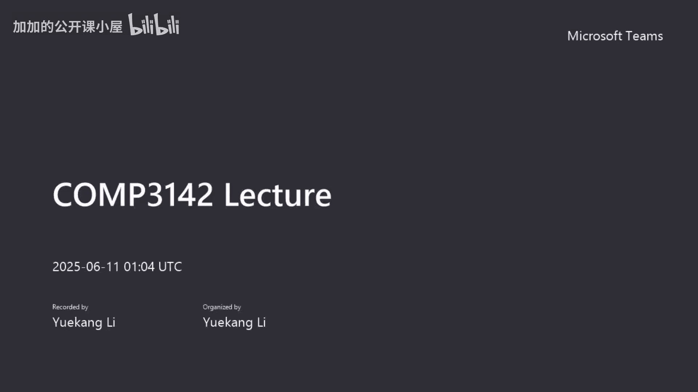
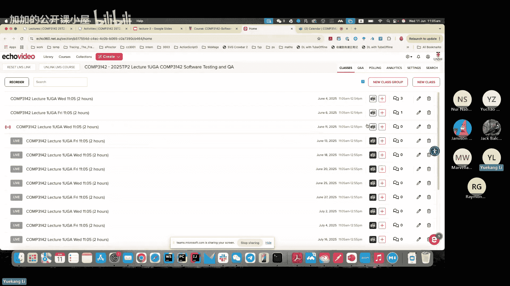
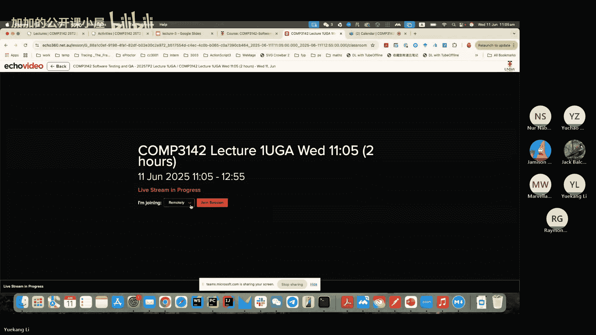
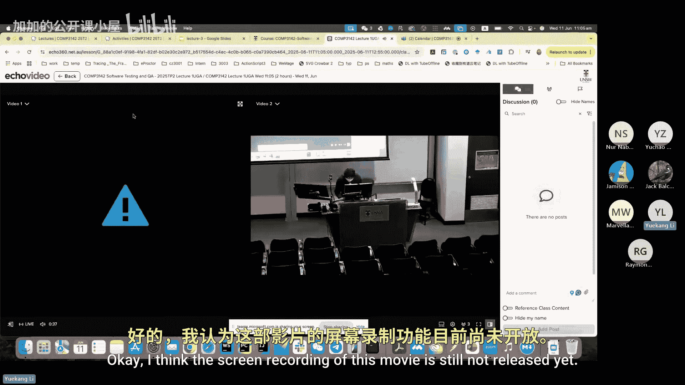
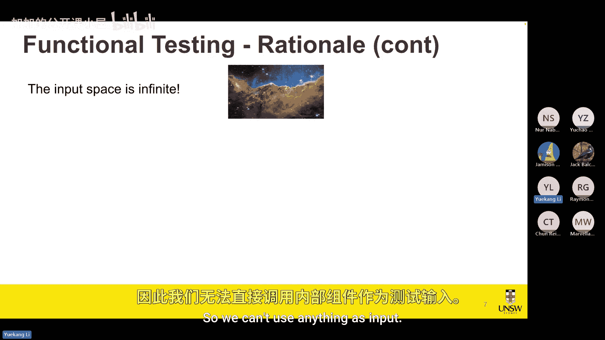
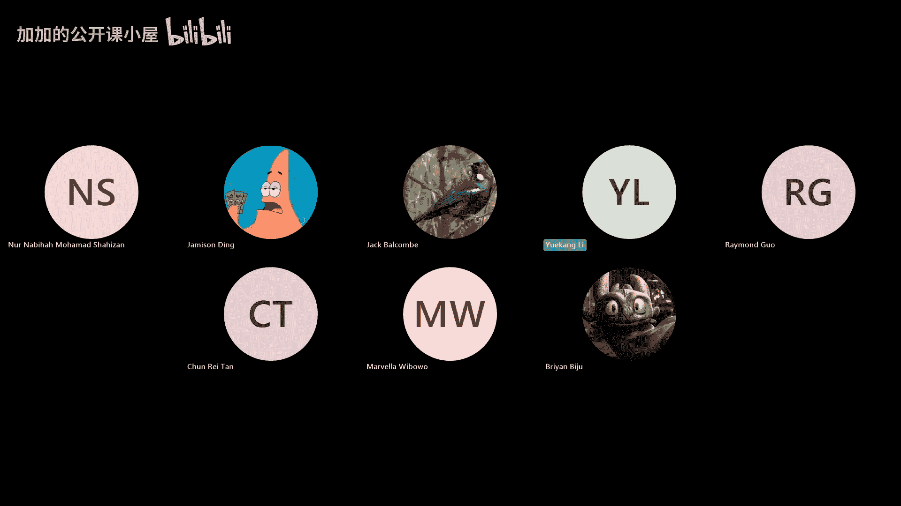
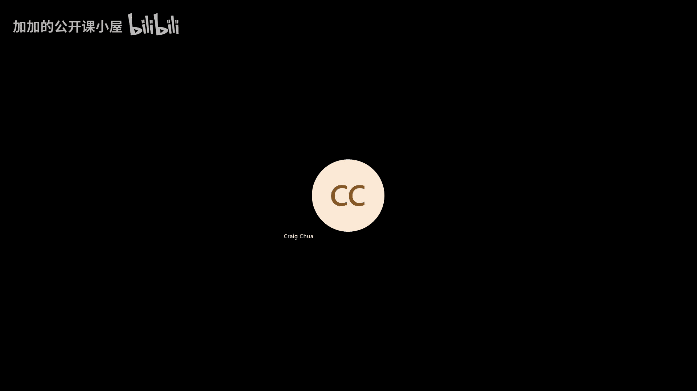

# 软件测试：第15讲：功能测试（一）🎯

在本节课中，我们将要学习功能测试的基础知识。功能测试是一种典型的黑盒测试方法，其核心思想是将待测软件视为一个“黑盒”，在不了解其内部实现细节的情况下，仅根据其规格说明来设计测试用例，以验证软件的功能是否符合预期。

---

## 功能测试简介

上一节我们介绍了测试的基本概念，本节中我们来看看功能测试。功能测试，也称为黑盒测试，其核心在于从用户视角出发。这意味着测试人员无需访问软件的源代码，只需关注软件的输入和输出行为。

在之前的课程中，我们讨论了很多关于需求的内容。现在，我们需要更清晰地理解“需求”和“规格说明”这两个术语之间的区别。

*   **需求**：描述了程序必须满足的属性，即“我们希望程序做什么”。
*   **规格说明**：则更为具体，它更侧重于程序内部功能或整个系统的实际实现细节。

规格说明是根据需求制定的。例如：
*   需求可能是：“系统需要安全的用户认证”。
*   对应的一个规格说明可能是：“密码长度至少为8个字符，且不超过16个字符”。

在功能测试中，我们实际上测试的是这些规格说明。

---

## 边界值分析

理解了功能测试的基本原理后，我们来看看一些具体的技术。首先学习的是**边界值分析**。这种技术基于一个观察：程序在处理输入域的边界值时，更容易出现缺陷。

以下是边界值测试如此重要的几个原因：

1.  程序员在定义边界条件时容易出错。
2.  用户需求在边界处可能表述不清，导致实现出现偏差。
3.  边界附近的测试用例通常能更有效地发现缺陷。

让我们通过一个简单的程序来应用这个理念。假设有一个程序接受两个变量 `X1` 和 `X2` 作为输入，它们的有效范围分别是 `[10, 50]` 和 `[20, 60]`。

为了设计测试用例，我们需要一个关键假设：**单缺陷假设**。该假设认为，失效很少是由两个或更多缺陷同时作用引起的，通常只允许一个变量取异常值。

基于单缺陷假设，我们可以设计以下类别的测试用例：

*   **健壮性测试**：测试有效输入和无效输入。
*   **一般边界值测试**：主要关注有效输入边界。

对于有两个变量 `n=2` 的程序，采用一般边界值测试（仅考虑有效输入），每个变量取最小值、略高于最小值、正常值、略低于最大值、最大值。测试用例总数为 `4n + 1 = 9`。

如果考虑无效输入（健壮性测试），每个变量还会增加两个超出边界的无效值（略低于最小值和略高于最大值）。测试用例总数为 `6n + 1 = 13`。

---

## 等价类划分

上一节我们介绍了基于输入值域的边界值测试，本节中我们来看看另一种重要的功能测试技术：**等价类划分**。

这种技术结合了两种策略：
1.  测试用例的设计应能代表整个等价类。
2.  根据单缺陷假设，一次只让一个变量取无效值。

其核心思想是：将输入域划分为若干个子集（等价类），使得同一个子集中的每个输入数据在揭露程序潜在错误方面是等价的。我们只需从每个子集中选取一个代表值进行测试即可。

根据是否考虑无效输入，以及是否采用单缺陷假设，等价类测试可以分为几种强度不同的类型：

*   **弱一般等价类测试**：基于单缺陷假设，仅考虑有效输入。
*   **强一般等价类测试**：考虑有效输入，但摒弃单缺陷假设，要求覆盖所有变量等价类的笛卡尔积。
*   **弱健壮等价类测试**：基于单缺陷假设，同时考虑有效和无效输入。对于有效输入，使用一个有效值；对于无效输入，一次只让一个变量取无效值，其他变量均取有效值。
*   **强健壮等价类测试**：同时考虑有效和无效输入，并摒弃单缺陷假设，覆盖所有有效和无效等价类的完整笛卡尔积。

让我们通过一个“三角形分类”程序的例子来实践弱一般等价类测试。程序输入为三个边长 `a, b, c`。我们首先根据输出（非三角形、不等边三角形、等腰三角形、等边三角形）来划分有效输入的等价类，然后为每个类设计测试用例。

---

## 基于决策表的测试

最后，我们简要介绍第三种技术：**基于决策表的测试**。这种方法适用于逻辑关系复杂的场景，其中结果依赖于多个输入条件的组合。

决策表列出了所有输入条件的所有可能组合，以及每种组合对应的预期输出或动作。它系统地覆盖了条件间的交互，特别适合测试业务规则。

例如，一个折扣规则可能依赖于“是否是会员”和“订单金额是否大于100”这两个条件。决策表可以清晰地列出所有四种组合及对应的折扣。

---

## 总结

本节课中我们一起学习了功能测试的基础和三种主要技术：
1.  **边界值分析**：关注输入域的边界，基于单缺陷假设设计用例。
2.  **等价类划分**：将输入域划分为等价类，并区分为弱/强、一般/健壮等不同测试强度。
3.  **基于决策表的测试**：适用于多条件逻辑组合的复杂场景。

这些技术的核心目标都是通过系统化的方法，对输入空间进行划分并选取有代表性的测试用例，从而高效地验证软件功能是否符合规格说明。