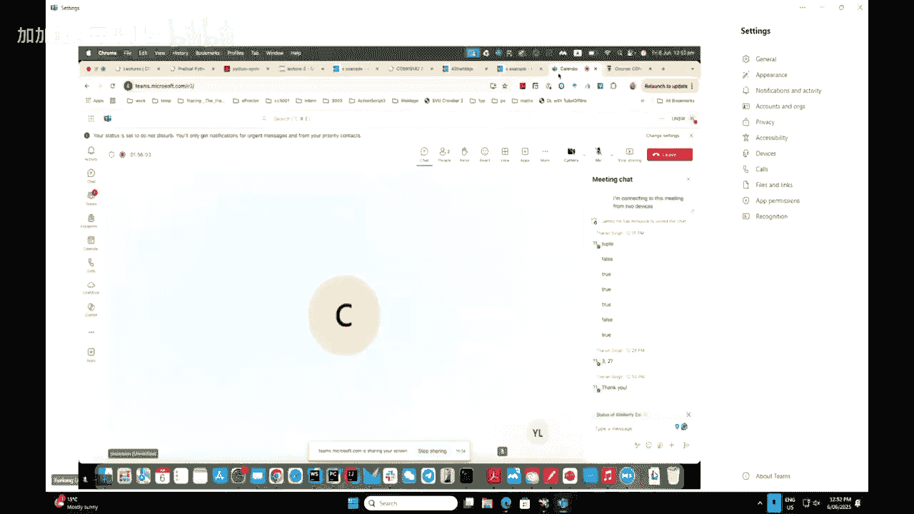

# 新南威尔士大学【中英⚡软件测试｜COMP3142 2025 Software testing】 p16 P16 Verification and Validation + Practical Python Syntax -BV1o34HzBENA_p16-

，me from online。No。Through the teamss meeting。Hi， guys in the meeting。 Can you guys hear me。Okay。

 okay， okay， that's great。 Okay， we finally figured out。 So I just mute myself on this laptop。

And I unmute myself on this desktop。 And then I use one of the microphones here so that people from online hear me and we don't have an echo in this classroom。

So that's the final solution for this。哦。Oh dear so。All right。Oh finally， let's get started。收。

So in our last lecture， we have learned about。An introduction to software testing， and。This is。Can能。

😔，Okay， it's better now。O。So。In our last lecture， we have learned about the basics of software testing。

 and why do we need to do testing。And， and we touched a little bit about verification and validation。

 So in short， verification is about， are we building the product in the right way and validation is about。

 are we building the right product。And that's the difference between verification and validation。

And testing is considered as a technique， a validation technique。I think this microphone is not very。

え。It is not very stable。I'll try another one。Let me try。 Oh， this one is better。

 So there are so many problems with the classroom。 So let's continue。

 So software testing is considered as a validation technique。

And most of the validation techniques are considered as dynamic software analysis techniques。

 and I hope you can still remember what is the difference between static and dynamic in the context here。

收。😔，Let's move on to today's content。 Today， we will cover three more aspects or three more groups of concepts。

 and then we will warm you up with some code about of Python。

 So you will be using Python for coding your assignments。 So we will warm you up。

And there are many different types of verification and validation techniques， and。

We are going to focus on the testing techniques here。 So we are going to focus on the dynamic ones。

And we are not interested in those static ones。So in the next week。

 we will learn about some black box testing techniques。And in the next， next week。

 we will learn some white box。Testing techniques。 And these two will be used for your assignment 1。

And， and then we will learn Grbox testing， which is one of the most practical testing techniques for finding vulnerabilities in real world applications。

And we are not going to learn any of these static analysis techniques in this course。However。

 in order to understand the advantage or the disadvantage of dynamic testing techniques。

 we need to touch a little bit of the static methods and compare it with the dynamic method。

And like we discussed in the previous lecture。The static analysis is like we are going to scan through a piece of software with some patterns and ruless and look for potentially buggy or vulnerable patterns。

So。Given a piece of code， we are just going to look for some specific patterns。 For example。

 the access of。An array index without checking the index value。And。

There are many methods for doing static analysis。 One of them is to do formal verification， which。

Which was taught in Com 3，1，4，1。 And this is often done manually with the help of some formal analysis tools。

And there are， and another type of static analysis is called software component analysis。

 So modern software is normally made up of。Many different components， like the third party libraries。

 And some of these libraries could have bugs or vulnerabilities。 So if we can。

 if we can identify the versions or the or the components。Of the software accurately。

 then we may know that， okay， this software is using some buggy library。

 Then this software itself could be buggy， right， so。That's software component analysis。

And then we also have static 10 analysis。 So 10 analysis is like we are trying to tent some values or some variables inside the program and track。

 How does the， how does the value propagate through the program execution。

 So this could also help us to understand how does a program work。And for a dynamic analysis。

 the difference between static and dynamic is whether we we need to run the program to do our analysis。

 So for dynamic analysis， we need to execute the target program and observe the system for some abnormal behaviors。

So static analysis， although they are very powerful。

 they are not good at discovering problems during the run time。

 So there are a certain program behaviors that could only be analyzed from run time， for example。

 we need， if we want to calculate how， how， how is the execution efficiency of a program。

 Then we have to run it。 We have no other choice。So。So dynamic analysis could be used to。

To help with these runtime verification， or runtime analysis。And more often。

 dynamic methods could be cheaper than static ones because they are easier to automate。

 Most of the static analysis techniques， they， they require certain levels of manual effort。

 for example， if you want to do a scan through the program code。

 you have to write the rules manually， right， Or if you want to do formal verification。

 Then you have to see there use the formal verification tool。 So。Normally。

 dynamic methods are easier to automate。So given these characteristics of static and dynamic methods。

Let's do a live poll。 So which systems are， do you think could be formally verified。

Like formal verification is like using a verification tool to verify certain properties inside the program。

 like whether a loop will terminate after 10 times。

 like whether a function will be invoked eventually in this program execution。

 So which of the systems do you think could be formally verified。

You can have more than one tries here。Actually， all of them could be fondly verified。

 All of them are。呃。Can can you try to scan this QR code。You can also try to visit this page on。

Wb C M。So you can see it。Oh， there's no upcoming date for this， O。

But you can also find it from the activities tab here。So， actually。

All of them could be formally verified and are suitable for formal verification， and。

Because all of them are。They are some， some of the compilers， not all compilers are small programs。

 but some compilers are very small， and they are very， very important。

 So people are formally verifying them manually， and some O S kernels are also formally verified because。

A operating system kernel is like one of the most important software in a computer system。

 So people need to ensure the security of these problems， and they need to verify these。

And another important。A type of software that could be formally verified。Are the smart contracts。

 because smart contracts are directly linked with real money， right？ So。

 and they are often very small。 They are like a few hundred lines of code。

 So these smart contracts are also normally formally verified。

And there are some big companies doing this。Formal verifications for smart contracts。

 which can earn a lot of money。So。There are so many verification and validation techniques。

 So how do we determine which one to use in when we are doing quality assurance， so。Normally。

 this is a game of trade offs。 We need to consider the。

 we need to consider the the resources we have in our hand。So。

We need to figure out what we what we want， what we need。 and most importantly， what we have。

So we can't have， like， like mentioned by NAA engineer。 So better， faster or cheaper。 we can。

 We cannot achieve all three of them with。One single technique。 So we have to do a trade off here。so。

发。Most importantly， because we， we are doing quality assurance， want things to be better。

 And however， sometimes we have to always satisfy the。Quality here。 we must。

 We must be able to tolerate some kind of inaccuracy when we do analysis。So。

 there are three types of。In accuracy here in this system。

 So the first one is pessimistic inaccuracy， so。We， we。

 we might be very pessimistic about the program。And we。We may not guarantee。

 So a certain a technique may not guarantee to accept the program， even if the program possesses。

Certain properties。So this will give us false positives。 So even if a program。

 So sometimes even if a program does not have certain errors。A tool may still report an error here。

 For example， if we write certain rules。To a certain patterns to do static analysis。

 it is very likely that we are going to match some benign code。

 So we will have this kind of pessimistic inaccuracy。When we do these kind of。

A rule matching or pattern matching for static analysis。And on the other hand。

 we may also have optimistic inaccur。So we may accept a program that doesn't have a desired property。

 So this will give us false negatives。 This means that there is a bug。

 There is a vulnerability in this program。 and our rules or our technique couldn't find it。

 So that is optimistic inequ， so。😔，And the third one is。The， the nature of the。

 the complex nature of the program。 we are going to test。So。Because we are。

 we are checking different properties of the program。 And if one property is too difficult to check。

 we may substitute that property with an easier to check one to make sure that our method works。

But in this case， we are introducing inaccuracy， for example。

If we want to check the implementation of an H TP protocol or H TP server， we may。

 we can model the the entire program as a state machine and do some kind of checking of the state machine。

 But in that case， if we couldn't model the if we， if the state machine we propose couldn't capture the actual implementation of the code。

 Then we are introducing inaccur here。 So that's due to the。Property complexity。So。

 these are the three。These are the three sources of three types of in inaccuracy。

 and for testing techniques。We are more likely to have the optimistic inaccur。 So that means。

For testing techniques， we are very unlikely to have false positives。Because if you run a program。

 it crashes， then it must mean that there is some kind of bug， right So。

 but if you run a program and it doesn't crash， it doesn't mean that this program is free from bugs。

 So that's why testing technique。Often have no or very few false positives。

 but it may suffer from false negatives， which means that we may not be able to detect certain bugs。

 But once we report that there is a bug， then it is a real bug。 So this is the characteristic of。

Testing techniques。And talking about fast positives and fast negatives。

We need to mention two key terms that you may encounter when you read the lits about testing and program analysis。

 And these two terms are soundness and completeness， so。A technique is sound， if。

If and only if it only identifies true positives。 So this technique is sound。

 It means that this technique will not report false positives。So， it's sound。

And a technique is complete。If it can identify all the true positives。It meanss that。

So a technique could be sound， but not complete。 Then it means that every bug reported by this technique is a real one。

But this technique may not be able to identify all the bugs inside the proman。And testing technique。

 most of the time， is sound， but not complete。And that's all about the theoretical aspects of verification and validation。

 And now let's move on to how do we use them when we are doing software development。So。

When we are doing software development， we need to plan how could we use different verification and validation techniques。

And this is called software， V And V planning。So。The。

 the planning is like very important for most of the development work。and。

There are multiple levels of testing plans that could be developed according to the various levels of V and V activities。

And there are 7 steps in total。So the first step is to identify the goals of verification and validation。

So。The verification and validation goals must be identified from the the requirements or specifications。

 So like in software development or software engineering。

 what we do first is to try to fix the requirement or specifications from the users， right？

 So this is to make sure that。Our final product is consistent with what is required or specified by the users。

 So the first one is。To make sure to to have these goals and these goals are coming from the specifications and requirements from the users。

During the software development。And the second one is to select。

Use usable or suitable V And V techniques for this project。 once we have figured out the goals。

And they are many， many different。There are many， many different criteria for these selection process。

 And during during each one of the phase， there are。

 there are there these they are different techniques suitable for for them。

 and you don't have to don't get overwhelmed by all these concepts。

 They are just trying and and these are not really access accessible for， in your assignments。

 but this is just to keep to make sure that， okay， you have this kind of concept in your mind and you don't have to recite all of them。

 You just need to know that， okay， roughly I need to follow these。Sts。

 And when you actually do things in practice， you just remember， okay。

 you have to do this and you can refer back to these slides。

And after we have selected a suitable technique， according to their characteristics。

We now move on to the third step。 We need to figure out what are the responsibilities from different parties or different teams in the software development team。

So。For develop。 So there are many different。Actors or different roles in this software， engineering。

 ecosystem or the development process。 So for the。Developmental organization。

 which is often the software developers。There。Their responsibility is to construct any applicable proof of the correctness at module level。

 So this means that as a developer， most often we are in， we are in we are we are。

In charge of doing some kind of unit testing to do module level insurance of the correctness。

And there are， and in many big companies， there might be independent testing team。 So for these team。

 most often， they are going to ensure the。Their responsibilities are to ensure the quality of the entire product or the entire system。

 So most often these。Independent testing teams， they are doing some kind of system level of testing instead of unit testing。

And。And apart from the independent testing team， there could also be some quality assurance team in these companies。

 So these quality assurance teams is to make sure that the software meets the quality to be released。

 and they will do some property based testing， for example。

 they will test the the actual performance of the software instead of looking for。

Lo bugs and another level， The last layer of this organization is。The independent contractors。

 So sometimes some companies may outsource the testing tasks to some third party people。 like。

 for example， some big companies， they may have bug bunty programs to allow others to help them to test their programs。

And the step 4 of this planning process is to integrate the selected。V and V technique。So。

So this is often dependent on the development methodology。

 So it depends on whether we are doing waterfall development or agile development， so。For example。

 we can， if we are doing agile development， we can try to in we can try to integrate the the testing the testing as part of the C I or C D process。

 So this is how this is a step 4。And step 5 is about program tracking。 So before step 5。

 we are talking about， okay， how do we determine the responsibility of different parties。

 How do we do， how do we select different tools。 How do we integrate the the quality assurance techniques into our system。

 And after that， we may find some problem or some bugs。

 Then we need to do proper program problem tracking， so。This often involves。So this is。

 this is to document our effort during the V and V process。

 So we need to keep important informations of the problems or the bugs。

 So there are several typical information to be kept。 So one of them is when did the problem occur。

 So this is often related to， so some bugs are time sensitive。

 So we need to make sure that when we need to keep track of， when did the problem occur。And we also。

 of course， we need to know where the problem occurs。

 So we need to know which part of the system went wrong or even which line of code is causing the bug。

And then we also expect better to keep track of the state of the system before the。

The occurrence of the bug， this is to help us to replay and debug。And， and， of course。

 we need to have evidence of the problem。So evidence of the problem could be。

Could be that the program crashes， and it also， it could also be some input that is causing the crash。

And lastly， we need to have a， we need to assign a priority to the problem。

 and assigning priorities could be according to the severity of the bug。

 like whether the bug is a vulnerability or not。😔，So this is also related to the safe safety property of the software dependability。

So an advantage of using testing technique as the V And V technique here is that we can use the test cases that triggers the bug as the evidence here of the problem。

 And if we just do static analysis like doing the scanning， we may not have such evidence that there。

 that is really a bug。So this is the advantage of using testing here。And for step 6。After we have。

After we have。Kept track of the problems。 We also need to track our testing activities。So， because。

Most of the time， we couldn't find any bugs in our system if we do testing。Or if we do a validation。

 So we need to have some kind of record about， okay， we have done this。

 We have done some proper testing technique， This is not only to keep track of to maintain an internal record。

 but also to make sure that some third party compliance checkers could verify that。 okay。

 this organization has done some testing properly。 So the product could be trusted。

 trusted to a certain level。So normally， we need to keep track of these data。

 So we need to keep track of the number of test cases executed。

 and we also need to track of the number of tests that are not executed yet。

We may also need to track our。 We may also need to track the time used resources used。

A number of problems found。And the last step is to do assessment， so。It is important for the。

Plan to provide the ability to collect data。And。Make sure that it is used。 Make sure that。This， we。

 we could assess not only the final quality of the product， but also the。

 the verification we have done for this product， so。So this helps to， this helps us to provide。

 approve or guarantee that。This product is trustworthy。 So that's about assessment。

 So it's not only aing the。The product or the testing is like we assign both of them together。

 So these are the seven steps of doing V and V planning。

So you don't have to worry about memorizing all these concepts。 This is just to show you， okay。

 there is such a thing You can， You need to consider about it when you are really doing testing or quality assurance。

And there's one more big chunk of concept before we jump into some code， so。

Let's learn about principles of analysis and testing。

So there are six principles for doing analysis and testing。 So these principles， you may also。

 you may also find these principles to be usable in our late in the。

 the actual testing techniques we will learn later。

 So they are reflected by those by the design of the those testing techniques。

 And I will introduce them for now。 So the first one is sensitivity。So。

We must make sure that our testing technique or our validation technique is sensitive to failures or errors。

For example， if we do， if we run a program and look for crashes。We may miss out some bugs。

For example。You can， if you are。If you are online or if you have the slides open on your laptop。

 you can click on this link。 It will lead you to this one compiler page。So basically。

 this web page can help you to。Run some programs online。And in this small zipper one。

 we can see that。We have a string or buffer。With length of8。And what will happen if we try to read。

From the 9th。Character， what will happen if we read this。Will the program crash or not。So normally。

 this program doesn't crash。But there is an error。 There is a bufferalo flow here。So。

So if we just look for crashes， were going to miss this bug here。😔，So if you click run。

 you can see it over。Vue was print out。And there's no error happening here。So。

So we need to be sensitive enough to detect this bug。And this is another example is。If we。

 for example， if we write， if we write。If we write one more bite。If you click run， then you。

 you can see that the program crashes due to overflow。Due to the buffer of flow here。So。Different。

Failures。Different failures requires different levels of sensitivities。To capture。So。

The first principle is that it is better to feel every time rather than only on some executions。

 So it is better that if we can feel or crash on both cases rather than we just crash on writing termbits。

But not reading one more bite here， so。So it's important for us to make false fault easier to be detected。

So， by making them to。Oh crash more often。 And one approach here is to use a dress sanitizer to compileel the program so that it will crash every time。

An error occurs。 So you will be using this later during this course， but not for now。

 So this is about sensitivity。And another。Princiipple is about redundancy， so。It。

 it is sometimes encouraged。To have multiple test cases。

Or multiple testing mechanisms or different techniques to test the same functionality。

 So this increases the likelihood of catching errors。 So we may use。One technique to find this。

 to check this functionality here， to check this piece of software here。

 And it is often encouraged to double check。This software with another technique from another angle。

And even if we are using all we， we are using testing techniques。

 there could be different testing techniques here。 So is encouraged to use a combination of them。

And one typical example is ensemble fuing， you。You will use this in your assignment， too。

 So this idea is to basically combine different phing or testing strategies to check for the same module。

This is about redundancy。And the third principle is about restriction。 So when there is no。

There is no cheap way to check certain properties of the program。 Sometimes we can。

We can restrict the problem。To reduce the complexity for checking the。

 the actual implementation of the program。so。Or maybe we can。

 We can try to focus on a smaller subset of the programs。An example is that。 we can。

An example is here。 So for this program。For this program。We， we don't。 We， we have an integer K here。

And only if the condition of a of I satisfied is satisfied， then we assign an initial value to K。

 Otherwise， we just plus I to K， so。In this case， we don't know whether this K could be initialized or not。

 right。So this is very hard to determine whether whether this K will be initialized the first time。

I is added to it。Because we don't know what happened in this， in this condition function call here。

So a more simple way of doing this of resolving this problem is that we just don't allow all path with potentially uninitialized variables。

So we， we can， we can somehow convert this problem into a cheaper one or a more restrictive one。

To solve it。 So that's the basic idea of this principle。And the fourth one is about petition， so。

Just divide and conquer， so。The best way of solving a big problem or a very complex problem is to divide it into some smaller ones。

So one of the ways of doing this dividing is to divide testing into different levels。 For example。

 we can do unit test， We can do system test。 And remember in the V andV plan planning different parties could be in charge of different levels of testing。

 for example， normally the developers are in charge of unit testing。

 and the dedicated testing team is in charge of doing the system level of testing。

And the sixth principle is about visibility and observability。

 So visibility is the ability to measure the progress of status against our goals。So remember。

 the first step in V And V planning is to have some goals from according to the specifications or requirements。

 so。We need to know。 O， we need to。We need to make our a testing progress visible so that we know where we are。

 and we also need to make sure that the verification or validation technique is observable。

 so we know， so we can know that， okay。So， we can know that。就。So we can know that。 okay。

 this testing technique is。Working here。 or it is not working here， so。

This visibility and observability are also important for these testing techniques。

And the last one is to。Allow feedback。And this is to apply lessons from experience in progress and techniques。

So。In testing this feedback or this experience based principle is that we can prioritize our test efforts based on the likelihood of。

Ft classes， for example。Given a very big piece of software and limited time budget。

We need to decide which part of the software do we want to do testing， right。

 We may not have enough time to test the entirety of。The software。

 we have to prioritize which part of the program do we want to test。

And we can prioritize our testing efforts， according to the complexity of different components。

 So a typical example is or a typical assumption is that the more complex a piece of software is。

 the more likely it is to be buggy。 So if we have limited time budget。

 we may need to prioritize or focus on the more complex parts of the program。

And that's all about the concepts。Of verification and validation。

And then we will move on to some coding。And this is to warm you up about for and get you prepared for these assignments。

And before we jump into the details， let's have a five minutes break。Hi， hi， Krishna。

 can you hear me now。Oh， I think you sound howline。😔， have you guys learned peyason before。

 like before taking these cars。Some of you have， right。Okay， that's great and。If， if you haven't， if。

 if you haven't taken Python before， this is a good chance to catch up。 And if you have。

 this may provide you a different angle of Python from a tester point of view。

 because I'm trying to cover some corner cases。啊三三。

Some features that make cow bugs when you are writing code。Okay， let's get started， so。

If you wonder where to find this material for learning basic Python syntax。

You can find it from the lecture slide tab here。Is practical Python syntax。

 It has to be put under one of the weeks here， but we will do this in both week 1 and week 2， so。

So let's get started。 But remember， this is not a course to really teach you a programming language。

 So I assume， I assume that you know the basics of Python。 So like what are the integers。

 What are the strings and what are how to do the。How to do basic operations with these basic types of variables。

 And I assume that， you know what is a class， What is an object。 So you know。

 some basic concepts of object oriented programming。So， have you taken the O O P course。Okay， great。

So， so you know that in Python， everything is an object。Right， so like。

 let's have a quick warm up about alright ored programming。 So like all of us here are。

Humans and human is considered as a class。 and we are considered as objects of that class。

And like these chairs are are considered objects of the furniture class。 So basically。

 object oriented programming is just a programming paradigm to help us to describe the world using a programming language。

So， so this cars， as I said， is not。Is not。course to teach you Python。

 But let's try to cover some interesting。Language features of person that are that you may make mistakes when you write the code。

And try to warm you up and get ready for the assignment。So。So in order to use this document。

 it is recommended that you try out。 There are a lot of code snippets in this document。

 It's recommended that you try out these snippets yourself with a personython interpreter。

Better with a version higher than310。So。This is how to use this document。

 You should first read the code and think about the output without actually running the program。

And then actually execute the code and see if what you have thought is correct or not。收。

So let's try to cover the E versus equals。And mutability today。So。Do you。

 do you guys know what is the difference between is and equals equals in Python。

So what is the most common scenario of using ease。The keyword is。Yeah。He roughly got the answer。

So anyone else have a try。So what is the most common scenario of using ease。Actually。

 the answer is here is none。 So if we check a value is a nu value or no or not。

 we often use is instead of equals equals。And they are different。

 So let's try to consider each code block here。So you， it's encourage。

 you are encouraged to try it out yourself。 and you can either use a Python interpreter。

On your local machine。For example， for me， I've installed Python on this laptop。You can see it's 3。

12。Or if you don't have Python environment installed， you can try to use。The one compiler。

Cloud platform on your laptop。 So in this platform。They have Python，3 and 12 installed。

So you can just copy the code and paste it here， and then run it。But the advantage of using an。

A terminal based interpreter is that。If I， I don't need to print out the results。

 It will automatically get printed。 It's inter very interactive。

 So it will print out the value of the variables or the return value of functions。So， let's try out。

The first example here。Sorry。😔，嗯。Great。A equals to1，2。And B equals to。1 to。

 Does anyone know the type of A and B here。Are they a least or not。Not at least。去过。Yes， yes。

 Here are two pose。They are not lists。 So because they are。

 we are using princesses here instead of square brackets。So A And B are tus。

 So what do you think will be the result of A E B。Without running the for one， don't try to run。

So before running this program， what do you think is the result of A E B。Tru of fast。te。烦死。Okay。

 let's run it。Remember， every everything inside， every variable inside Python is an object。

 is an object。Is fast。So because they are two different objects and is is used to check。

Whether two objects are the same。What about A equals to， equals equals to B。

What will be the result true or false。True， okay。The answer that is true。So because equals equals。

 checks the actual value of these variables， but not the identity of these objects。

And let's try the second code block here。A equals to one。 A。 Remember， A is still an object。

 A is still an object here。B。😔，Because goes to one。So what will be the result of A is B。They are two。

 They are still objects， two objects of integers。What will be the result。吓。fa。

And the answer is actually true。This is a little bit confusing。 There are。

 there are some small subtle features of Python， which could cause confusions。

 And I'll try to cover them using this course。 I'm not trying to cover those basic syntax and all those things。

But let's try to cover those con cases。So A is B is true。 What about A equals。To and equal be。

Is it true of us。True， yeah， of course。 So I will explain why this。A is B is true here， and。

But before I'll try to answer it after we see another example。What do you think is the result here。

100 K is 100 K。True， actually， it it， it will also warn you。 It better not use。Is here， actually。

It helps us to fix this syntax here。And。Let's continue。So what is A is B， Is it true or false。可。

It's actually fast。And what about a equals to。Eals equals to B。True， this is quite obvious， so。

The reason is that。So， they are。So the first question， why， you know， when we are trying to compare。

10 k versus 10 k。The Python interpreter give gives us a warning。

 and it says is shouldn't be used here。 We should use this。

 and it automatically fixed the problem of this expression here。 So， but why none could be used by。😔。

Using ease， using the checker ease。That's because of。A language。呃呃。

A concept called single tone in object oriented programming。 A single tone is。

Where a class has one and only one object。And the value of none。

Is the only instance of the class non type。So it is the only instance。None is an object。

And it is the only object of that class。So because it is an object， we can use is。

To compare with now。So that's why we can use ease。And can we use equals equals to compare now to compares now。

Do you think we can do that。So， let's say a。E goes to equal to9。 What do you think will happen here。

It is allowed， and it will return us fast。So it is allowed because nu is an object。

 so we can still use equals equals to check with to track the values against it。

 And we can also use is to check whether a value is nu or not， but。

We still recommend to use E whenever we are trying to compare a value with now。

 because it is it is faster and。😔，Makes the code clearer。And the rationale is。

Whenever we are using E， it is actually comparing the unique I D of an object。With the other one。

So it essentially equals to this。 So that's why is is faster than equals to equals。

 Because if we do is， we need to invoke this function here。 We have extra function invoke。

So this makes our code a little bit slower， but you won't feel it。 but it's a little bit slower。And。

If we use equals equals， it actually calls this equal function here。

And this is a built in function for。Most of the objects in Python。And。

And that's why if you use this operator here， we are comparing the actual value of objects。

 And if we are， we use E here， we are actually comparing the。The identities of objects。

And then you may wonder， okay， this， this explain why this A is B is false， right。

So because they are two different objects。 so this should be false。

This also explains why A is speed is fast here， because。There are two integer。

 two different integer objects。 So this should be false。

But why A B is true here when they are both assigned with value 1。

 that is because a mechanism of the personython interpreters。To speed up the execution。

 So Python interpreters， especially see Python， they are trying to。

Store the small integers as some kind of inter， internal values。And if by default。

 if a value falls within this range。It they are kept as。Small internal values。

 And if you assign variables to these values， they are referring to the same object。So， that's why。

A is B， is true If we assign value 1 to both of them。This is。

 this will also hold if we assign some value， like as to 200。Be close to。200。

And then if we check A S B is also true because they are kept as internal values by the。

 by the interpreter。So。So when you write code， when you write patterny code。

 you should be aware of these small， small things。And。😔，And why do we learn this。

 This is also because it is also also related to the mutability of different objects or different types of variables in Python。

 so。Sometimes when we write a Python code， we pass we pass a variable as a parameter to a function。

 and then we do something with the parameter with a variable inside that function。

 and sometimes the value of that variable gets changed of the original variable gets changed。

 and sometimes the original the value of the original variable doesn't changed。

So let's try to explain in detail。 when will this kind of thing happen in Python and when the variables remain the same。

So， let's consider this。Example here。 So we define a function。A B， which accepts two parameters。

 A and B。And what we will do is we will add B to a。

 and then we will return the value of a with this function。 So。

 and our task here is to observe whether the value of a gets changed during the execution of this function or not。

 So that's our。Task。For this one。So， let's try to run this。即。

The return values of the code messed up in the in the P D F file。

 So Ill just use the markdown file here。So let's define the function first。And then。

 let's try out the first。Example。So。In this example， do you think the value of a gets changed or not。

No。So what will be the value of a。And what will be the value of B。After executing this function。

And also see。1，2，3。O。Okay， since most of you are saying one three。 okay， let's see。你 actually 만多岁。呵。

And let's try。Second one here。So now， this time， instead of assigning integer values。

 we are creating two lists。 So a is the least holding an element of integer 1。

 and B is the least holding a single element of2。So。And C is。This， so what would you。

What do you think we， we have。Are the values of A， B and C after we execute the function。

Will the weather of a gets changed。Yes。😊，Will the value of big has changed。no。And what I see。

So is C the same as a。In terms of value。Yeses。And what about A E C。Yes， okay。 let's try。 let's try。

 No， okay。So A， B and C。 So this time is different from the previous。1， so in the previous run。

 A remains the same。 A is still one after we execute this function。 But this time， a gets changed。

And this is actually a side effect of this function。 We actually。Actually。

 we just want to return this value of a， right， we do。

 if we pass in the value of a to this function as a parameter。

 we don't want the value of a gets changed during this function execution。

 but it is actually changed。So this behavior， you need to be aware of this behavior。

 This could cause you some trouble when you write person code。 So a gets changed here。

 The value of a is changed here。And。If a check。A is see。 What do you think will be the result。主我 us。

F， actually sorry true true。T， yeah， A is。The same as see here。

And we will explain why this is like this later。And what about a equals to C。Of course， true。 Yeah。

 because the value is the same， so。It's true。And， let's try。Another example。So in this time。

 instead of using a list， we are using。Tuples。So what do you think will be the values of A。

 B and C here。Before running this。cold。What do you think。

Is it the same as the first one or the second one。Just make a guess。

 You don't need to don't need to be so serious。 This is not an exam。

 So just feel free to make a guess。😊，So will the value of a gets changed by this function or not。no。

Actually， the answer is no。So a doesn't change here。 So so you can see that。 Okay。

 it seems that whether the value of a gets changed or not is not affected by whether a is a variable with a single value or a is a variable with。

As a least with or an array with multiple values， right， Because both list and。

Tuples can hold multiple elements。So。The only。The only thing affecting this behavior of Python is about the mutability of the variable type。

The reason that I gets changed is only because。The value list is a mutable type in Python。

 An integer and tu are not mutable in python。This could be reflected by this。 For example， if we do。

 if we assign a as。At a least。Then， we can change。The value of a。And if we， if we print out a again。

 you can see the value of the first element of a gets changed。However。However， if we。

Make a a tuple here。And what will happen if we do this。We will end up into some kind of errors。

 So it's immutable because pupils are immutable。 So if we pass in。

An immutable function as a parameter to as a an immutable variable as a parameter to a function。

Then whatever we do in that function will not affect the actual value of the original variable。

However， if we pass in unmutable。Variable to the function。

The value of the original variable gets changed。And you can。

 you can imagine it as the function is holding a reference。Of the original variable inside it。

So that's why if you do something here inside this function， the original variable gets affected。

And since we are holding a reference of the original variable。 So that's why。The return value here。

 if a is mutable。 The return value is actually the same as the original object。 So that's why this。

Returns us a tro here。So you need to be very， very careful when you are writing personython code when you are passing in variables and parameters。

 you may sometimes wonder， okay， why does this variable get changed in my code， right？

 So this explains why。And。And there are many。There are many mutable types of。

 There are many mutable types in Python， and some common。Mutable types are dictionaries sets。

 at least。So these are some common mutable types。 So when you are passing them as variables as function parameters。

 you need to be careful that their values might get changed by that function。And if you。

 if you don't want the original value to， to be changed。This is a little bit too small， maybe。

If you don't want。If you don't want the original value to be modified。

 you should make a copy of that value whenever you are trying to modify a mutable variable inside your function to avoid this。

To like this。To provide this side effect。So what you can do is you can impart。The copy library。

 which is a built in model of Tython。And then。You can try all these。

 you can try all these these examples here。 but the， the。

 the answers to these values are painted out here。 so you don't need to。

You don' need to make guesses， but。Let me explain a few of them of why they are not true or why they are true。

 so。List is the constructor of the class of list。 So this means that we are creating a new object of。

Lsist with L。 So in this case， we are creating a new copy of L。Howeverever。If I use this。We are also。

It's also false。 And let me hide this answers from here。 So in this case。

 we are also creating a copy of L。 And there's another way of creating a copy， and that is to use。即。

The copy function。From the。From the library。Copy， so in this case。

 we are still creating a new object。So all these three are three different types of creating。

Copies of mutable variables。And it is the same for dictionaries and sites。

 So least different dictionary and sight are the three most common mutable。Variables。And sometimes。

Sometimes in Python， we can have。We can have default arguments。For functions。For example。

 for this function F here。X is。Aign with a default value of。An empty list。So， if we invoke。If。

 without passing any parameters to it。What do you think will happen here。What will be printed out。

Yes， just a single。The least with a single value of one。and。

What do you think will be printed out if we。If I do this。Yes， there one。And if we do it again。

Still01， right。But if we do this。This becomes one one。That's because house。The default value。

This default value is the least。 It's a mutable value。And this。By default， Python。

 if we don't make a deep copy of this default value here， Python will try to reuse this object。So。

 that's why。The value gets changed。The default behavior gets changed。So。

 but if we assign a value to this， if we try to invoke this function again， it will become 0，0。

 And what will happen if we invoke this function again here。What's the result。

 How many ones do we have。2。3。😔，Actory 3， because Python is trying to reuse。

The interpreter is trying to reuse this object。 And whenever we invoke the function without。

A parameter。 we are reusing this。Default。Object， the default parameter object here。

 So that's why it keeps increasing。So， this is also another。Behavior也 should。

You should be aware of when you are using Python。 So sometimes you may encounter some weird bugs when you write python code。

 and this could be the mutability of the default value could be one of the reasons。

 So should be careful about this。And it is。 It is the same for。The default values of。

class constructors。 So I， I won't show it again。So the。

 the takeaway here from this example is that a mutable default argument。

Is shared across different calls as far as you don't overrite the default value of that parameter with a custom value。

 So this is shared。 So pattern， this is。AndThis design is actually to save memory usage。

 but it could also cause you some troubles。And you should be careful that using this deputable default parameter could cause you some。

 could lead to some unexpected behaviors。Let's try。One last example of。Mutability here。

 So what do you think will we get for ill。If we do this。What is L here。Like。😔，This is。

 this is a really。Use both in text for a python。 We are trying to create lists。So， this will give us。

At least。Of 10 empty lists。And let's try to print out L， you can see it's a list of 10 empty。so。

What will happen if we do this。If we。Because。L is the list of these， so we can app elements。

To the element of L。 So what if we assign will upon one。To the first element of L， what will happen。

What is the expected behavior。What we want is。With one here， right， one。And9 empty list。

That's what we want to have with this。Cold。Let's see if it works like what they expected。一 doesn阵。

The value is copied。For all the variables。Of our list in all。So do you know why， why it is。

Working like this。Yeah， you got it。 So if we use the multiply operator here， we are actually。

 And this is because this is a。An immutable。 This is a mutable object。 The element is mutable。

 So we are actually copying references to the same object 10 times。

So that's why whenever we modify one of them。We are modifying。All the values here。 So this is。

 this could be verified by doing this。 Let's say， for example if we do this。Lets say pan2。

And what do you expect to see from L。Like all of them will be1 and 2。

So because they are all referring to the same。Le object。So。This behavior should also be。

We should also be aware of this behavior。So。What do you， What can we do in order to create， at least。

With 10 independent。Objects， what do we do， What do you think can we do。Can we do this。

Can I do a deep copy here， Let's say copy。Sorry。😔，Copy the copy。 How do this。 Does this work。诶。

But we expected。Will this work。No。Why not。It's actually essentially the same as what we did before。

 because we are just passing one single。Object here， this is essentially the same。 as we can， we can。

 we can verify this。So， you can see that。All values are modified。 We are not creating a new。카py。

So the correct way of doing this are the most elegant way of writing a python。

 a piece of python code。To do this is that we can。You can do this。So this time if we print eye。

 it still looks the same， right。But if we do， value changes。You can see they are 10 independent。Okay。

 there are 10 independent list。So this one line of code actually equals to。This piece of code。

This piece of code。So we initialize L as an empty list。And then， for。For each integer from。0 to 9。

 The range is like。From0， if you don't specify the initial value， it's from 0 to the。等于460 one。So。

From 0 to 9。Every time we create a new object of a list， and then we pen that object to L。

 So this single line of code is the same as these four lines。So in this case， we can create。

Pen independent。List objects。And。And that concludes our today's lecture。

 So these Python syntax are not。 you may use it in your assignment。 You may not use it。

 They are not directly accessible， but I hope that this can warm you up and about Python and。

You can try to when we are writing code when when are encountering some weird behaviors of the code。

 you will know why it happens。 So this is the purpose of this material。So。

So that's all for today's lecture。 So in this， in this week， actually。

 we are covering only some very high level concepts。 And in our next week。

 we will be learning some techniques of black box testing。

 which are related to how do we design test cases without having access to the actual code。

So see you next week。 And thank you for coming。好。It to be。왜 때도 그거 다。嗯。

It will happen in the beginning。The assessments will happen in the beginning。Yeah， as far as。年底的。And。

is there any findings。No， that's。

鸽。At the end of the time， he just what you。Every week one me。Sorry， is this your jacket？Oh。

your but like assume。I guess we have like talked this break。 I can have lunch as well。

 like you Why now。Yeah， next time I will do。Because after that， I have a。

Sation。