# 001：Rust语言与程序安全 🦀

## 概述

在本节课中，我们将学习Rust编程语言的基础知识，并探讨编程语言设计如何影响程序的安全性。我们将通过编写一个简单的“猜数字”游戏来实践Rust编程，并深入分析一个核心概念——`Option`类型，比较它在不同编程语言中的实现及其对程序健壮性的影响。

## 课程介绍

欢迎来到COMP6991课程。这是一门全新的课程，旨在引导你思考编程语言作为一种工具，如何深刻地影响我们的思维习惯和编程方式。本课程不仅教授Rust语言，更鼓励你批判性地思考不同语言的设计决策、权衡及其对编写健壮、安全程序的影响。

我们将避免灌输“唯一正确”的编程方式，而是呈现多种可能性，让你通过实践形成自己的见解。课程的核心是提问与讨论：你喜欢哪种方式？为什么？这种方式在其他语言中如何体现？

## 课程结构与要求

### 学习资源
*   **主要工具**：Rust工具链（在CSE系统上使用`6991 cargo`等命令）。
*   **推荐阅读**：《Rust编程语言》（“The Book”），可免费在线获取。
*   **学习方式**：结合讲座、实践工作坊、每周练习和作业进行学习。

### 讲座与工作坊
*   **讲座**：每周两次，侧重于介绍Rust特性背后的设计思想，并会涉及多种编程语言的比较。
*   **工作坊**：每周一次，是实践性环节。通常以小组形式协作解决一个较大问题，之后进行集体讨论，反思代码设计、遇到的问题以及在不同语言中的可能实现。

### 评估方式
*   每周练习：20%
*   作业1（程序设计）：20%
*   作业2（并发编程）：25%
*   期末考试：35%

课程无不及格分数线，总分达到50即可通过。

## Rust初体验：从Hello World到猜数字游戏

上一节我们介绍了课程的整体框架，本节中我们将动手编写第一个Rust程序。

### Hello World

以下是创建一个Rust项目并编写Hello World程序的基本步骤：

1.  使用Cargo创建新项目：`6991 cargo new hello_world`
2.  项目目录中的`src/main.rs`是程序入口。
3.  在`main`函数中使用`println!`宏输出文本。

```rust
fn main() {
    println!("Hello, world!");
}
```

4.  使用`6991 cargo run`命令编译并运行程序。

**关键点**：
*   `fn` 关键字用于声明函数。
*   `main` 函数是程序执行的起点。
*   `println!` 是一个宏（而非函数），用于输出带换行的文本。
*   默认情况下，变量是不可变的（immutable）。使用 `let mut` 声明可变变量。

### 构建猜数字游戏

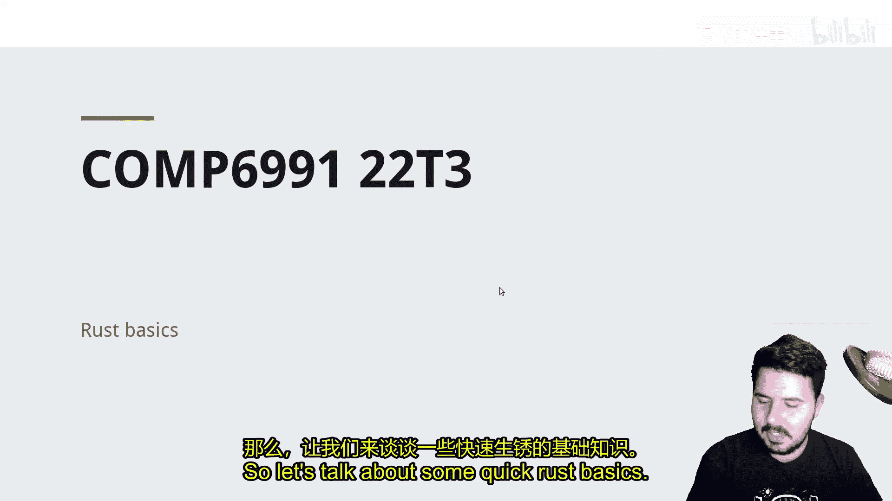


接下来，我们将构建一个更复杂的程序：猜数字游戏。计算机会生成一个随机数，用户输入猜测，程序会提示猜测是过高、过低还是正确。

以下是实现的核心步骤：

1.  **生成随机数**：通过添加`rand`依赖库（`6991 cargo add rand`）并使用`thread_rng().gen_range(1..=100)`生成1到100之间的随机数。
2.  **读取用户输入**：使用`std::io::stdin().read_line(&mut guess)`从标准输入读取一行文本。
3.  **字符串转换为整数**：使用`guess.trim().parse::<i32>()`将输入的字符串转换为整数。`parse`方法返回一个`Result`类型，需要处理可能出现的错误（例如输入非数字字符）。初期我们可以使用`.unwrap()`在出错时简单使程序崩溃。
4.  **比较数字**：使用`match`表达式与`cmp`方法优雅地比较猜测值与秘密数字。

```rust
use std::cmp::Ordering;
use std::io;
use rand::Rng;

fn main() {
    let secret_number = rand::thread_rng().gen_range(1..=100);
    loop {
        println!("Please input your guess.");
        let mut guess = String::new();
        io::stdin().read_line(&mut guess).unwrap();
        let guess: i32 = match guess.trim().parse() {
            Ok(num) => num,
            Err(_) => continue,
        };
        match guess.cmp(&secret_number) {
            Ordering::Less => println!("Too small!"),
            Ordering::Greater => println!("Too big!"),
            Ordering::Equal => {
                println!("You win!");
                break;
            }
        }
    }
}
```

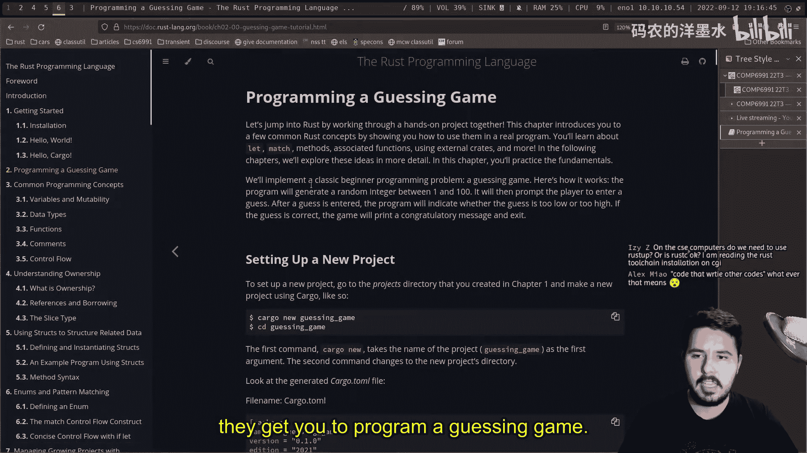

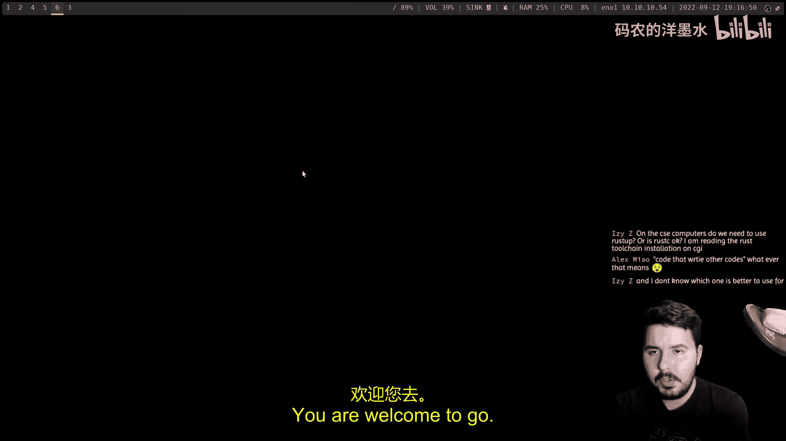

**代码解析**：
*   `loop` 关键字创建一个无限循环。
*   `match` 表达式是Rust强大的控制流运算符，它允许你将一个值与一系列模式比较，并执行匹配的模式对应的代码。它必须是**穷尽**的，即覆盖所有可能的情况。
*   `cmp` 方法比较两个值并返回一个 `Ordering` 枚举变体（`Less`, `Equal`, `Greater`）。
*   使用 `match` 处理 `parse` 的结果，比直接使用 `.unwrap()` 更健壮，因为它允许我们在输入非数字时继续循环而不是崩溃。

## 深入核心概念：Option类型与空值安全

上一节我们通过实践熟悉了Rust的基本语法，本节中我们来看看一个对程序安全至关重要的抽象：`Option`类型。

### 什么是Option类型？

`Option`是一个枚举（enum），它表示一个值可能存在也可能不存在。其定义如下：

```rust
enum Option<T> {
    Some(T),
    None,
}
```

*   `Some(T)`：表示存在一个类型为 `T` 的值。
*   `None`：表示不存在任何值。

### 为什么Option类型重要？

在许多编程语言（如C、Java、Python、Go）中，存在“空引用”（null）的概念。任何引用或对象类型都可以为null。这导致了著名的“十亿美元错误”，因为开发者很容易忘记检查null，从而在运行时引发崩溃或未定义行为。

Rust通过`Option`类型显式地处理值可能缺失的情况。**关键优势在于：如果一个值的类型不是`Option`，那么它在Rust中就不可能为“空”**。这由编译器在编译时保证，极大地减少了运行时错误。

### 不同语言中的“空值”处理对比

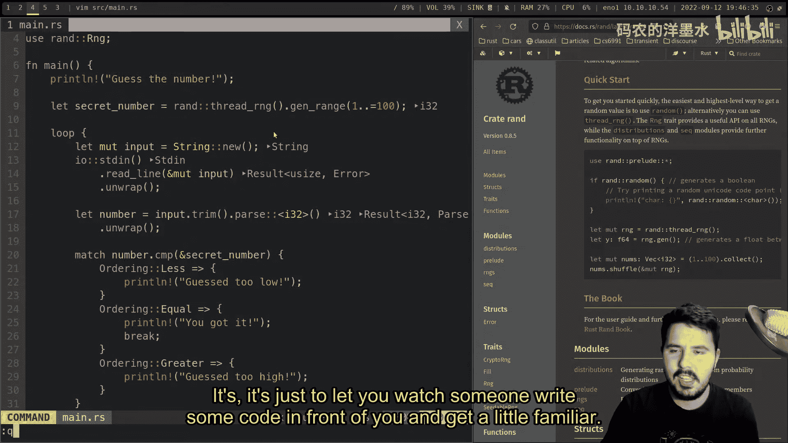

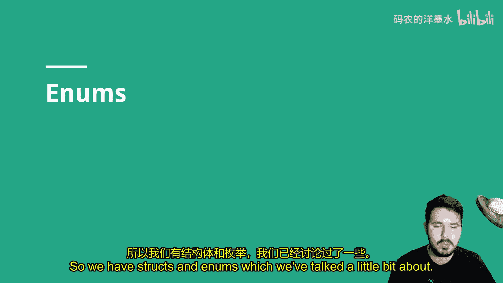

以下是使用不同语言处理“可能返回字符串也可能不返回”的函数示例：

**C语言**：使用指针和`NULL`。
```c
char* create(_Bool condition) {
    if (condition) return "hello";
    else return NULL;
}
// 调用者必须手动检查返回值是否为NULL，否则可能导致未定义行为。
```

**C++**：可以使用`std::optional`，但指针仍有空值问题。
**Java**：有`Optional`类型，但任何对象引用（包括`Optional`本身）仍可以为`null`。
**Python**：任何变量都可以是`None`，需依赖运行时检查或类型提示（如MyPy）。
**Go**：指针可为`nil`，解引用`nil`指针会引发panic（运行时崩溃）。

**Rust**：使用`Option`，并通过模式匹配安全处理。
```rust
fn create(condition: bool) -> Option<String> {
    if condition {
        Some("hello".to_string())
    } else {
        None
    }
}

match create(true) {
    Some(s) => println!("{}", s), // s 在此分支内有效
    None => println!("nothing"),   // 此分支没有 s 变量
}
// 编译器强制处理Some和None两种情况，避免遗漏。
```

### Option类型的意义

`Option`类型用于建模多种场景：
*   **函数可能没有输出**：例如，字符串解析为整数可能失败。
*   **函数参数可选**：例如，一个转换函数可以接受可选的进制参数。
*   **结构体字段可能缺失**：例如，学生可能还没有平均成绩（WAM）。

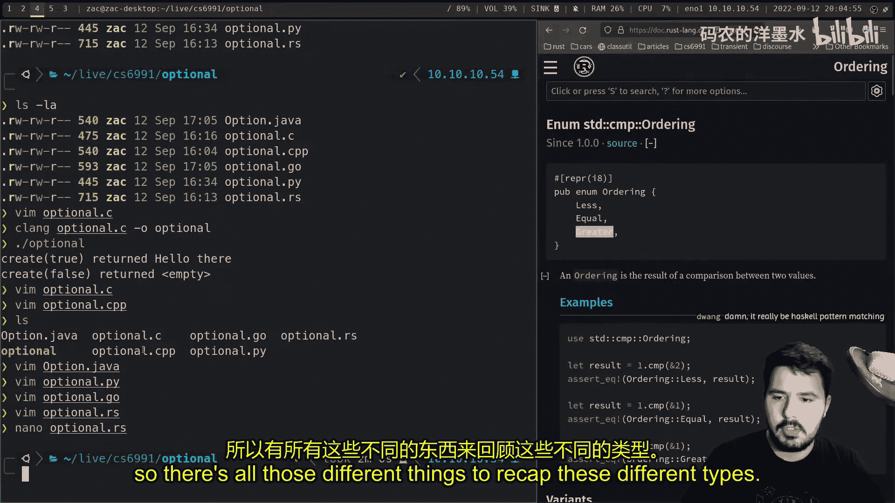

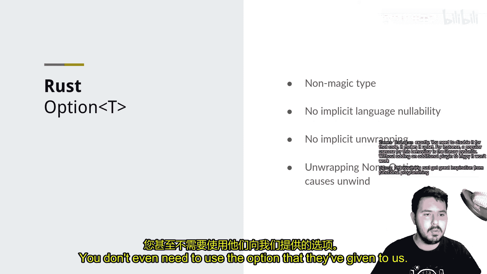

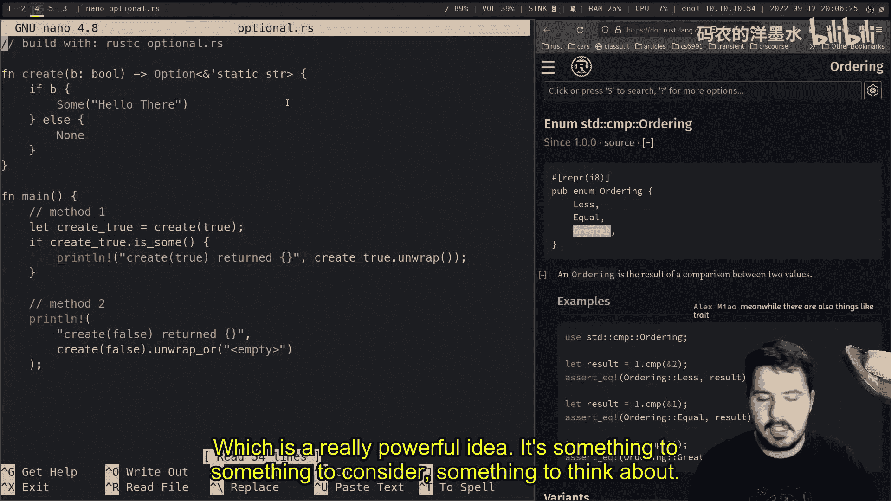

通过将“可能缺失”这一事实编码进类型系统，Rust引导（或强制）程序员在编译期处理所有可能的缺失情况，从而编写出更健壮、更少运行时错误的代码。

## 总结

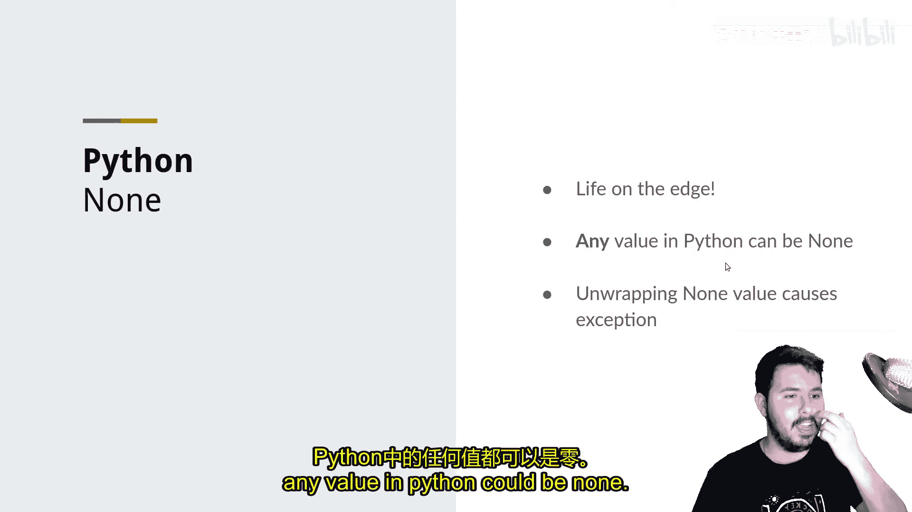


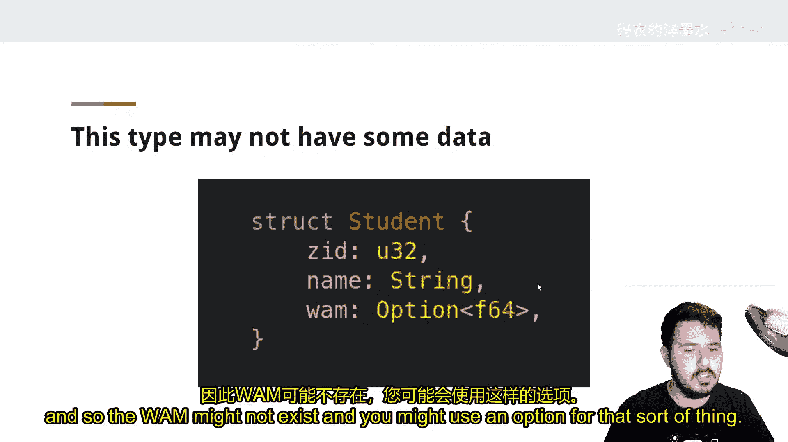

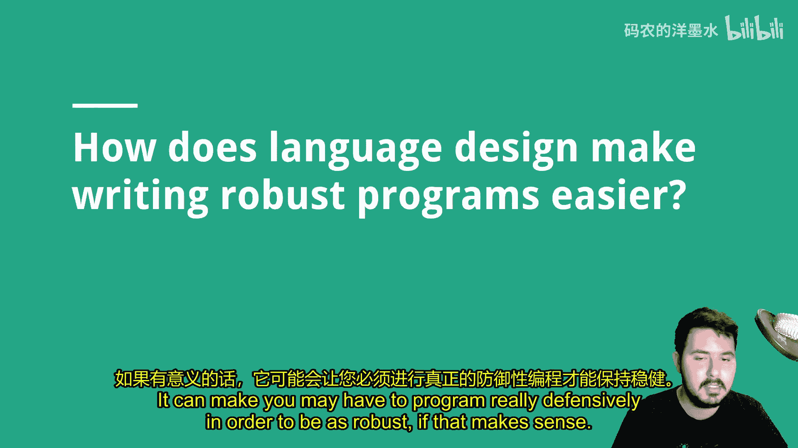

本节课我们一起学习了Rust编程语言的基础入门，并深入探讨了编程语言设计中的一个核心安全特性——通过`Option`类型消除空引用错误。

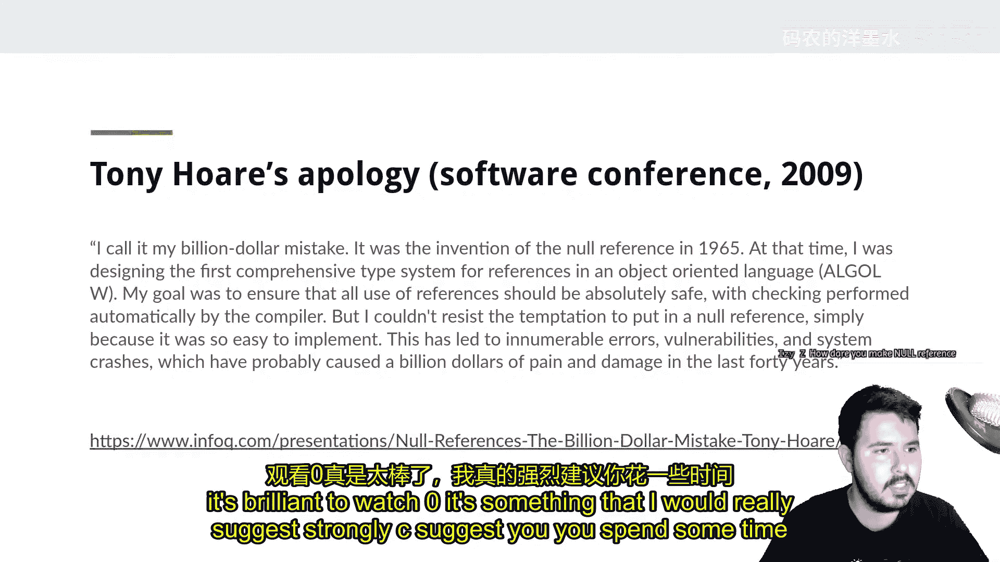

我们了解到：
1.  Rust通过所有权、借用检查器和丰富的类型系统（如`Option`、`Result`）在编译期保障内存安全和逻辑安全。
2.  `Option`枚举是处理值缺失情况的显式、安全的方式，与许多语言中隐式、易出错的空指针形成对比。
3.  语言的设计选择（如是否允许隐式空值）会深刻影响程序员编写健壮代码的难易程度。


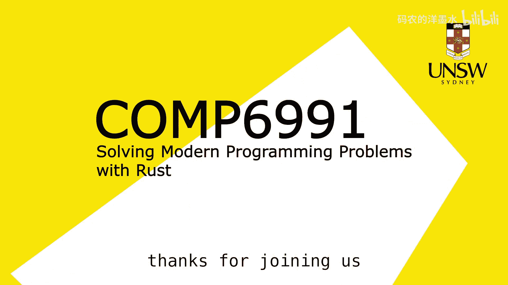

Rust并不一定是所有场景下的最佳选择，但它提供了一个优秀的样本，让我们思考如何通过语言设计来约束错误、表达意图并构建更可靠的软件。在接下来的课程中，我们将继续探索Rust的其他特性，并以此为契机，更广泛地思考和比较编程语言的设计哲学。