# 005：借用机制

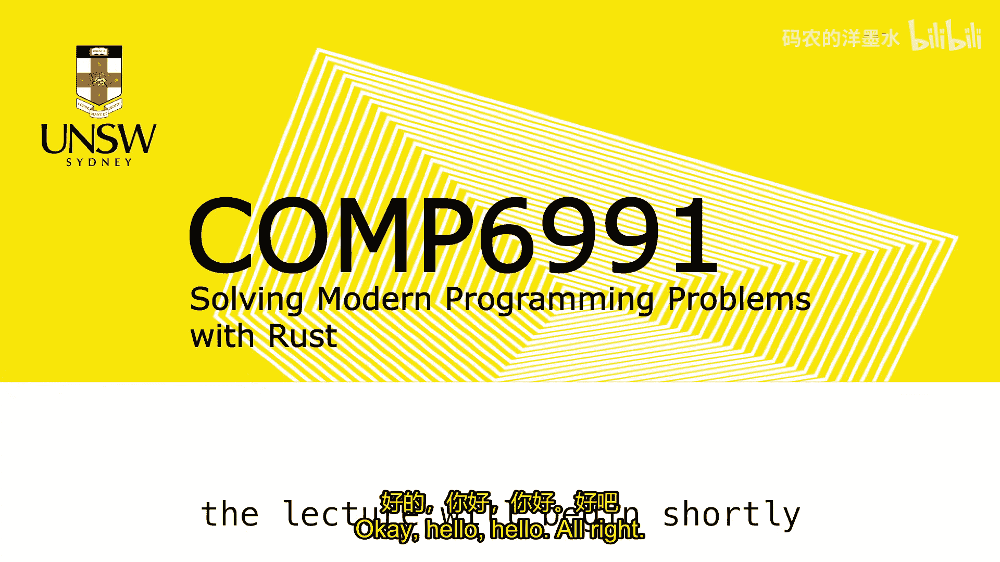

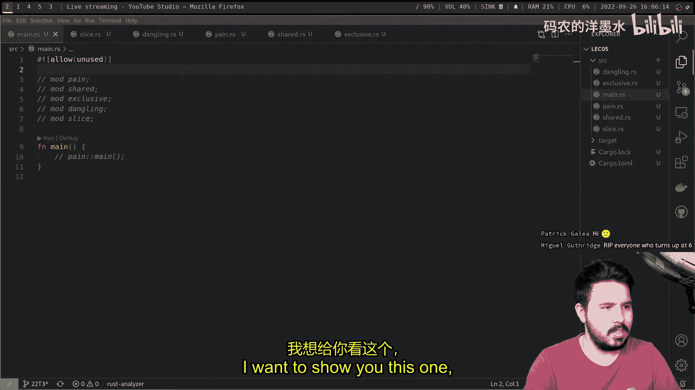

## 概述
在本节课中，我们将要学习Rust语言中一个核心且强大的特性——借用机制。我们将从回顾所有权开始，理解其带来的挑战，然后深入探讨共享借用和独占借用如何帮助我们在保证内存安全的同时，编写更灵活、更高效的代码。


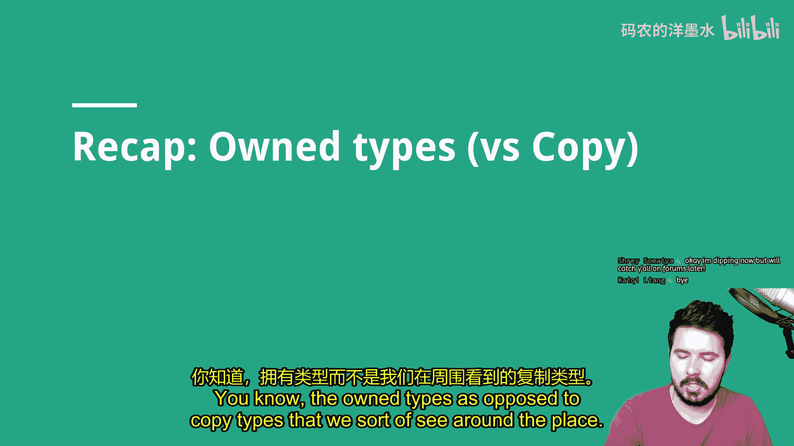

## 所有权回顾与挑战

上一节我们介绍了Rust的所有权系统。在Rust中，大多数值默认具有所有权语义。这意味着一个值在任意时刻只能有一个所有者，当进行赋值或传递给函数等操作时，所有权会发生转移，原变量将变得无效。

例如，对于一个自定义结构体：
```rust
struct Student {
    zid: i32,
    name: String,
    wam: f64,
}
```
变量 `student` 拥有 `Student` 值，而 `Student` 值又拥有其内部的 `String` 字段。所有权是层层递进的。

然而，Rust也为一些简单类型（如 `i32`、`bool`、`char` 等）提供了“复制”语义。这些类型被称为**复制类型**。对于复制类型，赋值操作会复制其比特位，而不是转移所有权，因此原变量仍然有效。一个类型要成为复制类型，其所有内部字段也必须是复制类型。

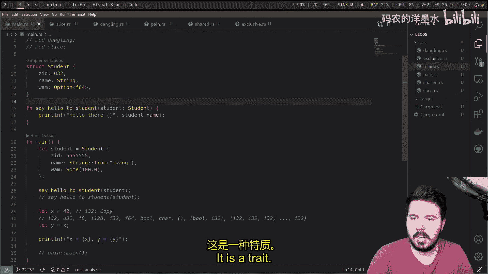

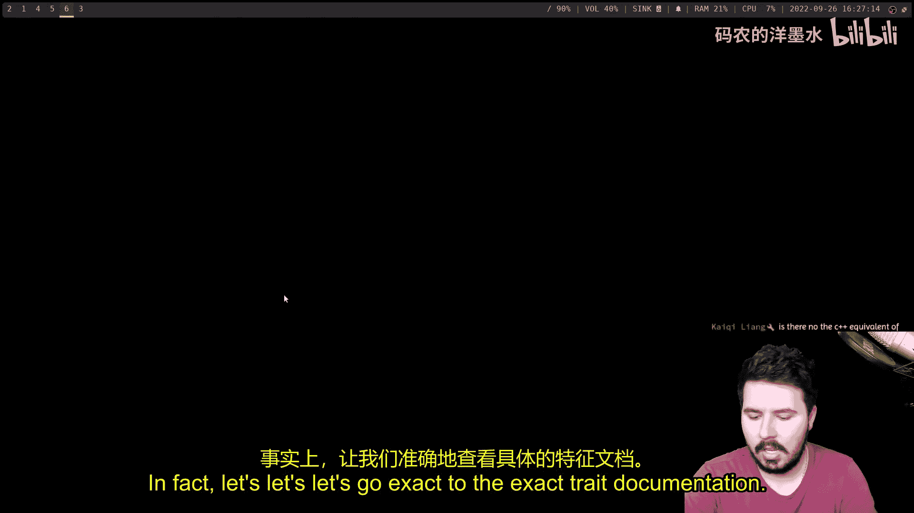

尽管所有权系统能有效防止内存错误（如双重释放、使用已释放内存），但在实践中，它有时会带来不便。例如，当我们想对一个值（如一个图像）进行多次操作时，每次将其传入函数都会导致所有权转移，之后便无法再次使用。常见的解决方法是让函数操作完毕后将所有权返回，但这使得代码显得冗长和繁琐。

## 共享可变性的危险

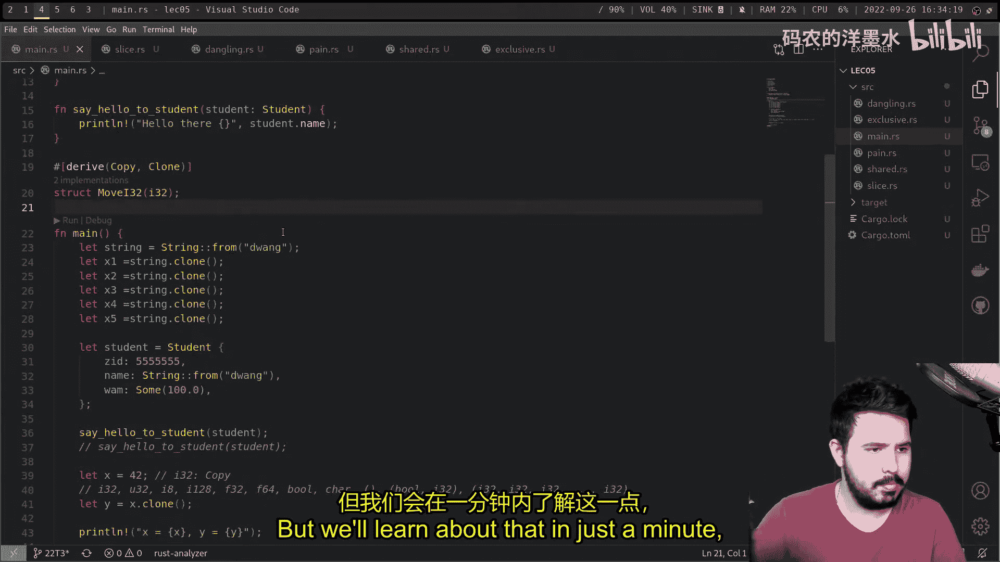

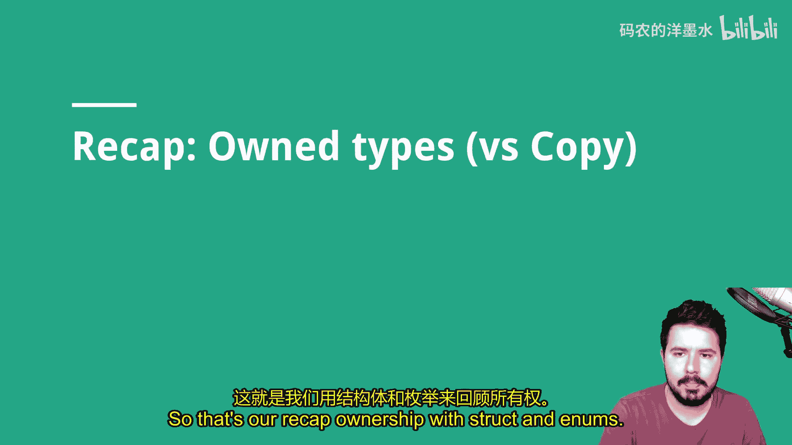

为什么Rust要设计这样严格的所有权系统？核心原因是为了避免**共享可变性**带来的危险。

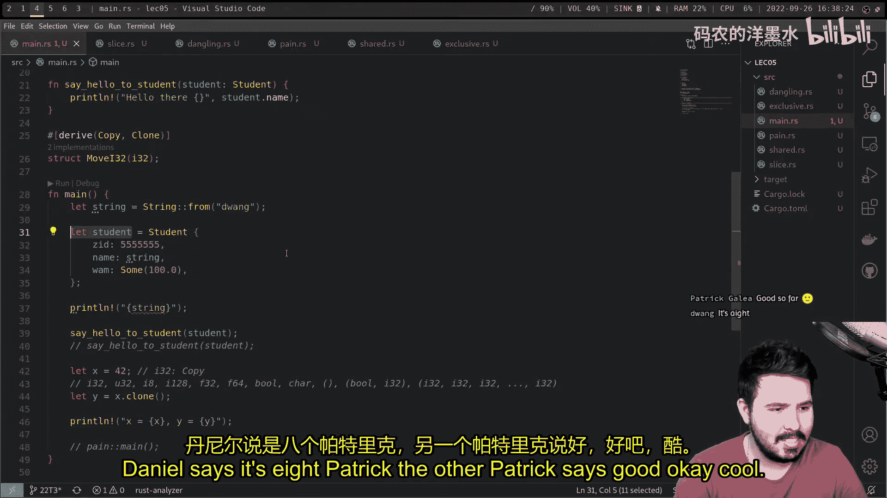


考虑多个线程同时操作同一个数据的情况：
*   **同时写入**：如果多个线程同时修改同一数据，硬件层面的写入可能相互覆盖，导致数据损坏或产生任意值。
*   **同时读写**：如果一个线程在读取数据的同时，另一个线程正在修改它，读取线程可能获得一个损坏的、不一致的值。

这些问题统称为**数据竞争**，是并发编程中常见且危险的错误来源。另一个经典例子是C++中的**迭代器失效**问题：在遍历一个容器（如向量）时，如果另一个操作修改了该容器（例如添加元素导致重新分配内存），迭代器可能会指向已释放的内存，从而引发内存安全问题。

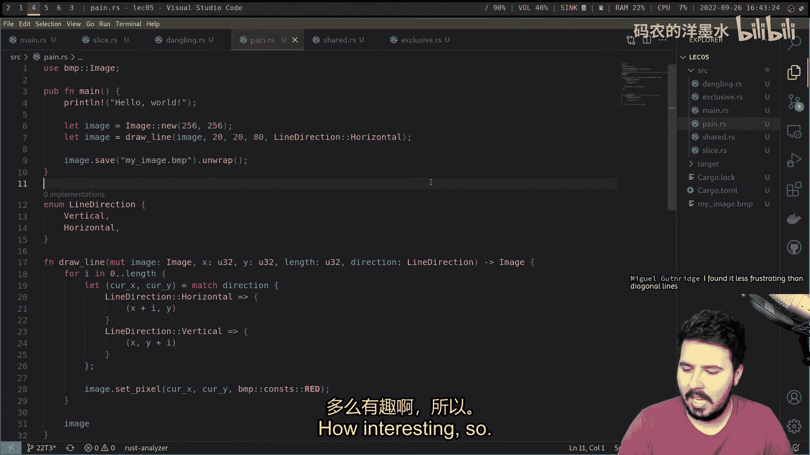


关键在于，当数据被**共享**且可被**修改**时，危险就出现了。Rust的设计哲学正是基于此：**共享与可变性不可兼得**。

## Rust的借用机制

Rust通过**借用**机制来贯彻“共享 XOR 可变”的原则。借用允许你临时访问一个值，而无需获取其所有权。借用分为两种：

1.  **共享借用**：允许你读取数据，但不能修改。可以同时存在多个共享借用。
2.  **独占借用**：允许你修改数据，但在借用期间，不能有任何其他借用（无论是共享还是独占）存在。

这个决定是**临时性**的。对于一个值，你可以在不同时期切换是共享它还是独占它，但在任何特定时刻，编译器必须能明确知道是哪种模式。

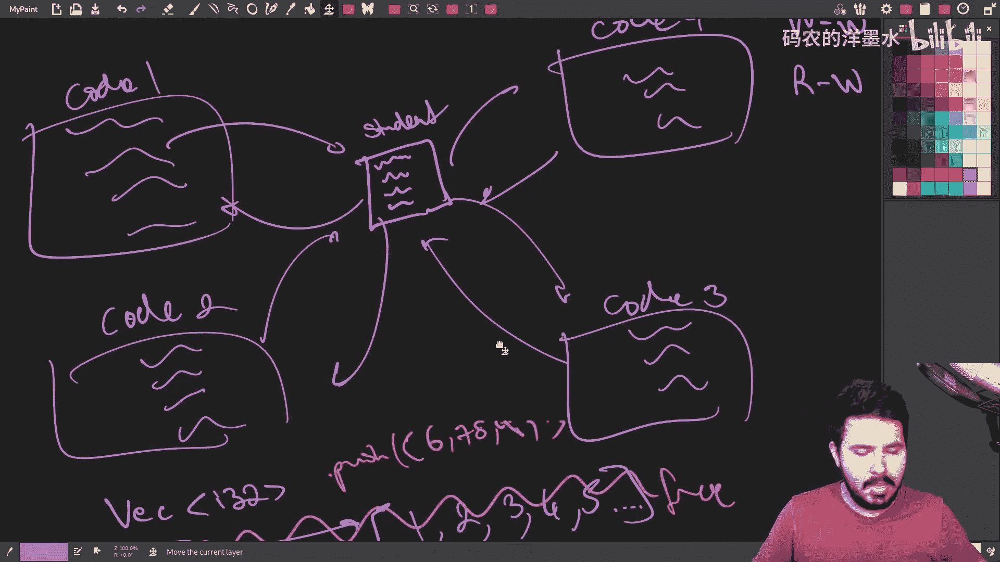


### 共享借用示例

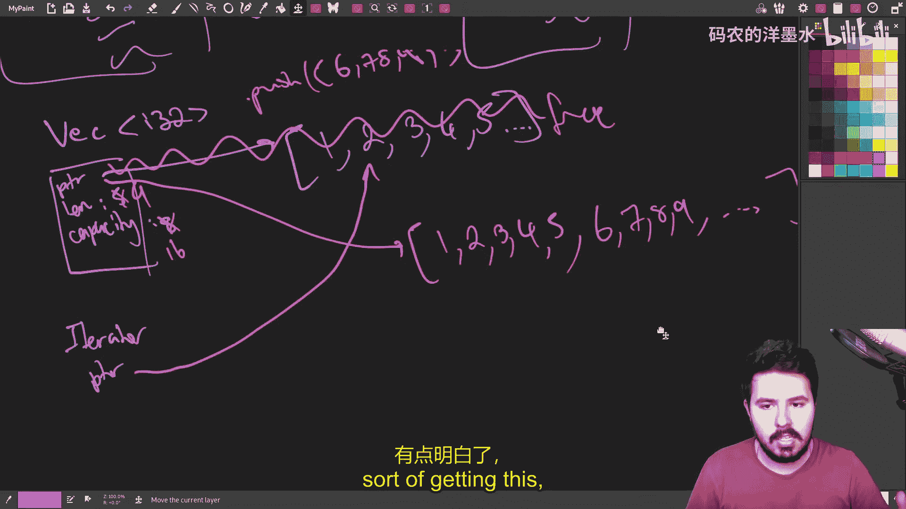


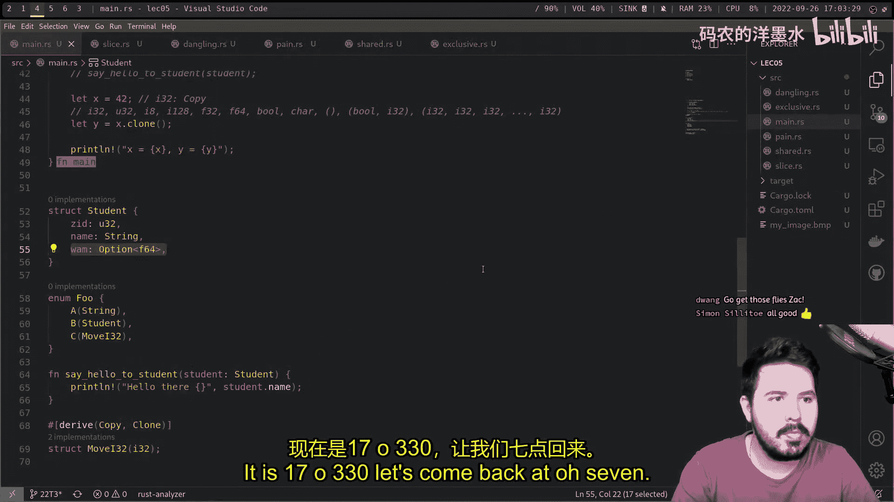


假设我们想编写一个函数来计算字符串的字符数，我们不需要修改字符串，也不需要获取其所有权。这时应该使用共享借用。

```rust
fn string_chars_len(s: &String) -> usize {
    s.chars().count()
}
```
函数签名 `&String` 表示接受一个对 `String` 的共享借用。调用时，我们使用 `&` 操作符来获取值的引用：
```rust
let my_string = String::from("hello");
let len = string_chars_len(&my_string); // 传递共享借用
// my_string 仍然有效，所有权未转移
```

**共享借用的特点：**
*   **超级能力**：可以创建任意多个，并且是**复制类型**，传递成本低。
*   **限制**：不能通过它修改数据，并且在共享借用存在期间，不能创建独占借用。

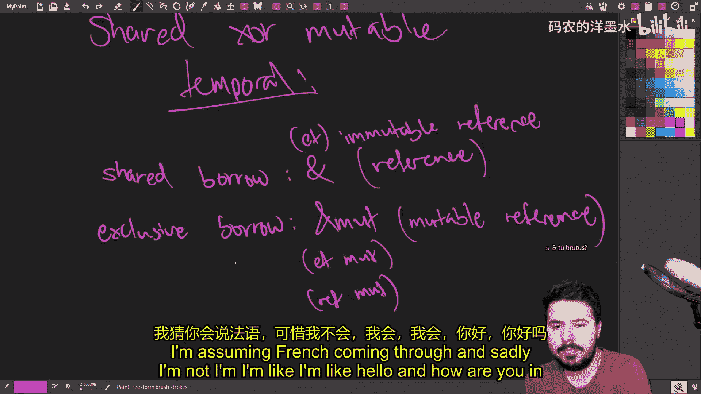


### 独占借用示例

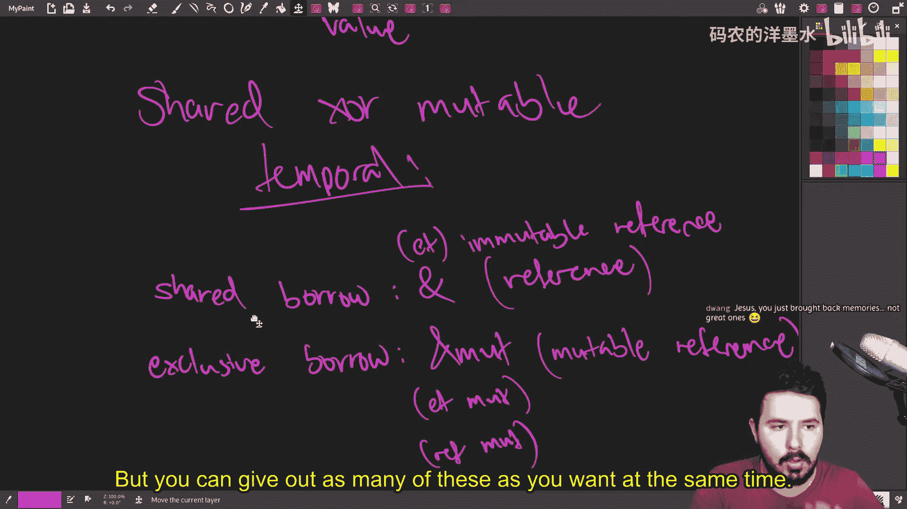


现在假设我们想编写一个函数来将字符串中的ASCII字符转为大写并添加感叹号，我们需要修改字符串，但仍希望调用者保留所有权。这时应该使用独占借用。

```rust
fn emphasize(s: &mut String) {
    s.make_ascii_uppercase();
    s.push_str("!!!");
}
```
函数签名 `&mut String` 表示接受一个对 `String` 的独占借用。调用时，变量本身必须声明为 `mut`，并且使用 `&mut` 操作符：
```rust
let mut my_string = String::from("hello");
emphasize(&mut my_string); // 传递独占借用
```

**独占借用的特点：**
*   **超级能力**：可以修改数据，且传递成本低。
*   **限制**：在独占借用存在期间，不能创建任何其他借用（无论是共享还是独占）。

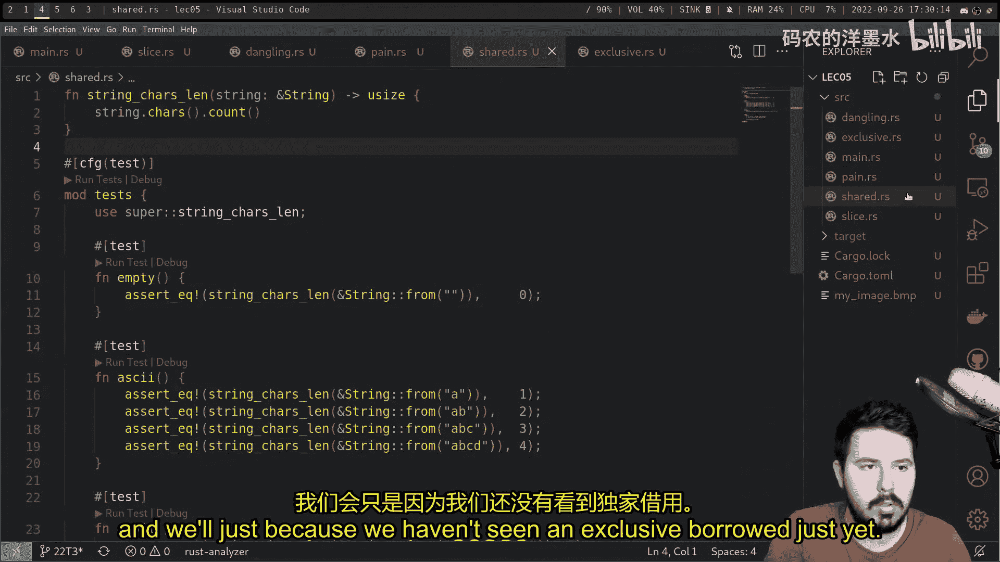

编译器会在编译时严格检查这些规则。如果代码违反了“共享 XOR 可变”原则，程序将无法通过编译。这就在编译期杜绝了数据竞争和迭代器失效等内存安全问题。

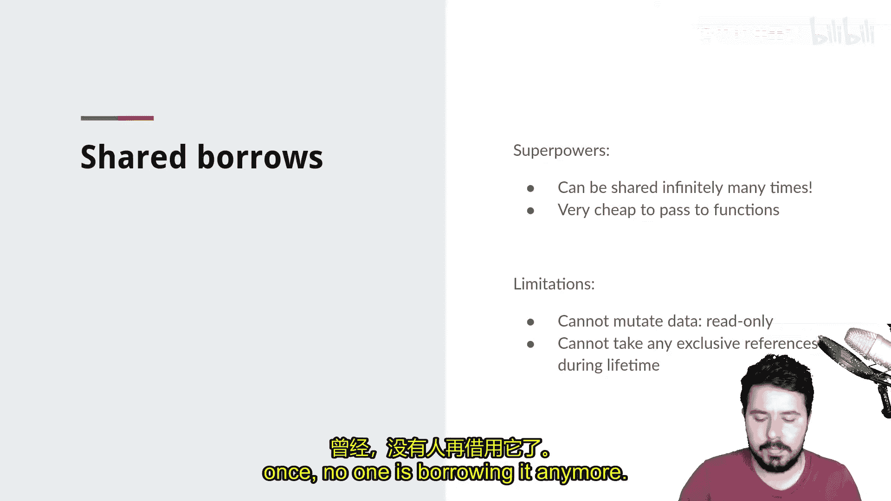

### 悬垂引用

在C/C++中，一个常见的错误是返回一个指向局部变量的指针（悬垂指针）。在Rust中，编译器通过生命周期检查来防止**悬垂引用**。如果你尝试返回一个对局部值的引用，编译器会报错，指出返回值“借用了一个值，但没有可供借用的所有者”。这确保了所有引用在编译时都是有效的。

## 切片简介

切片是对集合中一段连续元素的引用。它是一种特殊的借用，让你可以高效地操作数组或向量的一部分，而无需复制数据。

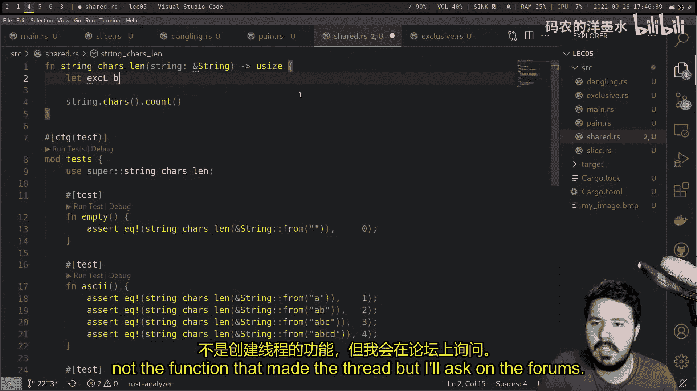

考虑数组和向量：
```rust
let array: [i32; 5] = [1, 2, 3, 4, 5]; // 栈上数组
let vec: Vec<i32> = vec![1, 2, 3, 4, 5]; // 堆上向量
```
你可以分别借用它们：`&[i32; 5]` 和 `&Vec<i32>`。但是，对于许多操作（特别是只读操作），我们更希望有一种统一的类型来表示“一段i32序列的视图”。这就是切片 `&[i32]`。


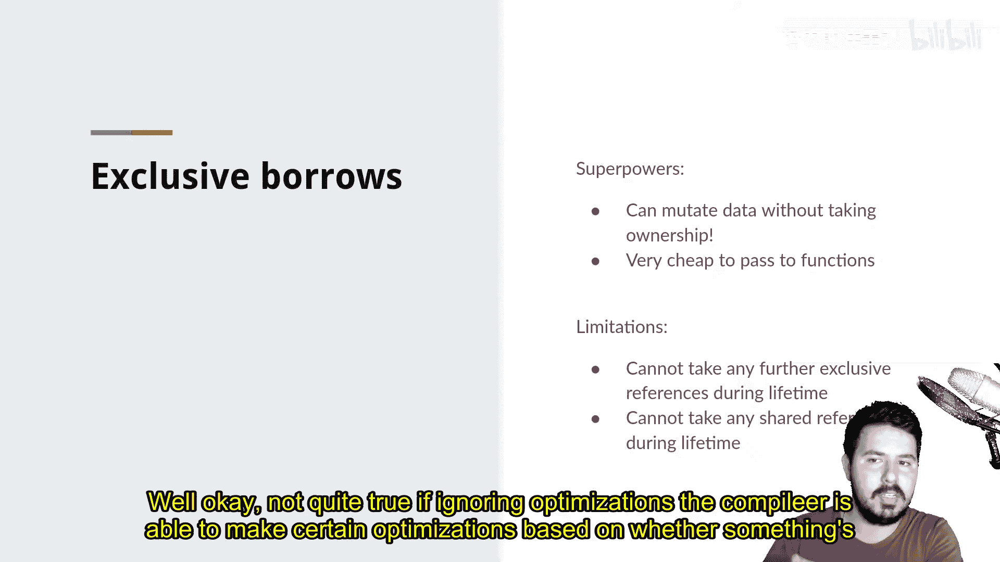

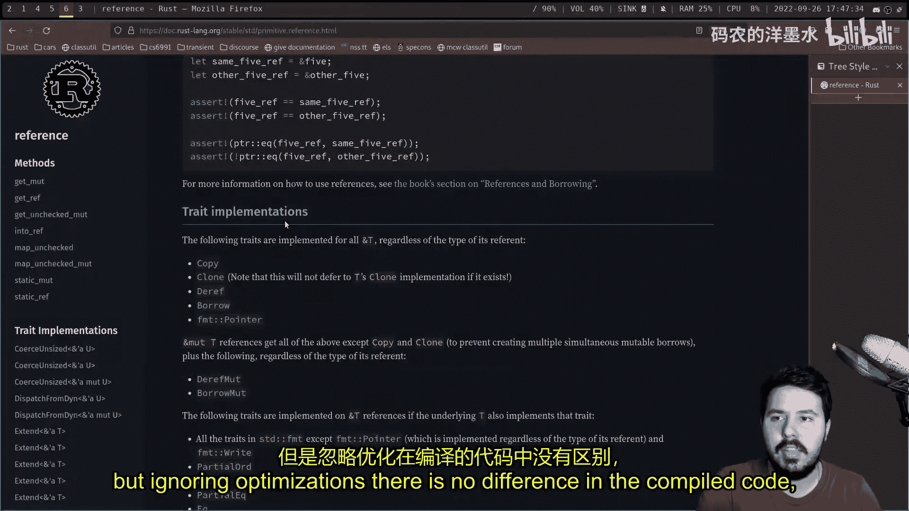


字符串切片 `&str` 也是同理，它是对 `String` 或字符串字面量中部分字节的引用。切片让函数能够更通用地处理不同来源的连续数据。

## 总结

本节课我们一起学习了Rust的借用机制，这是其内存安全的核心支柱之一。

*   我们回顾了所有权系统及其带来的挑战。
*   我们探讨了共享可变性的危险，如数据竞争和迭代器失效。
*   我们深入学习了**共享借用**和**独占借用**，理解了Rust如何通过“共享 XOR 可变”原则在编译期保证安全。
*   我们看到了借用如何让代码更灵活（无需转移所有权）且高效（仅传递指针）。
*   我们简要了解了切片的概念，它是对连续数据块的统一视图。

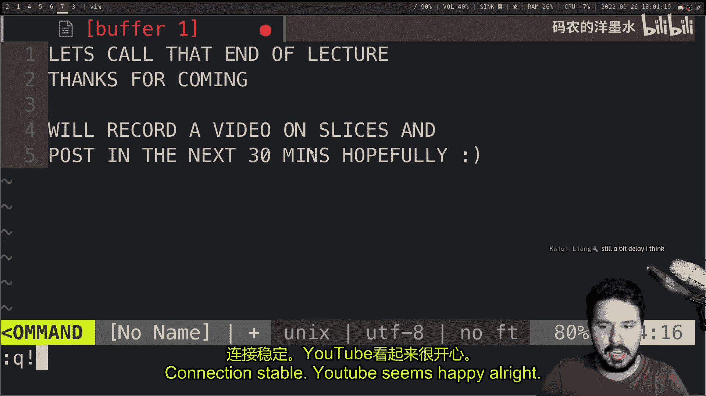


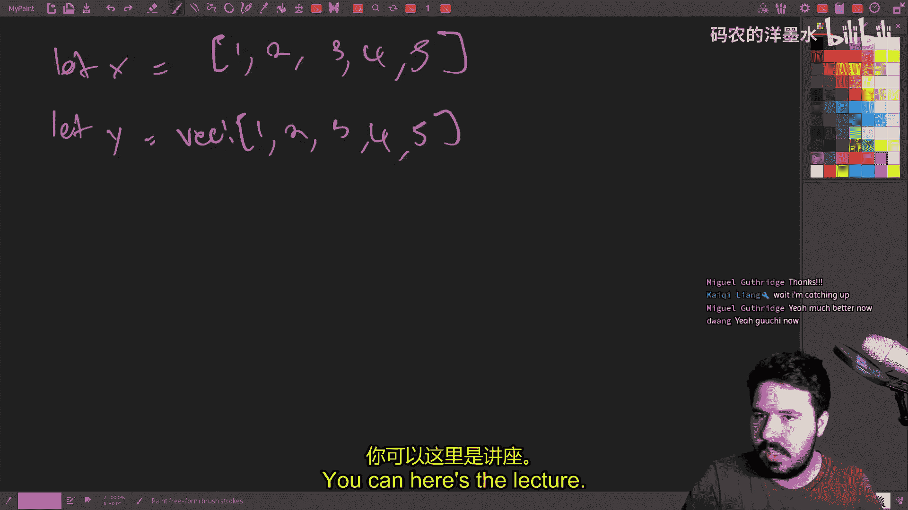


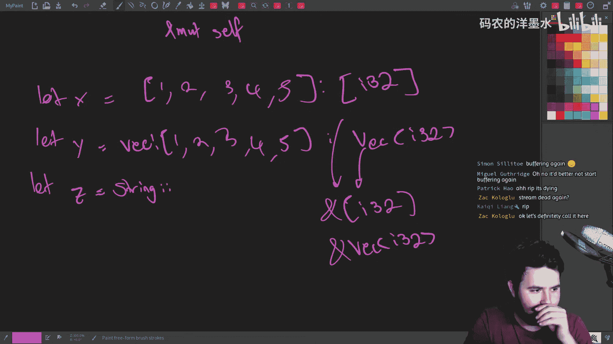

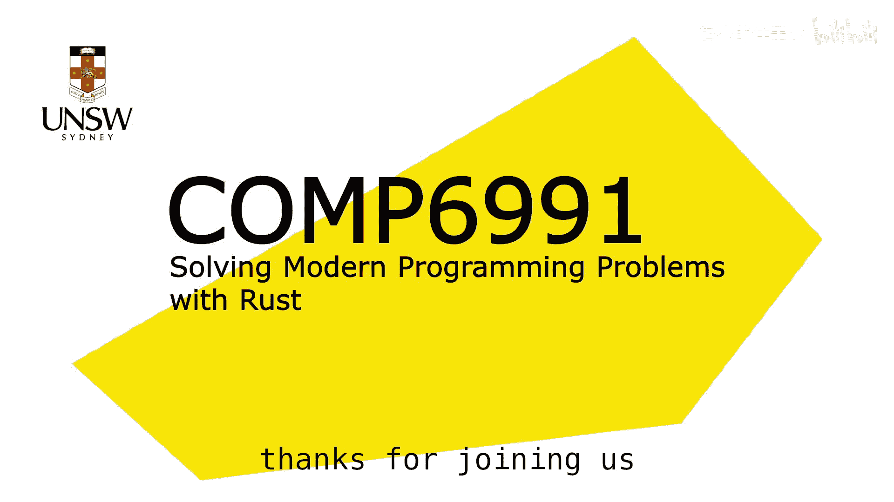

借用机制是Rust初学者需要克服的主要障碍之一，但一旦掌握，它将成为编写安全、高效并发代码的强大工具。记住，编译器是你的朋友，它的严格检查是为了帮助你避免运行时难以调试的严重错误。