# 009：泛型与特质

## 概述

在本节课中，我们将要学习Rust中的多态性，特别是泛型类型参数和特质。我们将了解如何编写适用于多种类型的通用代码，以及如何通过特质来约束这些类型的行为。课程内容将从简单的泛型函数开始，逐步深入到更复杂的通用容器和迭代器概念，并解释Rust实现泛型的底层机制——单态化。

---

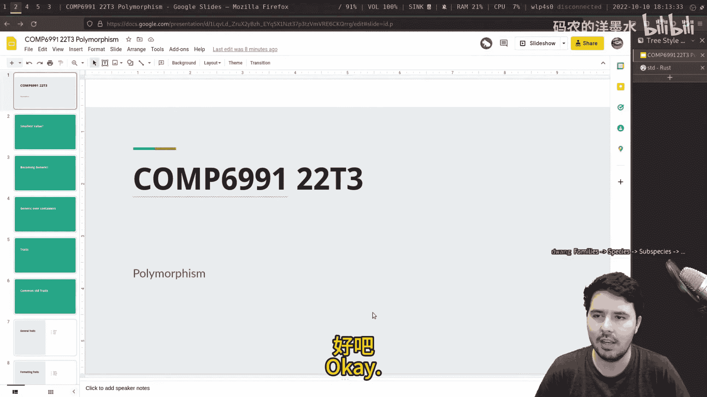


## 泛型类型参数

上一节我们介绍了课程概述，本节中我们来看看泛型类型参数。


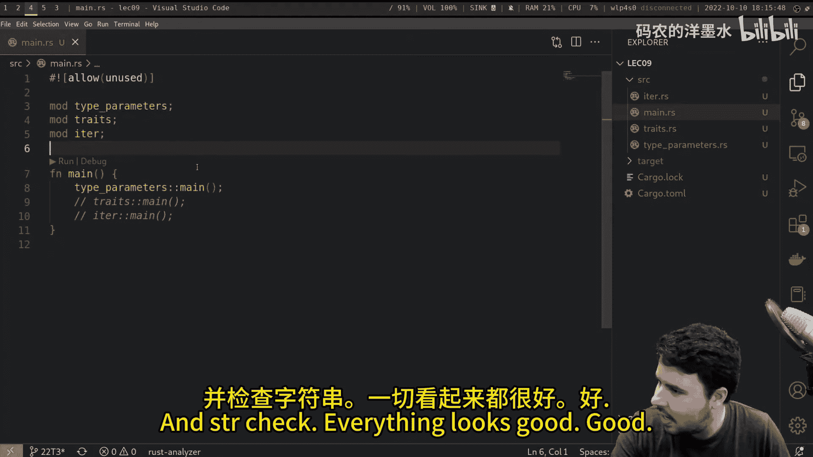

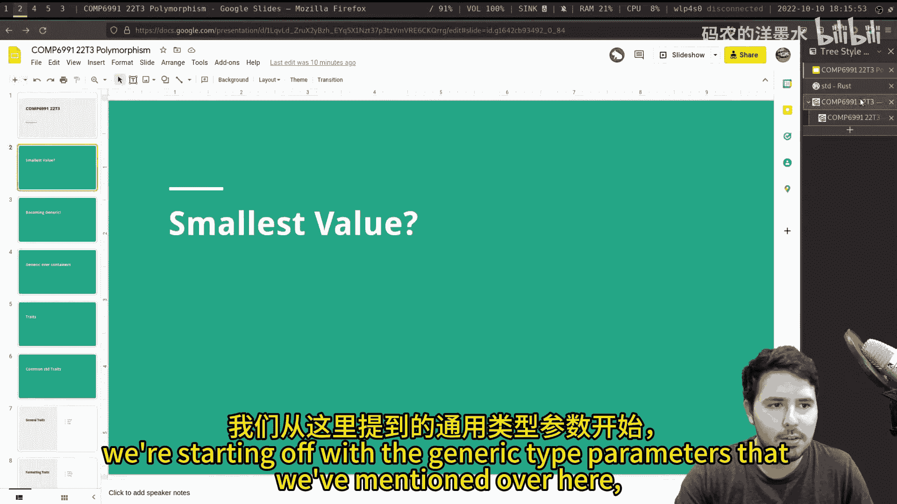

假设我们需要一个函数来找出两个值中的较小者。最初，我们可能会为每种类型（如 `i32`、`f32`、`char`）编写单独的函数。

```rust
fn smallest_i32(x: i32, y: i32) -> i32 {
    if x < y { x } else { y }
}

fn smallest_f32(x: f32, y: f32) -> f32 {
    if x < y { x } else { y }
}

fn smallest_char(x: char, y: char) -> char {
    if x < y { x } else { y }
}
```

这三个函数的逻辑完全相同，只是类型不同。为了避免代码重复，我们希望编写一个适用于任何类型的通用函数。

### 引入泛型

我们可以使用泛型类型参数 `T` 来定义一个通用函数。

```rust
fn smallest<T>(x: T, y: T) -> T {
    if x < y { x } else { y }
}
```

然而，这段代码无法编译。编译器会提示二元操作 `<` 不能应用于类型 `T`。这是因为 `T` 可以是任何类型，但 `<` 操作符并非对所有类型都有效。

### 约束类型参数

为了使函数正常工作，我们需要约束 `T`，确保它支持比较操作。在Rust中，这是通过特质（Trait）实现的。对于比较操作，标准库提供了 `PartialOrd` 特质。

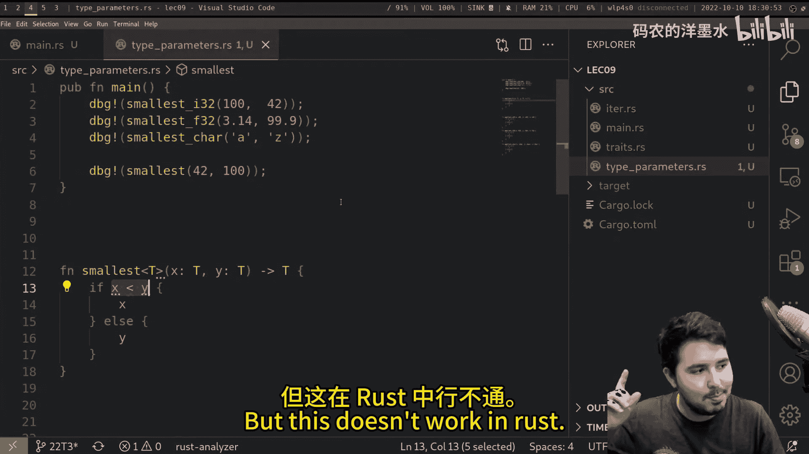

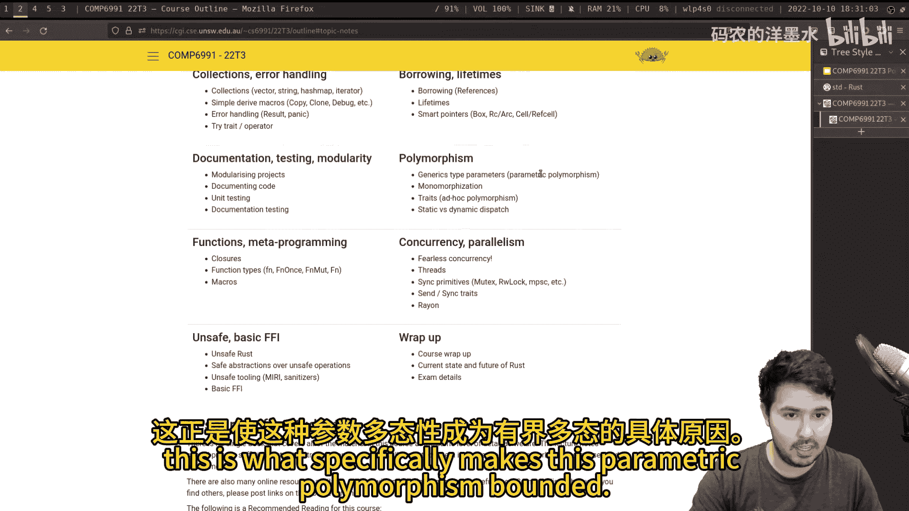

以下是使用特质约束的两种等效语法：

1.  在泛型参数声明中直接约束：
    ```rust
    fn smallest<T: PartialOrd>(x: T, y: T) -> T {
        if x < y { x } else { y }
    }
    ```
2.  使用 `where` 子句（更清晰，尤其当约束复杂时）：
    ```rust
    fn smallest<T>(x: T, y: T) -> T
    where
        T: PartialOrd,
    {
        if x < y { x } else { y }
    }
    ```

现在，`smallest` 函数可以用于任何实现了 `PartialOrd` 特质的类型，例如 `i32`、`f32`、`char`，甚至是我们自定义的结构体（如果为其派生或实现了 `PartialOrd`）。

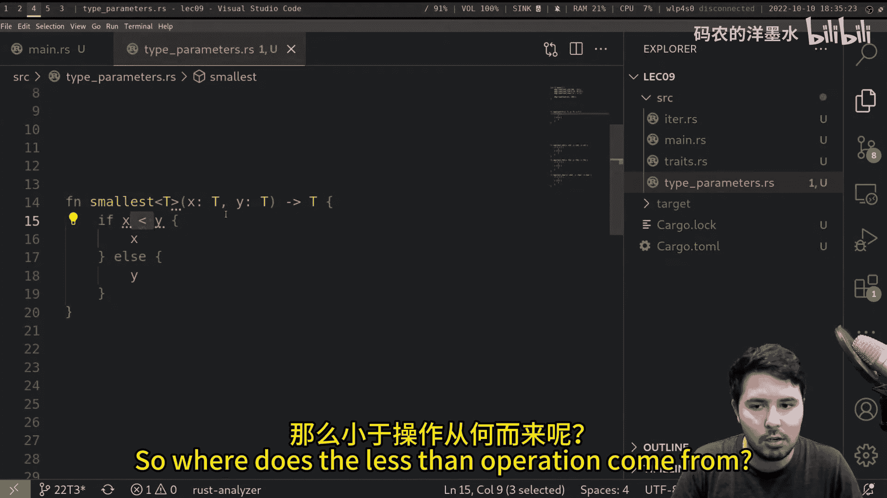

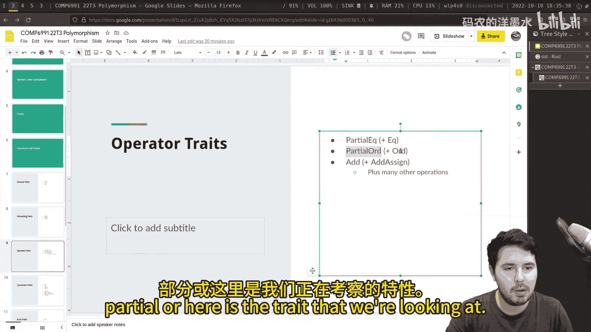

---

## 使函数更通用

上一节我们介绍了如何为简单比较函数添加泛型，本节中我们来看看如何使其更加通用。

当前的 `smallest` 函数只接受两个参数。如果我们想找出任意数量值中的最小值呢？我们可以让它接受一个集合。

### 处理集合

首先，我们可能会想到接受一个 `Vec<T>`。

```rust
fn smallest<T: PartialOrd>(xs: Vec<T>) -> Option<T> {
    let mut iter = xs.into_iter();
    let mut smallest = iter.next()?; // 如果迭代器为空，返回 None
    for item in iter {
        if item < smallest {
            smallest = item;
        }
    }
    Some(smallest)
}
```

这个函数返回 `Option<T>`，以优雅地处理空集合的情况。

### 泛化容器类型

然而，将参数类型固定为 `Vec<T>` 是“不必要的具体化”。用户可能拥有 `LinkedList<T>`、数组或 `HashSet<T>`。我们真正需要的约束是：参数可以被转换为一个能产出 `T` 类型元素的迭代器。

Rust 的 `IntoIterator` 特质正是为此而生。我们可以进一步泛化函数：

```rust
fn smallest<T, I>(xs: I) -> Option<T>
where
    T: PartialOrd,
    I: IntoIterator<Item = T>, // I 可以被转换为产出 T 的迭代器
{
    let mut iter = xs.into_iter();
    let mut smallest = iter.next()?;
    for item in iter {
        if item < smallest {
            smallest = item;
        }
    }
    Some(smallest)
}
```

我们还可以使用更简洁的 `impl Trait` 语法来简化签名，特别是当 `I` 的唯一约束就是 `IntoIterator` 时：

```rust
fn smallest<T>(xs: impl IntoIterator<Item = T>) -> Option<T>
where
    T: PartialOrd,
{
    // 函数体相同
}
```

现在，`smallest` 函数可以接受任何可迭代的集合，例如 `Vec`、`LinkedList`，甚至是对它们的引用，代码的通用性大大增强。

---

## 泛型在结构体和枚举中的应用

上一节我们看到了函数中的泛型，本节中我们来看看泛型如何应用于结构体和枚举。

泛型类型参数不仅可以用于函数，也可以用于定义结构体和枚举，使其能够容纳多种类型的数据。

### 泛型结构体

一个常见的例子是 `Point` 结构体，其坐标可以是任何类型。

```rust
struct Point<T> {
    x: T,
    y: T,
}
```

### 泛型枚举

标准库中的 `Option` 和 `Result` 枚举是泛型枚举的经典例子。

```rust
enum Option<T> {
    Some(T),
    None,
}

enum Result<T, E> {
    Ok(T),
    Err(E),
}
```

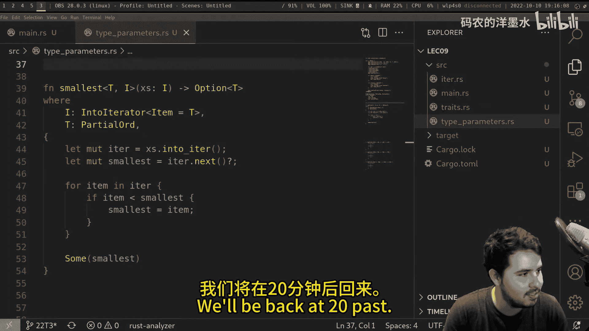

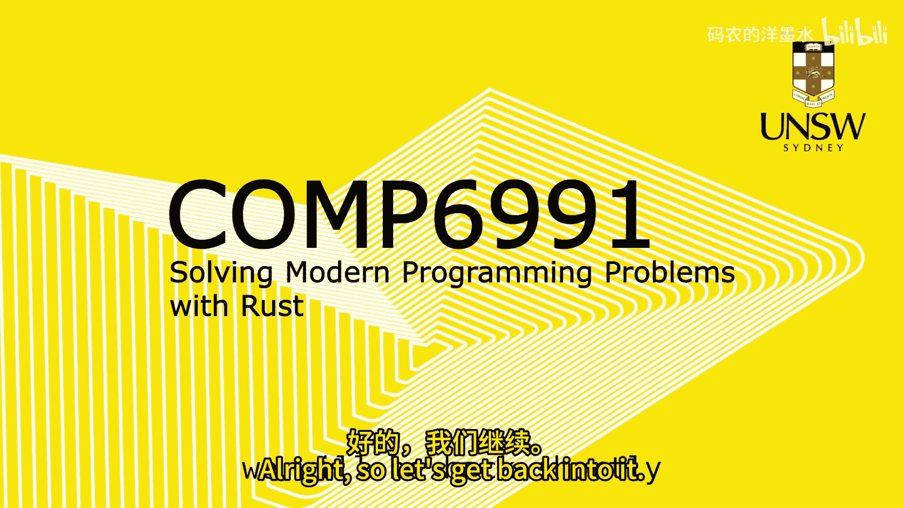

### 为泛型结构体实现方法

当为泛型结构体实现方法时，需要在 `impl` 块中声明泛型参数。

```rust
impl<T> Point<T> {
    fn new(x: T, y: T) -> Self {
        Point { x, y }
    }
}
```

我们还可以为特定的类型约束实现方法。例如，只为实现了 `Default` 特质的 `Point<T>` 实现一个返回默认点的方法：

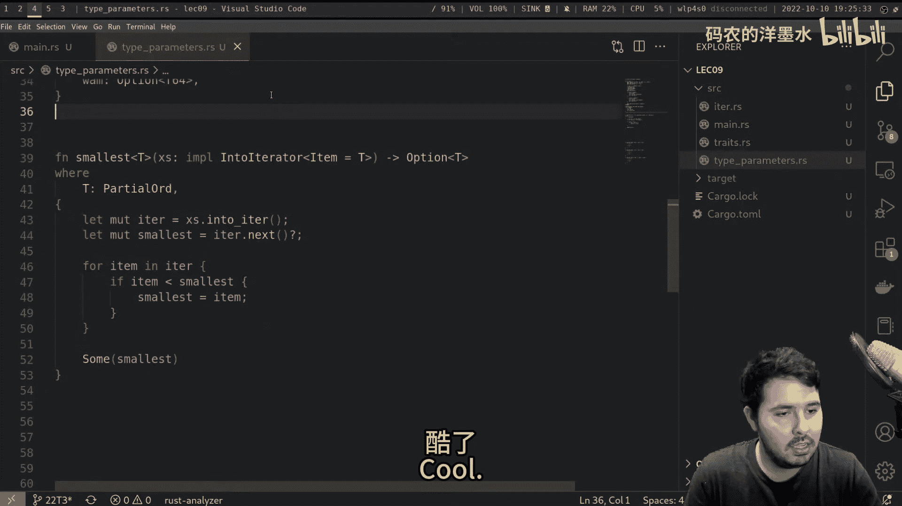

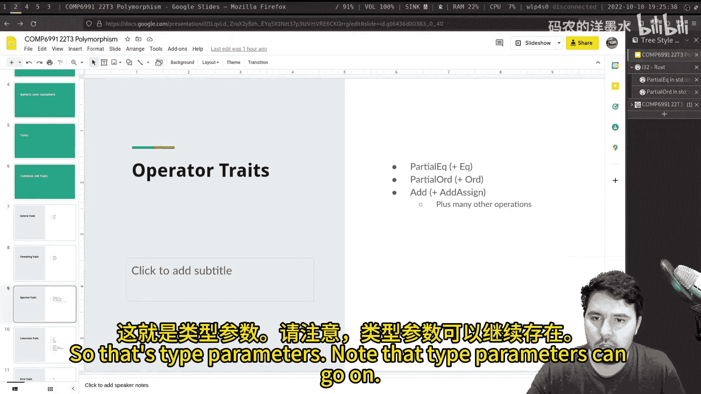

```rust
impl<T: Default> Point<T> {
    fn default() -> Self {
        Point {
            x: T::default(),
            y: T::default(),
        }
    }
}
```

这意味着，只有当 `T` 实现了 `Default` 特质时，`Point<T>` 才会拥有 `default` 方法。这种模式非常强大，可以根据类型的特性来提供不同的行为。

---

## 单态化：泛型在Rust中的实现

上一节我们了解了泛型的语法和应用，本节中我们来看看Rust是如何在底层实现泛型的。

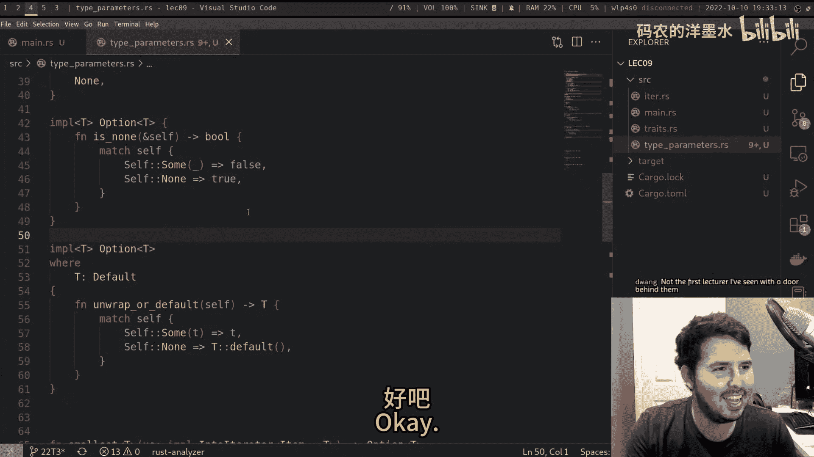

Rust 通过一种称为 **单态化** 的技术来实现泛型。这与 C++ 的模板展开类似。

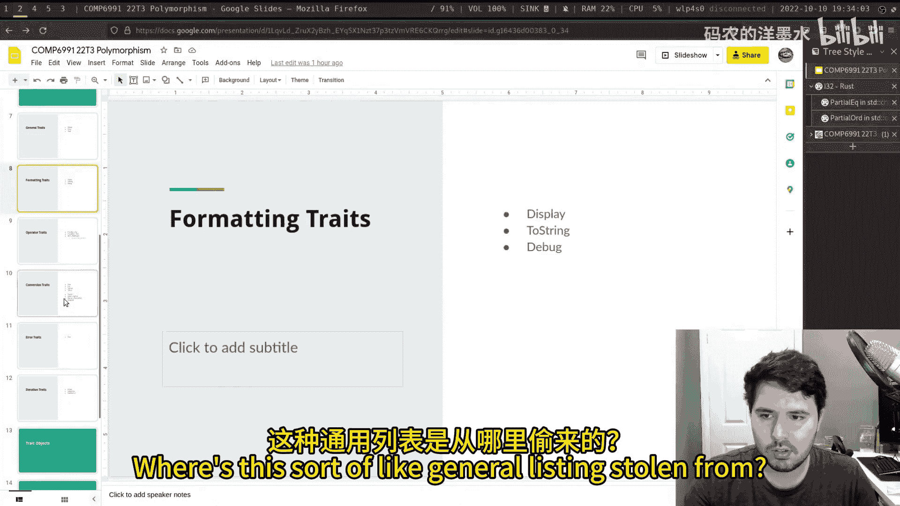

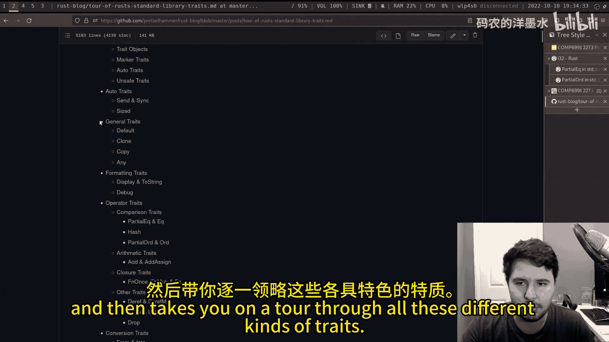

### 工作原理


当编译器遇到一个泛型函数调用时，例如 `smallest(42, 100)`，它会执行以下步骤：
1.  确定调用时使用的具体类型（这里是 `i32`）。
2.  为这个具体类型生成一个全新的、非泛型的函数副本。这个过程就像是把泛型函数 `fn smallest<T: PartialOrd>(x: T, y: T) -> T` 中的 `T` 全部替换成 `i32`，得到 `fn smallest_i32(x: i32, y: i32) -> i32`。
3.  编译这个新生成的函数。


如果同一个泛型函数被用于 `i32`、`f64` 和 `char`，那么最终的可执行文件中将包含三个不同版本的函数。

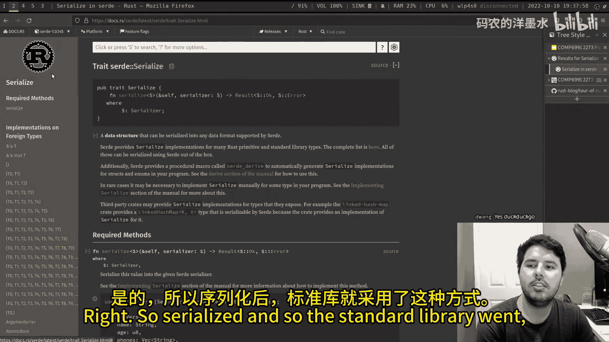

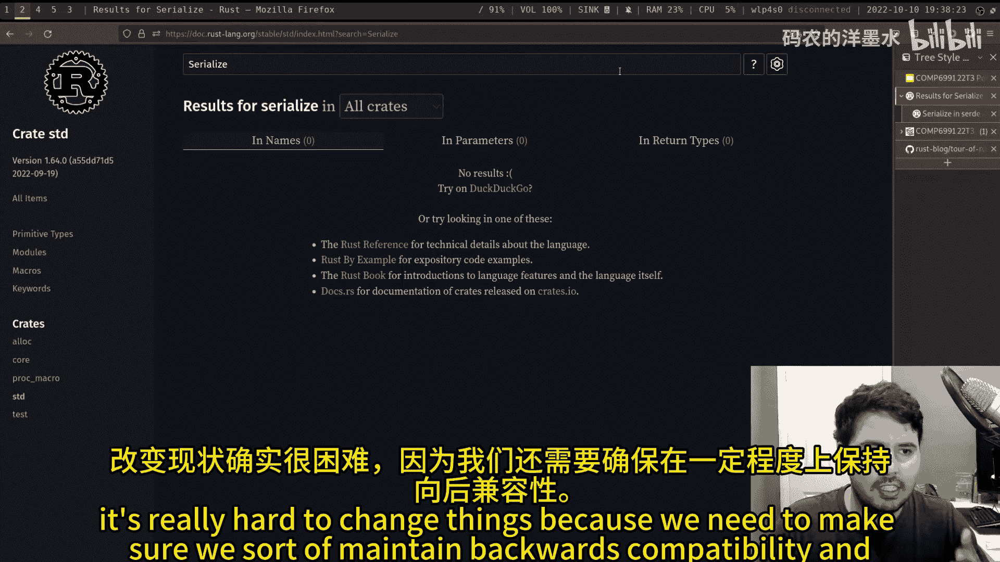

### 单态化的优缺点

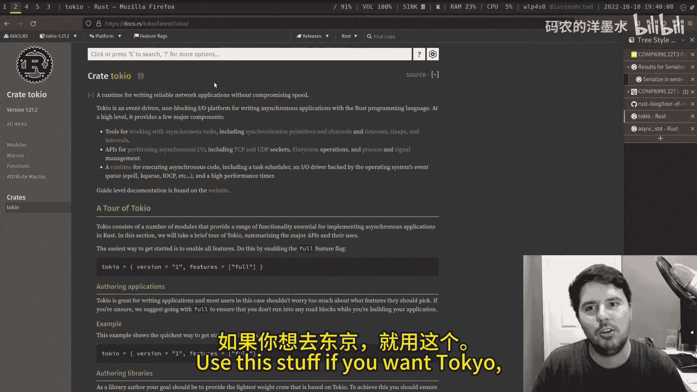

以下是单态化的主要权衡：

**优点：**
*   **性能优异：** 生成的代码是专门针对具体类型优化的，编译器可以进行激进的内联和其他优化。运行时没有动态查找的开销。
*   **静态分派：** 所有函数调用在编译时即已确定，效率极高。

**缺点：**
*   **代码膨胀：** 如果泛型函数被用于许多不同的类型，会导致最终二进制文件体积增大。
*   **编译时间增长：** 编译器需要为每种类型生成并编译单独的代码。
*   **必须知晓所有类型：** 所有使用泛型代码的类型都必须在编译时已知。这对于插件系统或动态加载库的场景不友好。

正是因为这些缺点，Rust 也提供了另一种实现多态的方式——**动态分派**，它使用 `dyn` 关键字和特质对象。我们将在后续课程中详细讨论。

---

## 标准库中的常见特质

上一节我们探讨了泛型的实现机制，本节中我们快速浏览一些标准库中常见且有用的特质。

特质定义了类型可以共享的行为。标准库定义了许多核心特质，这有助于在整个 Rust 生态系统中建立一致性。

以下是几个关键特质的简介：

*   **`PartialOrd` / `Ord`：** 用于比较和排序。`PartialOrd` 允许部分比较（例如浮点数有 `NaN`），`Ord` 则要求全序。
*   **`PartialEq` / `Eq`：** 用于相等性比较。`Eq` 比 `PartialEq` 要求更严格，它要求相等关系满足自反性（`a == a`）。
*   **`Default`：** 为类型提供一个合理的“默认值”。例如，`i32` 的默认值是 `0`，`String` 的默认值是空字符串。
*   **`Display` / `Debug`：** 用于格式化输出。`Display` 是面向用户的、友好的输出，而 `Debug` 是面向开发者的、详细的输出，通常可以通过 `#[derive(Debug)]` 自动派生。
*   **`Clone` / `Copy`：** `Clone` 允许显式地创建值的副本（深拷贝）。`Copy` 是一个标记特质，表示类型可以通过简单的位拷贝进行复制（浅拷贝），赋值等操作不会转移所有权。
*   **`Iterator` / `IntoIterator`：** 定义迭代行为。`IntoIterator` 指定了类型如何被转换为迭代器，而 `Iterator` 特质则定义了迭代器本身的行为（如 `next` 方法）。

理解这些特质及其用途，是编写高效、符合习惯的 Rust 代码的关键。

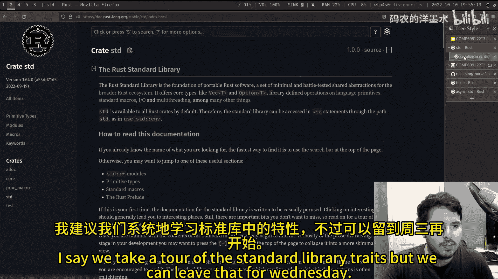


---

## 总结

本节课中我们一起学习了 Rust 多态性的核心概念：泛型与特质。

我们首先从编写重复的类型特定函数开始，引入了泛型类型参数 `T` 来创建通用函数。我们了解到，为了在泛型函数中使用特定操作（如比较），必须使用特质（如 `PartialOrd`）来约束类型参数。

接着，我们探索了如何使函数更加通用，不仅泛化元素类型 `T`，还泛化了容器类型，通过 `IntoIterator` 特质使其能接受任何可迭代集合。

我们还看到了泛型在结构体、枚举及其 `impl` 块中的应用，并了解了如何根据类型约束条件性地实现方法。

最后，我们深入了解了 Rust 实现泛型的底层机制——单态化，分析了其性能优势与潜在的代码膨胀代价，并简要介绍了标准库中一些至关重要的核心特质。


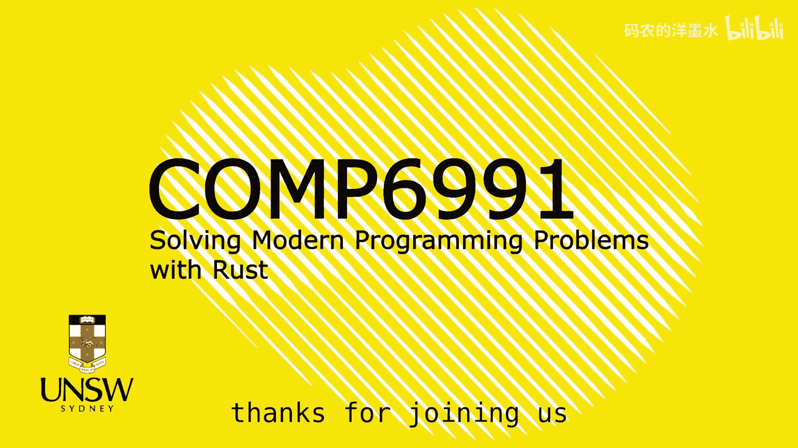

掌握泛型和特质是解锁 Rust 强大表达力和性能潜力的关键。在接下来的课程中，我们将继续学习动态分派和特质对象，以完成对 Rust 多态性体系的全面了解。