# 013：Rust并发编程

## 概述
在本节课中，我们将要学习Rust中的并发编程。我们将探讨并发的基本概念，理解为何并发编程容易出错，并学习Rust如何利用其类型系统在编译时防止常见的并发错误，例如数据竞争。我们将介绍线程、互斥锁、原子类型以及Rust特有的`Send`和`Sync`特质。


## 并发概念回顾
上一节我们介绍了本课程的目标。本节中，我们来看看并发的基本概念。

我们通常将代码视为顺序执行：程序从`main`函数开始，逐行运行，调用函数，再逐行运行。这是单线程程序的典型模型，一次只执行一个任务。

然而，这种模型存在局限性。考虑一个需要完成三个独立子任务的程序（例如，从不同网络源获取数据）。这些任务互不依赖，执行顺序无关紧要。在单线程模型中，CPU必须等待一个任务（尤其是涉及I/O的阻塞任务）完成后才能开始下一个，导致CPU在等待期间闲置。

并发提供了一种解决方案。其核心思想是：当一个任务因等待外部资源（如网络响应）而阻塞时，CPU可以保存当前任务状态，转而执行其他任务，从而提高整体效率。正如Rob Pike所言：“并发是关于同时处理许多事情，而并行是关于同时做许多事情。”我们主要关注并发。

阻塞函数（如读取用户输入或网络请求）会暂停当前线程的执行。在没有并发的情况下，程序无法在等待阻塞操作的同时执行其他工作。

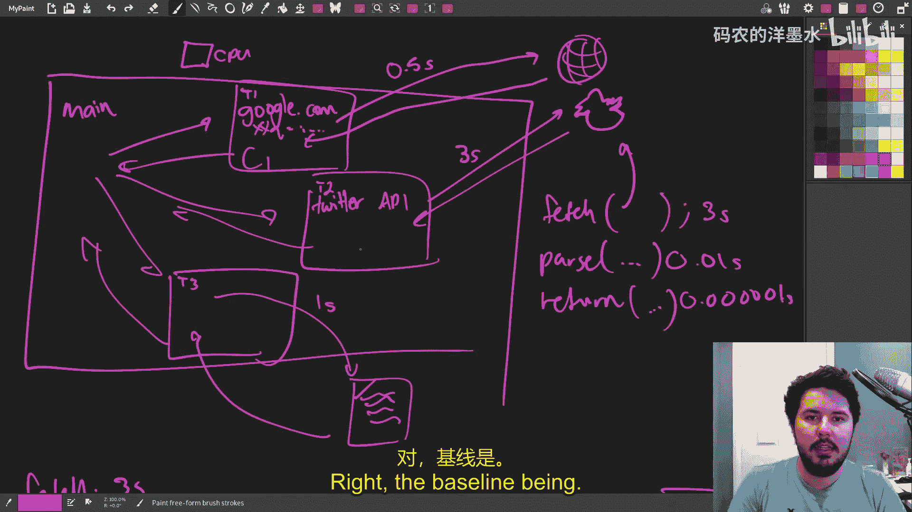


## 线程：并发的基本单元
上一节我们了解了为何需要并发。本节中我们来看看实现并发的基本单元：线程。

线程是程序中独立的执行路径。在Rust中，可以使用`std::thread::spawn`创建新线程。每个线程运行一个闭包中定义的代码。

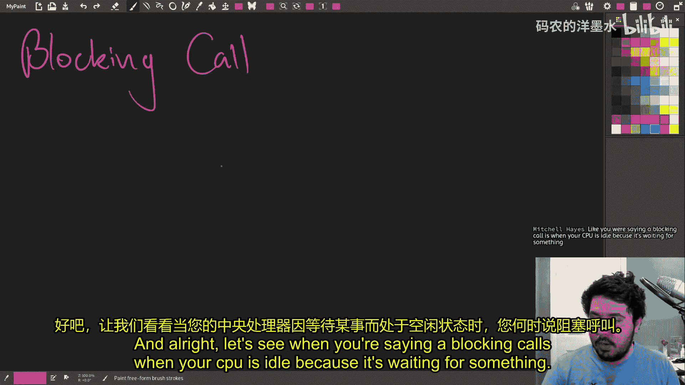


以下是使用线程处理阻塞操作的示例：
```rust
use std::thread;
use std::time::Duration;

fn main() {
    // 创建一个新线程来读取用户输入
    let handle = thread::spawn(|| {
        let mut input = String::new();
        std::io::stdin().read_line(&mut input).expect("Failed to read line");
        println!("Read line: {}", input.trim());
    });

    // 主线程继续执行，每秒打印一次
    for _ in 0..10 {
        println!("Hello there");
        thread::sleep(Duration::from_secs(1));
    }

    // 等待输入线程完成
    handle.join().unwrap();
}
```
通过创建新线程处理阻塞的`read_line`调用，主线程可以继续执行循环打印，实现了同时处理多个任务。

## 并发中的问题：数据竞争
上一节我们看到了如何使用线程实现并发。本节中我们来看看并发编程中一个经典且危险的问题：数据竞争。

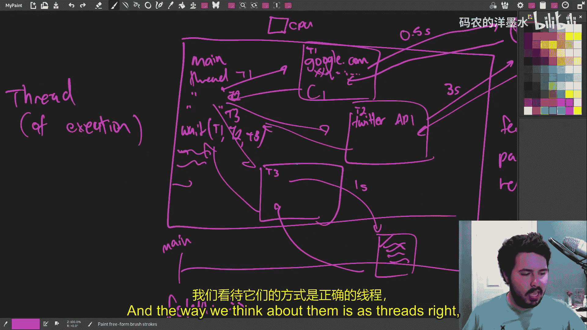


当多个线程同时访问同一数据，且至少有一个线程进行写入操作时，就可能发生数据竞争，导致未定义行为。以下是一个在C、Java等语言中典型的错误示例（概念上）：
```rust
// 注意：此Rust代码无法编译，旨在说明问题
static mut COUNTER: i32 = 0;

fn main() {
    let mut handles = vec![];
    for _ in 0..50 {
        let handle = thread::spawn(|| {
            for _ in 0..100000 {
                unsafe { COUNTER += 1; } // 多个线程同时修改，导致数据竞争
            }
        });
        handles.push(handle);
    }
    for handle in handles {
        handle.join().unwrap();
    }
    println!("Result: {}", unsafe { COUNTER }); // 结果通常远小于 5,000,000
}
```
在允许数据竞争的语言中，上述程序的最终计数往往远小于预期值（50 * 100,000 = 5,000,000），因为许多增加操作在并发执行时“丢失”了。

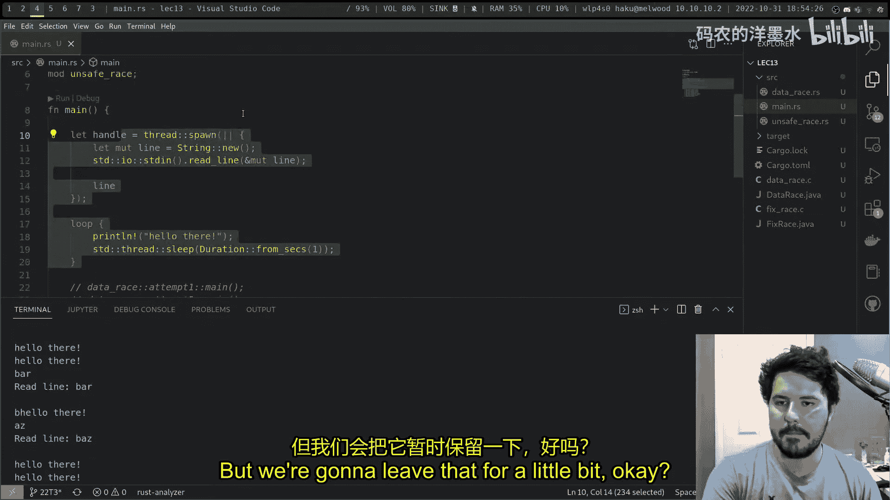


## Rust的编译时防护
上一节我们看到了数据竞争的危害。本节中我们来看看Rust如何利用所有权系统在编译时防止此类错误。

尝试在Rust中直接编写数据竞争代码会遇到编译器错误。Rust的所有权规则（特别是可变引用的独占性）天然阻止了多线程下对数据的非同步修改。

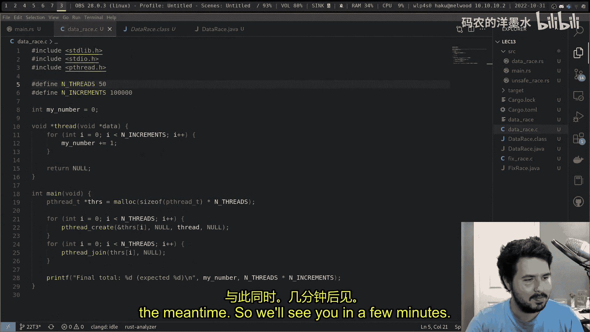

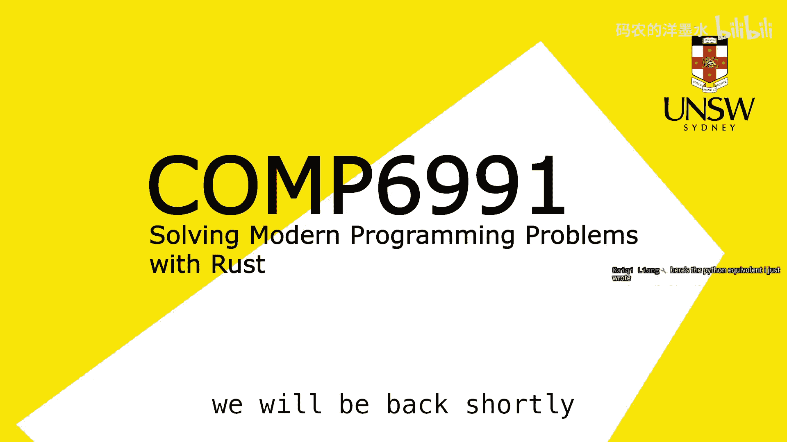

例如，尝试将可变引用传递给多个线程：
```rust
fn main() {
    let mut counter = 0;
    let mut handles = vec![];

    for _ in 0..10 {
        // 错误：不能多次可变借用 `counter`
        let handle = thread::spawn(|| {
            counter += 1;
        });
        handles.push(handle);
    }

    for handle in handles {
        handle.join().unwrap();
    }
    println!("Result: {}", counter);
}
```
编译器会报错：“cannot borrow `counter` as mutable more than once at a time”。这是因为`thread::spawn`要求闭包满足`'static`生命周期，并且其捕获的变量必须是`Send`的。一个局部变量的可变引用无法安全地满足这些要求，因此编译器拒绝此代码。

## Send 与 Sync 特质
上一节我们了解到Rust编译器阻止了不安全的共享。本节中我们来看看定义线程安全性的两个核心标记特质：`Send`和`Sync`。

它们是自动特质（auto traits），编译器会根据类型的构成自动判断是否实现。
*   **`Send`**：表示类型的所有权可以安全地跨线程传递（移动）。绝大多数类型是`Send`的。像`Rc<T>`这样的非原子引用计数类型就不是`Send`的，因为它不是线程安全的。
*   **`Sync`**：表示类型的引用（`&T`）可以安全地跨线程共享。如果一个类型`T`是`Sync`的，那么`&T`就是`Send`的。基本类型（如`i32`）、不可变类型以及像`Mutex<T>`这样的同步原语都是`Sync`的。而像`Cell<T>`和`RefCell<T>`这样的内部可变性类型（非线程安全版本）就不是`Sync`的。

`thread::spawn`要求闭包捕获的所有变量都是`Send + 'static`的。这确保了只有线程安全的数据才能被传递到新线程中。

## 使用互斥锁保护共享数据
上一节我们学习了`Send`和`Sync`特质。本节中我们来看看如何使用互斥锁来安全地实现多线程间的数据共享。

互斥锁（Mutex， Mutual Exclusion）确保一次只有一个线程可以访问受保护的数据。Rust标准库提供了`std::sync::Mutex`。其设计巧妙之处在于，数据被封装在`Mutex`内部，访问数据**必须**先通过`lock`方法获取锁。锁返回一个`MutexGuard`，它提供了对内部数据的访问，并在其离开作用域被`drop`时自动释放锁，避免了忘记解锁的问题。

以下是使用`Mutex`修正计数问题的示例：

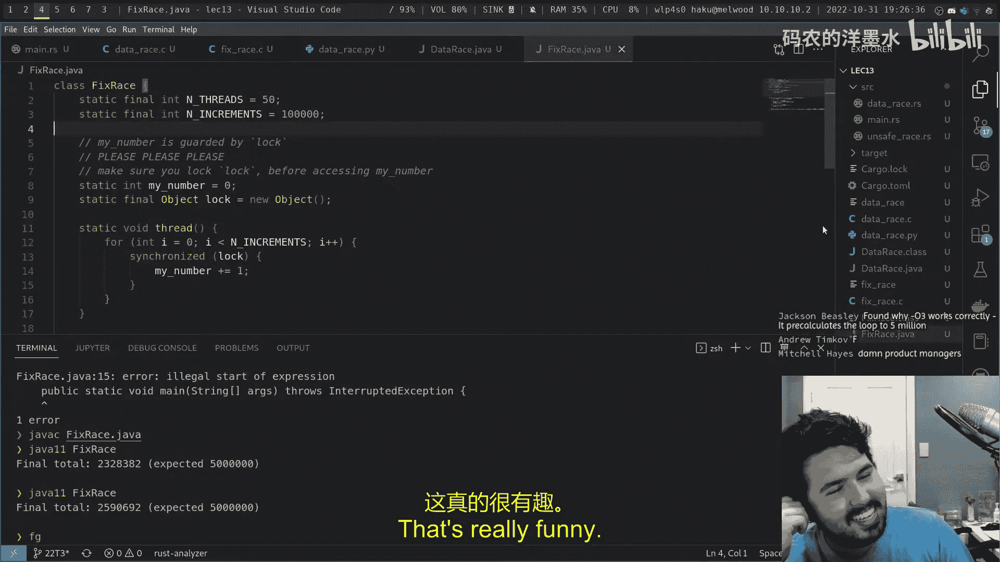

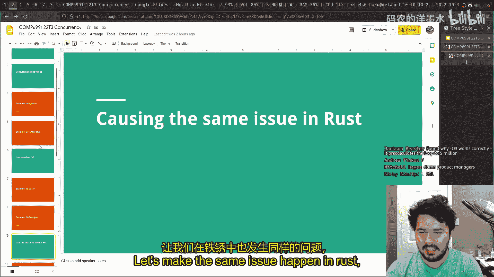

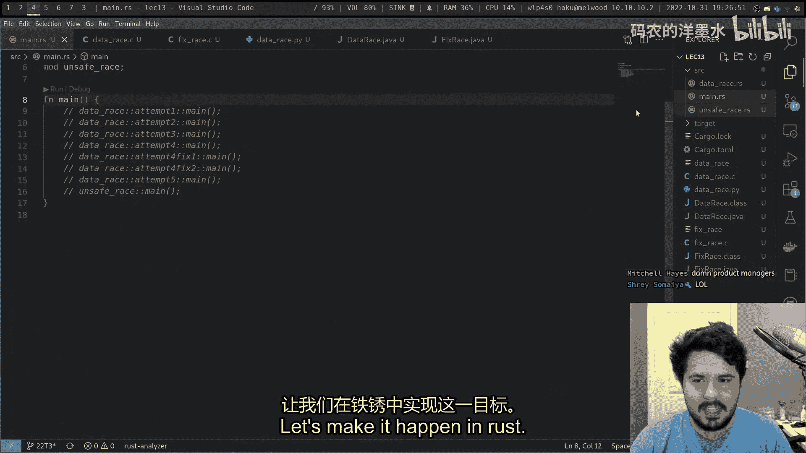

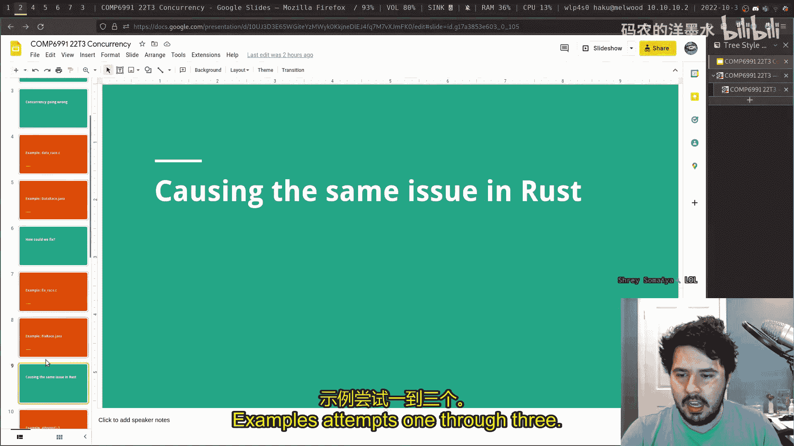

```rust
use std::sync::{Arc, Mutex};
use std::thread;
fn main() {
    let counter = Arc::new(Mutex::new(0));
    let mut handles = vec![];

    for _ in 0..50 {
        let counter = Arc::clone(&counter);
        let handle = thread::spawn(move || {
            for _ in 0..100000 {
                let mut num = counter.lock().unwrap();
                *num += 1;
            }
        });
        handles.push(handle);
    }

    for handle in handles {
        handle.join().unwrap();
    }

    println!("Result: {}", *counter.lock().unwrap()); // 正确输出 5,000,000
}
```
这里使用了`Arc`（原子引用计数）来在多线程间共享`Mutex`的所有权。`Arc`是`Rc`的线程安全版本，实现了`Send`和`Sync`。

## 更优雅的解决方案：作用域线程
上一节我们使用`Arc<Mutex<T>>`解决了问题。本节中我们来看看一种更简洁的模式：作用域线程。

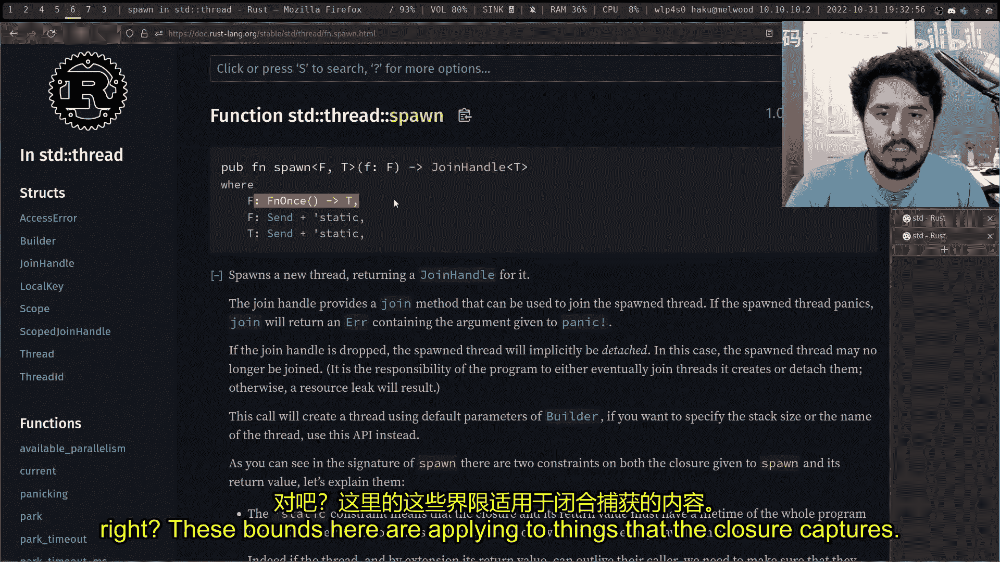

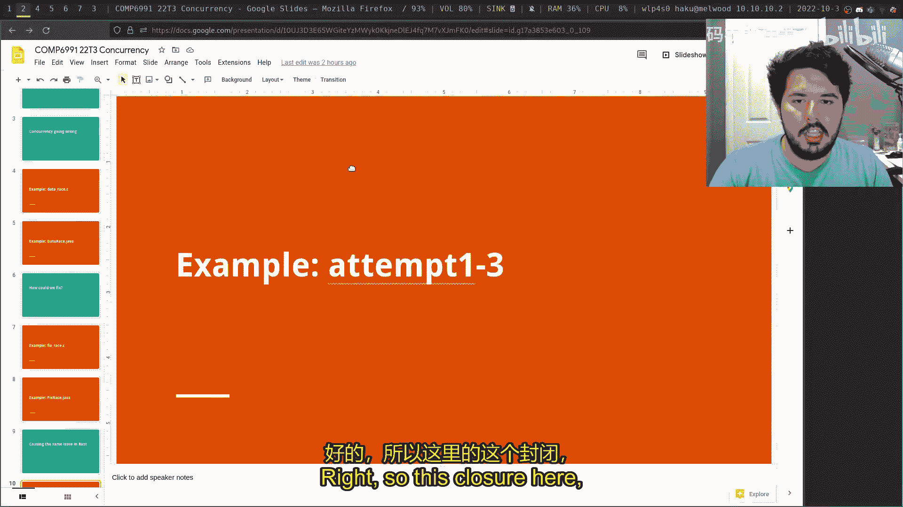

Rust标准库提供了`std::thread::scope`，它可以创建“作用域线程”。这些线程被限定在一个作用域内，编译器能保证所有线程都会在作用域结束前被汇合（join）。因此，作用域线程可以安全地借用外部作用域的非`'static`数据，而无需使用`Arc`。

使用作用域线程重写上面的例子：
```rust
use std::sync::Mutex;
use std::thread;

fn main() {
    let counter = Mutex::new(0);

    thread::scope(|s| {
        for _ in 0..50 {
            s.spawn(|| {
                for _ in 0..100000 {
                    let mut num = counter.lock().unwrap();
                    *num += 1;
                }
            });
        }
    }); // 所有在此作用域内生成的线程都会在这里被自动等待

    println!("Result: {}", *counter.lock().unwrap());
}
```
代码更加清晰，且无需担心所有权和引用计数。

## 高性能替代：原子类型
上一节我们介绍了互斥锁。本节中我们来看看另一种用于并发访问的、通常性能更高的工具：原子类型。

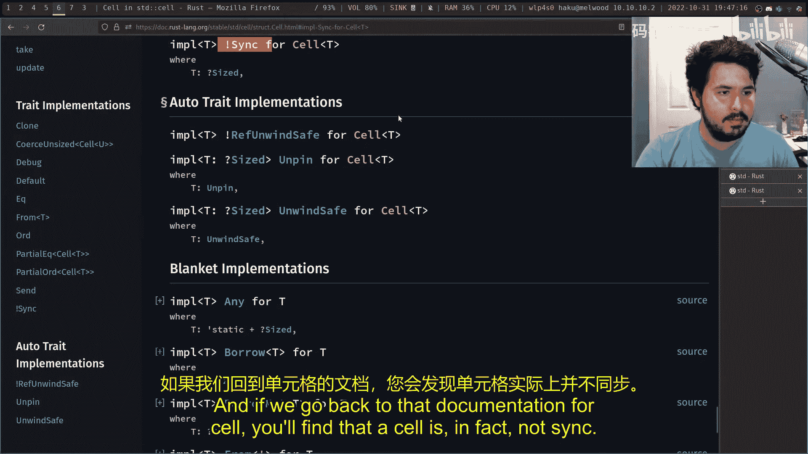

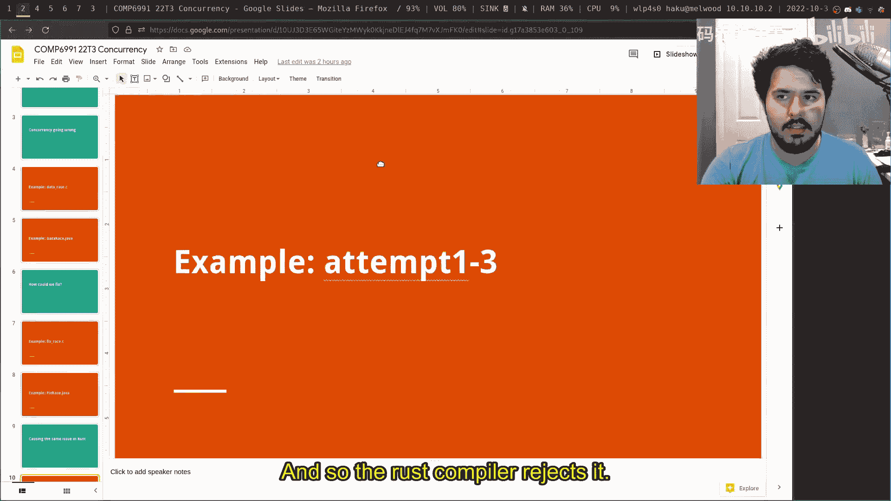

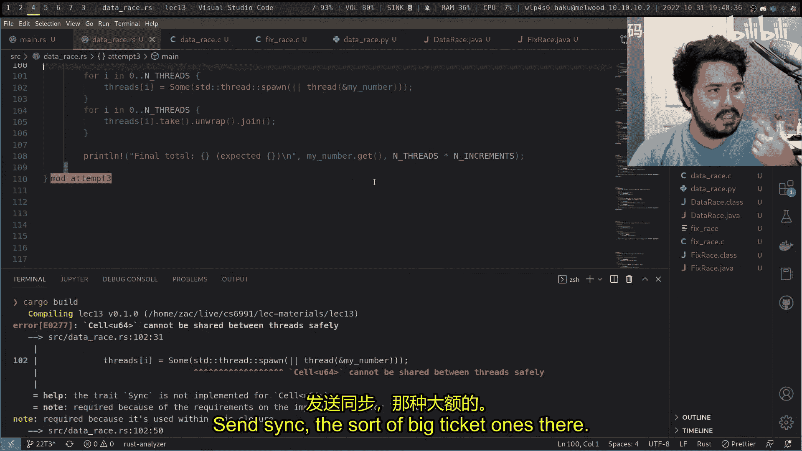


对于简单的整数类型，使用互斥锁可能开销较大。Rust在`std::sync::atomic`模块中提供了原子类型（如`AtomicUsize`、`AtomicBool`等）。原子类型通过特殊的CPU指令保证其操作的不可分割性，无需锁即可安全地进行并发读写。

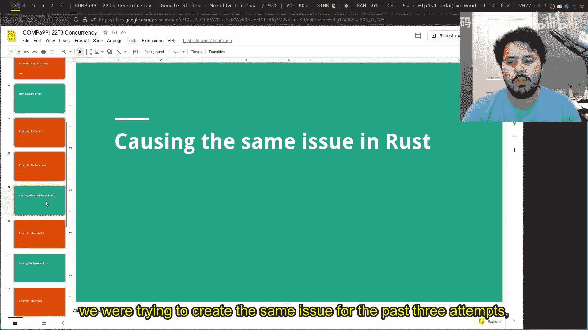

使用原子类型实现计数器：

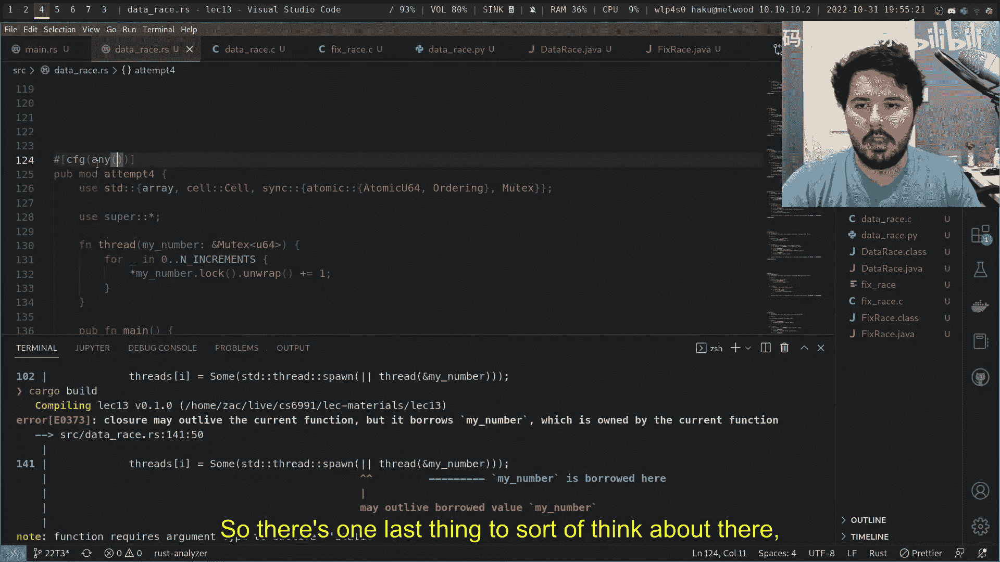

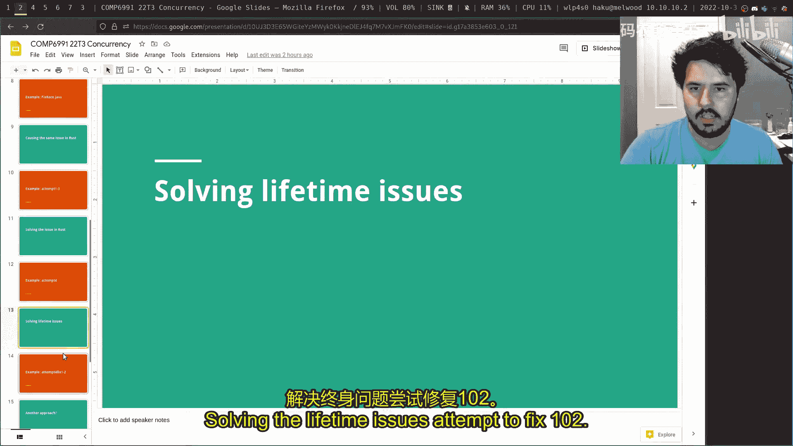

```rust
use std::sync::atomic::{AtomicUsize, Ordering};
use std::thread;

static COUNTER: AtomicUsize = AtomicUsize::new(0);
fn main() {
    let mut handles = vec![];

    for _ in 0..50 {
        let handle = thread::spawn(|| {
            for _ in 0..100000 {
                COUNTER.fetch_add(1, Ordering::SeqCst);
            }
        });
        handles.push(handle);
    }

    for handle in handles {
        handle.join().unwrap();
    }

    println!("Result: {}", COUNTER.load(Ordering::SeqCst)); // 正确输出 5,000,000
}
```
原子类型的操作（如`fetch_add`）通常比互斥锁快得多，适用于高性能场景。`Ordering`参数用于指定内存顺序，在大多数情况下使用`Ordering::SeqCst`（顺序一致性）是安全且简单的选择。

## 总结
本节课中我们一起学习了Rust并发编程的核心内容。

我们首先回顾了并发的基本概念及其价值。然后，我们探讨了使用线程实现并发的基本方法。接着，我们深入了解了并发编程中典型的数据竞争问题，并看到了Rust如何通过其严格的所有权和借用规则在编译时阻止此类错误。我们学习了`Send`和`Sync`这两个关键的标记特质，它们定义了类型的线程安全属性。

为了安全地共享数据，我们介绍了互斥锁（`Mutex`）的使用，它通过将数据与锁绑定，强制要求先加锁后访问，并利用RAII机制自动释放锁。我们还了解了使用`Arc`进行多线程所有权共享的模式。随后，我们看到了更简洁的“作用域线程”（`thread::scope`）模式，它允许安全地借用外部数据。最后，我们介绍了高性能的原子类型作为简单数据并发操作的替代方案。

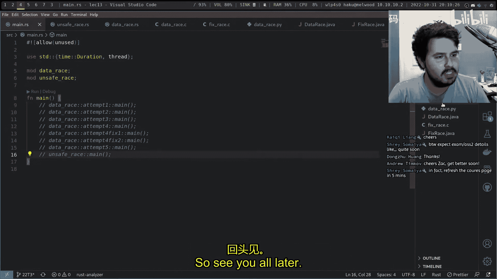

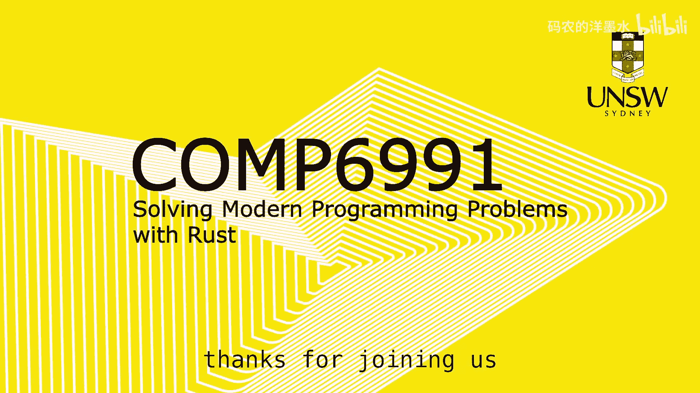

Rust的“无畏并发”理念在于，它通过强大的类型系统，将许多常见的并发错误（如数据竞争、死锁的一部分）转变为编译时错误，使得开发者能够以更高的信心编写并发代码。