# 014：并发编程进阶 🚀

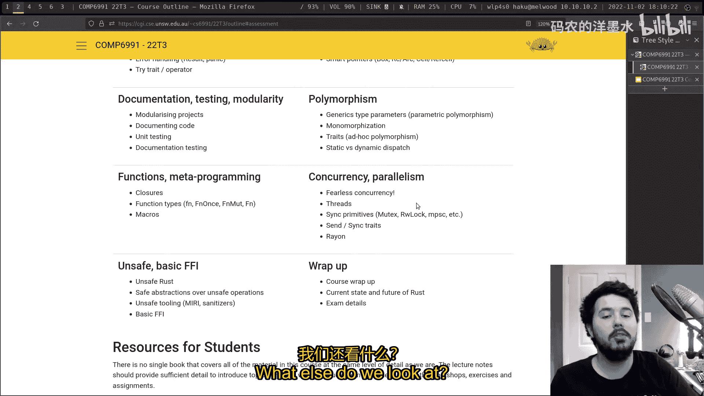

在本节课中，我们将继续深入学习Rust的并发编程。我们将探讨移动闭包、读写锁与锁中毒、通道以及Send/Sync特质等核心概念，并介绍强大的并行计算库Rayon。这些知识将帮助你更安全、高效地编写并发程序。

---

## 移动闭包

上一节我们介绍了线程和作用域线程。本节中，我们来看看一个在并发编程中非常实用的工具：移动闭包。

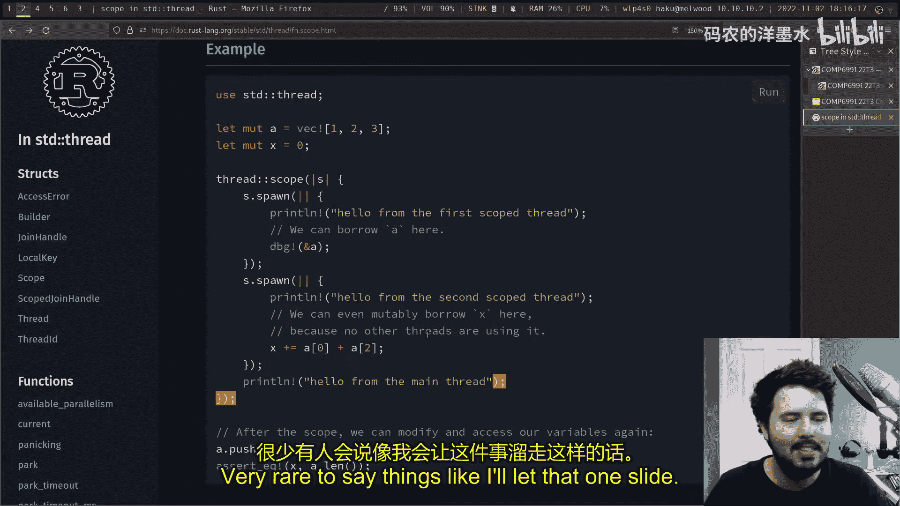

在Rust中，闭包默认会通过引用来捕获其环境中的变量。然而，当我们将闭包传递给新线程时，通常需要将变量的所有权也转移到新线程中，以确保其生命周期足够长。这时，就需要使用`move`关键字来创建移动闭包。

以下是一个常见场景的示例。我们尝试在一个新线程中打印一个字符串：

```rust
let my_string = "hello".to_string();
std::thread::spawn(|| {
    println!("{}", my_string);
}).join().unwrap();
```


这段代码无法编译。编译器会提示闭包可能比当前函数存活得更久，但它借用了`my_string`，而`my_string`由当前函数所有。

问题在于，闭包默认尝试通过引用来捕获`my_string`。对于`std::thread::spawn`，它要求闭包不借用任何外部数据，因为无法保证外部数据的生命周期。解决方案是使用移动闭包，强制将`my_string`的所有权移入闭包：

```rust
let my_string = "hello".to_string();
std::thread::spawn(move || {
    println!("{}", my_string);
}).join().unwrap();
```

添加`move`关键字后，代码成功编译。`my_string`的所有权被移入闭包对象，线程可以安全地使用它。

**核心概念**：`move`关键字改变了闭包的捕获方式。它强制闭包通过值（即移动所有权）来捕获环境中的变量，而不是默认的引用捕获。这对于需要将数据所有权转移到新线程的场景至关重要。

---

## 读写锁与锁中毒

在学习了互斥锁之后，我们来看看一个更灵活的同步原语：读写锁，并了解一个与之相关的概念——锁中毒。

### 读写锁

`std::sync::RwLock`（读写锁）允许多个读取者同时访问数据，但最多只允许一个写入者。这与互斥锁（`Mutex`）形成对比，互斥锁在任何时候都只允许一个线程访问（无论是读还是写）。

读写锁的API提供了两种获取锁的方式：
*   `read()`: 获取一个读锁，返回`RwLockReadGuard`。你可以通过它获得数据的共享（不可变）引用。
*   `write()`: 获取一个写锁，返回`RwLockWriteGuard`。你可以通过它获得数据的独占（可变）引用。

当你的数据结构读多写少时，使用读写锁可以显著提高并发性能。

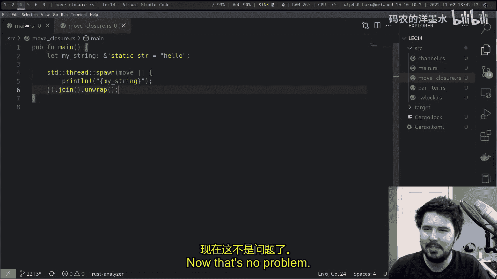


**潜在风险**：读写锁可能导致一种特殊的死锁。例如，如果一个线程已经持有一个读锁，然后尝试再次获取读锁，而此时恰好有另一个线程在等待获取写锁，某些锁的实现策略可能会导致所有线程都无法前进。在设计代码时，应尽量避免在持有锁的情况下再次尝试获取同一把锁。

### 锁中毒

标准库中的`Mutex`和`RwLock`都有一个特性叫做“中毒”。如果一个线程在持有锁时发生恐慌（panic），那么这个锁就会被标记为“中毒”。

此后，当其他线程尝试获取这个锁时，`lock()`、`read()`或`write()`方法将返回一个`Result`，其中包含`PoisonError`，而不是直接返回守卫。这是为了通知其他线程：之前持有锁的线程发生了异常，被保护的数据可能处于不一致的状态。


在许多应用程序代码中，如果发生恐慌，通常希望整个程序终止，因此可能不关心中毒处理。你可以简单地使用`.unwrap()`或`.expect()`来忽略中毒错误。但库的作者可以利用这个机制来实现更健壮的错误恢复。

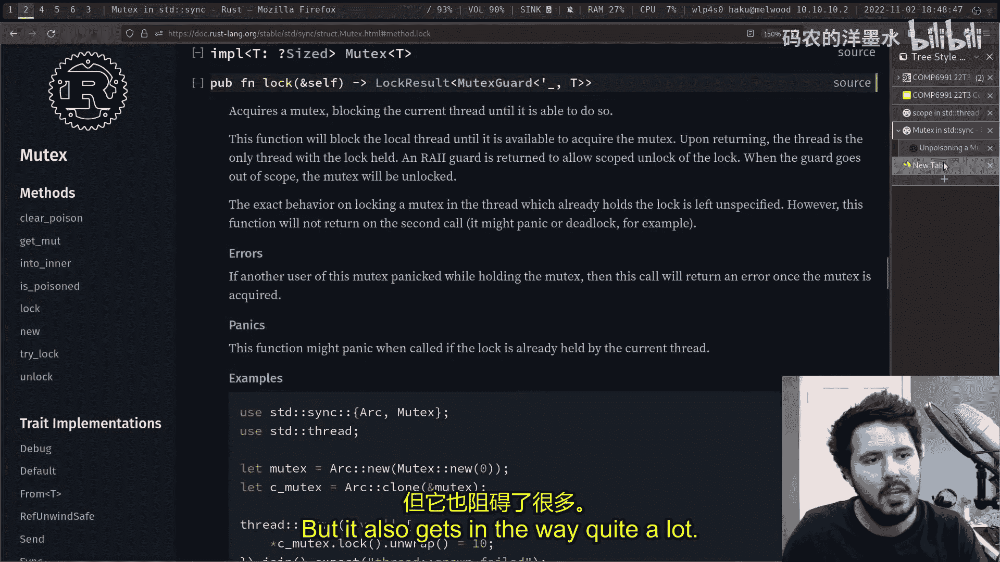


**注意**：一些第三方库（如`parking_lot`）提供的互斥锁和读写锁默认没有中毒机制，API更简洁，但在某些特殊平台或场景下，标准库的实现可能更保守、兼容性更好。

---

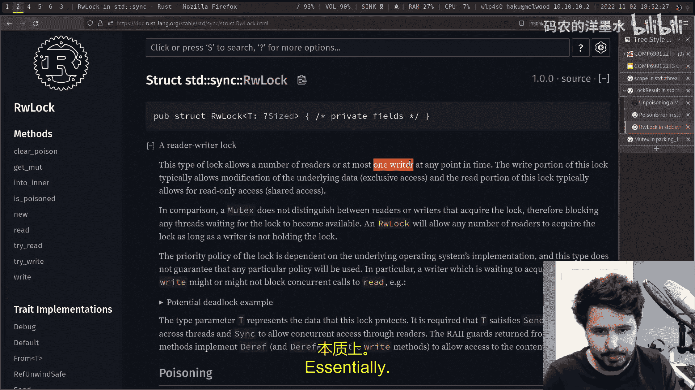

## 通道

线程间共享数据的另一种强大模式是消息传递，而通道是实现这一模式的核心工具。


### 多生产者，单消费者通道

Rust标准库在`std::sync::mpsc`模块中提供了通道实现。`mpsc`代表“多生产者，单消费者”。你可以创建多个发送端，但只能有一个接收端。

创建一个通道会返回一个元组：`(Sender<T>, Receiver<T>)`。

```rust
use std::sync::mpsc;

let (tx, rx) = mpsc::channel(); // 创建一个可以发送i32的通道
```

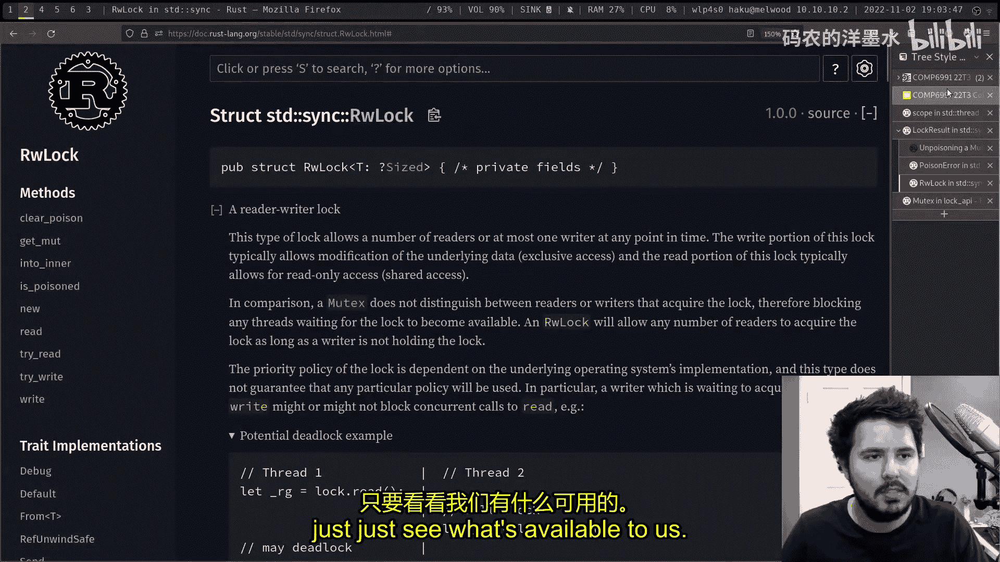

**发送端**：`Sender`可以克隆，因此可以分发给多个线程。每个线程都可以调用`send(value)`方法向通道发送消息。如果接收端已销毁，`send`会返回错误。


**接收端**：`Receiver`调用`recv()`方法会阻塞当前线程，直到从通道中接收到一个消息。如果所有发送端都关闭了，`recv()`会返回错误。

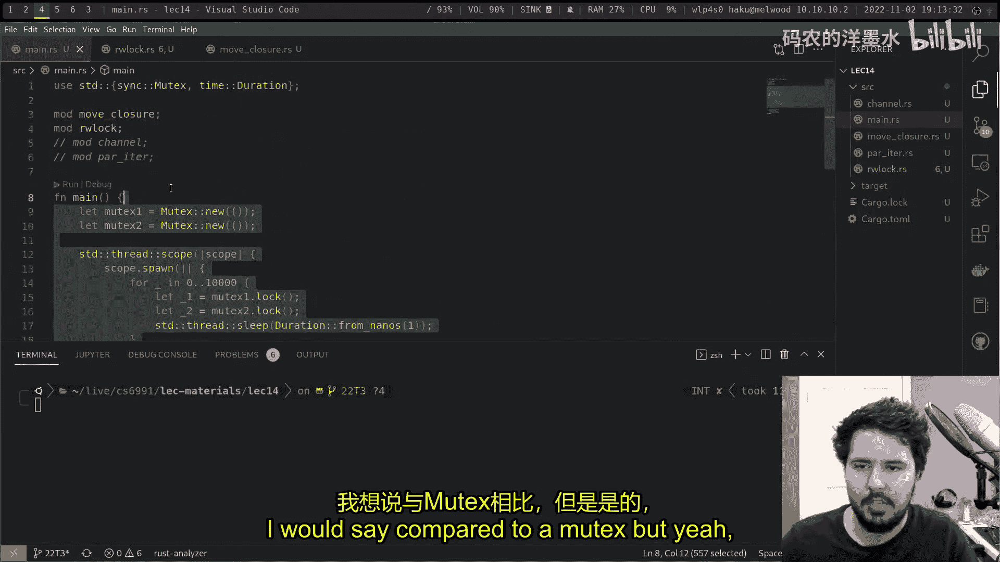


以下是一个简单示例：

```rust
use std::sync::mpsc;
use std::thread;

let (tx, rx) = mpsc::channel();

// 克隆发送端以供线程使用
let tx1 = tx.clone();
thread::spawn(move || {
    thread::sleep(std::time::Duration::from_secs(1));
    tx1.send("Hello from thread 1").unwrap();
});

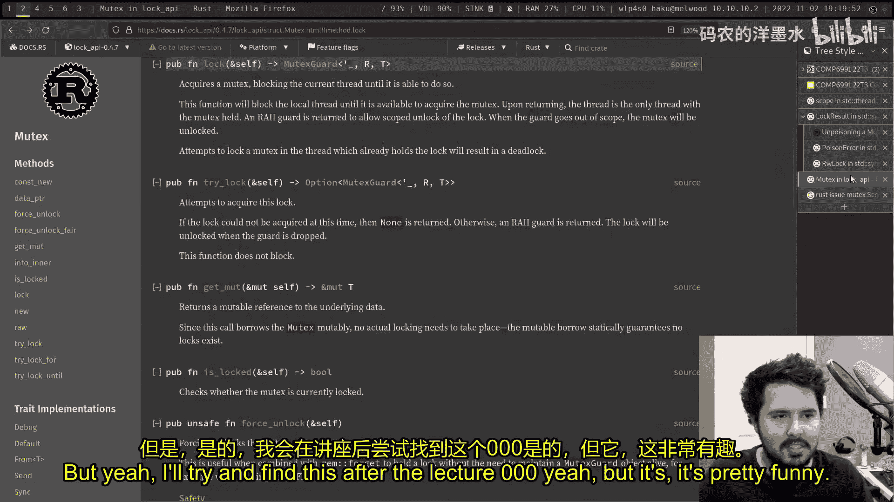

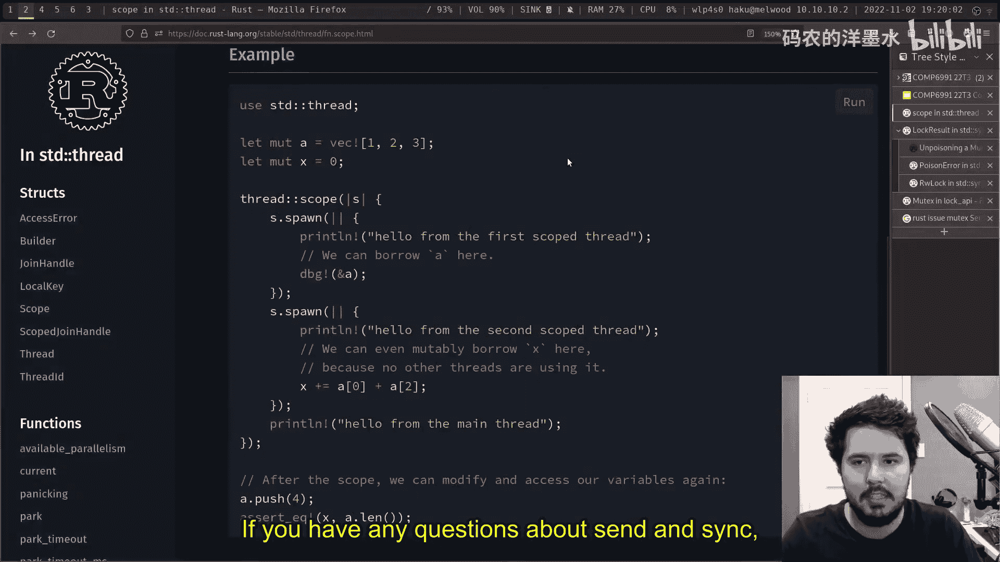


thread::spawn(move || {
    thread::sleep(std::time::Duration::from_secs(2));
    tx.send("Hello from thread 2").unwrap();
});

// 主线程接收消息
println!("{}", rx.recv().unwrap()); // 来自线程1
println!("{}", rx.recv().unwrap()); // 来自线程2
```

**有界通道**：`mpsc::sync_channel(n)`可以创建有界通道，其内部缓冲区大小为`n`。当缓冲区满时，`send`操作会阻塞，直到有空间为止。这可以防止生产者生产速度远快于消费者处理速度而导致内存无限增长。将`n`设为0会创建一个“交会通道”，发送和接收操作必须同步发生。

**多消费者通道**：标准库只提供单消费者通道。如果需要多消费者，可以使用第三方库，如`crossbeam`，它提供了`crossbeam::channel`，其接收端也是可克隆的。

通道是实现线程间通信、解耦生产者和消费者的优雅方式，在构建如聊天服务器等系统时非常有用。

---

## Send与Sync特质深入

我们之前介绍了`Send`和`Sync`这两个标记特质。现在我们来更深入地理解它们，特别是为什么某些类型不实现它们，以及标准库中的同步原语如何依赖它们。

*   **`Send`**: 表示类型的所有权可以安全地跨线程传递。
*   **`Sync`**: 表示类型的不可变引用可以安全地跨线程共享。

编译器会根据类型的内部结构自动推导这些特质。例如，包含`Mutex`的类型通常是`Send`和`Sync`的，因为`Mutex`内部提供了必要的同步机制。

**为什么某些类型不是`Send`/`Sync`？**
考虑一个包含原始指针的类型。如果它被标记为`Send`，那么将其移动到另一个线程可能会导致数据竞争，因为原始指针没有Rust所有权系统的保护。因此，包含原始指针的类型通常不会自动实现`Send`。

**标准库同步原语的约束**
查看`Mutex<T>`的文档，你会发现它的`Send`和`Sync`实现是有条件的：
*   `Mutex<T>`是`Send`的，当且仅当`T`是`Send`的。
*   `Mutex<T>`是`Sync`的，当且仅当`T`是`Send`的。

为什么需要这个约束？假设`Mutex<T>`无条件地是`Send`，即使`T`不是`Send`。那么，我们可以通过以下步骤破坏安全性：
1.  在主线程创建`Mutex<NotSendType>`。
2.  将互斥锁的引用传递给另一个线程。
3.  在另一个线程中锁定互斥锁，获得一个`&mut NotSendType`。
4.  在同一线程中创建一个本地的`NotSendType`，并获得其`&mut`引用。
5.  使用`std::mem::swap`交换主线程和本线程的`NotSendType`值。

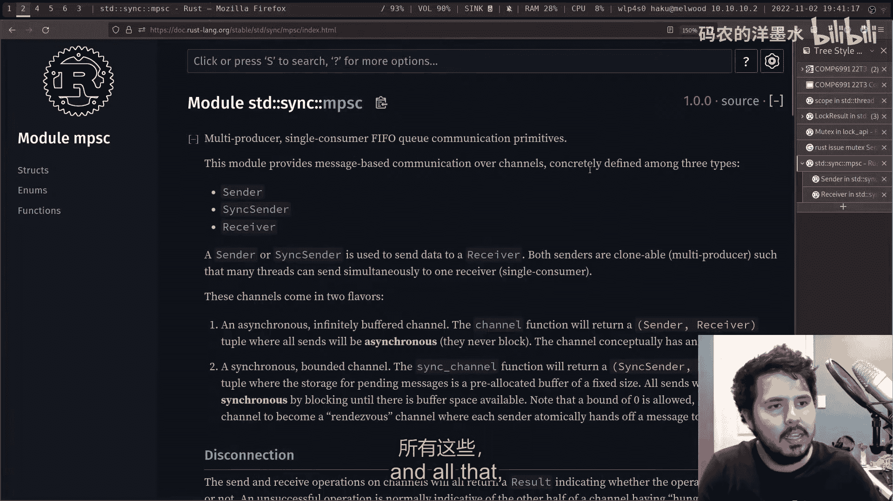


这样，我们就成功地将一个非`Send`类型的值“发送”到了另一个线程，绕过了Rust的类型安全保证。因此，`Mutex<T>`必须要求内部的`T`是`Send`的，才能保证整个`Mutex`是`Send`和`Sync`的。

这个设计体现了Rust“安全抽象”的理念：即使底层使用了不安全代码，公开的API也必须通过类型系统保证安全。

---

## Rayon：优雅的并行计算 ✨


最后，我们来看一个能极大简化并行编程的库：Rayon。Rayon是一个数据并行库，可以轻松地将顺序计算转换为并行计算。


Rust的标准迭代器是顺序执行的。Rayon提供了几乎完全相同的API，但它是并行的。你只需要将普通的`.iter()`或`.into_iter()`替换为`.par_iter()`或`.into_par_iter()`，Rayon就会自动利用所有可用的CPU核心来并行处理数据。

**示例：并行求和**

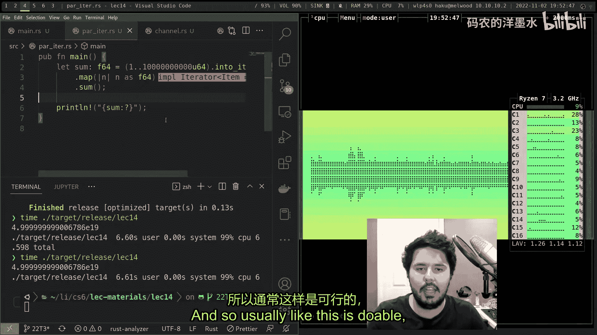


```rust
use rayon::prelude::*; // 引入必要的特质

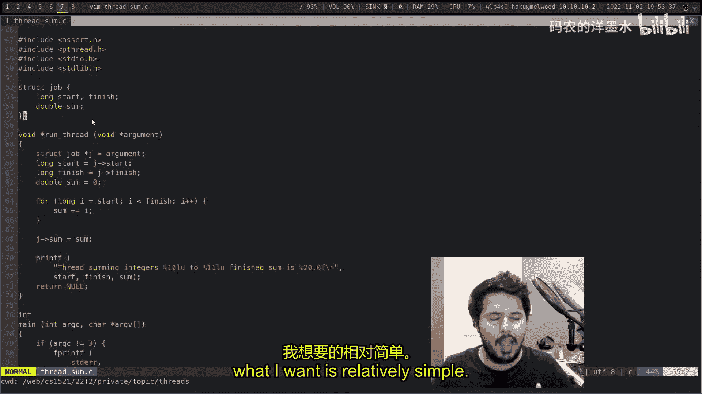


fn main() {
    let sum: f64 = (1..=10_000_000_000u64) // 100亿个数
        .into_par_iter() // 改为并行迭代器
        .map(|x| x as f64) // 并行映射
        .sum(); // 并行求和

    println!("Sum: {}", sum);
}
```

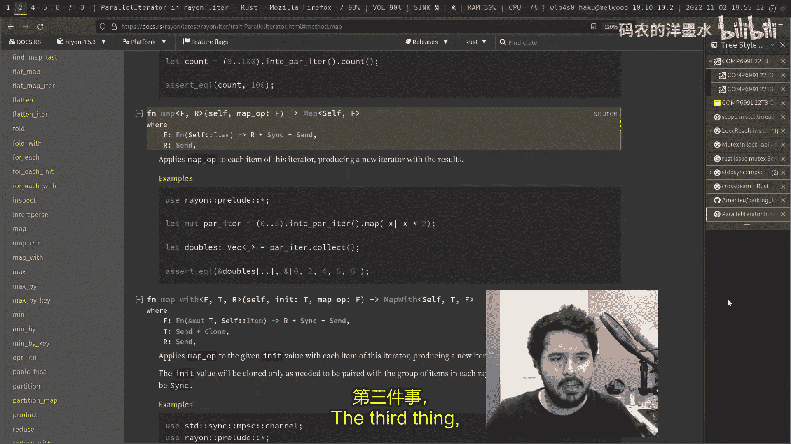

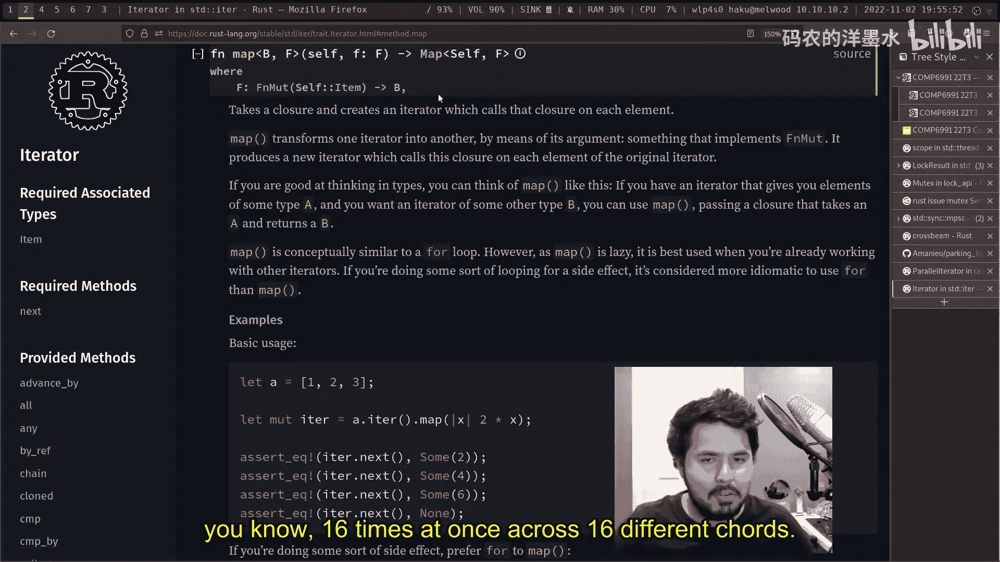

仅仅将`into_iter()`改为`into_par_iter()`，程序就从单核顺序执行变成了多核并行执行，速度得到极大提升。Rayon在背后自动处理了工作窃取、任务分割等复杂细节。

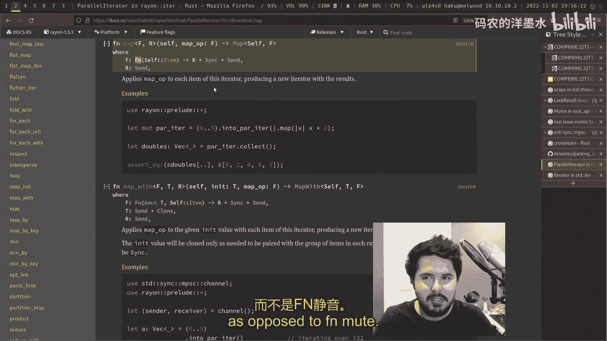

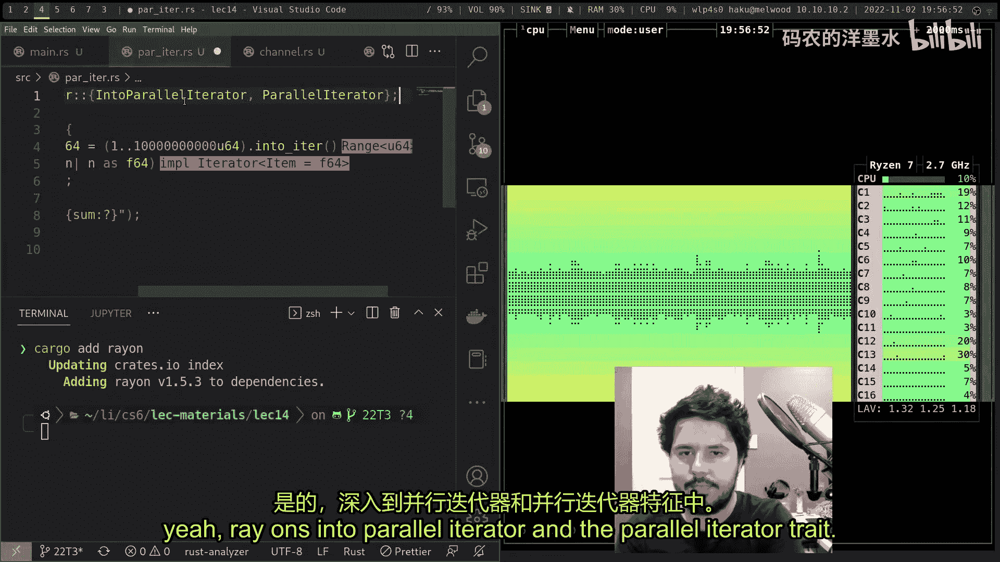

**安全性**：Rayon的并行迭代器方法（如`map`）要求传入的闭包是`Fn`，而不是`FnMut`。因为`Fn`闭包可以被多次同时调用而不会产生冲突，这由Rust的类型系统保证，从而确保了并行操作的安全性。

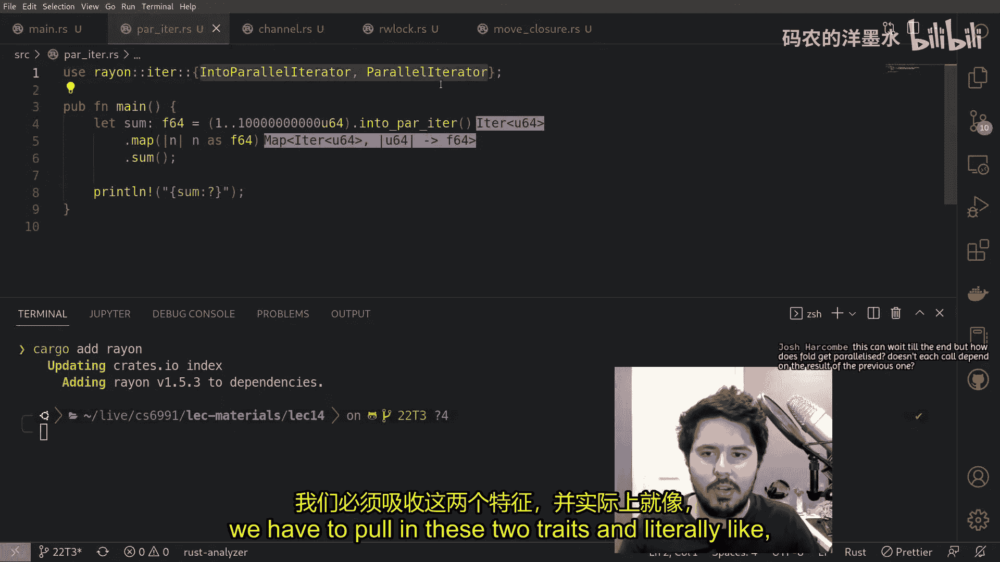

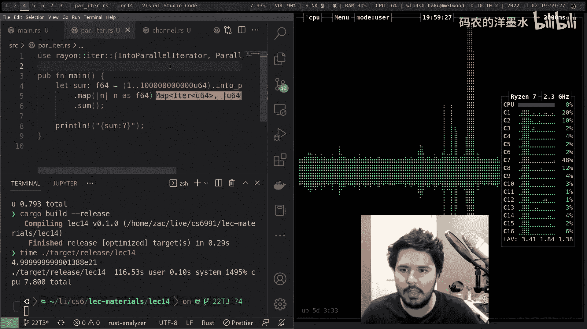

Rayon的存在充分展示了Rust语言和类型系统的强大：它允许在库的层面实现如此高级、安全且易用的并行抽象。


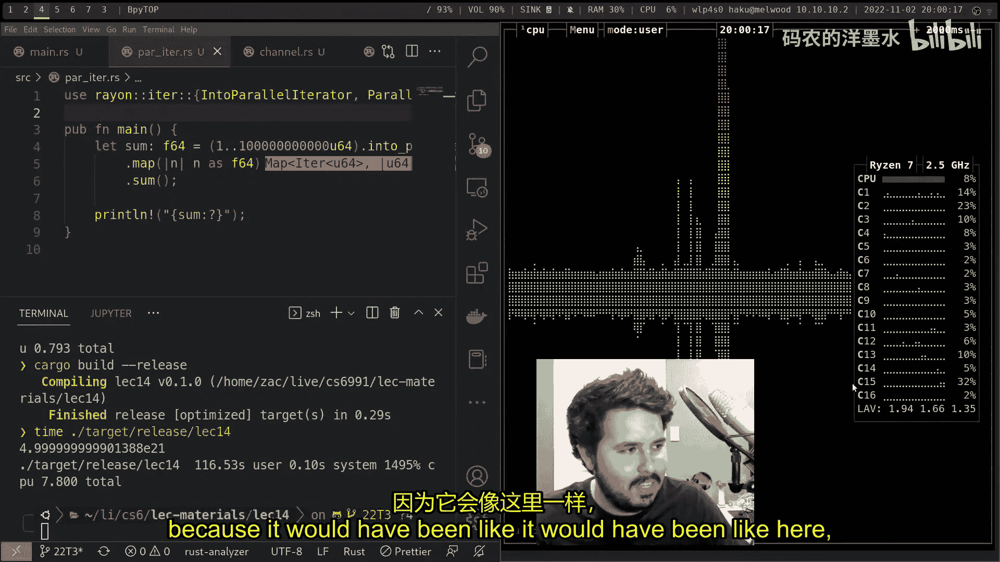


---


## 总结

本节课中我们一起学习了Rust并发编程的几个高级主题：
1.  **移动闭包**：使用`move`关键字将变量所有权移入闭包，以满足线程生命周期的要求。
2.  **读写锁与中毒**：`RwLock`提供了更灵活的并发读取控制；标准库的锁在持有线程panic时会“中毒”，以警示数据可能不一致。
3.  **通道**：`mpsc`通道实现了多生产者-单消费者的消息传递模式，是线程间通信的利器。
4.  **Send与Sync**：深入理解了这些自动特质的意义，以及同步原语如何依赖它们来构建安全抽象。
5.  **Rayon**：通过近乎零成本的API改变，将顺序迭代计算自动并行化，极大地提升了计算密集型任务的性能。

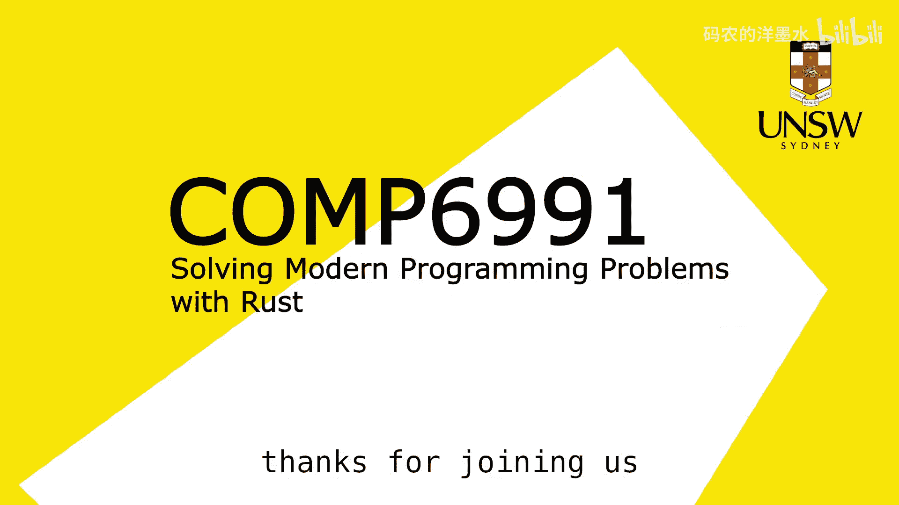

掌握这些工具和概念，你将能够更自如地应对各种并发编程场景，编写出既安全又高效的Rust程序。