# 020：Rustlings编程练习

## 概述

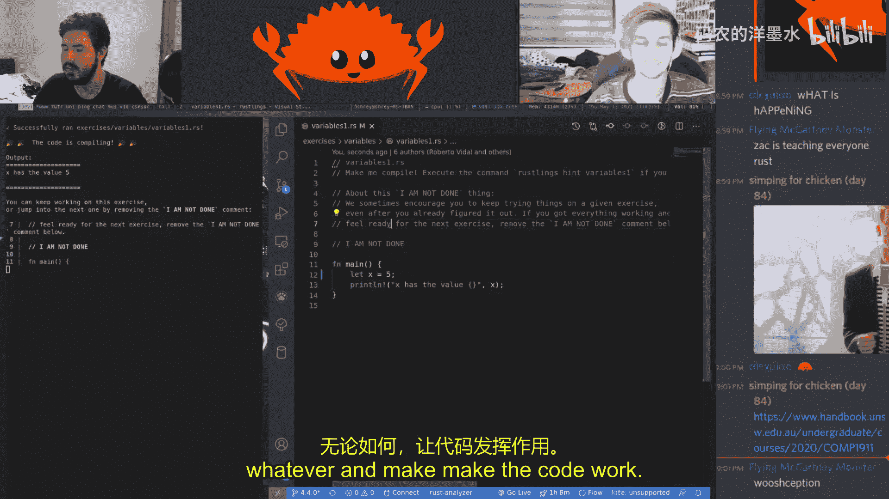

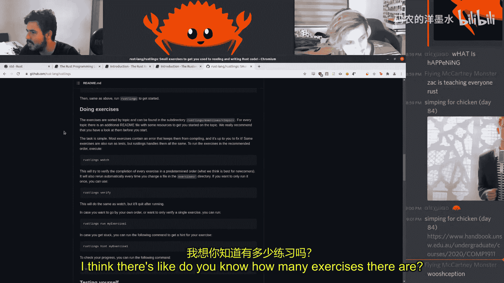

在本节课中，我们将通过一系列名为“Rustlings”的编程练习来学习Rust语言的核心概念。这些练习涵盖了从变量、函数到所有权、错误处理等各个方面。我们将跟随一个实际的编码过程，逐步解决每个练习，并深入理解背后的Rust原理。

---

## 变量与可变性

在Rust中，变量默认是不可变的。这意味着一旦给变量赋值，就不能再改变它的值。要创建一个可变的变量，需要使用 `mut` 关键字。

### 练习：variables1

以下是第一个练习，要求我们修复代码使其能够编译。

```rust
// 修复此代码，使其能够编译
fn main() {
    let x = 5;
    println!("x 的值为：{}", x);
    x = 6; // 这行会导致编译错误
    println!("x 的值为：{}", x);
}
```

**解决方案**： 要使 `x` 可变，需要在声明时加上 `mut` 关键字。

```rust
fn main() {
    let mut x = 5; // 添加 mut 关键字
    println!("x 的值为：{}", x);
    x = 6; // 现在可以重新赋值
    println!("x 的值为：{}", x);
}
```

### 练习：variables2

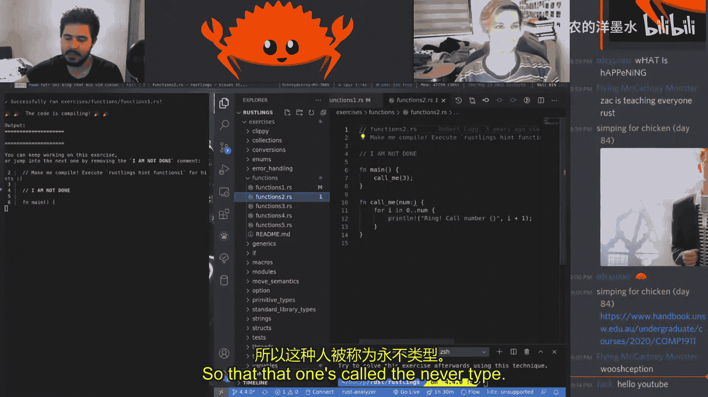

有时，我们可能希望在不初始化变量的情况下声明它，然后在后面再赋值。但Rust要求变量在使用前必须初始化。

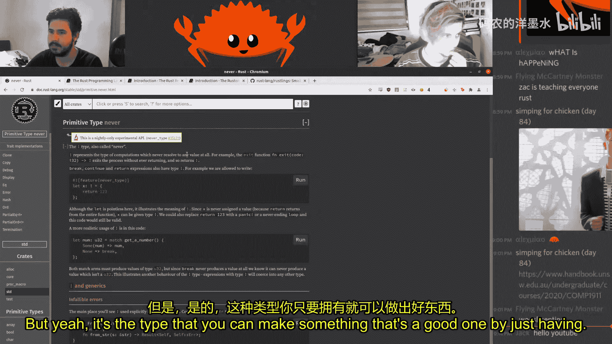

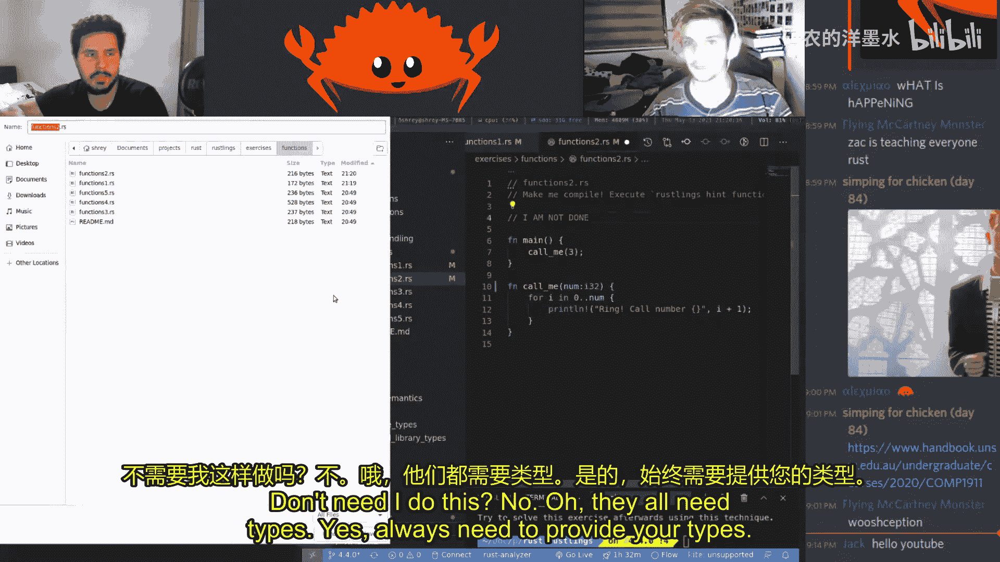

```rust
// 修复此代码，使其能够编译
fn main() {
    let x;
    println!("x 的值为：{}", x); // 错误：使用了未初始化的变量
}
```

**解决方案**： 在使用变量之前，确保它已经被初始化。

```rust
fn main() {
    let x;
    x = 5; // 初始化变量
    println!("x 的值为：{}", x);
}
```

### 练习：variables3

Rust允许变量遮蔽（shadowing），这意味着可以重新声明一个同名变量，新的变量会覆盖旧的变量。

```rust
// 修复此代码，使其能够编译
fn main() {
    let x = 5;
    let x = x + 1; // 变量遮蔽
    println!("x 的值为：{}", x);
}
```

**解决方案**： 变量遮蔽是允许的，但需要注意作用域。

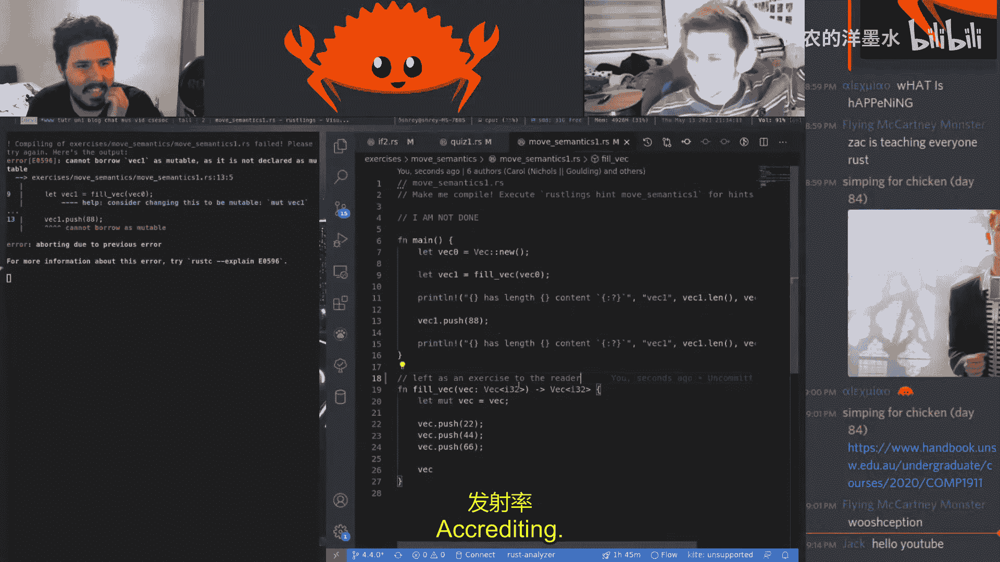

```rust
fn main() {
    let x = 5;
    let x = x + 1; // 正确：变量遮蔽
    println!("x 的值为：{}", x);
}
```

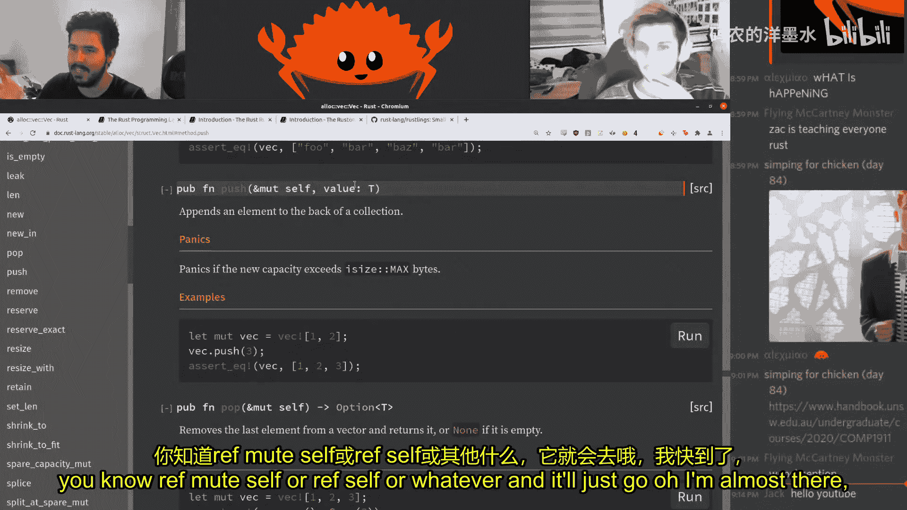

---

## 函数与参数

在Rust中，函数参数必须显式指定类型。函数体中的最后一个表达式会自动作为返回值，除非使用 `return` 关键字。

### 练习：functions1

以下练习要求我们修复一个函数，使其能够编译。

```rust
// 修复此函数，使其能够编译
fn main() {
    call_me();
}

fn call_me() {
    println!("调用了 call_me 函数");
}
```

**解决方案**： 函数定义正确，无需修改。

```rust
fn main() {
    call_me();
}

fn call_me() {
    println!("调用了 call_me 函数");
}
```

### 练习：functions2

函数参数必须指定类型。

```rust
// 修复此函数，使其能够编译
fn main() {
    call_me(3);
}

fn call_me(num: i32) { // 添加参数类型
    println!("数字为：{}", num);
}
```

**解决方案**： 在函数参数中指定类型。

```rust
fn main() {
    call_me(3);
}

fn call_me(num: i32) {
    println!("数字为：{}", num);
}
```

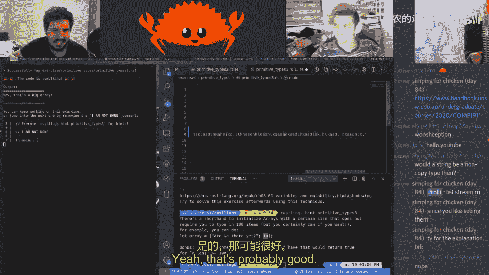

### 练习：functions3

函数体中的最后一个表达式会自动作为返回值。

```rust
// 修复此函数，使其能够编译
fn main() {
    let answer = square(3);
    println!("平方值为：{}", answer);
}

fn square(num: i32) -> i32 {
    num * num // 最后一个表达式作为返回值
}
```

**解决方案**： 确保函数体中的最后一个表达式是返回值。

```rust
fn main() {
    let answer = square(3);
    println!("平方值为：{}", answer);
}

fn square(num: i32) -> i32 {
    num * num // 正确：最后一个表达式作为返回值
}
```

---

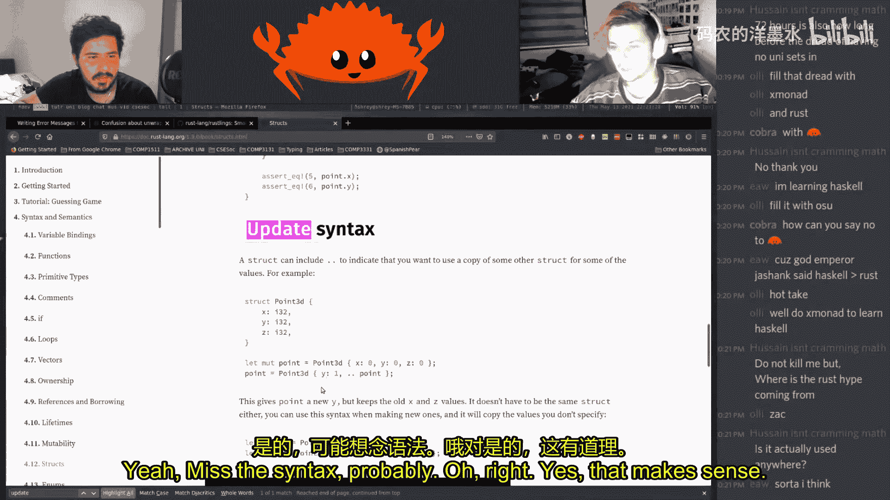

## 所有权与移动语义

所有权是Rust的核心特性之一。它确保内存安全，防止数据竞争。当值被移动时，原来的变量将无法再使用。

### 练习：move_semantics1

以下练习演示了移动语义。

```rust
// 修复此代码，使其能够编译
fn main() {
    let vec0 = Vec::new();
    let vec1 = fill_vec(vec0);
    println!("vec1 的长度为：{}", vec1.len());
}

fn fill_vec(vec: Vec<i32>) -> Vec<i32> {
    let mut vec = vec;
    vec.push(88);
    vec
}
```

**解决方案**： 移动语义导致 `vec0` 无法再使用，但 `fill_vec` 函数返回了新的向量。

```rust
fn main() {
    let vec0 = Vec::new();
    let vec1 = fill_vec(vec0);
    println!("vec1 的长度为：{}", vec1.len());
}

fn fill_vec(vec: Vec<i32>) -> Vec<i32> {
    let mut vec = vec;
    vec.push(88);
    vec
}
```

### 练习：move_semantics2

有时，我们可能希望在不移动所有权的情况下修改数据。这时可以使用引用。

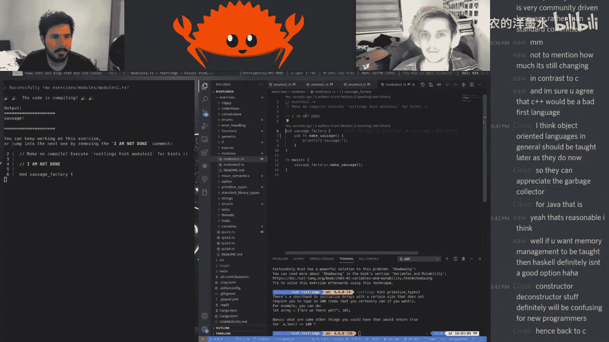

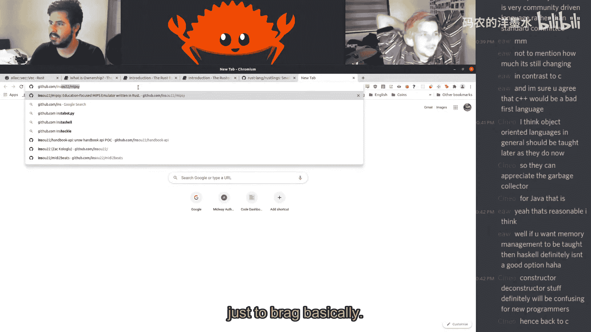

```rust
// 修复此代码，使其能够编译
fn main() {
    let mut vec0 = Vec::new();
    fill_vec(&mut vec0); // 传递可变引用
    println!("vec0 的长度为：{}", vec0.len());
}

fn fill_vec(vec: &mut Vec<i32>) {
    vec.push(88);
}
```

**解决方案**： 通过传递可变引用，可以在不移动所有权的情况下修改数据。

```rust
fn main() {
    let mut vec0 = Vec::new();
    fill_vec(&mut vec0);
    println!("vec0 的长度为：{}", vec0.len());
}

fn fill_vec(vec: &mut Vec<i32>) {
    vec.push(88);
}
```

---

## 错误处理

Rust使用 `Result` 和 `Option` 类型来处理错误和可选值。`Result` 表示操作可能成功或失败，而 `Option` 表示值可能存在或不存在。

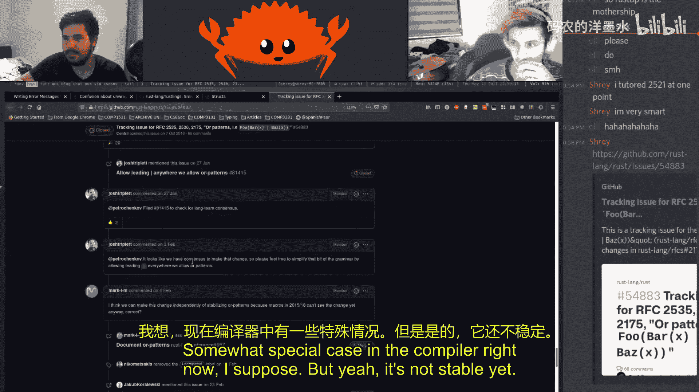

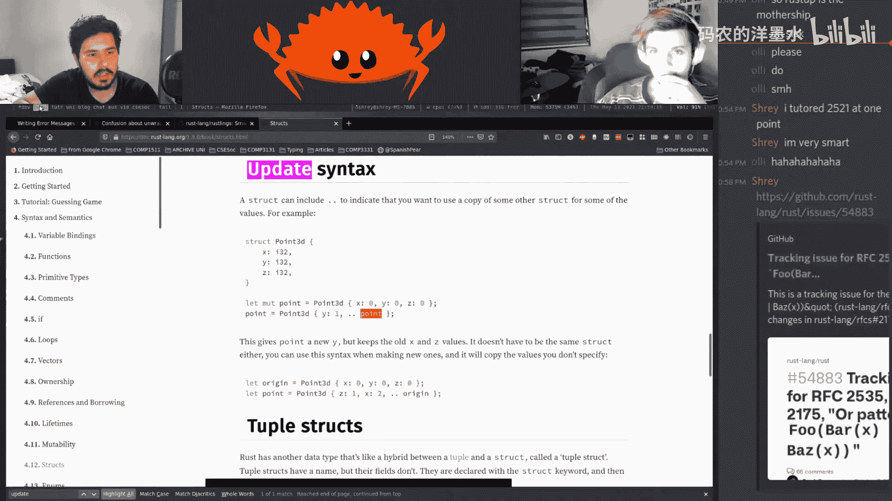

### 练习：errors1

以下练习要求我们修复错误处理代码。

```rust
// 修复此代码，使其能够编译
fn main() {
    let result = parse_number("42");
    println!("解析结果为：{:?}", result);
}

fn parse_number(s: &str) -> Result<i32, std::num::ParseIntError> {
    s.parse()
}
```

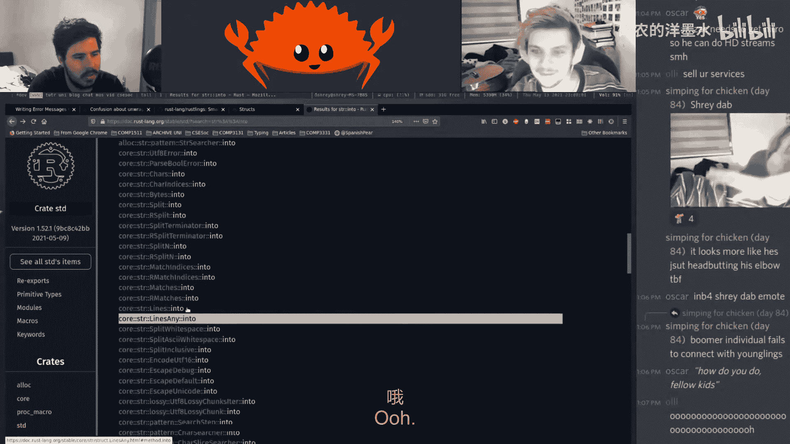

**解决方案**： 使用 `?` 操作符可以简化错误处理。

```rust
fn main() {
    let result = parse_number("42");
    println!("解析结果为：{:?}", result);
}

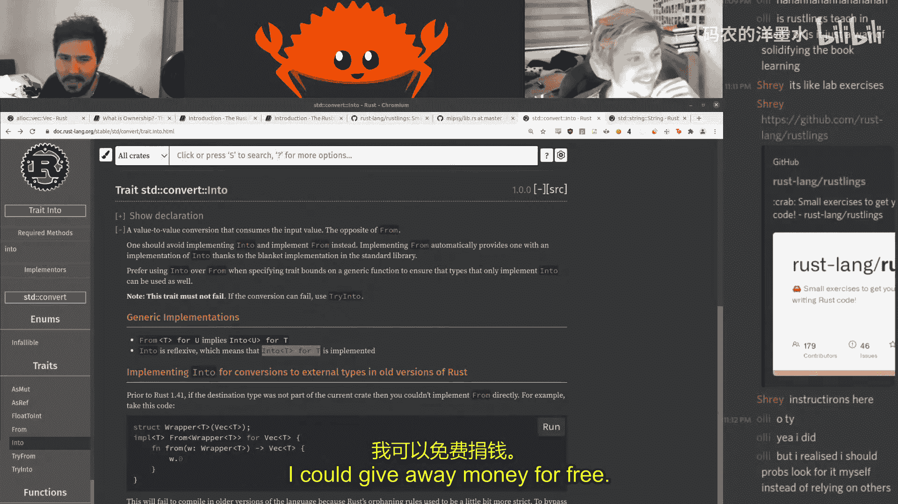

fn parse_number(s: &str) -> Result<i32, std::num::ParseIntError> {
    Ok(s.parse()?)
}
```

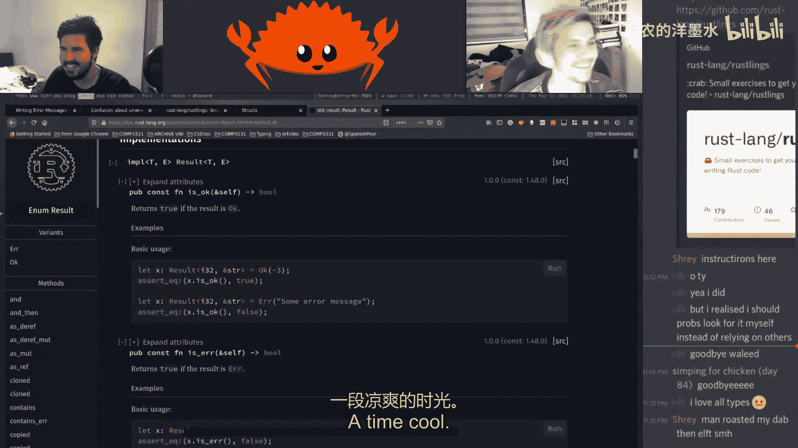

### 练习：errors2

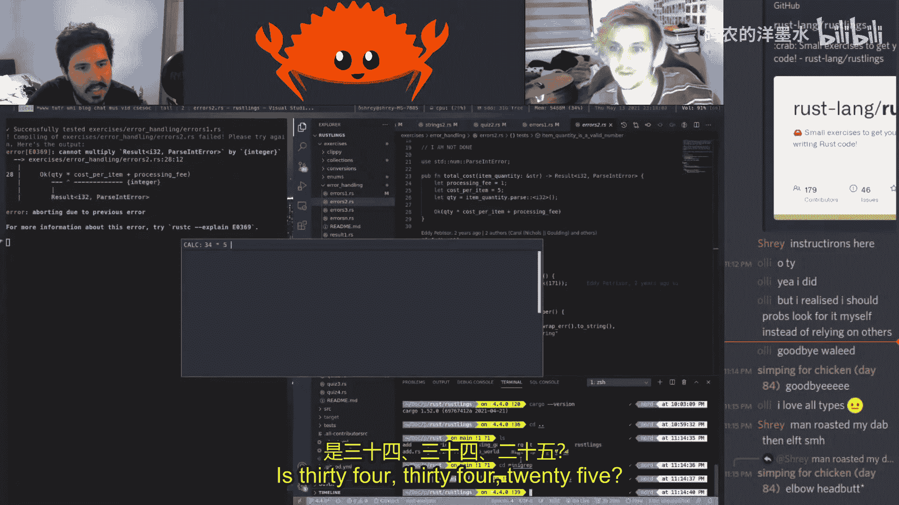

有时，我们需要在函数中处理多个错误类型。

```rust
// 修复此代码，使其能够编译
use std::num::ParseIntError;

fn main() -> Result<(), ParseIntError> {
    let number_str = "42";
    let number = parse_number(number_str)?;
    println!("解析结果为：{}", number);
    Ok(())
}

fn parse_number(s: &str) -> Result<i32, ParseIntError> {
    s.parse()
}
```

**解决方案**： 使用 `?` 操作符可以自动传播错误。

```rust
use std::num::ParseIntError;

fn main() -> Result<(), ParseIntError> {
    let number_str = "42";
    let number = parse_number(number_str)?;
    println!("解析结果为：{}", number);
    Ok(())
}

fn parse_number(s: &str) -> Result<i32, ParseIntError> {
    s.parse()
}
```

---

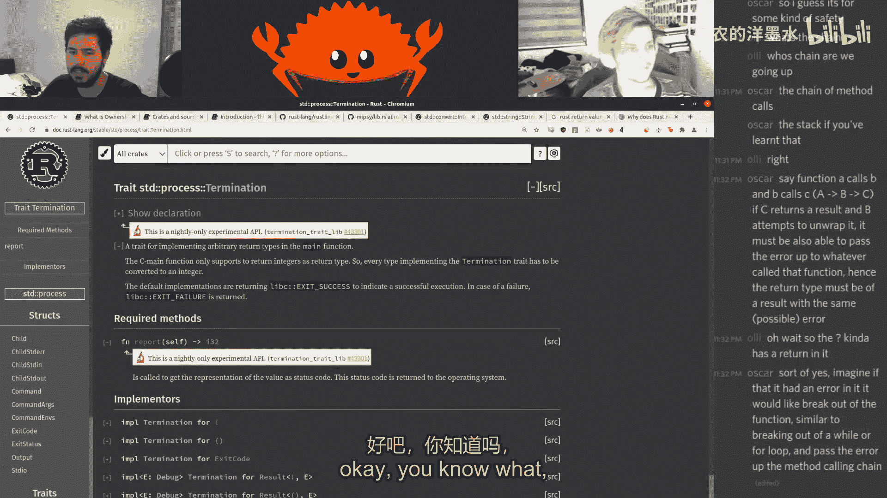

## 泛型与特质

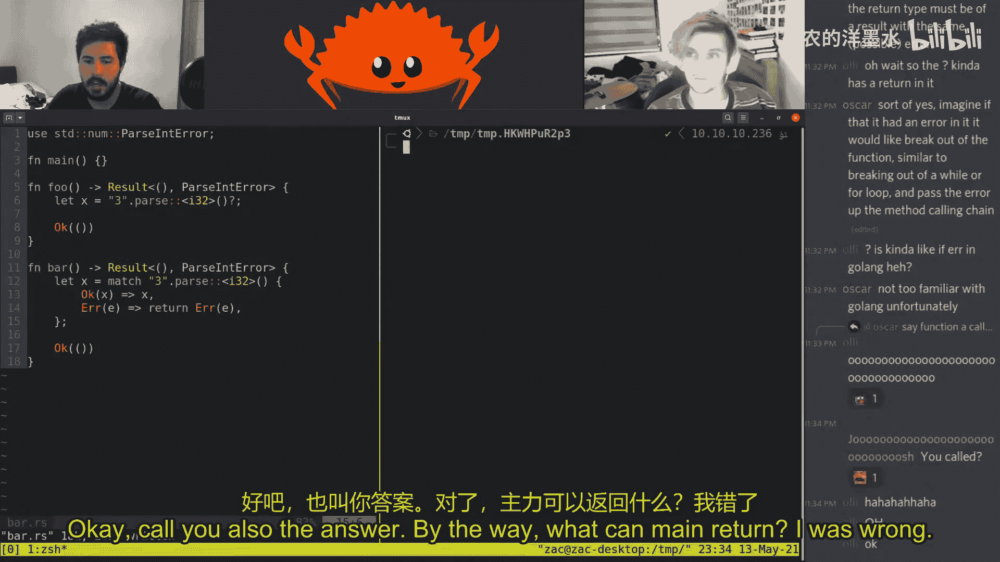

泛型允许我们编写可以处理多种类型的代码。特质（Trait）定义了类型的行为。

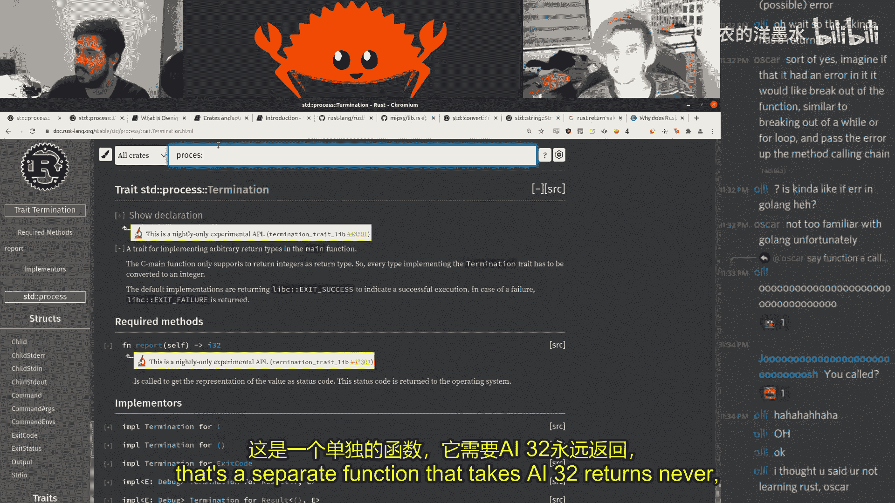

### 练习：generics1

以下练习要求我们修复泛型代码。

```rust
// 修复此代码，使其能够编译
struct Wrapper<T> {
    value: T,
}

impl<T> Wrapper<T> {
    pub fn new(value: T) -> Self {
        Wrapper { value }
    }
}

fn main() {
    let w = Wrapper::new(42);
    println!("包装器的值为：{}", w.value);
}
```

**解决方案**： 泛型结构体和实现已经正确。

```rust
struct Wrapper<T> {
    value: T,
}

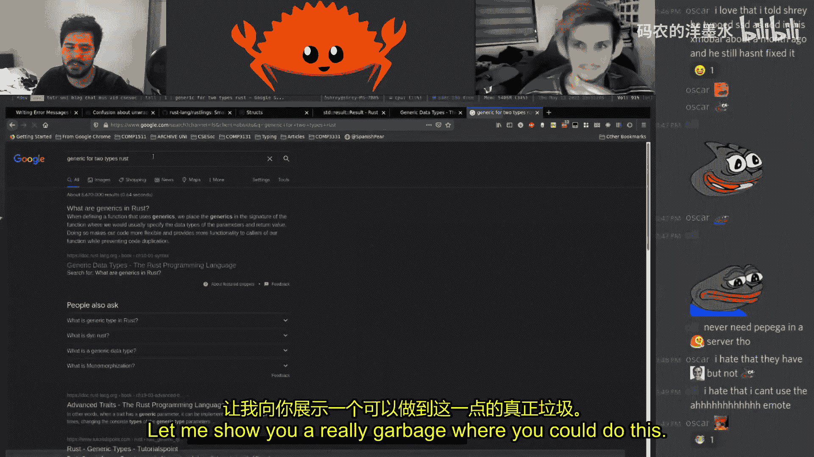

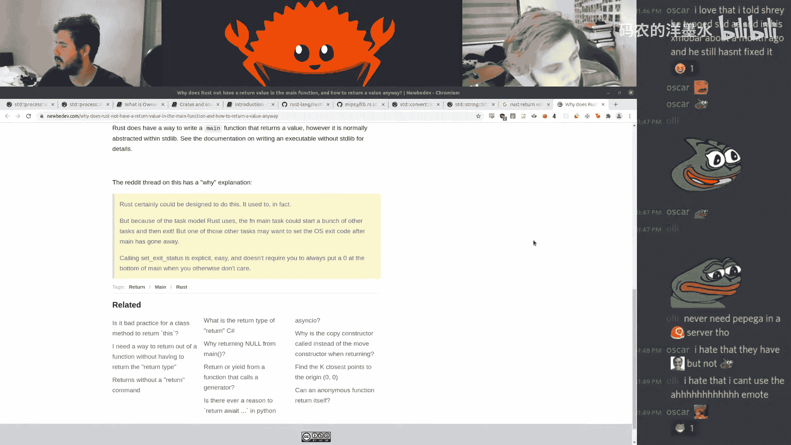

impl<T> Wrapper<T> {
    pub fn new(value: T) -> Self {
        Wrapper { value }
    }
}

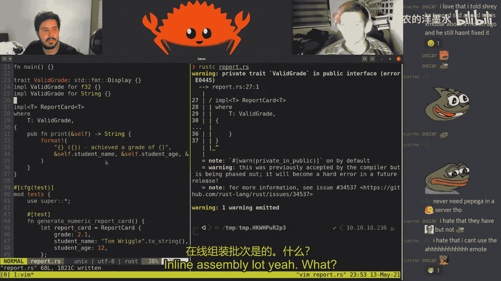

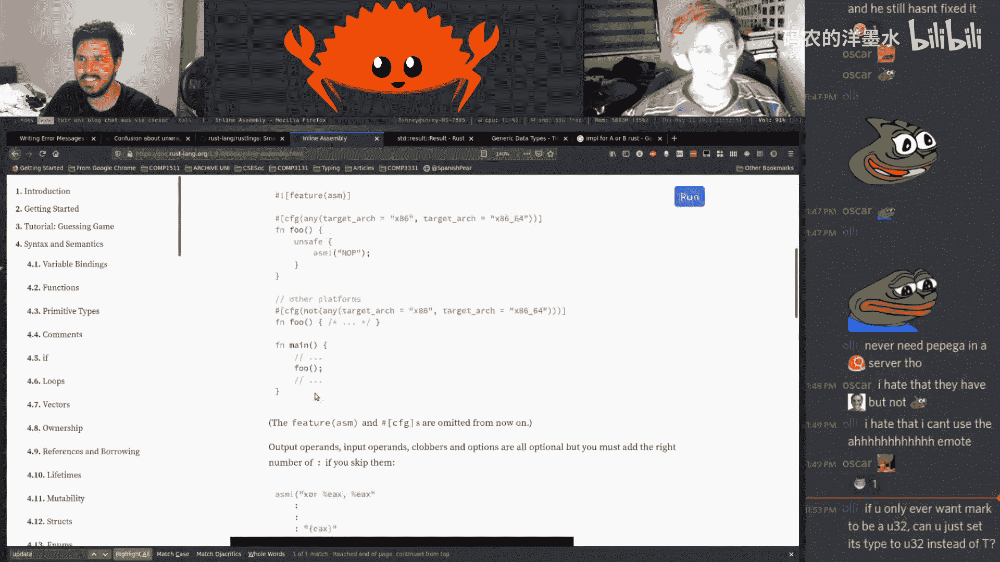

fn main() {
    let w = Wrapper::new(42);
    println!("包装器的值为：{}", w.value);
}
```

### 练习：generics2

特质可以用于约束泛型类型的行为。

```rust
// 修复此代码，使其能够编译
use std::fmt::Display;

struct ReportCard<T: Display> {
    grade: T,
}

impl<T: Display> ReportCard<T> {
    fn print(&self) {
        println!("成绩为：{}", self.grade);
    }
}

fn main() {
    let card = ReportCard { grade: 95 };
    card.print();
}
```

**解决方案**： 使用特质约束确保类型可以被打印。

```rust
use std::fmt::Display;

struct ReportCard<T: Display> {
    grade: T,
}

impl<T: Display> ReportCard<T> {
    fn print(&self) {
        println!("成绩为：{}", self.grade);
    }
}

fn main() {
    let card = ReportCard { grade: 95 };
    card.print();
}
```

---

## 总结

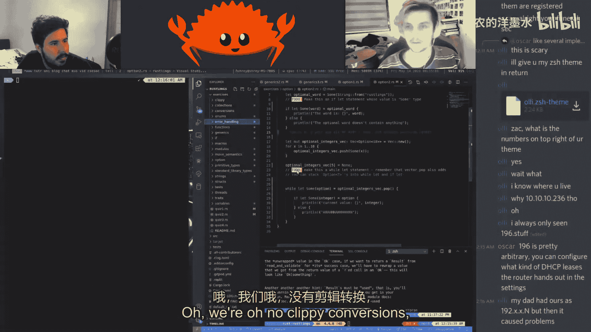

在本节课中，我们一起学习了Rustlings编程练习，涵盖了变量、函数、所有权、错误处理、泛型和特质等核心概念。通过实际编码练习，我们深入理解了Rust语言的设计哲学和内存安全特性。希望这些练习能够帮助你更好地掌握Rust编程。