# 【全集】新南威尔士大学 Rust现代编程 中英字幕 1080P p01 Lecture 1 - Rust语言与程序安全 -BV15cf4BCEN1_p1-

Alrighty。Hello， hello。Let's do a quick。AV check to make sure things。Heavnen broken since I lost。

Was doing this in last term。Yes， chat relay， hello， hello。😊，Audio okay， okay， that's good news。

Video okay， that's also good news。Well， it's good。Awesome， hello， everyone。😊，Wow。

 it's so nice to see。😊，There's plenty of familiar faces and certainly some new ones too。

Video is not 8 K Utra HDD。I am so sorry。Finallynily enough。

 I actually wouldn't get a choice on that because we've got YouTube ultra low latency mode。

But it doesn't support even 1440 p。And that's too low a resolution for Dong， it seems sadly。Welcome。

 everyone。Oh。Soir。What time is it， It is。0，5，51。 alright。Well， let's get started then。

So we're finally here。 Comp 6，9，9，1，22 T 3。 So I。I would assume that a huge portion of the course is aware that this is a completely brand new course。

 but you know there may still be some of us who， you know just saw the selective pop up and go。

 okay great， I'll take this。 So if you weren't to aware until now， comp 6，9，91。

Is a completely new course that you are here at the very first lecture of any Com 6991。

 Yeah its it's been a couple of years in the making， as Sree mentions。

 and so we've been sort of working on this for a long time， but regardless it is still a new course。

 We're gonna to do our absolute best。 in you know all manners regarding this course。

 but it's still brand new and there's still gonna to be some things I'm sure that go wrong。

 And so you might have to exercise a little bit of extra patience with us this term。

 but we really will do our best and we really hope that you enjoy the course and get something out of it。

😊，And yeah。So welcome to Com 6991。😊，So。Our lecture today is two hours。

 We have another lecture this week on Wednesday at the same time。This lecture。

 we're gonna spend just introducing the course， some of the ideas behind the course。

 I'll probably end up going on a couple rambles and rants as we， as we wander our way through this。

 and we'll also look at some very rust basics。 We'll do a little bit of programming。And yeah。

 yeah we'll do a little bit of programming and we'll look at our first little bit of like theory almost a lot of the sort of theory in this course is not necessarily us us meaning you know me in the teaching team telling you this is a concept。

 write this one down， learn this and and you know we're going assess you on this in the final exam a lot of the theory in this course is really going to be heres here's something to think about really it's going to be you know we've played around with lots of different programming languages and looked at lots of different features and ideas and there's certainly patterns that prop up in sometimes this feels like a better way to do things。

 sometimes this feels like you know this might be a little dangerous and hopefully most of the time in this course we're not going to come to you with the answer we're not going to come to you and say okay so there's you know there's let's say functions。

Functions should work this way。 and if if you do it like this。

 then you're doing it wrong if at all possible we're gonna to try and avoid that kind of thinking and instead go here's three different ways of using functions。

 here's what we think might be some advantages， here's what we think might be some disadvantages。

 Try each of these ways see how you like it and like try and take that knowledge and apply it more generally think about how this might look in different programming language in a different context if next year you're working at Google how is the what you're doing here going to help you think about how to program once you're out there and so we're going to try and look at things quite generally and you're very free to form your own opinions and you're free to form your own ideas and ideals and we're really going to try and encourage that as much as we can So a lot of the course is going to be you go away do something and when you come back to us instead of us going okay so you decided it on this one it's going to be us prodding questions at you and going what did you like what didn't you like Would you do it this way again。

😊，Is there sometimes you would do this and sometimes you would do that How does this compare to different languages we're going to be asking you those kinds of questions so come prepared。

 prepared not like with you know the answers to say。

 but prepared to you know think about these things think critically about the way you program and the you languages and tooling and all that sort of stuff you make use of so you know we've got a whole course ahead of us and I want to get too hung up and too far ahead before we just get started。

 but this is sort of the primary like pedagogical nature of this course pedagogical meaning sort of how it functions educationally don't expect a course where we're thinking like mathematically and this is the mathematical correct answer think of a more abstract course where we're asking questions and getting you to think about things and be critical and it's really up to you to take those lessons and and try and apply them elsewhere later you anything like that。

Allright as I'm sure most of us have already figured out there is a lecture chat and your little chat does pop up on the screen and stuff like that。

 So please do send messages and questions， I'm not going to immediately be able to like you send a message and half a second later I'm answering it but I probably will pause every now and then to go through the live chat you know questions are awesome and often when you're thinking of a question even if people who say everyone else in the room is probably thinking it even if they aren't chances are it's probably going to be helpful to everyone regardless because this is really what this course is all about So if you have any questions anything like that。

 if you have comments that you want to make even if it's not a question its you will look at different programming languages in this course and you might have experience with some programming language that we didn't have time to look at or that you know I might I might not have thought of to introduce somewhere and you might go oh you know I've used listsp and this is there's some really interesting。

😊，part of Lisp that you know applies to this or you know I've used some other crazy language that you know。

 whatever， if you have things you feel like this could add something into a discussion。

 type it in let us know it's really yeah again what this course is all about。😊，So all right。Okay。

 so the audio was good， Ferris plusies is rust more difficult than C++。😊。

That's that's an interesting question and it really will come down to your frame of difficulty。

 I'm going to leave that question unanswered and maybe in week 10 you can let us know what you think once we've spent quite a bit of time with Ru。

 you can let us know assuming if I'm assuming you sort of know some C++ at this point but。😊，You know。

 assuming that's the case， let us know again in week 10， and we might have a bit of an answer。Cras。

 crabs， yes， as that saying， maybe sometimes it's something we might explore。 Yeah， cool。

 YouTube crab doesn't。 the dong doesn't like C plus plus and how to add right shift。 Oh no。

 not right shift equals。 I'm guessing that's montic bind。 interesting。 So we'll。

 we'll get to all these kinds of things。 Yeah， yeah， yeah。😊，But we won't jump too far ahead。

So let's see what we got， oh I've got some quotes to start us off right so I've got some absolute legends who are going to pass on a little bit of wisdom before we get started with the course。

 So Dextra， who you know Dyixtra of Dyextra's algorithm and who really laid some absolute foundations in concurrency says that a programming language is a tool that has profound influence on our thinking habits。

😊，Right。Interesting。Profound influence on our thinking habits。All right， our next quote。

Comes from Hal Ableson。Of Creative Commons and the Free Software Foundation。

Who says a powerful programming language is more than just a means for instructing a computer to perform tasks right。

 This is probably the definition we got in comp 151，1 or something like that。

The language also serves as a framework within which we organize our ideas about processes。mm。

And finally， Larry wall of the Pearl programming language computer language design is just like a stroll in the park。

 Jurassic park。 that is。 So Larry invented the programming language pearl， which。😊，Has a reputation。

For being a a sometimes questionable language。 So Larry Wall certainly has a lot of experience in our computer language design。

 And he's telling us that。😊，That computer programming language design is a very nuanced and tricky idea。

 but I really like this quote as well because it sort of plays at the idea that until relatively recently。

 there hasn't been much like widespread discourse about programming language design。The the。

The academia has always been like， you know， endlessly frustrated at the industry for all these languages that have been spit out with all these foot guns and safety hazards and you know just being generally difficult to use in some ways。

 sos there's a lot of learning that we're going to try and take on during the course。😊，the read only。

 yeah， I think right only is is the joke that people make or execute only as well。 Yeah。

 that's for sure。😊，嗯。Where is rust used， That's a great question。

 Migo's got a an answer there mainly systems programming。 Rus can be used all up and down the stack。

 It is particularly suited for systems programming， because it。

Encapsulates a lot of these ideas in systems programming that can sometimes get in the way if you're sort of thinking on a higher business level。

 but I've seen it used all up and down the stack。😊。

Anywhere say like C++ or maybe even C could be used。

You you could certainly find rust in those areas too。Okay。

 so let's get on with the administratorista then。So some nice quotes to think about， you know， well。

 then and hopefully after the lecture as well， just keep them in your mind。So the staff。

 the convener of the course is Doctor Andrew Taylor。

 Andrew won't really have much to do with the course this term， you know。

 unless things go horribly wrong， which word。Whi' I'm not planning on。

 but Andrew is technically the overarching continuing staff responsible for this course if there's if you have some sort of grievance about the course that you don't feel as appropriate to pass on to me and you're always welcome to pass anything like that on to me。

 whether whether I've done something wrong or or you know anything surrounding the course you're always welcome to pass that on to me but you can also feel free to email Andrew or anything like that。

 but he's not really going to have any direct involvement with the teaching of the course or anything like that。

I'm your lecturer， hello yes I'm Zach， we have our two admins。

 Srey and Tom who have been putting in a ton of work behind the scenes。

 putting together like teaching materials and helping think about the course and ideas about the course。

😊，Sree has particularly been involved in the weekly exercises。

 so I'm sure you'll see like in the examples and stuff Srey's name popping up all over the place。

Because yeah， so he's he's been putting in a lot of work on the weekly exercises。

 we'll look at it a little bit and Tom。Has been looking in particular at the workshops and also assignment work。

嗯。That's not to say that's the extent of the work they do。

 but that's what their main focus is throughout this term。

 what they're working on we also have some wonderful teachers。

 we have Sage Kaiki and Jared who will be joining us in the workshops which we'll also talk about in a little bit but less involved in the actual administration of the course itself。

😊，So yeah， we'll talk about workshops in a little bit。So what is comp 6991 Well。

 until now hopefully you've done lots of programming right ideally。

 you've tried out multiple languages， not every single person enrolled in this course will have tried out multiple languages and you know we'll work with you and we'll help you through that。

 but I think if you've touched multiple languages and especially if you've touched languages in different styles。

 right if you've used something like C， if you've touched something like object oriented。

 if you've maybe played around with some functional ideas， if you've done lowlevel code， highle code。

 anything like that， the more sort of breadth of what you've played around with the better。

 but you know not everyone's going to have played around with everything or you know used every programming language under the sun but you knows hopefully you've done at least lots of programming。

😊，In Com 6，991 we're going to think about programming languages as a tool right so instead of just like。

 you know you enter 1511 and they go， okay so we're going to be learning C and you learn here's how an F works。

 here's how a while works， here's how a function works， that sort of stuff。😊。

And you just sort of accept it as gospel。 this is how I write programs。

 Then you go to a different language and they go okay， we do this slightly differently。

 but you know you do this， you do this， you do this in 69，91。

 we're really trying to think more abstractly about programming languages。

 we're trying to look sort of from a little higher up and go you know here's programming language。

 A B C D， E， you know two of those， at least we're programming actually three of them。

 at least we're programming languages， but like you know here's all these different programming languages。

 let's think about what these programming languages offer。

 how they intend for you to to do work in them， what what are things that we like about this language。

 what are things that we that we maybe worried about when we're programming this language。

 that sort of stuff。 So consider decisions in language design and in using said language and a lot of this is thinking about what works well for you and when。

😊，Right I'm going to talk about this a little later in the slides。

 but don't be mistaken in thinking that Com 6991 is a course that is just going to preach about。

 you know， the one true programming language rust。 I personally think rust is a pretty good programming languages and it has some stuff to offer。

 but there's there's other languages we could have taught this course in。

Rust is I think rust is a particularly nice choice for the course because it has a lot of these different ideas that we want to look at sort of join together in one big package。

 but Rus has its own flaws as well and there's sort of scenarios where there's often many better choices than rust right so we're not thinking about you know just learning Ru and this is like like you know the Com6901 is like a cult of rust。

We're adding another option available to us and we're using this to help us think about choices in other programming languages and how we write programs and from then on it's up to you to decide what you do。

 what you use and you know in what situations and when you use it， right？😊。

Dong enrolled for the cult。I'm sorry， but you might have to figure that one out on your own time。😊。

So after the Com6991， what what should you sort of expect as a graduate of this course。

 you should be able to reason about language tooling and design right things you'll have spent a lot of time playing around with different ideas and you'll go oh I quite like doing things like this or you know I really don't vibe with functional style。

 but I can write imperative code way better now， you know that sort of stuff。😊。

You can think about programs as contracts。RightSo you should be able to go if I write a function that looks like this。

 what do I sort of get from this here like what guarantees can I make about this code。

 what do I have to consider when writing this function so I don't have to worry about the program blowing up or crashing or causing a memory safety issue。

 that sort of stuff right？😊，You should be able to reason about invariance and correctness mostly statically。

 So rust is a nice language in that a lot of the time。 if there's some sort of correctness issue。

 you'll get that warning at compile times。 So that's why we're talking about statically here。

 You don't run the program。 it works five times and then you put in some different input and it goes oh blow up crash know hopefully we should be getting these kinds of errors when we're building our code and from being basically repeatedly punched in the face by the rust compiler over and overgoing wrong wrong。

 wrong， wrong， it'll help you to reason about how can I write programs that are more likely to be correct the first time。

 and you know you'll have an additional language under your belt。

 hopefully So learning rust is certainly an outcome of this course。

 it's not the totality of the course。 This course doesn't exist just to teach you rust。

 There's tons of great resources online to teach you rust。

 we're trying to get a lot more along the way。 which is why did rust do。😊，This， you know， is there。

 are other languages， how did they sort of make these decisions。

 What trade offs are there other languages that do anything any better， You know。

 we're looking at all these considerations along the way， Right， Jo， not the destination， you know。

Hey， let me catch up with the chat a little bit。So more complicated doesn't necessarily mean more difficult。

 That's a very good point。嗯。Rust might even be in very epic web based emulators。 right， Yes， Mipsy。

 very good。Enroll for the cold。 Yeah， yeah， yeah。 That being said， Okay， rust Cols。 Okay。

 mentioned C plus plus rust stations will melt。 Well。

 I sure hope not because we'll be mentioning C plus plus throughout the lectures probably relatively often。

 including today， hopefully option another option。 Yes， very good。

 Does Ada aim to do something similar。 Yeah， for sure。 A is also a very interesting language。

 We'll see if we can bring into the lectures at some point。 But。😊，Probably not。

Quite widespread enough to do like a ton of， of coverage on data。 But we'll see if we can get there。

2，5，1 being referred to as a Java course。 Yeah， exactly。 And like compile time guarantees and safety。

 Yes， absolutely awesome。😊，Perfect， so all caught up themes of CO 6991 program design。

 program languages， program safety program robustness。

 Theres there's like a Wikipedia link here for robustness in computer science。

 which is a new page to me。 So have a look at this Wikipedia page。 It's quite interesting。

 but it says robustness is the ability of a computer system to cope with errors during execution and cope with erroneous input So this is gonna be a major theme of CO 69。

91。 and a nice little Wikipedia page that also talks about some different principles as well。

 which is pretty interesting。 Very cool。😊，I think I need to go full screen again。No。

 now I've got this here， whatever that'll do。Cool， so some overarching themes of the course。

All right， easy to fall into the trap of hating a loving language。

 even just by making jokes about it， Yeah， for sure。😊，And design that yes very good。

 Okay so in terms of reading for the course。 So there's no strictly required reading and there's no like prescribed course textbook。

 some activities may say here's something that's relevant and quite interesting to read I think usually they will be like genuinely interesting。

 I feel like some courses can do the whole you know here's some content so we'll lean on that for the teaching and then you know don't have to do as much elsewhere。

 we're not really we don't plan to use sort of textbooks and stuff or articles to in place of the teaching。

 we'll always aim for it to be like here's a really interesting blog post that we liked and and hopefully might be a fun read。

 if you're reading it and you're going this is boring I'm not interested then by all means switch it off go back to whatever else you're doing they should be hopefully they should be interesting and fun to read And if you don't find it that way that's perfectly okay just you know don't read it and。

😊，Any else？嗯。So in terms of you know recommended， there is the Ru programming language book it's often just called the book in Ru。

 It's available online for free on HTML you can also order a paperback you know if you like but it's just on the web and free and quite nice to use the book is excellent it's a really good learning resource Sre's linked it there Thank you very much and you know check it out。

 see if you like it if it's working for you then by all means but it's not required So it's just for your own。

😊，And then some suggested readings as well Ru in A is a great book about systems programming and Rust。

 it's by Tim McNamara who will also be joining us to say guest lecturer will be delivering a guest lecturer to later on in the term so very cool。

 very excited for that and also Rust for rust stations is sort of a great more intermediate to advanced level reading by John Jangsett。

😊，I would it is， you know a relatively advanced book。

 my copy also took like like I think a year or something to arrive in the mail。

 so Id maybe suggest getting a digital version if you're interested but it might be more suitable for like after CO 6991 for like continued reading because it is a relatively advanced book。

😊，Cool。Tools and systems and stuff that we're going to be looking at throughout the course。

 the rust tool chain if you are installing rust at home then I would strongly suggest use rustt up as basically does the rest of the rust community you don't have to install rustt at home you can just use the tools on CSE such as 6991 cargo 6991 rust C6991 blah blah blah we've got basically all the tooling you should need if there's something that you would like to use a tool that you'd like to use that isn't available through 6991 or anything like that just make a post on the course forum and we'll install it No big problem。

😊，Creates。Iio is where we get third party dependencies。

 for the most part you probably won't even realize createates Io exists if you're just sort of following exercises。

 but you can look on createates I for third party dependencies and stuff like that where allowed。😊。

Rust documentation， so for example there's a nice link to the standard library Ru documentation usually gets mostly served out of a site called dos。

 Rrs。 I am a big fan of rust documentation and the way it's laid out and the things it encourages like lots of examples and stuff like that we'll look at writing our own documentation and all that as well I think during week。

😊，4 or five， something like that。 if I'm not mistaken and。

And documentation is actually a very interesting part of rust as well and we have auto test and give usually it just means sitting inside the you know seeding into the crate that you're working on and just running 6991 or auto test or 6991 give it'll figure out what activity it is and you know all that automatically so you should for the most part just have to run。

😊，This command here and this command here to auto test and or give。Cool lectures like here。

 like right now。 So theyre on Mondays and Wednesdays。

 Both are 6 PM to 8 PM and they're live streaming， as we see here on YouTube。 live chat available。

 Please ask questions。 Please make comments。 You know all of that。 They are going to be recorded。😊。

And there's like it sounds like a train is blowing up， the lectures are recorded。

 they're not linked on the we don't like have a page for lectures on the course webp page just yet。

 but we will have one soon and'll link slides and stuff on the course web page also soon。😊，Cool。

Lectures focus on the thinking behind different features of rust right as we sort of I've spoken to quite a bit at this point you'll often be we're often going to feature many programming languages other than rust be prepared to be guided through unfamiliar code right even today we're going to look at something like five different programming languages。

😊，It's not expected that you know all these programming languages you might know like one language quite well you know probably you probably know C relatively well you maybe you know one other language you know you've written some big programs in it and then like one or two other languages you've seen a little bit of here and there you know we're going to assume basically zero knowledge about any language other than C so just。

😊，Try not to get hung up on the gnarlly little details unless we're sort of directing attention to them and just sort of follow the broad strokes ideas that I try and pass along and I'll help guide you through different languages。

Sometimes in the lectures， we'll spend a portion of it teaching rust itself。

Right so even today we'll do a little bit of rust programming just to sort of bootstrap things。

 get things started but a lot of self-directed learning in terms of you know Ru the programming language is expected make use of of the resources available like the book and that make use of the course forum to ask questions in the weekly exercises to get practice and yeah like there there's tons of materials and stuff like that we only have so many contact hours a week so you're gonna have to spend some time playing around with Rus yourself and you getting things wrong and fixing it and asking questions and all that but we will still spend at least some time in the lectures you know writing Ru ourselves and and just you learning。

Things in rust， as opposed to comparing things to different languages and all that。

 Will we be able to access the slides before the live lecture。 It's a great question。

 The answer is maybe the answer is， I'll try。 but I I can't guarantee it for every week sadly， but。

 but I'll do my best。 So， so we'll see。😊，Okay， workshops so each week you'll have a two hour workshop。

 It might be listed as like a lab on my UNsW。 This is what we're talking about the workshops。

 I believe that all on Thursdays and Fridays and we have a workshop every week one through 10 but skipping flexibility week three of the four workshops that we have face to face on campus in J17 one of the four workshops is online which will be hosted on discord。

 you'll receive an email with further information about if you're enrolled in an online workshop。

 you'll get an email with more information about the online workshop sometime in the next couple days don't worry we'll get you there for now maybe just making sure you have access to Discord and if there's any problems there letting us know and if you're enrolled face to face and for some reason some week you can't make it on campus。

 maybe you're sick maybe you're away something like that then by all means you can temporarily join the。

😊，In the online stream and similar to the online workshop。

 we'll email out some details in the next couple of days。And for people going， yay discord。

 discord is mainly chosen for the screen sharing capabilities。

 it's very good at letting many people share their screens all at the same time。

 which is something that we care about in the workshops because there's going to be some small groups。

 right？😊，So the workshops themselves are going to be very practical sessions。

 They usually focus on a large problem as a class right so the tutor might are going to goToday we're gonna to do this cool thing maybe it might be we're going to write a web application that does so and so and hopefully so each workshop is gonna look a little different but as an example of a workshop they might go let's all gather around and work on some sort of design so we'll go okay we're going to need this we're going to need that we're going to need this and it's going to involve lots of stubing going like here's a function but we'll just leave it to do to do to do to do in all these little parts work on a big design then we' break up the pieces into very small groups and you'll go away and hopefully have 45 minutes an hour。

 whatever it is to sit there and actually practice your rust programming and to work on a small piece of this big problem if there's extra time we might even say you you solve this problem this way maybe try doing it a different way rust is often like mo。

😊，Param， there's multiple ways to achieve a similar result so I'm might， oh。

 you did this quite imperatively， maybe try functionally， oh， you did this quite functionally。

 maybe try imperatively， that kind of thing。😊，And so you。

 playing around with the code and writing know these smaller features。

At some point we'll bring everyone back together and try and integrate the code into a larger project you know hopefully it works。

 you know sometimes it may not work every time and you know maybe there's some fixing or maybe it's okay well you know that's this is what we've got but the real meat and potatoes of this workshop the most important part that I really love is that at the end once we've put this all together。

😊，And you know， we get in a big circle and and we chat and we have a discussion we go。

 what parts of this project do we like， You know， does anyone like what are some things that really stand out as that was a cool that was a cool thing to do。

 that's something that I quite liked or you know some things that were a little that maybe feel a little shaky about this code。

 parts that don't feel quite as robust that might break down are there different ways that we could have done things that we have any interesting issues along the way。

 was the compiler fighting us about some sort of thing here and there and really just go through all this stuff。

 What might this look like in another language。 Could we use this you know clever type system trick in a language like Python or something like that。

 Ryan we're gonna really sort of think about these things and play around with them in a nice big discussion I seriously think they're gonna be really cool I thinkll I think it'll be a lot of fun So yeah。

 let me just quickly catch up on the chat then yeahor cool will there be consultation hours help sessions available thing about assignments。

😊，So this is still a little bit TBBA。 The plan is to lean on the course forum quite a bit。But。

I might see if I can set up some consultation hours just for just for like smaller bits of help and stuff like that。

 but we'll have to see how we go Los me at group work well this isn't this isn't assessed group work Keep in mind So I'll talk about that in a second as well right Yes。

 that's Alex's question we'll get to in a second prereknowled on functional programming Nope not at all don't think rest of functional language has functional language but it's not something like high school Lisp yep correct hyppe for workshops basically dreamful learning effectively great I'm awesome It's very glad to hear that。

😊，What if I kind of turn the first week workshop I have another event cling with both Thursday and Friday yeah that's that is rather unfortunate so let me say this。

😊，Workshops are not mandatory。😡，So in this case don't worry about like losing marks or anything like that。

 Saly we only have the workshops on the Thursday and the Friday and they don't really make much sense to record the sort of educational value in them is the actual participation of it nonetheless we might consider recording the online class just as like a you know if you really couldn't make it to either and still wanted to see what was done anyway。

 then we might have that option but we don't really have many contingency plans in place right now for if you can't make either workshop a given week so yeah。

 sorry about that。嗯。Cool， okay， so let me bounce back to this for a second。 So in the workshops。

 the teachers expect that you've watched the current week's lectures right。

 So we have the lectures on Monday and Wednesday， and then we have the workshops on Thursdays and Fridays。

 So those workshops are expecting that you've watched the Monday and Wednesday lectures before the before the workshop starts because we might need to build off knowledge that's that's been presented in the lectures。

 Again， it's not like a absolute requirement。 We're not going check off your YouTube watch history as you walk through the door。

😊，But you know keep that in mind that's the general expectation if you haven't been able to watch the lectures by all means still do come along and still do participate。

 but it might be a little more confusing and they might be sort of like some catchup work during it but yeah so it's also the workshops are not intended as time to work on weekly exercises and tutors will almost always not have time to help with non-work material the workshops really are a workshop they're not like a comp 1511 lab where sort of tutors just roam around the room giving help with other content like weekly exercises or something like that So the workshops are really a workshop if you have those kinds of questions that's certainly cool there's no problem with that but try and direct them to the course forum instead which is where we're going be trying to answer a lot of these kinds of questions。

嗯。Cool， and yet， as Tom notes as well， we will encourage publishing the code that results from workshops So you can also look at them。

 Absolutely， yeah。 So being able to see what other classes have worked on and how they approach things is a really。

😊，It I think will be really fun。 So as we saw here before， workshops aren't mandatory。

 There is no participation marks if you don't show up to a single workshop。

 you know you' you won't be given a zero for the course or fail or anything like that。😊。

But with that in mind， please， please， please do give them a try， right。

 Even if youhuddle that and you're like， I don't know。Do me a favor。

 give them a try if if you go to the first two weeks and you decide yeah I really don't like them。

 they're really not for me， then let us know why so we can improve it。

 but you know we're not we're not going to force you to come and we're not going to hold you against your will。

 but I really do think they should be fun and I think there'll be a lot to get out of them so if if you're on the fence。

 please give them a try at least for the first couple of weeks and then you know and then make your decision Is it possible to increase the capacity for the online workshop。

😊，U。I will get back to you maybe。 like， yeah， as St mentioneds， it's。

 you're want to attend if you can't attend the in person one。

So maybe we can look at bumping the enrollment， we'll have a look。But yeah， I'll let you know later。

 maybe I'll let you know next lecture。Okay。So that's workshops， weekly exercises。

 So there's weekly exercises， weeks 1 through5，7 through 9。

 So note there's no exercises during week  six and week 10。😊。

There's usually going to be you know several exercises， but they're really substantial in size。

 it's usually going to be like， here's you know a small program。

Maybe the program is broken and we want you to fix it。

 maybe we want you to write something from scratch。😊，You know something like that。

 but they're individual tasks and they're mostly just a practice using rust right So then you know you feel prepared and you feel that you know how to use the language when you're working on your know larger assignments or in the final exam as well we will sometimes ask theoretical or openended questions so that open-ended could be both a theoretical open-end question or a practical open-end question which may be manually marked and generally for the weekly exercise will be quite lenient in our manual marking So yeah。

 we usually have auto test available and you submit everything with give those instructions on the weekly exercise page。

 that sort of stuff。 if you have questions about them course forum anything like that cool。😊。

Assignments， there's two assignments， assignments1 program design。

An assignment to on concurrent programming。 So these are released。 Actually。

 let me just double check the course outline before I give faulty information assignments。

 assignmentsment 1 is due week 7 and assignment 2 is due week 10。

 That's probably gonna be something like week 7， Friday。 Oh， I think maybe week 7， Monday， week 10。

 Friday， something like that。 Do we say when they're released I think I had it written down somewhere。

 but it might not have made its way to the course outline。

 But you can expect them probably released assignment 1， probably sometime around。😊。

Sometime around like week three and assignment two sometime around week seven。

So they're an opportunity to work on and demonstrate your knowledge in a larger project right they're going to be relatively hefty and they're going to be individual and have the standard UNSL late penalty which is the 5% a day for five days Phicle correctly。

 but we apply it hourly which to be clear is strictly in your favor so yeah assignments there will be and we'll talk more about assignments when they're actually getting released。

😊，There is a final exam， it'll be online right online exam work on it from home。

 there is almost certainly going to be a mix of practical and theoretical questions。😊。

Right and it's probably like the exam is our main avenue to test these sort of theoretical ideas so expect a reasonable amount of open-ended theory for most for a lot of these questions there's often going to be no right answer you know whatever the right answer may be but so your answers really just must be well justified you know we might not be looking for a specific answer。

 but as long as you argue it well and demonstrate your understanding then that's basically what you need and we expect it to be three hours centrally timetabled but you know we'll confirm that when we have more info。

😊，Okay， the usual stuff code of conduct plagis and that sort of stuff I'm going read it out So CSC offers an inclusive learning environment for all students and anything connected to UNL。

 including social media， these things are student misconduct and will not be tolerated So things like racist。

 sexist， offensive language or images it's actually inappropriate behavior。

 bullying harassing or aggressive behavior or invasions of privacy。

 show respect to your fellow students in the core stuff like this is genuinely very important we you know。

😊，I'm hoping we don't have a problem with this this term， but like take this seriously， it's。

 definitely very serious。Plagiarism， cheating of any kind constitutes academic misconduct and carries a range of penalties。

For example， group work on individual assignments is not okay but you know talking about it。

 discussing it， you know chatting about ideas on the course forum， whatever it is， that's okay。

 allowing any other student to copy or work， getting your hacker cousin to code for you or purchasing a solution to the assignment or not okay so just make sure you don't。

😊，And， you know， labs tests， assignments， so， you know。

 the weekly tests and assignments and examine all that must be entirely your own work。

You can't work on them in groups。 We will check for plagiarism。 Plagiarism is bad。

 You might get suspended。 You might lose a scholarship。 You might lose a visa。 You know。

 you might fail the course， just， you know。Don't do this is basically。Oh， we're getting to。 And yes。

 Ferris will be very disappointed。 That's that's very true。

 And there's no apost sciences to chief from。 That's also very true。Okay。

As far as the assessment goes， it's very simple，20% weekly exercises，20% assignment1。

25% assignment to，35% final exam。 Look at that one，35%。😊，And so to pass。

 you just need 5 out of 100 overall no hurdles， node。😊，You know， UFs， anything like that。

 50 out of 100 passed the course note that every weekly exercise counts。Right。

 so we don't do like a best seven of eight or anything like that at this point。

 It's just like the exercises get summed up and each week is worth 2。5%。

 So there's eight sets of weekly exercises each week is worth 2。5%。

 which is evenly distributed among the exercises。So yeah， no double pass， nothing like that。

 so it's you get 50 marks you pass the course， very easy， very simple。😊，嗯。Yeah。

 an academic miscon up bad and log exam component， yes， I also am a believer in that。😊，Okay。

 so how to get the most out of comp 69，91？Attend these lectures， you know。

 we've got a bunch of us here now， which is I'm very happy to see and happy to be up in front of everyone。

😊，Be involved， ask lots of questions， think about any questions that are pose。😊，And you know。

 you're all doing great on that so far。😊，Have an open mind。

 So this is what I was mentioning a little earlier。

 We're not here to convince you that Ru is the one true programming language。

 We want you to think about how you program what works best for you。

 We will explore many of rust weaknesses along the way。 And if you leave 6，9，9，1， hatating rust。

 But having become a better program along the way。 that fulfills our success criteria。

 If you come out of here going， I love Ru and I learnt a lot。 That's great as well。 No problem。

 But we're not here to convince you on rust。 We use rust as a tool in this course。

 And we' we're just trying to get us to all think about programming and hopefully， you know。

 learn a little more。 and。😊，And yeah， get something along the way。

I also suggest attend and actively participate in workshops Again。

 I'm seriously convinced they're going to be really fun if you're finding that they're not fun and you don't feel like you're getting much out of them。

😊，Don't just like I would really prefer if you don't just silently go， okay。

 I'm just gonna stop going and not do anything。 If you can all think of why or how they could be better。

 let us know anytime。 if you're going to the workshops and you're really enjoying them and you're having a great time And you can still think of ways they can be better。

 Please let us know also。 the easiest way to let us know is probably in the course forum。

 There's like a feedback category。 But we might also we might also add like an anonymous feedback form or something like that。

 sometime this week。😊，So， you know， whatever， whatever it works well for you， you're welcome to do。

And also work hard on your assessment items， the weekly exercises， the assignments， the exam。

 try not to miss anything if you can， you know it's sometimes you fall behind there's lots of different things going on in and outside of the course。

 but if you're working hard that's the most important thing for sure。嗯。

Is he likes the assessment outline。 That's great。 Yeah， sorry。

 slides will be on I'll I'll get them on the the website later on。

 I'm gonna have like a lectures page that we just don't have yet， so I just need to write that up。😊。

Final exam。 sure hope the final exam doesn't change the spec halfway。 Yeah， I don't。

 I don't think you have to worry about that。 Fortunately。 Okay， yeah， okay， okay， okay， I get。

 I get the message。Cool and finally here assumed knowledge So there's some non-negotiable assumed knowledge knowledge of C is absolutely requisite。

 This course is prere by comp 2521 So we're expecting that you have you know knowledge of C you've worked on a large project probably in C。

 for example， comp 2521 assignment and a willingness to learn an openmindedness right So if you've got those three then you're set to join us in comp 6991 some other stuff that's definitely going be useful I think in in this course is experienced with a programming language other than C even if you're doing another course at the same time like maybe you've only use C now。

 but you're taking you know some other round of course， 2511。

1531 I don't know whatever it is and you're learning another language like Python or Java maybe or Java know whatever if if you're sort of doing another language at the same time then that's great as well that'll certainly help out。

😊，Pain in programming is useful， Yes， I think this is maybe Tom can remind me。

 I think pain in programming is either maybe Carol Morgan's idea or maybe it might have come from Dyktra。

 I'm not 100% sure。😊，I think， I think Tom might know this a little better。 but the idea of。

Having experienced pain when programme okay is Carol so another an academic at our school at UNSW。

 Carol Morgan who teaches primarily these days comp 6721 informal methods， the Lost art。😊。

Talks about an idea of it's it's hard to appreciate certain ideas in programming until you've been bitten by them so what we're hoping is that most of us who have come in here have seen that nasty segmentation fault or if you've been using DCCC you've seen the big like uninitialized variable access or you know just as we're hoping that you've seen lots of error messages and you've had you know。

😊，Not to not to like wish for your sadness， but you know， that you've sort of gone through that and。

 you know， at least somewhat overcome it， you've you've gone through frustration when programming C plus plus template errors。

 sorry mentions， maybe put your put your your worst programming fear in the lecture chat if you'd like。

😊，I'm sure we've all been through this kind of stuff and so if you've experienced pain and programming。

 that's what we're trying to like think about， that's what we're trying to reason about in this course。

😊，Tom mentions the borrow check， yes， that's gonna be。

 that's gonna be a bit of a gnlly one about like maybe maybe a。

Like a third into this course or something like that， setting up environments， yeah， template errors。

 a very readable 1000 line error messages are great。

 Python dependency management programming without using Arch Linux。😊，Great。

And if you've experienced different programming levels， like you've written some low level programs。

 you've written some high level programs， you've written some OOP， some object oriented code。

 if you've you know written something a little more extravagant like functional code。

 often a lot of people。😊，Will go no， I've never done functional programming because they've never touched something like Haskell or they've never touched know M L or a Lsp or something like that。

 But they go oh no， but you go， I you used like Java streams。

 have you used like dot stream dot filter， dot map do whatever or have you used C plus plus has similar ideas。

 Have you used Python filter map and you go oh yeah I've used those things。 and you go， yeah okay。

 so you've used some functional program you've used these ideas。

 And so if if you've played around with anything like that。

 that's all gonna bring value to your education in this course for sure。

Debugging as synchronous code oh yeah， oh yeah， that's going to be really fun towards the very end of this course as well that's that's a development that Ru has had that's sorry that rust has broad I suppose。

 which is particularly interesting I think。😊，Just tried to log into the course forums got an a error not found after trying。

😊，Oh， I know exactly what that is。 That's not ideal。 I'll have to look into that after the lecture。

 but that's。CSA systems being。CC systems being a little frustrating its it's complaining that if you've ever used ACC ACC on on a CSC system。

 it's complaining that ACC doesn't exist on the server right now for whatever reason。

 so anyway I'll have a look at that after the lecture。😊。

having to use two functions of pass between a number to another number， yeah。

 send an email for Dora gangang， okay， cool。😊，Awesome，😊，Blue or not。

 that's our interest slide right there。So where are we at， We're at 54 past。 Yeah， dude， these。

 these are some nice quotes。 Now that we've sort of got an idea on the an idea about what the course is about just to run through them again。

 A programming language is a tool that is profound influence on our thinking habits like， you know。😊。

Really do think about these things here， powerful programming language is more than just a means for instructing computer to perform tasks。

 right， really important ideas for this course and then Larry wallss is kind of just funny。😊。

And is it too late to complete the W0 Las。 Oh， right， Yes， sorry， I should have mentioned the W0 Las。

 I， I meant to do that， actually， let me。Figure this out。

 here we go and get the course website over here。Yes great question so the week if I go to the course homepage I'll just give you a very quick tour we have announcements to come out here these also get emailed out to you know roughly around when they're posted so example more announcements will pop up here over time。

😊，And just keep an eye on your email and you'll get a notification。

There's the course forum linked to here， which may or may not be working right now。

 the course outline and the timetable which just has the classes， the locations， the teachers。

 that sort of stuff listed。We we have home computing resources so if you open this up。

 it shows how you can install the rust tool chain at home and some guides for writing Rut in VS code or in Neovim。

 those are the two sort of most popular editors we found for Ru development you're welcome to use whatever text editor you like these are just the ones that we have guides on hand for and if you want to do all your work in CSE then there's no need to install a rust tool chain at home either you can just use 6991 bh but these are nice trayres written these up for us and he's done a great job。

😊，And then we have the week by week exercises， revision questions， that sort of stuff。

So week zero if you look at these weekly exercises here。

 they are not assessed so there's no give command， I think some of them have auto tests so just run 6991 auto tests on them and see if it works。

 but they're just intended to get you up and running with Ru to get you you know having written a program or two and know how to print things and know how to use a loop that kind of stuff。

😊，But it's you can do them anytime anytime at all there's no deadline。

 there's no you know submission or anything just for your own learning the first week of weekly exercises is actually like these are accessible exercises and they have auto tests and they have give or most of them my auto tests they all have give and they're due next week Wednesday。

I should note the revision questions if you look at these。

 they're pretty similar to if you've seen like 1511。

1521 you know Introcomp tutorial questions and so we'll release you know hopefully at least a couple questions each week just to get your thinking and at the end of the week will'll also release answers which I might need to log in as a tutor four revision answers and for most of these we'll also have a video to go with it just to sort of walk through a quick solution they'll some of them will be like a minute or two some of them might be 10 minutes。

 something like that， but we'll usually have a written solution and at least sometimes a video to go along with it just for your own revision。

😊，Cool。And working access lecture notes， they don't exist just yet。

 but sometime this week I'll let you know how it goes。😊，Cool。And yeah。

 week zero just helping you also make sure you can even use rust in the first place。

 make sure your setup is working basically。😊，Okay。Any quick questions before we go into a break？

We'll have a quick like five minute break or so before we start playing around with some code and looking at some languages。

With we're gonna look a little bit at an option type。 right， very cool。

 So any quick questions before we go to a break。😊，I'll give if I don't hear anything by。I don't know。

 45 seconds passed， we'll start the break。All right。All right。

I'm going we'll go into a break now let me switch over here and we'll be back in five minutes around。

 yeah， sure four past the hour we'll come back and we'll do some coding。

 We'll look at some languages。 It'll be fun， so I'll see you all back in about five minutes。😊。

Already。Hope we didn't mess any of that up。It looks like。Oh，'s it's annoying as as。

The daylight goes down。 And also now I'm looking at a big bright monitor。

 The green screen sort of gets a little unhappy at times。 So I apologizelog， I apologize for that。

 But welcome back。Hopefully， yeah， I think you should be able to hear me again。

So oh while I get to  a thousand subscribers， well yeah， there's 100 students in this course。😊，嗯。

Cool， oh， I think Srey might have made a mes category on the forum， which is good fun。😊。

So let's talk about some quick Ro basics。

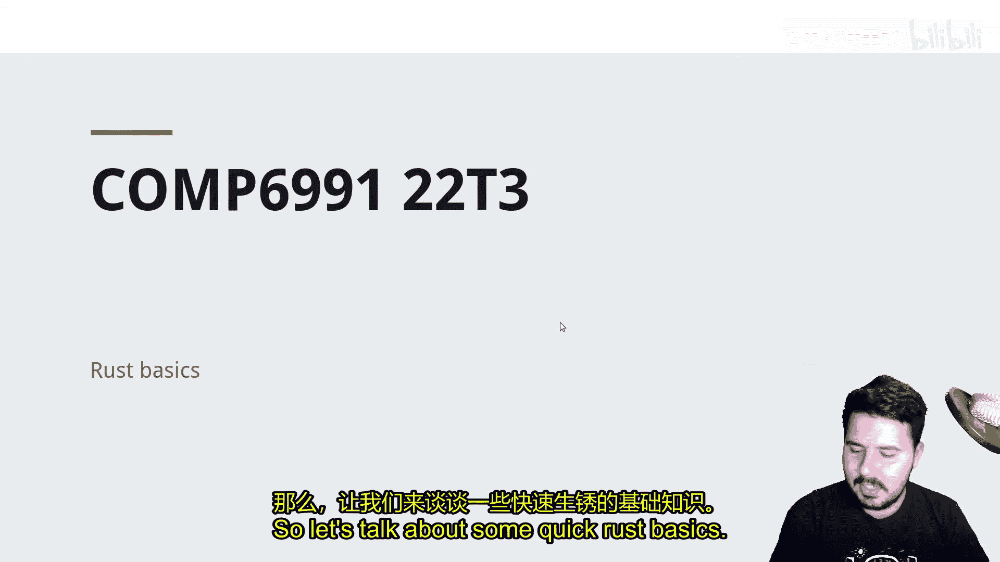

So we'll start off with Hello world。Oh， this kind of looks， this kind of looks like a nice。

 nice colour background for me。 Okay， so hello world， let's write some hellello worldld and rust。😊。

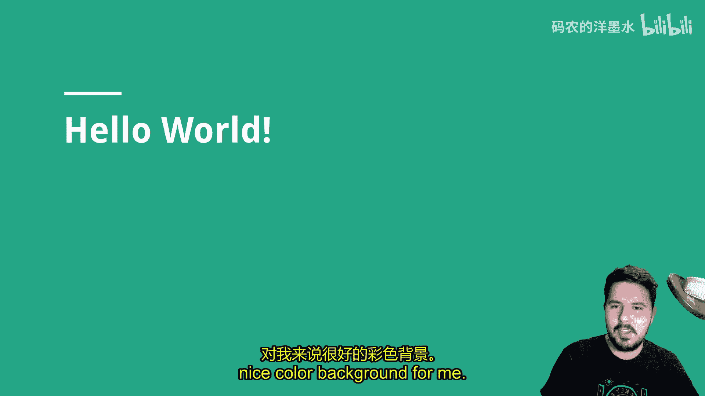

So when I'm writing rust， I generally like to have you know my terminal that I'm doing work in。

 you know whatever that is whether that's your VS code。

 whether it's you know Vim G editit inj or jetbras。

 whatever it's called one of them whatever you use is going to do just fine for this course Our suggestion is you use something called rust analyzer usually most text editors will have some kind of plugin for it VS code certainly has a rust analyzer plugin that's written like rust analyzer like this Neovim has a plugin for it I think that jetbrains people actually use they have their own one that works you know。

Ptty well as well， but it does make writing rust a little easier。

 It gives you a little tight hints and suggestions and all that so。

That would be my only suggestion really other than that completely up to you and I like to have documentation open up as well。

 documentation， especially I've found rust documentation to be quite nice。😊。

Quite legible and nice to use And the easiest way to get to you know， by default。

 you're probably just gonna be wanting to look at the standard library documentation。 Obviously。

 if you typeling in other dependencies and you'll want to look at those as well。

 But just to get to the standard library， you would do docs do R slashD dos do R s as a nice little sort of shortcut to it。

 or I think on the course website as well， if you click the Ferris in the corner。

 it takes you to the standard library documentation， which again is is quite nice to use。

 So I'll keep that up on the side here。😊，And let's write somes write let's write hello wel and rust。

 So if I want to make a new rust project， generally we' use something called cargo right so if you're on CSA you'd write something like 6091 cargo new and then the name of your project here。

Right， so maybe I want to make like a hello world project。

Something like this and you'll see it's created a new binary application right Ru programs can either be binaries which is a program that you run。

 you know you run it， it'll do some work it might spit out some output。

 something like that you can also create libraries in rust which is just code code not intended to be run on its own。

😊，codeode that's helpful to help other people write code essentially and there's lots of libraries of available and rust。

 if you're trying to write your own one， you would write it like this。 cargo new dash dash Lib。

 Hello worldld， but we actually want to write a program to run， right。

 We're going to run it and it prints out hellello World， So we're going do 69，9，1 cargo new。😊。

And so I'll see the into it。😊，And you see there's a couple files here。

 So there's the cargo domel right My editor is a little crazy。 I haven't fixed it up in a while。

 so I might have to do that before the next lecture。

 but you can see it just starts us off with some pretty basic info。

 The name of the package starts our version off at 0。1。0。 It also has this addition here，2021。

 I see some people come in here sometimes go oh let me check no it's 2022， let me change that。

 it's not gonna be too happy if you do that Ed is sort of like the version of the language you're using and they come out every three years there's a 2015 edition 2018 edition 2021 edition for like the sort of big breaking changes。

 Well， not even breaking， but minor breaking changes in rust。

 Otherwise there's updates to us like every six weeks。😊，So， but we'll try and keep the 69。

91 rust stuff usually stays pretty well up to date。

 So there's no need to change anything in the cargo toil。

 If we wanted to have third party dependencies right like extra libraries to help our code out。

 we'd put them down here。 You used to have to type them in。

 but now we can just do sort of cargo ad and give it the name of a library and it'll just go into it all automatically but we're not gonna do any of that here。

 We're just gonna。Write a little bit of code It also just generated a couple of extra files because I ran some cargo command or something like that。

 or probably probably just opening my editor did it。 it created this target directory。

 which is where compiled code usually ends up。😊，And also a lock file。

 which is to do with dependency management， lock files are very interesting。

 but probably outside the scope of this course。You'll see there's also this SRC source directory which has the main dot RRS file in it。

 We have a look at it。 Oh no it's spoilers， it has nothing in it suddenly。😊。

But we'll write some code ourselves， but you can see it actually did come preloaded with Hello Welt。

😊，In rust。好。There we go in rust as as a binary program right， not a library。

 a binary that you run execution starts in the main function。

 you declare a function with the Fn keyword right this will be a new function。

 I give it the name main I say it takes does it take any parameters。

 No main takes no parameters in rust and if I wanted the return value it would go somewhere like this。

 the main has no return value in rust， we simply just write it like this function main。😊。

And it takes no parameters and has no return value。

 We'll look at doing functions and stuff at some point。嗯。And now if I want to print something out。

 well let me go to the documentation here。 So something I like about the rust documentation is you can just press S。

 you know no matter where in the Pgui， you just press S。

 it gets you in the search box and I'm just going to type print let's see stood print stood eprint。

 stood print L N Eprint L N right So maybe printing a line of output is something that we'll be interested in So I'll go to this documentation here and says print to standard output with a new line some blah。

 blah blah and an example here right So let's steal this example right here。😊。

Baing over there and we're going to change our text name to say hello。😊，Weld。

Like this so this is something called a macro we're not going to worry about it too much for now it's just a thing we can use to us now that looks a little bit like a function but they're slightly different from functions we'll get there in like week seven or something like that but for now print LN we print out the string hello world and we end our line with a semicolon similar to something like C。

All right。So we've written some code。 How can we run it。

 The easiest way to run your code is just to do 6，9，9，1 cargo run。

 So rust is sort of like C or C plus plus or Java or go or whatever you're using where it's a language that compiles down to well。

 in Javas case， it's not quite machine code its actually a byte code。 but most of the time you know。

 we're talking about compiling down to some machine code assembly。

 whatever you want to think of it as。 And then once we've got that compiled version。

 we can actually execute that。 Ru is very much the same。 So if I want to follow that process。

 I would use 6，9，9，1 cargo build。😊，Right， and you'll see， oh， where's my binary， as I said before。

 it's actually inside targetet， we look inside Ta debug， and there it is there， the green one。

 hello weld。And if I run this program。Then you see on the program， it spits out hellello world。

 that's great。But this can be a little annoying to do cargo builds， find the thing， run the binary。

 so there's a nice convenience 69，91 cargo run。Whi does both of those steps。

 it goes and compiles your code and then it runs it automatically for you。

 so it just does both of those in one single step。😊，So I use cargo run all the time。

There's shortcuts for this sort of stuff， 6991 cargo R will do the same thing R for short for run you know be short for build if you're into that sort of stuff but and if you're doing it from home you'll just drop the 6991 at the front。

 cargo run， cargo build， whatever it's going to be。嗯。So yeah。

 that's getting our program up and going in rust。😊。

Let's see what I've missed out on for the last little bit。

 How do you have all that cool stuff at the top of your screen。

 I think Treys mentioned I3 and Polbar， cool。嗯。Katie， okay， yeah， talking about desktops。 Alright。

 cool。 for clarity， Anything with 69 hour cargo is not something we wrote。 It's part of cargo。

 We just installed onto CSE。 That's right。 So CSC， if you just run cargo on CSE。

 their rust tool chain is wildly outdated。 I think it's over like three years old。

 And so you'll probably get a message going failed to pars edition。 you know， you wrote 2021。

 I don't know what that is yet， it just means you've forgotten to put 69 hour at the front。

 which is 6，9，91s install of cargo， which is far more recent。😊。

It's interesting how many decisions on language design went even into the first line of code shown here。

 Why use function and not the return type first， right， That's a great one to think about。

 We won't have time right now to stop and spend too long on it， but。Think about that one， you know。

 now and after the lecture， what are the decisions that went into this line of code， What is。

 you know， in C， let's say main returned an integer in Rust， we would write that like this。

 Rus says int as like I 32， basically。If we're in a language like C。

 we'd probably write it like this， i32 main。😊，Primmerers go here， return values over here， right？

And again idea of this course think critically don't just sort of jump to a snap conclusion don't jump to a snap conclusion and go。

 okay well I definitely prefer rust here that's just so obvious to me and don't jump to a snap conclusion going this is different I like to see I didn't see a problem with it right and so I don't like this。

😊，Take a while。 stop， Think about it。 Think about how it might affect if， you know。

 when functions get more complicated， if you end up needing to like。

 if you've ever like passed a function pointer or something like that in comp 2，5，2，1 or， you know。

Stop and think about these things。 Consider them。 And then， you know。

 you can come to some sort of conclusion on this is what I would prefer。 And this is， you know。

 the kind of things I like。 Oh yeah。 and C plus plus automa goes to int。😊，嗯。Yeah。

So why is Prilin a macro not a function that's a really great question and I'm going to leave it for now and saying with a what is a macro is a great question。

 but I'm going to leave it for now， ask on the course forum and we can try and give you like an early explanation。

 but we don't properly talk about macros in this course until until week seven。

 I want to say week  seven， maybe week 8。😊，I think one of those。

 but they're very sort of deeply a relatively simple idea that has very deep and profound implications。

So I'll leave to that for now， asking on the course forum for an early sort of half explainer。

 but we'll probably get to it later in the course。😊。

And very very easy to approach and say I hate FN why not F UNNC， Hard to consider， Yeah for sure。

 so Tom's sage advice right there。😊，Um， okay。So that was Ho worldd。Where are my slides here？

Guessing game， right， so。Guessing game。Yeah， just we have for 10 minutes and train which X1。

 So this is a。This is an exercise that comes right near the start of the rust book。Right， so if I。

Oops。Think I' got it over here。This is。Let's go to here， I guess。So。

You see that this is the the book here and chapterer 2， they get you to program a guessing game。

 We're going to do that together here。

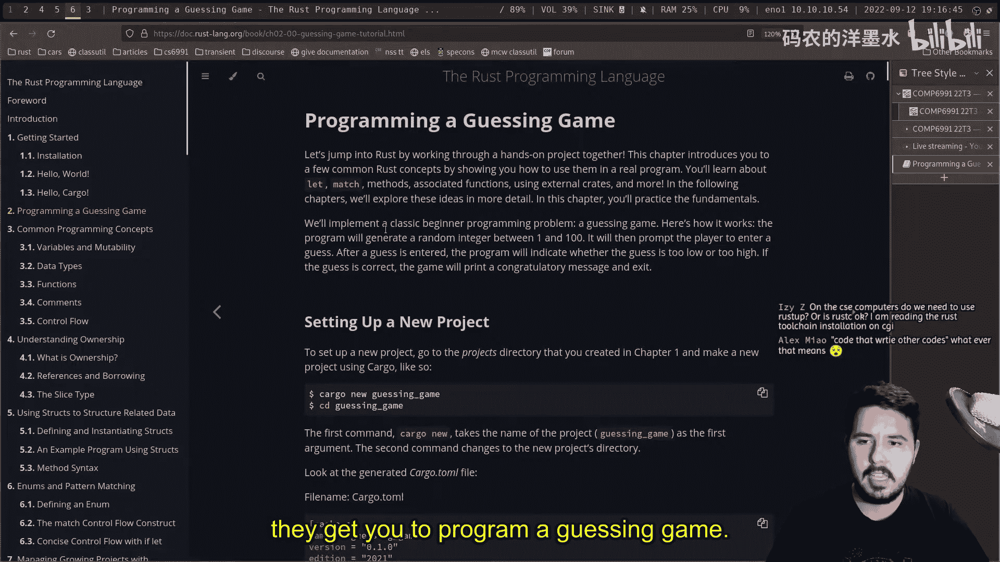

During the lecture。You are welcome to go go ahead and also work on this guessing game yourself。

 but I'll be know jumping into the chat and seeing what people are saying and thinking。

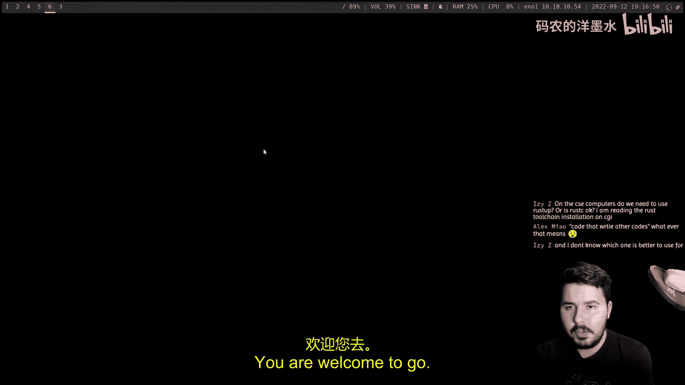

And we're going play around with it， so。I've made， I just made a new whileow we were talking。

 I did cargo New guessing game。 Ive changed into it。 and we can see we've got a new cargo Tom here。

 We've got a new fresh hello world program that Ru sort of spits out for us by default。

 And if I run it。😊，We get hellowell printed out。See compiled， finished， and run。Okay。

 so the idea of this project is we want to make a guessing game where the computer generates some kind of random number。

Let's say from like one to 100 or something like that。And the user is gonna input guesses。

 They might guess 50 and the computer will say， oh， the secret number is higher than 50。 They go。

 okay， what about 75。 and go oh no， it's lower than 75。 What about 62。

 And you know you sort of try and like narrow down the number until you go oh， 65。ep you got it。

 great， nice job。 And so we want to write a program that can do this。

 And this is a great starting program， especially in Ru because you get to touch quite a few different things。

 We're not going to I'm not expecting everyone to completely understand everything that we do here。

 but it'll give you a feel for the language You'll get an idea of how things sort of start to look。😊。

Sorry， I know you got a feel for how things will start to look and you'll get to at least become familiar with some of the ideas in rust。

Right。On the CC computers， do we need to use rust up or is rust C okay。

 I've been reading the rust tool chain installation on CG。

 I don't know which one is better to use for this course。 So we use rust up in 69。

91 Ru up is basically just a program that helps you like manage your rust install and update it and that sort of stuff when you type 6。

9，9，1 cargo 690 and rust C whatever it is。 That's you know using all the the tooling internally for the most part。

 we'll be using like 6，9，91 cargo we were planning to do a lot of exercises in rust C but then S remembered that。

Rust Anar really hates not being in a cargo project and it makes editors freak out and all that so at the last moment we had to rush change everything to cargo to make text editors happy。

😊，So generally you'll be using 6991 cargo yeah， and yeah。

 no need to install rust up or anything on CSC because we've got it already there。

Rust docs seem to have dot dot dot to admit important code is the only way to view this by viewing source。

 right， So the question is here， like if I have， if I look at some type。

 let me go like under file or something like this。 You're going like I can't see this sort of stuff here。

 I'm not sure which dot dot dot exactly you're talking about。 So if you can clarify。

 I can definitely help answer that one。嗯。Okay， so guessing it， right？Yess the number， right？Okay。

 so let's make our program We're gonna say it's going to generate a random number just to help test things。

 Let's just say， we'll let the， you know， the secret number。Just be equal to 42 for now。Right。

 we're gonna change this letters as be random。 but just so it's easy to test and you know so we get focus on the rest of it for now。

 we'll just make the secret number be 42。 And you can see this is how we do a variable declaration in rust。

 We say let We give some name we'll call this name actually a binding in this case。

 and we bind secret number to be equal to the value 42。 Now， notice。

 I didn't have to say what type this was right， Like in see。

 I would have had to write something like int secret number is 42。😊，But in， I just wrote let。

 I could have said let， you know， fo equals some string right。

 And my text editor is being really nice here and actually telling me the types of these things on the side here。

 but I didn't have to write it myself。 I can write it myself if I want。

 And if you do want to write it， you put it here。 So you go write off the name here a colon。

 and then you say I 32。😊，Or here， I might say。Reef stir， again。

 you don't need to know about what these types really mean and all that。

 But if I wanted to give a say what type of thing is。

 I can put it right here almost all of the time right very， very often in rust。

 it's able to infer what the type is automatically and so you don't actually need to manually specify it。

 You just leave it unsaid and it goes great。 I know that's an I32 because I looked at this。

 I saw that's a number。 And so I figured out what type this is。 So it's quite nice。😊，嗯。Cool。

 in what cases do we need to have explicit types， We'll run into them， Don't you worry。

 but I'm not sure if we'll run into them today。 We'll find out。

 but don't worry you will run into them because the compile will be upset at you and say hey。

 I don't know what type this is， give me a hint and then you can help it figure it out。😊，Okay。

 so if we're doing a guessing game， we're going to need to get guesses， right。

 we're going to need to let the user input a guess。😊，And so。

We're going to need to sort of read input from the user。 So let me search for read。

 There's a whole bunch of stuff here。 What about read line。Right， okay， standard input， right。

 So there's this standard input type here。 stood in， Col and， Col， read， underscore line。

 Let's have a look at this。So it says locks this handle and reads a line of input。

 appending it to whatever b bla bla b， you can sort of often skip across a lot of the details if you're not super interested in all the semantics at the time。

 You just want to go， okay， how would I use this thing first and have a look at this。

 input is string new read a line into input And then you know。

 here's some stuff or maybe there's an error。 Great， This seems roughly what we want。

 So let's let's sort of go along that track。 So I'll say， let' input is a new string。😊，Right， again。

 broad strokes。 is gonna be， oh， I don't know。 What is this code here。 I don't quite get it。

 It's okay。 We'll just like， we're just playing around with this finee。

 just getting a feel for the language。 So we're gonna say I O。😊，Stood in oops。

 I need to Io stoodin dot read line。 Okay， let's look at this。 So it takes a ampaand mute string。

 Well I have this input here as a string。 So I guess I can take my input here。

 which is a string and just put an ampersand mute here and it seems， you know。

 it's happy with that okay。😊，And then this function， right， So read line takes this refer string。

 It gives back a result of u size result。 Okay， so we can see here that it's saying that sometimes this can be okay。

 Sometimes there might be some kind of error， and they want us to sort of deal with these different cases。

 Well， we can do that。But I'm going to show us a little function for now that just says make these things go away for now。

 and that's called unrath。So we're going to talk a lot about all of this。 Don't you worry。

 We're going to talk about all of it， but unrap here just means I had some thing that could have gone right or it could have gone wrong。

I'm just going to assume it's gone right if I went wrong crash my program and we'll think about it a little more later。

Okay， so there's a compiler， the compilers complaining。

 It's got some red things cannot borrowla is mutable lot of the time。

It's hard to read these kinds of errors in the text editor with a whole bunch going on。

So I just like to run cargo build sometimes and get the。The bigger output here。

So it says warning unused variable。 Okay， we knew that。

 we're not using the secret number yet so we can ignore that one Er cannot borrow input as mutable as it is not declared as mutable。

 So on this red line here， it says we can't borrow it as mutable and it's at mute input。

 But it says help， consider changing this to be mutable。 So instead of let input。

 maybe try to let mute input。 Okay， so let's， let's try that out。 Let's see what it does。

So instead of let input， we're doing。Let mute input。And let's see。There you go， Er's gone。Great。

 so I've figured it out for us。 So Ru has some very strict ideas about which values can be changed and which values can't be changed。

 if you've ever heard of things like const or in Java that would be called final or are there any other some languages call it like var and Val or some languages call it like let and v anyway there's all kinds of different ideas for this。

 the idea that some values can be changed， some values must not be changed by default when you just write let b equals in rust。

 it assumes that that variable is immutable。 The variable cannot be changed And if you try and modify that variable or let someone else modify that variable or something like that。

 it's going go no， not gonna let you。😊，But if we explicitly say this variable is mutable。

 this variable can be changed， then it will go great， no worries， no problem with that。😊。

Rus compile code looks like a lot like， you know， similar to what youd see out of C or C plus plus。

 but it's you'll see some like rust sort of flavourings around the place。Cool， okay。So this should。

 in theory， read a line of input into this string here。 So this function basically says I'll take a。

 you know， some mutable string。Right， and I'm going to read a line of input into that。

 So we should hopefully get a line of input from the user。 Let's just test it out quickly。

 So I'm gonna to say printlin， right， printlin bang。So I pronounced this。You entered。

You entered and how do I actually print out something in rust with printlin in particular， we use。

Curly braces like this。 So that means insert a value here。 Which value am I going to insert input。

 So this is sort of like a percent code in C and see we might write something like you entered percent S in Ru you would write curly braces like this。

In fact， even in recent rust， you can actually just put the variable inside the curly braces here。

 but you can't do any any like if you're gonna put it inside the braces here。

 you can't have any other stuff in there yet。 You couldn't write like input plus2 or you couldn't write input dot you know。

 like trim the text of it or something like that。 It'll go know It needs to just be a variable or it won't let you。

 So this way is a little more flexible for nows this way is a little more flexible for now because you could do something like input dot trim and it's fine。

So we'll just leave it as this for now。And it says you entered some input， let's test it out。😊。

So I'm gonna to go cargo run。Says guess the numberbar。

 I'm going to take say F bar v and it says you entered F bar vs， great， okay， seems to be working。😊。

Go away。Okay。So we've got our user input， blah， blah blah blah， blah。That seems a little early。

 I'm roughly following along with how the book would like to talk about this。

 Let's look at doing this in a loop first。 So they're saying， oh， let's go to a random a number。

 Let's let's let's hold off on that for now。 We've got one line of input and then the program continues on it it ends。

 And so we're expecting that the user is gonna guess quite a few times so we might want to do this in a loop。

😊，In particular， we might want to do this in some sort of infinite loop。

 right in C or C plus bus or Java or whatever we're writing。

 we might like to write something like wild true。Right。

 we are at R true and then in all of this here。you know， hopefully this just sort of keeps happening。

 keeps going， keeps going， keeps going like this in rust。

 it's worth noting a couple things first of all， you don't actually need these perenss here。😊，So。

 and it's generally idiomaticically， you wouldn't write the parentenses。

 So this is true for while loops， you know， if statements or if expressions， I suppose， you know。

 anything like that， you don't need the parentheses around here like you usually do。

 And so we suggest that you just leave them off。 Rust also has a nice little sugar for wild true。

 instead of writing wild true， you can just write。Loop， which just basically means an infinite loop。

 which is quite nice。Allright， yes， Stephen boilling rust code and why not use ref input？

If I wrote that here， you'll see that there's some sort of error here and it goes。

 it expected a mutable reference to a string。 We got just a reference to a string。

 I'm not going to go too deep into this right now because we're going to have a lot of chat about what the implications of this line here are。

But we're not going to get there quite yet because as again， it's， it's quite a big task。

 and we only don't have enough time in just this lecture yet。

 Is readline allocateating space for the string， Yeah， so we've sort of created this new string here。

 which。Sort of brings about the idea of a buffer。Right， a string can is expandable in this case。

 like capital S string that we've got here， it can grow。

 it can shrink that kind of thing and when the user typess in the line it'll actually grow our string here to make space for it and insert the text in that they've written。

😊，Okay， great so this should hopefully work in a loop now， so let's try it out。😊，So food。

 you entered food bar， you entered bar Ba， you entered bass。 Okay， and if I do control D， it's。Yeah。

 just nothing， no input， so I actually have to kill out of this with control C because we've got no way to exit the program just yet。

😊，Okay。I don't know why。 Okay， there we go。 That's better。So what we need to do next， well。

 hopefully this， the input that they give us should be a number that they're guessing。Right。

 there should be a number that they're guessing， so it'd be nice to turn that into a number that we can compare against the secret number here。

 right against this the secret number 42 in this case。So。First of all， we need to。

 before we can compare it， we need to turn this string here into an internet。

 Some languages might let you compare strings。To integers you know just as they are not so happy in rust Ru likes to be quite explicit about things so let's turn this string into an integer and the easiest way I know how in this case is to use input dot parRS PARS is a really nice function。

😊，It'll basically turn it into， you know， if， if there's some sort of definition that input can be pard into Bla。

 whether that's parsing into a number， passingsing it into， you know some other random type。

 If there's some sort of definition for it that exists， then it'll be happy to do it for you。

 So we're gonna say let number equals input do pars， This is one of those times where it's gonna go。

Tpe annotations needed， because what do we want to pass it into， Maybe a number。

 but maybe we gonna to pass it into like a， you know a student。 Maybe this is some Json definition。

 maybe it's Python pickle， maybe it's just some random text that is you know that we'd like to pass into some completely different idea。

 So we need to solve us。 No， I'd like to pass this into a number。 Let's just say I 32 in this case。

 which is sort of the canonical int， and it's gonna go， no。

 I can't quite do this because it could go wrong。 Pase is potentially fallible。

 So it's going to say if you want an I 32， what you really mean is that you want to result where the successor value is an I 32。

 but there also could be some kind of error。This is a little bit of a cheeky。

 weird way to write it for now I'm just going to say pauses also will let you specify it a little like this。

Pas me into anI32 and that'll probably look a little more familiar for now。And for now again。

 we haven't talked about this quite enough yet。😊，Result。

 meaning it could be a number or there could have been some error that went wrong。

 the magic function that just says I'm just going to assume it went right for now is just dot unwrap。

😊，Like this。And so now number should truly be an I32， which is what it's saying here。

So number is the number that they typed in， if they typed in something that really just wasn't a number that it couldn't turn into a number。

 then it's just going to crash the program it' just going to blow up。

 And for now in a you know babies's first program we're completely fine with that， No problem。Okay。

 now we want to compare these numbers， I it bigger， is it lower， is it the same。

 So we probably write something like this to say if number is less than the secret number。

Elsif number is greater than the secret number。Else， and this is sort of like， you know。

 if the number is equal to the secret number， right。The only remaining case here。Then they've。

 they've guess numbers。 So we've got our sort of three cases here。 So I'll fill them out。

 If numbers less than the secret number， then we'll say printlin， you know， guest too low。

If the number is greater than the secret number， then we guess too high。Otherwise。You got it。Great。

 but if you got it， what do we want to do， If you got it， do we want to like。

Do we want to loop around again and keep getting more guesses No。

 probably at that point we're saying all right， you've got the answer。

 so similar to a lot of other languages， there's this idea of break and rust。

 which my editor is not happy with because Im Mr。 semimi Colon in all these places yet。

There's an idea of break and rust which just means end this loop we're done with this loop return would also work perfectly fine as well yet return from the whole main function because we don't have any code here down the bottom so。

😊，Will this work， let's try it out。Cer run， guess the number 50 thread main panicked result on wrapping a set in valid digit。

Big bang。 So this is， this is， you know， I was saying we're just going to assume it works and if it doesn't then blow up the program。

And its saying invalid interior。 Does anyone have a guess what went wrong here。

 How come I typed in 42。 Yeah， yeah， you guys are all over it， right。

 So there's a new line on the end of my input。 I typed in 42 50 and hit enter， which is 5，0。

 and then a new line character。 So it's， it's not happy about that。 So I'm gonna add a trim here。

 before I actually pause it， trim out any white space on on either end。 So alright。

 let's give that a go。😊，50， guess too high。25 guess too low，42。 You got it， okay。Great。😊。

So we've got a bit of a guessing game， it's always 42。😊。

And we're going to sort this out for a random number in a second， but I have a quick question。

Does anyone have an idea of how like this line here。

 This line here is fine And also Sreray has just mentioned there's the trim documentation。 again。

 just over here， you can always， I can very quickly get to this documentation here and go here's an example of how you might use it and what it might do。

 Very cool。 James is mentioning match right， So this here is not quite not quite idiomatic in how you write rust。

 because you could get these if conditions wrong and there's already code that's sort of you know well vetted that knows you know knows the intent we're trying to express here。

 We're trying to figure out how these two numbers relate to each other ordinly。

 whether it's greater less the same and we've written that quite imperatively here。

 We've written it as like explaining to the computer how to do that。

 how to compute which one is which。😊，Right。But in rust。We generally prefer to to instead describe。

 you know， describe what we're trying to do to describe the problem that we're faced with as opposed to telling the computer how to do it。

 right so。There is something called comp compare， right？

Compare when we have two things that can be compared。 So look at this5 dot compare 10。

10 dot compare 5，5 dot compare 5， and you might get some sort of ordering。

Let's look at an ordering and ordering is either less equal or greater。😊。

Right so let's try this out there's lots of examples here to make use of so if we said。

Number dot compare to oops。To the secret number and it's my editor of the smart and it's going， hey。

 you know this is what you mean you you just want to put an a percent here again we'll get to that eventually。

But this will return us a ordering， which is one of these。

 it's going to be less than equal to or greater。And Russ gives us this amazing operator to deal with this。

 which we'll look at more next lecture called Match。😊，So I say match on this ordering here。All right。

 match on this ordering and I can say fill my match arms out for me。And it'll say， you know。

 sorry the editor's going a little crazy here for now， just bear with me。

 it'll say what do you want to do in each case？😊，Right。

 it's putting all this stood comp ordering here because， you know， it'。

 it's like I don't know what ordering is。 I can just put a little import statement off the top。

 St comp ordering and then。Get rid of all this extra like flluff here。But if I swap these for braces。

 give me a second here to sort this。Crisis out。All right， there we go。Now， look at this。

 instead of telling it how to do， we've said， compareare these two numbers。

 and it's given us less equal or greater。All， so let me just put this same code in here。Allright。

 again， this code is doing the exact same thing。 Actually， we need two lines there。Right。

 Co's doing the exact same thing。But it's a completely different way of writing it。Now。

 which one do you like that or that's up to you？That's up to you to figure out。

 and we're going to play with all kinds of examples。

 you're going to have plenty of time to figure out all of this stuff， but it's worth knowing。

 it's worth thinking about and using both methods。😊，Right again。

 really just about playing around with things， let's just double check it actually works 50， 20， 42。

 you got it great， so it literally does the exact same job。😊，Exact same thing。 And， you know。

 take a look at this and see what you think right， think about this is the kind of time where you think about how often do you mess up a little if condition。

Where you go， oh， did I do， Was this less than or equal to or was this side greater。

 And that one was less， especially begin to like an orwe。 You have this thing or that or did I mean。

 is this thing and that or。You know， did I， what do I really want here？ And yeah， as， as She Lois。

 I'll figure out how to pronounce that one mentions would match for you had since it's exhaustive。

 So yeah， one of the things that match gives you is that it is exhaustive。

 So you need to account for every single case。 If I forgot about the fact that the number could be greater。

 I'll actually get an error at compile time。😊，I won't actually be able to build my coat。

I'll get non exhaustive patterns greater is not covered and it says， hey， you should， you know。

 you should put in a match arm that checks if it's greater。😊，And there are always to be clear。

 you might go， okay， that's I'm， I hate that。 Sometimes I don't want to deal with those。

 There's ways to tell the compiler I don't want to deal with other the case。

 But there's something in there。 There's something there that says。

That says you have to explicitly say， I don't want to deal with that case， so you know。

Sincech match is is required to be exhaustive It's recommended to use。

 especially if using a custom enum that might change later。 Yeah， for sure， right。

 so we think there's less equal greater。 you know， what if you're using some other enum， you know。

 some other you know， set of possible values where later you go actually there was another option that I needed to add here。

😊，In another language， you might have to go and try and track down every single spot where you are dealing with this thing to now account for that other case。

In this case， if you wrote it like this， you build your code again and it goes， okay。

 so you're missing it here， here， here， here， here， here， here， and there。😊。

And you can sort of track these things down。And yes， that's one thing Haskell as well。

 Haskell is non exhaustive。 Haskell has very similar ideas of this pattern matching。

 but it doesn't require exhaustiveness and that can be a real headache to work around as well。😊。

And match also compiles the jump statements in certain cases more efficient。 I think in this case。

 it's probably pretty likely that they compile down to the exact same code。

 whether you did the if statements or this comparing。 if you turn on like optimizations and all that。

 So often it actually doesn't matter which one you use This is a principal idea of something called zero cost abstractions。

 which will talk about during the course So yeah， often it just comes down to which way communicates your idea better。

 which way are you less likely to write the wrong code。 you know。

 these are the things to start thinking about。😊，So I think the last thing we have to do here for this guessing game is to make this knops be 42 but a random number。

And I believe we have a crate called Rand to help us out with that utilities for random number generation。

 So over here I'll write 6991 cargo add Rand， so this will add a third party dependency of R for me。

😊，Apparently， it wants to update my grades index。 So we have a little bit of time while it。

 while it works。 I want it。 He said， I said the word zero cost abstracttractions。 Yeah。

 it's an important idea。Okay， okay， there we go。So I've got RAand。

 it doesn't actually update this index every single time。

 I don't know why I chose to do it right now， but but it did。And it's talking about some features。

 you don't need to really worry about these this point in the course。

 but the important thing is if I look at the cargo dot Tomel now， you'll see it's included this here。

 Rand is 0。8。5。😊，So now we can use this library in our code。So instead of writing 42 here。

 we'd like to get some sort of random number， they've got a quick start to get you started quickly。

 the highest way to get a random value is to use random or thread RNG。

 we'll just use thread RNG here， So we'll go oops。😊，Rand。Thread RN G dot generate。

 return a random value， supporting the standard distribution。 great， I'm going steal。

 I'm going to steal Oh no， I won't way too far， didn't I We're doing things a little bit out of order。

Cool， there we go Gen range is probably a little better for us here， which I am again。

 to be clear stealing and will'll generate a number in the range of one to 100。

So this should give us a random number and instead of writing 42 here。

 we're basically just going to stick this bit of code right there。Of it。

So this should just be a random number between one and 100。😊，And yeah。

Can you combine ordering in a condition to deal with a greater than or equal case。

 That's an awesome question。 And just to show you what the code would roughly look like。

 I think the chat's sort of already all over this one。

 But you can write these these sort of pattern matching。

 which we'll talk about again next lecture as well。

 they're quite flexible in that I could say something like oops， not like that。 something like this。

😊，Right， if it's less than the number you get to below， if it's equal or greater， then you got it。😊。

So it is certainly possible。Okay， do we always add a depend when we use something outside of the standard library。

 Yeah， pretty much， pretty much。 if you're looking to use external stuff。

 then you'll have to add it as a as a dependency。 Can we use underscore Yes， absolutely。

 we'll talk about that one more next lecture。😊，All right， so let's see how this goes。

You can see it it was building these extra dependencies that we pulled in here。 We asked for RA。

 but Rand itself has its own dependencies that it needs to pull in right that we can see over here and so it had to build some extra some extra programs to get ours to run So I'm just gonna guess 5050 is too low。

75 is too high。😊，62 is too high， 57 is too low。59， we got it。 And we see if we run on it again。

 will we get a different number。 Yeah，50 is too high。 So you can immediately tell that it's。

 you know that we， we've got a new number here，42，40， you got it。😊，Great。😊，Okay。So， yes。

 there is a lot going on with this program here。😡，But the important idea is that you're not。

 we're not expecting you to look at this and go， yeah， I get every single line of this code。Easy。

 no problem。But we're hoping that you look at this code and go， okay， I can sort of tell that's rust。

 You're gonna get a lot of practice writing rust code and these things will eventually。

 these things will come to you。 But as long as you go， okay。

 I can sort of start to pick out different little bits and pieces。

 I see how this roughly looks like C。 I see how this might look a little bit of like another language I've used maybe。

 you know， just just picking up on the broad strokes。 That's the idea here。

 not to understand each little bit of code。😊，It's just to let you watch someone write some code in front of you and get a little familiar。

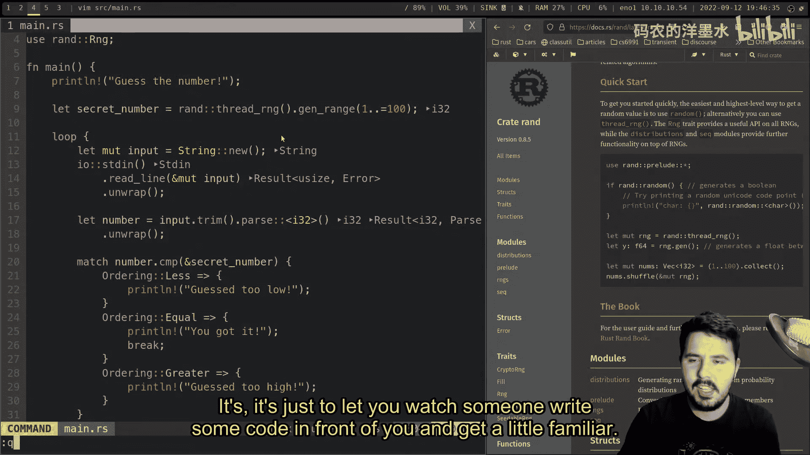

Okay， so that's our little guessing game。Let's rush through the。

 the sort of last bit of stuff we have to talk about。 So we havestructs and enums。

 which we've talked a little bit about both of these。 I don't think we really talked about strs much。

 oops， Oh my gosh。 yeah， editor going crazy。

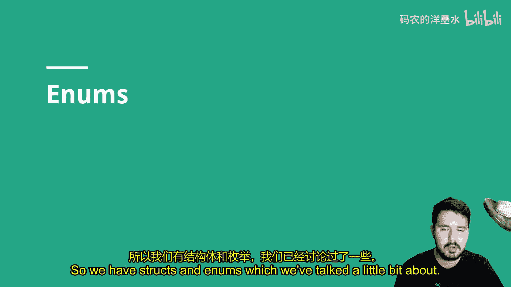

嗯。So to be clear，structs。😡，I very much like they are andC。Right， very similar idea。

If I have a struck student。Then I might say the student has a Z ID。

 I might say the student has a name。😊，I might say the student has a wormham。

 you know that kind of things， it's just about combining multiple types together into one large type like a student and you'll get practice usingstructs and playing around with the fields and that sort of stuff so worry not。

😊，嗯。So yeah，structs， much as you know them， enums are a little bit of a different idea which we've started to look upon。

 so an enum。😊，I might give this one， you know a name。 Let's say in Im Com 6，9，9，1 member。

So an enum lets us express the idea that there's different possibilities for this type。Right。

 just like this ordering that we saw here， so in ordering it's either going to be less equal or greater。

And we saw that they defined it like this inum ordering less equal or greater。Now， same idea。

 if a Com 69 element member they might be a student。😊，ops，They might be a teacher。

 They might be an admin。 They might be a lecturer。 They might be a convener， something like that。

 right， So all these different possibilities， the really key important thing with enums in rust。

And this is similar to some languages like Haskell。

 any language where you have something called some types， this is essentially just a sum type。😊，SUM。

Is that you can also attach data to each of these things and you can attach different data depending on which one it is so for a student we might care about a student has a Z ID som I'm going to write it like this。

😊，A student has a Z ID。Which is I guess I've been modeling that as a number recently。

A teacher might have， you know， a name。Which is some string。

 an admin might have like they have a name， but they also have like hours worked or something like that。

 How many hours they spent adminrating lecture might have， you know， a name。Ourours worked。

And also like， the， you know， lectures delivered。Right we can have different data types depending on which sort of version it is。

 but they're all unified under this one name here， Com 6991 member。

 So if someone goes here's a Com 6991 member。Well， you're not going to be able to do anything with it until you check which one it is。

Using something like this match， right， using using match here。 So let's say we got a student。

 we would go match on this student if it's a student with this Z I， then do this。

 if it's a teacher with a name， then do this， if it's an admin with a name and hours worked。

 then do this and so on and so forth。 then yes， U 32 is just an unsigned 32。😊，嗯。😊。

And it it's incredibly useful when writing programs in rust。

 and we'll leave it to you to decide whether you end up liking enums。😊。

But there's one enam in particular that I'd really like to end this lecture off looking at。

 and that's an enum called Op。So let me define option myself right here。Inum option。

 it's really simple， the one weird thing is it has this T up here。😊，Right。

 and it says some T or none。So。This T here is basically saying that if I I can't just have an option on its own。

 there is no such thing as just option。😡，There is only option of something。

Right so in this case we might think of something like an option of It。

 an option of I32 or maybe like an option of string and this T here can be swapped out for any type。

😊，It could even be swapped out for some other option type。 if you really wanted it。

 you can say some option of option。Of string or something like that。

The key idea is that option requires another type to go in between these， you know。

 these are little brackets here。😊，And that wherever this T is over here。

 it gets substituted in as well。 So yes， this is generics。 absolutely， is this maybe， yes。

 this is maybe if you've come from Haskell if you're seeing and you're seeing crossovers from other languages。

 Yes， great， perfect。 That's exactly what we want。 And please tell use the generics are better than templates。

 It's for you to decide。 but I have a feeling you might be convinced。😊，嗯。So okay， so these are。

 this is the option type and you'll see that the option type is either one of two things。

 it's either sum T or it's none。😊，So it's either。😡，This variant here。

 and these names could be anything。 This could be a variant food and a variant bar。

 The really important thing that distinguishes them is that foo carries a T along with it， carries。

 you know， in this case here， carries an int。 In this case here， carries a string with it。😊。

But if it's a bar， there is no tea。😡，RightIt makes a lot more sense to think of this as probably these names。

 some and none。But this is a brilliant， this this is a pretty brilliant idea， I think。

And it exists in a lot of languages。Which is。This is a type that represents a value that may or may not exist。

😡，If I have an option of y 32。😡，You know， let's say my function takes an option of I32 as a parameter。

 Then I have to check it each time。 And sometimes my function is called it might be， yeah。

 here's that， here's that integer。 or sometimes when it's called it might be， there's there's。

 you know， there's no integer at all。 It's just none。 So in other languages。

 you might be starting to think about some ideas like null。 right， you might go， oh， okay。

 theres some sort of type that represents either it's there or it's not there。Right。

 and I think I've done that with null before。 Sometimes when I'm passing a pointer。

 I'll pass a pointer to an actual thing， or sometimes I'll just pass null。

 which means that there I might be using that to signify that there's nothing there。 right。

 It's a very similar idea。 But we're going to think about like what it what that looks like and why I preferred one way or another。

Okay， so option。So I've got a program。I have a lot of programs here， actually。

I've written roughly the same program in a bunch of languages， Java， C， C++ go Python rust。

Since we have assumed knowledge of C， let's look at the C version first up。

So what does this program do if we start at Maine， it calls this create function。

Create takes a bulloleion。RightTrue or false， if it's true， it returns a string hello there。But。😡。

If the bullolean is false， then it just returns null in this case is how we'd write it in C。

 But what I'm really trying to communicate here is that if it's true， we will return a string。

 if not it won't return a string， itll return something。

 something that means there is no string and see this is generally how we'd write it。

 We'd write it as a you know， a pointer， string is a cha star， and if there is a string。

 it gives a string， otherwise it'll give back null。😊。

So then how would we deal with this and see if I create true？

And I put it in this variable here before I， before I use it and C。

 I must make sure that I always check if it's not null。 This is a bit of a。

 I've written it like this， but maybe you'd much prefer it to look like this。

 if create true is not equal to null。Then print it out。Right。

 or another way you might do this and see is with something like a turnernary。

 right And I might write this as well。 createre false is not equal to null。

 So if we now create false value， which should give us an nu back。Print out it returns some string。

If it's not null， this is a theerernary operator basically says ask a question here and if it's true。

 then do this thing， if it's false， then do this thing here。 So if it's not equal to null， then yeah。

 sure， go ahead， print out that string。If it is null， then print out empty instead。

So let's see how it works。Says create true return to there， create false return empty。Okay。

 so it seems to work。😊，Does anyone want to jump in with if is there anything that you feel a little。

 you know， sussy about is one way to put it， is there anything here that you look at and you go。

 you know， I'd be a little worried if I was programming in this code base？

What would be your considerations when you were writing this main function？Right？

When the lecture is SAss， I'm going to show you lots of SAS code this time for sure。😊，So yeah。

 if we were working this code base， you're at your job at Google and someone says， hey。

 here's this function create， that returns a pointer。😊，I time is highlighted in red。

What would you be like， you know， what would you be thinking about。

 what would you be potentially worried about， you know， in this code base？

Just looking at the function definition is not clear that C could return null。 Yeah， for sure， right。

 This just says returnsturn cha star。 A lot of people look at cha star and they go great string and they go printed out。

 And， you know， suddenly they're printing null。 They get something called undefined behavior。

 and things are going horribly wrong。😊，Right， there's no way to distinguish between an empty string and null。

I think。I think you maybe could， but it's certainly unclear， right。But it's， it's。

 it's still just like。Really tricky。 Basically， Fo you always check right。

 that's a really good point as well。 Basically forces you to always check for null if a type return is a pointer。

😊，Right， yeah， our empty string is yeah， is is going to point to a nullbackte character and nullle0。

 So all these things sort of get mixed in the same bag and get quite confusing。 But yeah。

 to that point， it forces you always check the null of a type return as a pointer。

 that's a really scary idea。 whenever you call a function that say returns a cha star。

 or if you define a function that takes in a pointer， you know， as as as a parameter。

 wherever you get some unknown pointer。😊，It always has this possibility to be nu。

RightThis might be an idea that youre just sort of like is ingrained in you。 you're like。

 yeah that's how coding works。 And with some of these things that we look at this term that might be the case。

 And so that's why I say you've got to keep this sort of open mind and think about these things because yeah。

 that's the case with a lot of languages So let's look at a couple other languages here。

 I've got some C+ plus for example， So C++ does have this stood optional type。

 which is quite a bit like rust。😊，RightAnd we can either return， there's some string hello there。

 or there is the empty option， right， there's nothing。And we can do similar things。

 check if it's true， printed out or we can do it a little more functionally like in C， where we say。

 give us the value out or print out this empty string instead。😊。

But we still often have to worry about。The same problem in C++。

 if you're using pointer types like existing C， you always have to check if they maybe null or not。😊。

Right， if you're using modern C plus plus， even things like stood unique pointer and stuff like that still have possibilities to。

 to have， you know， poor values in them， right， effectively not。

And so you end up having to program really， really defensively， right。

 defensive programming you have to go。This could go wrong。 This could go wrong。

 This could go wrong and sort of account for every possible case。 You know。

 could this point to be null， Could this point to be null， I spit a point to back out。

 That person there needs to go was that point to null。 right。

 any time you're dealing with these values that could be nullled out。

 There's possibility for like something to go wrong。 There's possibility for some kind of a crash。

Right， same thing happens in， say Java， right？Java is a brilliant example because it has this optional type here。

But in Java， any single object can be null， including optional itself。😊。

So this optional type has three possible values。 It could be some value。

 It could be a valid optional object that has， you know none， nothing。

 or the optional itself could be null。 So there's two ways that is just like， man。

 if you ever go into a code basease you're at Google or Europe at last year or something like that。

 And you find an optional that's null， let me know。

 send me an email because that's just like really funny that it completely defeats this whole purpose。

 But there's there's just so much to worry about。 Even Python。

 Python is probably the scariest of the bunch because in Python， any single value。

 any single value in Python has the ability to be none。😊，Has the ability to be nothing。

 And so anytime you get any value in Python。It might be tempting to go。

 I better just check if that's none or not。Right？And it's Python withty in。

 So absolutely you've seen that like languages develop over time and they've all you know there's been sort of convergent evolution where people are starting to realize maybe there's some ideas here。

 maybe there's some things that can help us in terms of like safety and all that。

 And's I think it's for good reason。 that's why we're sort of inspecting these kinds of things here。

 So there are mitigations in languages。 but a lot of the time there's still pitfalls that sort of fall through and it's important to understand where the language might let you down。

😊，Right。Learn how use my iPad and never look back yeah， and so that's。

 you know one of the things that's been advancing and is becoming more popular these days is type systems that help us avoid these kinds of ideas。

 right， avoid these kinds of problems。😊，And so， you know， with things like MyPa。

 things like Typescript with， you know， rust with a quite a you know。

 powerful type system to available to us。 And yeah， it looks friendly to use。

 but in terms of reverse engineering， it's a horror move。

 even in terms of just writing correct software， it can be really difficult because you're always worried about what could go wrong。

😊，Right， I think my absolute favorite has to be go in this case because I had a real fun time writing this example out because first of all go has no turnernary operator or anything like that so I have to create a variable and then go if it's not nil then that variable is the thing。

 otherwise that variable is this string and then the other really fun one is a string itself。

 although a string is implicitly a pointer。😊，The string type can't be nil。 Go calls it nil， not null。

 But， you know， so you have to do a pointer to a string， but you can't actually write。

Reference hello there。 the the go compiler doesn't like this line of code。

 And so you end up having to pass this string to a function that just does that for you。

 And it's just， it's just beautiful。 It's just brilliant。 So， you know。

 even trying to do the right thing or trying to do these things correctly can be。😊，A hassle。

 and that can actually be dangerous because people tend to go with the most， you know。

 the frictionless route， whatever is the most clear to create code。

 And so if you make it hard to do the right thing in your language， that can also be a real hazard。嗯。

So that was， that was certainly a fun one to write， but let's let's come back around。

 what does the rust code here look like。I would write something like this， okay， it's freaking out。

 sorry about that。Okay， the the， the。Stupid text editor。 Okay。

 we're going open it and something else because this is just horrible。 Okay， great。

 So in in our rust code here， we our function returns an option。

 This is just a rust's way of saying string in this case and we say if it's some then return hello there if it's if there is if it's false and return none and we can write something like this。

 We say create true if it's something， then grab it and unrie。😊。

So this is this is this should feel a little iffy so far。

 we check if it has something in it and if it does， then we call this unwrap function。

 which we've seen a couple times now it means I am pretty sure it's okay。 And if it is if I'm wrong。

 crash the whole program It's like there's a little bit of communication going on between these lines。

 If I messed up what this was and this might crash the program as it's written。

 it's probably fine but it feels a little scary So you know another method might be create false and unwrap it or if it's you know if it's doesn't exist。

 don't crash the program， just provide this string instead。😊。

RightSo this was the sort of two methods that I tried to do in each programming language。

 But then down the bottom here， I have this sort of hidden third option， right down the bottom here。

Which says， I know how the college has messed up， says match， right， match some string。 if。

 if it is sum， it， you know， if it has a string， then print out that string。

If it doesn't have a string there's just none， then the amazing thing about this。

 the thing that I really like about this personally is that in this nonen case。

 there's literally no variable called string。Right this string here is only valid inside this case here。

 In in un case， there's no variable。 There's nothing to get wrong。 If I wrote， you know。

 string in here accidentally， the compiler would go， hey， that doesn't work。

There is no variable string， that was up here。So that's something that I like to。

 to sort of stop myself from shooting myself in the foot。

 But I can see that I can see the people are chatting or about all kinds of things in the chat here as well。

 talking about， you know， programming languages and stuff。 And that's great news。 That means I I'm。

 I'm， I'm loving that that's happening there。😊，And yeah， it is basically a haskell pattern matching。

 but exhaustive is the one sort of primary difference。 Yeah， absolutely。😊，Okay。

 so there's all those different things to recap these different types。

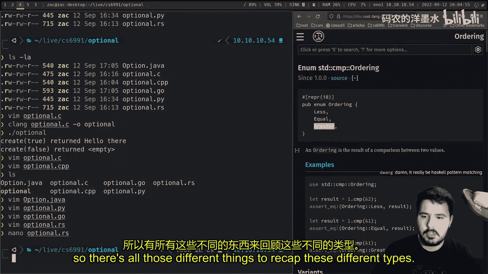

Rust's option is not a magic type， right， Notice we can write option ourselves。

 It's not some sort of special feature of the language that only the。

 the compiler writers can actually create this type。 Anyone could make their own option。

 You don't even need to use the option that they've given to us。

 But the important idea is that there's no implicit language nuability。

 That's something that I forgot to make really， really clear。😊。

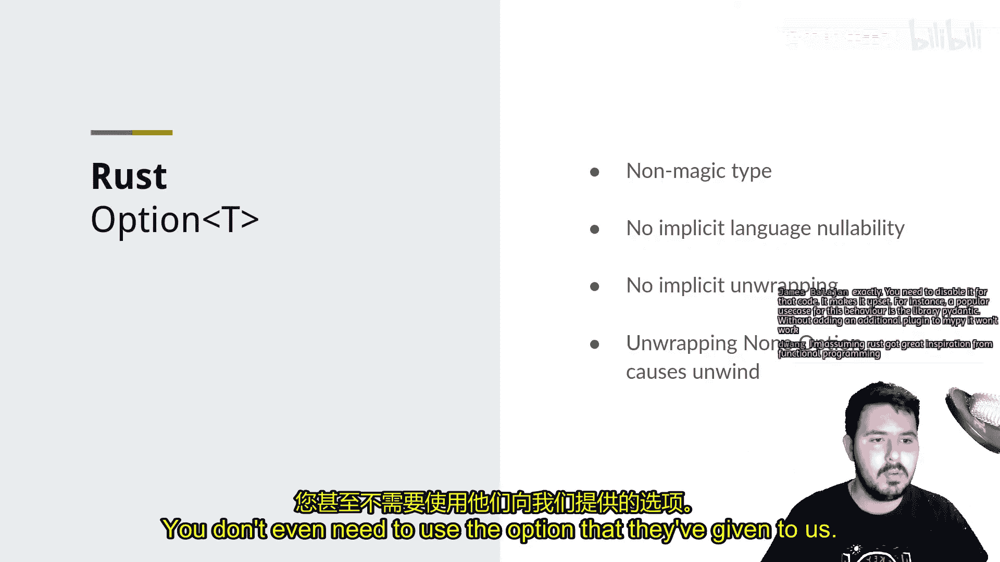

The brilliant thing。About having no nullability in your language and just using something like an option type instead is not the option type itself。

RightThe option type is sort of just like a necessary thing。

 where need to sometimes express the idea that this value may or may not be there。

We just need to do that sometimes。The thing that it gives us by sort of writing our language this way is that it means that anything that doesn't isn't written option。

 if I write string， if I write int， if I write you know， student， like struck student。

 whatever like that。😡，If I write that， it will not be no， it will always be there。Right I don't。

 I never need to check is it nu， is it null， is it nil， whatever you want or。

 whatever flavor of the month it is， right？😡，If I get a value out of a function。

 if I take a value into a function， if I don't write option。

 then I don't need to worry about the possibility of it not being there。

Which is a really powerful idea。 It's something to consider， something to think about。

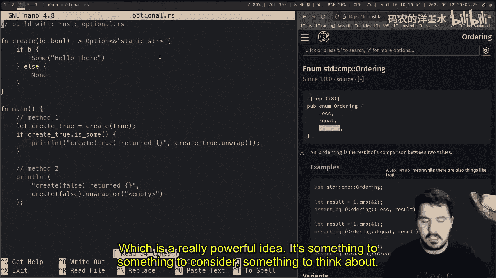

So Rus there's also no possibility of causing a crash unless you call a function that you know explicitly may crash the program if the option is none and if you do make the mistake of interruptwing a none option it'll unwind the program that's sort of like an exception where it's you know goes up and goes you were in this function then you went to this one then this one then this one then that line and that line there crashed and it gives you some sort of like little stack tracing here's a line that went wrong。

In C， we use a type pointer。 The problem with see is that any pointer can be null。

 Deer referencing a null pointer is undefined behavior。

 which I would argue is worse than unwinding worse than causing a crash because it can lead to memory safety issues。

 which can let the hackers into your computer and wreak havoc do all kinds of horrible things Usually it might be a segmentation fault。

 but it can be really bad if the optimizer goes crazy。

 We'll find time to talk about this or maybe foreign post or something like that。Later in the course。

But it can get real nasty and so you need to be really defensive when you're programming。

 you need to go， check is this null check is that null check is this null， that kind of thing。

C++ similar to rust option， but similar to C if you unwrap， if you call unwrap on a null option。

 it's by default undefined behavior， so it can be a little dangerous can lead to some bad things。

 similar idea， point to types have implicit nullibility and other types like stood unique pointer and stuff also can have this implicit nullibility problem meaning sometimes you have to program quite defensively。

Java， similar to Ro option， but any object in Java can be null， even optional of T can be null。

 which is， again， a little scary。 And if you find that in the real world。

 if you've run into this and just banging your head against your desk in three years time and you go。

 I remember Zack says something about that。 Please send me an email because I love it。 Go。

Pointer to a type like say any point it been nil， but at least dereferencing a nll pointer caused a crash instead of undefined behavior and you know potentially memory safety issues。

😊，Using pointers can be painful though， so sometimes you might write code that you're not the most proud of that may a little more dangerous。

And so you' got to be defensive and go as well Python is certainly life on the edge without my p at the very least。

 without some sort of type hint， life on the edge， any value in Python can be none and unwrapping and none value causes an exception。

 at least not memory safety once again。😊。

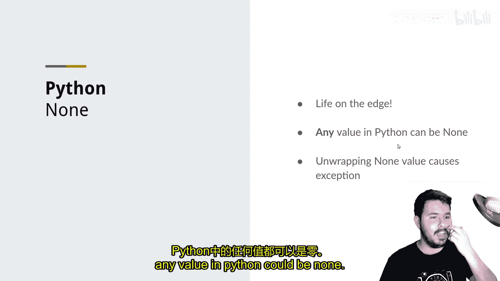

So just to wrap things up， what does an option value even represent？

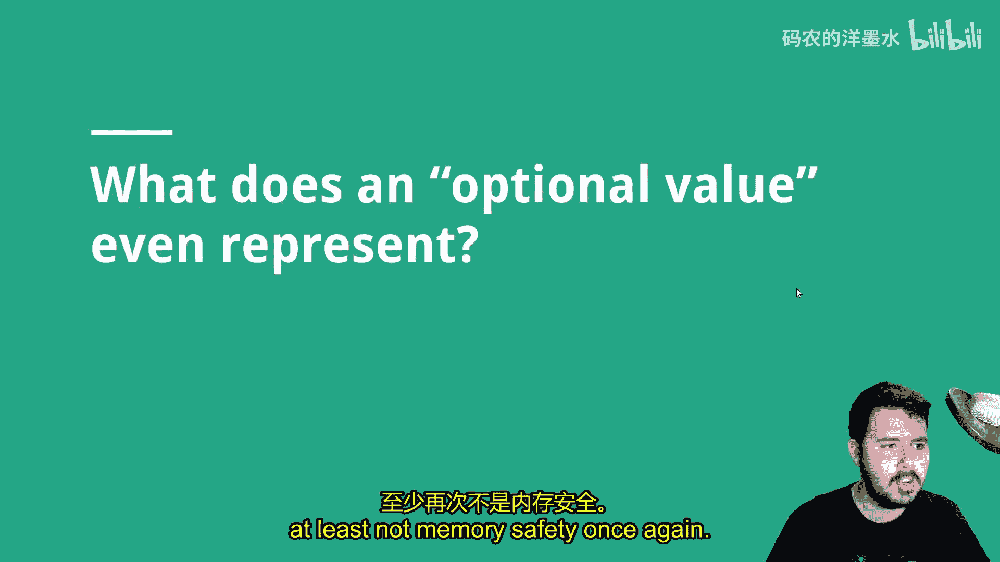

Well， it might mean this function might not produce an output。

 right So if we have a function that takes a string and turns it into an integer。

 not all strings are going to be valid integers， right， And so we notate that with option of I32。

 right， If we write I32 there， they can guarantee that they're always going to get an 932 out。

 no matter what string they give in by writing option here。

 they are forced deal with the case that it might not be so。

A function may require may not require an input。 right， Imagine In stringing。 Here's our integer。

 and we're trying to turn it into a string。 But let's say maybe we let them specify the base。

 This might be default like it might default to base 10 if they don't provide it。

 but they can optionally say， yeah， Id like to change the base to be base 16 or base 8。

 you know for the conversion。 But notice this string here is not optional。 Any number， right。

 any integer should be able to be converted into text。

 and they don't need to check if the string is null。 right， They just go， oh， string， great。

 printed out。 What is it， And it'll always be there based on the way that we've written this function。

 right， This is the contract of the function。 The contract specifies this string will always exist。😊。

It's quite nice。 And you may imagine a struct like a type that may not have some data。

 So like a student may always have a Z IE and a student may always have a name。

 but they may not have a Wham。 Like let's say it's their first term they haven't completed any courses yet。

 Their Wm is sort of like undefined in a certain sense。

 And so the Wham might not exist and you might use an option for that sort of thing。

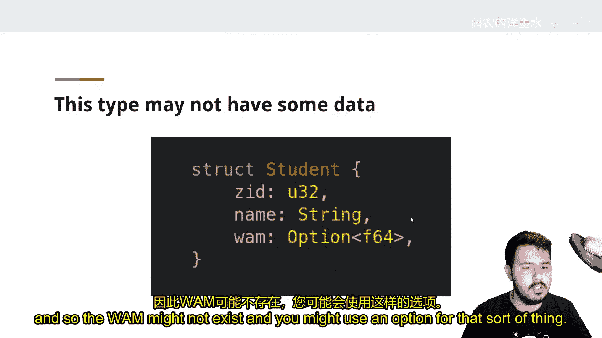

So how does language design making writing robust programs easier？Well。

 if you design your language to not have implicit null types， nil types， whatever it is。

 and there are languages that do this， right， I believe Typecr does this relatively well。

 things like Cotlin， Ru in our case， Haskell， you know， there's all kinds of languages that do this。

 you know these days， but there's also lots of languages that don't。

It can make you may have to program really defensively in order to be as robust if that makes sense。

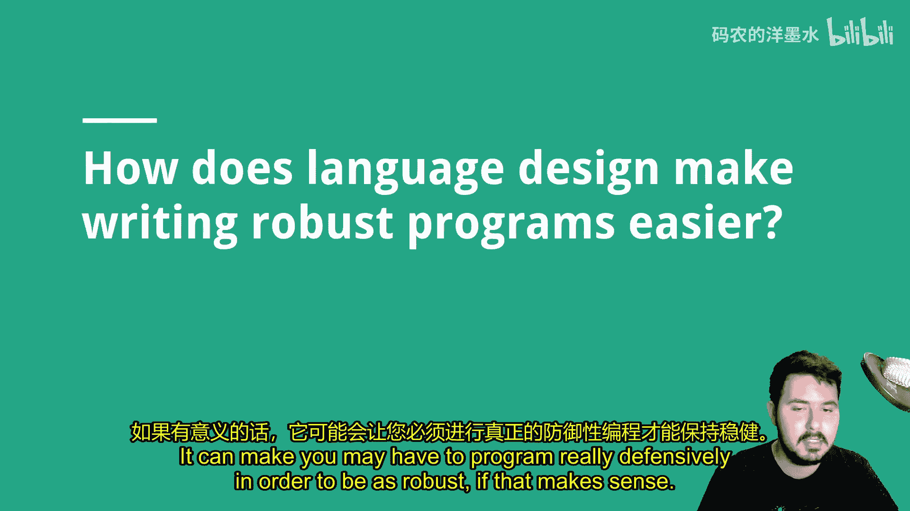

And we're just going to end this off with Tony Hre's billion dollar mistake。

 This is a really great talk that I would strongly suggest watching。

 but Tony H says his apology in 2009， I call it my billion dollar mistake。

 It's the invention of the null reference in 1965。 At that time。

 I was designing my first comprehensive type system for references in an object oriented language Alal。

😊，Algal W， actually， my goal is to ensure that all use of references should be absolutely safe with checking performed automatically by the compiler。

 but I couldn't resist the temptation to put in nu reference simply because it was so easy to implement。

 This has led to a newer where vulnerabilities and system crashes。

 which have probably caused a billion dollars of pain and damage in the last 40 years。

 So if you will info you know Tony H billion dollar mistake。

 there's a whole talk that he does you know explaining the sort of considerations and the decision behind it and all that。

 but， it's brilliant to watch。 And and it's something that I would really suggest strongly suggest you you spend some time thinking about。

😊。

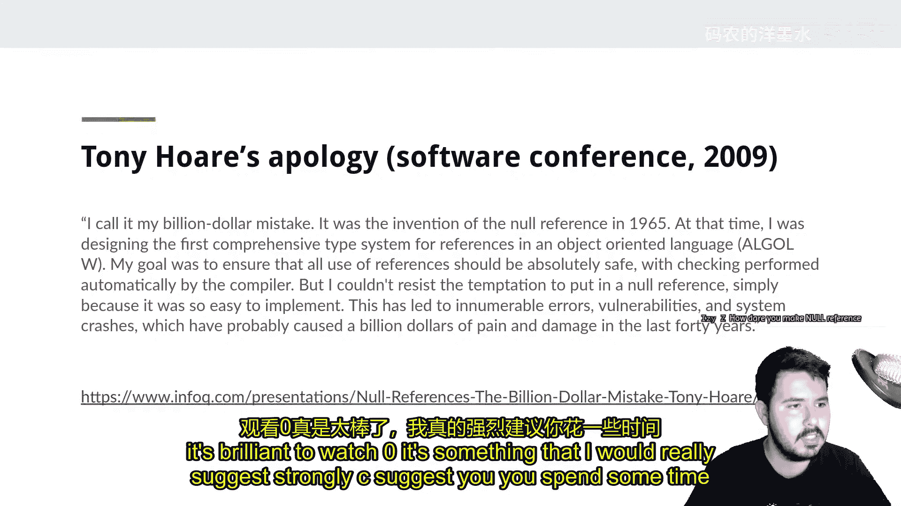

Anyway， welcome to Com 6991。 We look forward to the rest of the time with you。

 and we hope this's sort of like bit of a kickstart。

 You've gotten a bit of a flavor of what what we care about in the course and what we're going be looking at we're very excited to have you all。

 and yeah， So I'll just quickly this let's call this the end of the lecture。

 I'm gonna catch up with the chat really quickly because it's been a little while I had to sort of smooth because because you know're obviously a little overtime。

 but let's see Python type in scary Yes Python lets you write super confusing code but also very clean and readable code。

😊，Alright。 And now we're chatting about Python and stuff。

 There's some meta programminggram things you can do in Python will be literally impossible and aesthetic statically type language。

 There's some very cool meta programming ideas that we're also gonna to see in rust when we look at macros as well。

 which will be quite cool。 That's a very interesting and deep topic。

 classes that dynamically generic classes。 Yeah， yeah， yeah， cool。😊，Okay。

 so lots of chatting about programming languages。 that's great。 That's exactly what we want to see。

 And then we got lost in the source and went okay， what are we talking about。

 Kotland has null just null ability must be explicitly defined with a question mark character。

 So yeah and that's a pretty similar idea to like something like option in rust where we have the idea of value not being present。

 but we need to specifically say that this value is is optional may not be there And the thing that brings us is that all the other things that aren't option or aren't question mark maybe in Koland's case will be there and we can rely on that which which is awesome please share your vim config and plugins。

 Sure， I can make a post on the course for actually， yeah。

 make a post on the course for I'm asking because I'm sure there's lots of other people who might want to share their sorts of stuff。

😊，But yeah， I can do that， I don't think it's too complicated， but sure。😊。

How hard is this class gonna be。 We don't 100% know yet。 right。

 This is we're still just working things out the first time on a scale of HC C I to A O。

 Let's say I'm hoping it's gonna be somewhere in the middle， to be honest。

 I don't think it's gonna be an A O S， right， It's not gonna be a complete cake walk。 obviously。

 there's gonna be work in it。 but I don't think it'll be an A。

 I think it'll be I'm I'm hoping that people find it either sort of somewhere around the middle。

 You know， maybe on a little harder side at least for our first session here。 But we'll，'ll。

 we'll check up and we'll see how things are going。'll。

 we'll check in with everyone and you can leave feedback and we'll figure it out for sure。😊，UCool。

 thank you everyone， thanks everyone we'll get extra marks using Arch Linux。😊，I I ex， by the way。

 Great。 Okay， thank you so much， everyone。 Thanks for coming。😊。

And I'll see you all again on Wednesday。We'll be looking at some more interesting stuff。

 We'll be looking more at pattern matching a little more about those enums andstructs in detail。

 doing some more rust code。 It should be fun。 So I'll see you all on Wednesday Ask questions on the forum。

 That's right。 Yes， the YouTube comments are closed。 There's no commenting after the lecture。

 So that's not to stifle the discussion。 That's to move discussion to the course forum where we'll be happily answering plenty of questions。

 and please introduce yourselves。 Yes， there's an introduction thread on the course forum。 Ka。

 I need to oh let me hang on。😊，Make moderator。 There we go。 Yes。

 I introduce yourself in the course forum ask lots of questions。 and otherwise， we will see you all。

😊，On Wednesday， bye for now， and thanks again， See you' all later。

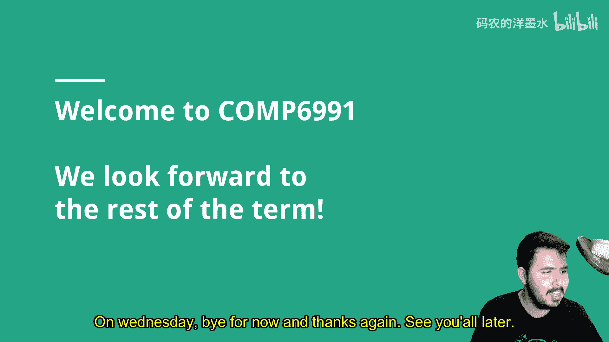

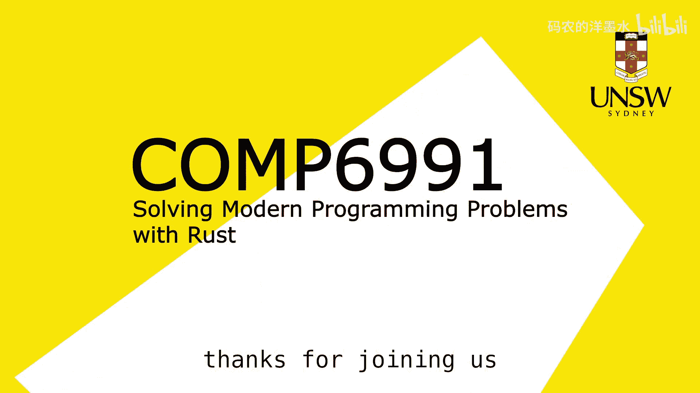