# 【全集】新南威尔士大学 Rust现代编程 中英字幕 1080P p02 Lecture 2 - Rust基础与所有权 -BV15cf4BCEN1_p2-

Already。😔，Hello， hello。We'll do another quick A V check。 Hello， everyone。Awesome。😊，哇。

How are you today？How are we， welcome everyone。I think the the green screen might get a little gnlly as。

The light goes down again， but I'm gonna， I have a light here to fiddle with as。

As as the outside light changes and all that。Hello， hello， hello， Dong， hello。Dwang， Duang。

It's a nice evening。Yeah， it's not too bad， is it。How are we all。

Are we all excited to jump into some more rust。 We're going to have a slightly different slightly different flavor lecture today。

😊，Hello， hello， Davige。Alrighty。嗯。There we， I think you can see my green screen peeking out a little bit。

Just something for the time。 There we go。Alrighty， so。Yeah。

 today's gonna have a little bit of a different style to it as opposed to yesterday。 So， sorry。

 not yesterday， Monday， I keep saying yesterday， as opposed to Monday's lecture。

 Monday's lecture was very much。Well， obviously we had to do the course introductions I've talked all about what the course is about。

 you know， general administrative things， you know what we hope you get out of the course and what to expect and all that。

So we had to go through all of that stuff and then the rest of the lecture was sort of like a。

 allright， let's like really quickly jump into rust。

 Then we'll do like that quick guessing game thing， which is， you know。

 it's a lot of things flying over our head， but just starting to get vague ideas of the syntax and what the language looks like down。

And so you know we got a little game out of that and probably some parts of that you were looking at and went like okay that part makes sense and then some of the bits you were like I have no idea what's going on there and that's perfectly fine that's to be expected and then I really wanted to sneak into that first lecture a bit of it ended up being a little rushed unfortunately but I did still want to sneak in a little bit of the sort of comp 6991 flavor of things that we're trying to go for this term in terms of that the little case study we did on option which is looking at different programming languages and examining certain sort of like implications of you know。

😊，Tackling code one way or another。 And what， you know， tools languages give available to us。 And。

 you know， all these kinds of things。 it was， it was a lot to juggle in that first sort of little lecture here。

 But today， I think will be a little karma。 We have plenty of stuff to go through。

 But it's today is gonna be a more of a。A little more tutorial， like a little more practical。

 We'll do some programming。 We'll take it slower。 and we've got some。

 we've got a fair amount of stuff to look over。 I guess I can give a little sort of sneak peek into what the sort of layout of the lecture is。

So we're going to talk about variables in mutability， talk about some data types。

 we'll talk about rust as an expression language， we'll talk about functions。

 we'll talk about control flow and we're going to finish off with some ownership stuff。😊。

So it's oops， I just move that one。It's going to be a fun little couple hours here。嗯。Hello Alex。

 hello Josh， Paul says， I'm starting to feel this course isn't about using oxidation reactions to solve modern problems and Sre says Camm 6991 yes。

😊，So not quite， but we'll get there。

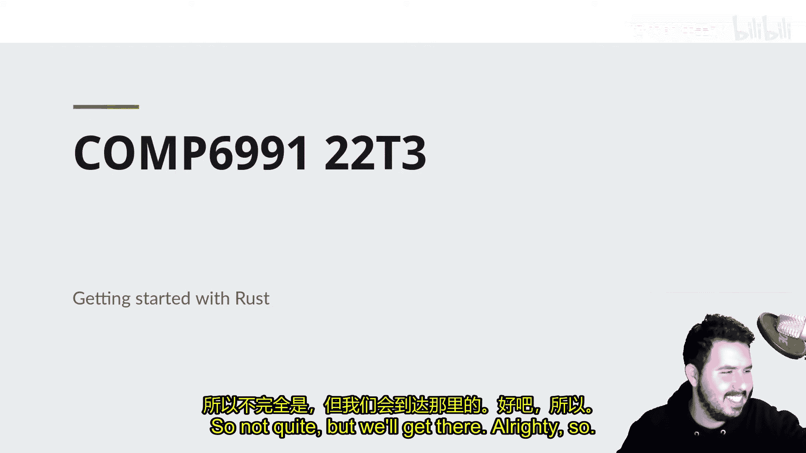

Alrighty so。😊，What's starting us off with variables and mutability。 Okay。

 so I've the way I've arranged these slides that we've got here is after each like sort of topic slide。

 I want to go away we'll do some code we'll play around in the editor hopefully you ask。

 you know lots of questions and and go， hey， can we make the code do this or that if you want to give ideas for programs。

 I'm happy to take things on the fly and and you know run with it and then we'll come back to the slides once we're finished as a quick little recap and just go。

 yep， hopefully we hit these bullet points， you can use the slides as sort of like you know later on use the slides as a reminder of what we did go through。

😊，And but like and， you know， I'm just gonna come back to them go through， yep， y， y， oh， actually。

 we did forget to cover this one。 We'll go back to the to the text editor。

 play around with some more stuff。 And that's that's sort of what we're looking for today。

 So variables in mutability。 that's gonna start us off here。 So I've got a little cargo project。

 I have this open in V S code today。 Last lecture。 I was using Vim。

 But my vim editors been going a little crazy lately and spits a whole bunch of stuff onto the screen。

 I generally prefer to use Vim a least on smaller things。 But I've got a。😊。

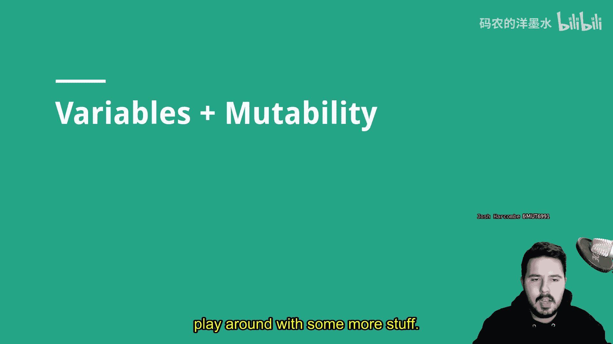

I've got to spend some time to make it less crazy for the lectures。

 So so we're gonna use VS code for now。 you're welcome to use whatever text editors you like。

 You're welcome to play around with them。 We've got a couple of home computing guides that Sreray has put together on the course webpage that show you how to get Ru language server stuff set up for VS code or Nevim there's plenty of resources online for all kinds of different text editors。

 You can really use any text editor， but there is a subset that offer a certain plug called rust analyzer。

 Ru analyzers very nice because it gives you these sort of nice smart suggestions that you can see out here。

 And you know when I type things in， it can give me little hints and inline compiler errors。

 It's pretty nice to use。 So I would。😊，My personal suggestion is to stick to a text editor that has rust analyser support。

 But other than that， you know， use whatever you want。

 And if you're not too worried about that either， again， Use literally whatever you want。

 Can I share polybar I3 dos in the forum sometimestime please。 Yes， I will。

 I I believe I was asked to that last lecture。 And I did see the the forum post， but。

My config files are all blown up and horrible。 And so I don't want to， you know。

 burn anybody's eyeballs out before I before I share them publicly。

 So you'll have to give me some time to clean them up。 And then and then I'll contribute。

 but everyone else feel free to contribute yours。 I'm I'm sure there's plenty configs a lot better than mine。

 But， but I sure will。 no worries。😊，嗯。Okay， no， you know， I haven't missed anything。

 We're just getting started and just talking about the lecture today。 And Dong likes V S code。

 There you go。Okay， so what were we talking about， variables in mutability， that's right， okay。😊，So。

In Ru， this is where we're looking at some real basics here。

 I'm hoping what we've got like right here is relatively。 okay。 Yeah， you know。

 that seems pretty reasonable。 Main function here sort of looks like how they're defined and see sort of。

 we've got our braces。 And this here is just printing a string out。😊。

Notice in C we would have to put a new line at the end here as well if we were using something like printf in Ru print LN puts that new line there for us。

 I could also just use print bang and put the new line in myself if I wanted to。

Doesn't really feel like it makes sense for me to do that。 So I'm gonna write it like this。

 But that's all the code we've got there right now。

 If there's anything in this code that you don't understand yet， let us know right now。

 and then we'll tackle that。 V S code is lovely。 Alright， so。😊。

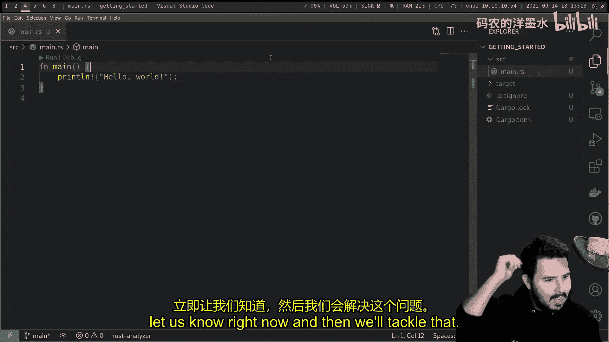

Right。

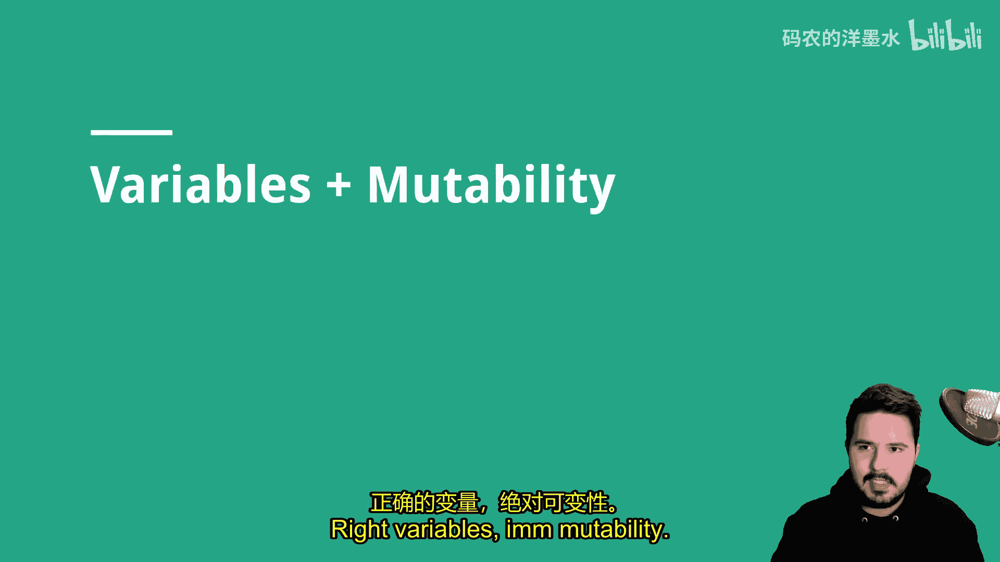

Varis and mutability。 So let's start off by defining a variable。 So in C。

 we might write something like int x equals 42。RightAnd I mentioned last lecture that in rust。

 we don't put the type at the frontier。 most of the time rust itself will be able to figure out the type of whatever you give it。

 And so whenever you're defining any variable， we'll just use the keyword let。Right， so you type let。

 then your variable equals 42。 Now， don't make the mistake of thinking that this。

Is is dynamically typed if if you've used languages like Python or jascript or something like that。

 you may be used to the idea of not having to provide a type when you declare a variable because you know in those languages variables could take on any type really you know there's no notion of static types types that exist when you're compiling your program not when you're running it So the type is still there right and I can write it like this。

 but the rust compiler is just you know relatively smart about these things and it goes right this is 42 here。

 you're saying let x equal this thing So I'm going go ahead and assume that x is an integer And I bet if I hover over it rust analyzer gives me this little hint here and it says X is an I 32。

 that's what the compiler figured out。Do I need to install rust locally if I want to use rust analyze and VS code。

 you can use VS code in CSE。I would suggest doing it through。

I would suggest doing it through Vlab if you're gonna do it on CSE。 and you can just write 6，9，9。

1 code in your terminal。 It opens it up in V labb。 and you can just install the rust analyzer plug plugin。

 and it should all just work now。The Vis code extension installation should do it for you。

 I I'm I hope so。 if you have troubles with it at any time。

 just let us know in the course forum and we'll help you through it。

 I'm not sure if that's always gonna be the case on every platform like， you know。

 on Mac Windows Linux， whatever else。 But And if you just using v S code in V lab with the extension。

 Well， great。 So， you know， play around with a couple of different ideas。 if you're having trouble。

 just let us know。😊，Right， so here we've defined a variable in rust。😊，So variables is sort of like a。

 a bit of a。Global term and exists across a lot of different languages。

 The exact terminology that I like to use is slightly different In rust。

 I like to think in terms of values and bindings right So this x equals 42 here。

 I like to sort of split this idea up into 42 as a value here right imagine his if we go back to like 1501。

 we have a little box inside the box is this value 42。

 and x is going to be the name that we have for this value 42 here。 So I'd call x the binding in 42。

 the value in this case。 You could also just think of this as x is the variable that is 42。

 But you'll see why in a little bit why I think it makes sense to split this up in terms of x is a binding and x is currently right now。

 bound to the value 42 over here。😊，Okay， and I can make many variables， like I say， let y equals 64。

 let Z equals 1，2， oops 1，2，3， and just make plenty variables。 and it'll be all happy days。

 I'm getting little warnings here just because they're unused。 And it's telling me that， you know。😊。

Maybe you might want to use them， sure， let's print them out or something。So I'll say print line。

And to print these values out in some language， you might write X is and then like throw x in this string here。

 and y is the the exact syntax， you know， is going to differ language to language in rust。

 it usually looks to something like this。 I'll say x equals insert X here， Y equals insert y here。

 Z equals insert Z there。 And then to fill in the blanks。 I'll say X， Y and Z。😊。

There is also as of like a couple rust versions ago， a bit of a special case。

 if these things that you're swapping in are just variables right I'm not writing x plus1 you know y times 2 right there's no sort of complex expressions it's just。

😊，X， Y， and Z， then you can just put X， Y， and Z directly in here as well。 So， but yeah， I can't put。

 say X plus one。 Saly， that gives me a compiler error。 But this is okay。 So that should that should。

 you know， print those values up。 and we can test it as well。他个 run。And x is 42， y is 64。 z is 1，2，3。

Okay， so。My first variables in Ru， there you go。 L values is of only x and R value of value 42。

 If you're familiar with E plus plus， yes， exactly。Perfect， so。

That's us defining variables Now there's more than just one type of variable obviously these we've sort of used integers for all of these。

 there's many different integer types， there's you know floating point types character types and we're going to go on we're going to go on all about all these different types in a little later in the lecture。

😊，But for now， there's a couple different ideas that are sort of specific to this。 Well， there's。

 there's a couple ideas that I'd like to bring in here first before we start looking at some extra types。

 So let's say I wanted to like this line here， multiply X by 2。 So I might say x equals x times 2。

Or you might be used to like in C， you might say like times equals to or something， you know。

 you get the， hopefully the rough idea， make X B X times 2。 But if I compile this。

 I'm going to get an arrow。 And it says， cannot assign twice to the immutable variable X。Right。

 so Rus analyzer will try and sort of inline these errors。

 but it can be a little it's like flashing all around the place。

 Sometimes it can be a little annoying。 If you get an error in Rustan。

 you're not like you don't immediately go， I know exactly what's wrong here， which you may well do。

 But if you're like， okay，' that might be a bit of a head scratch or let me figure this out。

 I'd always suggest going to a terminal。 and then doing like cargo run cargo build anything like that will sort of trigger a rebuild。

 and you'll get a much bigger and more sort of clearly explained error in your terminal and hopefully with like colors and stuff as well。

 which is quite handy。 So can I assign twice So that was the error message。

 The first assignment to X was here in let X equals 42。

 help you might want to consider making this binding mutable。 So mute X instead of just X。

 So let me try that mute X And then suddenly the compiler seems happier。 cargo run。

 And we see that X is now 84 instead of 42。😊，So that's sort of lesson one here。

All bindings in rust by default are immutable。Right， so Y and Z here in this case are immutable。

 which means they can't be changed once they're defined。If you want a variable to be mutable， right。

 in this case， we wanted to modify x here， the value inside x here later。

Then you have to use this mut or mute keyword here， short form mutable。

 and it means that we can now mutate this value later on。

 but it's something you have to specifically opt into。Now， James ask， what if you do let x equals 42。

 then let x equals x times 2 again。Alright， so let's get rid of this mute here。 And then down here。

 So this was a compiler。 x equals x times 2。 or if we did let x equals x times 2。Okay。

 it seems happy。 Let's run it。And it says x is 84。 So it did the right thing。

So James mentions re dececlaring， right。 And Dong likes that that it's constant by default。 right。

 yes， so immutability is the default in rust。 You have to specifically opt in to mutability。 Okay。

 so that's interesting。 This one worked。 But when I didn't have this here。That didn't work。

 So what's the difference here。 And this is， this is one of the key reasons that I specifically said it's generally a good idea to think in rust in terms of bindings and values。

 so。Okay， so。How can I demonstrate how this might be a little weird？

What if I introduced like a little blouff here。So I'm just going to introduce a new scope with these braces。

 You can imagine I've just written something like if true here， right。

 So just like always enter these braces。 and I'm putting the braces in here。 So like， you know。

 if I write， let hello equals 42 in here， you're not going expect to be able to use Holo down here because that's out of scope。

😊，So I'm just introducing a new scope to demonstrate a point here。

 Ss can be useful and regardless to sort of organize different variables and stuff like that and don't accidentally use ones you didn't mean to and in this case I'm going to say let x equals x times 2 in here。

Right， notice I've got a warning here it says this X is unused， but I do use x downhill。

If I run the program， we see that x is still 42。 So this is the key difference。

 If I change this back to let mute x and then back to x equals x times 2 and run it。

Then we get our expected answer of x equals 84。 right。

 So just to have both of these on page at the same time。

The two options here I'll get are these other variables。Just to get rid of some clot up。Like this。

 So if we have let x is 42 and then this， this does not work right， We get x is 42 out。

But if we have， let mute x like this and then say x equals x times 2。不此。

Then this does work when we get x equals 84。Okay， so does that make a new X with the original x as value。

So yeah， that's absolutely right。😊，So this here， what we're learning is something called shadowing。😊。

You may have heard of shadowing in other languages。

 And if you've heard of shadowing in other languages。

 this is going to almost certainly be the exact same idea。 The idea is exactly as D Wang or Wang。

 I think I'll go with D Wang for now， but let me know if you want me to pronounce that differently。

 mentions is that it's sort of making a new X with the original X's value。

 So we're declaring a new variable X， which is gonna be valid inside these braces。

 which in this case just has the value X times 2。 This X here referring to the previous X。

 And I'm sort of shadowing the old X away， at least inside this scope here。 Daniel Wang， Okay。

 I'll say how about Daniel， I I might try try that one out。😊，嗯。So rust allows redefinition。

 yes of a variable， yes， that's right。😊，So why does rust allow redelaring。

 but not some other languages， Is it because the redelared x takes ownership like names facing C plus plus Okay。

 so we're starting to think of it。 So why does it allowed in the first place。

 there are and Tre mentioned sts also coming in with the sort of specific terminology here of rebinding right So the value here is you know is not exactly what's getting transferred across。

 I could just say you know right here on this line。

 I could just say let x equals 100 and have no relation to the previous x but I'm just changing this binding x instead of pointing to the value 42 is now pointing to this value 100。

 So redeeclaring or or shadowing is the official terminology。😊。

I is more of a convenience thing than anything else。

It can cause confusing situations like when we have it inside a scope and it does something that that we didn't really expect。

 But it's， it's， it's just more of a convenience thing。 The nice thing is that。

These two things can have completely different types。 So notice that if I said。

 let me go back to a mututable variable X。Like this， I can then say x now has value 100。

But I couldn't say that x now has the value C。Right like the character C。

Because it's going to say x is a integer， but now you're trying to make it a character。

 that's no good。Right， but if I say， like， you know， this mute doesn't need to be there anymore。

 if I say let。X equals a caresy， no worries。Because these， these values are completely unrelated。

And we're creating this sort of new binding with that with the same original name。

So x here is a binding right， which points to this value 42， which is an integer。

This next x here is a binding with the same old name。

 sort of hiding away the old one that points to a completely different value with a completely different type。

So there's， there's no problem there。And no implicit type conversions from child int。 Yeah。

 type conversions in rust are usually very explicit。

's it's quite rare that for rust to implicitly convert between types。

 usually you have to add a little bit of a extra boiler platelate to go no really this is what I want if that's what you're going for。

😊，Okay。And still static cast， Alrighty so。😊，We've played around with variables a little bit。

 defining variables， specifying their type。 if we'd like to。

 We've talked about mutability a little bit。 We've talked about shadowing。

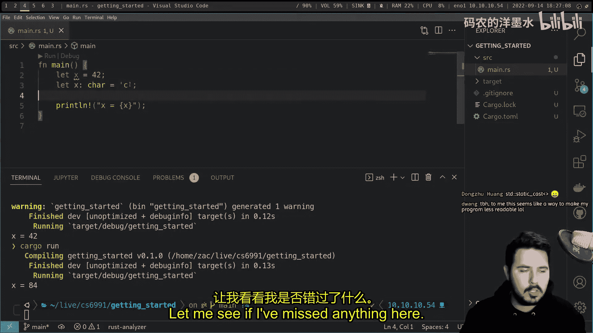

Let me see if I've missed anything here。 bindingds me showing constants。 yeah。

 that's another good one， Conss。

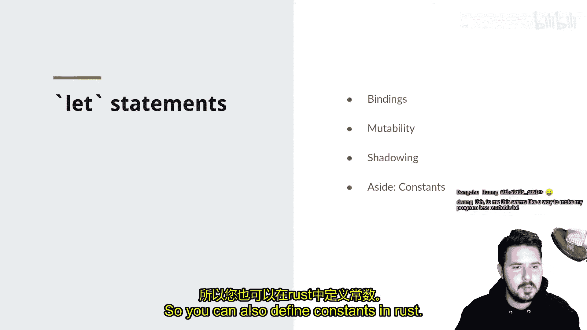

So you can also define constants in rust。 Let me do one up here， for example。

 So if you you might want to think in terms of something like a hash defined in C。

 you might write hash defined F is 42 in Ru where write this constant F。

 And the funny thing with the constant is that you always have to specify the type。

 So I'll just say it's a I 32。😊，Equals 42。 So these two lines are essentially equivalent to each other。

And cont in this case， right， the like the cont here here。

Sort of works like text dual substitution like and C。 but it needs to have a an actual value。

 The way to think about this is， if I wrote。It might be a little difficult to demonstrate with the tooling that we've got right now。

 but essentially if I write， let x equals through here。

The Rucan pilotr will literally grab this 42 and just slot it in straight here。There's some。

 there's some like weird edge cases that might pop up later in the course where you go， oh okay。

 that's that really is how it works as opposed to some slightly different but you know。

 spilled semantically different implementations。 So five different variables of the same name and different type。

Yes， so that's， that's right。 This could absolutely this。

 this can be sort of abused to a certain extent。And and it's it's something that you're gonna have to play around within in your programs and you might go。

 I completely hate this and I'm not gonna use it and that' that's perfectly fine or you might go。

 oh I like it in these scenarios but you know there's there's certainly a limit to it or you might go I'm just gonna name all my variables X at which point is like okay。

 maybe you went a little far。😊，So and that's a great question。

 isn't the point of immutability to not have this？😊，HaIt's a great thought。

 I would personally argue that it's not quite in the。It's not quite at arms， with immutability。

They are sort of distinct concepts， but it's， I don't think it's going to be something that's clear straight away。

This might be something that sort of is worth digging deeper into an a forum post or just like seeing how you go over time and playing around with these different things。

 But I'll leave that one a little openended for now， but it's a great question。

 It's a great thing to think about。 So if both X is refer to dynamically allocated memory。

 does the second X declaration free， the memory pointed to by the first X。 That's a great question。

 So in this case， this isn't dynamically allocated。 obviously， we're just looking at。

 simple characters and numbers and stuff like that。 But if it was right。

 if this X was something that carried some extra data and needed some cleanup or something。

 then you're absolutely right。 And we're going to see that later on in in the lecture as well when we look at ownership。

 So that's a great question。😊。

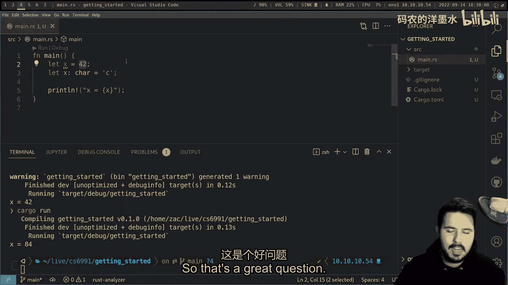

Okay。Soir。

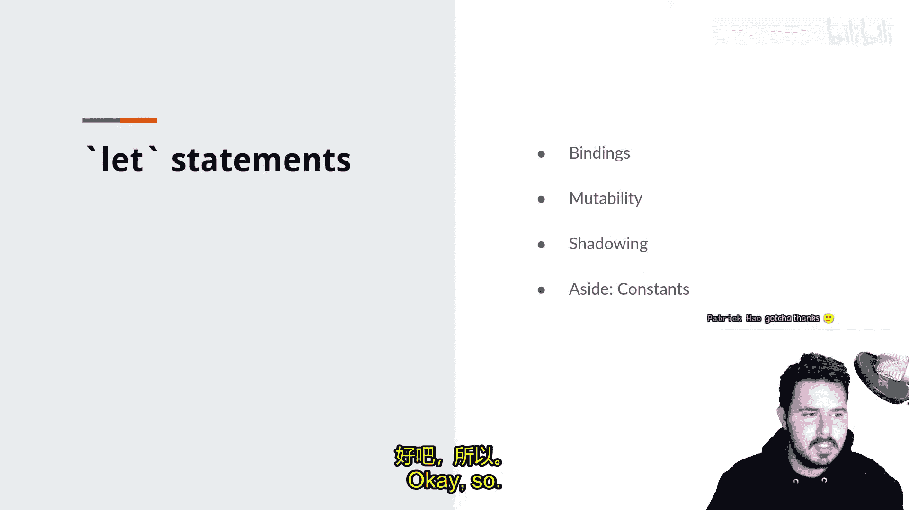

That was some cool stuff。 Let's， let's keep moving。 This is all still gonna be like， you know。

 rust basics and stuff like that。 So data types， oops。

 I guess we're not meant to look at that quite yet。

 But just to sort of run through some very basic data types that you have available to in rust think things like so that we have our integer types。

 the bread and butter integer type is really I 32。😊。

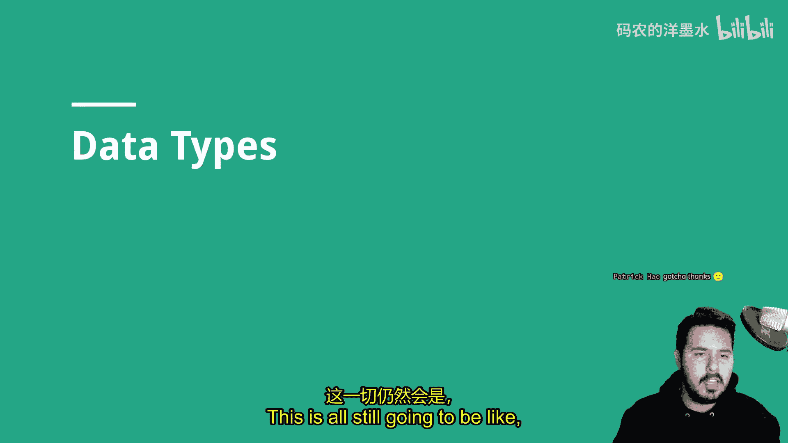

Right，This is a 32 B signed integer signed， meaning it can be both negative and positive。

And at the same sort of size here， samee width。 you also have U 32， which is a 32 B unsigned integer。

 unsigned meaning。It can't represent negative numbers。 Right， So you might go， okay， so why does a。

 you know， if this can store signed like can store。Positive0 and negative numbers。

 but this could only store 0 and positive numbers like what's the point of this。

 This just this I 32 actually just seems more powerful。 There's two relatively good answers to that。

 One is you get the storage that was used for negative numbers in in I 32 can be used to store more positive numbers for U 32。

 who actually get double the amount of possible positive numbers from that。

 But another one that I'd love for everyone to think about as you go through the course is。😊。

A U 32 gives you this additional guarantee that it's never negative。Yeah， don't want 1，5。

2 analog here for sure。 A U 32， an unsciigned number can never be negative。

And if you've ever been in like， had a program that you were writing and you were like， you know。

 it's I， I take， I've written a function here called function F。 And I needed to take an X。

 and it's a number。And the very first thing you have to do in this function is go。

 if x is less than zero， then like， you know，m I'm going to crash my program and say， hey。

 X isn't meant to be that like you know， something like this。😊。

Then you might be very interested in unsign types， right， A U 32 here。

 because this is just not even possible in the first place for an unsign type。

 And so you can start to sort of cut away things that you would not otherwise need to think about。

This is actually like it's hard to explain right now。

 but this is a really like big core idea in this course Com 6991。

This sort of ability to look at something like that and go， you're essentially using your types。

' using the type system here， changing from a signed type to an unsigned type to constrain。

What people can give to your function。 And you're trying to constrain it to only things that you would like。

 And you don't want to constrain it so much that there's things that you' are happy with。

 but they they're not able to give you because of the type。

 So there's this sort of fine balance that we'll be looking for through this course。 And type safety。

 That's absolutely right。 Yes， type safety is exactly what we're looking at here。Alright。

 so basic types we got， we got I8 U8， I 16， U 16， I32 U32 I've already seen I 64， U64。

 these are all just sort of larger and larger you know sizes， these are 1 bytes，2 bytes。

3 bytes 4 bytes， There is also I 1，28 and U128， which are our 16 bit 16 byte types， sorry。Some。

 you know， some computers actually have support for these natively。

 but a lot of the time these end up getting implemented in software。But they are available。 anyways。

 I think Ty might have written a lab exercise next week that requires 128 bit types。

 so just keep an eye out for that。We also have floating point types。 so we have F 32。

 which is a 4 by floating point and F 64， which is a 8 by floating point。

 If you've heard of float and double， that's exactly what you're looking at here。 floatat and double。

Right， and if you've not seen floating point types before。

 it just means you can store fractional numbers right， like， you know，3。14，2。5， you know，5。2150954。

 you know， that kind of thing or also like 3。0， you can still store sort of you know。

 integer values in a floating point type for sure。And two other special contenders we have as well is bull and char that we're gonna look at。

 So bull just being short for bullolean， meaning it's either true or false。😊，Right。

 and a char is a single character， ABC， a new line character。 and in Ru。

 these are actually Uniicode characters， so you can have things like emojis or you can have letters in different languages and stuff like that。

 like say， like a Chinese character which you know might be a bit trickier in some other languages to deal with So this is a full UTF 32 character if you know what that means。

 but it basically just means it's it can support basically I would like to say any character。

 but like it's basically computer's best notion of any character essentially。😊，So I8 is negativega 1。

28 to 1，27。 U8 is0 to 2，55。 Yep， that sounds right。 I 2，5，6。

 So I believe this is the limit for us right now。 we， we don't go up to I 2，5，6。

 And you can see here， the editor doesn't colour it yellow either。😊，But you know。

 maybe at some point， I suppose I'm sure there's external libraries for dynamically sized integer types as well。

😊，Is there no bitwise operators since logical or is bar I no。

 so logical ore is still bar bar in rust and logical end is still and and and there is bitwise operations There is single bar in single end for bitwise operations。

😊，Is there a decimal type A1 that doesn't suffer from the rounding error on floats。

 I'm assuming do you mean sort of like a big decimal kind of thing where it's like a exact like an exact floating point format。

 if that's the question， then there isn't one in the standard library， but there are yeah。

 so they are provided by some external libraries， but not in the standard library because there's a sort of a lot of machinery that goes into it。

 and。And the standard library and rust is。Relatively speaking quite small。

 they try and make the standard library quite What's the termin these not wide， but very deep。

 So it doesn't have too many different things like there's no redxs。

 there's no random number generation， there's no H T TP， that sort of stuff in the standard library。

 But the things that it does have usually have everything that you would want from them。

 And often when there's something that you think of like man it would be nice if they have that function。

 you go looking and there's someone's working on putting it into the language or something like that。

嗯。So， okay， so there's a whole bunch of types there to play around with。

 Did I miss any important ones， Integer types S point， bullolean character， right。

 So these are our sort of primary scalar types that we that we'll think of。

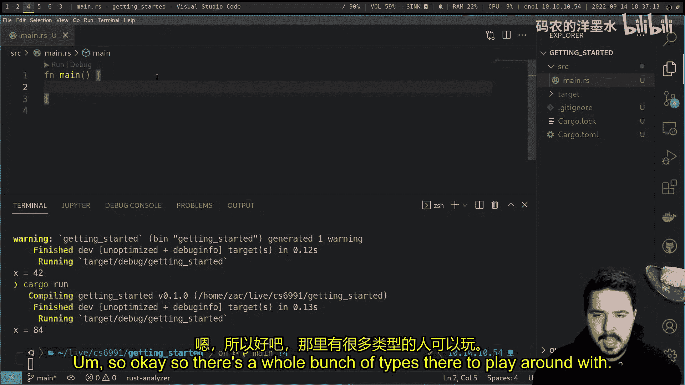

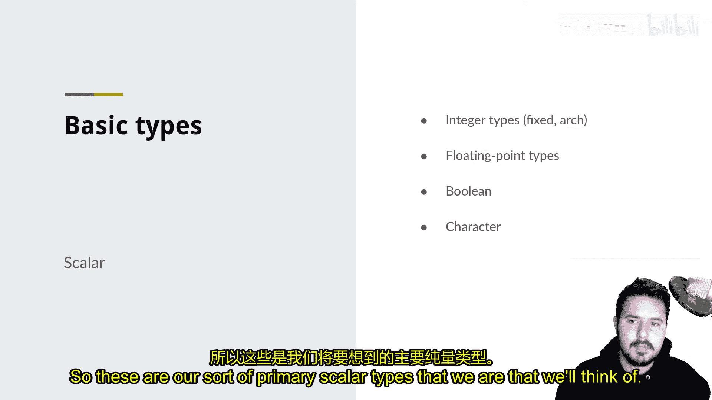

And then there's also compound types。Compound types。 So let's have a look here。

 So our first one is tus。 You may have experienced tuples in some other languages。 They've。

 they've certainly been more popular as time goes on。 You don't see many languages with tuples from。

You know，4050 years ago， but you see lots of languages with tuppples in the last 20 years。

 for example， And a tuple is basically just grouping together of multiple multiple values of。

 you know， potentially multiple types as well。 So， for example。I could say let X equal a topple of1。

 comma 2， comma 3。Right。1， comma 2， comma 3。 It's kind of like an array。 right， So this。

 this you'd be like， okay， that looks like an array。 And If I just swapped these for square brackets。

 in fact， it actually would be an array as well。But the really cool thing about a tu is that I can sort of mix data types。

 So this could be a bull here like true， and this could be say like a character like I don't know。

 Zed。😊，Right， and this is still perfectly happy。If we hover over this we'll see the type oops。

 we will see the type and I can even just like copy paste this into the code so it's right there。

 So x has type you know right these pers， so it has type topple are y 32 bull char in that order。

Right。Is a stood left pad。 Is it immutable like in other languages， too， so。

The immutability story this follows just like the rest。

 There is one thing that we haven't quite talked about yet。

 which is that rust's immutability is very pervasive。So you might have this idea。

 let's skip forward a little bit tostruct here because I think we've all seenstructs in at least C maybe in another language and something like that。

 let's say I have a struck student。And the student has a Z ID。

And the student has an age and the student has a whham like， you know。

 we were talking about last lecture， something like that。Now， I can make a new student by saying。

 let' student equals。 And the way I sort of create a new one of these is that I just typed the name of thestruct student here and then put these braces in like there。

 And I just fill in the field。 So I go Z I D is going to be。 We haven't quite looked at strings yet。

 So just bear with me on this one。 I'm gonna write string from who wants to be my。

 who wants to be my my guinea pigie。 We'll go D Wang， or I guess it's Daniel， isn't it。

 age is going to be， I don't know， I'm just gonna make you100 because。😊。

I'm not going to try and guess and your Wham is going to be also 100。

 you're doing it incredibly well。😊，Something like that。

 So I've created a student here and notice if I wanted the student to be mutable。

 then I would say let mute student。 And then later down here， I could say for example。

 student dot age equals you know， one years old now， right。But in many other languages。

 if I say let student here， right， which is， again， to be clear immutable now， can't be modified。

It often is still happy with this line of code。Right， often。Imutability。 And this is。

 this comes back to that question before， which was like。

 this seems like it's really sort of missing the point of immutability。

 Like the fact that we can redeclar another student。 We can say， let student equals， you know。

 a completely different student here and hide this original one。

 It's like that doesn't feel like a mutability because， in other languages。

 something like this is usually fine a lot of the time because they go， well， you know。

 this student itself is immable。 So I can't say student equals blah， blah， blah。

But the student's age is， you know， just a field in that。 so I can modify that。

 But you can see if I build this。No happy。 right。 Cannot assign a student dot age a student is not declares mutable。

 So rust mutability or rust immutability is very pervasive。 If I have some value， in this case。

 this student that is declared immutable。Anything inside that， anything inside that。

 inside that inside that， If I have like 10structs deep that this student has a struct。

 like transcript and that transcript has a struct course， and that course has a struct U O C。

 I don't know。 something like just round stuffstruct instructor， instructorstruct Instruct。

 You're not gonna be able to modify any of it。 It's all immable。 Like it's amutable all the way down。

 right， very pervasive。But if I say mute， then I can modify the things in this student once again and we're happy。

哎。And so， yeah， like in Java， for example， Java is an example of a language where if this was immutable and in Java。

 I would write this as final， right， Fi student equals blah。

 Java would still be perfectly happy with this line of code。 It be like， yeah， that's fine。

 No worries。😊，Because I'm not modifying student， I'm modifying student age and you didn't say anything about student age。

 you have to write something like you know， final age 100 down here。

 and you have to say every specific thing that you want to be immutable and it's sort of like all the time on none of the time。

 that kind of thing。But in rust。It's very pervasive。

 so there's no such thing as like a final or a mutable or immutable field inside a struct because it's just the struct itself that will be mutable or immutable。

Can we just replace the variable with a new topple anyway， couldn't we， Yeah， for sure， Yeah。

 definitely。And why some over here， I because I put WAMs oops， I put WAM as an option here。

 the WAM may may not be there， let's say as students in their very first term and they haven't got any marks yet。

 so they might have you know no WAM at all， or you might say they have a WAham of 100 they might say they have a WAham of 17。

5 right you know anything like that。😊，So I've used an option to represent the way just in this case。

Okay， so。So right， we've talked about the pervasiveness of mutability。

 We've talked about a little bit about tuples。 right， So let's say。

 if I jump back to tuples for a second， let's say have my function fill again。

 and I want food to take some variable X。 and X is gonna be a type of tuple。Right。

 if I was just going to take a single integer I'd write it like this， X takes in an I 32。

 If I wanted to take in a topple， I put an extra set of parentheses here to say it's a tuple and it's going to take an tuple of I 32 boolean and char。

 you know， something like that。And so that's how we write the type of a tople in this case。

So when you have an option， you always need to wrap the value in sum。 Yeah， absolutely。

 If you have a value to give it， right， the none variant of option doesn't need any， you know。

 doesn't doesn't take any data along with it， which is sort of the point， right？

 But if you do wan to give it a value， then yeah， you wrap it in sum。And why exactly is that， Well。

 if we look at option itself， This is where it's defined in the standard library。

 And we sort of like ignore some of the， the random little bits that they've got going on here。

 Right， You know， there's， there's lots of extra fluff。 But at the end of the day。

 it's just option is either going to be nothing or it's going to be something。

Without something is a T in this case。And so when I'm writing nonal sum。

There's a there's a nice little feature where I could write option。

Of some to let it know it's this is going to be an option and it's going to be sum inside that option。

 but by default， rust goes over you're gonna to be using option all the time。

 So I'm gonna just bring these into scope automatically for you to can just write sum and none as opposed to。

 you know specifically option sum option sum or option none。

 like you might see in a in another language。

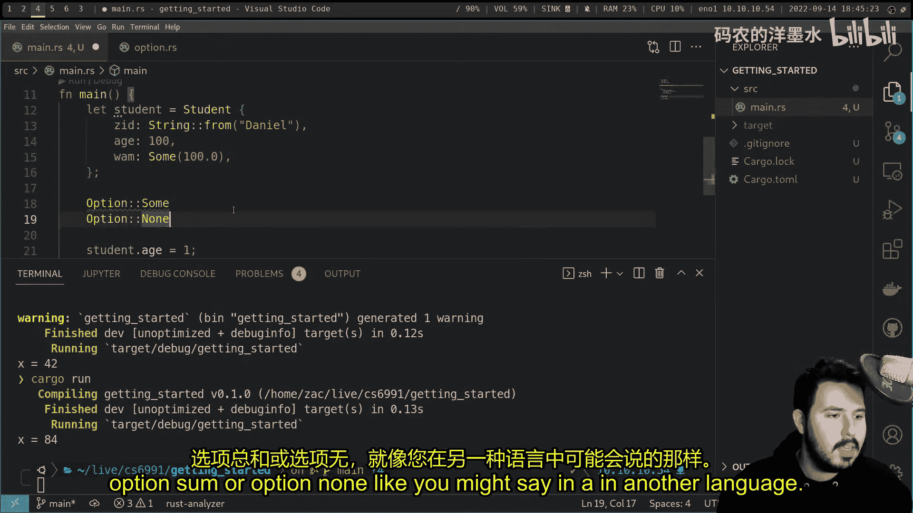

Okay， cool。What else do we want to look at arrays， right？

 So I mentioned tuples looked sort of like a raise before。 So we had a tuple that was like 1，2。

3 where x is a tuple of I 30， oops， I 32， I 32， I 32， which is perfectly valid。

 There's nothing wrong with this。

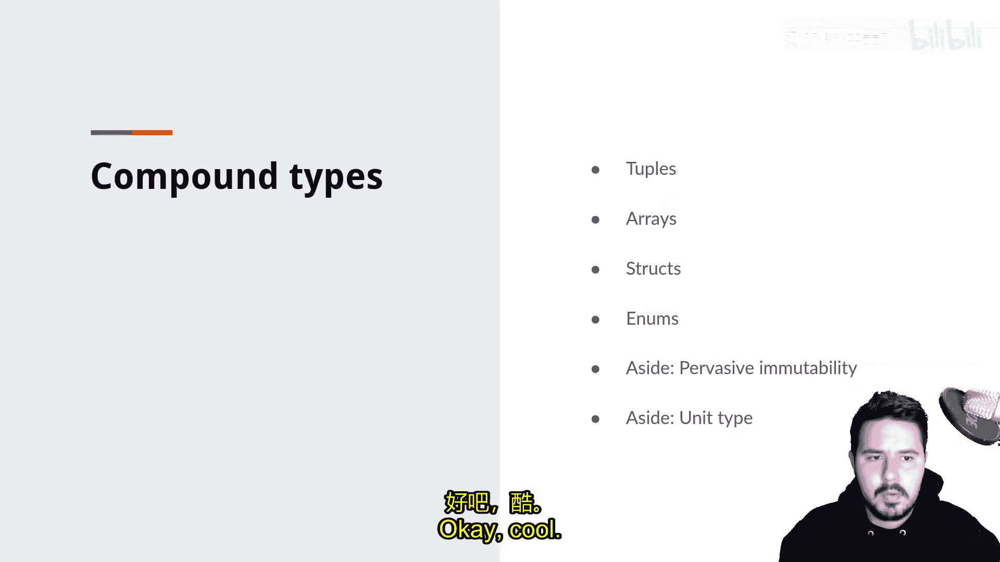

But you might go， okay， that that's probably better expressedes an array of three integers。

 and rust has fixed size arrays as well。So we use square brackets instead，1，2，3， like that。

And the type looks like this。 The type has square brackets as well。 You say what the array contains。

 In this case， it contains I 32s。Put a semi columnlon and you say how large the array is。

 It's three elements large in this case。 So X has type array， os array of 3 I 32s。

 and it's equal to an array of 1，2，3。 So that's as。 Now you might go， oh， hang on。

In every language I need an array where I don't know how big the size is it'll expand for me。

 it'll shrink for me you know when are we going get to that we'll probably leave that for the most part till next week when we look at collections So this is specifically for arrays of a fixed size。

 a known size And again if I'm trying to take this in a function I' would write it something like this like you know my array that you're passing into me is going to be an array of I32s maybe an array of bulloleans。

 let's say and there'll be 32 of those bulloles， something like that。

And the standard indexing follows as well， so my array。

 if we're trying to get something out of my array， my array of 10 will give me the tense thing in that array。

And yeah， there's also plenty of like functions that you can call on arrays。 You know。

 there's a borderline endless list here， which is what I say about the standard library being very deep。

 But， you know， just to get you off the floor， array indexing like this。 You know。

 it's zero index as well， arrays0 array of 1，2，3，4。 So the last one will be array of 31。

I also didn't mention how to index into a topple either， actually。

 So let's say we go back to this I 32 bull cha。 This is going to be my topple。Right。

 how do I get if I want to print outops， print Lindang of the I 32 is something。

 The bull is something and the char is something。 right， How am I actually going to get these out？

And let me just do a little bit of。Foratting here。How do I get those out？

If you want to sidetrack items of the index brand likes， that's a great question。

 compile error could be。 So we'll， we'll come back to that in a second then。

How do we index into a topple？There's a couple different ways。

 I think people are gonna hate this when I when I give you this one。

 let I'm just gonna like call it like this pupppy X， this pupppy Y， this pupppy Z。

 You can write something like this。 Let X equals my tuple。Dot 0。Right， so not index 0。

 but instead dot 0。 Yeah， which Paul is saying there， which a lot of this is a very divisive one。

 Some people are like， oh， yeah， I don't mind it。 That's fine。 And there's a lot of haters out there。

 I honestly don't care if you're a lover or a hater of this。 Yeah， we're gonna get some。 Yeah， like。

 I'm so indifferent on it that it doesn't matter to me。 but it does work。Right， x is my topple 0。

 my topple one， my topple 2。And this X here you'll see will be， if I hover this is an I32 wiseizable。

 said as a char。Right， but we've got a great point here。😊，Patent matching， right。

 That might be a slightly neat way to do it。 And it's something that we're going to get into as well。

 So let's， let's give it this a go now。Patent matching。

 So the let keyword here is actually more powerful than I than I made out to be。It's more powerful。

It's not another of us。 let's syndrome。 So， okay， so let here is very powerful because on this left hand side of the equal sign。

😊，It actually accepts what we'd call in rust a pattern。In this case， I've just said， oh。

 we've used the letter X， Y， and Z here。 and these are， these are patterns as well。

 It's just sort of a pattern that is。A name， let's say。But let's think of it this way。

Let's say I said let X is my topple。Right， now the type of x is going to be I 32。

 like a couple of I32 bull and char， right， So the type here。Oopsly let me grab this。

 the type here is I32 bull cha。What if I made X look like that type？Right。

 so let me take this type here and replace X with this type。 But I'm gonna to swap the。

 the type names here for letters for like names， variable names。 I'll go X。 I'll go Y。 I'll go Z。

Right。And if we just like， the type is fine to stay here。

 but just to get it out of the road for a second here。This compiles and works。

 Let's just test it out as well。 So I'll call let's say let's sum topple equals 42。

 Then it needs a bulloleyan will' do true， and it needs a child。 Let's do， I don't know。The at sign。

And what do they call the function food？Of some tuple。Let's run this。

The R 32 is 42 true and the at sign。 So this actually works。 Let Tuple X， Y， Z equal my tuple。

And and Miguuel is is， is happy again now。 Ha ha right， So yes， what it's done here is it's gone。

 This here looks like this。 My tuple looks like this， and this sort of looks like that。😊。

And if you sort of fill in the blanks， it goes， oh， I 32。

 that's going to line up with that X bull here is going to line up with the Y and char here is going to line up with the Z。

Right， so we say let x y and z equal this。 and so we'll go， okay x will be 42， y will be true。

 Z will be the outside sign。And this works like in in like whatever situation you can throw this。

 it'll， it'll basically work。 even with a struck student， something like this。

 Let me go back to the code where I had a struck student available to me。

 Like I could also destructure out of this student。 I could say， so right now， we've got， let's say。

 let's say X equals the student。😊，But what does a student look like， a student looks like this？Right。

 so I'm going to grab this type definition。So X is a student which has all this stuff over here。

And that's what I was saying it's equal to。So what if I said， let。Student of a Z I D age。And when。

Be equal to that student。 And suddenly， I've ripped out。 See here Z8 is a string。Age here is a U 32。

 And Wham here is an option of 6 F 64。 And so youve， I've now created three variables。

 No there's no variable for the whole student itself anymore。 Well， it's sort of it's still there。

 but not from this line。But I've now got a variable for the Z。

 a variable for the age a variable for the Wham。 This is a bit of a like a trickier one to see and understand。

But if you can understand what's going on in this one， you definitely understand pattern matching。

So this here is the pattern knows we have let and equal sign。

 so you look at everything between those， that's the pattern， this is what we're setting it equal to。

 and so it just lines these things up it goes well student looks like this and so that's the Z ID that's the age that's the WM and now I've got these variables available to me。

😊，So Pat matching。How interesting。So I genuinely like to use patent matching a lot when I'm dealing with things like tuples as well。

What's a good rule of thumb for creating astructverse defining a tuple。

 That's a really good question。 So something to notice here is we've got astruct student， right。

 Could this not just have been a tuple right？ Like I could have actually written something like type student equals Well it's just going to be a tuple of three things。

 You need a string。 You need a U 32 and you need an option of F 64。😊。

Right so you can imagine a struct is almost just like a tuple with names right。

 a tuple with like a name for each of these these fields。

 and my rule of thumb for tuples is that generally I'll go to make a struct unless the tuple is incredibly obvious。

😊，Just to like any any potential programmer working on this project。

 if they would look at that and go yeah， that's really obvious。😊。

I should be clear whenever I give any kind of this advice， I am certainly not infallible。

 I've written plenty of horrible code， horrible code that's still in production today， right。

 And so this is sort of like a do as I say not as I do kind of thing where plenty of the time I've written。

 I've thrown tuples around the place that are not obvious to everyone that have bitten people like S who has gone Zach。

 what the hell is this tuple。 What is this tuple of an R C stir and this completely random thing over here。

 that one's an option。 like I don't get it。 And I have to go， oh， yeah。

 now I have to like remember what I did here and explain it to you。

 So it's sort of about using your best judgment in these situations。

 But tuples are certainly great for the convenience factor。 if it's and I can confirm。 Yeah。

 And so as Russell for type alias。 Yeah， I just have done one here。

 So this could be student type student1。 And this is the syntax with type alias as well。😊，And yeah。

 if you need readability go for astruct yeah for sure and is this really called pattern matching and not destructuring so this is certainly destructuring and destructuring uses pattern matching so this is probably you're right in that destructuring is a more correct name for what we're doing here。

😊，And the destruct works because of pattern matching。

 Pat matching is sort of like the more abstract concept that destruct uses to work。

Is the way I would explain it。And yeah， tuple pattern imagine couldn't be tedious once the number of feels increases for sure。

 The good news， though， is that rust has ways to deal with， like。

 if I had a topple here that just had tons of things in it， right， let's say like all this stuff。

 I can actually in my pattern here to say， let X， Y， Z equal my tuple and just like， ignore the rest。

😊，That's this little dot dot here。 So it's sort of like saying X on the left hand side， we have X， Y。

 Z and a whole bunch of stuff。 However here， you have what will be X， what will be y， what will be Z。

 and then a bunch of stuff。 And it can， you can ignore a whole bunch like that。 And so。Yeah。

 you know， there's， there's， there's， there's options available。 But this is like。

 this is an absolutely ridiculous topple。 Like this is almost certainly not gonna be a good idea。

Okay。And underscore is also very useful。 That's absolutely right。

 If I just want to say skip one in the middle here， I can throw an underscore there。😊。

And then this just doesn't get bound to anything。 underscores a bit of a special symbol where it on its own is not。

 if you just have an underscore， that's not a valid name for a variable。

 It just sort of gets ignored， it gets skipped。And we'll look at that more as again later with patent matching。

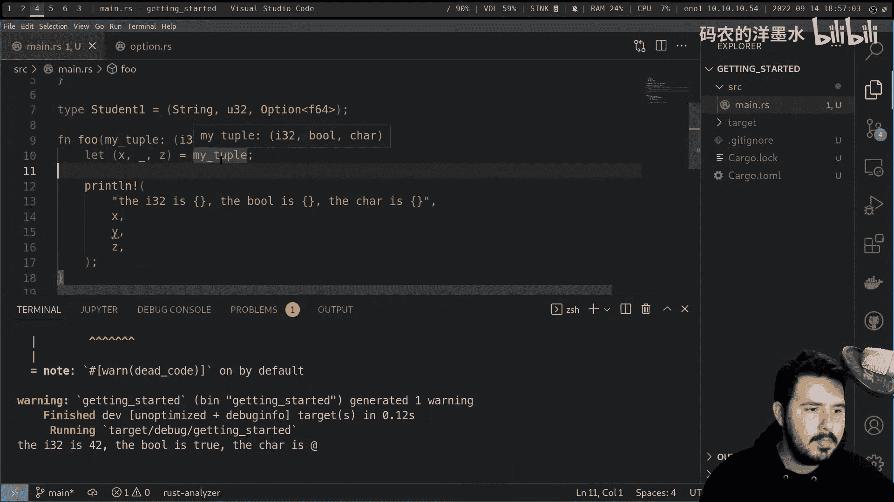

Okay。Tules arrays， strs， inums pervasive Muability unit type。 Okay。

 inums and unit type will'll quickly get through， and then we'll have a break。

 So inars we talked a little bit about last time。

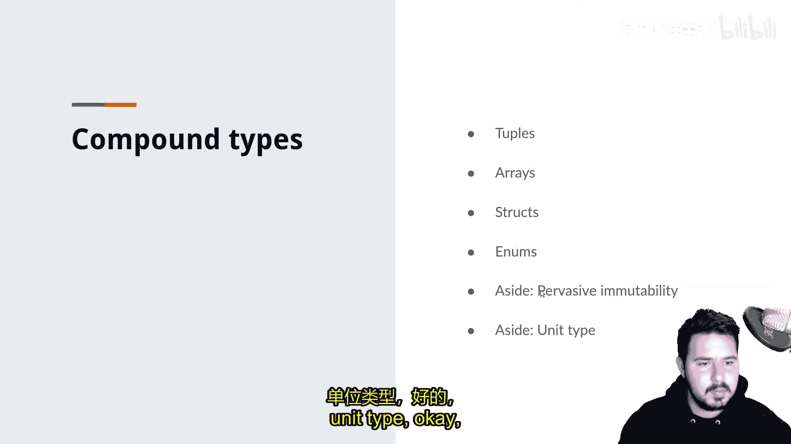

So let's say I have an enum coin。And we might have。

I guess we don't really have nice names for our coins in Australia。 do we we like。

 I wan to say like 5 cent， but I can't start a。And identify with a number， sadly。

 So I guess I can write 5 cent like this， you know，5 cent，10 cent，20 cent。50 cent。$1 and $2。

 So those are all our coins。Right。And this is an example of an enum。

 So an enum lets us enumerate over a set of fixed possibilities。

 So notice that if someone else saw this enum coin and oh。

 let's say the Australian Government comes in and they go， well。

 we're going to make a $3 coin now as well。 we're going add that in。

If someone else is working with this inum coin， if they're in a。

 let's say they're in their own crate， their own project and they pull in my Australian money crate as a dependency to their project。

 they can't just quickly go， I'll just know in my code here I'll add this extra coin in they're going to need to track down where this is written and you know find my code and in my code。

 insert the text here $3。RightThey can't just say like， you know。

 here's in their code go coin dot add in you know，$3， it's not expandable， sort of like that。

So they you know maybe need to submit a pull request to my code and go， hey。

 Stley Garvan came in and your cr's broken now can we fix that up？😊。

So enums represent a fixed set of possibilities， and enum coin can only be either 5，10 20。

 $50$1 or $2。Right， so this is pretty common in a lot of languages。 even C has this to an extent。

 The thing that makes rust inums slightly special and the sort of industry or I guess the academic name for rusty inums is actually something more generally called some types that's not SOM E but S UM instead some types andstructs in this case up here or referred to as product types and this comes down to how you think about programs algebraically but we're not going to get into that in this course。

 So it's a sum type here and the thing that's very special about this is that inum variants can carry data with them and you can have different data depending on the exact variant。

 So a coin might not be a great example here。😊，What's maybe a better example？

Does anyone have an example that they that they can think of that where we might have different。

 different data per variant， Otherwise I'm going to come up with something。A little more。Eceoteric。

 I'm sure a day of the week。 a day of the week is a good idea， but I， I can't think of any。

 is there any additional data you can think of that would go along with where different days of the week have different associated data。

So like this， to me， looks a little bit like the sense example here where we have Monday， Tuesday。

 Thursday， that Wednesday， that kind of thing， whether it's a weekend or not， yeah。Yeah。

 we could do that， but it's。😊，I， can you ask that on the forum， ask that on the forum later on。

 And and that's there's， there's some interesting things to go into there。 actually。

 that is a good question。 But okay， types of automobiles。

 that's actually a nice idea that I will just I think， work a little better for now。 So automobile。

 In， automobile。😊，Right， yeah， exactly。 Okay， so an automobile might have a car like we might have a car here。

 We might have a motorbike。We might have a train。 We might have a， you know， a plane。 maybe。

 It's that a， maybe like a bus。 That's probably a good idea， so。Okay。

 so what's like what sort of things will identify a car。 Well， they might have like a make， you know。

 like Toyota or a Honda or whatever。 We might have a model。

 And let's just say these could also be enums themselves。

 But I'm just gonna do them as strings for now， But what's sort of really specific to a car。 Well。

 the things that we might care about might be like， how many doors does the car have。

How many wheels does the car have， which， you know， trains themselves may have as well？But。You know。

 and， and like everything else。But。I guess actually。

 wheels is a really terrible example because cars generally have four wheels。 But let's sure。

 let's say the amount of doors in a car。 What would we care about in a motorbike。

 Maybe it would go like it has a make。It has a model。

But then the thing we care about might be like the horsepower， like how powerful is this motorbike。

 how fast is it， right， on a train， what about like the capacity， right。

 a bus might care about the capacity as well。Right， and so we have different data。

 depending on which variant it is。 our tool will drive fool wheel drive。 That's a great one as well。

 Let's throw that in in let's call it driven wheels。 and we might have front wheel drive。

 I can't write four wheel drive， four wheel drive， all wheel drive， and let's say rear wheel drive。😊。

Right， so。All these different options here。 And that might be specific to a car。

 right because driven wheels is going to be。One of these four things。

 So an enum being used in sort of two different ways here， right。

Is it possible to have an enum of other types such as true and false？Yeah。

 so you can have different types for variant in the enums。I'm not entirely sure of the question。

 but you could certainly write like an enam bullion that has true as one option and false as another。

If that's what you're sort of interested in， But you can't say put like values here。 Like。

 I can't say it'll be true or it to be like 42 or like 42 or 100 because these are a values here。

 where instead， we're sort of defining more like a blueprint similar to how we define a blueprint for a student。

 We can't say like age is gonna be like， you know。18 or something， right。

 We need to say it's going to be a number， and they'll fill that in。

 We can't write in true or false the values or a hundred and42 of the values。

 But we could certainly make things that are like， true or false。As。

 as in the same sort of way that we could do something like this or， you know， there are。

 there are still options。嗯。Okay。So enums let us define multiple different possibilities。

 And generally， when we're using an enum。The easiest way to deal with them is probably pattern matching。

 So if I take in a automobile is going to be some type of automobile。I can then match on that。 Well。

 I haven't looked at match yet。 but you know， we'll。

 we'll look at it a little more closely in a second later in the lecture。

 But just bear with me for a second。 I can say something like match automobile。 It's gonna go， hey。

 I'm really angry because there's all these possibilities you haven't thought of。

 I'll go fill it in for me。 You know， you know what to do。And in these little blocks here。

Let me fill this out。And here， right， we can say if it's a car， Well have a make a model。

 some amount of doors and a type of driven wheels。 And if it's a car print out。It's a car。Made by。

Some make。呃。It is the， you know， model with some amount of doors。

And like and like the driven wheels as well。Right， and so we can have different behavior based on which exact type of thing it is。

😊， whether it's a car or a motorbike a train or a bus。

And we can deal with different data based on which variant it is。

 So that's what enums give us in rust。So what's and this is often a pattern that is hard。

 It's very hard to describe Sorry I'm flying over the place。

 This is a pattern that's very hard to describe in some languages。

 Like if you're looking at a language like Java or just even a lot of like hardcore object oriented languages。

 it's often hard to describe this kind of pattern without using inheritance。

And the something that can get a little tricky with inheritance sometimes is an inheritance brings across a lot of extra baggage。

 let's say。There's， there's sometimes this is really like what I want to do。 But instead of。

Instead of just giving me this capability， I I'm retrofitting inheritance to make something like this work。

 And then I don't have like a fixed set either。 I might have to go， okay。

 if this thing is an instance of a car then do this， if it's an instance of a motorbike。

 then do this， something like that。 But then someone else comes along and goes， oh。

 I'm gonna to add a plane right， which has some amount of engines or something like that。

And your code didn't check if this object could possibly be a plane。 Whereas in， you know。

 my code over here， I'll suddenly get an error and say， hey， you didn't think of a plane。

 And I get to just run across my code base and go， okay， it's got an error here， here， here， here。

 here， here， here， and here。 plain， plain， plain， plain， plain， plain， plain。

 plain and deal with everything accordingly there。嗯。And yes。

 and some types are very similar to union types in Typescript。 In fact。

 I think if I recall correctly， union types in Typescript are some types。So。

 and you get there there are certainly there's lots， there's been a trend， you know， for language to。

 including this kind of functionality and even things that I'm you know。

 saying in languages that I'm saying this， this kind of thing might be more difficult in like in Java。

 I believe Java has proposals to add this exact functionality to the language because people are going。

 hey， this is actually quite useful。 This is like and I'm missing this when I come back to this language Cci also mentions iflet。

 that's a great question as well。 So matches Ru switch case， Stephen， yeah。

 matches is sort of like people ascribe match often as like switch case on steroids right。

 it gives you switch case， but with like with superpowers almost。😊，And Python's patent matching。 Yes。

 Python is also bringing in pattern matching to attack similar ideas as well as there's again。

 a lot of convergent evolution。 And the reason we're looking at rust in this course is because it has it's a nice conglomeration of a lot of these different ideas that a lot of languages are slowly convergently evolving into。

 So hopefully， you know， five years time。 all these ideas you'll be like oh。

 this language has got a new feature。 I remember learning about that in comp 69，91。

 and you're ready to go。 So you know， maybe one of the things that you might get out of this。😊。

Also there was the unit type I want to quickly talk about as well so the unit type is just basically the empty tuple。

 so let x equals a tuple with nothing inside it and you might go that that right there must be the most useless type and value of all time right a tuple with nothing inside it and the way you also the type and the value of this look exactly the same x is an empty tuple and it's equal to empty tuple。

😊，Right， which is quite funny。 Again， just just to make this sort of distinction quite clear。

 you know， Z8 is a string age is a U 32 Wham is an option of F 64。 These are our types。😊。

Our values or terms， as they're often called academically， our terms here are you know。

 Daniel100 sum of 100。0。 It's funny with in the case of this empty tuple type。

 the type itself and the term the way you actually create an empty tuple look exactly the same。

 which's quite funny。 And this is a very common， it's a。

 it's a surprisingly ridiculously common type to see in rust。

Because it's sort of like a type that represents nothing at all。

RightIt's a type that's just like essentially useless and that becomes quite handy when you when you start programming a little more generically。

 which we'll run into with things like option and result in that sort of stuff in the second half。

 I think we should take a quick break。😊，Right， we've been through a lot of， you know。

 we've been doing a lot of random coding stuff。 We don't have too much time。

 So let's take like a three minute break。 We'll come back at 13 past， and then we'll。

 we'll soldier on。 So I'll see you all in a couple minutes again。

 and feel free to get some questions ready in the chat and all that。

 But we'll see you in a little bit。😊。

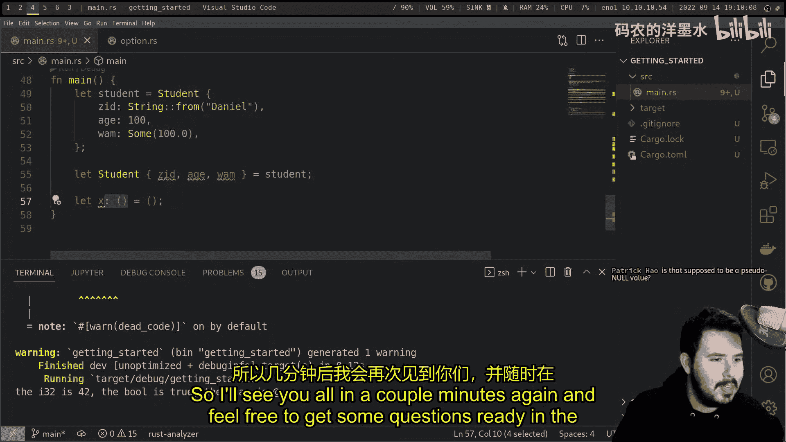

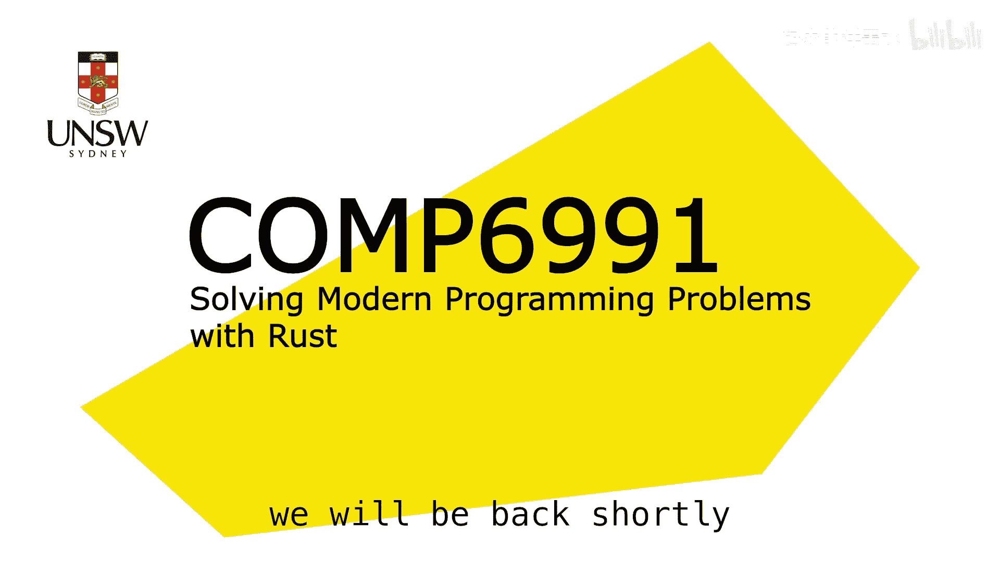

All right， I know that was just a very quick break。You know， three minutes or so， but。

I think we gotta keep moving， because。There's， there's there's some。

Still lots of fun to get through today。We're going to rapid fire the next couple topics。

 and then hopefully we get。20 or 30 minutes towards the end to talk about ownership。

So my spirit finally managed to cut catch up on。 And I remember you were mentioning having the hints in line earlier。

 I think airline lenss extension on V S code should allow that。 Yeah， awesome。 I think I'm gonna。😊。

Not use it for now because it can also really clutter the screen and make things confusing。

 but it's something that you should definitely try out yourselves。 And if you don't like it。

 turn it off。 And if you do like it， keep it on。 But yeah， that's that's a great note。

 error lens is the one that we're looking for。 Thanks Hussein。😊，Okay， so。

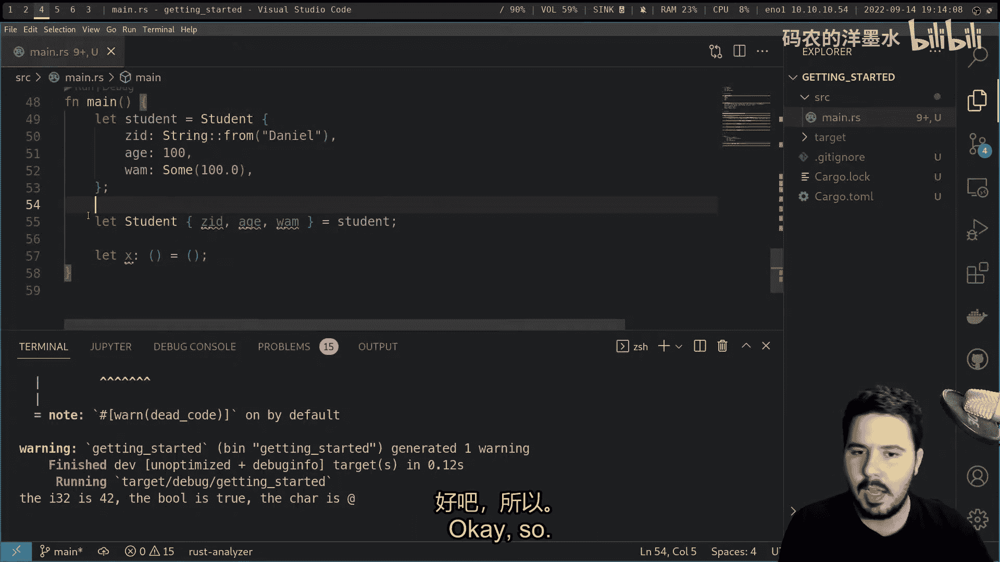

Let's think of rust as an expression language。 I don't think we've actually really had a chance to see this yet。

But what does it mean that rust is really an expression oriented language？

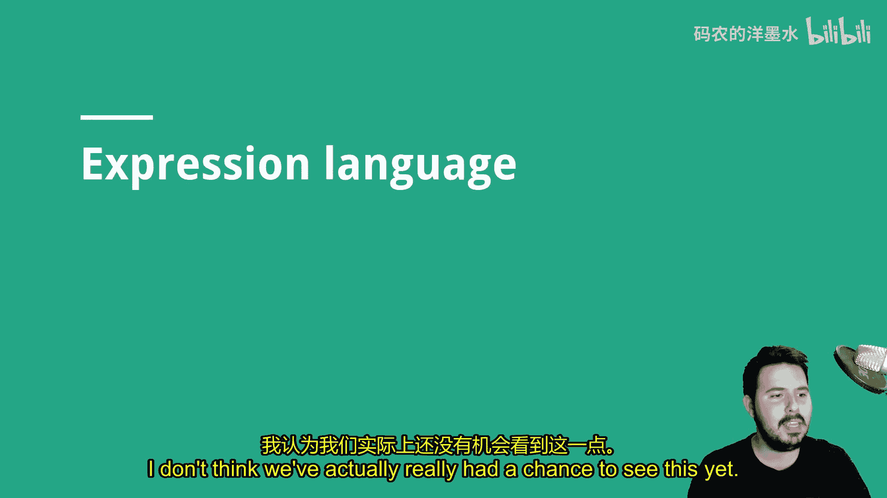

Well， there is this idea of an expression versus statement， right？ So in。

 let's say a language like C。 Well， let me go new file。

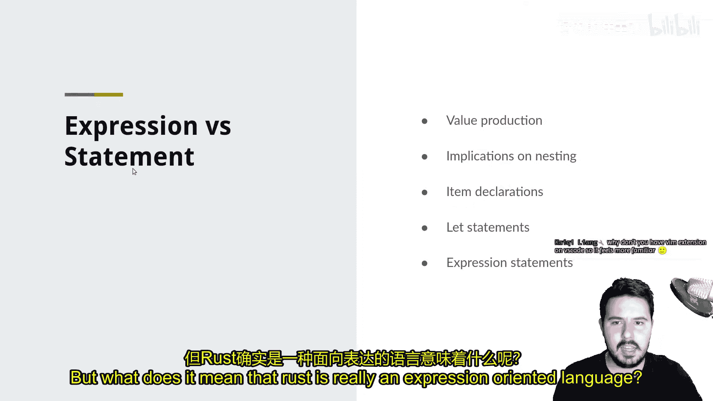

Food dot C。Yeah， yeah yeah sure。Okay， great。And a language like C。Same like int X equals four here。

If I recall correctly is a statement， right， this is something that you'll write and put a semicolon after。

 and it's sort of like one item on its own。😊，Right。However。

 there are also such things as expressions in C。 So an expression is a syntactical item， you know。

 like this that can also be used as a value for something。 So imagine if I could say int。

 and this doesn't quite work， but I can almost make it work int Y equals。This intex equals4 here。

 And let's say int equals 4 evaluates to this4。 Then theoretically， you might get the value 4， right。

 This expression might evaluate it to4 as well。 And so you' can end up with x is 4 and y is 4。

 So you can't quite write this and C。 I believe in C。

 you can write something a little like int X equals。I think if， if I write maybe like in x comma Y。

 x equals。Y equals4 like this， and I believe C is happy with that。Yeah， or or even like that as well。

 And what's happening here is that this。😊，Y equals 4 is an expression。 It's something。

 It does something。 It sets y to the value 4， but it also evaluates to this value 4 here。

 So you end up with getting， you end up getting y is equal to 4 and also x is equal to 4 like this。

はい。You can also use an expression as a statement right so this y equals 4 here could just be y equals 4 semicolon and this is just using an expression as a statement and we call this an expression statement right。

 very creative name just some text and then semicolon end of line。

 but it can also be used as an expression。Now the sort of takeaway here。

It is that expressions tend to be more flexible than statements？😊。

RightBecause wherever you have an expression， you can use it as a statement by just going like expression and then a semicolon。

😊，Right。But if it's an expression you can also use it elsewhere。

 not as a statement but as a part of a larger thing， and so in rust。

 a lot of syntactical items try to be expressions as well so you can use them in more context which is actually quite nice。

😊，So。What's some examples of using expressions in rust？All expressions are same。

 but not all statements are expressions。 Yeah， so all expressions can be used as statements。

 essentially， which is just by typing out the expression and then putting a semicolon Even like 42 is an expression itself because it's just 42 and then you throw a semicolon It doesn't do anything。

😊，Right， you just basically said 42 and then it didn't do anything with it。 but it's。

 you can use any expression as a statement by throwing a semicolon on the end。 But， you know。

 usually you'd use 42 as part of a larger thing like what x equals 42 or 42 plus 50 or you know。

 something like this， right。😊。

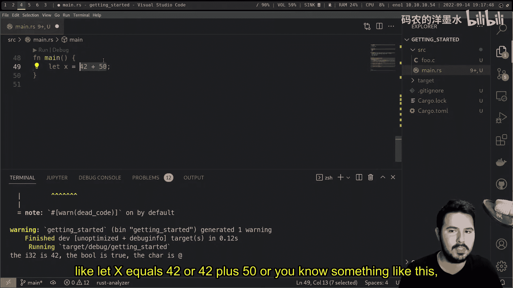

So what are examples of expressions in rust that you're unlikely to see elsewhere。

 A nice one to start off with is an if statement， right。

 I'm sure hopefully we've all seen a pattern that looks something like this。 It's like。

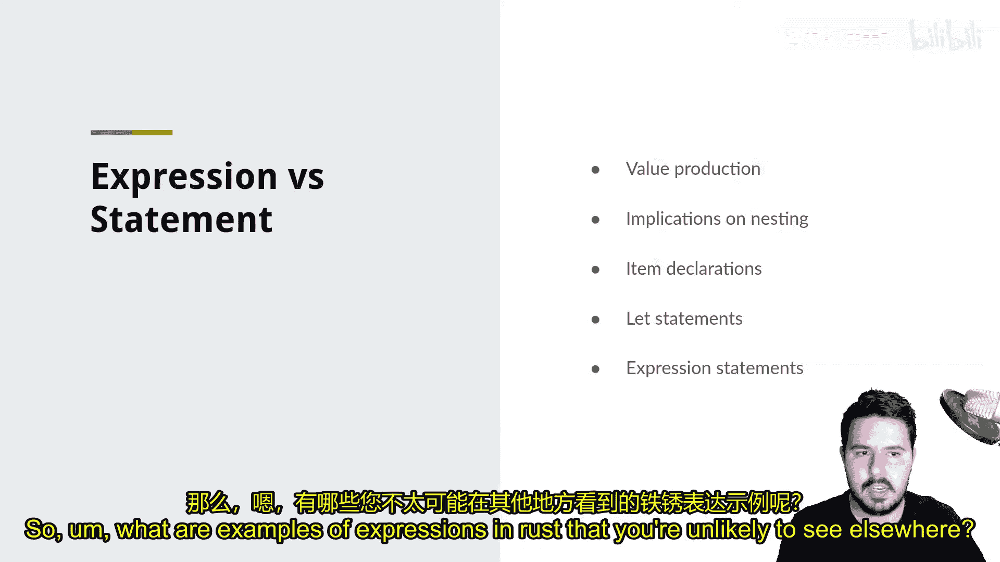

F2 takes in some flag， which is a boolean and it needs to give back an integer。And well。

 I guess a lot of the time here， you could just say if flag return 42 else return 100。

 But let's say you wanted to print out the value before you returned it。 Right， then you go， okay。

 well， we could do let X equals 42 print out。X。And then return X。

 And then I guess I could do the same stuff down here。 But this is 100。 But then you' sort of like。

 okay， this is looking a little like you're worrying about dry。 for example。

 I think this is just freaking out because there's another function called F。That can be for one now。

Where you're saying this code is very repetitive， I'd like to sort of bring this together。

 these ideas together， if I can。 And so you might end up with something like this。 you might say。

Let there be a variable called X。 If some flag， then x is equal to 42。Otherwise， x is equal to 100。

And then after we figure out what value X hold。Print out the value of x， and then return x。Right。

 so this is， this is some code that you might see。 you might have even written elsewhere。

 And this should theoretically do the trick。 We'll do full of true and full of false。And run it。

 We get 4 to 100。Great。😊，So what's the interesting part here for us well。There's。

 there's something this， This should feel a little weird when things get bigger。

 Imagine there was like an Elsif， Elsif， you know， false。Elsif。you know。

 true like there's there's some other conditions that are going on and these blocks here get you know。

 really big， there's lots of code going on and here lots of logic that needs to happen。😊。

In some other languages， it might be， you know， possible that you look at this and go。

 I forgot to set X。Fortunately， Russ will go， hey， it might be uninitialized。

 so I'm not going to let this program fly anyway， but you know it you might lose track of like where is X being set。

 where isn't it being set and and as the problem scales up。

 this ends up being a bit of a problematic solution sometimes。

 So what tools have we got to deal with this。 Well， ifs in rust are not statements。

 you might be used to saying if statement right， I'm going use an if statement to solve this problem in rust。

 you would actually be saying a will use an if expression。 This right here is a if and if expression。

Which means it evaluates to something。 This whole block evaluates to something。

What does it evaluate to。Well。The true case of the F has a block here right。

 See like these braces here denote the true block。And these braces here denote the false book。

 right out else in this case。And whenever you have a block in rust。That block as an expression。

 will evaluate to whatever comes last in that block， so let me show you like this。

If I get rid of the x equals here and just throw 42， notice not 42 of the semicollon。

 that's an expression statement。Just 42， then the block will end with an expression。

And if I do done the same thing in this bottom block here， make this block in with an expression。

 right？Then this overall if expression will evaluate to whichever like， if it's true。

 it'll evaluate to this expression here。If it's false， it'll value to this expression here。😊。

So then I can just throw this right here。Right， I need to throw in a semicolon because， you know。

 this is an， I need to tie this into a statement at some point。 So I throw this semicolon here。

 But this is what we get in the end。 Let X equals if the flag， then 42。Otherwise，100。

Bye by return keyword。 Oh， yeah， we're gonna see that one in a second as well。 So you might go， okay。

 well this， I can do this in C。 This is called a turnernary。 right， you might go flag question mark。

😊，And you've you've made a written code that looks like this， something like that。

 or it's like flag question mark， the first thing， Co and the opposite the else thing。

And you'll get the same result in this case， but。The difference， in my mind。

 is that this solution is more scalable。So let's say I wanted to throw a print as well here that said print。

The flag was true。And then I just wanted to say， like。Oh， no。Flag was false。something like that。

 this still works。And the reason this still works is because we have some sort of statement up here。

And it's only the last expression that it cares about right， since this ends in an expression。

 that expression sort of like infects its way upwards， you can imagine。😊，Right。

This hundred here infs its way upwards。 And because it sees that that if as an expression that ends in a I 32。

 L has an expression that ends in a I 32 here， then this if in its totality will also act as an expression that produces an I 32。

😊，Right， notice if these were different things if I said this is going to produce the let us see。

And this is a， so this is a cha now。 And this here is a， a I 32。It won't type check anymore。

 It's going say， hey， if and else have incompatible types，6 extra found integer。

 So they still sort of need to like type check and match up。 But if they do。

 then we're in we're in luck and we can start using like this。

And Ka notices it'll also just look like a ternary if you put it on one line。

 So let's get rid of these prints for a second。What if I write the code a little like this？Right。

That's relatively readable。 I think。 Let x equals if flag 42 else，100。Right。

 and so that's for this reason， Rus doesn't have a turnernary operator there's no turner operator at all because you're expected to just write it like this instead。

If we put the 42 before the print line， would it evaluate to unit？😊，It's a great question。

 So if we go back up here， what if I put the 42 up here and the 100 up here Yeah。

 this is just like the compiler is freaking out because it's like I don't even know what's going on anymore So it's this sort of magic trick only works when it's the last thing in a block when the block itself ends in an expression if I put the semicollonons here and I go okay that's this is a statement here。

 this is an expression statement here as well。😊，Then you'll notice this is。

 this is gonna come back to a a really funny idea。You'd expect that this would work。

 I would imagine if flag， then this is doing nothing， print something。 This is doing nothing。

 print something。 And like an if statement should， you know， really just work。 it should。

 if this do this， if else do that， that's what we used to。 But I can still say， let X equal to this。

 And the compiler still like that's fine。 No problem。 It's not happy to print it out。

 But like that's for a different reason。 What type does X have。What type does X have， because really。

 there's there's no real type to ascribe here？Right，There's no type。

 It doesn't really make sense sense for x to be a number， let's say， like an I 32。

 because what number would it be， Would it be 0， Would it be 42， Would it be the biggest number。

 would it be the smallest number， right？ There's no real type that makes sense。

 And when there's no real type that makes sense， You know what we have。They're empty toughle。

 there it is。Empty topple the unit type。It's very handy。 So this is what I was saying in the。

 in the comments during the break。 It's very handy when you just need a type that doesn't mean anything just sort of like a random empty type because。

 and it's great because there's only one value that fits the bill， which is just the empty topple。

 there is a concept of， well， void， I don't know whether you're coming when you whether you're saying void from like a C programmer's perspective or an academics perspective。

 because those are two very different types。 So if you， if you。Help me out there。 then。

 then I can tell you。C programmers perspective unit is void in C as a C programmer。 essentially。

 the difference is that。Voidid in C has no， there's no accompanying value， right， Void as a type。

 but it's sort of like the type of the absence of a value。

 and we sort of use this same idea here where we're saying it's sort of like the absence of a meaningful value。

 right， There's only one value。 It's just the unit value， which is of the unit type。 So it works。

 It's the same sort of idea。 But the great thing is like it doesn't really make sense in C to say this variable has type void。

 but it sometimes makes sense in rust to say this variable as type unit， has type empty tuple。

 just when we don't have a good type to give it。 There's it's it's sort of like a meaningless variable。

So as difference between semantically between unit and an empty tuple。

 unit is just a name people have for empty tuple' because it's it gets a little tie Im saying empty tuple。

 empty tuple， empty tuple， empty tuuffple and it's a bit of a tongue twister So we just say unit is as just a shorthand name for it。

😊，So yeah。And sorry， I missed some questions here， are those braces still needed。

 the braces are always needed in rust， always need the braces。

 you're not allowed to admit them even if it's just one line。😊，There's two good reasons for this。

 I'd say reason number one is that if you have a look at， no， no， no。

 I'll link this on the course forum later。 there's a brilliant story about an Apple security vulnerability because because of if bracing and it's a great read I'll put on the course forum check later on after the lecture and it's a really honestly an interesting read And reason number two is because there's always braces we don't need parentheses around the condition。

 The other reason you need parentheses around the condition is because sometimes you won't have braces and then there's there's lexical ambiguity is what we'd call it。

 And so you just have to pick one。 you always need parentheses or you always need braces。

 So us like we'll choose braces because it also can stop people from making mistakes which you'll have a look at later on。

 and braces also denote scoping like in C+ plus yeah， absolutely for sure。😊，Cool， all right。

So another interesting idea。 So let me fix this code up here。So we have oops。

42100 so X does have this number again， I that functions work the same way。 All。

 This is the function's body。Over here， and a function。Unless you sort of like， you know。

 return this value out of it like I'm doing here。The function will just evaluate to whatever expression comes last。

 There's no expression that comes last here。 So there's。

There's actually a very interesting trick that there's no special magic where it goes。

 oh since say write return。 I'm not gonna to check for this。 There's something brilliant。

 It's called the never type。 It's very advanced reading for where we're at right now。

 But it's there's no magic， it's sort of things very nicely work out here。 But in our case。

 let's just go if there is an expression at the end of the function。 Then the function will just go。

 okay， that's what I'm meant to return for this return X here。

 Does anyone want to guess what this could be rewritten as to still mean give back the value X from this function。

 What can I rewrite return X semi colonlon as here。😊，X， X， X， there you go。And it works， right？😊。

Cargo run。Flag was true，42， flag was false 100。Perfect with no semi colon。 That's right。 Abs。

 Theres a semi colon here。 We're going to get a type error。 And what's the type arrow going to say。

 oops， What's the typearrow going to tell us， it's going to say。I can't match unit with I 32。

Cause there's no return or anything。 So this will just go great。

 I'll just give back a unit type because there's nothing sort of there's nothing to to give back here。

 There's also a bit of a weirdness where statements themselves end up。Can can can evaluate to unit。

 but。You can see here it says it implicitly returns unit because there's no tail expression and there's no return right So it goes。

 hey， maybe try removing the semicol and that might be what you want。

 but that's the the type checking that fails here。 So it's very interesting， very cool。😊，嗯。

Cool cargo run does the right thing。 So that's expressions。

 And there's you can use expressions everywhere。 I could say printlin X。

 I'll just says some value where we say in here， if like X is equal to 42， then the string hello。

 otherwise the string， oops， otherwise the string goodbye。😊，Right， and since this is an expression。

 it's like great， that's fine。 I'll do that。 No worries。Right， and we run it and it does， you know。

 it does things that it should do。And so just play around with this。 have lots of fun。 Go。

 go not so in your workshops tomorrow and the day after and。😊，And just， you know。

 see how far you can push it。 and if you run into problems or questions。

 just let us know on the floor。All right。

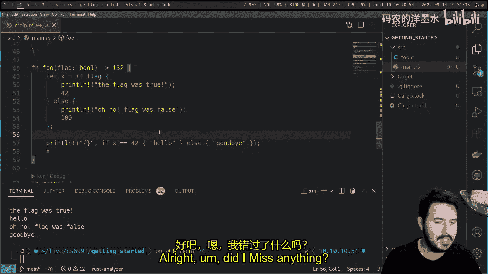

Did I miss anything important， implicationsmplication on nesting。 Yeah。

 that's kind of an interesting one。 You can just sort of。

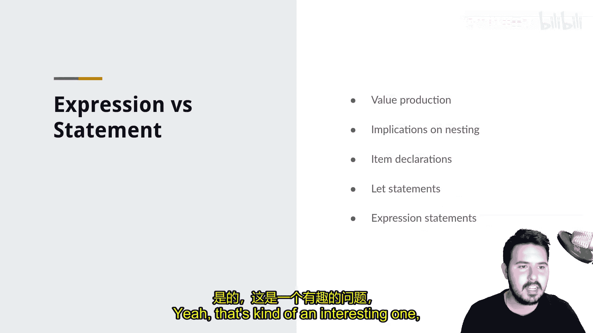

Like if I put an if statement in here as well， I could say， like if， you know，42 is equal to 4024。

 sure， then give back the value1050， otherwise give back the value 256。

And this just all sort of works out because this， if here will evaluate to some number。 you know。

 the if and else branch here will evaluate to number and that it just sort of like works its way up。

 So you can go really deep nesting these expressions and they sort of cascade their way upwards if you want。

 so and Ka has written a dozen line function that has no semi colonlon。 Yeah。

 it's very it's sort of like a hasskecal when if you've ever used taskscal and you've written a point free a really crazy pointfr function。

 It's that same sort of like nice feeling。 If you don't know anything that I just said。

 you don't need to worry about。 it's al right。 blah blah， blah， yeah， whatever。

 I'm sure that's not too important。 Alright， functions。 we've seen a lot of functions。

 So I'm gonna breeze through them really quickly。 we've seen defining a function which looks a little like this function。

 name of the function， any parameters。 the way we declare parameters is say name colon type。

 you always need to give the types in functions。😊。

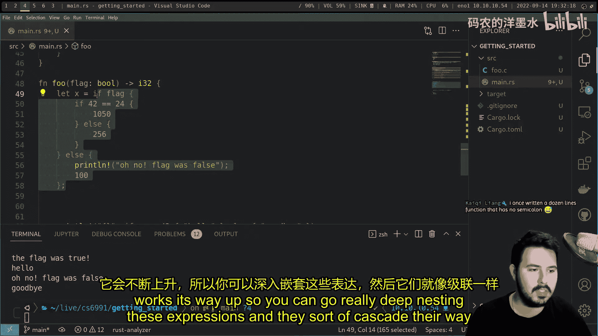

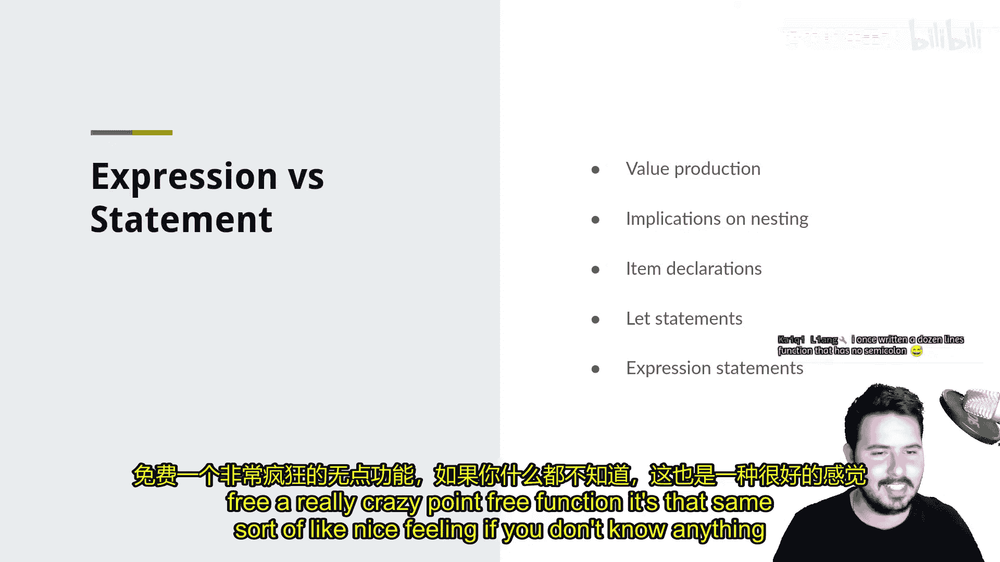

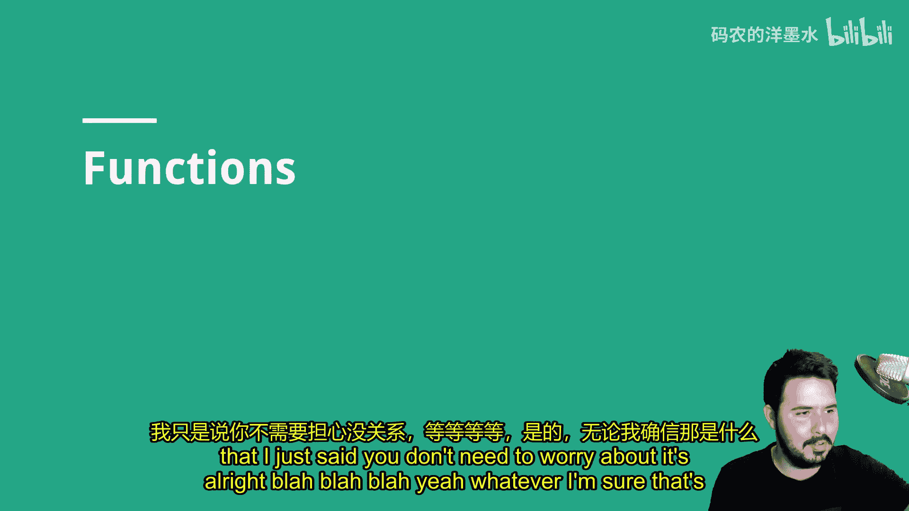

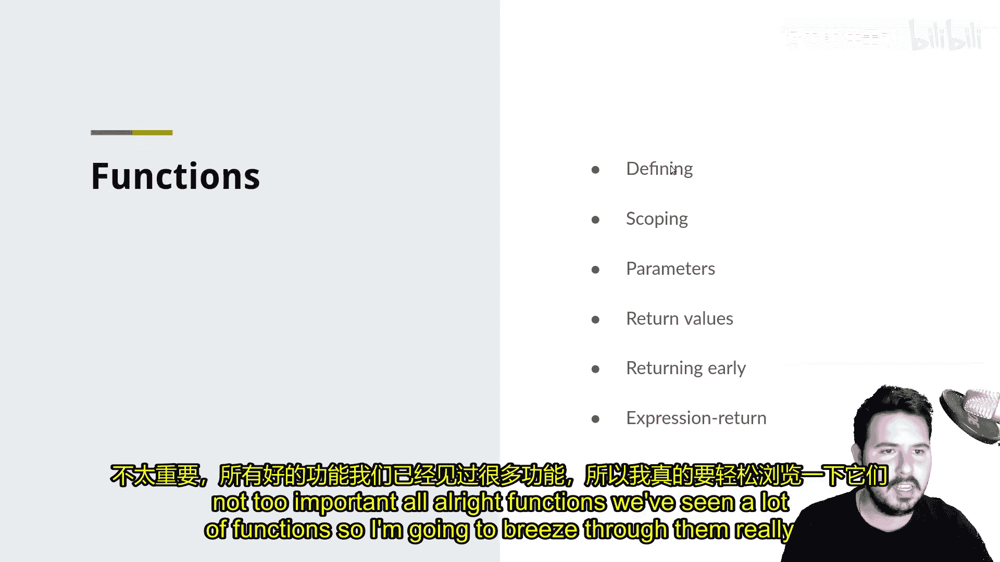

Rust will not auto info function types， there's some great reasons for that ask on the course forum and I will give you 100 of them。

😊，And if you have a return value， you can do arrow goes to a return value。 again。

 Ru will never auto infer a return value， a return type rather。

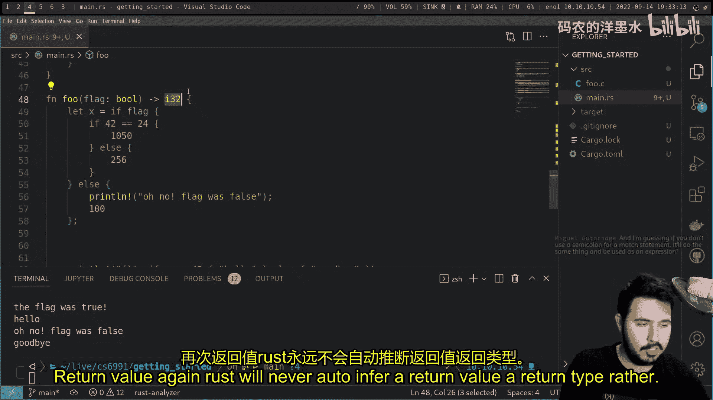

And so you have to type this all out explicitly Scoping functions。 you know， if I have。

 if I write X in this function， I can't just access X in main。

 samee as any other programming language really。 Well， same as programming languages with with。

 you know， scoping rules。

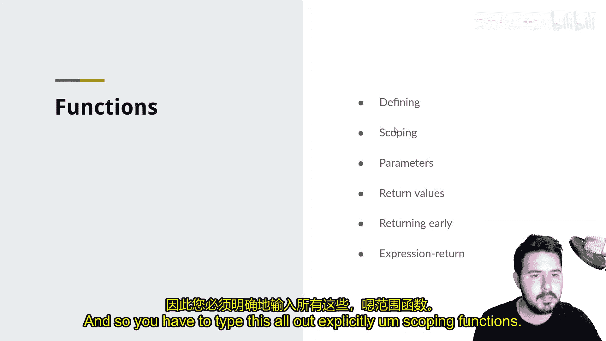

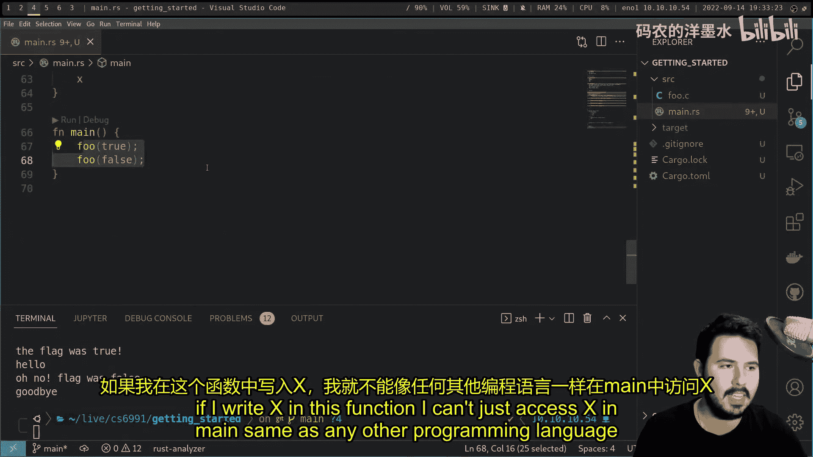

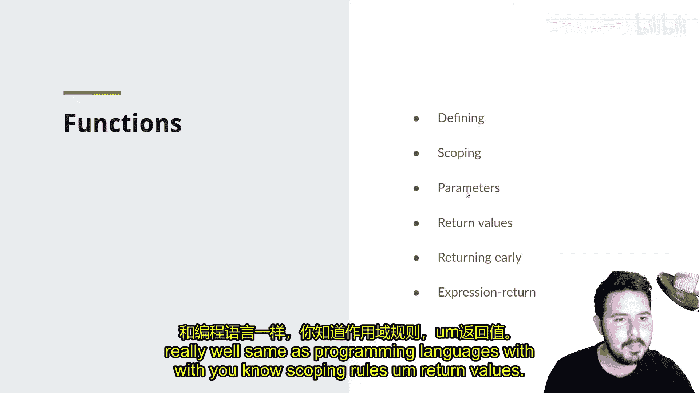

Return values。 Yes， we saw returning early。 You know。

 we can use the return keyword if we want to return early。 That's another really cool thing that I I。

 I really， is there a nice way I can quickly demonstrate this。

 Let's say there was also like they gave us an， instead of a flag。 they gave us a number。😊。

Which is an I 32。 And let's say we wanted to get the the log of a number or something like that。

 right？The， the， the logarithm， so like。This number here， let's say， like the log base2。

 that's the function we're writing here， log 2。Right。That is only defined for numbers that are my。

 let me my brainy sketch up。 I think numbers that are greater than 0。 Am I right here。

 Does someone mathematically smarter than me want to confirm the log base2 in this case should only be valid if the number is greater than 0。

😊，Is that correct？Okay， yep， that's right。😊，Step 1 might be like， okay， well， let's do it。

 Let's take an unsigned number here。 right， an unsigned number。

 because negative values are just not gonna make any sense。

 But there is still one case that could go wrong here， which is what if this number itself is 0。

 there's no real defined answer for that。 So what if we did something like this。 We said， let the。

But no， this is a bit of as sillyilated。It's hard to come up with the perfect example for us。

 but bear with me， let's say we're going to say let the logarith。😊，Equals。Well。

 if the number is equal to 0， then this is no good。Otherwise， it should have some defined value。

 right， But let's say I just want this logarithm itself to be not like I could say then this will be none。

 And otherwise， this will be some some number dot log 2。Right。

 something like this is probably going to give me an edit F32。 I'm guessing， oh no， you're 32。呃，说。

That。What's its problem Oh， unstable feature。 Okay。

 so this isn't hasn't quite made it in the language just yet， but maybe one of these has log2。

Is that unstable？Okay， whatever， well just imagine， right， so we're taking the log two of the number。

So I could write it something like this。 But what if I wanted to say， no。

 I want logarithm to really just be the number itself， right， I want logarithm to be a U 32。

 a number。Then how do I make this type check， How do I make rust happy with it？ Well， in this case。

 I can just say number dot log 2。 That's pretty easy。Right。That' that's really no worries。

 And down the bottom here we can just say， you know give back， give back the sum。Of that logarithm。

Rightright， so at the end here， this is just sort of like， again。

 just like saying return some logarithm。Right。But how can I make this top branch be happy if there's like no defined value here。

 Well， something brilliant as I can just write。Return none up here。And again。

 this is this is a little tricky because the log2 is it's going， oh。

 it's not ready for the language yet， we haven't quite got yet。

 but this actually does type check it's happy。Because it knows that itll。

 it'll never reach the point where logarithm needs a value if we just return straight away in here。

Right thing about this。 If the number is0， it's going to return and we' this thing will never end up needing a value anyway。

 because the function is already like we've left。So it goes， okay， that's fine。And otherwise。

 if the number is non0， then it will get a value numberumb dot log 2。

 And so this is a perfectly valid way of writing a let bla equals， you know， if blah， blah， blah。

So these's all type checks， which is actually， I think， very cool personally。😊。

That manages to figure this out。 and again， this is， again， related very advanced reading。

 This is to do with something called the never type。

 but maybe maybe this is sort of like a we'll come back to this in week 10 and be like thats this is why this works。

 but。😊，But yeah， it's pretty cool。 Our inlog， right， Yes， in log is not happy。 So yeah。

 maybe if we had have done like F 32 here， F 32 there， F 32 here。

 then it might have been a little happy 0。0 here。 There you go。 Absolutely right。

 I is considered good rust style。 Yeah， for sure。 This is very common。 See this kind of stuff。😊。

There's lots of， you know， perfectly idmatic rust styles。 There's not a， it hasn't been。

 maybe it hasn't been around long enough that people have sort of cordoned away subset of language or it's like avoid this whole sort of concept。

 It's not quite at that point yet。And if you if your immediate action is that it's unergonomic to read power to you。

 that's fine。 You absolutely do not have to write code this way。

 It's all about just giving yourself options and then finding what you like。

 experiment in the workshops。 right， That is to say like， you know。

 play around with and see what you like， don't sort of look at something and go， okay。

 I immediately am not super pleased with that。 So I'm just never gonna touch it again。

 Like the workshops and the exercises are your opportunity to play around with these ideas。

 So do play around with them。 And then once you have form your opinions and and， and yeah， yeah。

 awesome， great。😊。

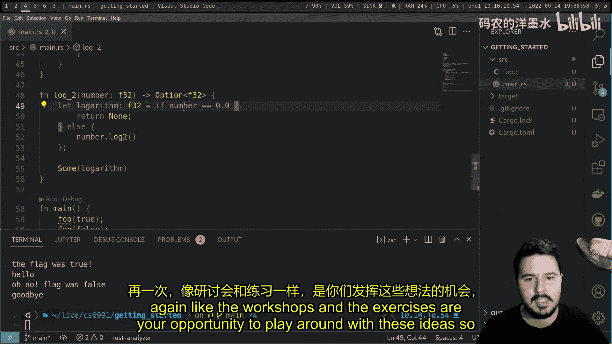

Okay， an expression return， yeah， we saw that one earlier as well。

 which is just replacing the return x with x itself。😊。

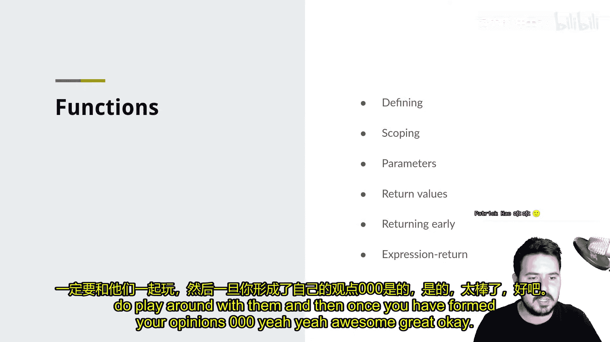

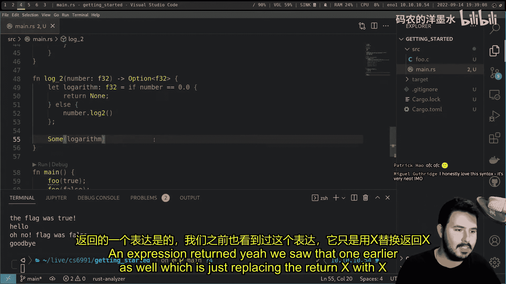

And Amiiguel loves this syntax。 So there you go。 Control flow。

 If expressions we've seen a lot already， we've been through this branching conditions in rust have to be a boolean is worth considering like in C。

 often you can just say like if 42。😊。

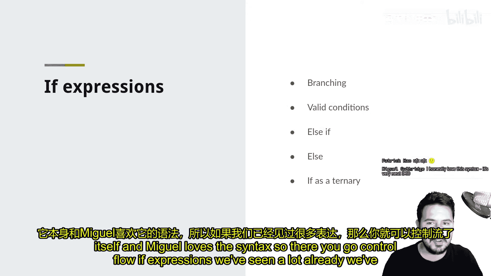

Right， or like if 0。Or like， let's say these were variables。

 And it was like let x equals 42 and F x or let y equals 0 and F y。

And C will basically coerce this into saying if they're not equal to 0 is what the semantics are。

 Ru you can't just like throw in。 It doesn't like to just randomly convert between types automatically。

 So you have to be pretty specific， if requires a boolean， so。GoGot to give it an actual。

 true or false value。So that's one thing to keep in mind。

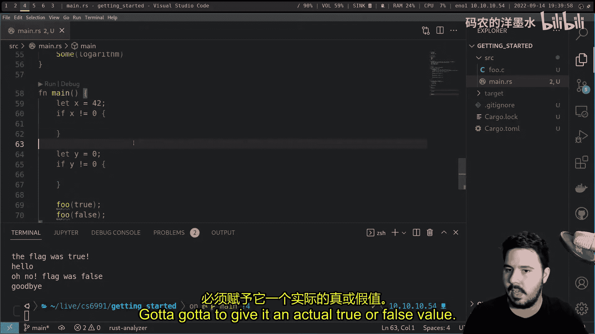

There's looping as well。 So I think we've seen a couple of different loops from the Monday lecture。

 The simplest one is loop。

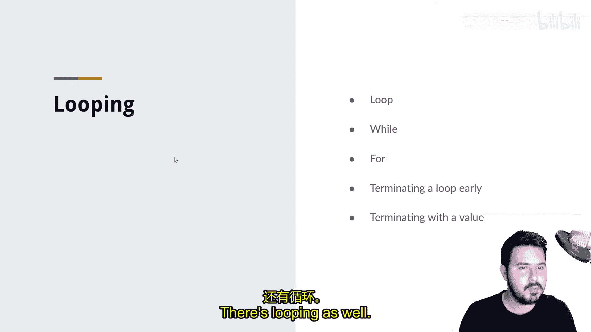

Which just means loop forever。Excuse me， so if I just said like。路。Printlin。Oops， printlin。Hello。

 students like this and O run， it's just going to infinitely print that out。Right。

 I could then say something like let mutable x equals 0 at the end of the loop do x plus equals 1。

 W noting Ru doesn't have plus plus syntax， sort of like Python like that。

 You only have plus equals or x equals x plus  one。And I could say sign if x is greater than 10。

Or you know， let's say if x is equal to 10， then break out of this loop， for example。

And this should hopefully print fellowo students 10 times。Right。

 and there you go 10 hello students out there。You can also break loops are an expression loops are an expression。

 you can break out of a loop with a value。😊，Let you know， y equals this loop。

 break with the value 42。And at the end， print out why。Right， loops or expression。 Again。

 basically every anything that like realistically can be is an expression in rust。's it's。

ItsJust sort of like that so you can break with a value in this， very cool。😊，We also have wire loops。

 so I've essentially baked a while loop up here， which is to say while x is not equal to 10 x plus equals1 and do this print line out here。

😊，So， this。Should also print fellowo students 10 times。ああです。There you go。

 hello students 10 times and we have four loops as well， four loops。

 right if you're familiar with four loops in C。😊，Then you're probably used to them looking like for let x equals0 x is less than 10 x plus plus there is。

 I would call this sort of like the the triple statement for loop right where you have you know。

 statement condition and like the step sort of statement there。There is no equivalent in rust。

 you can sort of use macrowiizardry and stuff like that， week  seven or eight。

 whatever it is to emulate stuff like this， but the four loops in rust are much like a language like Python。

 for example， where if we have some sort of a collection， like my array is  one，2，3，4，5。

 then I can say four element in X。And then print out。You know， each， each value in that sorry。

 not expert element。And we get one， two， three， four， five。

So four loops and rust always take the form four element in collection。The superior way to iterate。

 and we'll talk all about iteration and end collections next week。

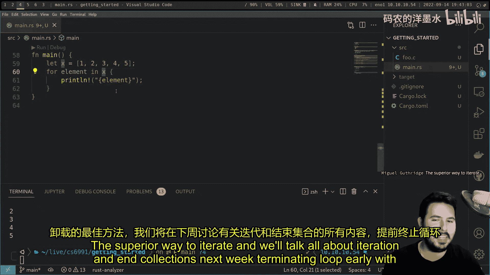

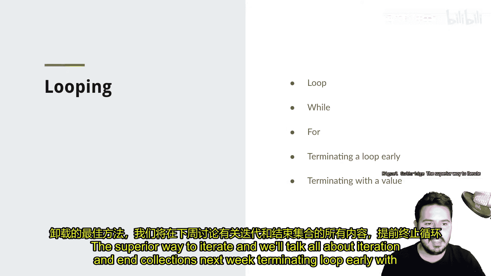

To loop early with break， they also have continue as well。 If you recall over using continue。

 there's lots of documentation about keywords， like continue and break and stuffca they exist in lots of languages there in Ros 2 and we saw termating breaking with a value。

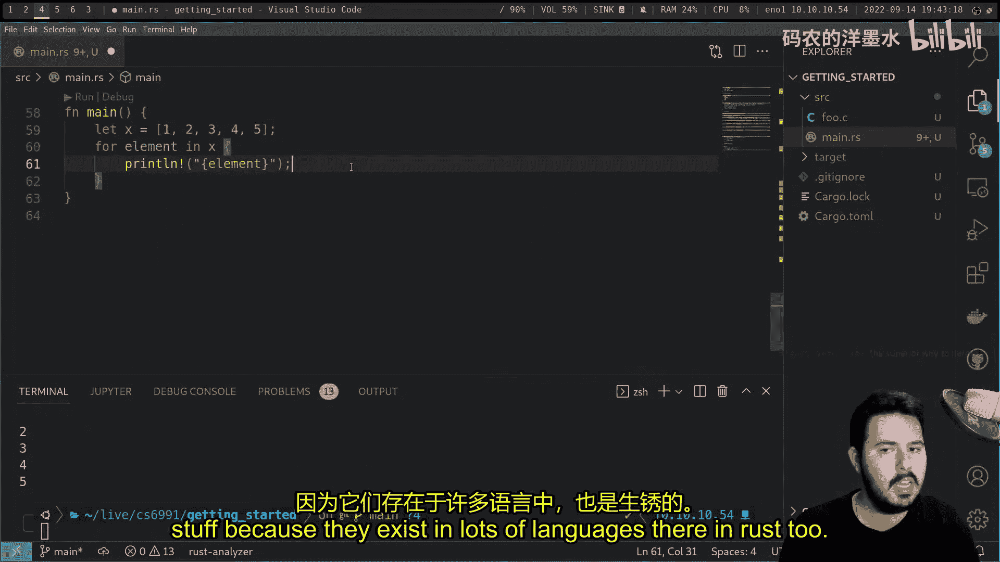

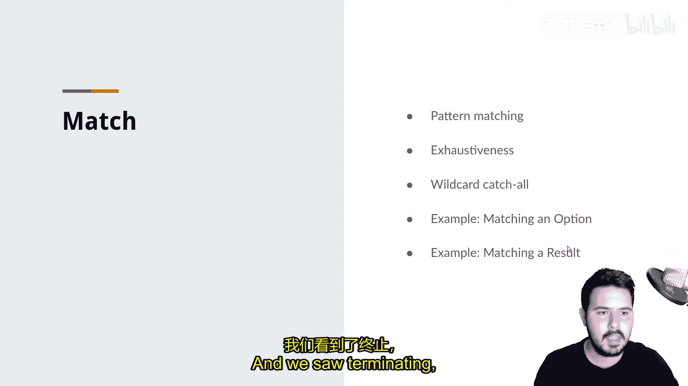

We've looked at match as well right So this was when we wanted to say match on this automobile here。

 we considered that they're exhaustive， so it's if you haven't considered say a bus or a plane。

 then you'll get a compiler saying hey， there's some patterns that could exist that aren't accounted for。

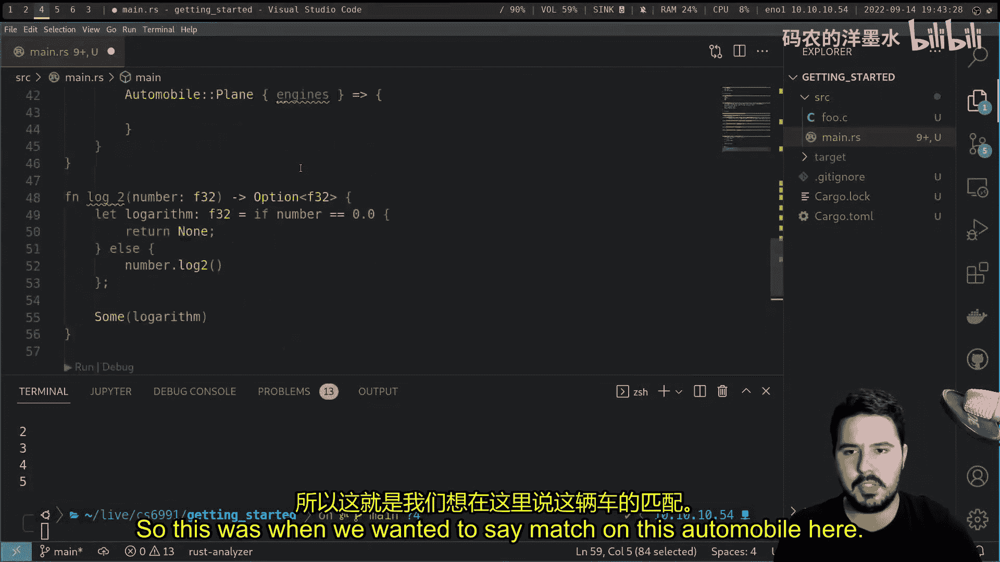

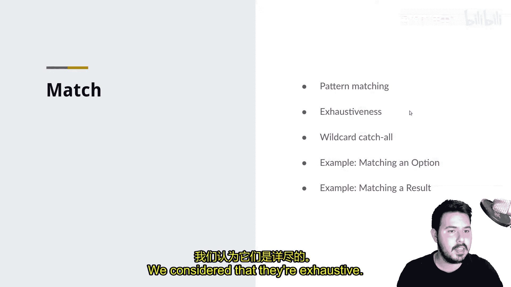

Right， and so that's quite handy if you add something to the enum and forget to like deal with it somewhere or anything like that。

 but it can get a little annoying。 Like sometimes no。

 I really only want to do something if it's a car or motorbike or a train。 if it's anything else。

 including a bus or a plane， I actually just don't care。 And in that case。

 there are patterns that will match anything。 So in this case， our pattern would be an underscore。

 And I say if this value here， it'll go through one by one。 It'll go， it doesn't match car。 Yes。

 then do this。 Okay， if it didn't match car， check this。😊，If matches this， do this， we're done。

But if it didn't match car and it didn't match motorbike and it didn't match train。

 then will it match an underscore， The answer is yes， any。

 any single thing in in the Ruk language will match this underscore pattern。_ matches anything。

 So if you go through all these options。 and it's really none of them。

 then you can end up throwing in this block。 And if you just want to say。

 I don't want to do anything with it。 Just leave the braces empty。 Don't put anything in there。Right。

So there's this like little wild card catch all， which is quite handy， so which is the underscore。

And matching an option， matching a result， you're gonna have to do some of this in the。

 in the workshops。 But imagine I take my function， takes an option。

Where x is some option of a number。Then often you might want to do something like match on X os。

Match on X。I'll ask it to fill out the arms for me。 And if it has some value， then。Do this。

 If it has no value， then do this。And match like really the sky is the limit with what you can achieve with match。

Right， like I could write， let value equals。Match X， if it has some value。

 then just spit that value back out。 right， This is an expression here。 If it has no value。

 maybe the default value like is 42， something like that。Right。

 and this is one of those cases where sometimes like in another language。

 value is just a random name I'm using here， right， Like value doesn't have that much meaning。

 It's just like， that's what it is。 And so I might have to come with like a random other name if you don't have shadowing I don't know if we still have the code relevant to it。

 but where you can sort of reuse an existing name I would have to maybe say like value1 value1 here。

 but I can just say whatever it's just a quick throwaway value value value。 And and you know。

 I'm probably fine with that。 You might not like it。 And you can write your code differently。😊。

And there's there's fast ways of doing this， of course， I could write let value equals x， you know。

 because I have sort of got a lot of rust functions memorized in my head。

 I would say this is Unrapap or 42。😊，And this will do the exact same thing as this code here。

 But the point is， if you understand how to use match and how match works， all these like。

All these functions on option。You know， there's tons of these functions that you can basically just do with a match。

Like tons of stuff here that you can just do with a match so if you can master match。

 then you figured it all out basically and then you can just like go looking for the functions and use them when you want to。

 but you should basically understand how they all work and it it's quite handy。😊，Similarly。

 there's one type that we haven't looked quite so closely at。

 I think we might run a little over time this lecture again， I'm sorry。

 which is going to be important for your exercises and potentially the workshop as well called Re。😊。

And result is very much like option and in fact， let me just pull up option one more time here just so I can really show you here。

There we go。 So see here option is， is generic over some type T， right。

 which just means when we have an option， we need to fill in some type in the blank here and see's either gonna be nothing or it's going to be a T。

 It's going to be something of that type T。Result has two types。

 has T and E E here usually stands for error， and it's either going to be okay。And we have a T。

 like things went well。 Here's the T。 Or there was some sort of error。 And here's that E， right。

 And this， this error type could be really anything。 It could be like a number。

 could be like an integer， which means 0 means that one means that it could be， excuse me。

 It could be a struct。 It could be another enum。Could be lots of different things。

 Whatever you want that E to be is perfectly fine。 If you think， oh， I。

 I just want to indicate that there was an error， but I won't give you any information。

 throw a unit there， right， throw an empty topple。 and they。

 it's not gonna give them any useful information， but they might be able to go， okay， well。

 there was an error， but they won't， you know， Tell me what it is exactly。

 And we can pattern match on results as well。😊，So let's say we had a result where either we get some sort of a number if things went well。

 maybe it's like the result of some calculation or they're just giving us their error is just going to be a string。

 maybe something like that。😊，And I would go， maybe I'd like to do something like match on X if it was okay。

 And we got some calculation。Then I might write something like print line。 The calculation was。呃，X。

Right。But if it was an error with some sort of error message。

Then we're going to print a like standard error， we'll say there was an error。

And print out the error message。Right， so just different different options， not X calculation。

All right， just it's the same thing as like patent matching on an option， but the sort of nonen case。

 this sort of bad case here can also have some data attached with it。

There's also an idea that like if I swap this for a unit where this， you know。

 type really carries node。No extra information， no extra meaning， no extra value。

 this is basically just like an option。😊，Right because it's either got something or it's just got this error unit。

 but the unit doesn't tell us anything。 So it's just as good as none。

 So the the academic terminology for this is isomorphism。

 essentially this result here is isomorphic to option。

 which is just a very fancy way of saying they're basically equivalent You can turn one into the other with no loss of information or anything like that。

😊，So another interesting case of the unit type popping up。

Can you use match like a switch statement those only work against patent slash types and not values。

 Yeah so match always takes patterns on this side yeah。😊，It's。

 and there's you can cascade things together。 like you might go， I have some number is 42。

 and I want to match on that number。 So like a number， for example， a term is a pattern。

 So I could say， if it's 0， then do this。 If it's one， then do this。 You know。

 Russell' is gonna be unhappy because hey， you missed like two through。You know。

2 billion and negative 2 billion through negative one。

 It's telling me that I missed a whole bunch here。 but I could say all。

 So if it's like two or three or four or five。Then， you know。Do this。 And otherwise。

 it's gonna to be some other number。 These are all valid patterns as well。

 So there's tons of valid patterns in rust。 have a player around and see if you can like spot like what things that you maybe didn't expect were patterns that are。

 if there's something that you're wondering， I can't figure out whether I can make a pattern that means this or not。

 ask on the course forum and and we'll help you out for sure。😊。

So all kinds of different patterns you can use yeah。All right， so。

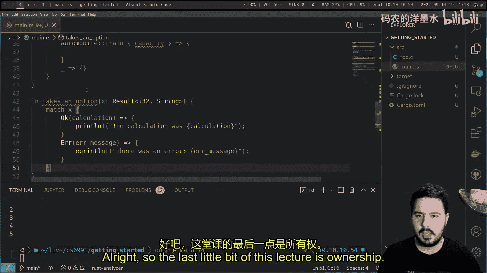

The last little bit of this lecture is ownership。 We're just going to sort of do like a basic introduction to the idea。

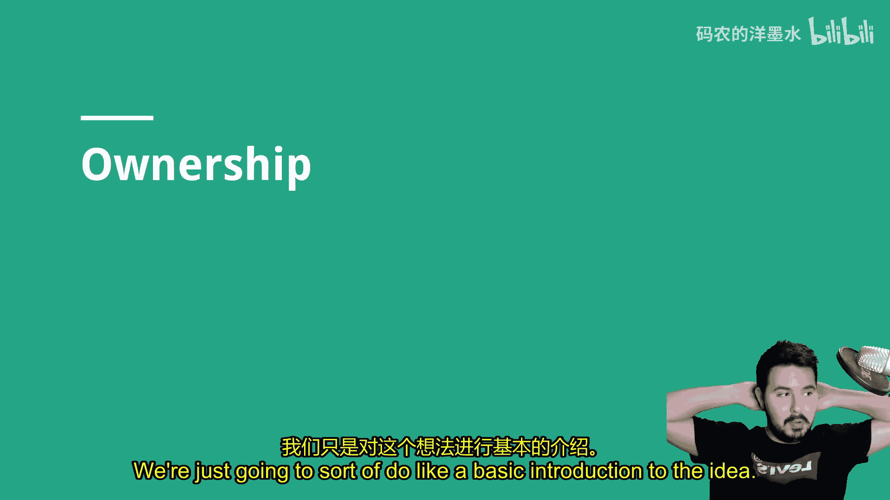

Right a basic introduction to ownership。

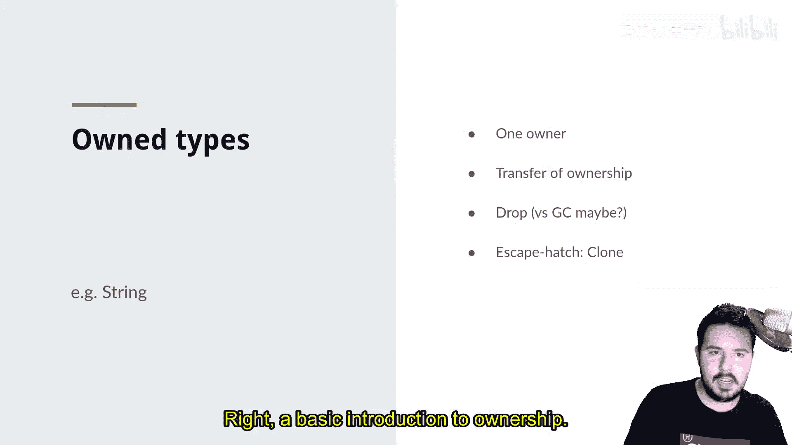

So let's do some random functioning here or a chip。And get some other stuff out of the way。

 Ca it's a bit of an interesting。Topic on its own。 Can you have further matching。

 conditional matching， I two different types of error in the option example。 Yeah， for sure。

 If you wanted to have two different types of error in the option example。啊。That so the question。

 I think the answer is like the answer is yes， whatever you're trying to do。

 you will be able to do it。 I'm not sure exactly which， you know， line of thinking you're going down。

 So if you could put it on the course forum， then then we'll。

 we'll draft together an example and and but yeah， the answer is almost certainly yes。

 It's just a matter of like what exactly you want and we'll， we can get some code to show that。

So ownership。😡，In a normal programming language， this is perfectly fine code。 Let X equals 42。

 Let y equals 123。Or let's， in fact， know， let's， let's say let x is 42， let y is be equal to x。

And then we'll print out。We'll print out you know why maybe。And we'll print out X。And in Rusk。

 this is also perfectly fine。This is a perfectly fine code， but it's。

 it's dangerously close to not being perfectly fine。 So let me just set up in main。

I'm gonna to figure out this over a second。 it's just gonna call this ownership function。

And we'll run this code。 So what are we expecting， Well x is 42， y is x print Y print X。

 which you get 242s。 yeah， there's 42， there's 42。😊，However。

 let me change the type here a little bit。 instead of 42， let me be string from。

And it's going to say ownership。Tgger run and I get an arrow。Oh。

 borrow of moved value X move occurs because X has type string， which doesn't implement。

 implement the copy trait value moved here value borrowed here after me。 Oh， okay。

 lots of scary things going on。 Interal stacks stringing is in heap。 Yeah。

 some interesting ideas there。 So this doesn't quite work。But it did work when this is 42。

Doesn't work when this is string， capitalist string。 So what is going on？

Go'ming to draw a very quick diagram here。Inc。Well， actually。

 pause for a second before you go to in C。 It's worth noting， as was mentioned in the comments here。

 string in this case， right， string。Is a is like yeah he allocated type String is something that uses Malik internally。

 Malik and free。Right in Rut we basically never have to write Malik and or free ourselves。

 it'll deal with it for us， but know that stringing internally does use Malik to allocate memory and therefore it needs to free it at the right time right we should be familiar with these ideas if we've worked in C。

😊，So when we say， you know， make me this is not correct rust syntax。

 but I say make me a new string right， and it's going have the text like hello or whatever it was。

Then internally， it's going to go okay， well， I'm going to need to call Malick。😊。

And Malik is going to give me some chunk of memory， and in that memory I'm going to store that text。

 which says hello。😊，Right。Now， this， I said， is going to be equal to x。

What should happen if I say y is equal to this， right y is equal to x？

And the answer is it sort of depends what language you're using。If you're using a language like C。

 right， then what would essentially happen is that we would get。

 and let's just imagine for a second that。That， you know， this is all the stuff that made it happen。

 right， that made this， this stuff happen。 But at the end of the day。

 X is basically going to point to some region in memory that has the string hello。Right。

And if I say y is equal to x in a language like C， then we'll get y is basically also pointing to this same region in memory。

Okay。If we're using a language like C++， maybe。You'll probably find that Y ends up。Creating a clone。

Right， so they each have their own string hello。Okay。

 so what are the advantages and disadvantages of H of of each approach here Well here。

We've got two of the same thing。Right， two of the same thing， which is like。

 is okay in some scenarios， maybe sometimes you do want two of the same thing。 Like， for example。

 if we're going to modify one of these， right， and we don't expect the modification to sort of make its way through on I like。

 you know， we expect them to be modified separately。

 then we really would like to have two of the same things。 so they get modified separately。😊。

Allright， so okay， maybe you do want it。 What's the cost here， Well， we've got two of the same thing。

 right where you get using two times the memory。If this is， you know，5 bytes， which is actually。

 it's going to be more， it's going to be something like。

Probably 32 bytes or something or even a lot more maybe。

We're using 64 bytes instead of potentially 32。If we go back to a language like C。You know。

 y equals this？Then we're still just using。Our original， say 32 byte0 or something like that。So yeah。

 as noted here， see you copy the point as see else you copy the everything until he runs out in memory and yes Steve Co also costs performance。

 not just memory， but it also takes time。😊，set up to make a new allocation。

 to copy all this stuff across and to do all that work。Okay， so they both sort of， so so， okay。

 So maybe we look at this and we go， okay， this is nice， but we'd like to avoid this cost。

 if possible， We'd like to reuse the same memory。 Oops， we'd like to use the same memory。Well。

 then what are the costs associated with this， Well， as mentioned before。

 if you need to change the thing it might end up changing both of these， but a。

 maybe that's what you want。 And B， maybe in the cases where you go， no。

 that's I'd want them to be separate， you can just explicitly say， no， give me a copy anyway。

 give me a separate one。 So okay， maybe that's maybe that's fine。 if you have both options。

But are there any intrinsic drawbacks on this。Does anyone know a common mistake people make or maybe a mistake computers sometimes make？

When when we have a situation like this。Something to do with what we need to do。呃。

What we need to do at the very end of things in general。What's a common mistake that might happen。嗯。

Yeah， double free use after free。 Yeah， yeah， yeah。

 calling the same memory space with different variables can cause many issues。 Yeah， it can。

 It's very easy to make these kinds of mistakes。 So double free is the probably the easiest one to look at here。

This variable X has some malic memory， and we know with Malik。

 we need to free it when and when we're like finished using it。

 So we'd like to say when x goes out of scope when x is no longer used。😊。

It'd be nice to just say free this right， and that works great。

 X goes out of scope at freezeze hello and， you know， no worries。😊，Until， you know， three。

 nanoseds later， when y goes out of scope and y goes great。

 let me free this and you've just introduced a security vulnerability and you know 13 year olds hackers on the other side of the world have just broken into your computer。

😊，Right。So this is this is a very serious problem。 And it's， you know， you start to freeze。

 double freeze that kind of stuff have been they're a tail as old as time or they' a tail at least as old as C And you see this popping up all the time and things like C and C plus plus codebas。

 even some of there's lots of you talk about well， things like modern C plus plus help you avoid these mistakes。

 And it's almost certainly true that it would help you it does help you avoid these mistakes。

 but even some of the most well vetted most you know where there's tons of money put into having a very modern and secure C plus plus codebase will often still will run into the same issues thinking things like chromroium like Google's huge C plus plus codebas。

 if they can't get it right sometimes then probably like a very big chunk of the world will also not be able to get it right sometimes I think is a pretty reasonable thing to say。

So。What's Rust's idea here？Well， Rus idea is sort of a bit of a nuclear approach where it's like。

 okay， so this is fine we have x equal to this when x goes out of scope。

 it's going to say free this memory and happy days， no worries。😊。

So where does rust fix this problem Well it goes well， if you say y is equal to X。 Sure。

 you're gonna point to the same thing。 So performance where looking great， No worries。 But also。

 I'm gonna like。Destroy X when you do this。X is no longer any good。Right， and so like it's like。

 okay， that， it feels a little like， yeah， a little like like the nuclear option， right， Like。

 this is you might have gone a little far here。 But， you know， the the， the idea is that well。

 when this goes out of scope， there's only going to be one thing responsible for this memory。

 there's only going to be one owner that's responsible for cleaning this up。Right， like like， yeah。

 like unique point in if you've used C++ is this is a similar sort of idea。

But the big point is that this is。😊，All over Rus's type system。

 not just things like memory allocations。Right so what are other things that we might care about in this case Well maybe something like a file right you open a file。

 you want to do some work and generally you don't want to forget to close that file before you're done and similar sort of idea here。

 you see these ideas in languages like C++ the idea is called resource acquisition is initialization where by initializing by creating like open file。

 whatever you become responsible for that thing and then when you go out of scope you'll clean things up。

 you'll close a file， whatever it is， but the flavor thats brings to this is that ownership model where there will only ever be one owner of any particular thing because if you like try and create a a copy where you go y is going to be equal to X it goes great X is no longer X doesn't exist anymore as far as we're concerned you're now in charge It's now yours。

😊，And Rus will statically track this ownership。 This isn't code that's running at runtime。

 There's not extra code that rust inserts in different places to go， okay， check who's the owner now。

 who's the owner now， who's the owner now， It figures this all out as it's compiling your code。

 and then it generates the correct sort of assembly instructions to deal with that situation。

So it it figures out all the ownership at compile time so there's no performance penalty。

 performance cost for having to figure all this stuff out and if it all cannot figure out what the right answer is。

 you'll get that big red error on your screen which is like this code here where it's going， hey。

 this doesn't look right because I can't make the ownership work here。

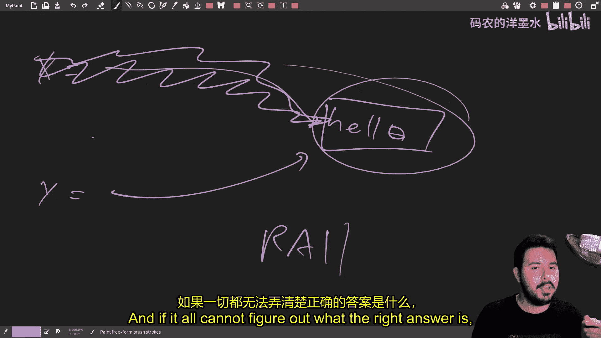

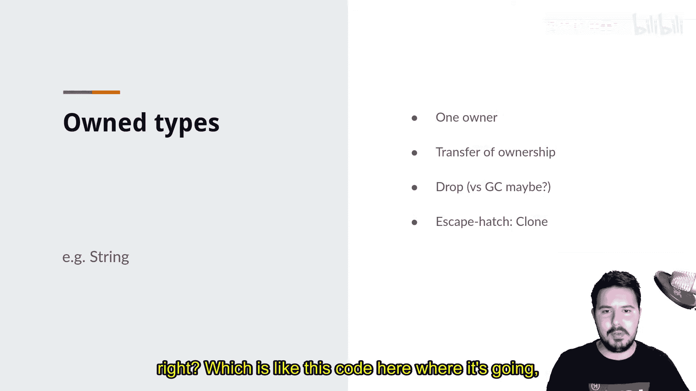

Right， because what we said is X is this。 Y is now going to be X。 X is now dead。 And I'm not sure。

 but that might be what this dot， dot dot is saying， or it might be。

 I'm not 100% sure it might just be because there's an error。

 It's probably just because there's an error sadly。

 but that'll be cool if the editor could tell you that a variable that sorry。

 a value that is disappears from ownership， but anyway。

It's imagine it's like saying now x doesn't exist， and so it does not like this line of code right here。

😊，Where you go try and use X， even if I had these lines the other way around。

 it's still really not going to like this because X has been moved away from。

 so it's no good anymore。😊，Okay， so what are our options then， Well。

 option1 in this case is just don't print X。Right。So that's one option。 But what if I go， Okay。

 instead of their being。This situation。This situation here， as I've drawn it。

 is completely illegal and rust。 It will just not happen。 right， It's， I mean。

 that's sort of vaguely true。Based on our current ownership model that we've seen。

 it's completely illegal， you'll never see this in Ru code。

There is things like borrowing which sort of help us work around this。

 but we're not going to look too deep into that until week four。

But so what if I like really want X to still live， then that's when I'm going to want to go。

Have something like this。 right， I'm gonna want to have。

 if I want X to still be live and I also want a y， then maybe I do want to create two。

 And we specifically opt into that and rust with dot clone。Right。

 so in this case we'd say y equals x dot clone。And this will actually sort of deep clone the whole thing and you'll get a second object that you can then mu as is mentioned in the chat there。

 Yeah， perfect。Or shouldn't use after free calls a segmentation fault in crash。

 If it crashes before harm can be done， it should be fine， right？ So often it does。

 But and as I'm sure， any sort of。USW security， you know。

 security engineering veteran will tell you if someone works hard enough。

 they'll often find their way in。And yeah， use after to freeze， double freeze。

 They're all like perfect vectors for for getting into your for getting into your binary， for sure。

And if you ask on the forum can we can help out showing some like examples of that happening。

 but yeah， it's it's it's certainly a big danger。Okay。

 so that's our primary idea of ownership for now is that。Yeah。

 like code that you have seen in other languages that looks perfectly fine。🤢，In rust。

 it may not be happy at all。 I still haven't quite explainedplain why this code when I had， you know。

 f both them out here， this code still did work， right， We got 2，42s。

 I didn't quite properly explain that yet。 The reason is essentially because because this ownership headache sorry。

 this ownership system is a bit of a headache right。

 Like you end up having to take on more work as a programmer thinking about these things。Right。

We'd like to avoid it where it's not really necessary and Rust has sort of a back door around this and it's called copy。

Right， so if your type is copy is the， you know， the terminology for it。

 then it just ignores these ownership rules。 If you say let y equals x， that's fine。 They will。

 Y will just end up being a copy of X， and they're both still perfectly fine。

 they opt out of the ownership rules。 So then what things are copy。The answer is。

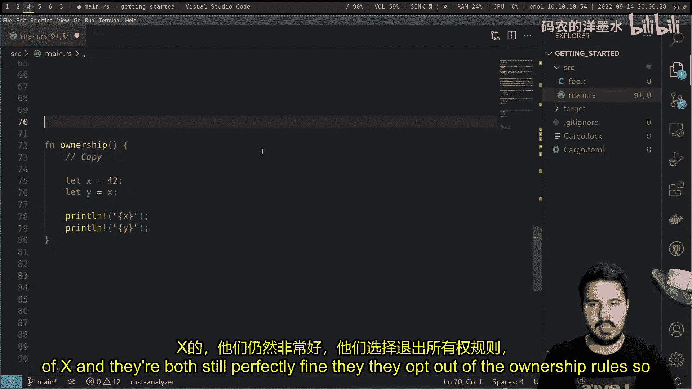

All those types that I talked about earlier。😊，These basic types， integer types I32， U32， I64。

 floating points， F 32， F64， whatever， bulloles， true， false characters， AB，CD。

 that sort of stuff they're all copy types。😊，Arays are not copy types。

 Ars are never copy Tuples are copy if all the types in the tuple are copy。 So， for example。

 if you have a tuple。

That's like an I 32， a boolean and a char。Then that is copy。But if I have a couple， that's like。

 let's say a bullolean and a string， that is not copy。

Because a string is a capital S string as I've written here is not copy。

 So this will opt into this whole tuple will opt into the ownership rules。 But if you just pull out。

 say this thing here， just pull out the bull and sort of leave the string to the side。

 then you can opt back into these copy semantics and not have to worry about the ownership。

 which is quite nice。 So if you ignore the string in the topple with patent matching and that sort of stuff like we saw earlier。

嗯。What about the other things，structs and enums， Sostructs and enums are kind of interesting。

 I have some struct that only has， you know， copy types。Like this。

Does that make the struct itself copy， Well we can check this， Let's create a fo with x is 42。

 U is 100 and Z is false。Oh， sorry， not U。 Y is 100 Z is false。 It's not gonna like printing them。

 I'm just gonna write a little bit of， in fact， let's just do。X dot x。

 let's just print out the first field。Does it like it， No， right， borrowed， move value。

 value borrowed here after move， So it's not happy with it。

 but watch this little incantation up here。Deriveve， copy。This is not going to quite work。 Actually。

 no。 Yeah， it's not going to quite work because it's， it's going to say， hey。

 I need clone as well to do this。 So I might need a write copy clone here。 but look down here。

 now it's happy。So we can say that our struct will be copy and it's happy。 Well， can I just go like。

Throw a string in here now， No， so you can only sort of become you can only make a type become copy if all the things inside it are also copy。

Right， so we kind of throw a ring in here and go to hell with it。But if it just contains that。

 then you can throw in this little incantation here。😊。

And your wholestruct becomes copy which is quite nice as well。

 same thing applies for enums if this was an enum instead， same rules apply。😊。

Cool。We're a bit over time now。 Is there anything super important。 I missed。 Yeah。

 we've talked about clone as an escape hatch transfer ownership。

 There's one owner of a type string as an example of an own type dropping is Ru's notion of like freeing essentially when when a thing goes out of scope when a value goes out of scope。

 it's dropped and that usually entails like freeing some resources or closing a file or something like that。

 if you're interested about garbage collection， ask on the forum for sure copy types don't follow the ownership rules that have value semantics。

 simple scalealar types like ints floats， chas， whatever a copy tuples。

 are copy if all the things in the tuple a copy and you can make your own types copy if if you drive it and everything in your type is copy as well。

😊。

Oh right， there is one last little thing I promise this is the last little thing before we done ownership in relation to functions。

😊，It works， pressing the wrong buttons。

If I have a function。Takes a string。Where has s is some string。

And then I have my ownership function here where I say let S equals string from Ho。Like this。

If I call the takes a string function and I pass it S。That has moved S into the function。

 So if I try and print that string out here。Like this， you'll see I get that。Error here。

 because S has been moved into the function。 Here's a neat little idea。

 What if I get this function to also return。A value， return a string。

Let's say it takes a string and prints out。I got the string， S。And then give S back。And then we say。

 let S equals。Takes a string S right， So this function takes S N。 We transfer ownership into it。

 It borrows it for a second。 and， you know， prints the string out。

 I know you might be looking this and go shouldn't that move it right there。

 There's some interesting reasons why it doesn't， but that's more like week four。

 I guess or the course forum if you're if you're sorry， week 3 rather I mean。

 but there's always the course form if you're interested and curious， but it says it prints it out。

 it pass it back。 It transfers the ownership back out of the return value。

 which ends up over here back in S。 and we've got it again。

 and then S finally gets dropped down the very bottom here。

 it gets freed up at the end of this function now。😊，And we'll just test it out。

 I got the string hello， and then it's also printed down here。I got hello back。Right。

 got the string Holo and then I got Hol back。😊，So ownership can be transferred into a function through a parameter and ownership can also be transferred out of a function through a return value。

😊，It's quite interesting。Can you derive it for any arbitrary type or are the same。

 or are there some way you'd have to implement the copy yourself by it， I mean， copy。

 So copy is something a little special called an auto trait。

Which means that there's no real code that comes along with copying something。

 one example of a type where you might have to implement clone sorry。

 one example of a trait here is what we call them that might require a manual implementation is clone where you might want to go like you know。

 deep cloning。 this stuff isn't enough， I actually to do this extra work here and there's some types that we'll look at that that have that kind of。

That kind of requisite later in the course， but copy actually never， it's just a little marker trait。

 it doesn't have any associated code clone that could definitely be the case though for sure。😊。

Okay。Get keen for workshop1， either tomorrowrow or Friday this week。

And I'll see you all next week in the lectures。 Are there any questions before， Let's。

 we'll call the lecture like officially finished here。 And I'll just。

 I'll field questions as long as， as long as you all are asking them。 But for those of us who are。

You know， thankful that it's。Yeah happy to get out of here。 then thank you so much for coming。

 And I hope we're having fun so far。 And yeah， get excited for your workshop later this week。

 And yeah， I'll just， I'll field any questions that we got for us again。

 as long as you send them at me。😊，So when we're passing a string via function parameter。

 we're still passing by reference right， the only distinction is that we're transferring ownership of that reference to the function。

😊，Okay， interesting so。Depends what you mean by passing by reference。

 And this is the funny thing that we're gonna to run into all the time in this course because there's so many different languages that we're looking at and everyone has their own like every language has their own nomenclature so often I have to sort of guess like here's some terminology。

 but people sort of say this in different meanings。

 And some people are like this is the correct way of using it and maybe they're right。

 But a lot of people might sort of have their own way of using that language and so I often need to sort of get the distinction here。

 are you thinking as a pass by reference in terms of something like C plus plus or are you thinking of like which which background do you want me to address that question in。

😊，嗯。And I can， I can also tune this as well to sort of like the。

Potentially how advanced or anything we want to look at that， but we'll start there。I guess， I mean。

 the function prime is just going address the beginning of the string， right。 So， okay， right， so。

The trick， the reason why I wanted to make that harm scene clear is because。

That sort of feels like the case and the way I explained it。

 that's like the way I've explained it heres。My explanation of it， but it's also kind of a lie。

 The answer is that a string is a little more than just an address。 a string is okay。

 well that's thank you。😊，Finally， I'll chase the rabbit hole down a string。 Oh， okay， great。

 Where's Rovek gone these days。 I think it's in here， actually。Stra draw back no。

They're really making it hot on me。Am I not in mode， No I am。Where is Roette on？呃。

I'm gonna find this。 Hang on。

S。😔，M I T dos。Come on， there we go， great。Okay。A but that's still not。

Okay， well。It's fine。' I'll just write it myself， I was hoping that it would be easier to chase it down。

 but the reason why I'm saying， oh， it's a little more tricky is because a string in this case is actually a triple of three things。

A string contains a pointer， which we've seen like right here， it also contains a length。

So in this case， we'd have 1，2，3，4，5 bys， right， No null terminator， right。

 null terminators of the devil。 So no null termminator length is 5。 And that's just gonna be。Length。

 here'll be a U 30。 Oh sorry， not a U 30 to a U size。

 which I just realized I've forgot to talk about， but that's not too big a deal。 U size。

 which is 5 and a capacity。And the capacity is going to be how big can this allocation that we've made here handle。

 because often we'll sort of pre allocatecate an extra little bit。

 So probably it's going to well it's going to be a U size and it's probably 8 in this case。

 So this triple of things， which is 24 bys on a 64 bit system is what makes up astruct stringstruct string。

And so when you pass it into a function， it will pass these three things right these three are all get passed together。

嗯。And。So so like you know you are passing a reference right。

 you're passing a pointer here but you're passing you know generally all this value along and you know once the optimizer gets its hands on it once the compiler goes I want to make this code fast then you sort of get until like an all bets are off kind of situation where maybe it actually goes。

 hey， it's actually way faster if I keep this code over here in this function and I'll just pass this pointer in because that's all it ends upneing and you know the optimizer can go really crazy doing some clever stuff to make the code go fast but principally it's the way to think of it is that it's passing all these things along。

And， but there are ways in Ru to just pass along one pointer。 like， say， to just pass along this。

 We just don't have the tools to express that in with with our current knowledge。 So this trick here。

 where we're saying。Take a string， pass the ownership in， print it， and then move it back out。

 Pass over here is far less efficient than the actual way that we would do it。

 If you want to see what that would look like right now。Again， this is going to be very unfamiliar。

 scary syntax potentially， but I would write the codes such that it looks like this。

 we don't pass anything out， we don't take this back and we borrow this string instead。And this is。

 this is sort of like your pass by reference， which is not quite true。

 It's actually pass reference by value， but people generally。

 people often just refer to this as pass by reference， which is why， again。

 the nomenclature can be a little weird。 But this will just pass an 8 by pointer。 And there's。

 the ownership is there's no ownership being transferred here。

 This is something called a borrow and we'll get to this sort of stuff in week 3。

 But this is how like the canonical rust would look like essentially。And Migle says。

 in terms of the literal memory， is it moving it elsewhere or keeping in the same spot so。

Memory is one way to think about it。 That might sound like a really obscure thing to say。

 But this here is memory， right， for sure。 The string itself is going to be stored in memory。

These three things here might be stored in memory， but these might just be three registers if we're thinking like MIPS that just might be T0 T1 and T2 so this might be like a register promotion kind of situation where these actually never end up make it to memory they just live in registers and so then when you're calling some function and you're passing this string across。

It might not end up needing to move any memory around at all。But if we assume， okay。

 let's say this is in memory on the stack。 right， There's a 24 bytes that all get passed on the stack。

 then yeah， it's gonna to need to move these three things in memory to the other function stack in order to do it。

 Again， Opr might get its hands on it。 The optr might go away。

 I can just look a stack frame above and be really clever and make the code go really fast。😊。

And you might be able to avoid this，Again， generally， this is the way you would think about it。

In terms of just like basic bass rust without the optimizer going crazy。嗯。Using go definition。

Looks like strings are implemented as pubstruct string vacate。

 Does that mean that those other fields like the length are stored in the string itself。

 or is it just a stream of bytes where the length is stored right there， but not as a named value。

 So this here， this triple that I wrote here is the exact same as Vec Vec is。If you're in， you know。

 Rust' Vec， if you're in C plus plus it's vector， if you're in Python， it's list， if you're in Java。

 it's a array list， if it you're in I need more languages honestly， whatever。

 you probably get the idea from one of those expandable collection storage and Vec has these exact fields。

 pointer length capacity。And so yeah， these three things get stored either together in memory。

 they might end up just being in registers or anything like that。

But the pointer itself is going to point to some segment of memory where in that segment of memory。

 there's no additional data。 It's just the the data itself。 So you could think of like， well。

 this pointer could point to some memory that has the length。

The capacity and then all the bytes like all here in one big thing。

 and then you could just store one pointer to the start of this。

 but that's not how it was chosen to be represented。

 Instead this memory here is just just the actual data that we care about the string itself and then we have pointer length capacity all sort of grouped together elsewhere。

Integers sorry not pullings in terms of the lital memory。

 is it moving it elsewhere or given the same spot？Integer sorrying upload。

 I am not sure what what you're talking about if you can clarify that I'm perfectly happy。😊。

But I'm sorry， I don't quite understand。So makes sense。 Okay， cool。 Yeah。

 so it' it's not the length is' installed right alongside the actual databases yeah。😊，Oh。

 didn't send the message above that。right， Yes， sorry， It didn't。 I， I'm have to no rush。

 I'm happy to hang out here while you'd。Well I told out， I' made to talk about rain。😊，Co， cool cool。

All right。Well， was there any more questions， any more questions， comments， queries， concerns。

 any of the above？😊，Before we end things off， again。

 I'm happy to answer questions as long as you keep firing them。No problem， Patrick。 And as always。

 the course form is always open。 We're gonna have honestly。

 it's gonna be very fun answering all that there's already been like thoughtful questions popping onto the forum。

 It's like that's a really awesome question。 It's this is gonna be a fun one to explain。 So。

 you know， throw all of them there。 it's gonna be fun。

 And also we plan to turn some of the the more sort of。😊。

Mey forum answers and the ones that really get to some cool core ideas into like blog posts for the course website as well。

 even if it's a student who who writes like here's what my thoughts are and sort of write something out if we look at that and you're like we're like yeah that's pretty cool we might go hey。

 can we turn this into a blog post put on the website and something like that but yeah so it's gonna be really fun on the course forum ask away and yeah。

 thank you all so much for coming and get excited for your workshops and other I'll see you next week in the lectures。

😊。

Alrighty， we'll see you all later and thanks again for coming。Bye for now。

