# 【全集】新南威尔士大学 Rust现代编程 中英字幕 1080P p03 Lecture 3 - 集合与迭代器 2.18 -BV15cf4BCEN1_p3-

Already。Hello， hello， everyone。I think it's working。Hello， hello， yes， hello hello， Alrighty。

 awesome。😊，Welcome， everyone to。Week2， we've made it through our first week。嗯。So， yes， hello。

 everyone。We've got some fun， exciting stuff out of us。So。

I hope we all had an interesting time last week， your weekly exercises from last week。

 the week one weekly exercises are due on Wednesday。

 so you still have time to watch this lecture and also the next lecture。

 well sort of it's more like due right after the second lecture this week。Srei says。

 don't forget to subscribe and hit that bell。U， so。😊，One thing I really want to quickly rule 7。

 One thing I want to quickly ask everyone at the beginning of our lecture is。

 how did we like the workshops last week， Hopefully most of us got a chance to to attend our enrolled workshop。

 I know a couple of people at least were you know， busy and had some stuff going on。 And that's okay。

 there's there's no attendance requirements， There's no participation marks。

 But for the people who did go， How did you， how did you find your workshops， Did you enjoy it。

 Did you have a fun time， Was it tricky， Was it， you know， Like， how was your overall experience。😊。

Mu。Nick and Do say。Are having trouble with collaboration， very good workshop。Pretty fun。

 but felt rushed。 Yeah， yeah， yeah。 Lots of fun， bit of a trial by5。

 but I think that unfamiliarity with rust。 Yes， for sure， absolutely。😊，嗯。

Time pressure have me doing things in non rust askque ways and just trying to get it done Yeah yeah yeah。

 that's true。Super， super fun， a little chaotic， too many merge conflicts， yep。😊。

And only youre using Windows in the workshop， everyone else on something else。😊。

WSL Gangdg says interesting。M。So yeah， this is something。 there's obviously the。

 the Thursday workshops for the absolute first workshops we've ever run in this course。

 So there's certainly a lot to learn and a lot to sort of figure out。 I Ive， we definitely heard。😊。

During that first workshop， the pain around collaboration。

 the most successful one we ended up seeing， I think。

 would have either been probably VS code Liveshare or or using like Reple it。😊，Live collaboration。

 something， those two seem to work relatively well。

 but I'm sure there was still people who had some issues。😊。

And we hear that and in terms of it being rushed and like sort of。😊。

Quite high energy and naming to fly through。Absolutely， 100% and it's and。

It's a really great note to sort of。Acknowledge that that kind of rush time pressure is at arms。

 right， It's sort of。You know， potentially draws away from trying to write your code such that it's like more reliable and more robust writing things the right way。

 you know， whatever that is for you and so yeah。And there's obviously a lot of like。

 as mentioned as well， in unfamiliarity with Ru， just getting started that causes these kinds of these kinds of pains。

 especially when you're just getting started。 So I think I think this week's workshop is may。

 may have a little bit of that the rush and the excitement going on。

 We're going try and tune things down a little bit from， you know， where we currently are to try and。

😊，See if we can make the activities a little sort of simpler to get into and you've you've each had a work of you know。

 fighting get or merge conflicts or maybe have a better idea of how to share code around and stuff like that。

But this week I think is still going to be a little maybe not quite as high energy but you know still up there and then sort of workshops past that point are going to be more focused in writing less code but writing it in a way that you like or train different ways and so we might see hopefully you get an experience in all these different kinds of workshop environments and we'll check back in a few weeks and see what things we like or you know what things we miss or anything like that。

ISpent an hour fixing out my group's work afterwards and genuinely told our superhe a bit of polishing。

 That's awesome。 throw it on the course for if you get a chance。

 I'm sure myself and plenty of other people would love to look through something like that。

 And if and if you've gone home and you've you know worked on some more images or done anything like that。

 let us know on the course forum。 It's perfectly suitable for like， you know this kind of course。😊。

Nick says isn't this also the first time that thing's been done in CSE do you mean that thing is in like the style of workshop and yeah and if that's the case then yeah Shereri mentions closest thing probably being something like security workshops and yeah yeah yeah okay I'm caught up。

😊，I think so。 or VS code， I see。Okay， another thing。

 a couple things to just quickly call out before we really get into things today。First of all。

 I am a little sick right now， I was a lot worse this morning， I'm doing a little better now。😊。

You might need to bear with me a little bit in today's lecture I'm on the mend。

 but things might be a little slower or I might be a little dumber today。

 but I'll do my best to push through it other things right so。

I've got an idea of a format to try out for these lectures there's sort of a careful balance that we want to strike between you know teaching rust and keeping you familiar with the language and the concepts。

But also that idea of comparing and contrasting against different languages and sort of different techniques of writing code and all that。

And so something that I want to try out for this week and potentially you know。

 continue trying out into following weeks depending on your feedback and everything like that。

Is for this week at least the first lecture today's lecture is going to be quite dedicated to rust programming。

 so we're going to learn about using collections anderate excuse me collections and iterators。😊。

And we're going to write lots of code if you have ideas on things that you'd like to see written like we're halfway through and all a program like this might be cool。

 just throw it in the chat And again， I'm very happy to be adaptable in the lectures and do things on the fly。

 I don't have a problem with messing up in front of 100 people and getting a bit of a laugh at myself but making mistakes along the way as part of the process so I'm happy to just sort of impromptu things a bit in the lectures。

 but otherwise I'll just fall back to other exercises along the way so please feel free to know get involved and sort of tune and update your own learning if you go I'd love to see someone working on something like this just let me know and I can give that to you most likely。

😊，So yeah for this lecture we're going to be doing lots of coding and looking at lots of rust code and then the plan for Wednesday's lecture right in a couple days is we're going to be looking at the same sort of topic collections generatorers and probably a little bit on error handling and stuff like that afterwards。

 but it's going to be heavily in contrast to other programming languages so that's going to be sort of like in that first lecture where we looked at a few different languages how they handle things and get to sort of examine the differences in the implications of those for us as developers。

😊，嗯。A program that computes a triveology sequence might be fun。😊。

I think it's I've had my fair share of times where I've accidentally done a accessible exercise in front of a tutorial room or something like that I'll try not to do that in this course coolol。

😊，Alrighty， Sir。Collections and iterators in rust。Very cool。

 I've also got a little V S code Zen mode set up here。

 So there's not so many buttons and things going on。 I think this should do all right。

 And we've got our little。😊。

Drawing station over here for any diagrams along the way or anything like that。嗯。Cool。

I also should have the standard library documentation up， which I don't。 Oh。

 that's one other thing I forgot to mention is I。😊。

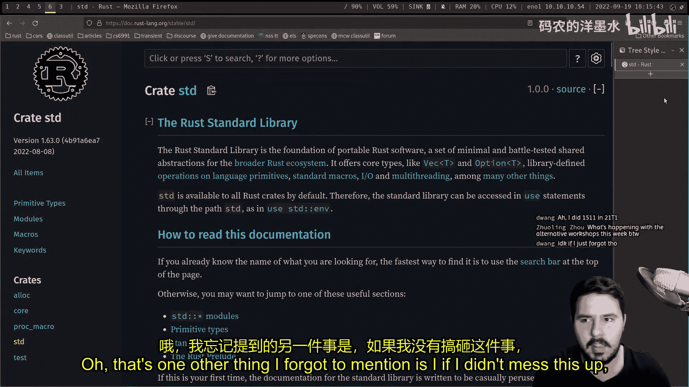

If I didn't mess this up， Yes， there we go。 Oops， I wanted that here， I guess。

The slides are up here now as the lecture starting if you want to go to that downloaded as a PDF and annotate the slides as we go through then you're more than welcome to。

 I don't really tend to lean on slides too much at least for you know for the more practical stuff so they're going to be relatively limited in how they help you but if it's something that does help you they are there now and so you can access them from the lectures section here and they'll keep popping up as lectures gone。

Okay， all right， yes， sorry， that's a really good point。 I did want to mention that as well。

 What's happening with the alternative workshops this week。I was going to make an announcement。

 but I'm still waiting on hearing back from the school about this。

 but if we look at the course forum。

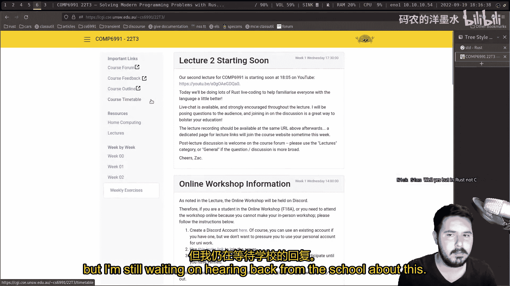

There was， was， was， was。Somewhere where to go， maybe I need to click more here poll， there we go。

So Thursday is a public holiday because of the queen， it sort of got thrown in， you know。

 last week or whatever it was。So the Thursday workshops， even if we wanted to run them。

 which I think myself and the teachers， other teachers would have been happy to run them on Thursday。

 we actually just don't get that option from the school。

 the labs are all locked so also don't expect to go into un be able to access lab machines and stuff like that on Thursday because I don't think you'll be able to get into the rooms so based on this poll if I got the results up here。

 the most popular options for like a makeup workshop were Friday from 12 to two and from four to6 both face to face。

There is also the 6 to 8 pm workshop， this one here， this option is like already running。

So if you wanted to go to this workshop， then you can just sort of show up， it's online on Discord。

 you can see the information for joining the online workshop here。

So if these two times don't work for you and you still want to go to a makeup workshop。

 then this online class will just have sort of infinite capacity for this week。

I am trying to book cat's rooms for sorry lab rooms are either for 12 to2 and for four to6 but I haven't heard back just yet they must have been very busy today。

 so as soon as I get some sort of confirmation that my lab rooms have been booked。

 I will make an announcement and be able to you'll be able to come to one of these makeup workshops at whichever time suits you。

That's the plan I just haven't gone confirmation yet。

 which is why it hasn't been widely spread around。😊，UCool。Also， yes。

 I didn't want to mention this until now because I didn't want to confuse next week's Monday lecture with today's Monday lecture。

 But next week's Monday lecture is gonna be run a little earlier than usual。

 So these lectures run from6 to oops，6 to 8 next week。

 So week 3 Monday lecture is gonna be I believe，4 to 6 instead of 6 to 8 next week。 but I'll make a。

 I'll make an announcement like that。 you'll get an email。 So just keep your eyes out for that。Cool。

Is there any more administrative sort of course course related questions before we get stuck into into any more content？

So the Friday 6 to 8 pm face to face workshop is still running yes。

 so Friday hasn't been affected because it's not a public holiday。

 we're just trying to make up for the now missing Thursday workshops by giving some extra ones on Friday to join。

😊，Yes， I am sorry， as always the recording will be available and we'll go back to the normal time in week four onwards。

😊，Okay。

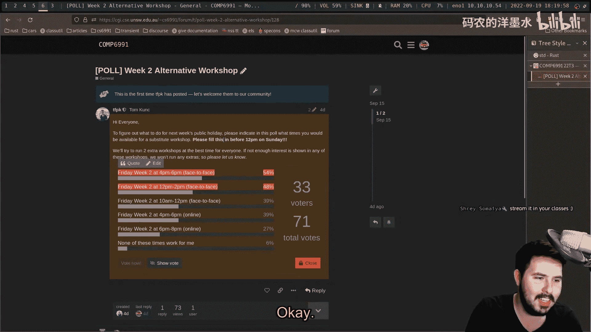

Alright， if you have any questions or anything， just let me know。 But otherwise， we'll get。

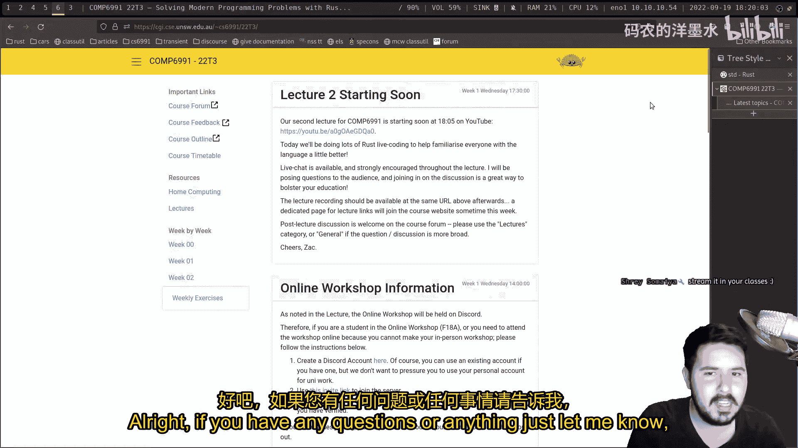

Let's get a little stuck in， I suppose。So I've got the standard library documentation up here which I love to use all the time if you want to pull up standard library documentation then just go to dosops。

s/tsD and that's sort of like a short link to get here Ser whenever I'm writing Rus I always have this webp page open somewhere it's incredibly helpful and I'm going to start off by looking at the modules here。

And going into the collections module because that's sort of very central to what we're looking at today。

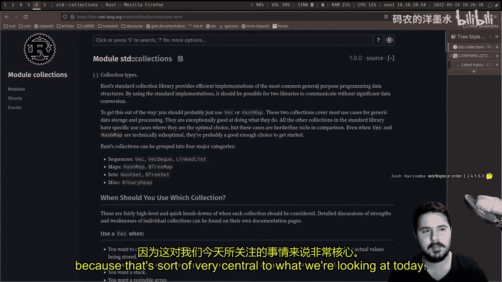

All right， so common collections in rust。And again， this is going to be。

Somewhat this lecture here is going to be somewhat prescriptive。

 it's going to be looking at rust playing around with examples writing code and you know we'll still。

Have the theme of the course in mind throughout， but it's going to be less focused。

 And you know when's lecture is going to be far more focused。

 And we're just gonna to see how this goes。 Feel free to leave feedback。

 That's the one other thing I should have mentioned， leaving feedback as well。

 I think Sree added a feedback form to our course website。

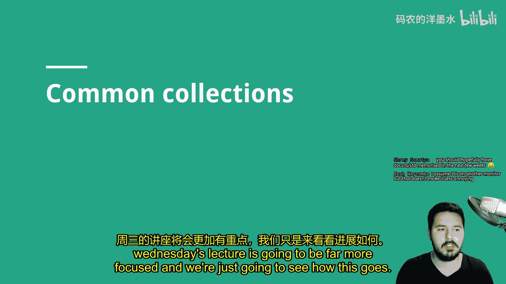

Which I have oh here， course feedback。 There we go I lost it for a second。

 If you ever have any feedback that you want to leave either anonymously or not。

 you can make a post on the course forum right here feedbacks and that's perfectly fine if you want to do it a little more anonymously sort of like you know imagine we had like a little feedback box in the corner that you just want to slip a little thing in there's this link here all it opens up into is what's your feedback and optionally what's your name if you wanted to attach a name or is that ID But if you want to pass on any feedback again even now in the lecture chat。

 the feedback category on the course forum or this feedback form over here all perfectly fine and encouraged。

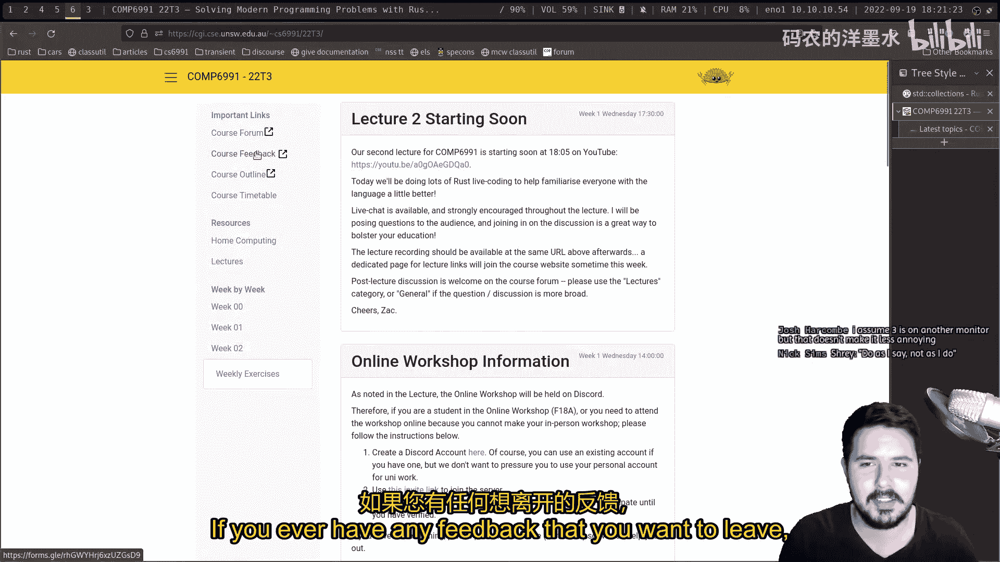

Okay， worksspace order 1，2，4，5，6，3。 Yes， one is my left monitor，3 is my right monitor and2，4，5。

6 are all this central monitor。 you've got it。😊，Okay， do as I say。

 as I do push up every time you need to look something up from stood， I would be absolutely ripped。

 I'll tell you that。

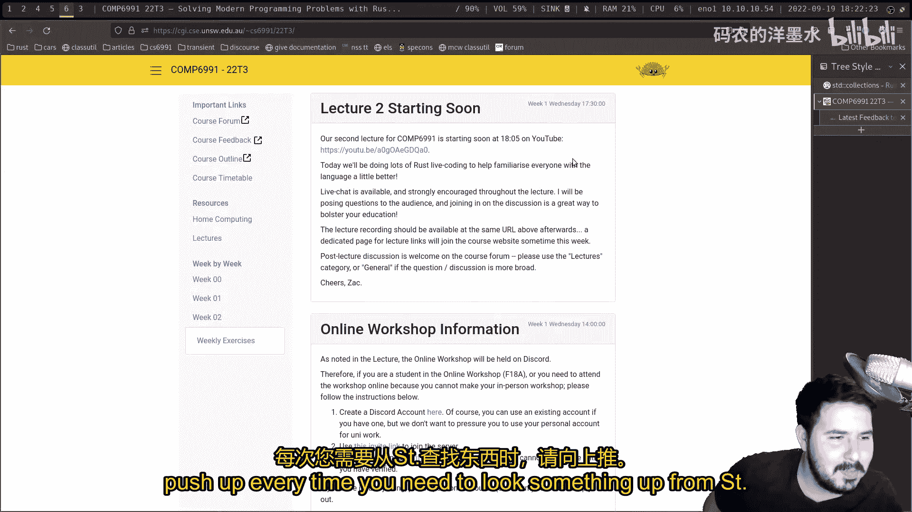

嗯。

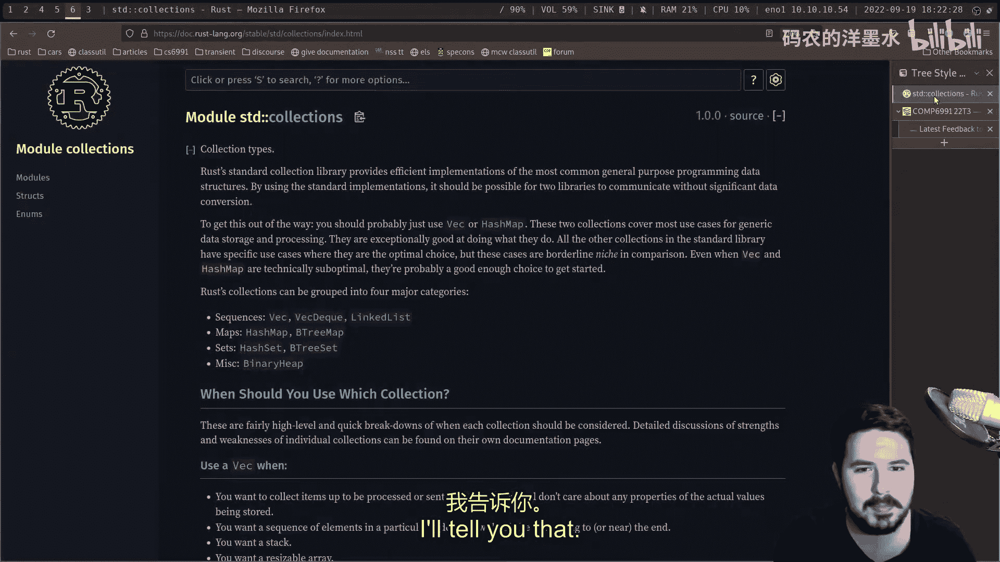

Alrighty。Soir。Common collections in rust。 I've got a little bit of a a you know。

 non sumummative list， you know， this is， this is not an exhaustive list of collections in rust。

 but it is enough to certainly get you started。 So far， we've seen array， right。

 just a simple array type like let X's is  one，2，3。 You know， something like this。

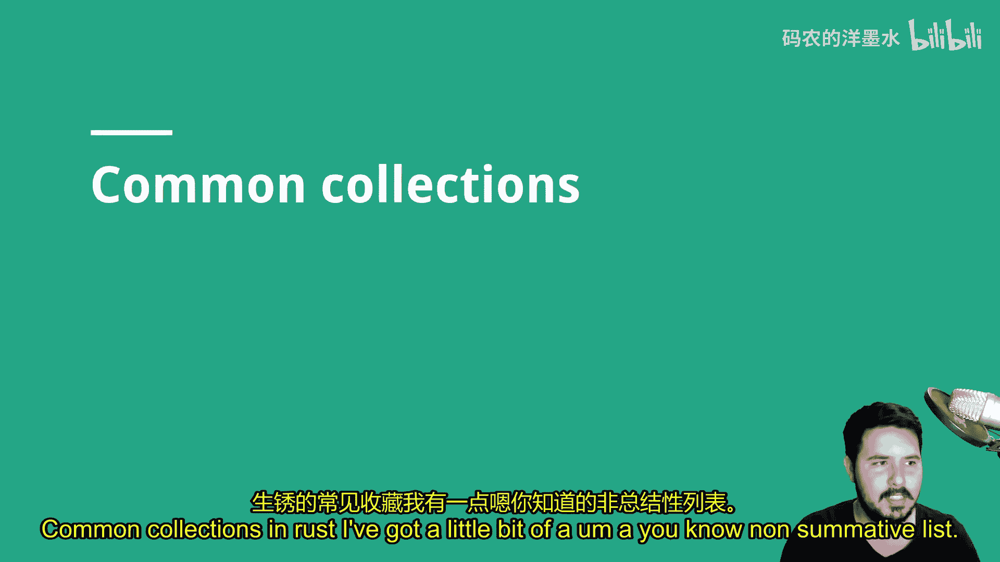

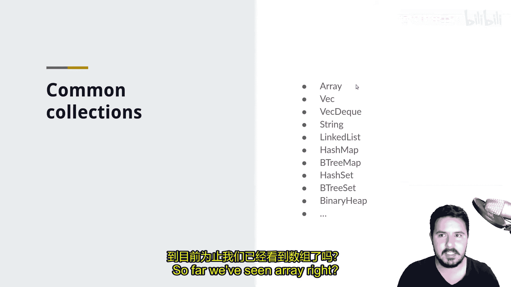

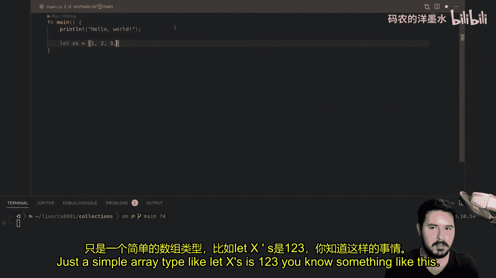

I don't。 Well， we've sort of seen strings a little bit。

 but you may have seen in rust that there is both this。

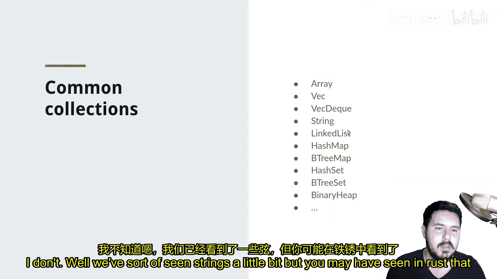

Stir type STR and there's also the capital S string type。 and these are subtly different。

 We'll get to talk a little bit about this today， but mostly next week。

 when we talk about references and borrowing， is where that sort of the main distinction between those comes in and then just a whole bunch of other collections here。

 Vec Vc deck， which I pronounce at V deck， it sort of stands for Vc doubleend Q。😊。

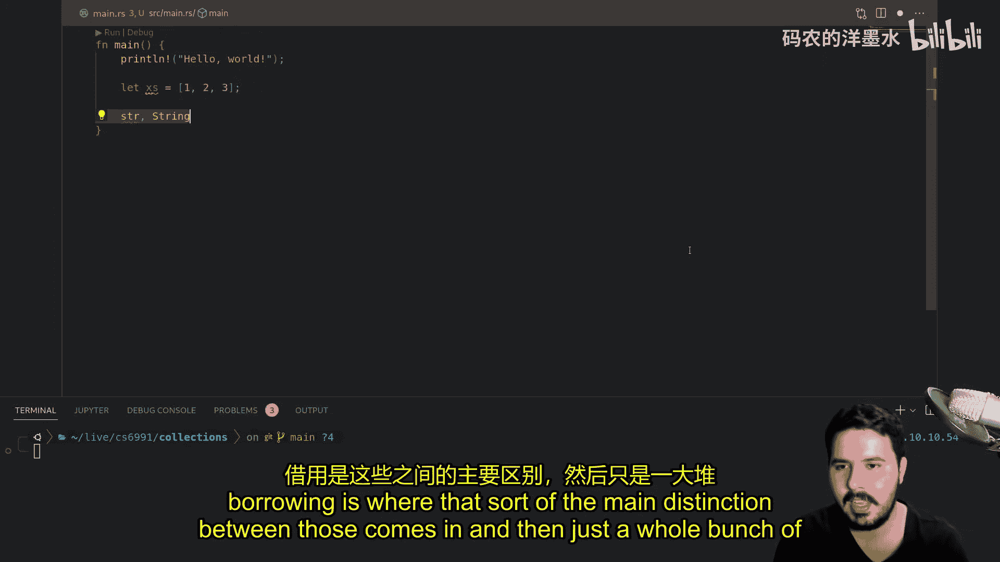

Right Q U E UE in this case stringing linked list， hashm， binary tree map， hash set， binary tree set。

 binary heap， you know list goes on and if you include sort of third party libraries in this list we wouldn't be able to fit it all in a slide。

 it would just be you know crazy。So we're not going to look at all of these sort of in detail。

 but they're all a big chunk of them are all sort of tangentially related。

 right like hashmap and B treem。😊，Provide a similar sort of interface， Vc V deck linked list。

 you know， have a relatively similar interface sets right， you know。

 binary heap we basically won't look at at all， I believe。😊，But you know。

 we'll look at them generally and write some code， but we're not going to get too into the specifics of every single difference between each implementation of everything。

 right。Okay。It's nice。 The names are explicit about the underlying data structure in both。

 and sometimes it's hard to tell。 Yeah， for sure。😊，Alrighty。

So our first thing that we're going to look at is our vector based types right So up here， you know。

 array is sort of loosely vector based， It's like a contiguous collection and there is also things like Vc V deck linked list and so and so forth that sort of support dynamic sizes So let's have a quick look and see if the documentation will help us out here at all。

😊。

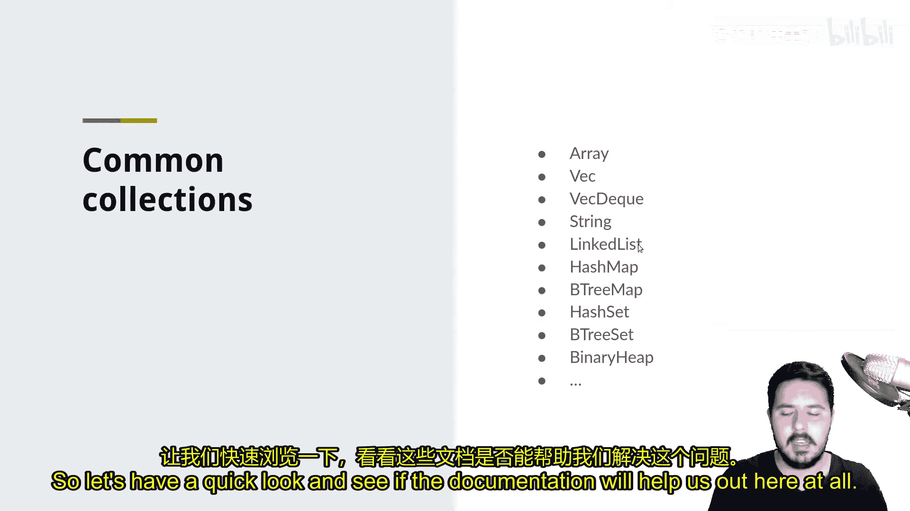

And also notice that it says to get this out of way， you probably just use V or hashmap。

 Those are almost always the two collections that you'll use for everything。

 That's a nice thing to sort of put out in to put out there right at the very beginning。

 Vec and hashmap， you see absolutely everywhere。 Every other collection here is sort of more niche than that they have sort of more specific use cases that you probably aren't going to be reaching for every time you're going for a collection。

 So Vec， absolute bread and butter data type here。 So what's special about a Vc。😊。

The most important thing is that a V provides us。Dynamic resizing。 So an array， let's say， you know。

 my array。Is one。2 and 3。Right。This my array can only ever hold these three elements here。 Well。

 you know， the elements individually can change， but it must always be three integers。 right。

 So in this case， the type of my array would look something like I 32， because that's what it holds。

 and there's exactly  three elements。 So if I say actually， I want to push 4 and 5 onto this，1，2，3，4。

5。Rust would say， no， array has three elements in it， so that's no good。

And this is common in a fair amount of other languages， but notably you know given that。

 well this is something that's a little tricky， most students coming into this course have probably done comp 1511 or something like that at some point where you you C and in this case arrays in C a sort of perfectly interchangeable here。

 if you haven't done C you if you're postgrad and you've done Python as introduction to programming。

😊，This might seem a little weird niche， but it sort of appears in systems Z languages where performance is really a key characteristic of your programs。

And so having a type that has a fixed size right three in this case can be rather helpful。

 especially when performances is in consideration。 so these performance descriptions for these data types So are there performance descriptions for these data types in the documentation C++ is really nice for that。

 hopefully rust doc has it too So in certain cases it's not performance。

 if you're thinking in terms of like algorithmic performance and stuff like that。😊。

Is there's no sort of。Structured documentation around that。

 There's no section that is expected to be filled in about algorithmic performance。

 where it is sort of important and relevant。 It often does pop up in the documentation， but it's。

 yeah， it's not going to be everywhere。 however interestingly。

 in this week's exercises that Sray has amazingly thrown together for us。

 this data analysis exercise you might find Wait， is it no hang on， sorry。😊。

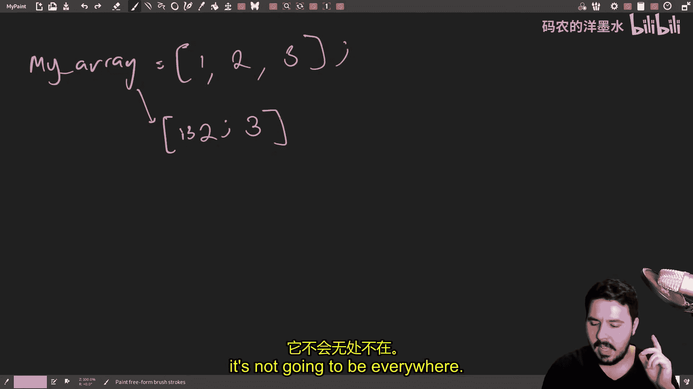

This one， the collections exercise， you may find particularly interesting because big O can sometimes be a little well。

 sort of just looking at。

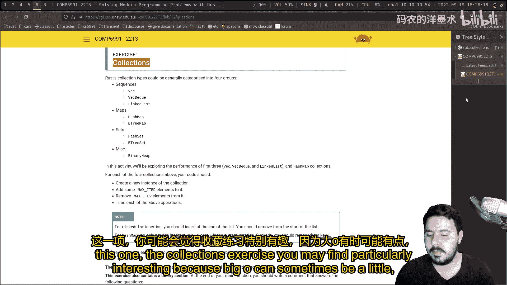

Big o notation or algorithmic complexity can be a little misleading if you're thinking about performance at times and you get to play around with that and you know just report back if you have anything interesting to talk about after you complete those exercises on the course forum。

 but I can promise you that it's very relevant to these kinds of questions。😊，Okay。

 so we have a arrays that can store many elements of the same type。So in this case， one。

 two and three are the many elements， and they each have type I 32， but they have a serious sort of。

A serious limitation on what they can do， which is that they must have a fixed size and always have that many elements in the array。

 no fewer and no more so。In comeses Vec， right， Vec of some type here。

 So you fill in the blank with the type that you would like to be inside this container。

 So let's say a V of I 32s。I can initialize a V with Vec bang sort of like using print LN B。

 this exclamation point is often referred to as bang when being pronounced just because it's easier to say than exclamation point。

 And if I write a similar thing here to the previous one。The great thing about a vector， right。

 Vex short for vector is that I can remove elements from it。 I can push elements into it。

 Its it can be dynamically grown and dynamically shrunk， which is very handy。😊，Okay。

 so how does this look like in code， We have x's， let's just say my array is one，2，3。

 let my V is V bangang。Of  one，2，3。Right， and so I guess just to spell it out and line it up here。

This syntax looks pretty similar， but we throw a V bang before。

 This is a macro we learn more about macros in week 7，8，7， I think， but essentially。

 this just gives us a value my V， which has type V of I 32。Okay。

And how can I use it a lot of the time very similar to an array， so if I say for element in my V。

Like this print out。Element is。Element。Like this。Gogo run， you'll see we get element is one， two。

 and three。Okay， so， you know， what's great about vectors again， well， I can say my V dot push。😊，For。

For example， my vector dot push 5。 This isn't going to quite compile just yet。

 It's going to be really upset about those lines。 Why is that， Well。

 pushing onto a vector will modify， you know， will' modify the vector instead of it just being 1，2。

 and 3。 It's going to be 1，2，3 and 4。 that's coming next。 So it's required。

 that it has access to mutate the vector。 But as we recall in rust。

 everything is immutable by default when declared。 So I actually need to say no， really。

 I want to be able to mutate this vector。And if I run at it again， I get one， two， three，4， five。

Excellent。So。Vectctors like arrays， but let us they let us dynamically resize them。

 we can also sort of take things out of vectors as well， my V dot remove and I can give it an index。

 let's say remove index2， something like that。And you'll see we have one， two， four， and five。

 and so that's great。😊，So isn't array the same as an immutable V then。Hm。

I was just about to ask that， that's great。Awesome， so。😊，Is an array vector that cannot be mutated。

 The answer is almost yes， to be honest， there's there are some like important distinctions， but。

You know， especially when you're getting started and you're getting familiar。

 I think it's a perfectly reasonable way to think about these to think about things like this。

 And so that's， yeah， that's why Sray is coming in here with a yes and't answer where it's the answer is yes。

 it's no， but like it's it's， you know， easily yes for now and。😊，D Wang。

 who I have now learned is Daniel Wang， if I recall correctly from the workshop。

 I'm assuming there's a performance difference， Yeah， absolutely there is。😊。

But it's it's more of sort of like a systems relevant performance difference。

 which I can talk about in a second。 So some of the differences when we're dealing with an array of vector other than just sort of mutability is let's say I have a function that says takes some list。

 right？😊，And let's say it's going to give us the sum of the elements in that list。

 so let's say it wants to take a collection of like I 32s and it's going to give us the overall sum of that list。

Now， this is an array。Then the problem is that this is going to need to have to specify the size as we've written it here。

 arrays always need to know how large they are， and so this function is really going to only work on arrays of a particular length。

 so an array with 42 elements in it or an array with five elements in it， right？😊。

There are cheeky ways to get around this that are way advanced for what we're looking at now。

 and there's realistic ways that you would get around this as a rust programmer would that we'll learn about next week that look a little like this。

But if you're just talking about arrays and vectors。

Then this sort of represents a serious difference between the two， because with a V。

 I can just write the code like this and it'll work。 It may work for a collection of any size。

And furthermore。That performance difference， the important idea here is if you understand the difference between the stack and the heap we don't we're not going to look super closely super in depth at the stack and the heap during this course。

 but if you recall from maybe a little bit from 1511 or from 1521 if you've taken those courses。

 the stack in the heap are different sort of segments of memory it's dangerous potentially to put a lot of data on the stack if you've ever heard of stack overflows usually they occur because of recursion where you keep allocating space on the stack by calling a function you know a function calling itself many many times but you can also cause stack overflows just by having a lot of data on the stack。

😊，Whereas the heap is a much safer place for lots of memory to go live， you know kilobytes。

 megabytes， gigabytes of memory to go live， the heap is a much safer place for it and arrays get put on the stack which generally gives them higher performance if you're just sort of accessing elements and stuff like that。

 but it's far dangerous in larger quantities and so going slightly like really slightly slower to go on the heap。

😊，Maybe a can often be a little。Save you a little headache and worry if that makes sense。嗯。

So can you do okay， so if we have a nonmable V。Excuse me。Can I say my Vck of0 equals 123？

And the answer is。My LSP is complaining about something else。 There we go。 No， I' woke it up。 No。

 you can't because cannot borrow my deck is mutable because it's not declared as mutable。

 if you make it mutable again， then it's you absolutely can。 That's no worries。 Now。

 what about the array。Right， so I do my array of0 equals 123。Then， you know。

 no surprises here because it's not declared as mutable， so this was never going to work。

 If I make this mutable， are we going to be able to assign to an element in an array。Yes。Yes。

 you can。 My array 0，1，2，3。 Let's test it out。 My al right like this。

Cargo run 12323 so I think that was a question above arrays can be im mututable in that you can change their context but you can't change their length。

 so absolutely that's sort of a demonstration of that here We can mutate an array but we just can't you know change the length of the array past its initialization or past when we gave it a type like we did。

Like we did over here。And we said the type was， you know， 30 integers or something like that。

All right。Does Vec have random access then， Yes， it absolutely does。

 So if you can iterate over and array the same way you can iterate over a V， you absolutely can。

 1521 has like a cool course， It certainly is just to rehash the contents still aren't mutable in our example right。

 So how should one initialize a vector of mutable objects So the contents aren't mutable in our example right How should one initialize a vector of mutable objects。

😊，So do you mean if you wanted to say modify？So like we've sort of。

The the questions arem not 100% sure on the。From the phrasing of your question， but let's。

I'm gonna I'm gonna like beat around that question for a little bit with a couple of different things that we'll go through and then let me know in 10 minutes I'll I'll jump back and you let me know whether it's been answered or not and otherwise we'll try and narrow down the phraing and get it answered as well。

So does so just to check。Does Vc have random access？Absolutely， it does。 So let's say my V of two。

 for example， just throwing in a random index there。Oops。Comment this out。

Cargo run element is three so we can randomly access elements inside a vector。

 can you iterate over them so yeah that's what we were doing there in these four loops。

 you can iterate over them。😊，And we're going to look at using iterator methods in a little bit as well。

So let's do a couple interesting little things with vectors for now then， so let's say。

I want to take a vector of numbers。 and let's say spit back out a new vector numbers that is just double the list that we got in。

 So if， if I give it a V of 1，2，3， you should it should give back a V of 2，4，6。

 So double the numbers。Let's call it double numbers。Vec is going to be a vector of I32s。

 and we're going to give it a new vector of I32s。Like this。Okay， so。How would I。

 as a Ru programmer write this， Well， I might reach for some sort of imperative solution。

 at least to start off。 So let me create a new empty vector。

 There's two sort of main ways to do this。 You can use this Vec bang macro and just give it nothing inside that'll give you an empty vector or you can also use something like Vec new。

Which just also creates an empty vector。I seriously don't mind。

 There's also like 40 other ways you can do this as well。 I don't mind how you create your。

 your empty vectors。 I'll just say， let。Doubled Vec equals。 Let's， let's do V new。

 So we see more things。 V new。 Now， this gives me an empty vector。 But again， it's im mutable。

 So it's never gonna be able to be anything but an empty vector。

 Let's make it mutable instead so we can do something with it。I'll say4 Lm in the vector， right。

 this input vector。We can say something like doubled doubled V dot push。 So push onto the back of it。

Eleement times2。And then at the very end， give the doubled vet back。Okay， so let's give it a try。

We'll go double let doubled。Equals double numbers of my V。And print it at。double捕。Like this。

 so this syntax I'm using here。Again we should be somewhat familiar with this braces syntax which sort of just looks a little bit like I'm this is how old rust used to look quite a lot now we can throw the name right in there Col question mark is a little bit of extra syntax that says use the debug print implementation which is just like don't rely on this first sort of displaying things in production but it's great as a developer to just quickly look at something so this is the debug print implementation they call it。

😊，And let's just try this out。Okay， so 2，4，6， I'll get rid of this hello world that keeps cluttering our view up as well。

2，46。 So we took in a vector here and we spat out a vector at the other end。😊，Okay。

So that's perfectly nice。😊，But Cyber says this is slow because pushback spends time changing the size of the V。

 wouldn't it be better to initialize the vector with the size or even just edit the V passed in。

 that's a great point。😊，Okay， so notice we use Vec new here。

 there's actually some other functions available on V。😊。

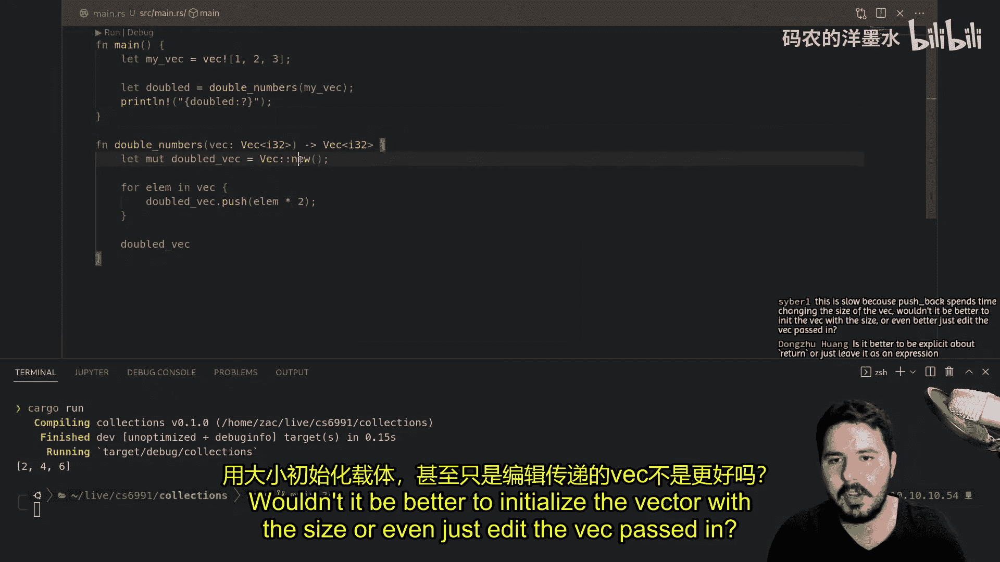

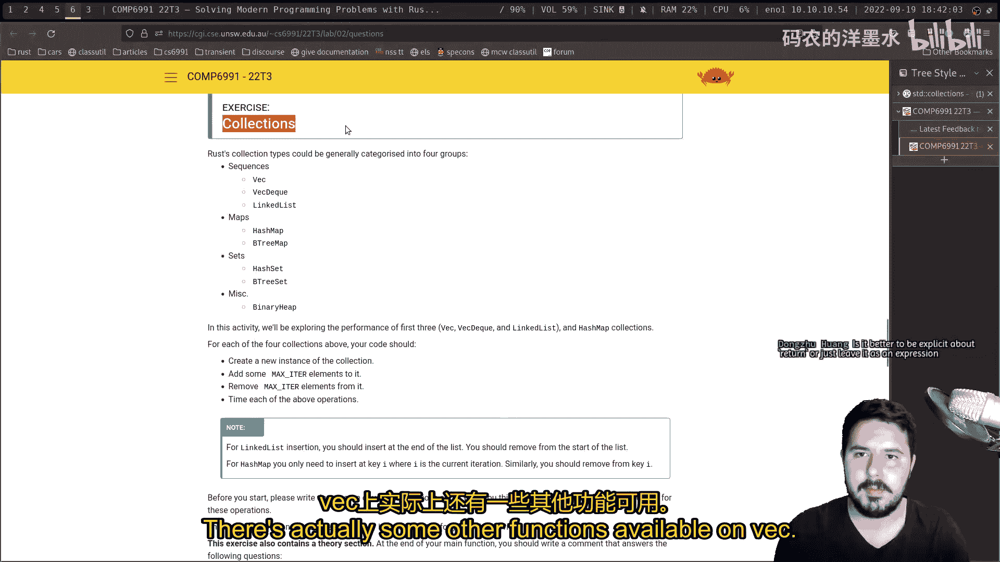

So let's have a look here， there's all these like there's a big list here， you know。

 on a rain on a rainy Sunday afternoon， pull up the V dos and have a read through the methods because theres all the functions。

 there's all kinds of things to use here， but the function I want to look at in particular here is with capacity。

😊，Right with capacity， takes capacity， which is a U size。

 U size is sort of like you know we have I 32 I 64。

 that kind of thing U 32 U64 a U size is the U in unsigned。

 So it's sort of like U and U 32 U and they sort 32 for size size in this case means the size of a pointer on your platform。

 So if you're on 32 bit if you're on an older 32 bit computer， this will be a 32 bit value。

 So U 32 if you're on a more modern， more sort of prevalent 64 bit computer， this will be a U 64。

 So it's specifically the size of a pointer on your system。😊。

And so it's useful for things like indices， whenever you're indexing into an array or indexing into something。

 U size is a very common thing to see pop up。😊，UBut let's see what it does construct a new empty V with at least the specified capacity。

Okay。So that's sort of weird。What's it going to fill those elements with if I say with capacity instead of saying new。

 we'll say with capacity 10。What are the 10 elements going to be， Are they going to be like zeros。

 is it going to be like1，2，3，4，5，0，7，8，9，10。 iss it going to be something else。 Well。

 this is where we need to make a bit of a distinction quite clear。An array。

Really just has its elements right， There's a size to the array。

 right a length of the array in this case， three， but that's sort of I actually no that it's not really discarded after compile time。

 I should say。😊，Sure， an array carries some information。

 the information it carries is the elements in the array and also the we'll call this the length of the array。

so three elements are in this array。A vector actually carries three pieces of information。

So a vet here you can think of as three things。The elements。

Which is going to be some sort of array in this case， like think of it like an array 1，2，3。

 It has the size or the length。Whatever you want to call it there of this array。

 which in this case will be three， but it also has this third parameter。Which is called the capacity。

 So the capacity is how much room do I have sort of at the end of this array that's not currently used When we're allocating memory。

 it's very rare to just go， give me3， you know， U 32 I 32s worth of space。

 So if each of these things is 4 bys，4 bytes，4 bys。It's very rare to say， just give me 12 bytes。

Right， because if someone comes along and goes， I want to throw four on the end here now。

 then you have to go， okay， I need a new allocation， give me 16 bys。 Then they go。

 I want to push another thing。 Okay， a new allocation， give me 20 bys and so on and so forth。

And so you end up only using like exactly as much memory as you need this way。

 but allocations can take a lot of time asking for more memory。

 calling mallic and realic and free and all that stuff can be quite you know time consuming low performance and so wasting a little bit of memory is generally just expected these days。

 So instead of just allocating 12 bytes for these three，4 byte values。

 it'll just go screw it 12 bytes， let's just allocate 16 instead。😊，Let's say。So let's do 16。

 And so this here， let's see if my eraser。Well， there we go。Oops。I want this one， there we go。

And probably size down。 there we go。So this here sort of has like space。😊。

RightWe've allocated 16 bytes and so if they say push you know a new element on like four。

 we've already got room for it， but we know we're only using these first three because of the length。

 so the capacity would be well four elements or 16 bytes， whichever way you want to think of it。

 we'll write the capacity is four elements in this case。😊。

And so let's say they go push the number four on。 It'll go great。

 The length is less than the capacity。 No worries。 The length is now4。

 and I'll push the number four on。 If then you say I would also like to push the number 5 on， please。

 then it'll go， okay， do we have room， length is four Capacities4 Okay。

 no room let's double this capacity here。 So let's make room for8。😊，呃。Crab the erasa。Trow。

 I keep clicking the wrong button， throw the five on。

 And now we have three sort of spare slots as well。 So the length goes up to 5。

 but our capacity is 8， and we've got room for the next few pushes as well。

 So this is a very common thing。 This is something that is basically guaranteed to happen in rust as well。

 And so vectors comprise of three things， the amount of elements， the length and the capacity。So。

The idea here is， well， we know how big this vector is。

Right let's say this vector has 100 elements in it and we just have our code that looks like this。

This vector has 100 elements and we go through and push in the element doubled for each element in this。

 push into our new vector， the doubled vector， the element times  two。😊，What's going to happen。

 well when we do Vec new it actually has a capacity of zero， it doesn't have a room for anything。

 this is again another performance trick， the first time when you want to push something in it'll go great I'll allocate space。

😊，A pretty common， in fact， I wonder if Rus actually tells us what the the first allocation is guaranteed to be。

 It doesn't allocate until it's pushed onto it。 it might not be capacity and reallocation。Yeah， blah。

 blah， blah， blah b， bla， blah blah blah guarantees things cool。 Yeah。

 they probably don't want to specify it in case they decide to change it in future。 but it's。

 it's almost certainly gonna be more than just one When we push our first element。

 it'll probably make room for4 elements or 8 elements or 16 elements or something like that。

 And then once we run out of room， it'll go， okay， we push 16 things in17th one comes along。

 double the space。 So now every room for 32， then we have room for 64， then we have room for128。

 So along the way we probably had to do if they the first time we push it just makes room for 16。

 let's say we'd have to do one allocation to make the 16，1 to go to 32，1 to go to 64，1 to go to 128。

 So four allocations in total and we'd be wasting 28 elements worth of space at the very end。

 But as cyberbar mentioned before， we should know how big this double Vec ought to be at the end。

 So if we say Veec with capacity。 Vec dot。😊，Len， right， so how many。

 what's the length of this vector， how many things are in it？

Just make the new vector have that same capacity。 Then we're never going have to do a reallocation。

 It'll just do that exact allocation right here， or maybe it might do a little bit more。

 and it might end up wasting the same the same amount of memory。

 but at least we just do one allocation， push everything and then return it back。

 So this kind of thing is also very common to see in rust just to sort of squeeze out performance。😊。

嗯。So yeah， this is， this is very cool。 And this is， this is some perfectly reasonable code here。

 This will also be， you know， perfectly fast， right， This is perfectly performant here。

 but we also have some different options that we'll see in a second。

 So is it better to be explicit about return or' just leave it as an expression。

 This is generally like the most common in rust。 You're sort of。😊。

Adding extra fluff you know to a rust programmer to write it like this。

 but again it's sort of your own preference for the most part。

 this would be my suggestion though if you are asking me。😊，嗯。Goball coming into， yeah。

 wasting memory bloat time Malck takes may depend how recently on may depend on how recently a spark was called and how much memory is needed。

 Yes， that's absolutely true。 But even if you have even if you've allocated plenty of memory。

 you may still have some fragmentation and stuff to deal with and it can be you can run into particularly naarlly cases sometimes。

 So avoiding allocations is something that the performant rust programmer often tries to tries to you know optimize。

😊，嗯。Okay， oh yeah。 you can print out the capacity after the first push。 That's a great idea。

 So let's see， let's see if it actually allocates 100 roof for 100 elements。

 Or if it does a little more。 That's an interesting little thing to check。 The double V dot capacity。

😊，Let's see。3， alright， This doesn't have 100 elements in it。 So it did actually do it exactly。

 though。 I wonder if this， if we went for I in 0 to 100， my V dot push。 you know。

 I just throw another hundred0 elements on it。😊，Right and then we tried it。

 so it should have 103 elements now。😊，Yeah， it still just has exactly 103。

 so no memory wastage in fact， which is quite nice。😊，Intering。Okay。So， this is， again。

Perfectly reasonable， perfectly performant rust code， but we have some more options。

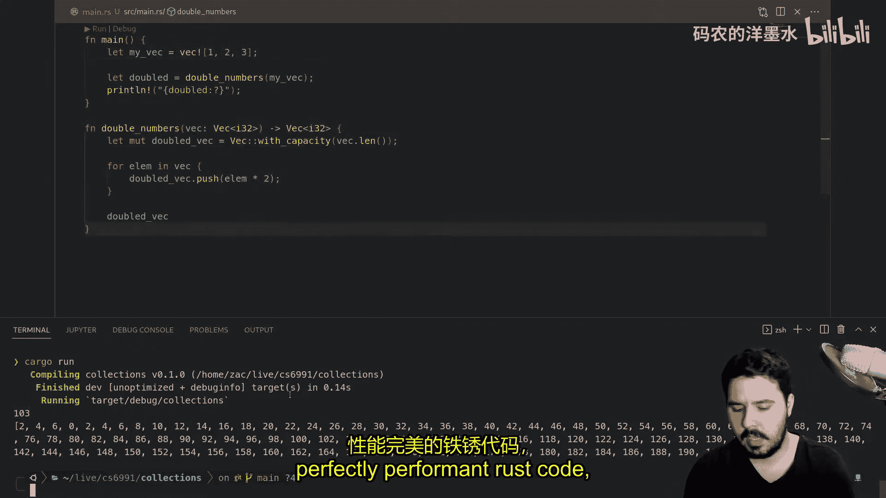

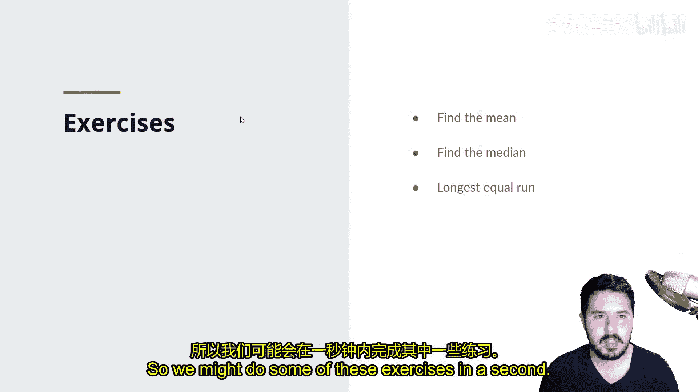

So we might do some of these exercises in a second。But。😡。

I want to take an aside to now talk about iterator， which is where our sort of。

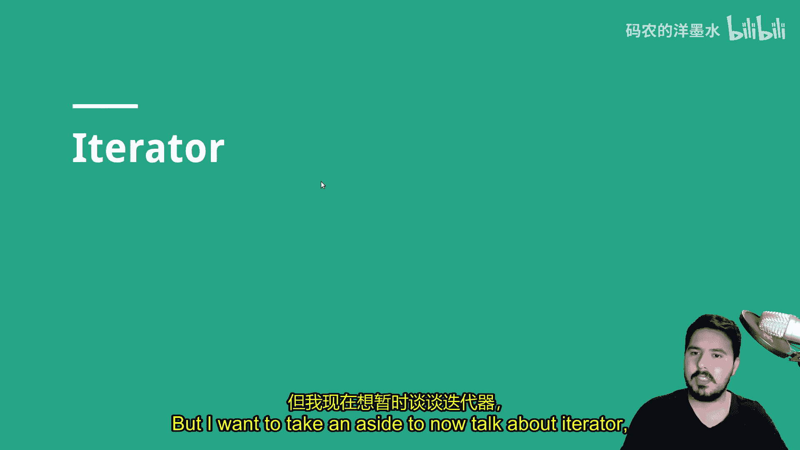

。Big topic here sort of gets pulled together The iterator trait。

 So iterator is a very sort of central and popular idea in rust。

 You can find it in the docks by searching for iterator with a capital I。

 and there it is at the top here。An interface for dealing with iterators。

 this is the main iterator trait for more about the concept of iterators generally we'll look at the module level documentation。

 so this is sort of where all the iterator stuff gets thrown in together。😊，Okay。

So what is the idea of an iterator？If again， if you've used something like C plus plus。

 if you've used something like even things like Java。

Maybey Python to a certain extent and you're familiar with iterators。

 the idea is still relatively similar here with of course some nuances in terms of how Rus deals with these things。

 but the primary concept of an iterator，Is that it has some item？

Some like element that is produced by this iterator， let's say it could be something like an integer。

 like an I32。And the idea of this iterator is that。If you have。

 I'm calling this box here my iterator， like I here， it provides us by default。

 really just like one primary method， which is called dot next。Dot next and dot next in this case。

 is going to give us an option。Of I 32。Right， that just coming from the fact that I've specified it up there。

So one function， dot next。嗯。So how do we use this， Well。

 if I've got my iterator here and I call dot next on it， let's say。

 let's say create an iterator out of， out of the vector that we've been using。 So my V。I has one。

 two， and three in it like this。And let's this is sort of made up syntax。You know。

 writing fake code here， but imagine I have my V that sort of looks like this。I can use my Vck。

Dot into。It all。Like this。 and this will produce me this iterator type。That sort of again。

 looks like this and let's just say like if I did let it equals this。😊。

Then suddenly this innerta value here， I can do some interesting stuff with。So， iter。😊，Again。

 the one primary thing we can do on it is the next method。

 And if I called itdo dot next in this case， it would give me back some。One like this。Right。

 notice the first element in this vector was one。 So if I call it dot X， it will produce some one。

 Now， without changing anything else， if I just wrote that same line of code again， it a dot next。

It would return me sum， oops， sum，2。Right， if I called it a dot X again。It would produce me some。3。

Now。Who wants to guess if I called Ida dot next again。What would be produced now？

Given the definition of my V up here。None， alright。 So remember。

 an option can either be some value or nothing at all。 none。

 And so once it's once it's finished spitting things out， it'll just give us none。

 It's a bit nice than dealing with end iterators。 Yeah， well， you'll。

 you'll have plenty of opportunities to play around with it。

 And but I I I tend to personally agree here。😊，Here's an interesting question。

An interesting question for our chat。So it makes sense someone next two， next three， next none。

 What if I was to call net like run dot next again。

 even though I just heard back that there was nothing left。

What do you think N and X would give me now if I just called it one more time。None， again， none。

I want to see if anyone's on a different teamme。Another none， some1。

 so maybe we go back around to the beginning。Trey says panic， crash the program。

 make well doubt it at panic。Underfined behavior。 Oh， okay， so we do have a lot of different teams。

 This is great。 Let's find out。😊，So I actually have my vac here。😊。

Let's forget about the whole doubling thing。 So let it equals myve do E Now calling next on an iterator does sort of modify the internal state of it because it you know we're calling the same function again。

 So for it to be able to produce different results generally it needs to be modifying some internal state it could be doing things you know external to the program like reading maybe it' it's like reading information from a network or something like that but。

Given this is a rather simple example。No， you can pretty much assume that it is just modifying internal state。

 So if we want to call dot next。😊，The iterator itself is going to have to be mutable as well。

So let's see， let's print out。With a debug print， right just so we can see what it is it a dot next。

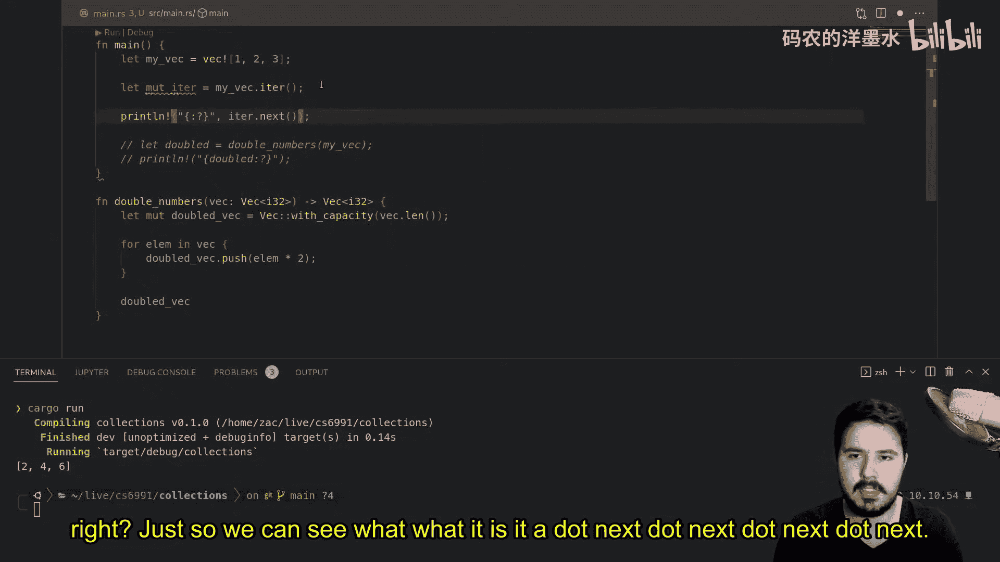

Dot next， dot next， dot next。 So the first four， I think we were all pretty happy with。

 And let's just double check。 it does the same thing。 some1， sum，2， sum，3， none， some1， sum，2， sum，3。

 none。😊。

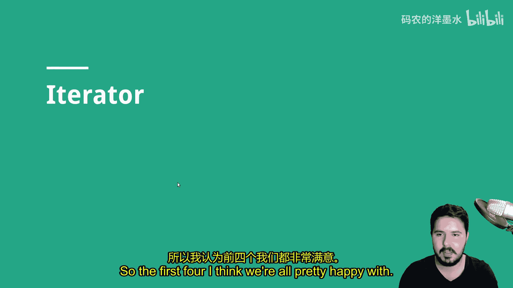

What happens if we do it one more time？So let's see U Seg fault delete system 32 core dump。😊，No。

 it's just none。It's just none in this case。So theyre they're all great ideas genuinely and the brilliant thing is。

BThe brilliant thing is that all of your answers are in a way， correct， Every single answer there。

 right， Like none， obviously， because that just happened here， but someone panic， undefined behavior。

 segmentation for potentially all these things can be correct。 Now， why is that。😊，Why can we yeah。

 why can we all get like participation trophies in this case？Um， the answer is。

 and it's it's actually not because it's undefined。😊。

But it's because iterator is something called a trait we're not going to be able to look too deeply into traits just now。

 in fact， if I pull up our course outline and pretend that I'm not forgetting you know when this is。

 I think it's yeah week five week five will really start to look into traits and how they work internally。

 but the core idea to just keep in mind for now is that，😊。

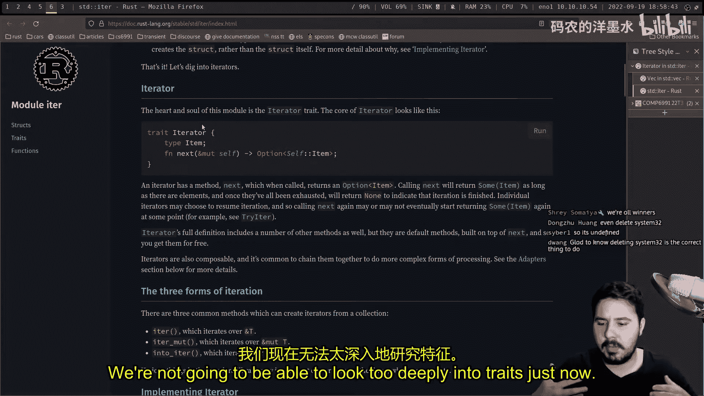

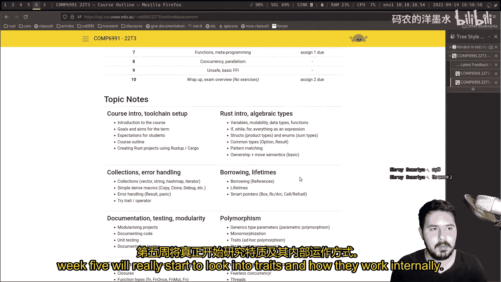

Any type can sort of implement this iterator interface their own way。😡，So in this case。I wrote myV。

t Ed， what I actually should have written is。I don't mean to confuse here this I should have written into it here。

When I turn my vector into an iterator， let's look at the documentation， Vec into E。

 oops we'll do into E over here。You can see that it produces this type here。

 which is they're just calling itterme in this case。

 it doesn't really matter what this type is called。

 but you can see that down here it says that they implement iterator。Why is it giving it a mute。

 Did I read the documentation wrong？Oh， yeah。 I did。 I definitely read the documentation wrong。 here。

 There we go。 That's what I was like， that's weird。 Here we go， implementing into iterator。

 There we go。 So when we call the into inner method， it gives us back this type here。

 And if I scroll down to this section here， it says。😊，Let's。

 let's just look at some code here in the standard library。

 It says when we iterate over this type here， it's going to give us a t back remember V of t。

 this case it's an I 32。 and they implement this next method themselves。

 That's the there's a lot going on here。 and oh my God he clicked on a lot of things that I'm so lost。

 The thing I want to point to you here is that they define this next method themselves。

 they've written the implementation。 And so what they've decided is， you know， once we run out。

 just keep producing nonens。 And that is very， very， very common。

 That is generally sort of expected behavior。 but。😊。

It's also reasonable to assume that someone in a potentially weird use case might want to do something like panic。

 They might want to do something like wrap around。 That's actually more common than you'd expect is the saying some。

 some， some， some none and then some， some， some， some sort of going around in a ring that also people have written stuff like that。

 panicking undefined behavior is like。That's someone would have to write wrong code to do that。

 And in rust， you have to use something called unsafe， right。

 You have to use this unsafe keyword to invoke undefined behavior。

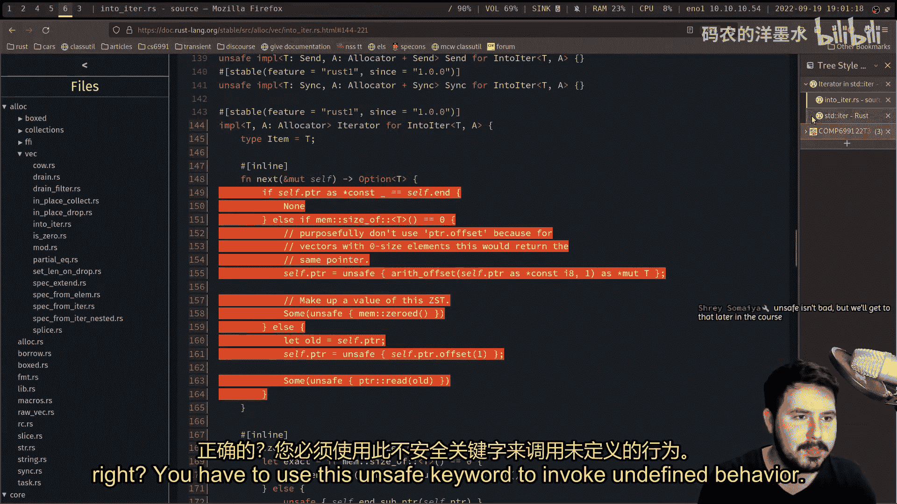

Which we learn about in week week 10， week9， week9， sorry。

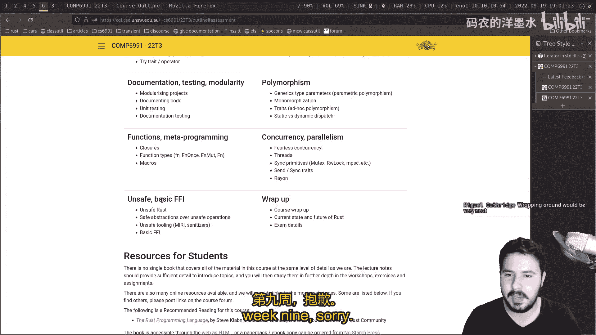

So and like generally， we， we don't like to， we don't like to write unsafe code in rust where someone doesn't have to use the unsafe word to run into undefined behaviour。

 So no rust doesn't have undefined behaviour usually。

 but people can make mistakes and sometimes they can slip through in extraneous circumstances。

 but it's not nearly as prevalent。 if that answers the question for everyone else。

But you could imagine a scenario where that could maybe happen。 So anyway。

 the the big idea here is that each type that is that can be iterated over can define how you get the next element on that iterator。

 That's the big idea of an iterator， right。Just to like do this visually as well。

 so I may have you know spoken this up but to talk visually here。Itator。

Is more like a concept than a concrete thing。😡，Right， it's， it's a， it's a way of life。

 right's no it's a way of talking about producing。You know， elements in a sequence， right。

 iterator of some item。Equs whatever it is， that's a very bad question mark。

And the way that we get elements out of some iterator， something that can be itated over。

 right is by saying give me the next thing， give me the next thing， Give me the next thing。

 Give me the next thing， Give me the next thing。 right， This is this sort of big。

 unifying interface over all different kinds of collections。 All different kinds of collections。

 We can just say give me the next thing， give me the next thing， give me the next thing。

And you might go。 That's weird。 That sucks， right？ Like。

 why would I ever want to write code that does that if I was writing code in this that was like。

 I mean， you've seen it right here， right， If I wanted to actually do this in a loop。

 I would have to write something horrible like this。 I would have to go like loop。

 let item equals it dot next， if you know， maybe match on this item here。 if item is some element。

 something like that。Then we'll go print that element out。Print out Lm。 Otherwise。

 if it doesn't exist， then we'll break out of the loop and finish it， right that's。You know， you see。

 okay， it ends up printing out  one，2，3， but compared to just four element in Vc， right？

This sucks like so why do we care about this？I'm going to leave you to think about that while we take a few minutes of break。

 right， Why would we care about having such a simple just one function interface to talk about。

Iterating over things。 I'll let you think about that。 while we take a little break。

 Let me catch up on the chat。 if you're not interested in the chat stuff， start your break now。

 So I'll catch up on the chat then I'll actually go to the break screen for two or three minutes and then we'll come back。

😊，So blah， b O P， O P Dunngeon game and rust for assignment 2 foreshadowing。

 unsafe Euclidean vector and rust。 wrapping around is neat。 unsafe isn't bad。

 Any reason why they use if else if else instead of match in this example。 Oh。

 that's a great question in this the standard library code Probably because the the things that the conditions that they're checking here are quite disjoint。

 right， It's not like check if this， this piece of data is looks like this。

 check if that same piece of data looks like that。 or if it looks like this。

 or if it looks like that。 These are pretty distinct ideas。

 Check if self pointer is equal to self end， if you've written C plus plus。

 you might recognize this line of code here， else if mem size of T is0 So like I think if else if else sort of flows a little better here because your match is gonna look like match everything if blah。

 blah， blah anyway， potentially。😊，But yeah that's a very interesting question。Unsafe allows U。😊。

I I know that's， that's definitely a joke。 But you know， seriously why not both we can those。

 those both， those things are both true and harmony， Sur。

 at least I think so unsafe is good because it contains unnecessary safe to distinct and easily recognizable sections。

 Yes， absolutely， we'll learn about that in week 9 as well。

 Is that iterator and validation I can see， that's an awesome question。

 And we'll talk about that after the break as well。😊，Cool， cool。

 full loop is it cool for element Iter。 Yes， you absolutely can。 absolutely， Daniel。

 Iter is abstract the internals of the day structure of everything use。 Okay， great。

 so sign to think about it。 Let's take a break。 I'll be back in two minutes or so。

 and we'll keep going。 Alright。😊。

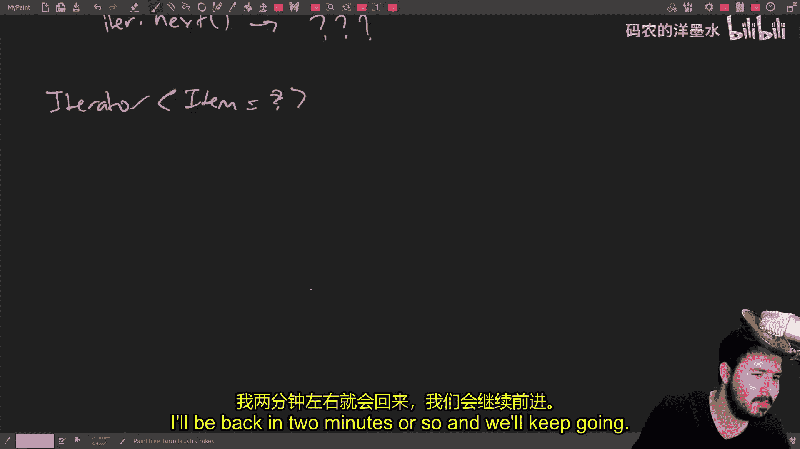

Okay， let's jump back in。

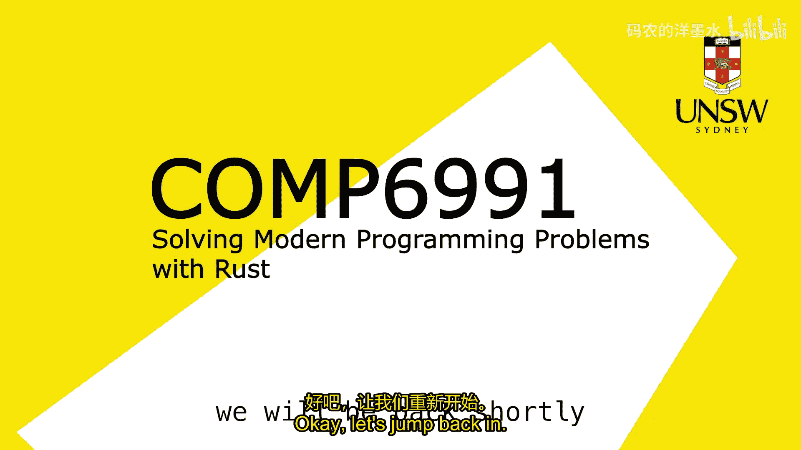

So where do we leave off a couple minutes ago？Well。

 those two questions I left out for a second could， excuse me， is that itadata invalid likeens C++？

Itterator invalid。 Yes， a very， a very prominent foot gun that can certainly you can。

 you can inju yourself and do a lot of damage with stuff like that。 I can tell you that rust。

You know the rust that we use in this course has basically solved that problem with the tools we've got right now。

 the solution is quite bad， but next week， once we learn about references and borrowing。

 you'll learn that the solution is， I think quite good。😊，The answer for now is， well， yes。

 you can't invalidate your iterator。 So iterator invalid， by the way， everyone is if I have a vector。

Then I'm iterating over the vector and then I modify this original vector specifically say add an element to it to the end of it。

 So instead of think  one23 I push on4，5 and6， for example。

 while I still have this iterator in a language like C++ that can do you a lot of harm in fact。

 you can get memory memory on safety issues and once you've got memory on safety issues。

 you've got you know hackers trying to breach your computer and take over take over a whole system and all that So it's very scary and the horrible answer for now。

 which is like you know technically it's solved is that again rust has these move semantics。

 So when I say my Vec dot into iter， this actually moves out of my Vec。😊。

In the same way that if I said let x is some string from hello。Then I say let y equals x。

Then x is no longer valid anymore because it's been moved into Y similar thing is happening here and I say my V dot into iter。

 it's sort of moving out of the contents of my VC and we end up with something else called itta and so you actually can't access my V anymore if I do my V dot push 42。

😊，This code cannot borrow because it's not mutable。 fine。 I'll do that。 and then it says。

Borrow of mood value。 It's moved away。 And so you're gonna be like， that's horrible。

 What the heck like， Now you can't use a vector anymore just because you had read through it once。

 Yes， we'll have the tools to deal with that next week。 But we're not gonna worry about it for now。

 The reason like， okay， but why are you leaving this out for us， Zach like。😊，This like。

 why don't we just look at the right way of doing things first。

 because it's very easy to get sort of。Over overborn in rust with like way too many details。 and。

 and it all comes flying at you at once。 And you go it's too hard。 I don't get it。

 So we're constraining ourselves now and writing some slightly poor programs that do things in weird ways。

 and， you know， giving you less sort of language available to yourself to make it easier to get your foot in the door。

 get things started and then we'll show you the right way。

 and and the more complex ways of dealing with these things。 But yes。

 once we do get into borrowing and references and。You know， avoid this problem of moving away。

 we rust still has fixed the iterator invalid validation problem， which is quite nice。😊，Now。

 back to that other question about iterators。They have tracked the internals of the data structure away from the user。

 which is good for separation and responsibility in your code， so that's certainly true。

 it's also good for one more thing in particular that I'm thinking of right now。

 which is so we have lots of collections。😊。

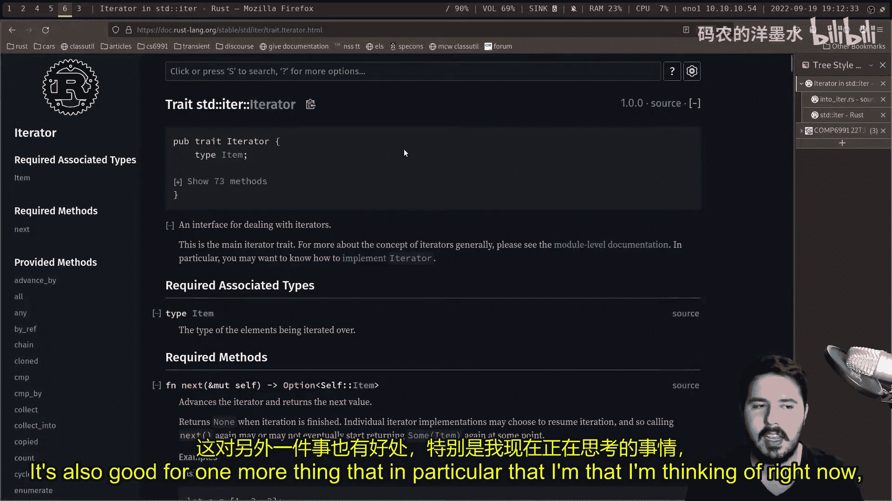

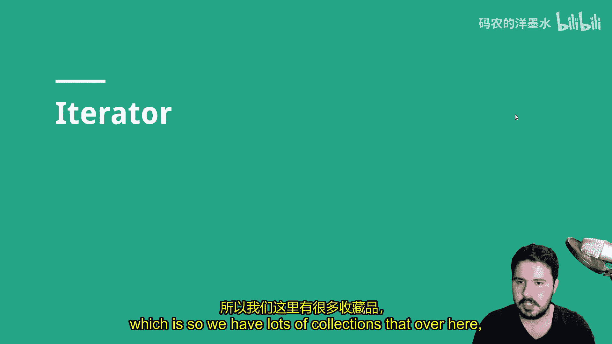

Then hit， array， V deck string， linked list， hash，lah blah， blah。

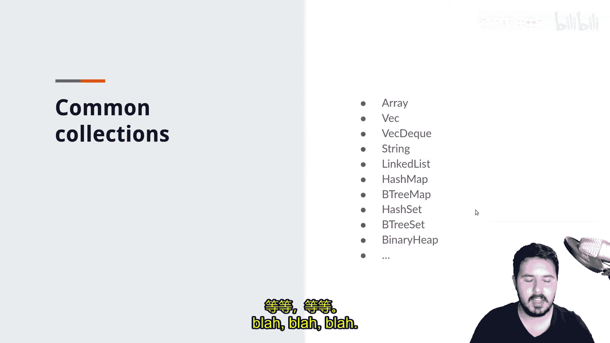

All of these， the， the iterator interface is flexible enough， right。

 An iterator just defines some type of an item that it spits out。 And you just need this method here。

 right， Give me the next item， and it gives you either some item or none。

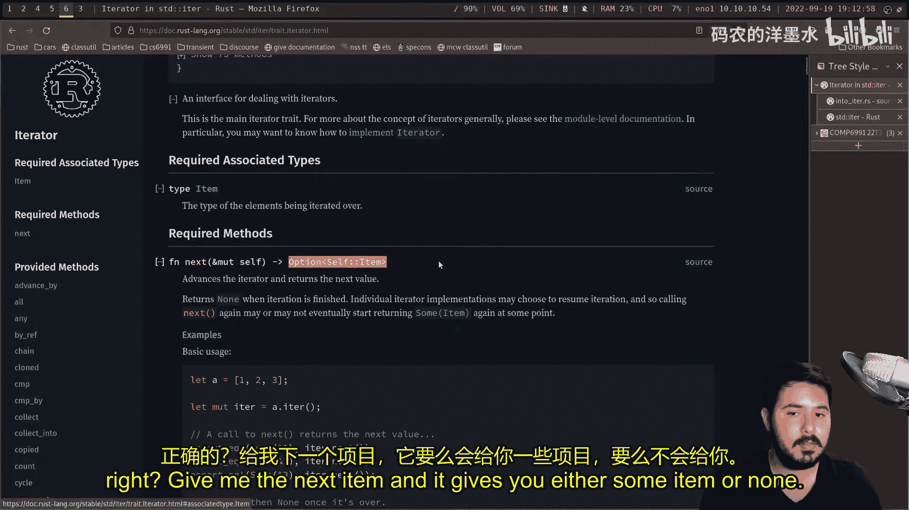

And that's flexible enough to be applied to every single thing here， an array， a V， a linked list。

 a V deck， whatever。😊，They'll will just give you his the first element， the second element。

 the third element， the fourth element as you go through of of the type， a string。

 If you iterate over a string， the first character， the second character， the third character。

 the fourth character。 What about a hash map， a hash map representing key value pairs。

 So it might be like like Z Is to names。 So my Z I， like5 to blah， blah bh goes to Zack and。

 you know， you know，301，7 bh goes to Andrew Taylor， that kind of thing， a hash map， Well。

 it's got two things。 So what could it do。 Well， it could say that this item type is is a topple of the key in the value。

 right， So it it's still one type， The type is a topple， but it just has two things in it。

 The key in the value。 So if you iterated over。😊。

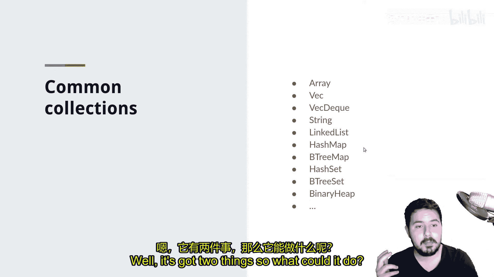

Something like a hash map， it would say the item might be equal to like a string。sorryrry。

 let's just say as that ID is like a number， we'll call it U 32 and a string for their name。

And so you'll get pes like so in my case，5，2，5，7，2，6，1 and Zach。

And then the next thing it might give you out is3， Oh no， sorry， Andrews a 9，9，3，0，0，1，6，2， I think。

 and you get， you know， Andrew。Now something like that， so it's very flexible this interface。

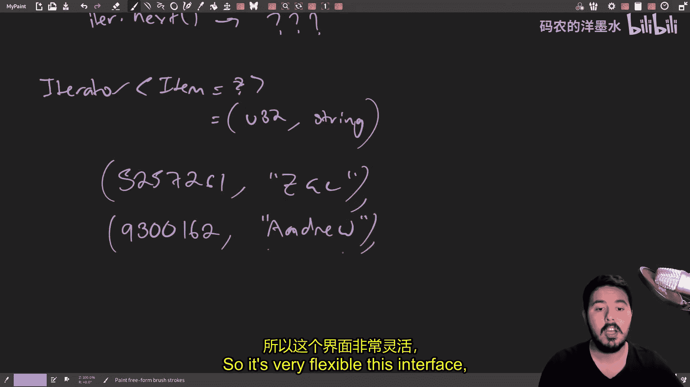

Right so no matter what data structure you're using， you might be able to do some operations on it。

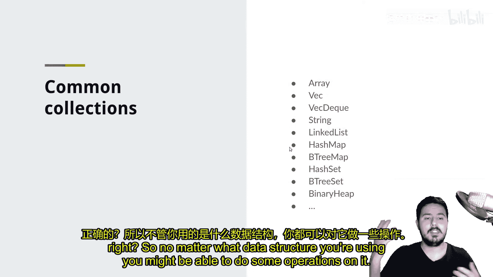

Furthermore。Furthermore， and this I think is one of the really cool things。😊，It means that rust。

 right the people who make the standard library and rust go， well。

 if a lot of people are going to be using this thing with an iterator。

 just how much just how many like helper functions could we write to help you iterate over things and the answer is。

A ton。Like really a lot。😊，Like even just with that one function next， which is what it has。😊。

Just based on next， they can write all these functions here that help you work with a some sort of collection that you're iterating over。

So let's look at something like， for example。Map is a really great one。L oops， H O J K L M map。

 Here we go。 So map is a function。 So once you're iterating over something， you can call dot map。

 and we haven't seen this yet。 This is called a closure。But it's essentially like。

If for each thing in the itator， I will call it for each thing X here。Instead， spit out  two times x。

 So if they had an array of 1，2，3 and this could be an array， this could be a V。

 This could be a linked list， whatever it is。 They say iterate over it and then map the elements such that it goes。

 you know， T for each element X，2 times x。 You'll get 2，4，6 out of it。😊。

You can think of as a land or anonymous function from other languages， yes， absolutely。

 and we call this a closure。😊，In rust and again， this X。

 you could swap out here for any name you want as long as you keep the same variable name over here it's you get different syntax fors in every language。

 this is very rubyish syntax if you've heard of the programming language Ruy so and the great thing with map as well is that you can is perfectly happy for this thing on the other side to be completely different type as well。

😊，Right， so if we go back to this other example， let's say we had let a。

Or a completely different type。Here we go。 Here is an example。

 Let's say we wanted the strings like these numbers here。 instead of the big numbers。

 they are a string that that sort of shows that same number。 Well， we could say。

I'm getting rid of this stuff for a moment。Vectctor into it dot map for each number do like the number。

 it's sort of， I guess you haven't really seen the syntax for this yet。

 But if I wanted to turn that number into a string， we'd write it something like this。

Which just says。Format is sort of like imagine print line that would print the number out。

 but it would print it to the screen formats just like the same thing。

 but it just puts it into a string instead instead of printing it to the screen and now what type does it have。

Well， it's sort of hard to see， but it says it's a something that was turned into an iterator that's an iterator of I 32s that then get turned into strings instead。

 So if I said。You know， print out4 Lm in it。Print out。You know， Elm。

 I guess you're gonna see it as a string。 all debug printed。 So you get。

 you can slowly see what I mean。 you've got the strings 1，2 and3 out instead now。

 So it's quite powerful。 just like S N printed， Yes， absolutely。😊，So easy to do string formatting。

 Yes， C And C plus plus， it can be a big nightmare to do that sort of stuff。 So again。

 that's one function here。 Another really handy one is something like filter。 So filter。

 it lets you write a function like a little closure here。

 we call them that returns a boolean based on each value。😊，So they've got the number zero， one。

 and two。And they say filter it。Where for each check， only if x is positive， right xt is positive。

 And so now when you go over this iterator， it'll give you one。

 two and and then it's done because zero is neither negative nor positive。😊，So。It's again。

 the big point I'm trying to make here is that there is like literally100 or so functions or sorry。

 75 functions that they've defined here to help you work on these things。Right， and you know。

 if you pull in external libraries as well， there is seriously hundreds。

 thousands of functions just devoted to dealing with， you know。

 this this such like this incredibly simple interface。 Just give me the next thing。

 give me the next thing， give me the next thing and they help you write code in a slightly different way。

 So this is when people talk about functional style。

 right writing code with a bit of a functional style a functional flavor to it。

 this is exactly what they're talking about。 And so we're gonna give that a try now。😊。

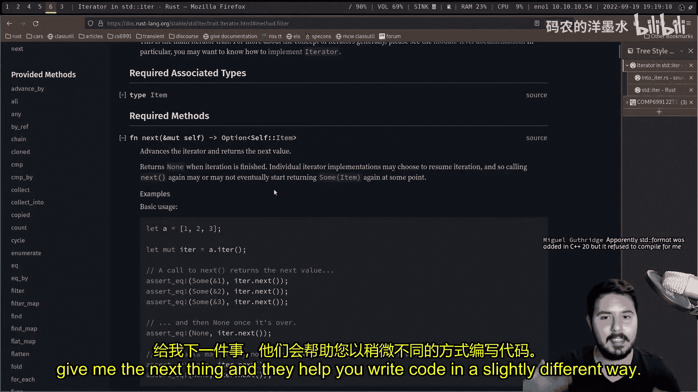

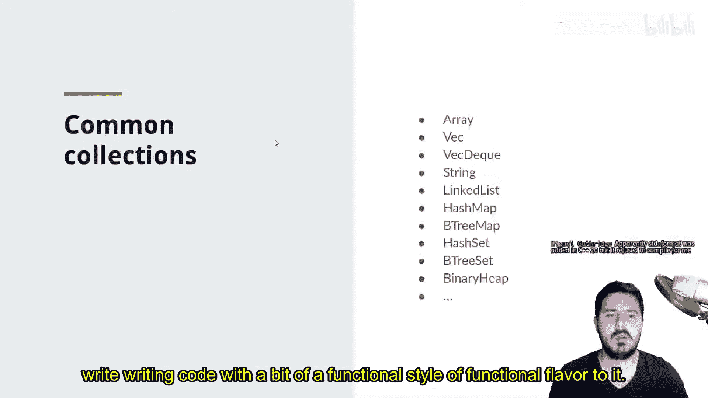

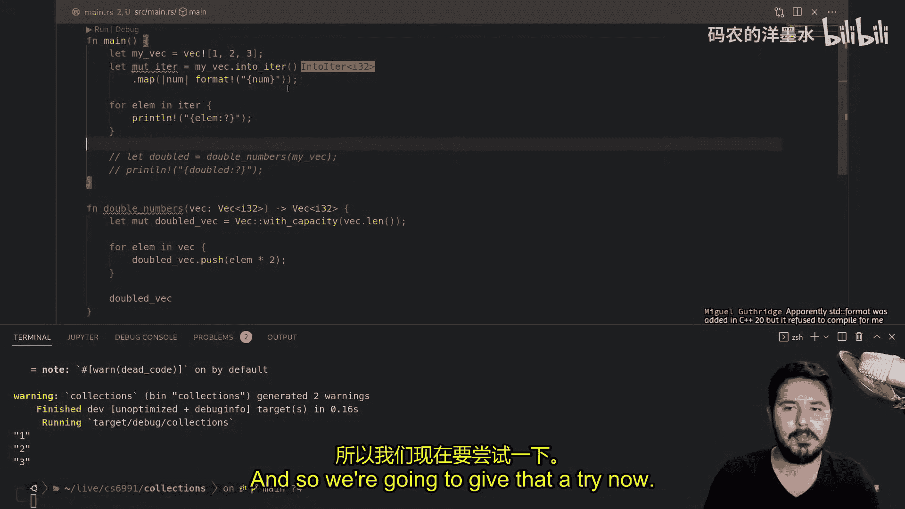

So here's some exercises， find the mean of a list， find the median of the list and the longest equal run。

 let's see how much we have time to do。

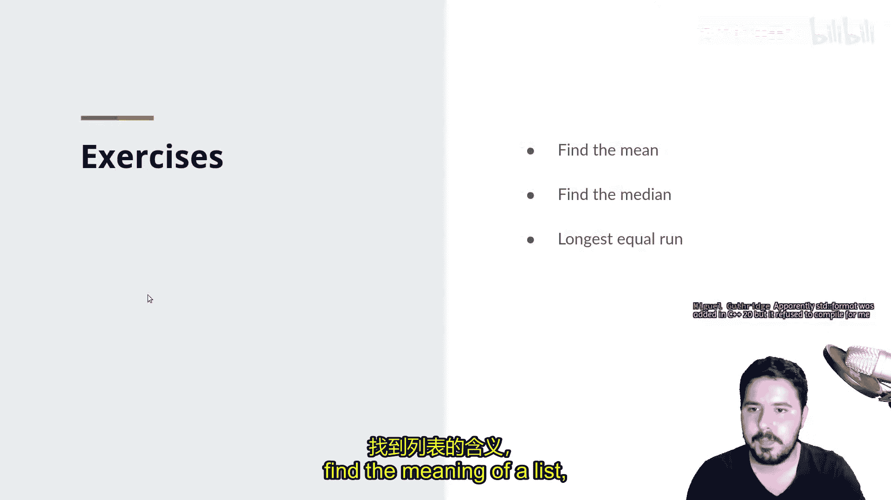

I guess I'll just sort of throw this。😊，呃。Down the bottom here and forget about it for now。

There it goes， goodbye。Go日。So let's say we have a， let's make this a little more complicated。

 throw sure， 10 numbers into it for now。😊，And let's say I was writing a function that was like function mean。

Mean， and let's J， just say for now， we take in a vector of I32s。And it's been on 932。Again。

 this is not how a rust developer would necessarily write this。

 but it' with the tools that we've sort of got right now。

 this is how we're going to write the signature of this function So if we did this imperatively mean meaning just like the average here of course。

 how might we want to do this。I think honestly， well， here's another interesting thing。

 I think I've already made a mistake in writing this。Does anyone want to like have a crack at。

 something that I haven't really considered？Just already， just writing this function signature out。

I 32。 Yeah， that's， that's certainly one thing。 Yeah。 So I 32， what should。

 what should this return type here maybe be instead。Mean could be a floatat。

 It may not be an answered。 That's right。 And James' here as well， what if the vector is empty。啊。

Students in the chat， What if the vector is empty。 What should this function return if the vector is empty Let's say we change it to F 32 or I probably lean for F64。

 There's iss very， very rarely do you really want to use F 32 with all the memory you've got these days。

 Sree says negative one。 Yeah， that's the the C programmers approach。😊，Often。Mu。There we go， so yeah。

 actually one option here is you could panic。😊，RightYou could say if x dot is empty， then panic。

 right， crash the program。You know， what the hell man。 That's， you know， we could。

 we could write out code something like this。 And this would be， you know， this is。

 this is an option。 But I'd say it's like a little more dangerous。 Yeah， a little more brittle。

 And you can just think about how like writing this。You you you would be less sure if someone said。

 put a gun to your head and said， are you 100% sure your program will not crash， you'd be like。

 oh yeah， I don't know。 I wrote some horrible things and this might be be one of those one of those things there。

 Another problem is that you're not really giving the user any sort of say in what happens So maybe the user does just want it to crash if the vector is empty like。

 they're like really， really sure the vectors not empty and they go if it's empty sure crash but you're not giving them the choice over whether they want to crash or whether they want to have some sort of recourse once you hit a panic。

 it's basically like you shouldn't be relying on catching a panic and trying to deal with it later。

 because it's's you're bound to run into issues and。And it'll just padd right Pa too sometimes。

 right？If we swap this for something like an option， then we're really leaving。

The choice up to the person who calls the function。 If they say that's fine。

 I just want it to crash if it's empty， right， So if I say mean of my V and I'm like。

 I'm looking this here。 I， this vector is not empty， right。

 I can just go ahead and unwrap this option here， potentially and just go this unwrap meaning。

 give me the the thing inside。 So I'm going to say let average。😊。

Equs the mean of this Give me the thing aside if it's not their panic。

 I bet you it's fine or I could even write expect and go vector is not empty C line above。

 This is sort of just like unwrap it giving a little bit of a you can either think of this as a reason why you're sure that it's okay or some people like to put error messages in here。

 they like to say you vector was not empty so if there's a crash。

 the user gets a message that says vector is not empty。

 I tend to prefer the former if I'm using expect like I'm writing expect because this should never end up crashing into a user I'm writing expect here to say like this is my reasoning as to why this will never actually panic but it's your choice to make and I generally prefer using expect over unwrap just to give my reasoning。

 And so if I look back over it and go okay that's why this was okay or maybe I double check the reasoning here and go wait that's not actually right。

 And so that could be Hey。 and someone also said result。So we could have a result。Alright。

 where we have some sort of error type。 So we might say enum mean error。

 and one of the possible things that could go wrong， right？ Well， the V。

 you could have like an empty V as an option。Can anyone think of any other errors that could go wrong。

 right if I put this here。Then this could work， and I say error of main error empty deck。

And that's perfectly fine。 But oops， I just left Z right。 I think there we go。

And that's perfectly fine。But if there's only really one thing that can ever go wrong。

 maybe this is still better because whoever calls the function might not realize why that function can go wrong。

😊，Right， if it's just an option。They might not realize like， okay， why is it an option。

 This should always work to me if if they didn't sort of think of the case of an empty vector。

 you know， you could maybe put it some documentation and go this function returns none know returns none if you know X is empty。

 you know you could document it or something like that。

 But' these kinds of considerations to make and these are again。

 I'm not here to tell you the right and wrong answer。

 These are your things to play around with and to think about but these are like the fact that you're all talking about in the chat means you're doing great in this course you're doing the exact know correct thing in this course just by talking about it because that's like what we're after here。

 That's the whole sort of essence of this course。嗯。So again， as long as you're thinking about it。

 it's fine， I'm gonna do option in this case， just so as' sort of less moving parts and stuff like that。

 But it's a perfectly reasonable point。 Another option。 yep， y y。

 printing program crashing sometimes really important。 Yes， it certainly is。 is always good to。

 I guess sounds nice and panicking。 Yes， yes， giving the user choice is nice。 y， y， y， y。

 deal with N N。 Rus has to deal with N N。 Very fun because it's part of the iE 7，54 standard。

 I'm sure Rus would have loved to do away with N A N。

 but it doesn't really get a choice because everyone uses iE and it's part of iE standards。 but。😊。

You know， so it's a headache everywhere， basically， sadly。If there's more than one way it can fail。

 a result will be better， I think， so they can tell us wrong， yeah， for sure。And if IFF。

 if I'm only if， yes。Okay， so if I was writing this imperatively。

 I might say let overall sum now what should this be。

 but I32 often in I64 might be a little better here because if we add up many i32s。

 it might overflow， but I'll just stick with I32 for now is going to be equal to 04 Lm in x overall sum plus equals Lm。

 which is obviously going to fail because this needs to be immutable。😊，And then say。

We also need to get the length of the vector Let length equals x dot L， oops， x dot L。

 And then finally， we can say oops， we can say， give back some。Overall， some as a F64。

Divided by the light。Like this， and it doesn't like this because of。Operator precedence like this。

 and it doesn't like this because length。It also wants it to be an F64 in this case。 there we go。

Good enough。And let's see if this works。😊，Print， Ellen。Average is average。What should this be Well。

 we've got 12，3，45，67891， so I'm expecting 5。5 if my maths is not too bad and the average is 5。

5 so its seemed like that mostly worked。My tripee damn like and Yeah， how would you replace Iee。

 It's a good question Ask on the course forum。 having any number of things that can go wrong， Yeah。

 yeah， yeah， for sure， absolutely， but that's， that's a great question to ask on the course forum regardless。

 But you're all having a good chat in the in the chat box。 So that's great as well。😊，嗯。Okay。

 so that worked。 and I'm going to call this mean imperative right here。Now。

 what if I wanted to do this sort of。Functionally。Like this， so the same idea。

 but using iterators these and these traits of stuff。

So our first step is turning it into an iterator and then we have this whole like slew of functions available to us。

 right？😊，Let's see we're looking for the mean。 I wonder if there's a method for， I'm looking。

 if there's a method for mean， no， is there a method for like average， maybe。

I honestly can't entirely remember if there is a like a mean average。

 but the one thing that we were looping in this thing。

 this was our only looper and it was to find the overall sum。

And I do know that for anything that can be added together， if you can sum things together。

 then you can sum an iterer of items。So if I just said， give me the sum。

Then it's just as simple as that。Now， what is some return， some returns and S。

 So I'm not quite sure the way I like to check if it's just like， I don't know what case this is。

 sometimes you can hover over it and it's like， okay， cool。Let's see if I do some as an I 32。

 which is what we are doing over here。 I'm assuming it's is it happy with that。

I guess because it's just going。Maybe it can be summed of both weights。No， that's interesting。

The trade bound， no， okay。Well， that's a little sad。 So， I mean。

 we get a little bit of niceity here where we say， you know， sum it up。

 but we're still probably going have to have most of the rest of the code here unless someone's got a particularly clever idea。

 But you can know we can write this instead。Overall，And， you know， maybe in this case。

 they were relatively similar， but it is also quite a。Quite a small， simple function。But yeah。

 this is the main idea。 for loop here， imperative functional style here into In do sum。

 maybe maybe don't like it。 But there's plenty more to play around with still。

 Can we look through the docks。Yes， the docks on what on some。Sums the element of an iterator。

 takes each element， adds them together and returns a result。

 and empty iterator returns the zero value of the type， which is a little sad to me。

It would have been nice if there was like a， you know。

 maybe at some point I wonder if I just Google like rust， try some。

 I wonder if someone's like working on this。😊，H maybe not。Well。

 that's something you could even look into adding to the language。 you just go， hey。

 I think this would be a good addition， it's very simple， very easy， and they might go。

 oh seems like an interesting idea。😊，But okay， in our case。

 we still have to write a little bit of code around it。

 but there might be a slightly nicer way of writing in this that I'm just not seeing immediately。😊。

Cool， I wrote that when you were likeking my wonder of some， but then you went to the talks anyways。

 I say gotcha。Okay， and let's check if it works。Main functional。Cargo run average 5。5。

 so these basically work equivalently and there's this other really interesting idea called zero cost abstractions。

 The idea is that。😊，This code here will run really fast。 This code here will run really fast。

 These almost certainly will just end up compiling into the exact same machine code that gets run。

 So， you know， even though this might be like shorter and have sort of less。😊。

Code to tell the computer exactly how to do it。Ideally。

 these end up just turning into the exact same machine code anyway。

 So you don't you don't have to pay for， for this sort of abstraction here。

 There is also another idea to zero cost abstractions。

 which is you don't pay for the features that you don't use。

 but we're not quite looking at from this lens just here。 And yes。

 I know everyone wants me to jump into Godbolt。 But No。

 I'm not gonna pull up God boltt in front of the lecture today。 maybe。

Maybe maybe make a post on the course forum and we'll pull up guidebolt and have a look， but no。

 not in front of the lecture because we're not 1，5。

2 on sadly or you know an OS or something like that。O。There was one other。 Yeah。

 this is an interesting problem here that might have a little bit more meat on it as opposed to just finding the average。

 which is the longest equal run。So there's a lot of different ways you could define this problem。

What I'm choosing to define this as is let's say we had a list that was like one， two， in fact。

 let's say we just had that list that we just had，6，7，8，9，10。Right， and then we had another list。

 so let's call this list X， and let's call this list Y， and it was like 1，0，3，4，5，6，28，9，10。😊。

Then the idea here is that if you sort of compare each element。Index wise， right？

 So the the first with the first， the second with the second， the third， with the third。

 What is the longest。Sort of sequence in in these between these two lists where they have all the same elements。

 So what are the sequences， there's one here where the first index， they're the same。

 but it doesn't extend to the next element because 2 is not equal to 0 here right？

 So that stops there。 Then we have 3，4，5，6 are both all the same。 So this has length 1。

 This has length 4。 And again， it doesn't extend to the next one because 7 and 20 are not equal and then 8。

9 and 10 are all the same as well。And that has length  three。

 So the overlap of this function we'd be hoping is four the longest sub sequenceequence being this length 4。

3，4，5，6。😊，Okay。Sounds like a leak code problem。Yeah， I mean。

 this is basically some kind of leak of own302 and I mean this is this is a still a rather trivial problem。

 I think， but okay， so let's let's write this out both imperatively and functionally。😊，So Fn。

est longest equal run。Equal run。Imperative， let's say。 So if x is a vector of y32 is。

 y is a vector of y32s。And we're going to produce some length and again length of an array we're thinking u size here because you know the thing to think about is on a 32 bit platform arrays can only be so big right。

 they have indices that are 32 bits on a 64 bit platform we're thinking 64 bit indices So whenever you're talking about indexes into an array or something like that。

😊，U size is the type way you're thinking for here。 The equivalent in C being size underscore T。

 If you've ever used， excuse me， if you've ever used that。Okay， so imperatively。

 how would we write something like this， So let's， what if we did something like let mute the the longest run。

Is length 0。And the current run。Is zero something like this and at the very end of the function we'll return back whatever the longest run was。

Then I could write imperatively something like4。Well。

 I I want to go through each of the indices of these of these vectors here。

 One could also be longer than the other。 So we're gonna have to figure out which one's shorter first as well。

 So let's say something like let short index， sort of like short length。Is well。

 we have x dot length。And then we also have wide dot length。

 and we need to find the minimum between these two。

So I can actually say x dot length dot min min between Y like， you might not like this syntax here。

 I could rewrite this as like I 32 min of X and Y。Which I think people might like a little better。

 So I guess I'll do that for now。 But there's， again， different ways of writing。

The same sort of code that does the exact same thing。I was sorry， not I32 U size。Between these two。

Okay， so then we could say something like four index in zero up to the short length。Right， for this。

 we go if。X of index is equal to y of index。Then， then like what are we looking at here， Well。

 if we start from the start here， if these two things are equal。

 then we we're sort of starting a run here。 The run just got one extra element in it， right。

 if we're looking here， we've got one extra element in it both here。

 So the run just got one step bigger essentially。So if we're looking at tour elementss and they have the same value。

 then our current run。Just increase by one。And if our current run now exceeds our longest run。

Right then this is now our longest run。Something like that。

 This could also be written as something like longest run equals longest run dot max current run if you。

 if you wanted to write it like that。You have options naturally。

If the two elements that we're looking at are not equal。Right if these。

 if the we're looking at a pair of numbers here and they are no longer the same。

Then that ends whatever current run we're on， so our current runners should go to back down to zero because we're not even on a run anymore。

So it's a little bit of code here。 Yeah， the variant end of this algorithm。 Yes。

 you're said writing code that looks like this that works correctly the first time comp 67。

21 is a nice recommendation Inal methods the lost art if you want to look at that。

 but we're not going focus too much on the algorithm itself here。

 Here's just one way of potentially writing it unless I've messed it up。

 So let's test it out on this case that we had here So what do I do I swapped this for0 and 7 for 20。

😊，So this for 0 and 7，4，20。 we'll call this X。 We'll call this y。Comment out the average code。

And we'll say， let longest。But just call L is longest equal run between x and y， and longest is L。

 something like that。And the longest is full， which I think is correct。 So here's our code。O。Now。

 what if we wanted to write this more functionally with iterators？What are our options here？F。

 fun for functional。Well。Let's start with turning our first vector into an iterator。Right。Now。

The interesting thing about writing code functional is that often。

You're looking to be more descriptive than prescriptive。 right， So up here。

 I'm really like each line of code is needing to tell the computer what to do。 Like， sorry， no。

 rather， my mistake is telling the computer how to do something。

 So what we're doing here is we're checking if they're the same。

 How we do it is we go X of index is equal to y of index。 right。

 What we're trying to do here is loop through each pair of elements。

 how we're doing it is we're needing to find the short length and then tracking through this stuff and all that。

 And you can imagine that it's easy to like mess this up to get something backwards。

 Like instead of a mi， you accidentally wrote a max。 instead of a dot dot。

 you a dot dot equals instead of a0， you to1。 right。

 there's a lot of little details here to get wrong。 But this big idea that we've got here。😊。

I's looping through like theyre looking at pairs。Like index wises into two iterable things。

 two things that we can iterate over。And that's an idea that's general to anything that can be iterated over。

 Like any time you're trying to iterate over two things and do this， this stuff。

 It doesn't matter whether you're iterating over integers， iterating over strings。

 iterating overstructs， iterating over， you know， inum， whatever you're iterating over。

 This is just sort of a general idea。 And so that's a candidate for something that someone's already done the work to a write code that does this。

And has probably gotten it right， right it's probably extensively tested。

 it's probably been used by tens of thousands of people。

 so there's probably a better chance that it does the right thing than you trying to explain to the computer how to do that potentially kind of complicated thing。

Now， who was it in the chat， Who was in the chat， Daniel Wang， Is there a zip in rust？

 Let's have a look。 zipip here。So zip has this crazy signature here zips up two iterators into a single iterator over pairs so let's look at the example a1 is 1。

23 a2 is 4，56 if we iterate over a1 and zip it with a2 what do we get it gives us1。

4 see14 it gives us2，5，2，5 it gives us3，6 right notice how it's like some has this bracket but then it has another pair of brackets here that's because we've got a topple right so we've got a topple of an element from the first iterator and an element from the second iterator。

😊，Right，The existence of zip makes Miuel very happy。Right， and again， as Streray mentions。

 this is just what the standard library provides。 Theres again。10There's hundreds。

 thousands of these functions out there in the wild。 So if we said x dot zip with y。

I might need write Y into it here， but it might even the type inference might be smart enough to do it anyway。

 depending on how they wrote it。Now。We've got something that we're iterating over that has an element from x and an element from y at each point。

😊，Right。Now， do we even care what the actual values are， That's the next question to ask ourselves。

 does it really matter this is3 and this is6 and this is8 and this is 10？😊，Like。

 it does matter because we need to check if it's equal to 10， if it's equal to 8， if it's equal to 6。

 if it's equal to 3。 but if we decide that they're equal or we decide that they're not equal。

 did the actual number itself really matter at all？

RightI think it's just like the fact that they're the same or the fact that they're not the same that is what we're really interested in this problem。

 so we can tell the computer， we can tell rust how to deal with that。

 We say if you recall the map function the map function lets us say for each element in this that we're iterating over。

 turn it into something else， take what we've got， turn it into something else。

 So if I take our tuple that I can say if just turn this into if the first thing in the tuple is equal to the second thing in the tuple。

😊，If topple dot0 is equal to topple dot1。Right， so this is the element like the we've got we're working in pairs here。

 the element from the X iterator is equal to the element from the y iterator。 right。

 So now we have an iterator over bulls， an iterator over just true or false。

 And we're just looking for the longest run of trues in this case。 right。

 So we might in in the case up here， in this example， we would have true， false， true， true， true。

 true， false， true， true， true。😊，And we just say， okay， there's four truths in a row， so that's。

 you know that's the one that we want to go for there。😊。

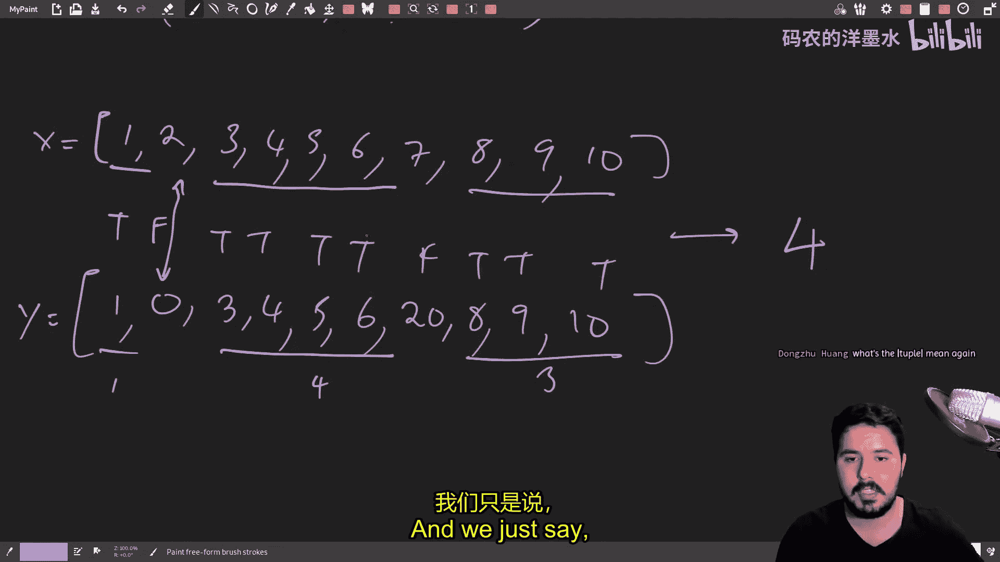

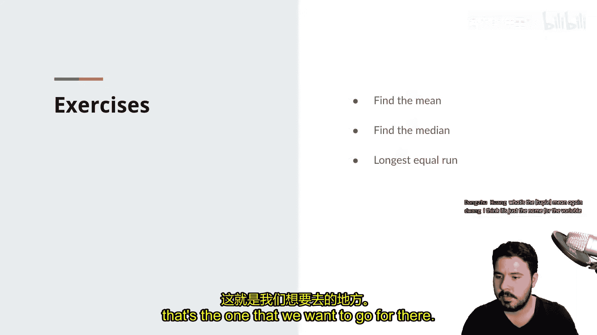

And yes， what does the topple here mean， this is just saying for each element that we're iterating over。

😊，Turn this element here， and I'm giving it the name topple。 I could give it the name T。

 I could give it the name X， you know， whatever I want， Tple。

 turn it into whether topple dot0 is equal to topple dot1。

Now there's another trick I can do here again， pattern matching sort of just exists all over the place in rust and I can also pattern match out of this here I could say something like so notice I change this from being topple here to be。

😊，These pars， and I'll say like x LM， Y Lm。And it goes， oh。

 I've got a couple of an integer here and an integer there。Right？

Then I'm going to make this integer Xlm and that integer Y Lm。

And then rewrite this right hand side here as XlM is equal to yl as well， which is also quite nice。

 Pat matching。 Yes， Co pattern matching。 There it is。 right， You absolutely can。😊，Alrighty。

 So also this， all these errors over here is just it being angry because it was like。

 you said you're gonna return a U size。 And this whole thing's an iterator。 and I'm upset and blah。

 blah， bh， blah， blah。 So I just throw a to do down here and goes， oh， okay， I get it。

 You're still working on this。 And it's fine。嗯。And if I hover over this。

 you'll see X element is an integer and Y element here is an integer。

 and we compare them together and that is a bull， right， we're just iterating over booles now。😊，Now。

There's the next question is， we want to find the longest run of these bulls。

 There might be a particularly nice way to do this。 My think that what I would sort of。

Think to reach for is something like fold。 Yeah， and reduces sort of rather similar to fold in in this manner。

 but。Just just subtly different。And this is sort of a thing you'll run into ego。

 Is there a nice method for me to deal with this and the answer a lot of times is like maybe you don't know all these functions here unless you know。

😊，If you've used something like Haskell a lot。Even if you've used things like Javas functional iterators。

 you might recognize quite a few of these， you know， map filter， you know， stuff like that。😊。

But there's a good chance that you just sort of don't know a whole lot of these things。

 And the answer is， you know， you'll run into them。 like if you go through and look at some。

 you'll learn about them， ask us on the course forum。 hey。

 does anyone know of any clever functional way to do this and you might get to sort of learn new methods by example like that。

 But also every single function here comes with an example along with it So I don't even know a cycle doesn't ring a bell to me。

 there you go So it it has an example that says if you cycle this iterator of 1，2，3， you just get1，2。

3，12，3 know and sort of just goes an infinite loop of the iterator。

 And so I don't know what cycle is， I click on it because it sounds interesting And then I see what it does。

 I'm like okay cool there might be some interesting details that I read here but I look at the example and it's like。

 okay I get it。😊，So fold， fold is what I'm going to use here to turn this。You know。

 iterator over a boolean into this final number for the longest run。Falold is a little gnlly。

So we'll go back to the whiteboard for a second here。😊，The idea of fold is， if I have， so is true。

 false， true， true， true， true， false， true， true， true like this。And I say fold over that。

Fold over that iterator， I need a sort of an initial value。😊，And then one of those closures。

 one of those functions that takes， which ones that take first again， it takes the item。

 right that that's sort of like this thing here， along with one single item。And it needs to spit out。

That item again。 So it needs to spit out sort of like a， I shouldn't have called this item。 Let's。

 this should be called element， rather。And this maybe we' refer to it as like the reduction， right。

's let's call it that for now， the reduction here。You get a reduction here and it needs to spit out a reduction out this side。

And so this is like all a little crazy What's going on here。

 So we're trying to reduce this into just a number。

 just the like this number here for is what we're trying to get to。

 which is the longest sequence of the same thing， right。

So if I initialize our reduction in this folder is the number0 right， F across with the number 0。

 and then I say。If you give me some sort of reduction and an individual element。

Then I will give you a new reduction out out back。 So what's it going to do for me， it's going to go。

 Okay， well， the first element here is true。 So I'm going to call your function with0 is what you've told me to start with。

 And the element true。And I need you to give me one of these numbers back here。

 so I'm saying if it's true。Then sorry。 it's， it shouldn't actually be a number。

 I'm gonna need two pieces of state， which is the， the current run in the maximum run。

 like we were using in this in this imperative solution up here， the longest run in the current run。

 These are sort of， I think， relatively fundamental ideas in this problem。 So that's fine。

 our initialization value can be a topple of two integers here。

 And we're gonna start them both off a0， which ones which that's sort of for us to decide will say it's the the。

 let's do best current。 So the best and then the current。We start this off as 0 and 0。 Now。

 what happens if we getops， not 0，0。 So here we have 0，0。 Now， if we get a true value。 Well。

 our current should go up by one。 and our best should be either itself if it's better than the current run。

 or it should be the current run。 If our current run is our new best。 So we get one here。

 Then they give us a false value。 So they give us0， oh sorry， they give us1，1 and false。 we go right。

 that's just ended this current run here。 This current run there。 And so the best is still one。

 but our current run is now gonna be 0。 So our functional splitit this out。

 Then they might give us 1，0 true。😊，And we'll say okay， the best is one。 the current is one。

 so on and so forth。 And you sort of work in this process。

 It basically we start off with this value here。 and then it feeds this value in the next time each each time we're working on this until eventually at the very end。

 it just spits this very last tuple back out。 So this is like fold and Haskell if you've used it before This might be a little easier。

 if you're like what the heck is going on， it might be a little easier to understand by example here。

 So I'm gonna say we initialize this with the current。

 sorry the best run and the current run about 0 and0。😊，And then we say。

 given the best run in the current run and some individual element that we're looking at now。

And what are we going to give back， Well， if the element。Is true。Right。

 if El and element is just a bullying at this point， If it's true， those things were equal。

 then we're going to do， we'll say our current run is current plus one。And we'll give back。

Best current， but if the best is like this best value here is got to be。

The maximum out of the current and our best， if the current is bigger than the best then we want to use that instead。

 so I'll just say choose the maximum between the best and the current。If the element wasn't false。

 just give the current best back and go back to0 for our current run。

 This is basically the exact same analog as what's going on here。

But sort of squished into one little fold here。 Now， due to the way rusts of expressions。

 I don't need these braces out here and maybe you'd write it， Yeah， something like this。

And so finally， this fold should spit us out。😊，The best and the current。Right over this whole thing。

And we just care about giving back the best run。Like this and so and notice we actually don't need this current value at all here。

 so you can either prefix it with an underscore to say we're not using it or you could just even replace it with an underscore entirely if you just want to say we don't care。

😊，And this is a functional solution。 We'll just quickly test it works We're I'm having to sort of like speed along a little bit because we're running out of time。

 but this is an example here of of using a very heavily functional fold for this problem here。😊。

But the interesting thing as well。Is that you could also mix these two approaches if you went。

 I was with you till here and then this fold sort of blew my brains that's okay right I would suggest sort of playing around with it yourself and trying to get accustomed to it because it is a very nice option to have but you could go I really liked the first half but you had me in the second the first half but you know didn't like the second half of it just stop once you reached this map here。

😊，Al right， once you've turned it into bulls， you could just go4 Lm in。This whole chunk of stuff。

Right， and now we go back to the imperative solution here。Right， you can grab this stuff out。 Let's。

 let's grab the past that we need。 We don't need this short length anymore。

 We don't need this loop or anything。 So this is sort of the important bit。 And oh， wait。

 I've past that in the wrong spot。 Oops， sees。Let's。Let me grab this again， my mistake。

 I posted it into the functional legend， not the mixed。There we go， don't need this anymore。

 We still might need these bits。So this is really the meat and potatoes of this part here。

And instead of saying if they're equal， we just say if L M， right， for like。

Equal in x in this functional thing here， if they're equal。

 then this code otherwise that and just spit out the longest run。

Over here and this is a mixed approach， we've used some functional bits where we liked it。

 we used some imperative bits where we liked that。😊，And does it still do the same thing？Oops。

 I thought I'd copy the name of this next。That's still the same thing。 Short does。 longest is still4。

 So again， there's a lot of code to playground with here。 I'm going to put this all on on Gitthub。

 which you can access via the the lectures page over here。

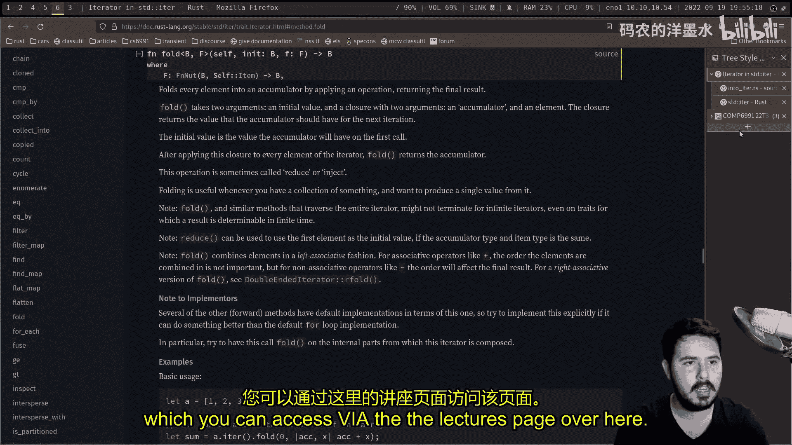

In fact， I think you can see some of the code from like the first lecture maybe， or yeah。

 the first two lectures see how there's this code here that you can click。

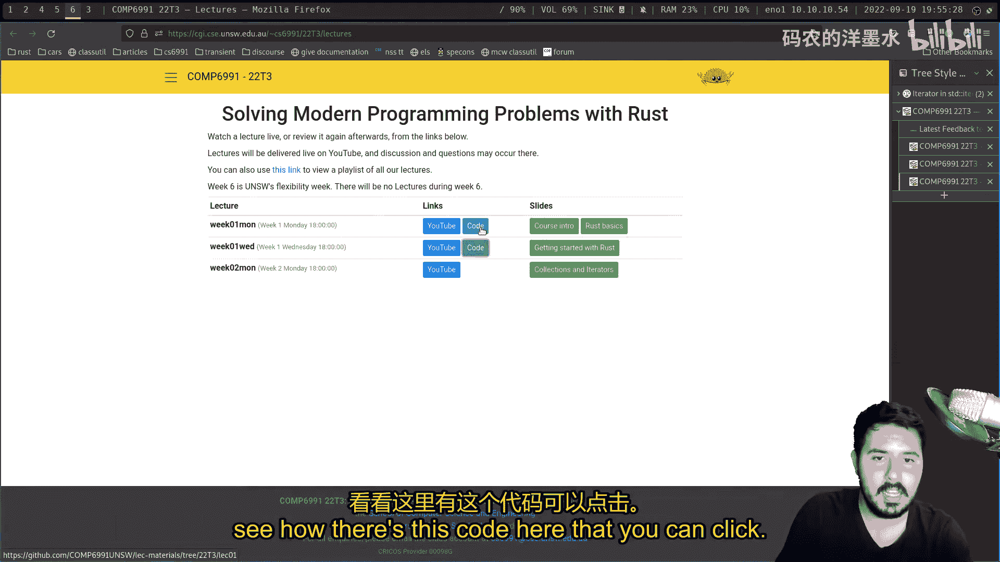

I'll put this up after the lecture finishes， so play around with these and play around with these different approaches。

 functional imperative using iterators that sort of stuff。😊，In your lab exercises and all that。

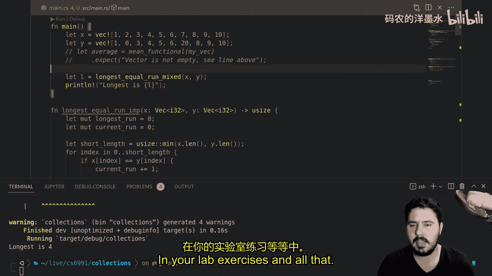

So those are the big ticket ideas of today， to be honest， we've talked about its strings。

 we haven't got too much of a chance to talk about。

 but strings really just act as a collection of characters。 So hello world。

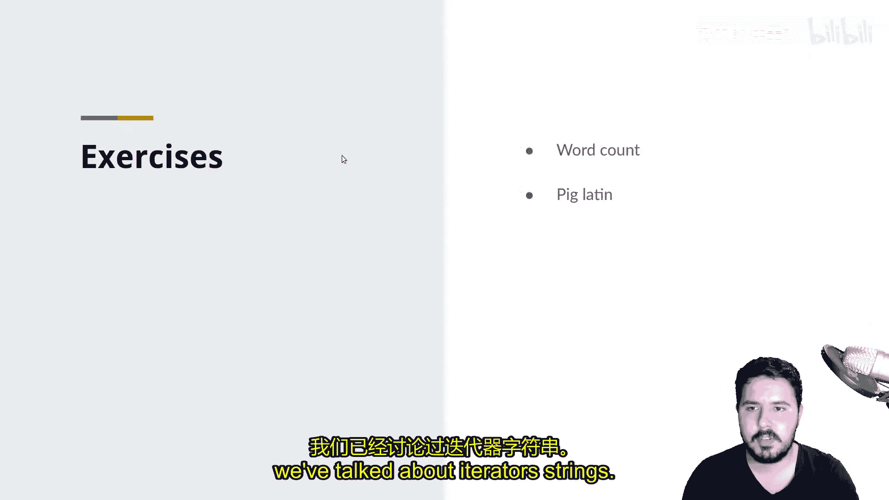

It goes a little deeper than that。😊，So' say let is this。

It does go a little deeper than that because strings internally get stored as a sequence of bytes。

 but we often like to think of things as individual characters。A little yeah。

 we we often like to think of strings as a sequence of individual characters。

 including things like emojis。 So thank you Dong for providing me with emojis to throw in here now right this if you know about Unicode。

 you might recall that this letter here or each of these letters here are one byte a piece whereas as an emoji in this case is actually gonna be four bytes。

 and we don't really want to care about like the first bite of the emojis， the second byte。

 the third byte， the fourth byte， realistically we're interested in individual characters。

 whatever the sort of their sizes。😊，And so the iterator that we generally use over strings most of the time is chars。

 S dot chas。And this again， is just an iterator over characters， iterator over char。

And so you'll often want to reach for this child iterator。

 I think you might need to do in La exercises or your weekly exercises rather so you know。

 hintin wink wink I think。😊，Um， but， you know， something to consider there we'll look more about the differences between string and。

😊，AirP stir， if you've seen them around the place next week when we talk about borrowing references and borrowing。

 but a little too out of scope for what we're looking at now。

 there's some fun exercises to do here since we don't have time in this lecture I might write do them up in a revision video and then put that up on the course website as well。

😊。

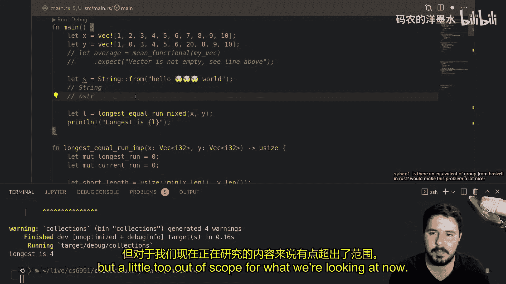

And the other thing we didn't get to talk about。😊。

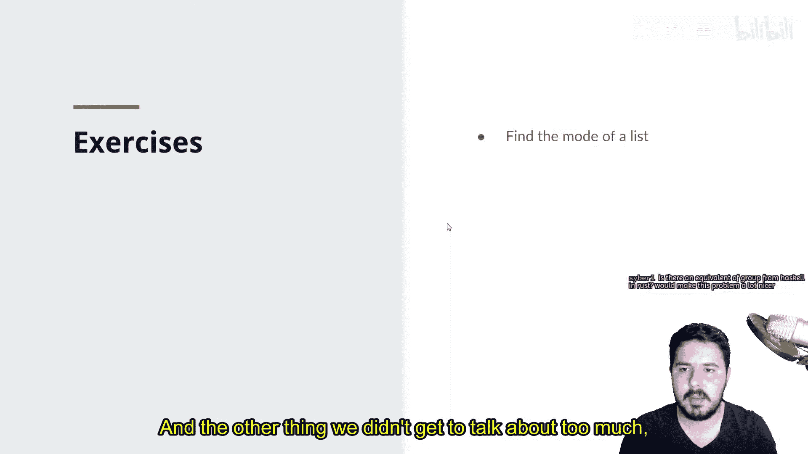

Too much， maybe we'll just do a quick thing now is on the map types。

 so hashm in particular is a very important type in rust that gets's used all the time。

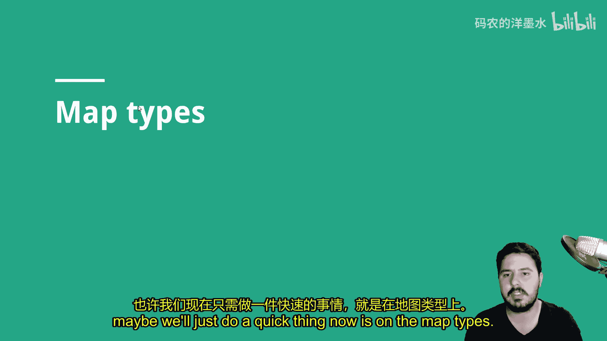

So it suggests， let's find the mode of the list， right， so let's say if this had。If I list。

I guess we'll just do another example down here。 Lets Z equal 1，1，1，2，1，5，5，5，8，5，7，5，6，5。

 something like this， right？ The mode will be the most common。element in this list。 So 5，5，5，5，5，5。

 there's 6， fives。 There's four ones。 So okay， five is going to be the most common element in this list。

 So the mode。FN mode of X is like V。Is a V of I32s。Should give us out。F instead。Sorry。

 five as a result of this。Brt， London。Moode is。Moode of。Like this。What is it like？Expected。Oh， oops。

 I've got to right back。There we go。Okay， cool。So we'll do this to finish off。 What's the time。 Okay。

 we'll run like five minutes over time to do a quick catch map demo。

 Is there anything in the chat that I'm missing here， foldold and reduce， Yes， yes， yes。

 fold folds like reducing Js and Python， yep， y， y， y， y yep， absolutely fold initial value。 y， y。

 y y Use a coupleple yep， your way ahead。 Unicode， yes，1，521 very true。

 Is there an equivalent of group from Haskell and Rut would make this problem a lot nicer。

 That is a great question。 Maybe for the course forum。😊，And rust chas are actually not a fixed size。

 rust chas， individual chas are a fixed size， they are UTF 32， which is4 bytes per character。

 but strings internally are not just an array of4 byte chars， they use UTF 8 encoding internally。

 but an individual char variable is going to be always4 bytes always UTF 32。😊，Um。

 and u there's a great article as Strey mentions that talks about these kinds of things and always the course forum for us to ramble on about all the funness there。

😊，Okay， so。Let's finish off with this mode exercise。

 how are we going to write code that finds the most common？

Write the most common value in a list Well， one approach is to use a hash map right or to use any kind of map really。

 we'll use a hash map in this case， but it doesn't really matter where we say if our list on a smaller example was one。

2，1，2，1，3， for example， what if we turn this into a sort of key value map where we say the element 1。

The element 2 and the element three each appear a certain number of times。

 so in this case we have one，2， three ones， so one goes to three， we have two twos。

 so two goes to two and we have just one， three， so three goes to one here。

And if we made a big map like this， then we just have to find whichever one has the largest size in this case。

Alright， so let's write this kind of functionally because， you know。

 imperatively it's often just sort of a translation from what you already know how to do in language like C with sort of rustism thrown around the place a little bit here and there。

 but the functional stuff is a little scarier and more new so that seems more fun to me。😊，So。

Let's turn this into well let' let's do the hashmap stuff first。

 let's turn it into a hashmap imperatively and then we'll get the the answer functionally。

 that seems interesting。😊，So let map， and it's going to be mutable。Be a new hashmap。New like this。

Then we can say4 Lm in Vc。Map dot。Oh， insert， this is interesting。

 So inserting into a map looks like this。 we could say insert the element with count of one。

And that's great and it's complaining like， yeah， I know there's still stuff to do。And that's great。

 But there's a problem here， which is what if the element is already in the array。

 Like insert the number one with one count into it is fine the first time。

 But then the second time it's going to overwrite the existing one with one again。

 when in reality we want it to go to2， want to go to three。

 want it to go to however many there currently are。

 So map has a whole bunch of nice things to help us with this kind of stuff。

 I like to use something called the entry API。😊，So I can say。

 give me the entry for whatever element we're currently looking at。And we'll say。We say。

 or insert with。呃我。And modify。 yeah， let's， let's do it this way and modify some existing element X。

Dot or insert with or insert some default like this。 So here's how I've structured this。

Tell me about the the you know， the thing that's in this hash map that's already in here。 So of like。

 let's say we're up to let's say we're up to the we've done the first three elements here。

 our map is going to look like one goes to two and two goes to one like this。And if I say。

 give me the entry of two， it's going to say， well， two goes to one right now。

 if I say give me the entry of three， it's going to say there is no entry for three。

 so it'll be an empty entry。And modify here is saying if that entry exists what I want to do with it。

 and I'll say if it exists， increase it by one。Right。Otherwise， just insert one instead。

This is probably okay， fine。Starex。You might not like。You might not like this for now。

 but we haven't quite gotten so far as mutable references here imagine this and see where we have like a pointer I'm just saying take the value of x and increase by1 I'm sad that I have to do it this way for now but you can imagine if it exists increase by one。

😊，Otherwise， just insert one， insert the element with a value of one because we've only just seen this first one now。

And so that will throw us together a map， which is great。嗯。Cool。

 we should have a map that looks something like this at this point。

 and now we just want to find the one with the biggest value。

 so that should be this one here and then out of that spit back out that one was the most common。😊。

Right， they don't want to know how many times it appeared just that one was the most common。

And so we'll do that functionally， so we'll say in this map。😊，Let's turn it into an iterator。Right。

 what is a map what's how does like how do you iterate over a map Well it iterates into topples So the first key in the topple is the sorry the first element in the topple is the key。

 the second element in the topple is the value。So turning it into an iterator。

 and I want to find the max by key。 This is a very interesting one。 Find me the biggest thing。Right。

The max spike a where。We have if we have a the like number and the occurrences。That spellt wrong。

 I think， I dont， spelling is hard。Give me the maximum by the occurrences。Instead， oh okay okay， yes。

 it's very fun。 we haven't dealt with borrowing yet。 just add stars and refs until it works for now。

 sadly， but we will get there next week you don't have to worry too much about this yet but we say maximizeimise find me the maximum thing in this iterator that by like the occurrences not by the number itself but by the occurrences and it goes great I'll do that for you。

😊，Now， notice， though， this actually returns an option。Right。

 so because the maximum may may not exist。 there's something that I've like I made this mistake。

 And no one in the chat noticed it unless I missed it。 No， no one in the chat missed it。

 This here is a bit of a bad signature。 And the reason I'm sort of making fun of everyone in the chat here is because I miss this。

 You all miss this。 You know， or at least maybe didn' maybe just weren't confident enough to have said it。

 But this， this could go wrong。 And this function sort of returning an option。 maybe go oh， yeah。

 The maximum might exist。 The mode might not exist because this vector might might be empty。

 There might be no elements in it。 And so then what's the mode。 And so then this， we could just say。

Realistically we should maybe return an option， so maybe there's a mode， maybe there isn't。😊。

Now how do I deal with this， this returns an option。With some value in it。

 I'm going to introduce you。 I'm just going to give you your taste of this beautiful。😊。

Question mark operator。 This is an option。 So let's say like let my option here is whatever this is。

It's going to be an option over the number and the number of occurrences that it has。

And I can tell if if this doesn't exist right if there is no maximum， then there is no mode。

 So if it's none， I just want to give back none if it's something。

 if there is some value that I want to sort of get that value out and so we probably do this with a match you'd say matchch on my option。

 if there is some value then do some stuff in here but if theres nothing at all just return none to this function。

 this is such a common pattern in error handling， we'll talk about it more on Wednesday that there is a brilliant operator for this that is just question mark。

😊，Instead of being my option now， I can say let the number and the occurrences。Equal just this。

And the question mark says if it's none， return none back。😊，And so this。

 this will never end up getting a value， or if it's sum， just give me the actual value itself。

 the number and the occurrences。At the very end here。

 we just care about which number had the most occurrences。

Rather say that there is some value and this is the the number there。

What if the two numbers have the same number of occurrences。 That's a great question。

 And it comes down to how max works。 If several elements are equally maximum。

 the last element is returned。 So you might have to then say， okay， well。

 if that's how that one works， then I'm going to take this and put this in my documentation here。

 oops， put in my documentation。 If several elements are equally maximum。

 the last element is returned， if the V。😊，Is empty， then none is returned， right。

 And so we pass that on。Maybe this is not what you should do。 Like maybe you're going， oh no。

 the mode should be the first one or should return none if there's multiple equal。

 And that's sort of your decision to come to。 I'm just gonna show you the tools and you can play around with it yourself。

 Also， we're running out of time。 And yeah， so is this it part of the monad bind operator right。

 right equal。 So yes， this is very it's a very similar idea。

 Rust doesn't actually have a complex enough type system to represent a monad。 In fact。

 it's not even complex enough yet to represent a funta， which is， you know， like three levels up。

But it can certainly emulate some of the useful behaviors of monads。

 which is what's happening here to sort of help us reduce boiler platelate。

 but we can't type monads in rust as Strey mentioneds yet。😊，Okay。

 I'm going to replace these unused variables just with underscores because we don't end up needing them。

And we'll check if this works。 So the mode here should be five， I think。Mo is S5， great。😊，All right。

 we're 10 minutes past， we've got to wrap things up。

 we've done a lot of programming and a lot of playingground with things。😊，Let me make this clear。

 This lecture is is fast paced。 There's a lot going on with learning a lot of new ideas and you know I'm not the best teacher right there are going to be things that you that we that we ran into here where you're like I did not get that that fold thing that was crazy that didn't make sense to me you know or like that bit where you talked about some stuff and then deleted the code I was so annoyed you know there's gonna be those moments and that's okay I hope as long as you're okay with it that is perfectly okay。

😊，And we're here to help you， we're here to talk about these things and so we'd love to see those kinds of questions on the course forum and to chat about these ideas and to write up big things that are about all these interesting ideas but the overarching message I'm trying to get across here is that if your feeling like a little that was a bit fast I'm feeling a bit rushed。

 I don't quite get everything that's expected， that's okay and now it's all about I'm going to put this code up on GitHub。

 you can scroll through it， play around with things yourselves in your weekly exercises。

 play around with ideas in your workshops， post questions on the course forum。

 ask lots of questions and we'll get you all through it。😊，Time to replay at 0。25 x speed Yes。

 as Strey says， please please， please please， please， please ask questions on the course forum。

 please do really。😊，嗯。Al right， and yeah， from basic how I do a for loop to like I want to hack them on out into rust and like crazy advanced stuff we're there on the forum for all of it for everyone。

😊，All right。Let's call that a lecture， I'll push this code up on GitHub and I'll stick around for however long to answer questions if anyone has any questions I'll stick around but feel free to run away。

 go some go have some dinner， go you know play some games， do whatever you want。😊，And yeah。

 thank you all for coming along。And if you have any questions now， while I stick around。

 just let me know in the chat。And yeah， thanks everyone， Thanks everyone for coming。Alrighty。

 well you'll talk about some questions。 I'll， I'll do some giness over here。 where did that stuff go。

I have a git reppo。For this stuff。Don't leak anything bad， I hope。B b， ba core， select materials。

That's the one like materials。 Where did I put this thing。

 Any opinions on why they don't have get or default for maps for for like the entry API here。

 Let's have a look。 entry。 Oh God。 I need to get out of Zen mode now。Okay， no that's fine， entry。

 entry， entry。That's a good question， hashrap entry。So。Or default。

Ensures the value is in the entry by inserting the default value empty and returns a mutable reference to the value in the entry。

 So they， they do。

And we could have used this in the code as well， so we could have done。

Or default。Oh， sorry， or， you know， whatever you want to do， or default。

 the default value for an integer is 0。 So it throw 0 in there。 you could write or insert 0。

 You know， whichever way you want to write is， let's say or default。

And this will give you back a mutable reference either to the0 or to the one that you've already got。

 And you could say， dereence this whole thing。Plus equals one is like a maybe a slightly horrible way to write it。

 I'm certainly formatting it horribly。But you could write something like this and this should do the exact same thing。

 potentially or insert。0ero might be a little more clear here。

 The reason I chose to write it around this way is that it's sort of weird that you insert0 just to immediately turn it into a one。

 which is what you'd have to do because you just saw one element。

 I chose on the fly to write it like this。And I'm slowly getting through it。

Specifically because it sort of reads as like if it's there， add one。

 otherwise give it that default value one， but those are perfectly reasonable ways to they're both perfectly reasonable and whatever you end up preferring is up to you。

Um， but yeah， that's that's what was running through my mind when I was writing that code then before。

If I do six hour and fetch does it overwrite the current files no I'm。😊，95% sure of that。Let's see。

Ftch。Fetch， I believe， says。呃。If。🤢，The activity of a folder with that name already exists。

 then it should say you already have code for that activity。

So it should hopefully do the right thing， but it's not like。😊，It should be okay。 I trust in。

 I trust in the power of Basa。 I think it should be okay。And no worries。No problem， Andrew。Okay。

 so what way was I doing。 Oh yeah， I was doing the。

The files here。I don't know， it's somewhere on my computer， but I'll just do。

Ill see this one。Fetch not red in our I。 So sorry。 lac materials。 lac o。 No， that's not it。Bck03。

呃那 one more。Collections， that's what we're working on today。Into Leco 3， oh I'm in Leco 3。Great。

 my bad collections。スター？Anything in there， yeah， get agnoable take。快い。All right， cool。😊。

Good enough for me。啊，让我操。That's fine。Lck 03， so that code's up there now。😊，On the repo。

 it still needs to go into the course stuff， does anyone， is there any other questions or？

Should I be packing things up at this point？Config like。lectureectures。 yal。Co。Leack O3。嗯。

I'm going to hide that。All right。嗯。Cluse for a second。 pingbang boong。There we go， all right。😊。

That should be the code going up on the course website。Be setting up Z H almost ZHP。

 I't economic any font recommendations， consoless is missing things， hack nerd fonts， nerd fonts。

 which nerd font， I don't know what my font is， to be honest。😊，com。Elacrity。Meslo LGS。

 if you like this font。Meslow LGSNF。Is I believe what I use。And apparently what Andrews is as well。

All right， I'm going to leave it to that if you have any questions。

 please do ask them on the course forum and I'll see you all again on Wednesday。😊，And yeah。

 thanks again for coming， so we'll see you all then。😊。

All right， bye bye， everyone。😊。

