# 【全集】新南威尔士大学 Rust现代编程 中英字幕 1080P p04 Lecture 4 - 错误处理 -BV15cf4BCEN1_p4-

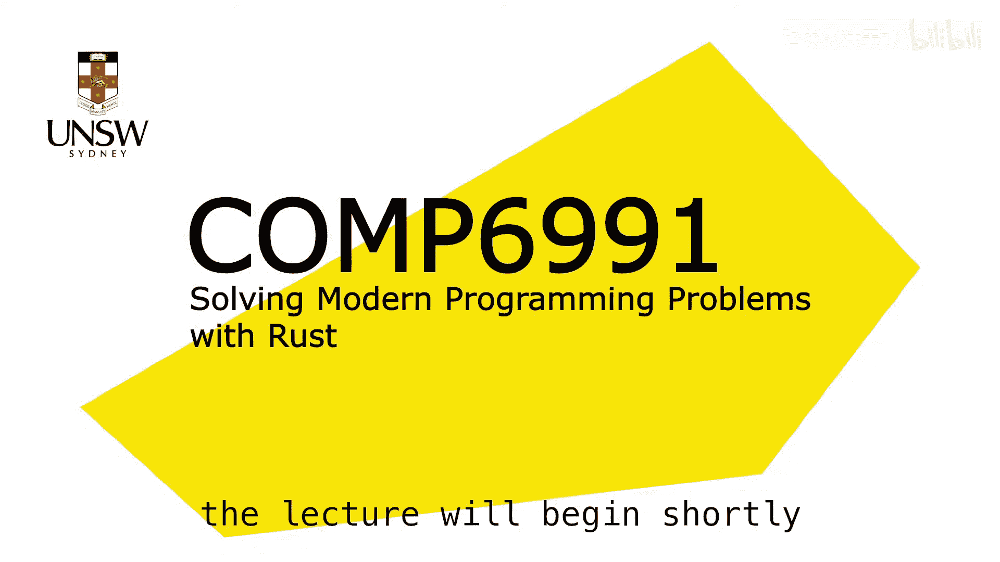

Okay， okay。Hello， hello。Hello， everyone。Sorry， I'm running a little light。Hello， hello， Simon， hi。

 Tom。Hi Husssein， hi， Alex， hellello， Sage。 Oh， Sage， I need to make you a。Moderator。There we go。

Hello， Daniel， how am I feeling today？I am sadly still under the wa， I'm sadly still sick。

I thought I was on the mend but than I was not。So once again。

 at the beginning of today's lecture I'm going to。I'm going to request a little bonus patience today。

Yeah， I'm I'm， I'm still， you know， working back up to things。 but， you know， again， once again。

 I'll do my best。嗯。ううん。So。But I hope the rest of you are doing all right。So before we kick off today。

 today's lecture， a couple quick things。So。Next week's Monday lecture right so this is the next lecture from today is not going to be at the usual time I mention this on Monday。

 but it's not going to be at the usual time instead it will be from four till 6 as opposed to six till8。

And it's just for that week I know some of us aren't able to make it at that time and I'm very sorry but it's just going to be for one week just for week three and if anything changes I'll make an announcement that info is also going to come out in an announcement that will come to your email secondly the workshops that are meant to be tomorrow the Thursday workshops I already mentioned last lecture you had to be cancelled due to the public holiday that got instate。

😊，But I've heard back from on Monday， I hadn't heard back from timetabling yet we have now and they've confirmed that we'll be able to have a room for 12 to two on Friday and a room for four to6 on Friday as well so we're going to be opening up two additional inperson workshops on Friday the usual in personson 6 to8 workshop on Friday and the usual six to8 online workshop on Friday will both run as usual ifre if you Thursday if you're part of a Thursday workshop that was canceled and you can't make it in person either at 12 to2 or at four to6 then you can feel free to join the six to8 online workshop instead if you can't make it at all on Friday then we don't really have a good option right now and I'm sorry I'm sorry about that but again things go back to normal next week Thursday workshops Friday workshops all go back to normal and the exact rooms and。

Like a conversation will also come out an announcement to your email either tonight or tomorrow。

So just have a lookout for that。Tom knows that we'll be recording the six to8 workshop but we don't know how well it'll work yeah so I'll actually speak to that in just a minute as well。

 hello Paula and yeah the online one that is yes yes。😊，Okay。

 so another thing to note is that I mentioned on Monday。

 well I think I mentioned a little previously， but also mentioned on Monday that we have this course feedback form over here so you click it and it opens up a little Google form that's anonymous it doesn't have to be anonymous you can let us know who you are。

 but if you want to submit feedback anonymously you can do it through here we have received feedback and we wanted to address some of it before the lecture starts today。

 So I hope you don't mind if I just pull up some little bits of feedback。

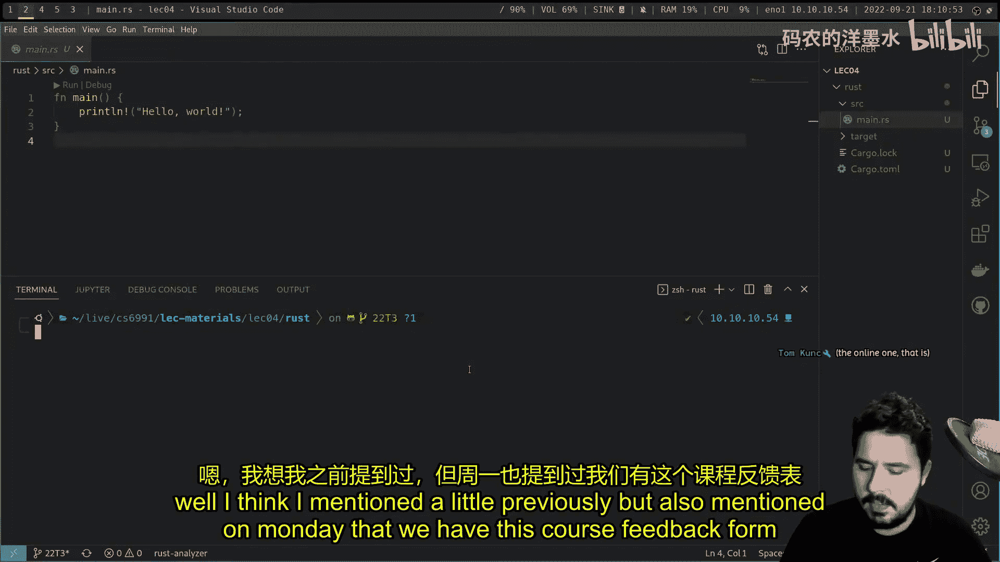

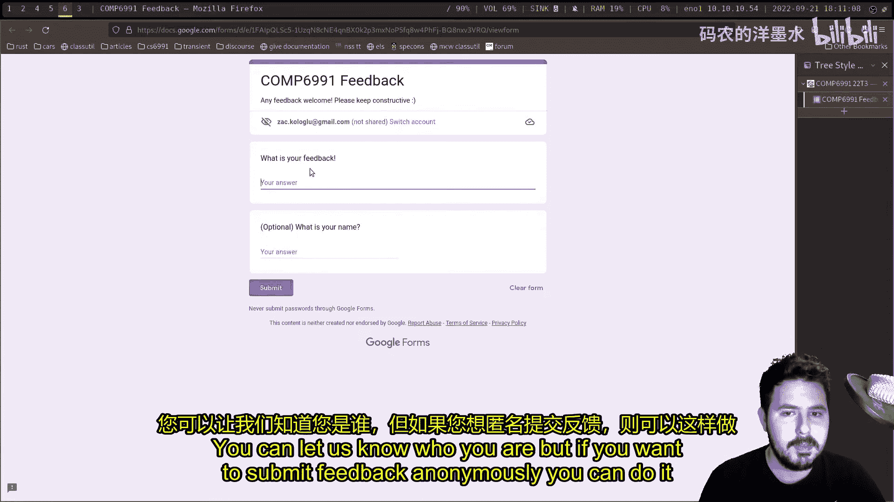

That I've sort of curated here。 there was some feedback on some rather random things here that I'm about to address。

 there was also a reasonable amount of feedback about the first workshop right about last week's workshop that Tom has done a lot of reading through and written a lot about which I'll try and summarize off my phone here。

 but I'll go through the sort of miscellaneous feedback first So we received some feedback that said that one of the activities was called translatelate some art。

 but the activity name was Picasso and there was also the van Go exercise and stuff like that and it was all very confusing So very good feedback and the title of the exercise was renamed from translate some art to Picasso。

Just just to you know settle that confusion we did also get feedback that said not enough rust memes。

 which is a work in progress。 Apparently Srey has been looking at some looking at putting together some memes I think we have a meme category on the forum course forum over here where we've got some posts already so if you get some good rust memes and feel free to put them in there and this person who's submitted feedback may very happy about that some feedback that says there wasn't really a way to post on the forum anonymously which is absolutely true and that should now be fixed So I believe if you go on the course forum here and you want to do you want to make an anonymous post you can click your profile picture up in the top right here。

You click this sort of profile button here and there should now be this enter enter anonymousonymous mode button over here if you click this。

It should change you see how my like profile is now this anonymous thing and then you can say new topic and post some stuff here and it should just show up anonymously I think you can even comment on stuff anonymously if you'd like as well and when you're done you want to go back to your normal profile you just go to the same spot if click exit anonymous mode so I think that should work if you have any troubles with it just let us know but anonymous posting should be all fixed now。

And so workshop feedback so there was a lot of feedback and some of it was there was next there was a lot of people there was a good chunk of students in the workshops who'd really enjoyed it a lot of aspects about the workshop and had a great time there was people who may have enjoyed it but noted that there was some things that could be improved and there were some people who didn't have quite as good of a time who also had some stuff to say So in summary and I'm just going to read this off my phone a little bit the feedback from tutors was sometimes not as helpful as it could have been apparently there was an instance of tutors maybe suggesting to use Google or to look at lectures which we don't really want to have happened so much it's not what we're aiming for too much emphasis on working it out for yourself and perhaps more of a balance could be struck between having workshops that are like completely student led where right now there is a lot of sort of student。

A lot of。we're looking for， you know yeah students to take a big role in leading this the workshops。

 but there could be a better balance between tutors taking a more active role in helping and explaining concepts so we've been talking about this with our tutors and we want to make sure that we're all consistent about providing help and we want to provide that kind of environment where people are comfortable asking for help and that and that we are sort of there to give that help once you've asked for it and we want tutors like we really want tutors to be available to answer questions that you have you know throughout the whole workshop and we want the workshops to feel safe。

 we want them to feel nice and we are going to redouble our efforts to make sure that we're creating that kind of environment。

Then some other feedback that we got was the workshop， the first workshop felt quite rushed。Um。

 there and and another thing， you know， with it being rushed。

Students also felt though some students felt unprepared。

 I think probably a big portion of students would would have felt rather unprepared coming into the workshop。

And， and there was a lot of， there was a lot of。TheTime spent trying to figure out how to collaborate in the groups as opposed to actually problem solving and writing rust。

This got grouped in with some other feedback that was it might be nice to have some questions marked try doing this before the workshop to help you prepare for what we're getting into。

 some sort of making a distinction between easier and harder questions during the workshop could certainly help and。

And。We miss out on Val China getting。Cool， okay， right。 So Tom sort of， you know。

 talked about some responses to this sort of stuff。

 So I think we were all still very surprised about how quickly those two hours go。 You know。

 we we go in and say two hours is a pretty long time。 We should have， you know。

 plenty of time to do all this sort of stuff。 But it really does just fly by。

 And so I think week1 did sort of set that bar quite high because due to us overestimating just how much or rather overestimating how little time there really actually is to do everything with everything we want to do。

 We also learned a lot about you know。A lot of groups smashing their head over gi merge conflicts and having a horrible time with that。

😊，We think VS code Liveshare seems to work relatively well。

 but if you have particularly bad experiences， we'd like to hear about that。😊。

In in effort to try and reduce the overhead in collaborations for this week we're going to try and reduce the group sizes。

 so we're often having groups of like five and six last week and so you really have to have some good system of collaboration when you have that many people we're thinking we may reduce this down to something like three as a trial for this week。

 so hopefully even like regardless of what your collaboration tool is even if it's just sort of multiple people looking at one screen it should make the the overhead of dealing with that hopefully a lot lower。

We'd like to try and give feedback earlier in the workshops。 if we have the the time for it。

 also releasing the workshops you know， earlier than than than we made it accessible for。

 for you all last week。 I think the workshop questions are out now。

 So it might be worth having a look through this before the workshop。

 So you get an idea of of what we're going be looking at during the workshop。 This was released。

 I think， yesterday ish， maybe it was it might have been last night or something like that。

 but we're going to aim to have the workshops out even earlier in future as well。 Where did my。

 I guess I was just looking here。

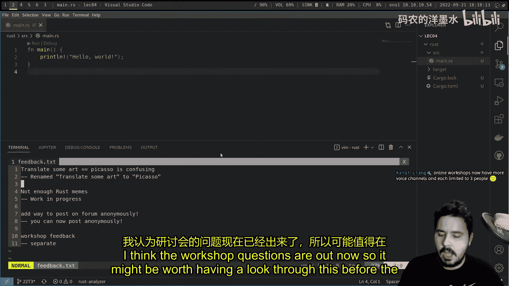

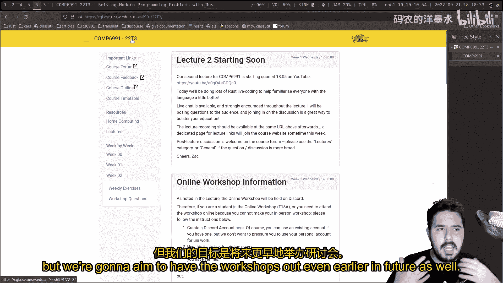

And we're looking at also adding some questions to the workshop that are meant to specifically be done before the workshop to help you prepare for it and of course it's not going to be mandatory。

 it's not going to be compulsory， but it might if you're feeling worried about being prepared or sort of getting caught up in that rush something to sort of help you easy and so once you get to the workshop you don't feel so sort of overloaded if that makes sense。

So let me catch up on the chat because I see people have been talking。😊，miss anything important。

 or I was just waffling on about being a little sick and saying hello to everyone before we started this whole feedback thing。

😊，Noous posting brought up， Would private posts， if we wanted to inquire and Cospec stuff be possible on top of that。

 Yes， I think private posts you can already do。 I think the way you do private posts is in this settings cog here。

 toggle unlisted。 So if it's unlisted， then only staff should be able to see it。

 So I think that should work。😊。

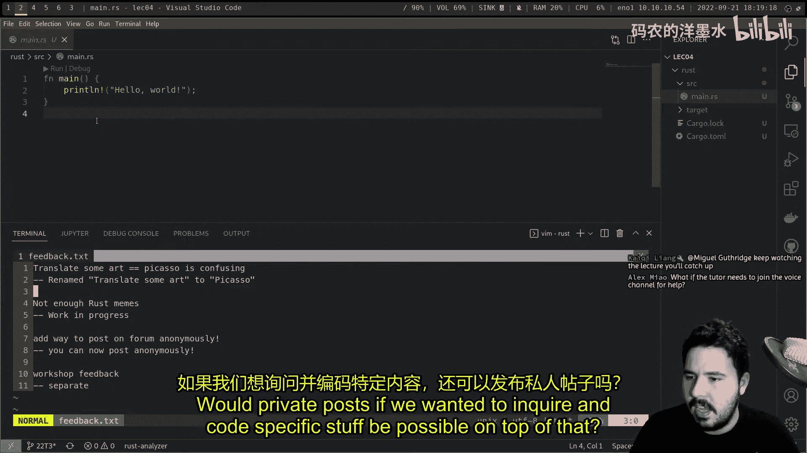

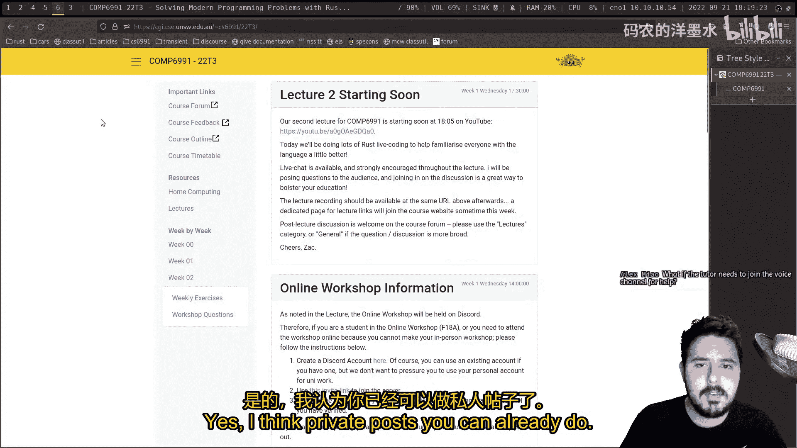

But again， let us know if you're having any trouble with it。嗯。Cool， cool， cool， cool。

 All my workshops have more voice Yeah。 Y， y， y， Was' playing for workshops tomorrow。

 That was talked about a little earlier。 It'll come out in an announcement。

 But the TLDR is workshops tomorrow cancelled。 And we've put， we've done some。

 we've allocated some extra in person workshops on Friday。

 So just keep an eye your email and that'll come out。😊，And okay， cool， cool， cool， cool。 Alright。

 cool。There was one last piece of feedback to address which was please record the workshops and like the person who gave the feedback I think acknowledge that the fear is that some students wouldn't participate if recorded to which Tom's sort of thought about this and said well the reason we aren't recording them right now isn't to encourage participation the two main things is one it's logistically quite difficult recording an in-person workshop is going to be very tricky even just like thinking about the hardware in terms of like cameras and microphones and how we'd sort of put that together a lot of you know there would be a very big amount of work to go into that but it's something we can think about as time goes on and recording online is possible but and it's not nearly as hard as doing it in person but there is still some amount of overhead to that but the second part is we're not entirely sure which bits if any of the workshop are valuable to record So the。

Part of the workshop is really just sort of logistics。

 introducing the thing and splitting people up into groups。 The middle is just people working。

 So like I don't know if we'd record people's like voices and screens as they're working， which。

Feels maybe a little weird， but you know could maybe happen。

 We do have the end bit where we're sort of discussing code and putting an app on the screen。

 which might be handy， but also then lacks the context of the rest of the workshop that you've been working in。

 regardless of all that that's sort of why we didn't record first week's workshop。

 regardless of that， Tom is still gonna to try recording the online workshop this week。

 And if it doesn't go horribly wrong， we'll post it and make that accessible。

 but we'd also love feedback on whether it's actually useful or if there's anything things that we could change to make it more useful。

 And if people want to recording specifically so they don't have to go to the workshops themselves and engage in themselves and watch it or if it's more of like know。

 I did go to my workshop and I want to watch recording to see other people's codes and other piece of feedback and stuff like that。

 if you can let us know those kinds of things that would be very helpful。Okay。

 I think that's all the feedback I wanted to address at the beginning of the lecture a couple quick things one does anyone have well let's say three things one does anyone have any questions about any of that feedback or sort of our rough responses for now at least to those bits of feedback right now two does anyone have any other additional feedback they wanted to throw in the chat that they wanted to have addressed and three。

Do we want this Would we like this to be a pattern in the lectures。

 We at the beginning of one of the lectures a week。

 I'll go through and address a whole bunch of feedback that has been submitted and try and give some responses in our plans to address it。

 Or is it something like， I'd rather just this just happens offline。

 And this isn't interesting to me going through feedback like this。

 So I'm putting those three out there。 I'll give the chat a minute。 while I'd catch up on some water。

So as a reminder， one， any questions about that feedback， two， any feedback to add and three。

we do we like addressing feedback at the beginning of the lecture or keep it out of the lectures ideally？

Anyone。As long as it doesn't impact the amount of content we can have for the lecture。

 I wouldn't mind it in the lectures， Okay， cool。I think hopefully we'll have room in this lecture。

Alex says the same。Migwell says perhaps in terms of solution sharing。

 it could be better to have a megath in the form where we can share links to our solutions。

 I think recording workshops wouldn't have much benefits since the main learning outcome is collaboration。

 Yeah okay， yes， so that first part， that is certainly our plan once the due date plus any extensions on the week one weekly exercises have lapsed。

😊，My plan for now is to encourage everyone to post a bunch of solutions on the forum and will give feedback and other people can give feedback。

 other students rather can give feedback on your code and ask questions and。

Talk about different approaches。know at current moment。

 I'm fine with the idea of once sort deadlines have passed people just sort of flooding the forums with weekly exercise code and workshop code。

 feel free to just flood that on the forum whenever you want workshop code isn't assessed it also you can just post it whenever on the forums and play around with that。

 but I definitely like the idea of it and I'll let you know the specifics once the week one weekly exercises deadline plus extensions has lapsed。

Don't mind it。 But if it's not too long and we can't contain the foreign press fine。 Yep， cool， cool。

 keep it out。 Okay， and it would be nice to have recordings for revision purposes。

 Otherwise I'm indifferent to the situation。 Okay， cool。

 sometimes there are stuff tutors speak about in workshops that isn't wholly connected to just workshop work。

 That's true。 Yep， that's very true as well。😊，Okay。Well。

 let's leave it at that for now then and let's talk about some stuffs。

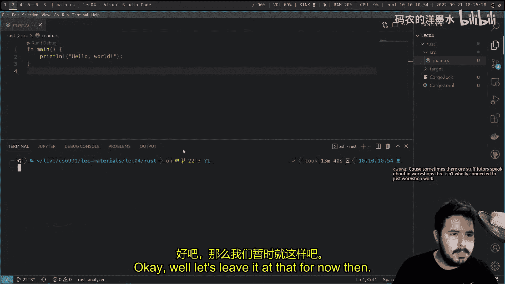

So。Saavs me work as a st。😊，Today we're going to be talking all about error handling and as I mentioned last lecture。

 this is going to be a little less just sort of like rust rust rust Ru rust Ru rust。

 And in today's lecture we want to consider what solutions may look like in different languages as well。

 We're sort of trying to consider the programming languages space as a whole as opposed to just like what does rust the language do That's obviously going to be a part of this lecture and I'm going to still try and write some rust code in particular。

 but we'd like to think about the whole scope of error handling in the in the programming languages space across many different programming languages。

 So let's start this off with a question that I'm going to throw to the chat here Who can think of ways that different programming languages。

😊，Let's say canonically or idiomatically deal with errors。

 I'm going to use this word quite a lot during this course， I'd find idiomatic right。

 or in this case idiomatically。

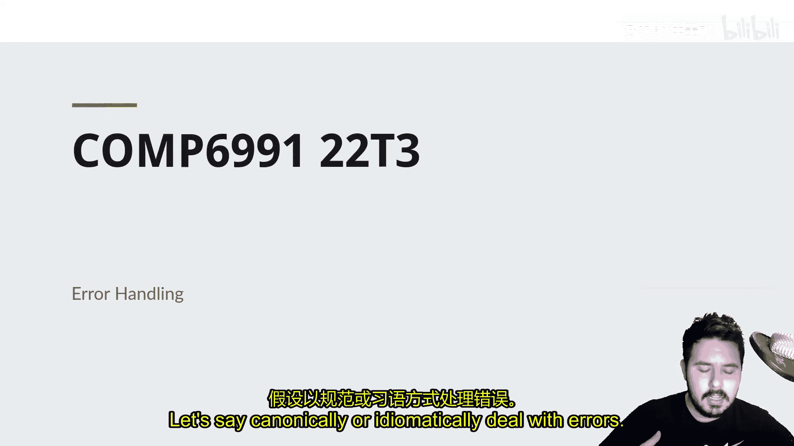

This word here， right idiomatic is sort of just like it's a word that means I would like to say a word that means the canonical way of doing things。

 but that's also like I feel like a lot of people are going go， okay， I don't know that word either。

 it sort of means the widely agreed upon tradition of the language。

 let's say So if something is idiomatic， you're likely to find it in lots of you know。

 let's say in this case， lots of different rust code。

 And if people do it in a way that's not that way， someone might go， hey。

 you might want to rewrite it to be a little like this for this reason。

 blah blah bh people like doing this and this is the idiomatic way of doing it blah， blah， blah。😊，嗯。

So I'm gonna I'm gonna to use this terminology quite a lot during the course。

 What is the idiomatic way of doing this in a language Okay， so let's see what we've got。

 we've got exceptions， try catch Seg fault error codes， return nullen you need to check the error。

 register for an error code cough cough C if point is equal to none panic in function in star error。

 Okay， great， we've got all kinds of ideas Alrighty， so。😊，I'm going to ask another one。

 another question that sort of follows on from this。

 which is someone mentioned or a couple people mentioned exceptions generally。

 can anyone categorize exceptions into like sort of subcategoorized exceptions into two distinct models？

😊，For using exceptions in a language。This is their most languages fall under one specific kind of exceptions。

 but a language Java also is really the main。The main offender in bringing in a very a similar but also semantically different model of exceptions to a programming language Can anyone has anyone ever heard of this distinction that I'm thinking about？

😊，嗯。So Patrick says checked verse unchecked exceptions。

 yes okay great so checked exceptions and unchecked exceptions and then all this other stuff error codes。

 Segfold point and nu panic right， yeah， okay， awesome。😊，interesting。There is。

This sort of may have been。Maybe it hasn't been quite addressed in the chat yet。

 There is also one other sort of。Primary way of。Dealing with error cases in a programming language。

That I don't think has been sort of explicitly mentioned yet。😊，Maybe because it's。Yeah。

 static assurance you're definitely on the right track there to what I'm thinking of。

But another way of dealing with errors， maybe because it's a little more vague。

 there's I don't think there's a necessarily an exact terminology for this。😊，嗯。

But another kind of way of dealing with errors that I'm thinking of is not dealing with errors。

 maybe not quite what I was going for but exactly what Miwell says there is what Russ does with result。

😊，We've heard about result。Which looks like oops， which looks like this。

And the idea of this approach to error handling is that it's almost like there is no real approach to error handling。

 but you have other tools in the language that give you the capability to express you know。

 powerful error handling， let's say。😊，So the approach that I'm talking about here is sort of using normal types right just using normal types in your language。

 if you're in you know rust we're thinking likestructs and enums that kind of thing。

 if we're in Java， we're thinking classes， if we're in Python。

 we're thinking like I guess classes as well， but you know just whatever values。

 if we're in C++ we're thinkingstructs we're thinking classes we're thinking you know whatever else。

So just using like the types that are already in the language。

But that only sort of works particularly well if the language is well suited to allow you to express errors conveniently and sort of expressively enough。

To make that work， so that's also one other approach that we're going to think about today。Okay。

 for a second I thought I was going to bring in phantom types， yes， they do exist in rust。

 but if I don't know if we'll ever need to use phantom types in this course。

 but if you want to ask about on the course forum， then we can any question that youve got we can we can go crazy on that。

 but I don't know if we'll ever end up getting there in this course。😊，Okay， cool， so。

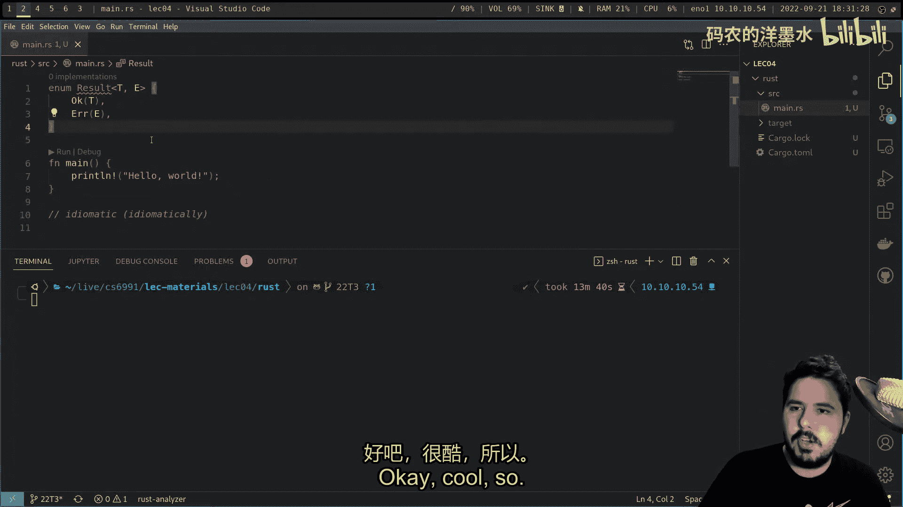

Yes， so Ive broadly categorized this into a a few different things here。

 So Sentinel values is what I'm calling if I go back to the chat here so I guess I guess there is sort of one other approach that I haven't really talked about here which is just straight up aborting the program right so just like exiting the program on the error case that's sort of vaguely on the same line as something like Seg fault and I think that was the only chat message there So the ones that are sort of representative here of Sentinel values would be Patrick says error codes if pointer is equal to null mean also says return null cough cough C what else do we have maybe in function in star error from hssein So those all sort of fall into Sentinel values here。

😊。

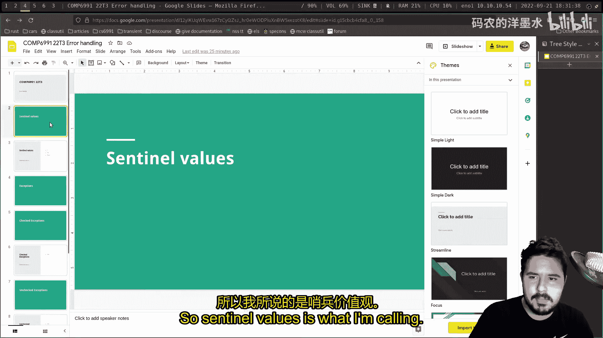

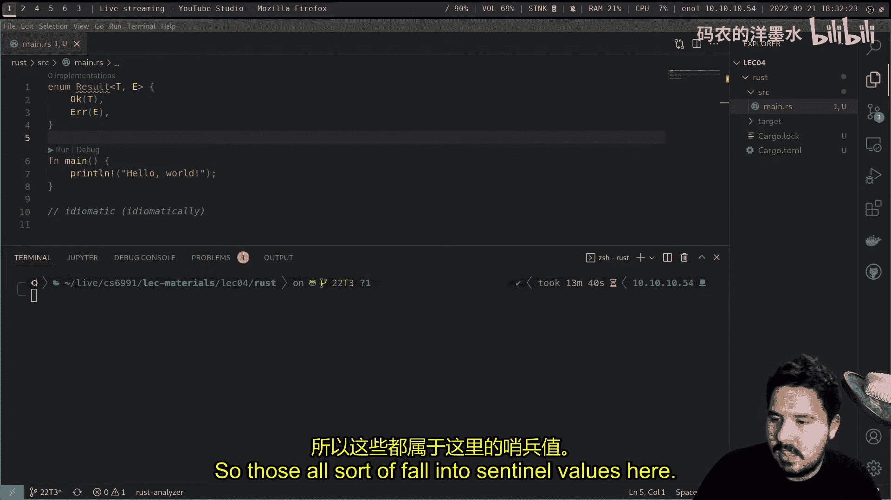

So we're also going to talk about exceptions， checked and unchecked。

 we're going to talk about using your type system， so we're going to look at all these different ways of or talk about all these different ways of handling errors。

😊。

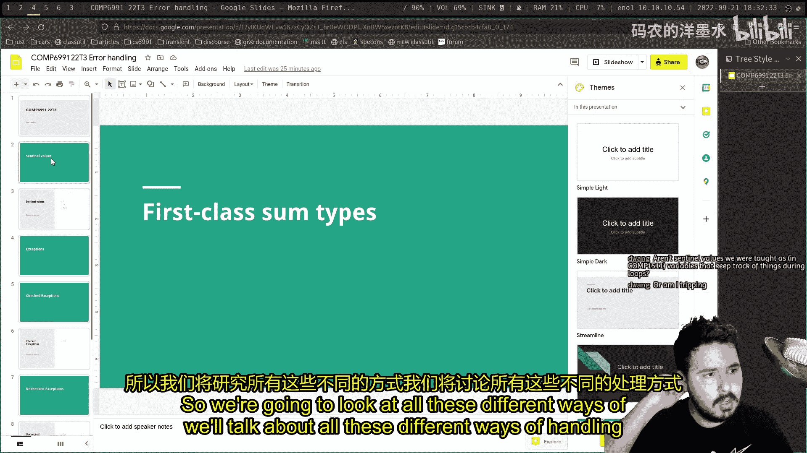

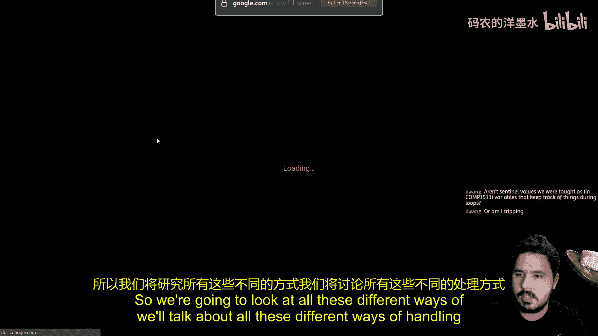

Aren't central values what we were taught in as in 1511 variables that keep track of things during loops or my tripping。

 you probably were taught them as that in comp 1511 and that is still I'd say like vaguely true。😊。

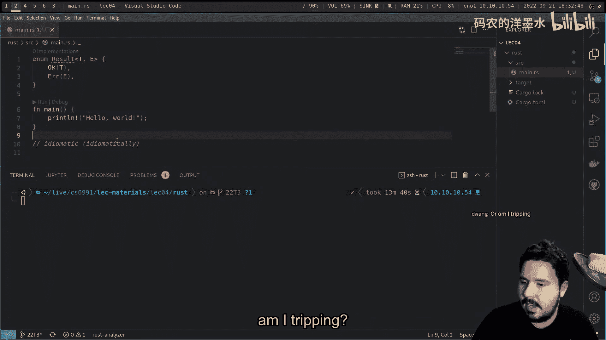

So what is a sentinel value then， a sentinel value is sort of a a value that provides。That， like。

 where the specific。Value of it provides some additional meaning。 So let me。

 let me explain what I'm saying here。 Let me find my。

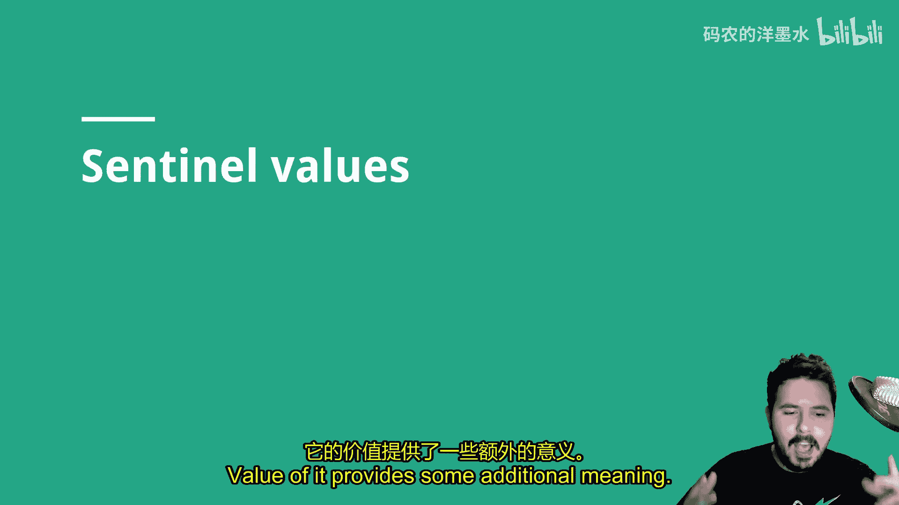

Drawing tablet。Right。Hopefully， okay。 yeah， this seems to still be working on me。 So if I have， say。

A pointer， right？A pointer might be some address， you know，7 FFF like， you know， 6 C A E。

 I don't know， Yeah， like just like some random pointer here and this might well point to some value that we actually want to use we actually care about 42。

However， a pointer as we know， can also be something like null。In this case。

 null is an example of a sentinel value。So in this case like null general usually meeting the value0 here is Sinel in the fact that it is sort of signaling that there was some kind of error。

 its specific value is important to establish that there were some kind of error Another place Sinel values pop up it things like strings in a language like C。

So in C， we might have heard that a string might look like， you know。

 hello world and the way that that gets actually implemented in memory is you'll have a character H。

 a character E， a character L， you know， so on so forth。 all the characters in this string。

 then an L， then and A D， at the very end of world。 and then usually a。😊，Back slash is 0。

No like a null terminating character。 This is usually called N U L with just 1 L here。

 And this is also an example of a value。 It's where this specific value。

 right all the way across here。 we had char， char， char， char， char， char， char。

But this and they're really representing like a letter， a letter， a letter， a letter。

 but this is also a cha， but it doesn't represent a letter。

 it represents the fact that the string is entered at' some sort of sentinel value here or a sentinel value of a here as well。

😊，These also this I， this like similar idea also pops up if I have some kind of， well。

 what have I done， if I have some kind of。There we go。 that's better。

 Some sort of like error code map。 So I might say like errors。Where like zero is okay， one is like。

 you know， I could come up with all kinds of random of different errors， file not exists。

 you might have that two means file empty。3 might mean file like bad permissions or something。

 And like so on and so forth， where you just have this sort of vague mapping of numbers into different classes of errors。

 And this is something that Linux in particular， rather famously does。

 I think I might be able to do man， Erno or maybe Erno dot H。

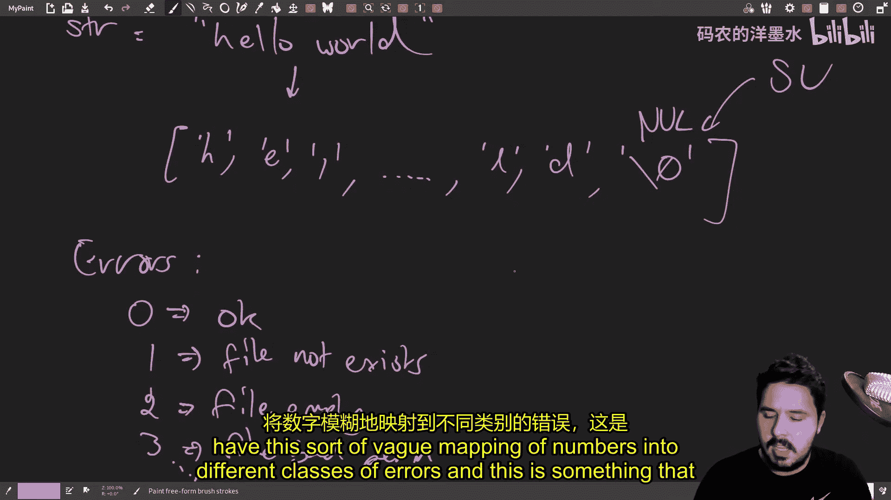

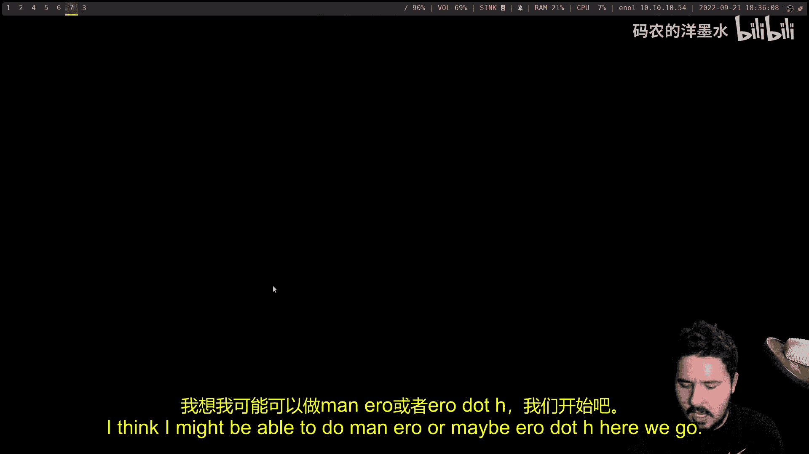

Here we go so in Linux you just have this huge list of errors that could go wrong you know E E file too many files open in the system or EAO was an input output error E and Val and valid argument Ra have this big list of errors that correspond to numbers E access permission denied for example。

And this sort of works a little bit like this。

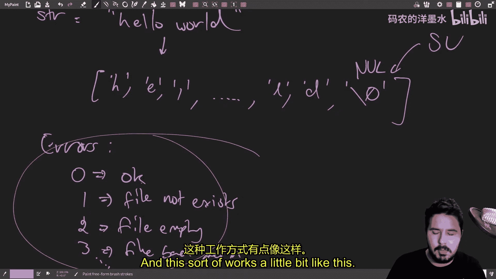

So this is pretty common in languages like these days you're most likely to find this kind of sentinel value error handling in languages like C and go。

 where it can often be relatively idiomatic Pascal。

 I think even newer versions of Pascal have exception handling in particular but maybe maybe rather old versions of Pascal。

 you know had the same sort of system， but yeah in particular， for example， C。

 which I'm hoping you know most a good chunk of people in this course have used C before。

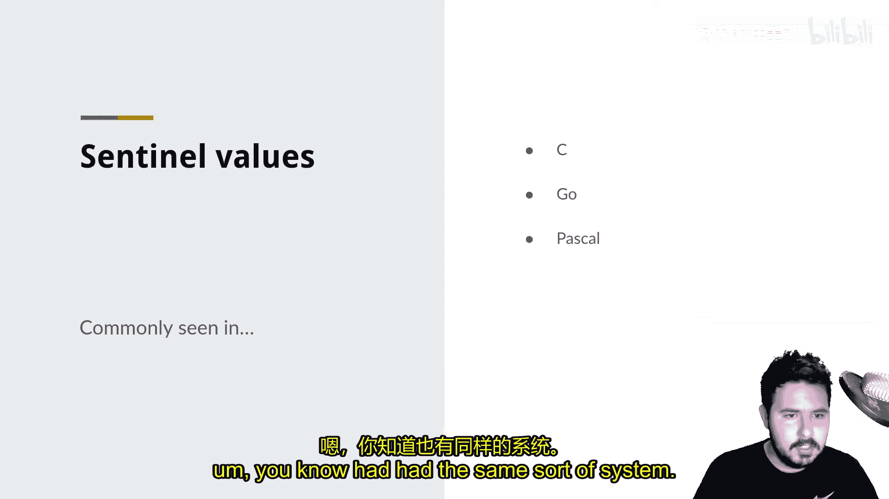

It's very common to do this kind of sentinel value handling where you're checking if something returned nu or if you're checking if the return value of some function was not equal to zero or something like that。

And then。And once you've seen that there's some sort of error case。

 you might need to go check another variable like Erno to see what kind of error went wrong。

 you might need to like you know call some other function or just like quit the program。

 but you have to sort of do all that error handling by hand。😊，And there's a lot of there's a lot of。

Ways that that can go wrong。 So go uses central values。To a certain degree。

So a lot of this list I'm going to see like commonly seen in right for a bunch of these slides and we're going to see like this was commonly seen in a whole bunch of languages。

 blah， blah， blah blah blah， you know， sort of jumping ahead。 it's worth noting that。😊。

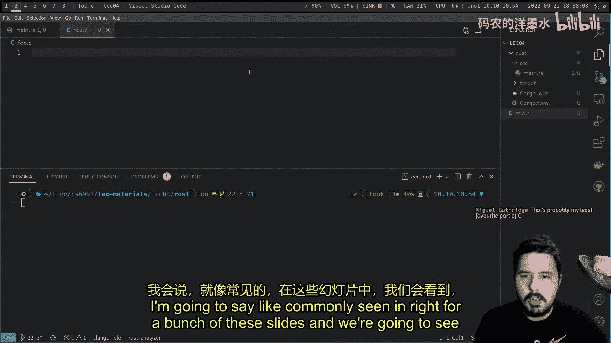

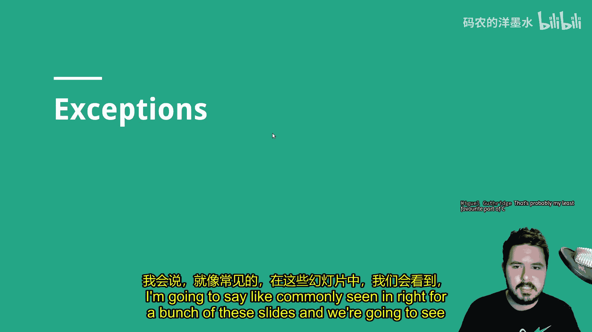

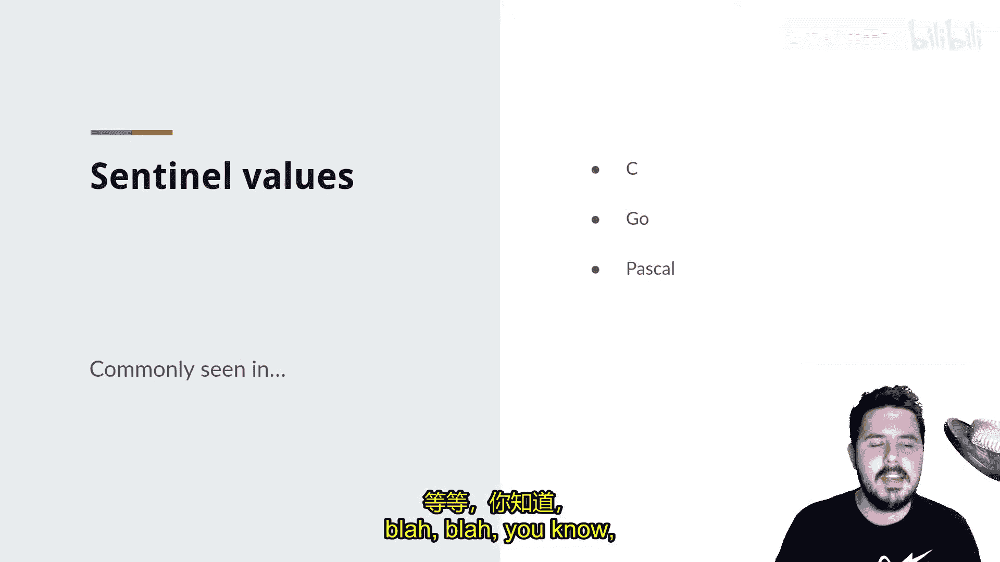

Your favorite language might appear on this list and I'm not again I'm not here in the lectures to say this language good。

 this language bad， you know， do this， don't do that。

 that kind of thing that's what I'm not trying to do that in these lectures。

And so when I say that Bla you know this language might commonly feature this or this language might is often to see this I might sort of point at someone's favorite language at some point and go oh this you often see that in this and you might go well actually it can do other things as well and if you know if you see things like that。

 then obviously jump in and say something whether it's jumping in the chat or making a post on the course forum or saying something about it and sort of start up some sort of discussion and that's you know perfectly reasonable but do keep in mind that I'm also not necessarily annotating the limits of any languages right in particular like。

😊，Ja is a good example of a language where it's sort of like incrementally got better then they did a whole bunch of stuff。

 then Java slowed down for like a while。 and then in the last five。

6 years or so Java's being going like crazy adding more and more and more features And so like I become wrong on like a week by week basis because they're suddenly just adding more and more features to a language and you know these things evolve and change and I don't know everything about every language。

 So naturally yes， I might poke so someone says you know so if someone goes on does I don't use central values and go I do it some other way and it's like that's okay that's cool。

 But from my looking at a bunch of gocode， it seems relatively common， it seems relatively popular。

 relatively idiomatic and I'm also not saying here that you're implying that that I am saying that I was saying that rather But in the case that this happens just keep that in mind。

😊，And as Jackson says here res O equals reO is a pretty common pattern of go。

 not sure if that makes okay a Sinel value right， so I would argue that it potentially does but that's there's also like a good argument in that Let me do this as well okay。

😊，So in C。😡，Let's say I wanted to open a file， that's a pretty good example。Open a file。

 so I'm going to say file star file is F open hello do Txt， and I want to like read the file。So。

Let's say I don't know see that well。 I've written this and then I go， okay。

 I want to like read a line from this file， so I might just go read a line。

Maybe I don' see well enough to like write this kind of code here， but so I'll say read it into line。

 its we'll give it size of line and we'll say read it from this file。And I'll go great。

That seem to all work， I'll print the line out here onto standing up with something like that。

Now the the problem that I see with this personally， again， this is my sort of。

 I'll introduce my opinion here a little bit is that if I use， you know。

 Andrew Taylor's magical compiler DCCC or if I use more normal compilers like Kang and I run it。

It's everything's fine。 Nothing goes wrong。But then when I run the program I get segmentation fault core dumped and I'm assuming you know this is what Daniel was talking about when they were saying segmentation fault as a method of error handling So right we've just sort of immediately jumped into this。

😊，So。You know when you're not given adequate tools， it can be a little tricky or at least you know。

 the computer itself， the compiler might not be of a great deal of help to you。😊，When you want to。

When， when things might go wrong。 So for me， writing C。Oh， is， am I dropping frames？ No。

 I think it's okay。嗯。Okay， it seems all right， but let me know if the stream looks choppy on my replay feed。

 but。😊，O， B， S seems happy。 So just let me know if there's a problem。 And yes， S。

 time to pull out GDP， right， So something's gone wrong。

 Now we need to start debugging this in as opposed to as opposed to being able to see this before you even built the program。

 the language telling you hey， this looks a little wrong。

 and you get similar problems cropping up when you write go in this particular example for me。

 at least。 So in go， it's very common to write something like， you know， my， my function。😊。

Is going to return back and let me just use like some ad hoc rust style syntax a very common pattern is let me return like some value pointer so a value that we want to get out of this function as a pointer usually and then some maybe something like an integer right like an I32。

😊，It goes and does this stuff。 And this， again， is like a topple。

 It's the functions returning two things。 And then maybe in my main function。

 I do something like the the value and I'll call this sort of second value here。 Okay， again。

 let me just sort of like rustify this a little bit， equals my function。And then。

The trick here in go often is that this value here might have a completely terrible unspecified value。

 It might not really represent a thing that we really want。 So before I ever use this。

 I need to check this OK value here。 So I might go if okay is not equal to 0 or something like that。

 then I need to do some error handling over here。And then， you know。

 maybe I return from the function or anything like that。And then otherwise I can actually use value。

 you know， maybe I go and print value out or something like that。

So this this is a relatively common thing and this also comes back to that idea of Sinel values potentially where we have to check the value of something before proceeding on with the you know the main path。

 the happy path in our code。😊，嗯。So。Again， this is。This is certainly an option and when you're talking about a language like C in particular and you know go is very much。

😡，ryGo to a certain extent， Go tries to be a。A bit of a modern day C in some ways。

For a language like C。This almost certainly made a great deal of sense at the time right you have to consider the context that languages appeared in and C being a product of around the 70s this makes a lot of sense because C wanted to be a language that was really fast was really low level right there's this older doge of C being portable assembly which。

😊，I think is probably not really that true these days but if you want to hear more about that feel free to chat about it on the course forum but that's what their goal was they wanted it to be a step up from assembly but still give you access to all the nitty gritty details and so they didn't want to sort of strap on exception handling or like you know fancy systems for dealing with errors that may have caused some sort of performance penalty when you're actually running the program。

😊，And so a lot of the time they figured we can just return normal values， that's really fast。

 checking if something is null or not， checking if something is zero or negative one or whatever it is is really fast for the computer to do so you know and really only experience programmers to be writing C maybe is something that they were thinking and so they'll know to deal with the errors。

😊，And there is a lot of literature on the internet of people saying error handling and C is perfectly fine。

 just like if you don't know how to deal with errors and C。

 then you're not a C programmer and you you see this kind of thinking pop up from time to time and it's not exclusive to see it appears in basically every language in its own sort of way。

 but the factor of the matter， the fact of the matter is in my opinion。😊。

You have to account for the fact that programmers will make mistakes at least some of the time again a common thing is the idea that modern day C++ is very memory safe and it's very difficult like if you're a well experienced modern C++ programmer you're very unlikely to cause any kind of memory un safety issue。

But if you look at sort of， you know， hard facts and stuff like that。

 things like the Chmeium project， which is one of the most sort of。

One of the highest budget modern C++ projects in the world still has plenty of memory security vulnerabilities that get racked up。

🤢，You know， again， I'm not here to say that that makes C plus plus a bad language。

 I'm here to say that it， it's important to consider that programmers will make mistakes。

 And so it's nice to be able to develop in a way where your mistakes can be caught before you ship things out to if before you ship things out to production ideally before you even get to run your program in the first place is。

 is my， is generally my take on things。 There's a there's an older dodge that is。😊。

The the safest program is the program that does not compile。

 I believe that's the that's the quote money the safest program is the program that does not compile。

 I think is that。

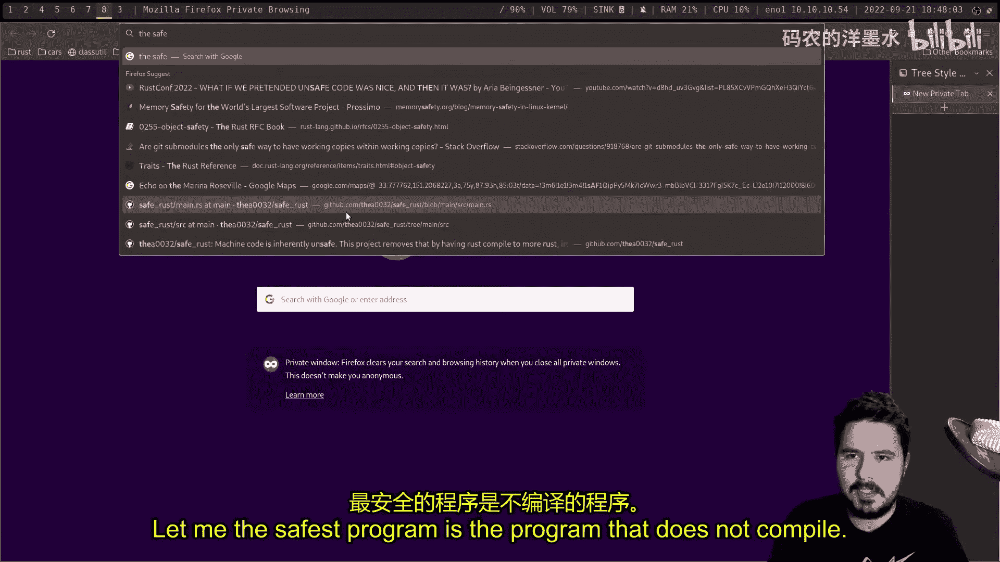

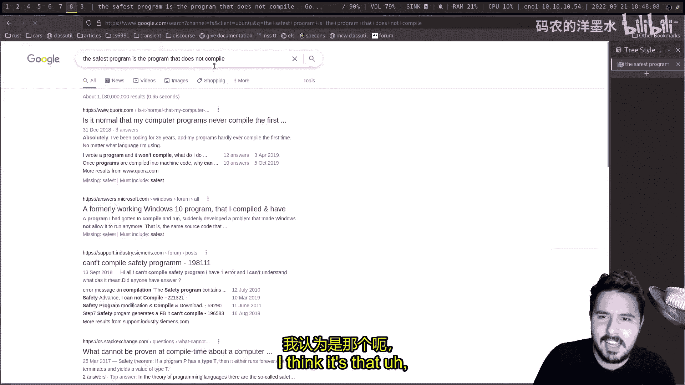

No， I'm not finding this quote。 It's something like that。 that's。

 I think like it's the spirit of it across， which is basically to say that。

，If your program doesn't build if you have no program then it's perfectly safe right and that's not the reason why it's a quote and not like a mantra to live by is is that it's not particularly helpful if your program doesn't compile then you may as well not have written a program in the first place if that's where you leave it but the sort of point of it is if you get told no I won't get make it。

 no I won't make it， no I won't make it and then you're fiddling with things and fixing things and then it goes okay it builds。

 then you get a bit of extra sort of you might feel a little more confident。

 a little I have a little more sort of respect for the safety of your program and it not doing the wrong thing。

😊，嗯。So yeah， an air handling is a bloat。 That's another thing to consider as well。

And we're going to talk about this in a second when we get on exceptions and in particular check exceptions。

 but that's another problem with programming language design。

 which is you could make an absolutely brilliant language that forces you to deal with all the errors up front and you can guarantee that the program is going to execute correctly。

 which eventually gets you moving towards things like The improving and like proof assistance and all that。

😊，And you can put all this time and effort in and go。

 this is a brilliant language that will do all this for you。😊，But at the end of the day。

 if it's really hard to write that code， if it takes a lot of time， if it's like annoying。

 if it's a boiler platy， a lot of the time programmers are just going to take the path of least resistance anyway So I think that's probably a big part as to why languages like Haskell haven't you never ended up really hitting a really solid mainstream you know Haskell still has appearances in the wild and you hear of you know Facebook or Amazon or Google or whatever where they have oh this thing over there is written in Haskell and we love it and we have a team that loves it and it's great。

😊，But you don't really hear of companies where we wrote everything in Haskell and it was amazing and I can't help but feel a big part of that is。

If the， if the code is sort of quite you know， difficult or difficult to write or， you know。

 you know， there's a lot of resistance in the way of writing something。

 there's that sort of balance where if you， if you can't ever be that productive in it。

 a lot of the time people won't go， will go。 It's just not worth the trade off。

 regardless of what it gives me。 And yeah， of course， there's a bunch of other stuff。

 Haskell is there's another quote about this where Haskell is，you know， a brilliant language。

 Haskell was a language by mathematicians， I think was something know something like that where the language itself is mathematically beautiful。

 but the language was not created by engineers in the sense of like all the tooling around the language kind of sucks like the build systems and and all the other like fun bits around it。

 which also， you know， is part of a thing that。😊，Part of。

It is an important part of a language that you're using。And so anyway。

 getting a little bit off topic here。😊，But this is one error sort of handling method to consider。

 and the important idea here as well is that you could write code that looks like this in rust。😊。

It would probably not make a ton of sense to do， so let's say I had a struck student。

 I love going back to my struck student here that has a Z ID and has a name and has a WAM。Like this。

Right and I could write a function that says get student that might go wrong let's say this function might go wrong and I return it back as a couple of a student and an I 32 which is my idea of an error code and I go if you know if insert something bad here I'm just going write like whatever then we might go I'm going to return like negative one for my error code but if things go well then I'll return some student with like a Z ID and a blah blah blah。

With。The error code， maybe like an error code0 for me， signifies that things went well。

 But then the question is the problem that you run into with Ru is。

 what am I going to put in these dots here？Right。Ive in other languages often this is going to be some sort of a pointer or whatever and so I would just go oh this is if it's bad I'll just return null here and negative one to indicate some sort of error or maybe negative  two or negative3 or negative four or whatever it is depending on what kind of error。

😊，But in rust， then you would go， okay， well， probably I'm just gonna。

 if I I can't write null here because there's no null pointers in rust。

 I might wrap this in something like an option。 But then at that point， like。

Either your arrow code is just completely redundant here， so I put that go in the wrong spot。

 either the  error code is just completely redundant and it's not giving us anything of value。😊。

Or alternatively， the error code is sort of signifying different kinds of errors。

 and then you might just be better off using a result to indicate this kind of thing anyway。

So this pattern is very uncommon to see in rust sometimes it does pop up in rust where people are dealing with CAAPpis where rust code needs to call out to C code and you know the best way of dealing with that was sort of replicating what the C code has passed to it but in often in very sort of pure rust code's it's very unlikely to see this actual stuff in the wild usually we'll use things like option result like we'll have a look at later does anyone else in the chat here want to have a think about like。

What are some。Like try and rattle off like I'm gonna leave sure。

 let's leave five minutes for this and then we'll take a break。

 rattle off anything that you can think of it that is good or anything you can think of that is bad in your opinion about this kind of approach to error handling where you just sort of like pass along numbers and central values。

 null pointers， numbers to indicate errors you know sort of mixing up the the value that you want and the value that signifies some kind of error。

 what are things that someone could find advantageous to this and what are some things that people could find disadvantageous。

Let's。Have a think about that and type out some ideas in the chat。Hopefully we'll hopefully。People。

Put some in there and we'll chat about them a little bit and then we'll take a break and talk about exceptions and doing some error handling and rust after the break。

Right， yes。 so easy to set up and you can customize the error codes。 Okay， yeah， very true。

 So there's very little。😊，Very little additional support in the language that you need to do to sort of handle errors this way。

嗯。There is some language that sort of explicitly take that ability away from you， like in rust。

 where there's a very sort of a very。Sorry， again， my brain is foggy because I'm still。

 I'm still a little sick today。 There was a very sort of specific choice。To， to， you know。

 make sure every value is， is well defined。 And there's no uninitialized data。

 and there's no null pointers and all that stuff。 So the some languages make it sort of purposefully hard for you to emulate this kind of thing。

 But it is still often very possible in one way or another in basically any language less boiler plate。

 So yeah， there is， there is less boiler platelate in。And dealing to， to sort of。Maybe。

Less boiler platelate。 So there's there's different sort of measures of boilerplate with this kind of stuff。

 I think。 So if you're just straight up ignoring errors， if you're assuming things will go right。

 So in this case， that would be if I had a file hello dot T XT that has some stuff that I can read from it like hellello worldd。

RightAnd I compile and run this。Then like， yeah， that's very little boilerplate right， if you don't。

 if you're like certain that there will be no errors， there is zero overhead。

 there's zero boilerplate on top， which is very true。

But the one thing to keep in mind is that if you want a program that deals with things going wrong。

 if you want to write a program that's like truly robust。

 that I'm not 100% sure if it's if if there's well。

 maybe there often is less boilerplate than other solutions。

 I think checked exceptions in particular， have a lot of extra boilerplate which will look out after the break but there might be ways to approach this with even less boilerplate than what we have。

 So I think maybe a little like middle of the road。

 but certainly less than others when I stop to think about it。

 it's very easy to accidentally forget to handle an error and if an error happens。

 it doesn't stop your program from continuingtinuum which can lead to undefined behavior。

 Yes absolutely that's a really great point。 and I completely agree with it。

 very common operating systems probably for that exact reason disadvantage too easy to ignore。 Yes。

 I thinkre similar to Miguel's point。An example of the disadvantage is if you need values like negative one actually means something valid。

 Yeah， that's a great example。 Here's a really good example of this， I think。😊，F gets C。

If I recall correctly， so F get C is a really interesting function。Which reads one byte。All。

 FGt C is meant to read one byte from some file。Right？ whats my。Pen。It's。Fuall on asleep， okay。

 that's weird。Let me just。ho。That's rather unfortunate。My。

My drawing tablet has decided that now is an opportune type okay， it's it's awake again。

 but now I just have to。Of course， run a random shell script on the computer to make it happy because my computer is held together with threads。

 So F get C。😊，Is a function that's meant to return one byte from a file。

So you'd imagine what does F gett C return well it should return a byte。

 which generally people are usually happy to call that a cha and see there's a whole thesis in whether a byte is a char here or not。

 but let's just say it's a char， which can hold 256 different values。

 which is great because a file a byte and a file can have 256 different values。😊。

But there is one problem， which is that， what if there is no byte in the file， And in that case。

 F Gt C is meant to return E O F。Right， so that actually means that between the 256 different bytes that a file could have。

😊，And EOF needing to be a distinct value from all of those F get C can actually return 257 different things。

 So that means that a char or a byte is not enough space to store a return value from F gett C So they end up needing to cast it to an int instead so it can hold those 257 different values and so that's sort of a tricky thing and also another consideration is sometimes people think of a byte in a file as ranging from negative 128 to positive 127 and some people think of bytes in a file going from 0 to 255 and they're both。

 in my opinion， perfectly valid ways of thinking about bytes in a file。

 The problem is that EofF is usually hash to find to be negative1。

 which means if they encoded the bytes in the file like this。

 and someone had a byte in their file that was literally negative1 then you wouldn't be able to tell a apart is this an actual byte negative 1 from the file or is it saying that the file is finished。

 there's no more bytes So for that reason。😊，F Gtsy also couldn't use this representation here it had to use this and then save negative one as the things like we're out of bytes in this file case so that's our 257 different values and so that's at this exact point of here where we're saying a disadvantage is if negative one it might not be clear whether negative one is。

😊，You know， a valid output or if it's， you know meant to be for error handling。

And a lot of the time you have to go documentation diving and in underdocumented projects。

 you might have to go reading through source code， see reading through the code that someone else wrote just to see if your program like to figure out how to do the right thing in your program。

 So that's definitely a point to always consider， I think Hain says null checking seems very universal。

 you don't need to go check documentation for specific structures or types of errors you're catching。

 if you don't care for dealing with errors just panic if null， Yeah。

 there's certainly a point in that for sure。 there is there does come a point though where this kind of calls back to that idea of if things are particularly inconvenient when programming。

 a lot of the time programs will choose the path of least resistance and。😊。

In a language where any value can be null or maybe a very large subset of the types in the language have the possibility to be null。

😊，In any function that that expects a value or anytime you call a function that returns some value。

 if you you may end up being worried about， could this ever return null， and you need to go if null。

 if null， if null， if null， if null， if null， if null， And that can get quite tire。

 And then sometimes you just go， oh， this program。 this， this。

 I check the documentation It said it's not gonna return null。

 And so you I'm gonna leave this check out。 It should be fine。And then they update the library。

 and suddenly that thing can go wrong now。 So they went， oh， it's fine。 if it goes wrong。

 we'll return null。 your program probably crashes and you go， well， that's silly。

 I hate this And you know things can still go wrong for sure。 disadvantage。

 particularly of using things like custom error code is that other developers using your system need to then look up what each error code means。

 Yeah， absolutely， that's another great point as well。

 or it might be sort of you might have some like blessed hash defines that sort of live all over the system。

 like in error number over here， which is also just very fun。

 But if you're using your own custom error codes， then yeah that they might need to go hunting for what does 47 mean。

 you know seems that if you're not returning a pointer。

 but some other structure where it's hard to have a null representation of that object。 Yeah。

 absolutely just native on E or something instead of necessarily in error。😊。

I'm not sure if this is an actual question or hypothetical question， if I'm honest， but。😊。

net EOF is usually negative one for in a C environment and and so if F gets C goes wrong。

 it'll return if it says there's no bytes left in this file it'll return EOF which is usually negative one if F gets goes wrong it'll return a null pointer which is usually just zero and so we have two different functions you know in the same man page where one returns a negative one if it goes wrong and one returns zero if it goes wrong and it's you know always very fun okay and no problem Al so we've done lots of thinking about that very cool。

😊，Hopefully that gives you a bit of a picture of， you know some advantages。

 but also a lot of dangers， I think， personally with this kind of technique of handling errors。😊。

We'll have a quick break and then we'll talk about exceptions and dealing with errors in rust when we get back from the break。

 So let's break until let's go， let's go 8 past， so I'll be back at 8 past。

 enjoy a break and we'll see you afterwards。

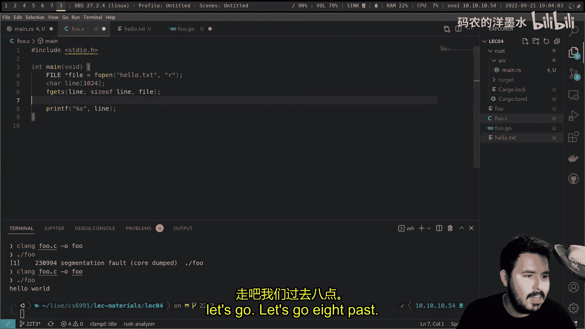

Alrighty， okay。We are back。Welcome back， everyone。没有 yeah。

I wonder why FGC doesn't just deal with the problem we were talking about by returning the char via Fun parameter and just letting the return value represent the present s absence of an error。

Yes， so this is something that we often call an out value where in fact。

 it's exactly what FGt S does。😊，Where FGt S returns the information， assuming things go well。

 it returns the information that we would like in our case。

 the line of text that was read from the file。😊，Into a parameter that was passed into the function。

 right， we pass a pointer to it， and it writes the value into that pointer。

 We call this pointer here and out parameter。 And so I've got say absolutely could have taken that approach。

 but it didn't。And like。Now we're stuck with it， that's often another sort of thing with program design。

Is that a lot of the time， if you're writing like， you know， your， you know， Bob's first program。

 you're writing or you're like I'm writing my little script to do whatever。

 then often you're not worried about changing a function and then breaking everyone using your code because it's just you and it's just you who's written a program to do a thing。

But as soon as you're authoring library code where other people are depending on you。

 often you get stuck very easily， very quickly and so thinking about like just you know updating something that updating maybe even the simplest thing with a function might just break a whole ton of user' workflows and so sort of putting in some forethought into what the right way of doing things is and considerations you might need to make in future and all that is certainly a part of this discussion as well。

 but yeah Fkety could have done that but they didn't and now they're stuck。😊，But yeah。

 and now so many people go char， another thing that's great about C is that it won't warn you。😊。

Oh actually maybe it does maybe does let's let's let's give it a chance cha C equals F get C file so this is very dangerousca a char is one byte which can hold 256 values F get C returns 257 distinct values which means at least two of those values end up needing to end up with the same value。

 This is I think pigeonhole principle I think is what they call it。😊，And so do I get a warning？

Not by default。 What if I do WO。Unused variable， Okay， so yeah。

 I'm not even getting a warning that this here is implicitly turning from an int to a char。

 which is just also， you know， not only is maybe W pedanttic， W Peranttic。No。

 still don't get a warning， at least on my machine， but that's just doubly as dangerous as well。

 because not only is the language not preventing it。

 the like additional tooling that's sort of there help developers might not spot it either and that can be yeah that can be a little tricky。

😊，But yeah， a really interesting point as well。Okay。Let's talk about exceptions for now then。

So some of us， I'm hoping a big chunk of us have like seen some form of exceptions before。

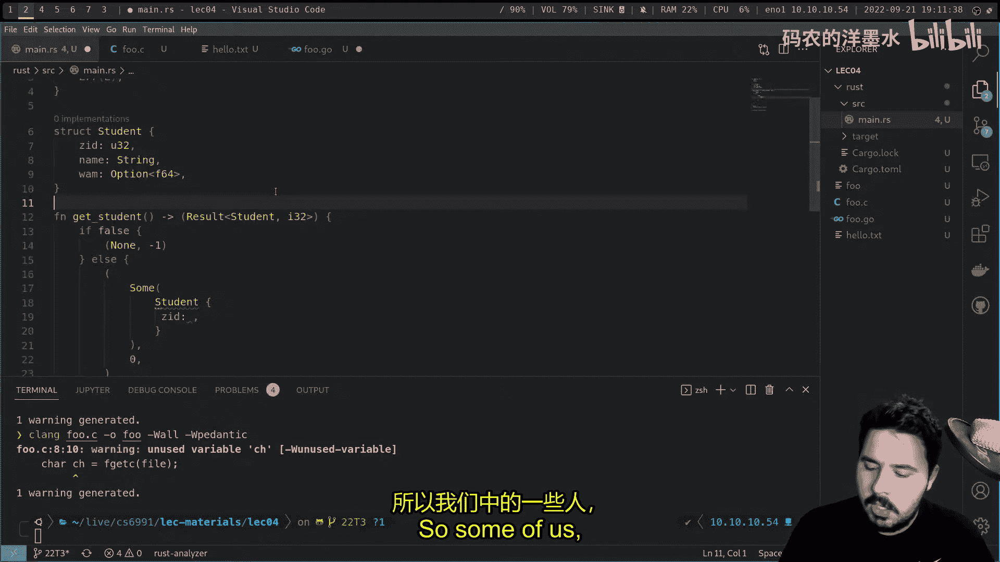

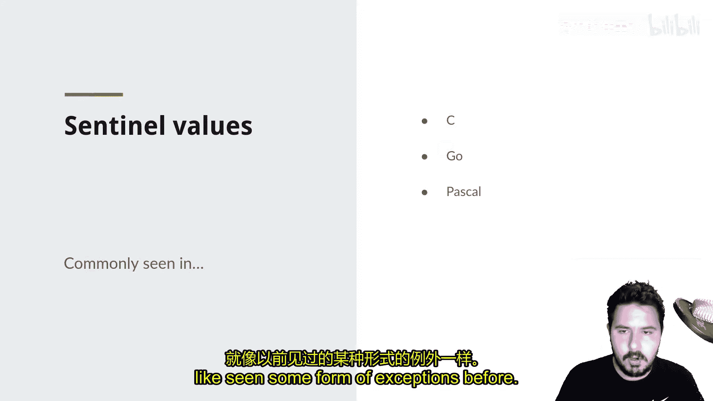

They're really common and basically any like if you're not looking at C or you're not looking at go there's you've got a seriously high probability of having some sort of exceptions in your language and in most languages with exceptions exceptions tend to be the idiomatic way of dealing with errors in that language that's not entirely like that's not true for every language to be clear in fact Ru has a form of exceptions ish language is like Swt have a form of exceptions more exception than rust's exceptions if I recall correctly。

😊。

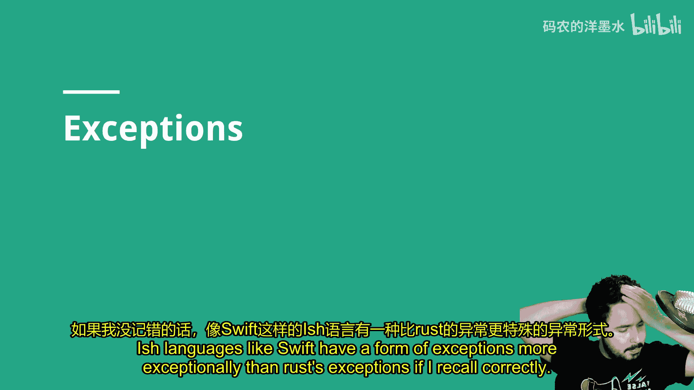

But it's just incredibly common。 So let's let's play with some Python or something like that。

So let me make a food Python here。And so an interesting function that could maybe go wrong is。

 let's say I grab some input， I'm going to say line equals input and I think an input you can give it a prompt in Python。

 so I'll say please enter a number。And this should give me one line of input and a very common thing you want to do in Python is take that line of input and turn it into like convert that into an integer So I think you may have all done this already with rusts dot pars but taking a string right taking this sort of string input and going actually I want that to be like if it's the string 42 give me the integer 42 And so if I run this Python Ellets let's print it out as well maybe we print out double the number print。

Double your number is numb times。Times 2。Like that。Python 3 food dot Pi。 please enter number 42。

 W number is 84， great so。This seems to work， but again， this wouldn't be， you know。

 this lecture is all about error handling， so what can I do to make this program upset？Well。

 I typed 42 last time， what if I give it hello？And this is what we get。😊。

Notice that we don't get segmentation fault core dumped we don't get the program going on and doing something crazy instead we get this trace back right file food up high line to this line went wrong invalid literal for int with base 10 hello right sos saying and this it's also saying value error here。

😊，So it's saying something went wrong。Here's what is you didn't deal with it。

 So I'm going to give you some information。 You probably want to deal with this error。

 So you're gonna have to， you know， you go figure this out now， programs crashed。

And so this is our very first potentially our very first introduction to the idea of an exception。😊。

So the idea here is。😊，And that's， let's just sort of forbrievity let's。

Squeeze this down into just one line of code。Where I just say grab the input and then immediately turn it into an intejo。

Okay， and then it prints out double your number is， blah， blah， blah。Okay， so。42 is 84。

Foo gives us value error with this big sort of print out here。

So this system is clearly capable of detecting that there was an error。

 but a lot of the time with error handling， one of the big things we care about is。

Dealing with an error appropriately when it occurs。

 So what does that look like in a language like Python。 Well， let's say this is a function。

 a function that's something like get。User number， something like that。

And it grabs it like this and it tries to return it back。

And then someone else will say it as nu equals get。Get user number。Something like this。

 So does this still do the same thing I've just turning into a function。Yes， it all seems the same。

 but interestingly， this trace pack has changed a little bit。So instead of just saying it was。

On La 2， nu equals int lane right here。Now it says it was on line2 nu equals int line。

 but also on line 5， get user number。Right， so what's happened here is we've called this function。

 It's gone into this function and executed this code。 This code has gone wrong。

 It's raised an exception。 And what happens next is something called and I generally call this unwinding。

 So some people call it。Like trace backing potentially or tracing back。

 what's the other common terminology for exception unwinding？😊。

If anyone can recall it in the chat then let me know， but we'll call it unwinding in our case。

 so it begins to unwind。😊，And so it goes， okay， so this line fails。😊，Where did this line come from。

 It came from here。 And so we unwind up into here。 Yeah， stack trace。 Sha， sure， sure， bubbling up。

 Yeah， very， very good。 So it begins to unwind it goes， this went wrong。

 Where did I get called from here， So let's try。 Let's go here and then sort of eventually。😊。

Maybe works its way back up to the top of the program。

 So I fired another function that was called like helper。s let's call it Helper one， for example。

 that just goes returnturn， get user number。And then we had。HelPA。

 a function called helpler 2 that calls helper 1 and a function called helper 3 that calls helper 2。

 for example。And then finally our actual code down the bottom here calls Helper3。

 so Helper3 just calls Her 2， which calls Helper 1。

 which calls get user number which you know runs this line of code that maybe goes wrong。😊。

So if I run 4284， if I run food， now my my trace back， my stack trace。

 whatever you want to call it is a lot longer。 it goes well， what happened First of all。

 you said numb equals helper 3， That's this line here， line 14。😊，When I went into that function。

 the code was on this line， it was on this helper2 line here。Then in HelPA 2。

 it was on this line where it says return helpPA 1。In the Helper One function。

 it was on this get user number line over here。And in get the user number function。

 it was this line here which actually caused this exception。How did we get here， yes？

So this is like a full traceback， but it also represents one sort of important idea of exceptions。

 which is that they unwind through all the like functions that called them right along the whole calling path。

 main called this called that called this called that called this and we're all the way down in this function and this function went wrong。

😊，And when the thing went wrong， I just went， it goes all the way back up through and went spit out and narrow。

Okay， so that's kind of cool， it gives us like a little like breadcrumb trail of like we went here。

 then here， then here， then here， and that might help you debug a problem。😊。

But exceptions like this kind of being using this as as a method for dealing with errors is probably not very good if you don't have a way to successfully deal with an error。

 if you go， oh， it's okay if the user enter enter saying that's not a number。

 I'll just ask them again， or maybe I'll print a message and ask them again， but you know。

 right now the way I've written it is it doesn't matter if it goes wrong， there's no saving it。

So most languages of with exceptions will also introduce something like a try catch block。

 not every language of this， but I think it's by far the most popular way of dealing with it。😊，So。

They'll add some extra control flow to your language sorry not catch Python of course。

 I had to call it except if I recall correctly and you can also put some extra stuff here。

 I'm going to say value error over here and go print。You know。

 to be to be filled in so they support this try catcher except I'm actually going to even leave a comment here that says try catch。

😊，Is is just， I think more common in other languages。

 but Python uses the word except where other languages often use catch and this says。😊。

Try to do this line of code。 if there was some sort of exception， then we'll deal with it below。Okay。

 so in this case， I say if there was a value error in particular。

 which is what we can see was spat out over here。😊，Then do this bit of code down here。

 So this is sort of like it's almost like a like a and it's similar invain to like if else where we have an an if block and an else block。

 but instead of checking a condition at the very top here。

 it runs this code and if there was some sort of exception， it might end up in this else， this catch。

 this except block down the bottom here。So let's say see how we write this code maybe a bit more radiomaticically in Python。

 we might say something like while。😊，True。Try all this and catch some sort of error。

If we get to this line here， if this line doesn't cause a crash， then we should have a good number。

 And I think I might need to do。 I forget Python's exact scoping。

 but I'm just going to say numb equals none up here just to。Potentially say facer。

 I think it might be fine without it and I can't quite remember if things go right。

 then break out of this infinite loop up here right so this is just loop forever。😊。

If we manage to get a number and it continues onto to the next line。

 break out of this infinite loop and return the number back。

 in fact this really could just be return the number right here and then we don't need this as well that seems like a bitete slightly nice way of doing it。

😊，If it works， return that number back。If there was a value error here。

 then we might print something like that's not a number。

And then let the wild loop go back around and ask again。So let's see if this works。

Enter a number 42 your w your number is 84 enter number 4 that's not a number and it ask me again bar that's not a number 42 S that's not a number 125 250 perfect and yeah you don't need the numbers none from every but we'll do it this way instead as well。

And both that has， let's be different syndrome， which says from benevolent dictator syndrome。 Okay。

 so， so this is the sort of canonical， idiomatic way of dealing with errors with an exception model。

Okay， so that's cool。 What else can I do with this except block， Well。

 I can also accept different kinds of errors。 So if it was not a value error。

 What's maybe another error that could go wrong， I think Python has things like runtime error that some might encapsulate some things that we might go。

Oh that's not good right， like something really horrible went wrong here and maybe we deal with this in a different way。

 or there could be as as mentioned here， there could be some kind of type error。😊。

And if a tie pair gets raised， then I might deal with that here， whatever。

 I'll just say forget it for now。😊，But we can deal with all the different kinds of things and a lot of languages will also accept some sort of catch all block where you can just say like accept any other error。

 like if anything else happens， then like go in here。So。That's a there's。

All kinds of different ways you can do you can also attach data to errors。

 So for example in a value area you might say， you know if there's a value error。

 take me in this block， but I also want to be able to see that error myself。😊。

And I say that's not a number and I could also just say print out the error was and potentially we'll see if Python's particularly happy with this。

 that's not error。 the error was invalid literal print with base 10 F right so we could maybe have attach some additional information along with this error that gets that we might maybe want to print out or do something with that extra information and so this is a relatively flexible system in that sense。

Another thing that's quite interesting。Is。This whole try catchch business doesn't even need to happen here。

 So watch this。 This is a kind of a fun one。 Let's take this function all the way back to just this。

 Yeah， I'm going to keep that。Right， all the way back to this。

 but all the way down here in Hepa three， I'm going to write。Some code in here。That says try。

To return helper2。But。If that goes wrong， then say then like if we get some sort of exception。

 do this and I'm going to throw all of this in a infinite loop up here as well。

Similar to how we did and get user a number。 So notice a completely different function all the way over here。

So let's see Python， please。Python， I'm sorry， Python， okay， it's fine。 I got out in the end。

So all the way down here， if I do 42， then the number is 84， if I say hello。😊。

Then notice it still works， that's not a number， here's the error and it goes please entry number。😊。

Okay， I'll give it one and it says two， so how did that work？Well。

 the way that worked is we call helper3， helper3 enters this infinite loop。

 and it says try to call helper2 and return that value。 So it goes， okay， helper2 calls helper 1。

 helper1 calls this and this calls this function。 Now if I gave it the text fo instead of an actual number。

 this now causes an exception。😊，The exception starts unwinding the code so it goes okay this has gone wrong。

 We need to like figure out where we came from and start bubbling up as as Ka mentioned before So it starts unwinding and it goes this you know now calls an exception so this function throws this exception upwards。

😊，That means this broke with an exception， so this function throws the exception upwards。

 which means that this little bit here broke with an exception， right。

 this little function called raise an exception。😊，And so it goes， oh， I'm actually in a try block。

 is that a value error by chance， oh it is great， I'm going to go into this block here and it goes。

 that's not a number。😊，This is the error， by the way。

 and we end up going back into this while loop and calling everything all over again。

 so that's another interesting thing with exceptions。😊。

Is that you can have a very big gap between where an error occurs and where an error is dealt with and all these functions along the way might not even know they might have no idea that any of this was happening to them they're just like I'm just returning this function that's being called but actually know you you were sort of like a paw in this big catastrophe where an error was sort of actually thrown through you and you threw it on。

 you didn't even realize you threw it on them they threw it on and this is the person that actually went and dealt with this in the very end right so a very interesting system because of that。

😡，So this is what we would call generally an unchecked exception model。

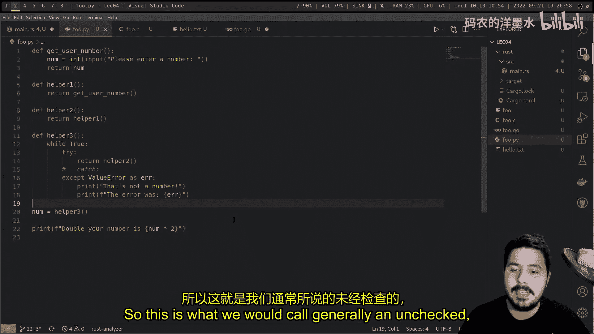

Unchecked exceptions， so there's checked exceptions and there's unchecked exceptions generally。😊。

Where do we find unchecked exceptions。 Oh right， Java， C plus plus C sharp， Python Swift， Koland。

 the ML family Ru， right， Ru as well。 you often see this kind of thing popping up and we'll talk about exactly why。

😊。

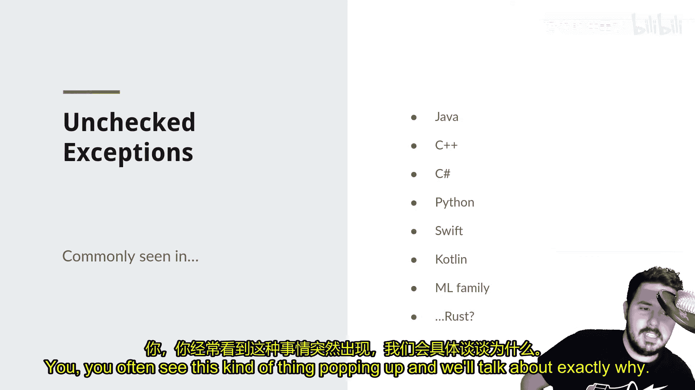

Or rather why and how？Soir。Let's take a moment to chat， we'll jump back into the chat for a bit。

I want to hear what do we like， what do we dislike， or even if it's not you yourself。

 what could someone like， what could someone dislike if you take on the role of any you know any other program as well。

😡，What do we like or what would someone what could someone like。

 what could someone dislike about this model for dealing with errors， which is again。

 prevalent in many， many， many languages。嗯。Kai mentions you have to read documentation to see whether any function throws an exception。

Right， and so I'm assuming as Kai hasn't mentioned whether whether he likes this or dislikes this。

 but given it involves reading， I'm going to assume that he dislikes dislikes this if you overlook an exception。

 you won't know until run time。😊，How interesting？Not having to immediately handle an exception lends well to separations of concern。

😊，Interesting。With some languages you might be forced to handle an exception which is annoying sometimes。

And even then you better pray your test cases are thorough， right， so Miwell's pointing out here。😊。

What about the case where you know maybe exceptions might be great for a lot of reasons。

 what about the case where a function can throw an exception but and like nowhere along this big chain of functions did anyone deal with this？

😊，And nowhere in your testing and all the， you know。

 the testers and the QA come through and check everything and all your unit tests run。

And just no one ended up hitting this particular code path that causes this exception to be thrown until you're in production with tens of millions of users and then suddenly you go to Google。

com and it says 500 server error， right？😊，So there's a serious concern there in that。

If no one sort of notices this potential path of errors。

 then it could the final sort of step here is generally that it'll blow up the program the program will terminate with some big error if something really deep in the weeds goes wrong right some really。

 really deep function throws an error that no one above it knows how to deal with programs dead right or even maybe it gets all the way to the top all the way to the very top of your program where you you've gone I'm not 100% sure whether I've dealt with every single possible error let me catch any problem。

😊，But if there's any kind of problem， there's really not much room for things that you have to do to fix it。

 probably your best bet is to do something like if something really did throw the problem that gets all the way up to the very like top of my program to like my main function。

 I'm just going to go like， you know， try， run the program。😊，If there's some sort of problem。

Maybe just like restart the whole program and start from scratch。

 That's something that actually does exist in production in the real world that people do。

 which is exactly what I saying that wrap your entire program in a tri block。

 This is something that exists because it is a real problem that people run into and like if the choices between program blows up dies and production is down and customers are hitting like F5 their5 and it's you know website's not popping up or it's down for a minute or two。

 but the program starts itself back up from you know a known good state。

 then people tend to pick this option And so。You know this this thing can happen in the real world so lesss control the inception can interrupt execution at any time that's a really good point and check exceptionceptions lead to a bad pattern where every function catches in rayrow error even though it doesn't care about it。

😊，Interesting， so let's talk about Simon's point there less control the exception can interrupt execution at at any time this sort of falls into what Kai was saying as well where you have to read documentation to see whether any functions rose in exception。

😊，The potentially worryorrisome about exceptions right when I'm writing code。

 what I worry about it with exceptions is that whenever you call a function。

Any line that calls a function or like in。Maybe a language like Java where you access a field of something or in C where you' like thinking about dereencing a pointer。

 you know， Java it might be accessing a field in an object or sorry like，😊，Yeah， sure。

 accessing a field in an object where you don't know if that object may be null or not in Python or like calling any function。

 Python here， calling any function， you know， all kinds of things if I， if I have a value here。

 a function， de。😊，Gives value。And this function， for some reason， returns none。

 which is sort of like Python's null here。 And then I have some code， you know， wherever。

Let's say I have some code here that goes x equals。Gives value plus 5。

And I'm assuming that give value returns back some number。 You know， potentially anything I do。

 even just adding like this line here， Maybe'll right x equals gives value， and then y equals。

X plus5， even just this line of code here， x plus 5。Could potentially raise an exception。

Right the scary thing to me， potentially about exceptions is that almost anything you do in some languages could potentially throw an exception and uproot all your code just like start completely doing a different thing。

😊，So there's sort of like anytime you call a function， if you add things together。

 if you look at a field and a value or anything like that that could go wrong and when it goes wrong it just immediately cancels your function。

 starts sending stuff upwards or like jumps into a catch block and accept block whatever you want to call it。

😊，Its， it's it can be tricky as a programmer to like deal with that because you don't want to go for like every line every single time I'm adding numbers together。

 We'll throw it in a try and we'll throw it in an accept you know， type error here and like okay。

 the next line of code I'm gonna to make a try and then you know you're not gonna put。

 you're not gonna do that for every single line of code you write but you don't want to do it for nothing because seriously lots of things can go wrong when you're programming。

So that can be pretty tricky。And yeah， that sort of ties into that other point where you just even like with calling a function or something like that。

 you just don't always know whether that function is completely safe to call and so often you need to go documentation hunting if the documentation is poor or the documentation doesn't exist then you might have to go diving into code to figure out all the different things that could happen and that can be a monumental task at times。

嗯。So so we like checked exceptions though right， so if I jump to the slides here。😊。

What is is my slides here， check the exceptions commonly seen in Java。😊。

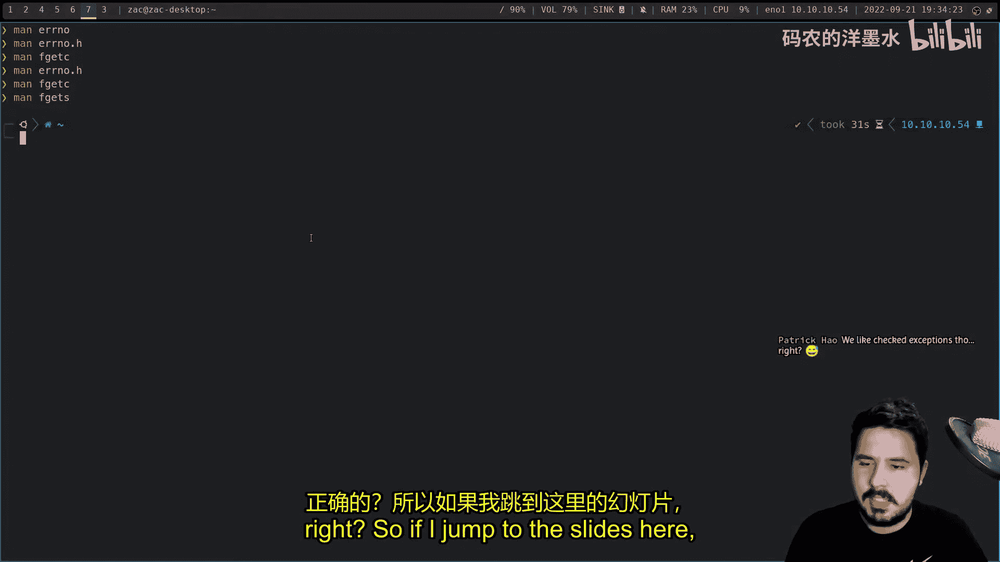

So checked exceptions。😊，In fact， checked exceptions were attempted to be introduced to C++ at one point and then they went。

 no， this is horrible， we hate them or their implementation。

 they were just very not happy with it in the language and decided to do away with it。

 but checked exceptions really from my understanding didn't make it much further than Java。😊。

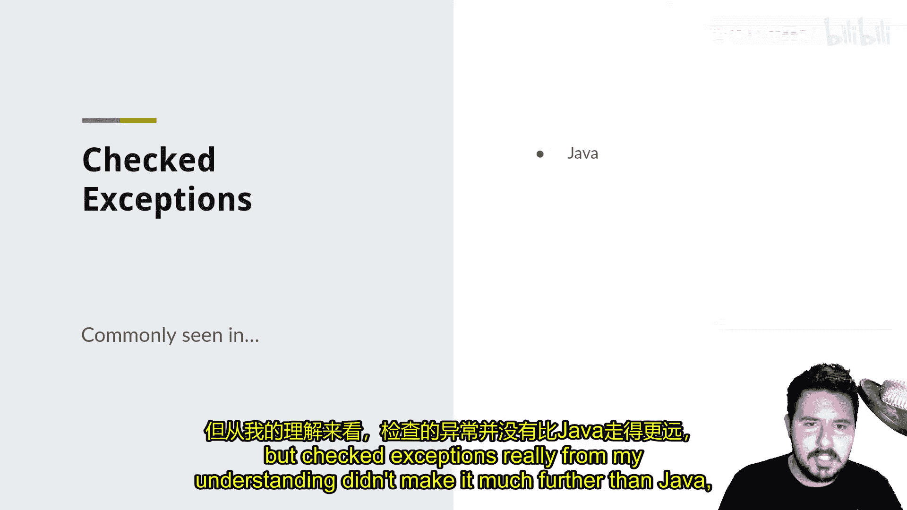

Which is interesting。So what's the idea of a checked exception？Well。

 let's say in the case of this int function here， I'm going to call it def my int。

And what it's going to do， it takes in sum value x。And I'm just going to make it call X in this case。

 but imagine this is just an implementation detail Imagine I actually had right here all of the code all of the code that does what int does that does what it does。

 I don't know how to write that in Python so I'm just going to write I'm going call the in function here。

😊，And the idea with checked exceptions was。😊，At some point in this code。

 I'm going to have to do something a little fishy。😊，Right， and when I do that fishy thing。

It's gonna to go， hey， that fishy thing can throw an exception。

 You need to annotate the code of your like the the your function definition here。

 You need to actually annotate this with something like throws like it could potentially throw a what was our exception again in this case。

 I think a value error or something like that。 Right， So my end of x。😊。

Could potentially throw this value arrow type。And so then whenever someone calls that function here。

 right， So see get user number calls you know into blahla。

 the compiler before your coding gets a chance to run is going go that function right that function there could throw a value error and that means that you could throw a value error So you're going need to annotate that as well。

 And then now this function goes well this function could throw a value error。

 So you need to that means that you could do that as well。 So you need to do that here。

 which means that anyone who calls helper one， let's get rid of this stuff for now。😊。

Needs to then annotate that。 Now， helper 3， though， it calls helper 2。

 So does it need to throw a value error will know because it calls helper 2 inside a trial block that knows how to deal with a value error。

 So it would not have to write throw his value error here。 and helper3 is safe to call。And so yes。

 you get less documentation hunting。😊，Right， so this was Java's model for checked exceptions。

 Java also notably does have unchecked exceptions So Java's sort of idea was let's throw exceptions that are just basically really tricky to deal with things like null pointer exceptions or division by zero or like blah or blahh blah will' throw them as runtime exceptions or unchecked exceptions like we were looking at here in Python but things that you could like realistically deal with are really common one common ones are like IO errors if a file fails to open or you can't read something from a file or like sQL exceptions if you're connecting to a database and the connections died or something like that。

 those kinds of exceptions， those will all be in this checked category and you need to annotate your function with anything that any like checked exceptions that could be thrown out of them。

😊，Right， so that was a model to my understanding that Java introduced， but again。

Mainly ended with Java。 And I think the reason for that is that checked exceptions can be really。

 really like painful to deal with， especially in a language like Java。

 Java is relatively wildly heralded as a， as quite a。Vbo language。

 you have to sort of write a lot of code to do what some people might consider to be quite simple things potentially and there's a lot of extra boilerplate that needs to be written when you're dealing with checked exceptions。

 Like if my thing if my code here reads a file and also you know connects to a database or something right now I'm putting three things here that it could throw。

 And when someone that means I have to go through all these functions here and fix them And then this function here that needs to be able to accept either a value error or it could also it also needs to be able to deal with a Io exception or you know so on and so forth。

 it's quite gnarly to like。😊，Deal with these exceptions all over the place。 There is a blog post。

 an interesting blog post。😊，That's like like。I'm just gonna Google like checked exceptions。 bad。

 Oh are evil。 There we go。 That's the one。 checked Excepts are evil。

 I think this is quite a a famous blog post。 And it seems like there's an interesting and interesting stack over play post here。

 which is， again， talking about Java。 But there is， so。😊。

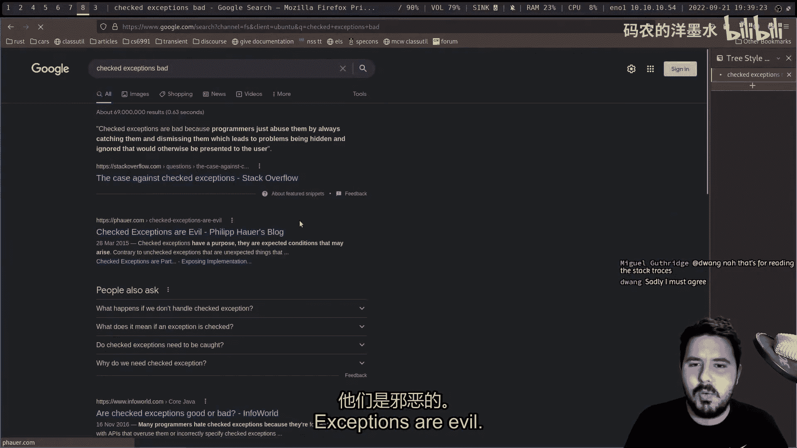

They were widely hated。😡，Seriously hated for a long time。 And because people are saying， well。

 if you rethrow the exception， then you need to and as we've seen here。

 you need to annotate everywhere， change all the signatures that call this code it could this good throw。

 this good throw， this good throw， this good throw and you sort of start to expose potentially expose implementation details。

 So this was someone mentioned this in the chat。 someone said。😊，Or where was it？Where was it。

 Where was it， Where was it。Someone did definitely mention something that was at least very close to this。

嗯。 I can't find it。Someone， someone definitely wrote something about this。

 but' I'm sad that I'm like missing this。Chat message。

 I'm going to read quickly read through one more time。There we go。

 Patrick said not having to immediately handle an exception leads well to separations of concern。

 So I think that's like， yes， yes， yes， yes。 So that's that's vaguely。

 It's not the exact same idea here。 But it's pretty similar in the idea of。

It should anyone who calls this function have to deal with the idea that there's something that goes wrong with a file inside this function。

 So you're sort of like making what should maybe be your responsibility。

 other people's responsibilities to deal with。Then they talk about how okay well if you're not going to pass on the exception you need to handle the exception yourself that was this big idea with checked exceptions as we saw in this function down here if you don't want to throw the exception onwards you better well deal with it yourself in a try catchch block and theres you know there's there's a lot of problems that come with this。

😊。

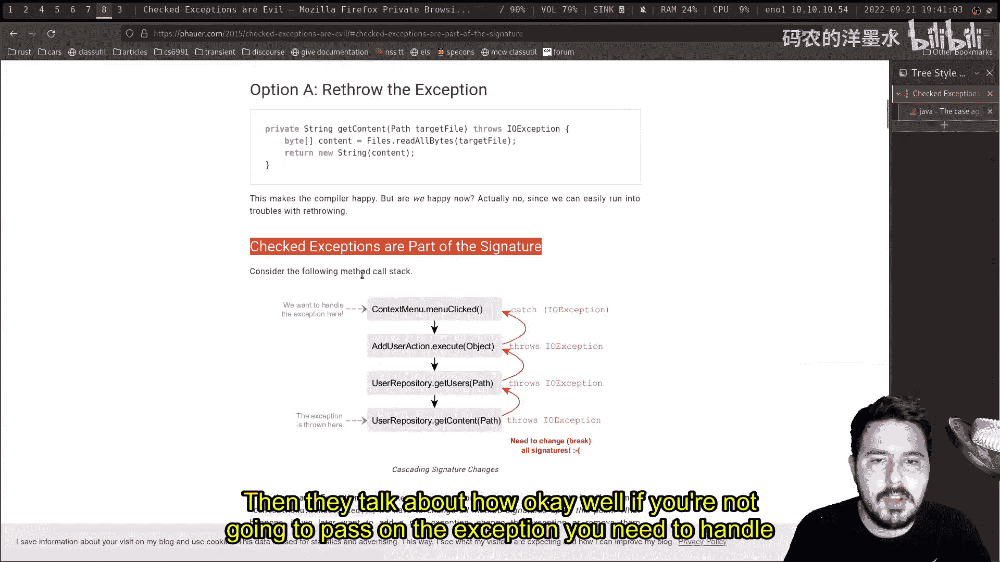

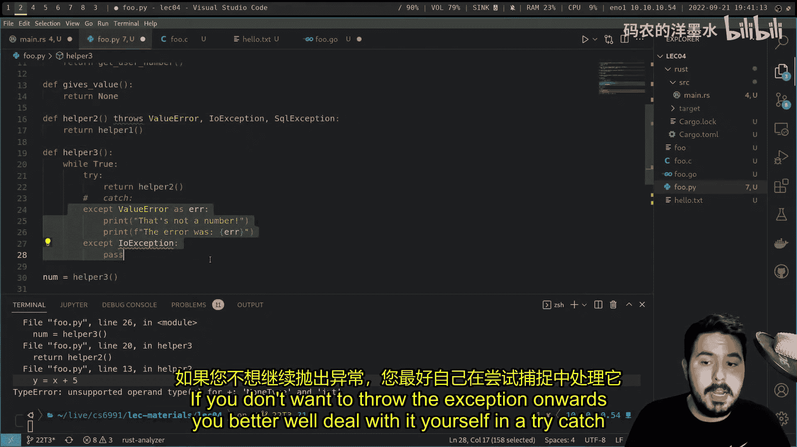

Which is， for example， like what do I do？Right， sometimes there's just nothing really that can be done like for us。

 we can ask for more input， but if you really need a file to be there and it's just not there。

What should you do， right？And so and you know， they talk about all kinds of other issues。

 This is another really big problem that is really interesting as well was they say Javavarate lambs and streams here。

 only a couple people in the course are going to be able to read this and understand what they're going on about。

 but one of the really interesting ideas that is that sort of lens weirdly with checked exceptions is when you start thinking of as function when you start thinking of functions as objects。

 So we saw the other day。😊。

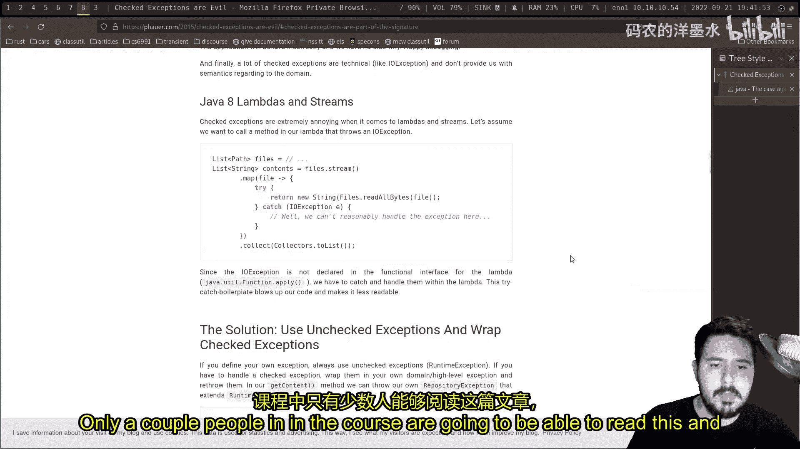

How we in rust can have like an iterator， like let numbers equals 1，2，3，4，5， and we can say numbers。

 numbers dot into iterator and then say like map these numbers into x for any x become x times 2。

Right so this iterator will end up spitting out two，4， six， eight，10。Right？

And the idea here is that we have a function。Right we have this a function that's being passed to another function We're calling this map function and providing it a very small function here that says if I get an x I return x times 2 right I think of this as this little function here is times2。

😊，It takes an X， which is an integer and returns back x times 2， and I can just pass that into map。

Just like this， and it's perfectly happy with that。

 apart from the fact that I forgot forgot to put the return type there。😊，Right。

 so passing a function over here and the problem with Java is if you're writing a function like map that's expecting to take a function in。

😊，There's no real way to tell it， oh， they'd like to provide a function that could throw a checked exception。

Because you would need to be able to like know to deal with that checked exemption in map。

 but anyone could just make any checked exception so you can't possibly think of every single checked exception ahead of time and so you run into this like problem here where you have。

😊，Is the terminology for this a language byformity？I can't quite remember。

 I'm going to have to double check after the lecture。

 but I think I've heard this terminology before potentially of a language by formatity。

 where the idea is regardlesss of the exact name for this。

 you have two features in the language that are like clashing heads where this is trying to do one thing this is trying to do another thing and they both might work perfectly well in separation but when you join these ideas together。

 you can't use either of them like you can't use them together at all potentially or they work together in a very strange or bad way。

😊，And so that was a really big problem with Java exceptions， is that they just sorry。

 checked exceptions？

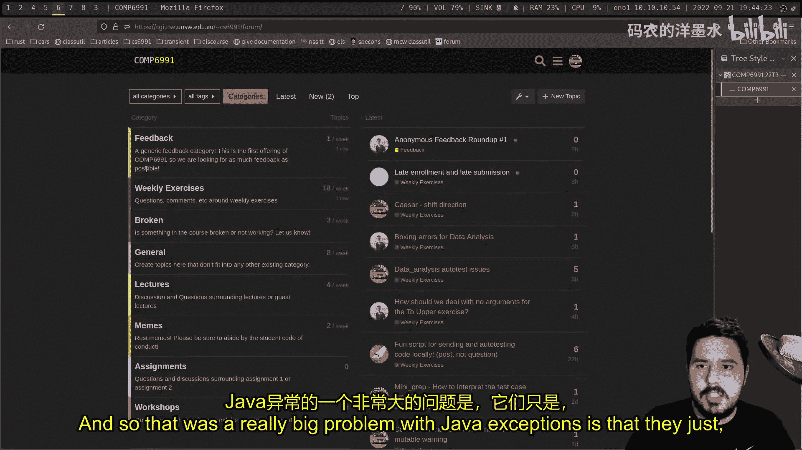

Which is just that they didn't fit in well with the rest of the language。

 which made them really difficult to use。 But they had a real big set of advantages in that。

They letch it was a part of the language telling you what could go wrong with a function。

 And that makes you be feel a lot more secure in in the code you're writing。

 I know all the things that can go wrong with this function。 And so if it， like when it goes wrong。

 I can deal with it， I can pass it upwards and the compiler will help me along。

 If I ever forget to deal with something that could go wrong， the compiler will let me know， right。

 And sometimes I can choose， like， I can choose， I can fix this， right， in the case of the。😊。

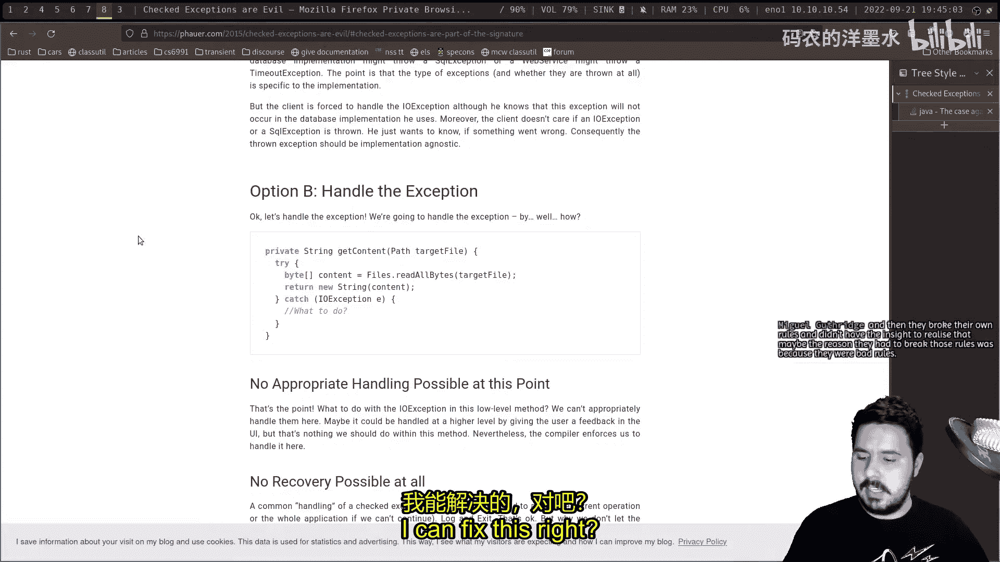

In the case of the user input， I can just go， wellll just do it again， get more input。

 go like that input was bad， give me more。 And if I can rezo it。

 then I can write the code that redoes it。 The compiler goes， oh yet they deal with that error case。

 Great good news and and I can feel safe in that or I go I don't know how to deal with this。

 I'm not able to deal with this。 Pass it on upwards in a certain way。

 So maybe there's a happy medium here potentially where I get this sort of security of knowing the set of things that could go wrong。

😊，Right while also not having to deal with all this extra boilerplate and not having this。

 hopefully I'm using the terminology correctly， this language by formatity where things。

 two features of the language don't work well when you bring them together。😊，Okay。Now。

 let me catch up on the chat The only now size you need a 40"ch ultra widescreen monitor to read your code。

 Yes yes， welcome to Java Read for the stack traces Yes good model because it forced you to deal with errors are like Ru yes I lower run the stack traces 348 functions called by native errors and then my two functions high at the very bottom Yes that's very fun。

 order an o into51 and big product separated concerns streams and nice writing useless code to deal with errors that will never happen。

 which cascades into decrease coverage as testing that useless code is unrealistic。 Yes。

 that's a very， very interesting point as well Do onlyling Java for this reason。

 also because they decided not to do operator realized because they could hypothetically be used to write that code and then they broke their own rules and didn't have the insight to realize that maybe the reason they had to break those rules was because they were bad rules。

😊，Me when rules aren't made to be broken and I simply just wrap a abstract exception handler factory builder object inside that map Okay so we dunking on Java that's okay all right。

😊。

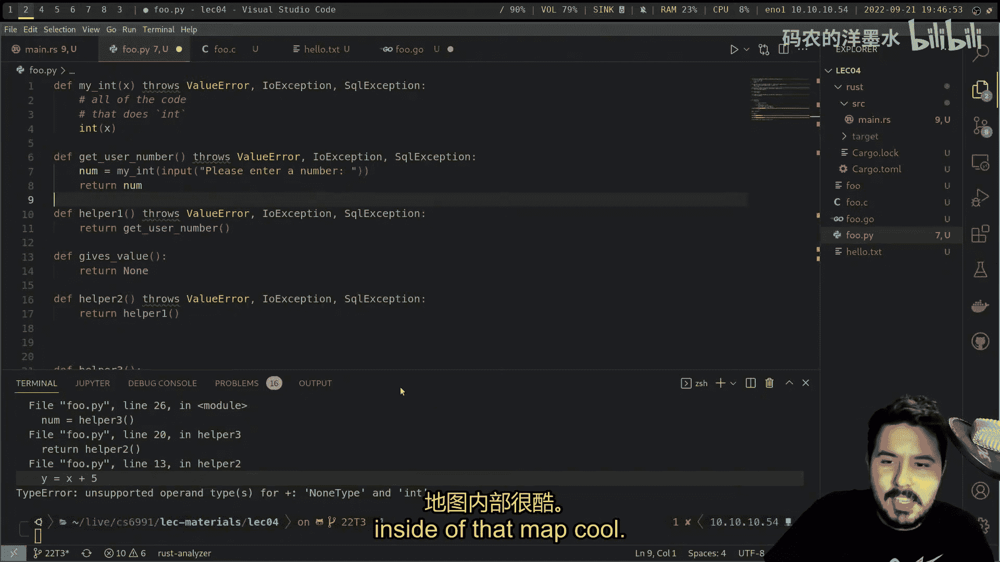

So， those are。Checked exceptions， those are unchecked exceptions now I mentioned。

In this list of commonly seen in， we have Ja plusto Sea sharp Python Swift。

 Cotland M family and like 50 other languages as well。 I couldn't fit them all on one slide。

 But whos that sneaking in at the bottom right there， Ru。Oh， so rust does model unwinding。 right。

 So this idea of something's gone horribly wrong， let me just start unwinding back through functions。

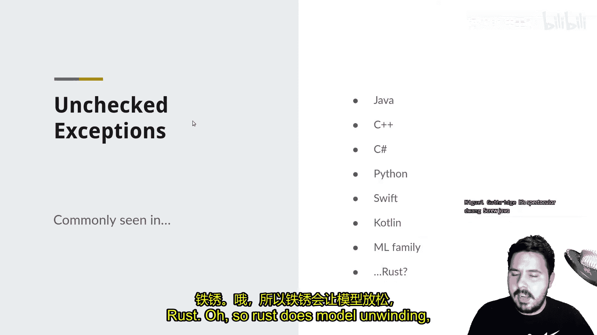

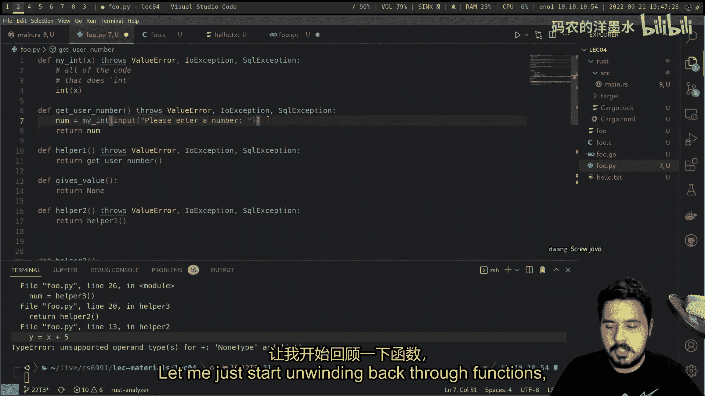

But it doesn't。Necessarily support catching and unwind。 So to be clear， you're gonna gozaac。

 Actually， I'm really smart， and I'm really good at rust。

 And I know that there's a function here called oh called catch unwind。

 And it's like it's like it's like try catch it。 catches and unwind When you're unwinding up through these functions。

 And the answer is yes， but unwinding also says blah， blah，la， blah， blah。

 It's not recommended to use this function for general try catch。

 this function is not guaranteed to catch all。😊。

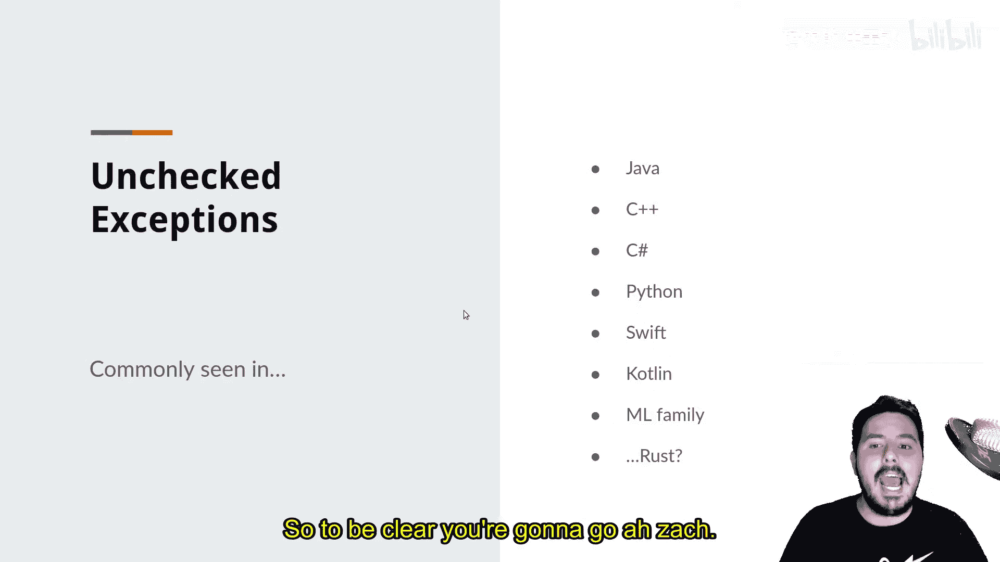

Let's say unwinds for now。So。Rust does support this unwinding， but only very specifically。

 and so we'll talk about that in a second as well。😊。

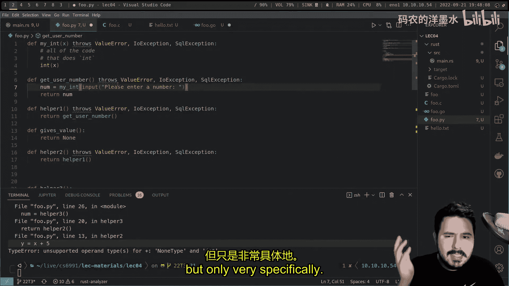

Daniel it's spectacular。 And Daniel says screwjava。 Okay， Allright， so here's another option。

 potentially first class， maybe not， it doesn't necessarily need to be some types。

 But sort of just doing error handling with first class types in your language。

 just the types that are provided in your language。

 The things you're able to do with the language that's already there。

 What if we just dealt with error handling with that。

 and built some additional tooling just to make working with that easier。

 And this is Rus's approach in this case。 Who else， Who else's approach this。

 Let me go back into the thing。 So Rus does this。 Swift does this， Swift does also have exceptions。😊。

But it still， this is， this is relatively idiomatic for a language like Swift。

 This is very idiomatic in a language like Haskell。 Haskell also has a form of unwinding like rust。

 But again， very idmatic in Hakell。 It's very idiomatic to see this kind of thing in M L。

 but M L also has exceptions。 And Java 15 has been working hard to try and make this happen。

 but I don't think Java 15 is actually out quite yet。 It might be。 But again。

's the language is moving very fast these days。 And I've struggled to keep track。

 I think it's not out yet， but it might be。 they're working on it。😊，So again。

 a bit of this potentially convergent evolution happening here where some newer languages， rust。

 swift， newer versions of Java coming along going， hey， let's try this。😊。

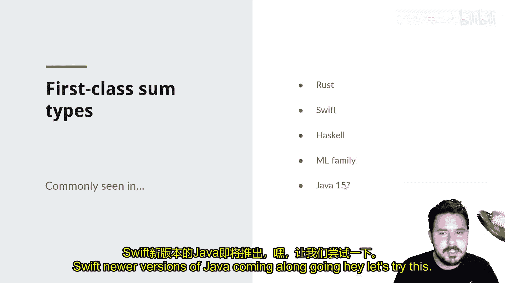

And so okay， so what's this idea， it's what we've been seeing a lot of already， things like option。

 things like result， result in particular is the one that we're really interested in today。😊。

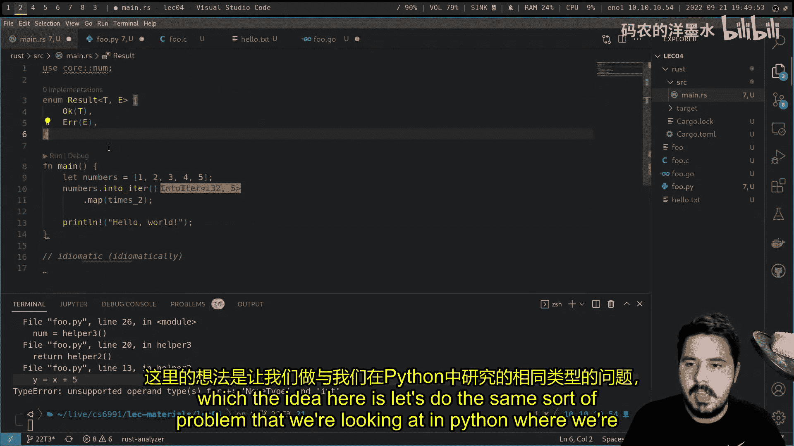

Which the idea here is， let's do the same sort of problem that we're looking at in Python where we're trying to get a number from a user and and get it as an integer。

 so I might go function， get input。

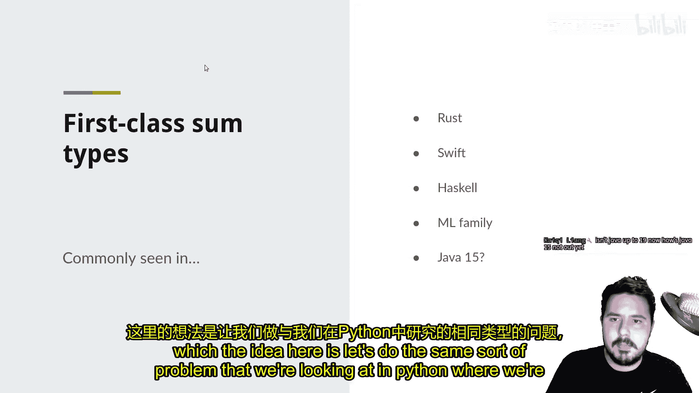

And this is maybe it's going to return the number that they've given us。

Or maybe I can say that this function will go wrong and pass it upwards。 Let's say for now。

 this function can go wrong。 This function will like， do it。 It'll， It'll try a little bit。

 but it's not gonna like ask them repeatedly。 It'll just ask them once and let you know if it worked or not。

And so the way to do this is it'll say。A result。 we're gonna return a result type where if things go well。

 we'll get a number out this end。 If things go poorly， we're gonna get some kind of error value。

 I don't know what to put there yet。 So I'm just gonna leave it as an empty tuple。 The unit type。

 which is just a sort of great。 We'll figure it out later。

 But this is what our function is gonna look like。We'll go Let mute input equals string new。

 The details here aren't super important。 I stood， I stood in dot read line into at mute input。

And this can go wrong。 So let result is this。Let's say， so note that this。

Fun read line returns a result of a U size or an error。

 So actually reading in the input can go wrong And that's sort of described here in this type。

 which is something that we didn't even think about in Python。 right。

 Maybe in Python we just assumed that we'll always be able to get input。

 Maybe we want to make that same assumption in rust as well and we'll look at how to do that in a second。

 but we'll ignore for a second and then we'll go input dot pars。So we're gonna say let number。

 which is we're trying to pass it into an I32 equal input dot parse and this is gonna go note that's no good because this returns a result。

 So I' got say okay number is gonna be a result of an I32 or some kind of error I actually don't need to name the exact kind of error here which is nice I can just throw and underscore there and it's upset because that's funny because I got this result type here confusing things I'll just comment it out。

Um great， and then I need to deal with this， I can't just go give me the I32 I need to write a little bit of extra code whenever I'm doing to try and get this good value out。

😊，But for me， it's probably going to be something like match on this numb。

Let's fill the match arms in if it's okay with some value， then great spinit out okay of that value。

😊，If there was some kind of error， then。Right now， I could just say an error with。

The empty topple in it， right， these types， the type here and the value down here should match up。

 And， you know， the person who calls this function will be able to see it went wrong。

 but they'll get no additional information as to why it went wrong。

 So maybe we do something like in get input error。And what could go wrong well there could be like the input failed。

Or input。Was not number， for example， maybe there's other things that could go wrong here as well。

 but's you know that that's two sort of basic ones there。And we could say， well。

 let's match on this result。Appea。Maybe if it's okay， then we just say， you know。

 if we read in the input fine， then just do nothing， that's fine if there was some kind of error。

Then maybe we'll say return。That there was an error and the error was a get input error。

Where the input failed， for example。And so then I'm going to say this result here is actually going to need to。

 if it fails， give back a get input error in this case。😊，And then down here， if it went wrong。

 then maybe a get input error input was not number。Okay， interesting。Now。

 another rather interesting thing is if the input wasn't a number。Right。

 if this input wasn't a number， we could also give them a little bit of extra information。

 We could tell them what the input was that wasn't successfully turned into a number。

 So along with this， we could actually attach a string。

Right or maybe I like to write it like this so they know that this string here also has this ident input So either the input failed and we have nothing to tell you or the input was not a number and so we'll tell you what that input was and so that's perfectly fine。

 we can do that。And we say input is well， input itself， right？And the same topic。

There you can also just write it as input here， this writing this is input is just shorthand for input。

 colon and input， I think you see in languages like JavaScript， Typescript。

 other things I'm sure but，So now this function can go wrong and describe what went wrong。

So how does this change the functions that sort of surround it？Well。

 if we go to like helper one here。Helpa1， let's just say helppa1 is going to return the integer itself。

Well， help of one is going to call get input。But since get input is working in the type system。

We're going to have to deal with the fact that there's a result here。So we have to actually go， okay。

 maybe we'll match on it。Match， get input。Let's get the text editor to fill out the blocks here if there's some sort of value。

 great， let's just return that value back。So there's no problem there if there is some sort of error。

Then maybe we like to say let's match on that  error there。If the input failed， that's bad。

 that's no good。 And so let's say we're going to have to deal with this here。

 we're going to have to do something。But if the input was not a number， right。

 then we can deal with that。 We can say something like。That was not a number。And then try again。

 and so the trick for this in Python was that we just threw this whole thing in an infinite loop。😊。

Right， so just keep trying until you get a value。And look at that， this works as well。😊。

So let's let's give it a try。 Let's see if it works。 We're going to just go call Heer one。

And that should give us like a let number equals this and we're going to say print out number times two is。

Number times 2， just like that。So let's try this out。C D rust， togger run。

It's waiting for some input， so I'll give it 42。😊，And it says 42 is not a number tricky See Ru isn't able to fix every little error and I miss this。

 I don't know if anyone else caught this in the chat。

 but it's because when you read a line of input it also includes a new line on the end like and see F gets includes that new line on the end so probably before this pause here I'm going to do a trim which just says take any white space off the front and the end。

😊，Okay， so 42 number times 2 is AD4。Great， what if I give it food？😊，That was not a number bar。

 That was not a number，42。Number times2 is 84。Okay， so that works。

That seems interesting now there's a couple of problems here。😊，Okay， we're running close to time。

 there's a couple problems here， one is this is a lot of boilerplate。😊，Right。

 we're getting into that Java territory of like every like it's getting really annoying。Um andum。

 also like what do we do here， what happens if there's some sort of error where this error is okay。

 we can deal with this。😊，But this error here， if the input's failing。

 we we we shouldn't just keep trying 1 thousand0 to 10，00，10000 times。

 hoping that they'll suddenly like stood in will suddenly exist and we'll suddenly be able to get input if we're not getting input。

😊，This seems grounds for the program to just abort， just go， no， that's it， we're done。And rust。

 that's exactly why rust has unwinding and it unwinds。

 generally unwinds are done through panicd in rust。So I'm going to say panic where we say could not。

Read from standard input。And this， this is a perfectly reasonable use case。 So in rust。

 generally we model things that are like。As an  error that could potentially be recovered from。

In this kind of way with a result， where we say here's the different things that could go wrong and we pass result where this is the good thing。

 that's the bad thing and people can deal with that result through something like a match， right？

But if the sign that's just seriously gone wrong severely that just cannot be recovered from。

Then it's perfectly reasonable and idiomatic to use a panic。

 which is like an exception that just can't be caught， it's just going to wind all its way up。

 spit out， hey there there was this error message here。😊。

And there was this error message and here's that trace back as well I'm not sure I'm going to be able to invoke this error on the fly。

 but just to sort of demonstrate what it looks like I'll throw a panic just in the middle down here。

😊，Obviously this is not correct code but just to show you what it looks like when we get a panic。

 it says threadreadman panic that could not read from stood in on this line if you want to see the full back trace run with this environment variable and so you can either run it like this thrust back trace equals one cargo run and you can see I've got some code where I've done this before。

Right， so you could write code that looks like this and you'll see we get the full trace back right at all the functions。

 this line， this line， this line。Or something that you may prefer to do is so you don't have to write the rust back traces one every time you can just say export rust back trace equals one and then now from now on when you do cargo run。

 it'll always show you the full trace back when things go wrong or if you want to really reversebo back trace you can do rough back trace equals full。

😊，And then it gives you even more information about this is more like the low level programmer's information here that might be a little too much if you're just。

 you know， writing code。😊，Could you reproduce it by popping nothing into it。

 I think it'll actually just。Read it empty input， I believe。

 but we can double check false into cargo run。 Yeah， so it just， it just sees it as an empty input。

 Maybe we could actually expand this a little bit here and say， if result dot is sorry。

 not this result。 if the input is empty， then maybe in that case。

 we'd also like to return a similar error。 or maybe we say input empty is another case that can go wrong here。

Right， so I say return error where the get error input。Is empty。

 And then notice this is a really great thing that I love about rust is that as soon as I've added this extra thing that could go wrong。

 you know， and I've even I don't even need this code here。

 but I've added another potential thing that can go wrong The compiler pointing me down here where it says。

 hey， you didn't deal with this。😊，And so in this case， I'm just going to say if the input failed。😊。

Or the input's empty。 Then this willll just say could not read input。Something like that。Right。

 and now。We get that exact thing going on， I'll turn it back to let's turn rusts back traces off。

And you see now when I run it， it says it couldn't read the input if I run it like this。😊。

But if I run it normally， then you'll see it works as expected。Soir。That's rather interesting。

That's so。That solves the problem of like， if there's， if an error is unrecoverable， then yeah。

 just use one of these panics and unwind。 And there's also shortcuts all over the place to deal with that。

 things like dot unwrap， things like dot expect。 But， you know。

 this is all still very verbose to try and deal with these errors。

 So is there any way that we can make this a little less verbose。And the answer is yes。

 I love using the question mark operator personally。😊，So let's see this here。

 This here is a I O error。 This one down here is an。Here is an from string error。

 which is probably going be。Let's see what it actually is。 It is a。Pause intot error， interesting。

 so here's a little trick。Let's use this question mark operator to make our code simpler。

I'm going to say。This is let's let's at this。 So this is a bit of like blessed code that I'm going to pass along。

 We're not going to understand how this code necessarily works。

 Like what all the different little bits and pieces mean yet we will get there in week five。

 but I'm just going to sort of write some code and you can follow this like pattern in your own code if you would like to I'm going to write Iple from。

😊，From in this case， so notice that this stood in read line here。Returns an IO， like an IO result。

Right， let me just， in fact， let's do this in the documentation so you can see how you would do this read line here。

😊，Stooud in read line returns this result。 If I click on it here。

 you'll see that this is just a shorthand for result of some type。 and then this error here。

 this is what we care about。 This is the error that could go wrong if readline fails and it's a stood I O error right So I'm going to say。

We're going to support converting from a stood IO era。For get input error。

 So if someone has a stood error， I'm going to say we can turn that into a get input error。

 now it's going to say， hey， this is no good。 you need to also implement this function。

Like this where it says given a stood Iio error， give me a get input error。

 this self here is shorthand for writing this thing out here， it's fine either way。

 you can write whichever one you want， but I'll put self here because that's generally more idiomatic and rust and I'm going to say if you get a stood Iio error this is this is a bit sucky for now。

 but I'm just going to say I'm going to assume this is the thing that went wrong here that the input failed。

😊，So I'm just going to say return back a get input error input failed。Great。

 and I didn't even need this error， I'll preface with an underscore to make the compiler be quiet。

 but it' saying I don't care what error it was if there was an error then if there was an IO error。

 it meant that the input failed。😊，Okay， so what about a pause into error pause So when I did。oops。

We had this pauseRS function， actually no， this is where I want to go。😊。

Pause lets us get something like we're trying to look for an I32。

So this comes from this from stir trait。 It's essentially a way to define that an integer can be you know。

 parsed from some sort of a string。 So I actually end up needing to chase this down。

 I believe there's no yeah implementers list， So I need to chase this down to I 32。And then it goes。

 if I go all the way down this documentation， I should be able to find。Where are we Oh here。 Yeah。

 These are all the traits here fromster。 I'm looking for fromster。 Alright， here we go。

 So if we try and convert from a string to an I 32， the thing that could go wrong is a parsant error。

So this is the thing that I was looking for here， par into error so I can go。

If we get a pause int error。Then I can tie that into a get input error for sure。

 let me steal this code here， the error that we get in is going to be a pausesiter instead。

If it goes wrong， then we get a input was not number oh but then how we're going to pass this input along maybe it's somewhere inside here。

 let's have a look if I go to the documentation for this error。

 what does it give us It gives us the kind of error does it give us it implements display it might not give us so maybe we don't get to say。

This is a little inflexible in this case and there are nice ways of doing this but I'm cautious of time so I'm going to do the lazy thing here and just say all right you don't get the actual string back out anymore but we'll say we can turn it from a pos ander into this sure whatever。

😊，So。The brilliant thing with this now is that this an Iio error can be converted to a get input error。

 a Par and error can be converted to a get input error。

 and these are things that can go wrong over here。😊，So check this out。On this result here。

 I've gone match on it if it's okay， then you know， do whatever， maybe give me the thing inside it。😊。

If it went wrong， this is the important part if it went wrong， return this error， right。

 this appropriate error， and Ru has a one character way of doing this exact thing。

 it is question mark。So I say grab this stuff here。

 read a line and then in the case like in the case of an error。

 return that error upwards with this question mark here and so I don't even need this result here anymore either just stood in read line if it goes wrong question mark。

We still need this one here， if it's empty， this is sort of a special case here， if it's empty。

 then return this error。😊，Then again， pause here。Instead of getting a result or whatever。

 let's just say give me that numberba。If there's an error， just pass it on upwards。Right。

 and then at the very end we're going to give back。Yes， we found the number， here it is。

And so this code， in fact， I don't even need this type here anymore。

 this code just suddenly shrunk all the way down and all that error handling got just delegated down into these question marks here。

😊，Wow， okay。So very interesting you can really cut down this boilerplate and another great thing is it gives you things to look for as well when you're looking for error handling and rust。

 you can just search for the question mark character and it'll help you track down wherever things can just get thrown thrown around so to be clear question mark is a pattern that looks like this if I have a block of code that says let x equals match on fo。

 let's say where Foo is some sort of result。😊，It says if' if it's okay with some value。

 give that value back if it's error with some error。Then。Return。Error of that error actually。

 there is also like a dot into here。This is sort of that little conversion here where we said we can convert from onearrow to another。

That's where it does it heal。This is all exactly equivalent to let x equals food question mark。

 that's essentially what the question mark operator does for us and Ru and it's very nice。

So it can really cut down on a lot of this stuff。The question mark operator is often also used in conjunction with map error。

 so let me just show you this one quickly， the PARS function we had to take this little shortcut here and I wasn't super happy about it。

If I didn't want to take the shortcut， I could have written it like this。

 forget this hole converting automatically and stuff like that。

 let me just convert it manually in this code here。😊，Where I say dot pars。

 if there's some sort of an error， then I will convert this error into a different one。

And what I'm going to convert it into is I'm just going to forget about the error that was already thrown because it didn't really have anything that interesting to me instead I'm just going to convert it straight into a get input error input was not number where the input is that string that we've got there。

😊，And then the question mark just works again because through this map error that I've written here。

 I've converted this error that's maybe completely incompatible to what my function is returning into like the exact thing right。

 something that is compatible with what my function returns。

 and I just throw this question mark on the end。😊，So that's very nice。

 I'll comment this out so it's still in Git。😊，Very nice for dealing with errors and you can see this has got that input down there again and it's very happy。

 you know。😊，And down here it was like you wrote input。That was not a number， something like that。

And everything's happy and good So Que mark operator it'll take a little bit to get used to and you'll have some fumblings where the the compile is going to go hey。

 that error is not compatible with this one like that's no good I don't like this。😊。

It's going to take some time to like to find some common ground with the rust compiler。

 but ask on the course forum。 we're always there to help As Fre mentioned。

 there was a great chat about this already on the course forum， which was。😊。

Here using question mark for invalid input handling so check out this thread as well if people have already talked about this sort of stuff Yes。

 anyhow in this era are also really nice libraries for error handling and rust but。😊。

Hopefully this has given you a flavour of different ways that languages can deal with errors。

 sort of some of the reasons why Ru has chosen this approach in particular。

 which is essentially in my mind， it's this first class sum types approach。

 which is really at the end of the day， this is very similar to checked exceptions。😊。

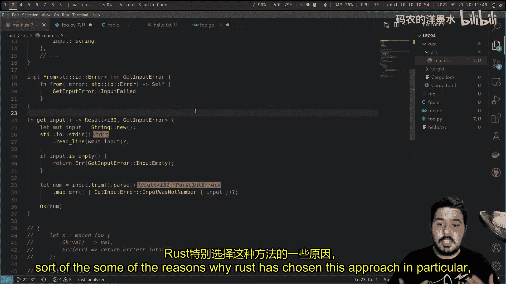

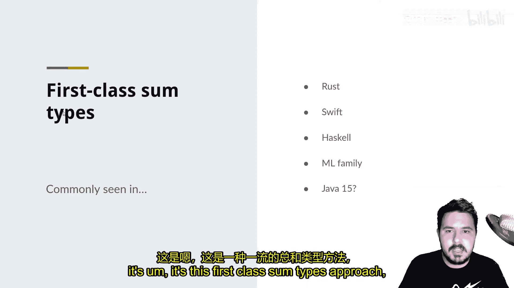

But the difference is it's implementing checked exceptions just as like basic types。

 which means that when you want to use these elsewhere in the language。

 when I want to do that map like I was talking about down here before， where we had like one， two。

 three， four， five and a function that could potentially go wrong right so let's say into iter。😊。

And I want to map this。Into like some potentially fallible thing。

 that's fine because it'll just end up being like some result like okay of x right or maybe just map it into error of like 42 or something like that。

 And it doesn't care。 that's just a random value that it's being mapped into。 It's fine with it。

 And so you don't get this sort of clashing in the language where oh。

 actually I expected a function that was that didn't have any checked exceptions。

 but you gave me one and I don't know how to deal with this just I gave you a function that returns a thing like most functions do So you I think that you get most of these advantages with checked exceptions without the like clashing in the language I think again。

 I think it's called language by formatity， but I'm going double check that one after the lecture。😊。

And I think you cut down on a lot of the boilerplate of this error handling with things like the question mark operator。

😡，Right。But still getting a lot of those benefits。 So this is for you to form your own opinions on it's completely up to you to what you do。

 Obviously you're gonna have to write a lot of rust code for this course anyway。

 but you form your own opinions。 I'll stick around as long as people ask questions' let's like call the end of the lecture here。

 we spent a lot of time for the for the other error handling techniques sort of talking in the chat about what we like and what we didn't like。

 if you want to talk about what you like and what you didn't like about Ru approach here。

 I'll stick around as long as you want and answer any questions。

 but this is what we've got this is what we're hoping that you'll be playing around within your assignments and your workshops and exercises and all that but it's ultimately for you to make your own judgments and your own opinions on So Thank you everyone for coming to the lecture。

 hopefully it was somewhat interesting。 Sorry again that we are always running like 10 or 15 minutes over time。

 But again， if you have any questions， I will stick around long as as long as you are still you know spinning them out。

😊，And otherwise please send as many questions as you like towards the course forum and will be there as a reminder。

 no workshops tomorrow public holiday I'm going to make an announcement about the makeup workshops on Friday so keep your eyes up on your email for that announcement and next week's Monday lecture is going to be two hours earlier than normal as was mentioned a couple times already I'll also put that in the announcement。

Alrighty。Any questions anyone has again， thank you all for coming。 And if we go。😊。

If we go at any point， 60 seconds with no questions， I'll call that quits。So， but Ill'll yeah。

 I'll be here as anyone as long as anyone's asking questions。😊，No problem， Daniel。 No problem， Nkil。

So just to confirm in the code example in order to reth the IO error we have to do the from thing right yeah so these lines of code here are sort of subtly interacting with this line of code here because read line returns this IO error that could go wrong。

 which if we didn't have this code。😊，We get a compiler error that says oops that says。

There we go that it says I couldn't convert from a IO error into a get input error。

 right like I just can't return the right type。Fortunately。

 the question mark operator will look for any implementations of from， essentially that say。

 if you can convert from this error to that error， then it's all fine。 I'm happy to do that for you。

 But if I don't see any way to convert between the two then that's no good。

 So your two primary options that I use a lot is either implementing from from one error to another。

 if they make sense to convert from， this is a bit of a like weird way of having done it。😊。

Probably the right way to have said this is like is to have this first variant here be something like an IO error that also carries as data along with it a stood IO error。

😊，And so， then。This from implementation is very easy。It's just an IO era with， well。

 I've prefixed its phenomena nano school let I get rid of that， an I era with this error。

And I'm going to have to change the name down here。

 Ier that carries some stuff that we're going to ignore。And this is perfectly fine。

 I think what's is just a random error down the bottom here。This is perfectly fine。

But there's so that's one approach where you just input this from block。

 the other approach potentially is， let's say we get rid of this associated data again。

Using something like map error， so this read line here takes a result and in fact。

 it might also help to just peek at the docks for a second as well。For result。

Reult has this map error type right here， which says if I have a result with some success type T and success some failure type E。

And you give me a function that takes an E， right， a function that I can call that takes an E and spits out an F。

 then I am happy to give you a result that has the same success type T。

 but the  error type is now an F。😊，And the implementation of this function should be very simple。

 it just goes if like match on this result， if it's okay， then just it's okay， pass on that。

 pass that along， if it's an error of E， call your function on E to turn it into this type F So if I can convert in this map error function from the error that we've currently got to an error that we want then I can do it that way as well。

 So in our case we've got an like an IO error， and I'm just going to say。😊，Screw it。

 I'm going to go like get input error， Io error like this， or I could again。

 bring this piece of data back here and say stood Iio error。

Right and pass that in this maparrow over a here。Through this function。

 so take the old arrow and wrap it inside this like that。And this also works perfectly fine。

 you can see this compiles and if I run this now。You know， it's， it's doing。

The right thing generally。So。You have options and both of these are perfectly idiomatic doing writing I from using map error。

 I use them all the time， so yeah it's perfectly up to you。And yes。

 Shee says it's super fun and no problem me well。😊，So does that answer your question。

 did you have anything else that you're sort of wondering about that or do you or anyone else have any other questions as well？

No problem， Patrick。 let me。 I'm gonna prepare this code to go on Github while I'll take it back to this kind of thing。

This。I'll leave a little comment here that says。But this。Its equivalent。2。This。

So just a little note there。嗯。Okay， there we go。I don't need these， apparently。Oops。Okay， cool。

 I don't see any other questions。 So I'm going push this up to the。GitHub。Let go for。

Do I mean anything I wasn't meant to， I mean， yeah。

 kind of like this and some random stuff over here， but whatever that's fine。That's fine。 Cool。

 So I think。If I didn't screw things up that the oh， yes， that's the one other thing I have to do。

 I suppose。IsP this。Then lecture， what's it called？Tim exercise concrete lectures， this one here。

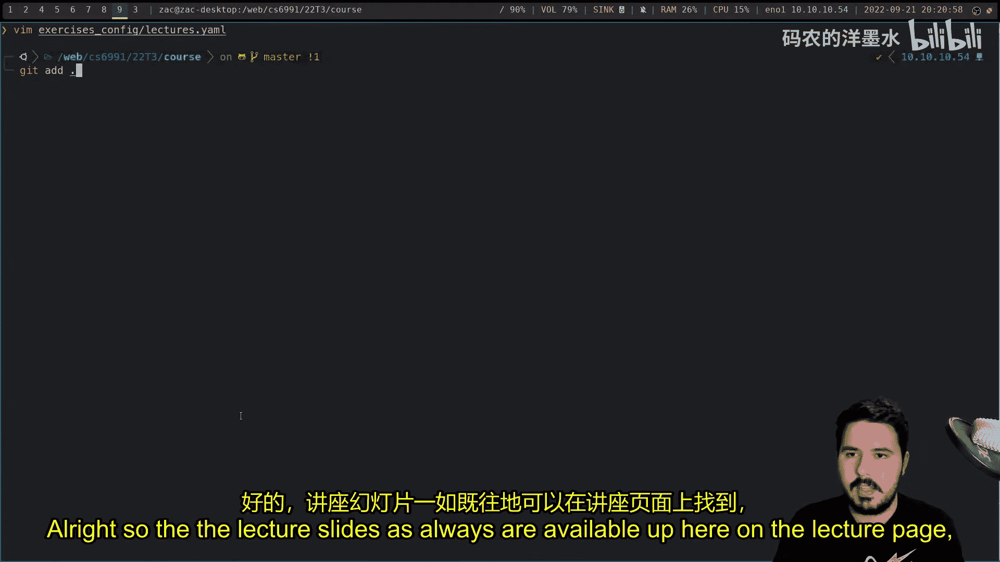

Black04 Co。Cool， alright。 so the， the lecture slides， as always。

 are available up here on the lecture page， The YouTube link if you want to watch it again。

 and the code will appear in about。😊，A minute or two is time over here if you're interested。 Alright。

 thank you everyone， I'll see you all next week Monday at four o'clock as opposed to six and yeah。

 very exciting。 I'll see you all then We're gonna be talking about references and borrowing and stuff that's gonna be really cool Thank you all again for coming and have a wonderful rest of the week We'll see you in the workshops on Friday。

😊，Alright， bye bye， bye for now。 See you all。

